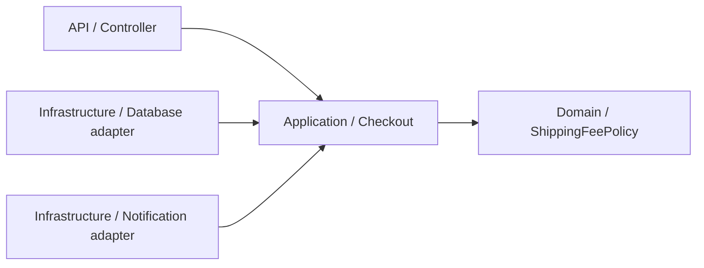

# Ranh giới trách nhiệm của phương thức, lớp và mô-đun

Một tính năng có thể chạy đúng nhưng rất khó thay đổi nếu mọi quy tắc đều nằm trong một phương thức lớn, một lớp vừa xử lý nghiệp vụ vừa gửi email, hoặc các mô-đun liên tục truy cập chi tiết nội bộ của nhau. Khi ấy, yêu cầu nhỏ như “đổi mức miễn phí giao hàng” có thể dẫn đến sửa mã lưu dữ liệu và gửi thông báo, dù những phần đó không liên quan đến chính sách phí.

Trong chương **Cấu trúc và phụ thuộc** của `CODE_QUALITY_FUNDAMENTALS`, chúng ta tìm hiểu cách xác định **ranh giới trách nhiệm của phương thức, lớp và mô-đun**. Đây là cơ sở để đánh giá mã nguồn có **đáng tin cậy, dễ hiểu và dễ thay đổi** hay không. Tư duy quan trọng là đặt hành vi ở nơi có trách nhiệm rõ ràng, giới hạn những chi tiết mỗi phần cần biết, và giữ các thay đổi thường gặp trong phạm vi hợp lý.

Sau bài này, bạn có thể phân biệt trách nhiệm ở ba cấp độ, nhận diện dấu hiệu một ranh giới đang bị vượt qua, thiết kế lại ví dụ Java đơn giản và giải thích vì sao **chia nhiều lớp hơn** chưa chắc tạo ra cấu trúc tốt hơn.

## 1. Ranh giới trách nhiệm là gì?

**Trách nhiệm (responsibility)** là phần công việc, quy tắc hoặc quyết định mà một đơn vị mã được giao thực hiện và duy trì. **Ranh giới trách nhiệm** xác định phần nào thuộc đơn vị đó, phần nào thuộc đơn vị khác và hai bên tương tác thông qua hợp đồng nào.

Lấy ví dụ tính năng đặt hàng của một cửa hàng:

- Xác định phí giao hàng theo tổng giá trị đơn và quyền lợi khách VIP.
- Tính số tiền phải trả.
- Lưu kết quả đặt hàng.
- Gửi thông báo xác nhận.

Các công việc có liên hệ trong một quy trình nhưng **không nhất thiết thuộc cùng một trách nhiệm ở mọi cấp**. Một phương thức điều phối có thể gọi cả bốn bước để hoàn tất đơn hàng, nhưng quy tắc phí giao hàng, cách lưu cơ sở dữ liệu và cách gửi thông báo vẫn có thể do các thành phần khác sở hữu.

Ba cấp độ thường gặp:

| Cấp độ | Câu hỏi cần trả lời | Ranh giới nên thể hiện |
| --- | --- | --- |
| **Phương thức (method)** | Một lời gọi này thực hiện hành vi có tên gì? | Đầu vào, đầu ra, tác dụng phụ và những bước phục vụ trực tiếp hành vi đó |
| **Lớp (class)** | Đối tượng hoặc dịch vụ này chịu trách nhiệm cho nhóm quy tắc nào? | Trạng thái, bất biến, phương thức liên quan và đối tượng được phép cộng tác |
| **Mô-đun (module)** | Phần chức năng/miền nghiệp vụ này sở hữu khả năng gì và công bố cho bên ngoài điều gì? | API công khai, các kiểu dữ liệu trao đổi, phụ thuộc và chi tiết triển khai nội bộ |

Trong Java, một mô-đun theo nghĩa thiết kế có thể là **package, nhóm package, thư viện hoặc thành phần triển khai**. Java cũng có **Java Platform Module System (JPMS)** với `module-info.java`; đó là một cơ chế tổ chức và khai báo phụ thuộc cụ thể. Không phải mọi ranh giới mô-đun về mặt thiết kế đều phải được triển khai bằng JPMS hay tách thành microservice.

**Mục đích của ranh giới là giảm những điều người bảo trì phải giữ trong đầu khi thay đổi một phần mã.** Khi hiểu một quy tắc, họ nên biết cần tìm ở đâu, cần kiểm tra gì và những thành phần nào có thể bị ảnh hưởng.

## 2. Ranh giới ở cấp phương thức: một hành vi dễ gọi và dễ hiểu

Phương thức nên có **mục đích nhất quán** mà tên gọi, tham số và kết quả diễn đạt rõ. Một phương thức tốt không nhất thiết chỉ có một câu lệnh; nó có thể bao gồm nhiều bước nếu tất cả cùng phục vụ một hành vi ở cùng mức trừu tượng.

Ví dụ phương thức tính phí giao hàng:

```java
final class ShippingFeePolicy {
    private static final long FREE_THRESHOLD_VND = 300_000L;
    private static final long STANDARD_FEE_VND = 30_000L;

    long calculate(long subtotalVnd, boolean isVip) {
        if (subtotalVnd < 0) {
            throw new IllegalArgumentException("Subtotal must be nonnegative");
        }

        if (isVip || subtotalVnd >= FREE_THRESHOLD_VND) {
            return 0L;
        }

        return STANDARD_FEE_VND;
    }
}
```

Phương thức `calculate` có một nhiệm vụ có thể giải thích ngắn gọn: **tính phí giao hàng từ tổng tiền hàng và trạng thái VIP**. Việc kiểm tra giá trị âm và lựa chọn mức phí đều phục vụ trực tiếp nhiệm vụ đó. Không cần tách mỗi câu lệnh `if` thành một phương thức khác chỉ để đạt “một việc”.

Ngược lại, phương thức dưới đây bắt đầu vượt ranh giới:

```java
void calculateAndSaveAndEmail(OrderDraft order) {
    long fee = calculateShippingFee(order);
    long total = Math.addExact(order.subtotalVnd(), fee);
    database.insertOrder(order.id(), total);
    smtp.sendReceipt(order.id(), total);
}
```

Các đối tượng `OrderDraft`, `database` và `smtp` trong ví dụ này được giả định đã tồn tại; đây là đoạn minh họa cấu trúc. Phương thức pha trộn **tính quy tắc nghiệp vụ**, **ghi dữ liệu** và **giao tiếp bên ngoài**. Một thay đổi ở cách tính phí có thể buộc người bảo trì mở mã chứa kết nối cơ sở dữ liệu và email.

Nhưng cũng cần phân biệt: một phương thức cấp cao tên `checkout` *có thể* gọi lần lượt những thành phần tính phí, lưu đơn và gửi xác nhận. Nếu nhiệm vụ của nó là **điều phối quy trình đặt hàng**, việc gọi nhiều thành phần có thể chính là trách nhiệm của nó.

### 2.1. Khi nào nên tách một phương thức?

Hãy xem xét tách khi một hoặc nhiều dấu hiệu xuất hiện:

1. **Khó diễn đạt bằng một tên có ý nghĩa:** Tên phải ghép quá nhiều động từ thuộc những mục tiêu khác nhau.
2. **Các khối mã có lý do thay đổi độc lập:** Cập nhật quy tắc tính phí không nên cần sửa logic định dạng email.
3. **Mức trừu tượng lẫn lộn:** Nửa đầu mô tả nghiệp vụ, nửa sau điều khiển từng trường SQL hoặc từng header giao thức.
4. **Phụ thuộc khó kiểm soát:** Muốn kiểm tra một phép tính thuần túy phải kết nối mạng hoặc mở cơ sở dữ liệu.
5. **Đầu vào, tác dụng phụ hoặc luồng lỗi khó theo dõi:** Một phương thức vừa trả kết quả, vừa âm thầm thay đổi trạng thái ở nhiều nơi.

Trước khi tách, thử **đổi tên biến, gom điều kiện có ý nghĩa, dùng kiểu dữ liệu rõ và giảm nhánh không cần thiết**. Việc tách quá nhiều phương thức nhỏ có thể khiến người đọc phải nhảy qua hàng chục lời gọi để hiểu một thuật toán đơn giản.

### 2.2. Hợp đồng phương thức là một phần của ranh giới

Một phương thức có ranh giới rõ cần làm sáng tỏ:

- **Đầu vào:** kiểu dữ liệu, tính hợp lệ và điều kiện tiền đề.
- **Đầu ra:** kết quả có nghĩa gì, có thể rỗng hay không.
- **Tác dụng phụ:** có ghi dữ liệu, gửi thông báo, thay đổi trạng thái hay gọi mạng không.
- **Lỗi:** khi nào ném exception hoặc trả trạng thái thất bại.
- **Đảm bảo:** dữ liệu và bất biến nào vẫn đúng sau khi kết thúc thành công.

Ví dụ `ShippingFeePolicy.calculate` không ghi dữ liệu và không gọi mạng. Vì vậy, ta có thể kiểm thử quy tắc bằng các đầu vào cụ thể và không cần dựng toàn bộ hệ thống bán hàng.

## 3. Ranh giới ở cấp lớp: nhóm các hành vi cùng lý do thay đổi

Một lớp có thể chứa nhiều phương thức nhưng vẫn có **một trách nhiệm nhất quán**. Thuộc tính liên quan là **cohesion (tính gắn kết nội bộ)**: các phần của lớp có cùng phục vụ một mục đích hay không.

Ví dụ, lớp `ShippingFeePolicy` có thể có phương thức tính phí và phương thức xác định đủ điều kiện miễn phí. Cả hai liên quan cùng chính sách giao hàng. Ngược lại, lớp `OrderManager` vừa tính thuế, quản lý SMTP, xây câu SQL, định dạng PDF và kiểm tra phân quyền có thể đang gom nhiều trách nhiệm có vòng đời thay đổi khác nhau.

Nguyên tắc **Single Responsibility Principle (SRP)** thường được diễn đạt ngắn là một lớp nên có **một lý do để thay đổi**. Cách diễn đạt thực tế hơn là: một lớp nên phục vụ một nhóm quy tắc hoặc nhu cầu thay đổi có **chủ sở hữu rõ ràng**, thay vì trộn các quyết định đến từ những nhóm trách nhiệm độc lập.

| Thay đổi phát sinh từ đâu? | Thành phần nên chịu trách nhiệm chính |
| --- | --- |
| Chính sách miễn phí giao hàng đổi ngưỡng | `ShippingFeePolicy` |
| Cách lưu đơn chuyển từ JDBC sang một công nghệ khác | Adapter/repository triển khai lưu trữ |
| Nội dung hoặc nhà cung cấp gửi xác nhận thay đổi | Thành phần thông báo |
| Trình tự quy trình đặt hàng thay đổi | Thành phần điều phối checkout |
| Điều kiện dữ liệu đầu vào được chấp nhận thay đổi | Hợp đồng/validation ở nơi sở hữu quy tắc đó |

Không thể suy ra ranh giới chỉ bằng **số dòng** hoặc **số phương thức**. Một lớp 200 dòng với một trách nhiệm rõ ràng có thể dễ bảo trì hơn năm lớp chỉ chuyển tiếp dữ liệu cho nhau. Ngược lại, một lớp 50 dòng vẫn có thể chứa ba loại quy tắc không liên quan.

### 3.1. Che giấu chi tiết triển khai

Một lớp tốt không chỉ gom hàm mà còn **giữ quyền kiểm soát dữ liệu và bất biến do nó sở hữu**. Ví dụ:

```java
import java.util.Objects;

final class CustomerEmail {
    private final String value;

    CustomerEmail(String value) {
        Objects.requireNonNull(value, "value");
        if (value.isBlank() || !value.contains("@")) {
            throw new IllegalArgumentException("Invalid email");
        }
        this.value = value;
    }

    String value() {
        return value;
    }
}
```

Đây là ví dụ tối giản về một kiểu dữ liệu mang ý nghĩa nghiệp vụ, **không phải** bộ xác thực đầy đủ địa chỉ email theo mọi chuẩn. Điểm cần học là bên ngoài không được sửa trực tiếp trường `value`, còn constructor là nơi giữ điều kiện đã xác định. Nếu yêu cầu xác thực phức tạp hơn, cần cập nhật hợp đồng và logic phù hợp.

Che giấu chi tiết không có nghĩa là mọi trường phải có getter/setter tự động. Việc công bố thao tác có **ý nghĩa trong miền nghiệp vụ** thường giúp giữ ranh giới tốt hơn so với mở toàn bộ trạng thái để bất cứ nơi nào cũng sửa được.

## 4. Ví dụ Java: từ lớp làm tất cả đến các trách nhiệm rõ ràng

Giả sử yêu cầu minh họa: khách VIP được miễn phí giao hàng; khách thường có tổng tiền hàng từ **300.000 VND** được miễn phí; các trường hợp hợp lệ còn lại chịu **30.000 VND**. Khi checkout, hệ thống tính tổng tiền, lưu kết quả và gửi thông báo xác nhận.

### 4.1. Phiên bản gộp quy tắc, lưu trữ và thông báo

```java
final class CheckoutManager {
    private final JdbcOrderRepository database = new JdbcOrderRepository();
    private final SmtpReceiptSender email = new SmtpReceiptSender();

    void checkout(OrderDraft order) {
        long shippingFee = (order.vip()
                || order.subtotalVnd() >= 300_000L)
                ? 0L : 30_000L;

        long total = Math.addExact(order.subtotalVnd(), shippingFee);
        OrderReceipt receipt = new OrderReceipt(
                order.id(), order.subtotalVnd(), shippingFee, total);

        database.save(receipt);
        email.send(receipt);
    }
}
```

Đây là **minh họa cách tổ chức ban đầu**: các kiểu `OrderDraft`, `OrderReceipt`, `JdbcOrderRepository` và `SmtpReceiptSender` được giả định có sẵn, không phải một đoạn mã chạy độc lập. Ngay cả khi hành vi hiện tại đúng, lớp `CheckoutManager` phụ thuộc trực tiếp vào chính sách phí, lớp lưu trữ và lớp gửi email.

Có những bất lợi cụ thể:

- Muốn đổi ngưỡng miễn phí giao hàng phải sửa một lớp cũng chứa việc điều phối I/O.
- Muốn thay SMTP hoặc cơ sở dữ liệu phải thay chính lớp nghiệp vụ.
- Muốn kiểm thử trường hợp VIP được miễn phí có thể bị phụ thuộc vào việc khởi tạo và kết nối hạ tầng thật.
- Quy tắc phí có nguy cơ bị sao chép nếu nơi khác cũng cần tính phí giao hàng.

### 4.2. Phiên bản phân định rõ trách nhiệm

Đoạn Java 17 dưới đây có thể đặt trong một package để minh họa và tách thành các file tương ứng khi đưa vào dự án thực tế:

```java
import java.util.Objects;

record OrderDraft(String id, long subtotalVnd, boolean vip) {
    OrderDraft {
        Objects.requireNonNull(id, "id");
        if (id.isBlank() || subtotalVnd < 0) {
            throw new IllegalArgumentException("Invalid order draft");
        }
    }
}

record OrderReceipt(
        String orderId,
        long subtotalVnd,
        long shippingFeeVnd,
        long totalVnd) {}

final class ShippingFeePolicy {
    private static final long FREE_THRESHOLD_VND = 300_000L;
    private static final long STANDARD_FEE_VND = 30_000L;

    long calculate(OrderDraft order) {
        Objects.requireNonNull(order, "order");
        return (order.vip() || order.subtotalVnd() >= FREE_THRESHOLD_VND)
                ? 0L : STANDARD_FEE_VND;
    }
}

interface OrderRepository {
    void save(OrderReceipt receipt);
}

interface ReceiptSender {
    void send(OrderReceipt receipt);
}

final class CheckoutService {
    private final ShippingFeePolicy feePolicy;
    private final OrderRepository orders;
    private final ReceiptSender receipts;

    CheckoutService(
            ShippingFeePolicy feePolicy,
            OrderRepository orders,
            ReceiptSender receipts) {
        this.feePolicy = Objects.requireNonNull(feePolicy);
        this.orders = Objects.requireNonNull(orders);
        this.receipts = Objects.requireNonNull(receipts);
    }

    OrderReceipt checkout(OrderDraft order) {
        Objects.requireNonNull(order, "order");

        long fee = feePolicy.calculate(order);
        long total = Math.addExact(order.subtotalVnd(), fee);

        OrderReceipt receipt = new OrderReceipt(
                order.id(), order.subtotalVnd(), fee, total);

        orders.save(receipt);
        receipts.send(receipt);
        return receipt;
    }
}
```

Ở đây có những ranh giới cụ thể:

| Đơn vị | Trách nhiệm chính | Điều không cần biết |
| --- | --- | --- |
| `OrderDraft` | Mang dữ liệu đầu vào và giữ điều kiện hợp lệ tối thiểu của một đơn nháp | SQL, SMTP, cách tính phí |
| `ShippingFeePolicy` | Chọn mức phí từ quy tắc miễn phí giao hàng | Cơ sở dữ liệu, email, quy trình lưu đơn |
| `OrderReceipt` | Mang kết quả tính toán cần chuyển giữa các bước | Cách lưu, cách gửi |
| `OrderRepository` | Hợp đồng lưu kết quả đơn | Công nghệ lưu trữ cụ thể |
| `ReceiptSender` | Hợp đồng gửi xác nhận | Nhà cung cấp email hoặc thông báo cụ thể |
| `CheckoutService` | Điều phối các bước để hoàn tất tác vụ checkout | Chi tiết JDBC, SMTP, công thức phí cụ thể |

`CheckoutService.checkout` vẫn có nhiều bước: tính phí, tạo kết quả, lưu rồi gửi. Điều đó **phù hợp** nếu trách nhiệm của lớp là điều phối use case checkout. Không nên ép mỗi lời gọi thành một lớp mới chỉ vì muốn “một trách nhiệm”.

Các triển khai hạ tầng như `JdbcOrderRepository` hoặc `SmtpReceiptSender` có thể thực hiện hai interface. Ứng dụng lựa chọn triển khai nào được truyền vào constructor ở nơi lắp ghép (composition root). Cách cấp phụ thuộc này gọi là **constructor injection**; không cần framework DI để áp dụng nguyên tắc.

**Lưu ý phạm vi:** Ví dụ tập trung vào ranh giới trách nhiệm, chưa triển khai transaction, xử lý lỗi mạng hay idempotency. Nếu lưu đơn thành công nhưng gửi thông báo thất bại, hệ thống có thể rơi vào trạng thái chưa đồng nhất và phương thức ném lỗi sau khi dữ liệu đã được ghi. Khi vận hành thật, cần thiết kế cơ chế phù hợp như outbox, hàng đợi, retry có kiểm soát hoặc cách tách gửi thông báo khỏi giao dịch đặt hàng.

### 4.3. Kiểm thử cho thấy ranh giới mới hỗ trợ kiểm chứng

Vì phép tính phí nằm riêng và các tác động phụ thuộc được đưa vào qua interface, có thể kiểm tra hành vi mà không cần SMTP hay cơ sở dữ liệu thật.

```java
import static org.junit.jupiter.api.Assertions.assertEquals;

import java.util.ArrayList;
import java.util.List;
import org.junit.jupiter.api.Test;

class CheckoutServiceTest {
    @Test
    void chargesStandardShippingThenSavesAndSends() {
        List<String> calls = new ArrayList<>();

        OrderRepository fakeOrders =
                receipt -> calls.add("save:" + receipt.orderId());
        ReceiptSender fakeSender =
                receipt -> calls.add("send:" + receipt.orderId());

        CheckoutService service = new CheckoutService(
                new ShippingFeePolicy(), fakeOrders, fakeSender);

        OrderReceipt receipt =
                service.checkout(new OrderDraft("ORD-1", 250_000L, false));

        assertEquals(30_000L, receipt.shippingFeeVnd());
        assertEquals(280_000L, receipt.totalVnd());
        assertEquals(List.of("save:ORD-1", "send:ORD-1"), calls);
    }

    @Test
    void vipAndThresholdOrdersHaveFreeShipping() {
        ShippingFeePolicy policy = new ShippingFeePolicy();

        assertEquals(0L,
                policy.calculate(new OrderDraft("VIP", 50_000L, true)));
        assertEquals(0L,
                policy.calculate(new OrderDraft("AT-LIMIT", 300_000L, false)));
        assertEquals(30_000L,
                policy.calculate(new OrderDraft("BELOW", 299_999L, false)));
    }
}
```

Các test JUnit 5 trên kiểm tra phép tính, trường hợp biên và thứ tự **lời gọi trong quy trình điều phối**. Chúng không kiểm chứng bản thân adapter cơ sở dữ liệu hay dịch vụ gửi thông báo thật; các thành phần đó cần kiểm thử tích hợp tương ứng.

Cấu trúc mới giúp kiểm tra: **“Quy tắc miễn phí có đúng không?”** mà không phải biết chi tiết cách lưu, và **“Checkout gọi các bước theo thứ tự nào?”** mà không cần kết nối hạ tầng. Đây là bằng chứng cụ thể cho lợi ích của ranh giới, thay vì chỉ nhận xét chung rằng “mã sạch hơn”.

## 5. Ranh giới ở cấp mô-đun: ai sở hữu hợp đồng và phụ thuộc?

Khi nhiều lớp cộng tác, cần thêm một tầng tổ chức: **mô-đun**. Ranh giới mô-đun phân định một nhóm khả năng, kiểu dữ liệu và API mà phần khác được phép sử dụng, đồng thời che giấu cách triển khai bên trong.

Trong hệ thống nhỏ, có thể bắt đầu từ cách phân chia logic như sau:

```text
checkout/
  domain/
    OrderDraft.java
    OrderReceipt.java
    ShippingFeePolicy.java
  application/
    CheckoutService.java
    OrderRepository.java
    ReceiptSender.java
  infrastructure/
    JdbcOrderRepository.java
    SmtpReceiptSender.java
  api/
    CheckoutController.java
```

Đây là **một cách tổ chức minh họa**, không phải cấu trúc bắt buộc. Trong sản phẩm thật, vị trí của kiểu dữ liệu và hợp đồng phụ thuộc vào miền nghiệp vụ, quy mô module và quy ước kiến trúc. Các file ở ví dụ 4.2 sẽ cần `package` và phạm vi truy cập thích hợp khi tách sang package khác.

Điểm cần chú ý là **hướng phụ thuộc ở mức mã nguồn**:



Trong sơ đồ, mũi tên biểu thị **một bên cần biết hợp đồng hoặc kiểu của bên kia khi biên dịch**, không nhất thiết là hướng chạy của lời gọi tại runtime. Lớp `CheckoutService` gọi `OrderRepository.save`; adapter JDBC triển khai interface do application công bố và do đó phụ thuộc mã nguồn vào hợp đồng application. Nơi lắp ghép truyền một đối tượng adapter cho service. Tư duy này giúp giữ phần ứng dụng khỏi phải import trực tiếp loại kết nối cụ thể.

### 5.1. Những gì nên công bố và những gì nên giấu

Một mô-đun giao tiếp tốt nên công bố **khả năng cần dùng**, ví dụ:

- `checkout(orderDraft)`: nhận yêu cầu checkout với hợp đồng rõ ràng.
- `calculate(orderDraft)`: tính phí theo quy tắc do module sở hữu.
- `save(orderReceipt)`: hợp đồng lưu kết quả với ý nghĩa lỗi đã định nghĩa.

Các phần khác không nên cần biết tên bảng SQL, cách dựng email, biến cấu hình nội bộ hay trạng thái tạm bên trong thuật toán. Nếu sửa những chi tiết này mà vẫn phải cập nhật hàng loạt module khác, ranh giới có thể đang bị xuyên thủng.

**Khả năng che giấu thông tin (information hiding)** không có nghĩa mọi thứ đều bọc bằng interface. Mục tiêu là cô lập những quyết định có khả năng thay đổi và chỉ công bố những điều mà bên sử dụng thực sự cần.

### 5.2. Đừng nhầm ranh giới mô-đun với việc tách tiến trình

Tách một package Java thành module build hay microservice có thể tạo thêm khả năng triển khai độc lập, nhưng đồng thời tăng chi phí giao tiếp, giám sát, phiên bản API và xử lý lỗi phân tán. **Ranh giới trách nhiệm có thể được thực hiện ngay trong một ứng dụng đơn khối (monolith)**.

Khi chưa có lý do triển khai độc lập, một monolith có tổ chức module rõ ràng thường đủ để đạt mục tiêu dễ hiểu và dễ bảo trì. Nếu phải tách thành các dịch vụ khác nhau, cần xét thêm quyền sở hữu dữ liệu, hợp đồng mạng, tính nhất quán và quy trình vận hành.

## 6. Liên hệ giữa cohesion, coupling và trách nhiệm

Hai khái niệm thường xuất hiện khi đánh giá ranh giới:

- **Cohesion (tính gắn kết bên trong):** Các phương thức và dữ liệu cùng phục vụ một trách nhiệm có ý nghĩa hay không?
- **Coupling (mức độ phụ thuộc giữa các phần):** Một phần phải biết bao nhiêu chi tiết của phần khác và thay đổi ở một bên lan sang bên kia đến đâu?

Thông thường, chúng ta hướng tới **cohesion cao** và **coupling được kiểm soát**. Nhưng “coupling thấp” không có nghĩa không có phụ thuộc. `CheckoutService` vẫn cần hợp đồng repository và gửi xác nhận; những phụ thuộc đó phản ánh yêu cầu thật của quy trình.

Một số dạng phụ thuộc cần chú ý:

| Dạng phụ thuộc | Ví dụ | Hệ quả có thể xảy ra |
| --- | --- | --- |
| Phụ thuộc vào chi tiết hạ tầng | Service tự mở JDBC connection hoặc tự cấu hình SMTP | Khó thay công nghệ, khó kiểm thử riêng |
| Phụ thuộc vào dữ liệu nội bộ | Module khác đọc trực tiếp bảng hoặc trường nội bộ | Thay đổi cấu trúc dữ liệu lan rộng |
| Phụ thuộc vòng | Package A import B, B import C, C import A | Khó xác định quyền sở hữu, khó tách và kiểm thử |
| Phụ thuộc vào quy ước ngầm | Bắt buộc gọi `init()` trước `send()` nhưng API không thể hiện | Dùng sai thứ tự gây lỗi khó tìm |
| Phụ thuộc hợp đồng hợp lý | Service dùng `OrderRepository` với phương thức `save` rõ nghĩa | Cộng tác được mà không cần biết chi tiết triển khai |

Không thể đếm `import` rồi kết luận chất lượng. Hai module không import nhau vẫn có thể phụ thuộc chặt qua **cùng sửa một bảng dữ liệu** hoặc dựa vào một thứ tự gọi ngầm. Ngược lại, nhiều lớp cùng import một hợp đồng ổn định có thể là thiết kế hợp lý.

## 7. Nhận diện khi ranh giới đặt sai

Trong code review, nên tìm bằng chứng qua **những yêu cầu thay đổi thực tế**, thay vì đánh giá thuần túy bằng kích thước file.

| Dấu hiệu | Câu hỏi điều tra | Hướng cải thiện |
| --- | --- | --- |
| Một phương thức xử lý nhiều loại tác dụng phụ | Có thể mô tả một hành vi chính rõ ràng không? | Tách bước thuộc trách nhiệm khác, giữ phương thức điều phối nếu cần |
| Một lớp có nhiều lý do thay đổi độc lập | Những quy tắc này có cùng chủ sở hữu và vòng đời không? | Nhóm lại các trách nhiệm có sự gắn kết thật |
| Mỗi lần đổi database phải sửa mã nghiệp vụ | Thành phần nghiệp vụ có biết quá nhiều chi tiết lưu trữ không? | Đặt hợp đồng phù hợp và adapter ở ranh giới hạ tầng |
| Module A và B liên tục sửa trạng thái của nhau | Ai thực sự sở hữu dữ liệu hoặc bất biến đó? | Rõ quyền sở hữu và các thao tác được phép |
| Muốn test một phép tính phải khởi động toàn bộ ứng dụng | Có phụ thuộc không cần thiết hoặc bị tạo cứng không? | Cô lập tính toán và làm rõ phụ thuộc |
| Một thay đổi nhỏ phải sửa nhiều nơi | Quy tắc bị sao chép hay hợp đồng quá rộng? | Gom quy tắc về nguồn sở hữu, thu gọn giao diện |
| Nhiều lớp chỉ gọi chuyển tiếp một dòng | Việc phân lớp có mang lại ranh giới hữu ích không? | Gộp lớp hoặc bỏ trừu tượng không tạo giá trị |

### Bài tập tưởng tượng một thay đổi

Hãy hỏi: **“Ngày mai giảm ngưỡng miễn phí giao hàng xuống 250.000 đồng thì phải sửa những đâu?”**

Với cấu trúc ở mục 4.2, nơi chịu trách nhiệm chính là `ShippingFeePolicy` cùng các test quy tắc. `CheckoutService` vẫn gọi chính sách phí qua cùng hợp đồng và không cần biết con số ngưỡng cụ thể.

Nếu đổi nơi gửi thông báo từ email sang một dịch vụ khác nhưng vẫn giữ hợp đồng `ReceiptSender`, thay đổi có thể tập trung tại adapter và nơi lắp ghép. Nếu yêu cầu mới chuyển từ “gửi email” sang “gửi theo kênh khách hàng đã chọn”, hợp đồng cũng có thể phải đổi; **một ranh giới tốt không bảo đảm mọi thay đổi đều chỉ ở một file**.

## 8. Những sai lầm khi cố chia trách nhiệm

### 8.1. Hiểu “một trách nhiệm” là “một dòng” hoặc “một phương thức”

Không cần chia mỗi phép cộng, mỗi điều kiện và mỗi dòng gọi hàm thành một lớp. Điều đó làm tăng số nơi phải tìm kiếm và khiến người đọc mất bối cảnh. Trách nhiệm được xác định theo **mục tiêu và lý do thay đổi**, không theo số câu lệnh.

### 8.2. Tạo lớp `Utils` gom mọi thứ không biết đặt ở đâu

Tên `Utils`, `CommonHelper` hoặc `Manager` có thể hợp lý nếu phạm vi thật sự được định nghĩa rõ, nhưng thường che giấu trách nhiệm quá rộng. Đừng chuyển mọi đoạn mã khó phân loại vào một nơi; hãy hỏi **quy tắc thuộc miền nào và ai chịu trách nhiệm duy trì**.

### 8.3. Dùng interface cho mọi lớp dù không tạo ranh giới

Việc thêm một interface chỉ có một triển khai không tự động làm coupling giảm. Interface có ích khi **diễn đạt nhu cầu của bên sử dụng**, cô lập chi tiết thay đổi hoặc cho phép kiểm thử và thay thế phù hợp. Nếu không đem lại ích lợi rõ, một lớp cụ thể với API nhỏ có thể dễ hiểu hơn.

### 8.4. Che giấu việc phụ thuộc bằng một tầng trung gian vô nghĩa

Một wrapper chỉ chuyển tiếp nguyên mọi tham số và hành vi của thư viện bên ngoài có thể không tạo ra ranh giới tốt. Nếu interface mới sao chép toàn bộ API hạ tầng, mã nghiệp vụ vẫn bị ràng buộc vào mô hình của thư viện đó. Hợp đồng nên phản ánh **nhu cầu của nghiệp vụ**, không chỉ đổi tên lớp.

### 8.5. Chia module quá sớm

Một hệ thống nhỏ có thể bắt đầu với vài package rõ nghĩa. Việc xây dựng hàng chục module build, tạo sơ đồ dependency phức tạp và quy trình publish riêng có thể vượt quá lợi ích đạt được. Thiết kế nên tương xứng với quy mô, tần suất thay đổi và năng lực vận hành của nhóm.

### 8.6. Tách lớp nhưng không giải quyết tính đúng của giao dịch

Ví dụ `CheckoutService` ghi đơn rồi gửi xác nhận. Tách repository và sender giúp quản lý phụ thuộc nhưng **không tự động bảo đảm** hai thao tác thành công cùng nhau. Phải xem xét mức đảm bảo nghiệp vụ, lỗi mạng, giao dịch, khả năng thử lại và idempotency. Ranh giới tốt là điều kiện hỗ trợ thiết kế đáng tin cậy; nó không thay thế việc xử lý lỗi.

## 9. Quy trình đặt ranh giới trách nhiệm trong thực tế

Khi thiết kế mới hoặc cải thiện mã đang có, có thể làm theo trình tự:

1. **Viết mục tiêu bằng ngôn ngữ nghiệp vụ.** Ví dụ: “Tính phí giao hàng”, “Ghi nhận đơn”, “Gửi xác nhận”.
2. **Xác định điều gì có thể thay đổi độc lập.** Chính sách phí, nơi lưu, kênh gửi và luồng điều phối có những nguồn thay đổi khác nhau.
3. **Chọn trách nhiệm ở cấp phương thức.** Tên gọi nói lên hành vi; tránh trộn bước kỹ thuật rất thấp với quy tắc nghiệp vụ cao.
4. **Nhóm phương thức và dữ liệu thành lớp có cohesion rõ.** Lớp sở hữu những bất biến hoặc quy tắc có liên quan chặt chẽ.
5. **Xác định API và quyền sở hữu ở cấp mô-đun.** Công bố khả năng cần thiết, che giấu chi tiết nội bộ, chọn hướng phụ thuộc có chủ đích.
6. **Kiểm tra đường đi của một yêu cầu thay đổi.** Thử tình huống đổi ngưỡng phí, đổi nhà cung cấp hoặc thêm kênh thông báo: phải sửa những nơi nào?
7. **Kiểm chứng bằng bài test và thực tế bảo trì.** Có thể kiểm thử chính sách riêng, điều phối riêng, adapter riêng không? Người mới có tìm được đúng nơi sửa không?
8. **Điều chỉnh mức chia khi có bằng chứng.** Nếu nhiều lớp trung gian gây rối hơn giúp ích, đơn giản hóa. Nếu thay đổi lan rộng liên tục, xem xét ranh giới còn sai.

Không cần tối ưu mọi cấu trúc ngay từ lần viết đầu. Với phần mã ít thay đổi, một thiết kế đơn giản và rõ ràng thường tốt hơn việc dự báo quá nhiều trường hợp tương lai chưa có căn cứ.

## 10. Câu hỏi tự kiểm tra

**Câu 1.** Một phương thức `checkout()` gọi `calculateFee()`, `save()` và `send()`. Có chắc nó vi phạm nguyên tắc một trách nhiệm không?

*Gợi ý:* Không. Nếu trách nhiệm của `checkout()` là điều phối use case đặt hàng, ba lời gọi có thể thuộc cùng nhiệm vụ cấp cao. Điều cần xem xét là mỗi bước có che giấu chi tiết riêng và thứ tự, tác dụng phụ, lỗi có được kiểm soát không.

**Câu 2.** Lớp `OrderManager` dài 40 dòng nhưng vừa viết SQL vừa định dạng email. Lớp `ShippingFeePolicy` dài 180 dòng nhưng chỉ xử lý nhiều quy tắc phí. Lớp nào đáng xem xét lại ranh giới trước?

*Gợi ý:* `OrderManager` có dấu hiệu trộn trách nhiệm độc lập dù ít dòng. `ShippingFeePolicy` có thể vẫn gắn kết nếu tất cả phương thức cùng phục vụ chính sách phí.

**Câu 3.** Sau khi tạo interface `OrderRepository`, đổi công nghệ lưu trữ không làm `CheckoutService` thay đổi. Điều đó chứng minh điều gì và chưa chứng minh điều gì?

*Gợi ý:* Đây là dấu hiệu tách được mã điều phối khỏi chi tiết lưu trữ. Nhưng chưa chứng minh adapter mới hoạt động đúng, hợp đồng xử lý lỗi phù hợp hay giao dịch đáng tin cậy.

**Câu 4.** Hai mô-đun không import nhau, nhưng đều ghi trực tiếp vào cùng bảng đơn hàng. Có thể kết luận coupling thấp không?

*Gợi ý:* Không. Chúng còn phụ thuộc vào cấu trúc dữ liệu và quy tắc thay đổi trạng thái. Cần xác định chủ sở hữu dữ liệu và hợp đồng thao tác.

**Câu 5.** Có nên tách `ShippingFeePolicy` thành một microservice ngay khi muốn dễ kiểm thử hơn không?

*Gợi ý:* Thường không cần. Một lớp hoặc module trong cùng ứng dụng với API rõ và kiểm thử riêng đã có thể đạt mục tiêu. Tách thành dịch vụ độc lập làm tăng độ phức tạp mạng, vận hành và tính nhất quán.

## Ghi nhớ

**Ranh giới trách nhiệm tốt cho biết một phương thức thực hiện hành vi gì, một lớp sở hữu nhóm quy tắc nào và một mô-đun cung cấp khả năng nào cho phần còn lại của hệ thống.** Phương thức nên có mục đích rõ, lớp nên có cohesion cao, mô-đun nên công bố hợp đồng cần thiết và che giấu chi tiết triển khai.

Hãy đánh giá ranh giới bằng một câu hỏi cụ thể: **Khi một yêu cầu thay đổi, những phần nào thật sự cần thay đổi theo?** Nếu thay đổi thường xuyên lan sang những phần không liên quan, đó là dấu hiệu phải xem lại trách nhiệm và hướng phụ thuộc. Một cấu trúc hợp lý giúp mã nguồn **dễ hiểu, dễ kiểm thử và dễ thay đổi an toàn** trong quá trình phát triển lâu dài.
