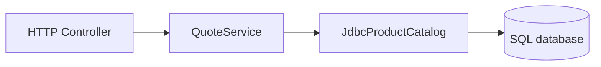
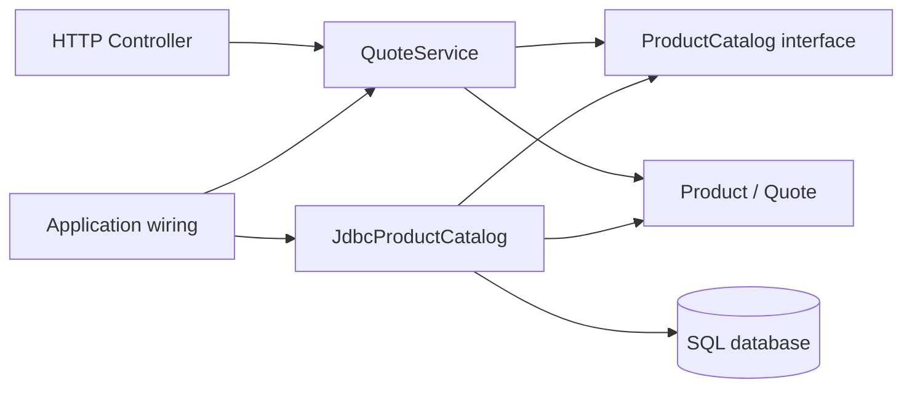
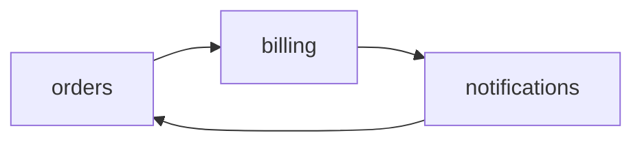

# Mức độ kết nối và hướng phụ thuộc giữa các đơn vị

Một thay đổi nhỏ trong cách truy cập cơ sở dữ liệu đôi khi buộc nhiều lớp nghiệp vụ phải sửa theo. Một hàm kiểm thử báo giá có thể cần khởi động cả dịch vụ web chỉ vì nó tự tạo kết nối đến hệ thống ngoài. Những vấn đề này thường bắt nguồn từ **mức độ kết nối giữa các đơn vị mã** (*coupling*) và **hướng mà chúng phụ thuộc vào nhau**.

Trong chương **Cấu trúc và phụ thuộc** của `CODE_QUALITY_FUNDAMENTALS`, bài học này giải thích cách quan sát và tổ chức quan hệ giữa hàm, lớp, package và module. Mục tiêu của học phần là hiểu những thuộc tính quyết định mã nguồn có **đáng tin cậy, dễ hiểu và dễ thay đổi** hay không. Khi các đơn vị có ranh giới và hướng phụ thuộc rõ ràng, người bảo trì có thể khoanh vùng tác động của một thay đổi, kiểm thử từng phần và thay thế chi tiết kỹ thuật với ít rủi ro hơn.

## Mục tiêu học tập

Sau bài này, bạn có thể:

1. Phân biệt **phụ thuộc** (*dependency*), **mức độ kết nối** (*coupling*) và **tính gắn kết nội bộ** (*cohesion*).
2. Đọc sơ đồ phụ thuộc và chỉ ra đơn vị nào cần biết chi tiết của đơn vị nào.
3. Nhận diện các dấu hiệu kết nối chặt: gọi trực tiếp thư viện cụ thể, chia sẻ trạng thái, truyền cấu trúc dữ liệu quá rộng hoặc tạo vòng phụ thuộc.
4. Áp dụng **Dependency Inversion** và **Dependency Injection** trong ví dụ Java mà không nhầm hai khái niệm này.
5. Đánh giá khi nào nên tạo abstraction, khi nào phụ thuộc trực tiếp đơn giản và hiệu quả hơn.
6. Dùng kiểm thử và xem xét tác động thay đổi để đánh giá chất lượng cấu trúc.

## 1. Đơn vị, phụ thuộc và kết nối

Trong bài này, **đơn vị** có thể là phương thức, lớp, package, module hoặc một dịch vụ. Chọn cấp nào thì phân tích quan hệ ở cấp đó. Ví dụ: lớp `QuoteService` sử dụng interface `ProductCatalog` là một phụ thuộc ở cấp lớp; module `application` khai báo import từ module `infrastructure` là một phụ thuộc ở cấp module.

Một đơn vị **A phụ thuộc vào B** khi A cần một điều gì đó ở B để biên dịch, chạy hoặc thực hiện hợp đồng của mình. Các phụ thuộc phổ biến:

| Loại | A phụ thuộc B qua đâu? | Ví dụ |
| --- | --- | --- |
| **Phụ thuộc tại thời điểm biên dịch** | Kiểu dữ liệu, import, kế thừa, lời gọi method hoặc thư viện. | `QuoteService` dùng kiểu `JdbcProductCatalog`. |
| **Phụ thuộc khi chạy** | Đối tượng, kết nối, cấu hình, endpoint được sử dụng thực tế. | Lúc chạy, `QuoteService` gọi một adapter JDBC. |
| **Phụ thuộc dữ liệu** | Lược đồ, định dạng, cấu trúc bảng hoặc thông điệp. | Nhiều module tự đọc cùng một bảng và biết tên từng cột. |
| **Phụ thuộc thứ tự/thời điểm** | Một thao tác đòi thao tác khác đã chạy trước. | `publish()` phải chạy sau `initialize()`. |
| **Phụ thuộc vận hành** | Triển khai, nguồn tài nguyên hoặc điều kiện sống của dịch vụ khác. | API cần một database hoặc broker sẵn sàng. |

**Coupling** mô tả mức độ các đơn vị ràng buộc vào nhau. Kết nối càng chặt khi đơn vị A phải hiểu nhiều chi tiết nội bộ của B, khi giao diện thay đổi liên tục hoặc khi sửa B buộc A phải sửa theo. Kết nối thường thấp hơn nếu A chỉ biết một hợp đồng nhỏ, ổn định và không phải hiểu cách B thực hiện.

**Cohesion** mô tả mức độ các trách nhiệm **bên trong cùng một đơn vị** phục vụ một mục đích liên quan. Một lớp chỉ giải quyết quy tắc báo giá thường có cohesion cao hơn lớp vừa tính giá, vừa gửi email, ghi log nghiệp vụ, tải ảnh và quản lý phiên đăng nhập.

Hai khái niệm bổ sung nhau:

- **Cohesion cao:** những việc thuộc cùng một trách nhiệm được gom hợp lý.
- **Coupling được kiểm soát:** ranh giới giữa các trách nhiệm có giao diện vừa đủ, ít giả định ngầm.

Không nên coi “càng ít phụ thuộc càng tốt” là quy tắc tuyệt đối. Phần mềm phải kết hợp các đơn vị để thực hiện công việc. Mục tiêu là **có những phụ thuộc cần thiết, rõ nghĩa và dễ quản lý**.

## 2. Hướng phụ thuộc biểu thị điều gì?

Trong các sơ đồ dưới đây, mũi tên **A → B** có nghĩa **mã của A phụ thuộc vào hợp đồng hoặc kiểu do B cung cấp**. Đây là chiều phụ thuộc của mã nguồn, trừ khi sơ đồ ghi rõ đó là luồng gọi khi chạy.

Một cấu trúc bị gắn với chi tiết kỹ thuật có thể trông như sau:



Ở đây `QuoteService` biết trực tiếp tên lớp JDBC. Nếu chuyển sang đọc giá từ API khác, hoặc muốn chạy unit test không kết nối DB, người viết có thể phải sửa mã nghiệp vụ.

Một cách tổ chức khác là làm cho phần nghiệp vụ phụ thuộc vào **hợp đồng**, còn adapter kỹ thuật phụ thuộc vào hợp đồng đó:



Trong cấu trúc này:

- `QuoteService` biết **cần truy xuất sản phẩm bằng SKU** nhưng không cần biết JDBC, SQL hay HTTP.
- `JdbcProductCatalog` hiện thực `ProductCatalog`, nên chính adapter kỹ thuật phụ thuộc vào hợp đồng ứng dụng.
- Điểm khởi tạo ứng dụng (*composition root*) được phép biết cả service và adapter cụ thể để ghép chúng lại.
- Lúc chạy, lời gọi vẫn đi từ `QuoteService` sang đối tượng `JdbcProductCatalog` thông qua interface. **Chiều gọi khi chạy không đồng nghĩa chiều phụ thuộc mã nguồn.**

Thay interface bằng một lớp trừu tượng cũng có thể diễn đạt hợp đồng; điều quan trọng là **chi tiết bên ngoài không buộc chính sách nghiệp vụ đổi theo mỗi lần thay kỹ thuật lưu trữ**.

## 3. Ví dụ Java: từ phụ thuộc vào lớp cụ thể đến phụ thuộc vào hợp đồng

Giả sử một hệ thống cần tạo báo giá theo SKU, số lượng và đơn giá tính bằng đơn vị tiền nhỏ nhất. Quy tắc minh họa: số lượng phải dương, đơn giá không âm; kết quả bằng số lượng nhân đơn giá. Để tập trung vào cấu trúc phụ thuộc, ví dụ bỏ qua thuế, giảm giá và các quy tắc tiền tệ khác.

### 3.1. Cách cài đặt gắn với JDBC

```java
// Ở đây JdbcProductCatalog là lớp adapter cụ thể.
final class QuoteService {
    private final JdbcProductCatalog catalog;

    QuoteService(javax.sql.DataSource dataSource) {
        this.catalog = new JdbcProductCatalog(dataSource);
    }

    long totalCents(String sku, int quantity) {
        if (quantity <= 0) {
            throw new IllegalArgumentException("Quantity must be positive");
        }
        Product product = catalog.findBySku(sku).orElseThrow();
        return Math.multiplyExact(product.unitPriceCents(), quantity);
    }
}
```

Đây là đoạn minh họa cấu trúc: `Product` và `JdbcProductCatalog` được giả định là các kiểu có sẵn. Vấn đề không nằm ở bản thân JDBC. Vấn đề là `QuoteService` trực tiếp tạo đối tượng JDBC và biết `DataSource`, khiến phần tính giá phụ thuộc vào chi tiết lưu trữ.

Các hệ quả dễ gặp:

- Unit test phải chuẩn bị `DataSource` hoặc thay đổi cấu trúc để đưa một nguồn sản phẩm giả vào.
- Khi đổi JDBC sang một nguồn dữ liệu khác, phần ứng dụng bị chạm vào.
- Constructor của lớp nghiệp vụ thể hiện nhu cầu cấu hình kỹ thuật thay vì nhu cầu nghiệp vụ là “một nơi cung cấp sản phẩm”.

### 3.2. Định nghĩa dữ liệu và hợp đồng nhỏ, rõ

**`Product.java` — mô hình dữ liệu miền:**

```java
package example.domain;

public record Product(String sku, long unitPriceCents) {
    public Product {
        if (sku == null || sku.isBlank()) {
            throw new IllegalArgumentException("SKU is required");
        }
        if (unitPriceCents < 0) {
            throw new IllegalArgumentException(
                    "Unit price must be non-negative");
        }
    }
}
```

**`ProductCatalog.java` — hợp đồng mà ứng dụng cần:**

```java
package example.application;

import example.domain.Product;
import java.util.Optional;

public interface ProductCatalog {
    Optional<Product> findBySku(String sku);
}
```

Hợp đồng này mô tả **khả năng cần có** của ứng dụng, không đưa tên JDBC, bảng SQL hay địa chỉ HTTP vào chữ ký. Nó cũng làm rõ một trường hợp bình thường: SKU có thể không tồn tại (trả `Optional.empty()`).

**`Quote.java` và `QuoteService.java` — chính sách ứng dụng:**

```java
package example.application;

public record Quote(String sku, int quantity, long totalCents) {}
```

```java
package example.application;

import example.domain.Product;
import java.util.NoSuchElementException;
import java.util.Objects;

public final class QuoteService {
    private final ProductCatalog catalog;

    public QuoteService(ProductCatalog catalog) {
        this.catalog = Objects.requireNonNull(catalog, "catalog");
    }

    public Quote quote(String sku, int quantity) {
        if (quantity <= 0) {
            throw new IllegalArgumentException("Quantity must be positive");
        }

        Product product = catalog.findBySku(sku)
                .orElseThrow(() ->
                        new NoSuchElementException("Unknown SKU: " + sku));
        long total = Math.multiplyExact(
                product.unitPriceCents(), quantity);

        return new Quote(product.sku(), quantity, total);
    }
}
```

Lớp `QuoteService` giờ phụ thuộc vào `ProductCatalog` và dữ liệu miền. Chữ ký constructor thể hiện đúng nhu cầu: “muốn tính báo giá, cần một nguồn đọc sản phẩm”. Khi chọn cách lưu trữ, ứng dụng chỉ cần truyền một implementation đáp ứng hợp đồng.

### 3.3. Adapter thay thế trong môi trường phát triển hoặc kiểm thử

**`InMemoryProductCatalog.java` — adapter dùng dữ liệu trong bộ nhớ:**

```java
package example.infrastructure;

import example.application.ProductCatalog;
import example.domain.Product;
import java.util.Map;
import java.util.Objects;
import java.util.Optional;

public final class InMemoryProductCatalog implements ProductCatalog {
    private final Map<String, Product> products;

    public InMemoryProductCatalog(Map<String, Product> products) {
        this.products = Map.copyOf(Objects.requireNonNull(products));
    }

    @Override
    public Optional<Product> findBySku(String sku) {
        return Optional.ofNullable(products.get(sku));
    }
}
```

**Điểm ghép đối tượng (`Application` hoặc cấu hình khởi động):**

```java
import example.application.ProductCatalog;
import example.application.QuoteService;
import example.domain.Product;
import example.infrastructure.InMemoryProductCatalog;
import java.util.Map;

ProductCatalog catalog = new InMemoryProductCatalog(
        Map.of("SKU-42", new Product("SKU-42", 2_500L)));
QuoteService service = new QuoteService(catalog);

System.out.println(service.quote("SKU-42", 3).totalCents()); // 7500
```

Đoạn ghép trên là các câu lệnh đặt trong phương thức khởi tạo hoặc `main`; bản thân nó không phải một file Java đầy đủ. Thay `InMemoryProductCatalog` bằng `JdbcProductCatalog` chỉ đòi điểm ghép biết implementation mới, miễn là adapter mới tuân thủ hợp đồng `ProductCatalog`.

**Giới hạn cần nhớ:** việc đưa interface vào không bảo đảm mọi thứ đều dễ thay đổi. Nếu interface liên tục bị sửa để phục vụ chi tiết riêng của JDBC, hoặc trả về trực tiếp kiểu `ResultSet`, phần ứng dụng vẫn bị ràng buộc chặt vào DB dù có interface.

## 4. Dependency Inversion khác Dependency Injection

Hai thuật ngữ dễ nhầm lẫn:

| Khái niệm | Câu hỏi nó giải quyết | Trong ví dụ |
| --- | --- | --- |
| **Dependency Inversion Principle (DIP)** | Chính sách có thể phụ thuộc vào abstraction thay vì chi tiết kỹ thuật như thế nào? | `QuoteService` phụ thuộc `ProductCatalog`; adapter JDBC triển khai interface này. |
| **Dependency Injection (DI)** | Đối tượng cần thiết được cung cấp cho một lớp bằng cách nào? | Constructor `QuoteService(ProductCatalog catalog)` nhận implementation từ bên ngoài. |
| **Composition root** | Ai quyết định ghép các implementation cụ thể? | `Application` hoặc cấu hình khởi động tạo adapter rồi truyền vào service. |

Bạn có thể dùng constructor injection mà **không đảo chiều phụ thuộc**: truyền `JdbcProductCatalog` trực tiếp vào constructor vẫn khiến ứng dụng biết kiểu JDBC. Ngược lại, có thể tổ chức đảo chiều phụ thuộc với factory hay cơ chế khởi tạo khác mà không cần container DI. Spring là một công cụ hỗ trợ ghép đối tượng; **nguyên tắc thiết kế không phụ thuộc việc phải dùng Spring**.

### Không phải abstraction nào cũng có ích

Một interface chỉ có một implementation vẫn có thể có giá trị khi nó mô tả **ranh giới thay đổi rõ ràng** hoặc tạo điều kiện kiểm thử hành vi. Nhưng tạo `IOrder`, `IOrderImpl`, `OrderFactory` cho một lớp dữ liệu đơn giản có thể chỉ tăng số nơi phải đọc mà không giảm coupling đáng kể.

Hãy hỏi trước khi tạo abstraction:

- Có một **hợp đồng ổn định** mà nhiều chi tiết khác nhau có thể đáp ứng không?
- Ranh giới này có cách thất bại, giao thức, trạng thái hoặc tốc độ thay đổi khác phần nghiệp vụ không?
- Interface có thể được viết bằng **ngôn ngữ của bên sử dụng**, thay vì phản chiếu toàn bộ API của bên cung cấp không?
- Việc thêm một lớp chuyển tiếp có giúp hiểu mã và kiểm thử hơn chi phí phải theo dõi thêm một bước gọi không?

Nếu tất cả câu trả lời đều không, phụ thuộc trực tiếp vào một lớp nhỏ, ổn định và có mục đích rõ ràng đôi khi tốt hơn.

## 5. Nhận diện mức độ kết nối chặt

Không thể đánh giá coupling chỉ bằng số lượng dòng import. Điều cần nhìn là **một thay đổi nhỏ ở B buộc A phải biết hoặc sửa bao nhiêu chi tiết**.

### 5.1. Phụ thuộc trực tiếp vào chi tiết thực thi

Ví dụ `ReportService` gọi trực tiếp thư viện PDF, tự thiết lập đường dẫn file và tạo HTTP client. Khi thư viện hoặc giao thức thay đổi, nghiệp vụ báo cáo cũng bị kéo theo. Nếu đây là điểm mở rộng có ý nghĩa, hãy đặt interface như `ReportExporter` hoặc một adapter ở lớp ngoài.

### 5.2. Chia sẻ cấu trúc dữ liệu quá rộng

```java
void calculateShipping(CustomerEntity customer, OrderEntity order) {
    // Chỉ dùng customer.getRegion() và order.getTotalWeight().
}
```

Hàm cần biết toàn bộ hai entity, trong khi chỉ dùng khu vực và tổng khối lượng. Khi entity bị thay đổi, hàm có thể chịu ảnh hưởng gián tiếp qua ORM, lazy loading, schema hoặc vòng đời đối tượng. Với một ranh giới rõ ràng, truyền dữ liệu vừa đủ có thể giảm kết nối:

```java
Money calculateShipping(Region region, Weight totalWeight) {
    // Tính phí từ đúng dữ liệu cần thiết.
}
```

`Money`, `Region` và `Weight` là những kiểu giá trị miền được giả định đã khai báo trong ví dụ. Không nhất thiết mọi hàm đều phải nhận trường nguyên thủy: dùng một value object có ý nghĩa và bất biến rõ ràng thường dễ đọc hơn danh sách tham số dài.

### 5.3. Phụ thuộc vào thứ tự gọi

```java
client.initialize(config);
client.authenticate();
client.send(message);
```

Nếu `send()` chỉ đúng sau hai lời gọi đầu, người dùng phải nhớ một giao thức ngầm. Có thể dùng constructor/factory tạo đối tượng đã sẵn sàng hoặc một API công khai rõ trạng thái. Điều này giảm **temporal coupling**, nhưng cần thận trọng với tài nguyên có vòng đời phức tạp: đóng kết nối, làm mới token, retry.

### 5.4. Trạng thái toàn cục và dữ liệu dùng chung

```java
GlobalSettings.currentCurrency = "VND";
invoiceService.calculate(invoice);
```

Kết quả tính toán phụ thuộc một biến toàn cục được sửa ở nơi khác. Hai kiểm thử chạy song song hoặc hai yêu cầu với tiền tệ khác nhau có thể ảnh hưởng lẫn nhau. Truyền cấu hình cần thiết qua tham số/constructor hoặc dùng ngữ cảnh bất biến giúp thể hiện phụ thuộc rõ hơn.

### 5.5. Phụ thuộc ngầm qua dữ liệu và sự kiện

Hai module không import nhau nhưng cùng cập nhật bảng `orders` vẫn có thể kết nối chặt qua schema, quy tắc khóa và tính nguyên tử. Hai dịch vụ giao tiếp bằng event cũng có thể phụ thuộc vào tên field, ý nghĩa sự kiện, thứ tự xử lý và khả năng phát lặp.

**Không có import trực tiếp không đồng nghĩa độc lập.** Khi đánh giá kiến trúc, cần xét cả giao diện dữ liệu, contract của message và phụ thuộc vận hành.

## 6. Vòng phụ thuộc và ranh giới module

Giả sử:

```text
orders → billing → notifications → orders
```

Nếu đây là các phụ thuộc mã nguồn giữa ba module, chúng tạo một **chu trình**. Khi muốn biên dịch hoặc phát hành riêng một module, có thể phải kéo theo các module còn lại. Một thay đổi ở một phía dễ lan vòng và làm ranh giới trách nhiệm khó hiểu.



Không nên “sửa” chu trình bằng cách chỉ đổi tên package. Phải xác định **vì sao** mỗi module gọi module còn lại.

Ví dụ, nếu `notifications` phụ thuộc `orders` chỉ để tra cứu mẫu dữ liệu thông báo, có thể:

1. Định nghĩa một hợp đồng sự kiện nhỏ `OrderPaid` do bên phát công bố và bên nhận sử dụng.
2. Để `orders` hoặc `billing` phát sự kiện theo một hợp đồng phù hợp.
3. Cho `notifications` nhận sự kiện và tự định dạng nội dung, thay vì gọi ngược vào toàn bộ API nội bộ của `orders`.

Một hướng khác là chuyển một quy tắc chung, ổn định sang module `shared-domain` nếu đó thật sự là **khái niệm chung**. Đừng biến `shared` thành nơi chứa mọi thứ chỉ để đồ thị trông không có vòng.

**Quan trọng:** chuyển sang sự kiện có thể loại bớt phụ thuộc tại thời điểm biên dịch, nhưng tạo **phụ thuộc vào hợp đồng thông điệp và độ trễ xử lý**. Nếu cần một kết quả đồng bộ hoặc giao dịch nguyên tử, kiến trúc sự kiện có thể không phù hợp. Luôn đánh giá cả coupling mã nguồn lẫn coupling khi vận hành.

### Hướng phụ thuộc qua các lớp

Một cấu trúc thường dễ quản lý:

```text
api/controller ───────────> application/use-case ───────> domain
                                     │
                                     └──> ports/contracts
infrastructure/adapter ───────────────────> ports/contracts
bootstrap/composition-root ─────> application và infrastructure
```

Đây là **một cách** tổ chức phụ thuộc, không phải luật bắt buộc với mọi ứng dụng. Một ứng dụng nhỏ có thể không cần đủ lớp như sơ đồ. Nhưng khi dự án phát triển, hướng phụ thuộc nhất quán giúp giữ **chính sách lâu dài** tách khỏi **chi tiết dễ thay đổi**.

## 7. Đo coupling thế nào cho có ý nghĩa?

Đo lường giúp phát hiện điểm cần xem xét, nhưng không có một ngưỡng “số import tối đa” bảo đảm thiết kế tốt.

| Dấu hiệu / chỉ báo | Gợi ý điều gì? | Cần kiểm tra thêm |
| --- | --- | --- |
| Một lớp phụ thuộc nhiều loại dịch vụ và DTO khác nhau. | Lớp có thể đang ôm nhiều trách nhiệm. | Các phụ thuộc có cùng phục vụ một use case rõ ràng không? |
| Một package thay đổi là hàng chục package phải biên dịch/sửa. | Lan truyền thay đổi cao. | Các thay đổi có thật sự đi qua API công khai không? |
| Vòng giữa package/module. | Ranh giới trách nhiệm hoặc chiều phụ thuộc có vấn đề. | Cần tách hợp đồng hay chuyển trách nhiệm? |
| Unit test cần DB, HTTP, broker cho logic thuần. | Nghiệp vụ có thể gắn chặt với hạ tầng. | Có một ranh giới hợp đồng đủ nhỏ để thay thế không? |
| Một interface có rất nhiều phương thức không liên quan. | Bên sử dụng bị phụ thuộc vào giao diện quá rộng. | Có thể tách interface theo nhu cầu thực tế không? |
| Mọi thay đổi phải sửa file cấu hình DI khổng lồ. | Thành phần ghép nối đang phức tạp. | Có thể giới hạn module và điểm cấu hình không? |

Hai phép đếm đôi khi gặp trong phân tích package:

- **Ca** (*afferent coupling*): số đơn vị bên ngoài phụ thuộc vào đơn vị đang xét.
- **Ce** (*efferent coupling*): số đơn vị bên ngoài mà đơn vị đang xét phụ thuộc vào.

Một chỉ số cấu trúc hay được dùng là:

```text
I = Ce / (Ca + Ce)     nếu Ca + Ce > 0
```

Chỉ số này thường được gọi là *instability* trong các thước đo package: giá trị gần 1 biểu thị nhiều phụ thuộc đi ra so với phụ thuộc đi vào; gần 0 biểu thị nhiều đơn vị khác phụ thuộc vào package đó. **“Ổn định” ở đây nói về lực ràng buộc trong đồ thị phụ thuộc, không chứng minh package ít lỗi, ít thay đổi hay có chất lượng cao.** Khi `Ca + Ce = 0`, biểu thức không xác định; không nên tự coi kết quả là 0.

Phép đếm còn phụ thuộc cách định nghĩa “đơn vị” (class, package hay module) và cách công cụ đếm cạnh. Không nên tối ưu số liệu bằng cách tạo interface rỗng hoặc chia package tùy tiện. Hãy dùng chỉ báo để đặt câu hỏi, rồi đọc mã và xem lịch sử thay đổi thực tế.

### Cách dùng lịch sử thay đổi

Nếu sửa chính sách tính giá thường phải sửa lớp JDBC, controller và cấu hình web, đó là dấu hiệu các trách nhiệm đang liên quan quá chặt. Nếu thay database chỉ sửa adapter và wiring mà kiểm thử báo giá vẫn giữ nguyên, ranh giới đang phát huy tác dụng. Theo dõi *change coupling* (các file thường phải thay cùng nhau) có thể bổ sung cho đồ thị import tĩnh.

## 8. Kiểm thử như bằng chứng của hướng phụ thuộc

Một kiến trúc dễ kiểm thử thường cho phép kiểm tra quy tắc nghiệp vụ bằng **đối tượng thay thế nhỏ** thay vì chạy toàn bộ hạ tầng. Ví dụ JUnit 5 cho `QuoteService` ở mục 3:

```java
package example.application;

import example.domain.Product;
import java.util.Optional;
import java.util.concurrent.atomic.AtomicInteger;
import org.junit.jupiter.api.Test;
import static org.junit.jupiter.api.Assertions.*;

class QuoteServiceTest {

    @Test
    void calculatesQuoteWithoutDatabase() {
        ProductCatalog catalog = sku ->
                Optional.of(new Product("SKU-42", 2_500L));
        QuoteService service = new QuoteService(catalog);

        Quote quote = service.quote("SKU-42", 3);

        assertEquals("SKU-42", quote.sku());
        assertEquals(3, quote.quantity());
        assertEquals(7_500L, quote.totalCents());
    }

    @Test
    void rejectsInvalidQuantityBeforeLookingUpProduct() {
        AtomicInteger catalogCalls = new AtomicInteger();
        ProductCatalog catalog = sku -> {
            catalogCalls.incrementAndGet();
            return Optional.of(new Product(sku, 1_000L));
        };
        QuoteService service = new QuoteService(catalog);

        assertThrows(IllegalArgumentException.class,
                () -> service.quote("SKU-42", 0));
        assertEquals(0, catalogCalls.get());
    }

    @Test
    void rejectsUnknownProduct() {
        ProductCatalog catalog = sku -> Optional.empty();
        QuoteService service = new QuoteService(catalog);

        assertThrows(java.util.NoSuchElementException.class,
                () -> service.quote("MISSING", 2));
    }
}
```

Các kiểm thử trên không cần DB vì hợp đồng đọc sản phẩm được cung cấp qua `ProductCatalog`. Tuy nhiên, chúng **không kiểm tra adapter JDBC truy vấn đúng** hoặc dữ liệu trong DB có khớp với schema hay không. Adapter cần được kiểm chứng bằng kiểm thử tích hợp phù hợp; việc tách ranh giới giúp hai loại kiểm thử có mục đích rõ ràng.

Ngoài unit test, có thể kiểm tra hướng phụ thuộc bằng:

- **Quy tắc build/module:** module ứng dụng không khai báo phụ thuộc vào module hạ tầng.
- **Kiểm thử kiến trúc:** ví dụ quy tắc “các lớp trong `domain` không import `infrastructure`”.
- **Review thay đổi:** sửa adapter có làm thay hợp đồng ứng dụng không?
- **Kiểm tra chu trình:** sử dụng công cụ phân tích đồ thị dependency cho cấp package/module.

Các quy tắc này cần được viết theo kiến trúc thực tế của dự án; không nên cấm tất cả phụ thuộc ngoài chỉ vì muốn sơ đồ đẹp.

## 9. Những đánh đổi cần cân nhắc

**Đặt interface ở đâu?** Nếu interface là nhu cầu của use case, đặt gần bên sử dụng thường làm chiều phụ thuộc rõ hơn. Nếu nhiều module cần cùng một hợp đồng có ý nghĩa ổn định, có thể tách nó thành module hợp đồng chung. Tránh để domain buộc import một SDK chỉ để thỏa một interface nằm ở hạ tầng.

**Chia nhiều module có luôn tốt hơn không?** Không. Quá nhiều module có thể tăng độ phức tạp build, cấu hình dependency, versioning và điều phối thay đổi. Bắt đầu với các ranh giới có lý do nghiệp vụ hoặc kỹ thuật rõ; chỉ tách thành module độc lập khi nó mang lại lợi ích quan sát được.

**Interface cho mọi lớp?** Không. Interface giúp khi cần hợp đồng ổn định, thay thế implementation hoặc kiểm thử ranh giới. Với các kiểu giá trị bất biến, phép tính thuần và lớp nhỏ không cần thay thế, phụ thuộc trực tiếp thường rõ ràng hơn.

**Event luôn giảm coupling?** Event có thể giảm việc gọi trực tiếp và cho phép xử lý bất đồng bộ, nhưng bổ sung hợp đồng schema, thứ tự, retry, trùng lặp và nhất quán cuối cùng. Cần đánh giá yêu cầu nghiệp vụ trước khi chọn.

**Dependency Injection luôn cần framework?** Không. Constructor injection và một điểm khởi tạo đơn giản thường đủ cho ứng dụng nhỏ. Framework có thể giúp quản lý nhiều đối tượng nhưng không sửa được một hướng phụ thuộc sai ở mã nguồn.

**Giảm coupling có khiến code khó đọc hơn không?** Có thể, nếu lớp chỉ gọi chuyển tiếp qua nhiều abstraction không mang thêm ý nghĩa. Sự cân bằng tốt là người đọc nhìn vào interface hiểu được nhu cầu nghiệp vụ, và việc đi từ use case sang implementation không đòi qua quá nhiều lớp không cần thiết.

## 10. Quy trình cải thiện cấu trúc một cách an toàn

1. **Vẽ các phụ thuộc hiện tại.** Với một chức năng cụ thể, ghi lại lớp nào import, tạo và gọi lớp nào; bổ sung phụ thuộc qua DB/message nếu có liên quan.
2. **Chỉ ra điểm đau có bằng chứng.** Ví dụ phải sửa logic tính giá mỗi khi đổi nguồn dữ liệu, hoặc unit test không thể chạy nếu thiếu DB.
3. **Xác định hợp đồng tối thiểu mà bên sử dụng cần.** Với báo giá, chỉ cần `findBySku`; không cần lộ toàn bộ API truy vấn của JDBC.
4. **Đưa hợp đồng đến ranh giới hợp lý.** Cho use case phụ thuộc vào kiểu hợp đồng và cho adapter hiện thực hợp đồng.
5. **Ghép đối tượng tại điểm khởi tạo.** Giữ các `new Jdbc...` hoặc cấu hình SDK ra khỏi lớp nghiệp vụ.
6. **Bảo vệ hành vi bằng kiểm thử.** Unit test hợp đồng nghiệp vụ với fake; integration test adapter; kiểm thử luồng cho hành vi xuyên thành phần.
7. **Chuyển từng người gọi và bỏ đường cũ.** Kiểm tra không còn import trực tiếp chi tiết hạ tầng hoặc vòng phụ thuộc bị sót.
8. **Đánh giá kết quả bằng khả năng thay đổi thực tế.** Thử đổi implementation hoặc bổ sung một tính năng nhỏ: số điểm phải sửa có giảm, mã có còn dễ đọc không?

Không cần tái cấu trúc cả hệ thống khi chỉ có một vấn đề nhỏ. Bắt đầu tại ranh giới mà thay đổi lặp lại nhiều lần hoặc gây lỗi, rồi mở rộng theo bằng chứng.

## 11. Câu hỏi tự kiểm tra

**Câu 1.** `QuoteService` chỉ đọc giá sản phẩm, nhưng constructor bắt buộc nhận `DataSource` và tự tạo `JdbcProductCatalog`. Điều này nói gì về coupling?

*Gợi ý:* Lớp chứa logic báo giá phụ thuộc trực tiếp vào công nghệ lưu trữ. Có thể cho nó nhận một hợp đồng nhỏ như `ProductCatalog`, còn adapter JDBC được ghép từ ngoài vào.

**Câu 2.** `QuoteService` nhận `JdbcProductCatalog` qua constructor thay vì tự `new`. Đó đã là Dependency Inversion chưa?

*Gợi ý:* Đó là một hình thức Dependency Injection, nhưng phần ứng dụng vẫn tham chiếu kiểu JDBC cụ thể. Muốn đảo chiều phụ thuộc, phần ứng dụng cần phụ thuộc vào abstraction do ranh giới nghiệp vụ sở hữu hoặc sử dụng.

**Câu 3.** `orders` phụ thuộc `billing`, `billing` phụ thuộc `notifications`, còn `notifications` phụ thuộc `orders`. Tại sao đây là dấu hiệu cần xem xét?

*Gợi ý:* Đồ thị tạo chu trình, khiến trách nhiệm và biên thay đổi khó tách. Cần kiểm tra quan hệ nghiệp vụ và cân nhắc trích hợp đồng chung, đảo chiều phụ thuộc hoặc thay cơ chế giao tiếp khi phù hợp.

**Câu 4.** Hai module không import nhau, nhưng cả hai tự cập nhật bảng `orders`. Chúng đã độc lập chưa?

*Gợi ý:* Chưa chắc. Chúng vẫn có phụ thuộc vào schema, quy tắc cập nhật và trạng thái chia sẻ. Cần xem ranh giới quyền sở hữu dữ liệu và tính nhất quán.

**Câu 5.** Một lớp phụ thuộc vào ba lớp giá trị bất biến, nhỏ và ổn định. Có nên tạo ba interface chỉ để giảm số dependency không?

*Gợi ý:* Thường không cần. Một số phụ thuộc rõ nghĩa là bình thường; interface chỉ hữu ích khi làm rõ hợp đồng hoặc bảo vệ ranh giới thay đổi thực sự.

**Câu 6.** Vì sao unit test `QuoteService` với fake `ProductCatalog` chưa đủ để kết luận hệ thống đọc đúng dữ liệu từ SQL?

*Gợi ý:* Fake kiểm tra logic use case và việc tiêu thụ hợp đồng. Lỗi mapping, câu SQL, transaction hoặc schema thuộc adapter và cần kiểm thử tích hợp riêng.

## Ghi nhớ

- **Coupling** nói về mức độ ràng buộc **giữa** các đơn vị; **cohesion** nói về sự thống nhất trách nhiệm **trong** một đơn vị.
- **Chiều phụ thuộc mã nguồn** cần được phân biệt với **chiều gọi khi chạy**. Có thể gọi adapter kỹ thuật lúc chạy mà vẫn phụ thuộc vào interface ổn định khi biên dịch.
- **Dependency Inversion** là nguyên tắc về hướng phụ thuộc; **Dependency Injection** là cách cung cấp đối tượng. Hai khái niệm liên quan nhưng không đồng nghĩa.
- **Vòng phụ thuộc, trạng thái chia sẻ và hợp đồng dữ liệu** có thể khiến các module kết nối chặt ngay cả khi số import không lớn.
- **Phụ thuộc trực tiếp có chủ đích** đôi khi tốt hơn abstraction dư thừa. Đánh giá bằng số thay đổi lan truyền, tính rõ ràng của hợp đồng và khả năng kiểm thử, thay vì chỉ đếm lớp.

**Câu hỏi áp dụng khi review:** “Nếu thay một chi tiết kỹ thuật hoặc một quy tắc ở đơn vị này, những đơn vị nào khác buộc phải biết hoặc sửa theo? Mũi tên phụ thuộc hiện tại có phản ánh đúng trách nhiệm của chúng không?”
