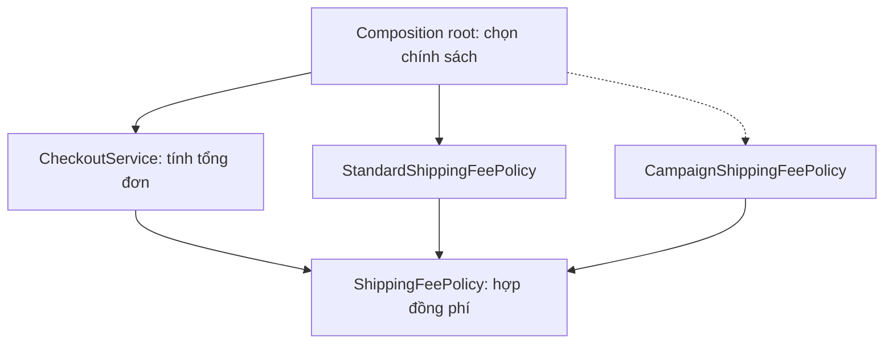

# Che giấu quyết định dễ thay đổi sau hợp đồng ổn định

## 1. Mục tiêu bài học

Trong chương **Cấu trúc và phụ thuộc** của module **CODE_QUALITY_FUNDAMENTALS**, chúng ta tìm hiểu một nguyên tắc thiết kế quan trọng: **đặt những quyết định có khả năng thay đổi phía sau một hợp đồng đủ ổn định để phần còn lại của hệ thống không phải thay đổi theo**.

Module hướng đến việc hiểu những thuộc tính quyết định mã nguồn có **đáng tin cậy, dễ hiểu và dễ thay đổi** hay không. Nguyên tắc này góp phần đạt cả ba mục tiêu: giảm số nơi phải sửa khi yêu cầu đổi, làm rõ trách nhiệm của từng phần và tạo ranh giới có thể kiểm thử.

Sau bài học, bạn có thể:

- Phân biệt **quyết định có khả năng thay đổi** với **hợp đồng ổn định** trong một ngữ cảnh nghiệp vụ cụ thể.
- Giải thích cách che giấu chi tiết triển khai giúp hạn chế ảnh hưởng dây chuyền giữa các thành phần.
- Thiết kế một ví dụ Java mà nhiều chính sách phí vận chuyển có thể được thay thế mà không sửa dịch vụ tính tổng đơn hàng.
- Kiểm tra xem hợp đồng có thực sự bảo toàn ý nghĩa nghiệp vụ, đồng thời nhận diện các tình huống phải thay đổi hợp đồng.
- Tránh tạo quá nhiều interface hoặc tầng trung gian khi bài toán chưa có nhu cầu biến đổi rõ ràng.

## 2. Quyết định dễ thay đổi là gì?

Trong một ứng dụng, không phải mọi phần mã đều thay đổi vì cùng một lý do.

Ví dụ với chức năng tính tổng tiền khi thanh toán:

- **Quy tắc phí vận chuyển** có thể thay đổi theo chiến dịch, loại khách hàng hoặc chính sách cửa hàng.
- **Cách tích hợp nhà vận chuyển** có thể thay đổi khi đối tác sửa API, phương thức xác thực hoặc định dạng phản hồi.
- **Cách tính tổng tiền** thường vẫn là một ý nghĩa nghiệp vụ có thể phát biểu ổn định hơn: tổng phải trả bằng tổng tiền hàng cộng các khoản phí áp dụng, theo một hợp đồng tiền tệ đã xác định.

Các quyết định về ngưỡng miễn phí, mức phí thành viên hay tên trường HTTP là những **chi tiết có lý do thay đổi riêng**. Nếu chúng xuất hiện rải rác trong màn hình, controller, service thanh toán và mã tích hợp, mỗi lần đổi chính sách sẽ đòi hỏi tìm và sửa nhiều nơi.

**Che giấu quyết định (information hiding)** nghĩa là để phần khác của hệ thống biết **năng lực cần dùng và kết quả được bảo đảm**, nhưng không phải biết **chi tiết nào tạo ra kết quả đó**. Đây không phải việc giấu mã cho khó nhìn: phần chi tiết vẫn phải rõ ràng với người chịu trách nhiệm bảo trì nó.

### Hợp đồng ổn định gồm những gì?

**Hợp đồng (contract)** không chỉ là tên interface hoặc chữ ký phương thức. Nó gồm:

| Thành phần hợp đồng | Câu hỏi cần làm rõ |
| --- | --- |
| Ý nghĩa nghiệp vụ | Phương thức trả lời câu hỏi nào, ví dụ “phí vận chuyển áp dụng cho đơn này là bao nhiêu”? |
| Đầu vào, đầu ra | Cần dữ liệu nào; đơn vị tiền và kiểu dữ liệu là gì? |
| Điều kiện hợp lệ | Có chấp nhận số âm, `null` hoặc đối tượng thiếu thông tin không? |
| Hành vi được bảo đảm | Kết quả có không âm, nhất quán cho cùng dữ liệu đầu vào hay không? |
| Trường hợp lỗi | Khi không thể tính phí, bên gọi nhận lỗi gì; có được trả giá trị mặc định không? |
| Tác dụng phụ | Phương thức chỉ tính toán hay còn lưu dữ liệu, gửi yêu cầu mạng? |

Một hợp đồng được xem là **tương đối ổn định** khi ý nghĩa trên có cơ sở tồn tại qua những thay đổi dự kiến của cách triển khai. Không có hợp đồng nào được bảo đảm bất biến mãi mãi: khi yêu cầu nghiệp vụ cốt lõi đổi, chính hợp đồng cũng có thể cần sửa.

## 3. Vì sao cần một ranh giới?

Xét đoạn mã tưởng tượng:

```java
public long checkoutTotal(long subtotalVnd, boolean member) {
    long shippingFee;
    if (subtotalVnd >= 500_000) {
        shippingFee = 0;
    } else if (member) {
        shippingFee = 15_000;
    } else {
        shippingFee = 30_000;
    }
    return Math.addExact(subtotalVnd, shippingFee);
}
```

Nếu đây là nơi duy nhất xử lý phí, đoạn mã có thể hoàn toàn đủ cho một sản phẩm nhỏ. Nhưng khi tính phí vận chuyển còn được dùng trong trang giỏ hàng, bản xem trước đơn, API đặt hàng và xử lý hoàn tiền, việc sao chép cùng các ngưỡng và mức phí sang những nơi đó tạo nguy cơ **các chỗ không còn thống nhất**.

Nếu mọi thay đổi chiến dịch lại bắt nhóm sửa `CheckoutService`, các controller và nhiều bài kiểm thử không liên quan, phần logic tính tổng đã **phụ thuộc vào một quyết định có vòng đời biến đổi nhanh hơn nó**.

Ta muốn người dùng chức năng chỉ cần biết:

> “Với thông tin đơn hàng hợp lệ, hãy tính phí vận chuyển bằng VND; kết quả không âm.”

Những ngưỡng và mức phí cụ thể được quản lý tập trung ở phần hiện thực chính sách.



Mũi tên liền thể hiện phụ thuộc vào kiểu/hợp đồng; phần cấu hình ở điểm khởi tạo chọn hiện thực cụ thể. Dịch vụ tính tổng chỉ phụ thuộc vào năng lực **tính phí**, không phụ thuộc vào tên chiến dịch hoặc ngưỡng của một hiện thực.

## 4. Ví dụ Java 17: che giấu quy tắc phí vận chuyển

Giả sử cửa hàng xác nhận hai chính sách:

| Điều kiện | Chính sách thường | Chính sách chiến dịch |
| --- | --- | --- |
| Miễn phí vận chuyển | Tổng tiền hàng từ **500.000 VND** | Tổng tiền hàng từ **350.000 VND** |
| Phí dưới ngưỡng cho thành viên | **15.000 VND** | **10.000 VND** |
| Phí dưới ngưỡng cho khách thường | **30.000 VND** | **30.000 VND** |

Trong cả hai chính sách, đầu vào gồm tổng tiền hàng tính bằng VND và thông tin thành viên. Kết quả là **phí vận chuyển không âm, tính bằng VND**. Việc chọn chính sách áp dụng cho một đơn diễn ra trước khi tính tổng đơn hàng.

### 4.1. Đặt hợp đồng theo ý nghĩa nghiệp vụ

```java
// ShippingRequest.java
public record ShippingRequest(long subtotalVnd, boolean member) {
    public ShippingRequest {
        if (subtotalVnd < 0) {
            throw new IllegalArgumentException(
                    "subtotalVnd must not be negative");
        }
    }
}
```

```java
// ShippingFeePolicy.java
@FunctionalInterface
public interface ShippingFeePolicy {
    // Trả phí vận chuyển không âm, đơn vị VND, cho đầu vào hợp lệ.
    // Phương thức tính toán; không ghi đơn hàng hoặc gửi yêu cầu mạng.
    long feeVnd(ShippingRequest request);
}
```

Tên `ShippingFeePolicy` thể hiện ý nghĩa mà `CheckoutService` cần, không chứa `Standard`, `Campaign2026`, tên đối tác hay tham số ngưỡng cụ thể. Kiểu `ShippingRequest` đảm bảo không truyền tổng tiền âm. Trong các hiện thực, `request` phải khác `null` và phí trả về phải không âm theo hợp đồng.

**Hợp đồng dạng interface chỉ quy định điều các bên đã thống nhất.** Java không tự chứng minh giá trị trả về luôn không âm hay phương thức không có tác dụng phụ; cần hiện thực đúng, kiểm thử và rà soát. Đặc điểm “không lưu dữ liệu, không gọi mạng” là quy ước hành vi của hợp đồng trong ví dụ này.

### 4.2. Tách hai quyết định có khả năng thay đổi

```java
// StandardShippingFeePolicy.java
import java.util.Objects;

public final class StandardShippingFeePolicy implements ShippingFeePolicy {
    private static final long FREE_FROM_VND = 500_000;
    private static final long MEMBER_FEE_VND = 15_000;
    private static final long REGULAR_FEE_VND = 30_000;

    @Override
    public long feeVnd(ShippingRequest request) {
        Objects.requireNonNull(request, "request");

        if (request.subtotalVnd() >= FREE_FROM_VND) {
            return 0;
        }
        return request.member() ? MEMBER_FEE_VND : REGULAR_FEE_VND;
    }
}
```

```java
// CampaignShippingFeePolicy.java
import java.util.Objects;

public final class CampaignShippingFeePolicy implements ShippingFeePolicy {
    private static final long FREE_FROM_VND = 350_000;
    private static final long MEMBER_FEE_VND = 10_000;
    private static final long REGULAR_FEE_VND = 30_000;

    @Override
    public long feeVnd(ShippingRequest request) {
        Objects.requireNonNull(request, "request");

        if (request.subtotalVnd() >= FREE_FROM_VND) {
            return 0;
        }
        return request.member() ? MEMBER_FEE_VND : REGULAR_FEE_VND;
    }
}
```

Hai lớp có cùng hợp đồng nhưng khác **quy tắc biến đổi**. Khi thay ngưỡng chiến dịch hoặc mức phí thành viên, nơi tự nhiên để sửa là `CampaignShippingFeePolicy` và các kiểm thử của chính sách đó.

Trong một dự án có nhiều bộ giá trị khác nhau nhưng cùng **một thuật toán**, phương án đơn giản hơn có thể là **một** `ThresholdShippingFeePolicy` nhận cấu hình ngưỡng/phí trong constructor thay vì tạo một lớp cho mỗi bộ giá trị. Hai lớp được tách ở đây để biểu diễn rõ cách thay thế hiện thực; không nên nhân bản thuật toán khi khác biệt chỉ nằm ở dữ liệu cấu hình.

### 4.3. Dịch vụ tính tổng chỉ biết hợp đồng

```java
// CheckoutQuote.java
public record CheckoutQuote(
        long subtotalVnd, long shippingFeeVnd, long totalVnd) {
}
```

```java
// CheckoutService.java
import java.util.Objects;

public final class CheckoutService {
    private final ShippingFeePolicy shippingFeePolicy;

    public CheckoutService(ShippingFeePolicy shippingFeePolicy) {
        this.shippingFeePolicy = Objects.requireNonNull(
                shippingFeePolicy, "shippingFeePolicy");
    }

    public CheckoutQuote quote(ShippingRequest request) {
        Objects.requireNonNull(request, "request");

        long feeVnd = shippingFeePolicy.feeVnd(request);
        if (feeVnd < 0) {
            throw new IllegalStateException(
                    "shippingFeePolicy returned negative fee");
        }

        long totalVnd = Math.addExact(request.subtotalVnd(), feeVnd);
        return new CheckoutQuote(request.subtotalVnd(), feeVnd, totalVnd);
    }
}
```

`CheckoutService` có trách nhiệm đơn giản: hỏi chính sách về phí, kiểm tra bất biến được mong đợi và cộng tiền an toàn với `Math.addExact`. Lớp này **không có** điều kiện `subtotalVnd >= 500_000` hoặc `member ? 15_000 : 30_000`.

Việc kiểm tra phí âm bảo vệ ranh giới khi một hiện thực vi phạm hợp đồng. `Math.addExact` phát hiện tràn số nguyên `long` thay vì âm thầm làm sai tổng tiền. Trong hệ thống xử lý tiền, cần chọn kiểu và chính sách làm tròn phù hợp với yêu cầu; ví dụ dùng `long` để biểu diễn **số VND nguyên** theo giả định đã nêu.

### 4.4. Chọn hiện thực ở điểm khởi tạo

```java
// ShopApplication.java
public final class ShopApplication {
    public static void main(String[] args) {
        ShippingFeePolicy policy = new StandardShippingFeePolicy();
        CheckoutService checkout = new CheckoutService(policy);

        CheckoutQuote quote = checkout.quote(
                new ShippingRequest(420_000, true));
        System.out.println(quote.totalVnd()); // 435000

        // Khi chạy chiến dịch, cấu hình ở điểm tạo phụ thuộc đổi:
        CheckoutService campaignCheckout =
                new CheckoutService(new CampaignShippingFeePolicy());
        System.out.println(campaignCheckout.quote(
                new ShippingRequest(420_000, true)).totalVnd()); // 420000
    }
}
```

Đoạn khởi tạo trên được gọi là **composition root**: nơi ứng dụng lắp ghép các đối tượng và quyết định hiện thực nào được sử dụng. Trong dự án sử dụng framework dependency injection, công việc tương đương có thể nằm tại lớp cấu hình hoặc điểm tạo thành phần. Mục tiêu vẫn là tránh để từng phương thức nghiệp vụ tự `new` các hiện thực phụ thuộc vào một chiến dịch.

Thay chính sách áp dụng sẽ **cố ý thay đổi** số tiền người dùng nhận được trong trường hợp phù hợp, nhưng không đòi hỏi thay mã nguồn `CheckoutService`. Cần kiểm thử chính sách mới và toàn bộ luồng thanh toán trước khi đưa vào sử dụng; hợp đồng ổn định không tự chứng minh quy tắc mới đúng.

## 5. Kiểm chứng được gì nhờ ranh giới này?

Tách phụ thuộc tạo điều kiện kiểm thử theo từng trách nhiệm:

1. **Kiểm thử chính sách:** xác nhận các ngưỡng và mức phí, đặc biệt tại giá trị ranh giới.
2. **Kiểm thử dịch vụ tính tổng:** xác nhận dịch vụ dùng kết quả từ hợp đồng, không tự tính lại chính sách.
3. **Kiểm thử tích hợp:** xác nhận ứng dụng lắp đúng chính sách theo cấu hình và luồng thanh toán dùng đúng dữ liệu.

Ví dụ JUnit 5, giả sử các lớp ở trên nằm trong cùng package của mã kiểm thử:

```java
import static org.junit.jupiter.api.Assertions.assertEquals;
import static org.junit.jupiter.api.Assertions.assertThrows;

import org.junit.jupiter.api.Test;

class ShippingFeePolicyTest {
    @Test
    void standardPolicyRespectsThresholdAndMembership() {
        ShippingFeePolicy policy = new StandardShippingFeePolicy();

        assertEquals(30_000, policy.feeVnd(
                new ShippingRequest(499_999, false)));
        assertEquals(15_000, policy.feeVnd(
                new ShippingRequest(499_999, true)));
        assertEquals(0, policy.feeVnd(
                new ShippingRequest(500_000, false)));
    }

    @Test
    void campaignPolicyHasItsOwnThresholdAndFees() {
        ShippingFeePolicy policy = new CampaignShippingFeePolicy();

        assertEquals(30_000, policy.feeVnd(
                new ShippingRequest(349_999, false)));
        assertEquals(10_000, policy.feeVnd(
                new ShippingRequest(349_999, true)));
        assertEquals(0, policy.feeVnd(
                new ShippingRequest(350_000, true)));
    }

    @Test
    void checkoutDependsOnFeeContractNotPolicyDetails() {
        ShippingFeePolicy fixedFee = request -> 12_000;
        CheckoutService service = new CheckoutService(fixedFee);

        assertEquals(new CheckoutQuote(200_000, 12_000, 212_000),
                service.quote(new ShippingRequest(200_000, false)));
    }

    @Test
    void checkoutRejectsBrokenPolicyAndInvalidInput() {
        ShippingFeePolicy invalidFee = request -> -1;
        CheckoutService service = new CheckoutService(invalidFee);

        assertThrows(IllegalStateException.class,
                () -> service.quote(new ShippingRequest(200_000, true)));
        assertThrows(IllegalArgumentException.class,
                () -> new ShippingRequest(-1, false));
    }
}
```

Các phép kiểm thử này minh họa sự phân chia trách nhiệm: khi ngưỡng của chiến dịch thay đổi, các kiểm thử chính sách cần cập nhật theo **yêu cầu mới**, trong khi các kiểm thử về quy tắc cộng tổng vẫn có thể giữ nguyên. Nếu một thay đổi về chính sách làm test ở `CheckoutService` thất bại, đó có thể là dấu hiệu lớp này vẫn vô tình phụ thuộc vào chi tiết của chính sách.

Để tránh hiểu nhầm, kiểm thử dùng fake như `request -> 12_000` chỉ chứng minh cách `CheckoutService` sử dụng hợp đồng; **không** chứng minh ứng dụng sản xuất đã chọn đúng chính sách. Phần lắp ghép phải được xác minh riêng.

## 6. Chọn đúng thứ cần che giấu

Không nên tạo interface trước rồi mới đi tìm ý nghĩa cho nó. Hãy bắt đầu từ **những lý do thay đổi có thật hoặc có cơ sở**:

| Quyết định có thể thay đổi | Hợp đồng nên hướng đến | Chi tiết nên giữ phía sau |
| --- | --- | --- |
| Chính sách phí vận chuyển | Tính phí cho thông tin đơn hàng hợp lệ | Ngưỡng, mức phí, cách chọn chiến dịch |
| Nhà cung cấp gửi thông báo | Gửi thông báo với kết quả rõ ràng | HTTP endpoint, tên header, định dạng payload đối tác |
| Cách lưu phiên làm việc | Đọc/ghi trạng thái phiên theo hợp đồng | Redis, database, bộ nhớ, cách serialize |
| Cách tính điểm xét duyệt | Đánh giá kết quả dựa trên dữ liệu được định nghĩa | Trọng số, ngưỡng, thuật toán nội bộ |
| Đồng hồ phục vụ kiểm thử | Lấy thời điểm hiện tại | Đồng hồ hệ thống hoặc đồng hồ cố định trong test |

Điểm chung là **người gọi có nhu cầu ổn định hơn chi tiết thực hiện**. Nếu tên phương thức là `sendWithProviderX`, kiểu trả về chứa mã lỗi HTTP chỉ có ở một nhà cung cấp, hoặc `CheckoutService` đọc trực tiếp ngưỡng chiến dịch, quyết định dễ thay đổi đã **lọt qua ranh giới**.

Một ranh giới tốt nên dịch sự khác biệt của công nghệ thành ý nghĩa mà bên gọi thực sự cần. Ví dụ, adapter có thể chuyển phản hồi nhà cung cấp thành `NotificationResult` với trạng thái nghiệp vụ nhất quán, thay vì buộc mọi caller hiểu mã trạng thái và chuỗi lỗi riêng của từng API.

Tuy nhiên, **không phải mọi sự khác biệt đều có thể che giấu một cách trung thực**. Hai nhà cung cấp có thể có bảo đảm giao hàng, khả năng hủy hoặc cơ chế đồng bộ khác nhau. Nếu hợp đồng đang hứa một năng lực mà một hiện thực không đáp ứng, chỉ thêm adapter sẽ tạo cảm giác tương thích giả. Khi đó cần điều chỉnh hợp đồng, tách năng lực hoặc thay đổi yêu cầu.

## 7. Ranh giới thay đổi và hướng phụ thuộc

Một nguyên tắc liên quan là **phụ thuộc vào sự trừu tượng phù hợp với nhu cầu của bên dùng**, không để phần nghiệp vụ bị khóa vào chi tiết của thành phần thay đổi nhanh. Trong ví dụ, `CheckoutService` cần một phép tính phí; nó không cần biết các lớp chiến dịch.

Có thể đánh giá chất lượng ranh giới bằng các câu hỏi sau:

- **Độ lan truyền thay đổi:** đổi ngưỡng chiến dịch cần sửa những file nào? Nếu controller, màn hình và dịch vụ tổng tiền đều phải đổi, quy tắc có thể đang bị phân tán.
- **Ý nghĩa hợp đồng:** tên, đầu vào, đầu ra có mô tả nhu cầu của bên dùng, hay chỉ sao chép chi tiết hiện thực?
- **Chiều phụ thuộc:** thành phần nghiệp vụ có import kiểu của một nhà cung cấp bên ngoài hay không? Một lớp hiện thực có thể phụ thuộc vào interface; bên dùng không cần import lớp hiện thực.
- **Khả năng kiểm thử:** có thể truyền fake phù hợp và kiểm tra hành vi mà không khởi tạo cơ sở dữ liệu hoặc mạng không?
- **Độ phức tạp tạo thêm:** có nhiều lớp chỉ gọi chuyền nhau mà không che giấu quyết định hay tạo ra hợp đồng có ý nghĩa không?

Một thay đổi hợp lý thường giúp phạm vi sửa tập trung hơn và khiến **lý do phải sửa** dễ nhận biết. Tuy vậy, số lượng file thay đổi nhỏ không tự động chứng minh thiết kế tốt; một sửa đổi sai nhưng chỉ nằm trong một file vẫn có thể gây lỗi nghiệp vụ nghiêm trọng.

### Phân biệt đóng gói và bất biến

**Đóng gói** giúp giới hạn những chi tiết mà bên ngoài phụ thuộc vào. **Bất biến** giúp một số trạng thái không bị sửa ngoài dự kiến. Chúng hỗ trợ nhau, nhưng không tương đương: một lớp có trường private vẫn có thể làm lộ quy tắc nội bộ qua getter chi tiết; một cấu trúc bất biến vẫn có thể mang tên và ngữ nghĩa rối.

Điểm cần che giấu ở đây là **quyết định** và **lý do thay đổi**, không nhất thiết là tất cả dữ liệu. Hợp đồng nên cung cấp đủ thông tin để người gọi sử dụng an toàn, đồng thời giữ các tùy chọn triển khai riêng ở bên trong.

## 8. Khi nào hợp đồng cũng phải thay đổi?

Thiết kế không thể dự đoán chính xác mọi tương lai. Chẳng hạn, chính sách ban đầu tính phí theo tổng tiền và quyền thành viên; sau đó cửa hàng bắt buộc tính thêm **địa chỉ giao hàng**, kích thước kiện hoặc khung giờ giao. Khi đó `ShippingRequest` có thể cần mở rộng và các caller phải cung cấp dữ liệu bổ sung. Đây không nhất thiết là dấu hiệu thiết kế cũ thất bại: **bài toán và hợp đồng nghiệp vụ đã thay đổi**.

Tránh hai phản ứng cực đoan:

1. **Cố giữ chữ ký bằng mọi giá:** thêm các giá trị mặc định, đọc trạng thái toàn cục hoặc diễn giải sai một trường hiện có để khỏi sửa interface. Điều này làm hợp đồng khó hiểu và có thể dẫn đến kết quả sai.
2. **Dự đoán quá xa:** đưa sẵn mọi loại địa chỉ, loại tiền tệ, bảng chiến dịch, nhà vận chuyển và hàng chục cờ tùy chọn trước khi có yêu cầu. Điều đó làm người đọc khó phân biệt dữ liệu bắt buộc và dữ liệu chưa dùng.

Khi yêu cầu mới xuất hiện, hãy làm rõ dữ liệu đầu vào, ngữ nghĩa đầu ra và tính tương thích. Có thể chọn mở rộng một hợp đồng, tạo phiên bản mới hoặc tách năng lực nếu thực sự có hai cách sử dụng khác nhau. Mục tiêu là **thay đổi có kiểm soát và phản ánh đúng nghiệp vụ**, không phải bảo tồn tên interface bằng mọi giá.

## 9. Những đánh đổi và ngộ nhận thường gặp

| Ngộ nhận hoặc vấn đề | Hệ quả | Cách cân nhắc |
| --- | --- | --- |
| “Lớp nào cũng cần interface.” | Tăng số khái niệm và file phải đọc, dù chỉ có một trách nhiệm đơn giản. | Trước tiên xác định biến thể, ranh giới phụ thuộc hoặc nhu cầu kiểm thử cụ thể. |
| “Dùng dependency injection thì mã tự dễ bảo trì.” | Wiring phức tạp, điều kiện chọn hiện thực khó tìm. | Kiểm tra hợp đồng có ý nghĩa và nơi cấu hình có dễ truy vết không. |
| “Giữ chữ ký phương thức là giữ được hợp đồng.” | Có thể thay đổi âm thầm đơn vị, ý nghĩa kết quả hoặc trường hợp lỗi. | Ghi rõ ngữ nghĩa, bất biến và kiểm thử ở ranh giới. |
| “Ẩn mọi chi tiết bằng một lớp tổng quát.” | Lớp chứa quá nhiều điều kiện, cờ tùy chọn và trách nhiệm. | Chọn ranh giới theo lý do thay đổi; tách khi có nhóm hành vi khác nhau thật. |
| “Refactor xong là chính sách mới đúng.” | Mã tổ chức tốt nhưng quy tắc tính phí vẫn sai. | Xác nhận yêu cầu và kiểm thử các trường hợp biên của hiện thực. |
| “Có interface thì đổi nhà cung cấp dễ dàng.” | Bảo đảm về trạng thái, timeout hoặc ngữ nghĩa dữ liệu có thể khác nhau. | Kiểm chứng khả năng tương đương trước khi hứa có thể hoán đổi. |

**Đánh đổi chính** là giữa khả năng cô lập thay đổi và độ phức tạp của lớp trừu tượng. Một ứng dụng nhỏ chỉ có một chính sách ít thay đổi có thể dùng một lớp cụ thể, tập trung quy tắc và kiểm thử đầy đủ. Khi xuất hiện nhiều biến thể hoặc nhiều bên dùng phụ thuộc vào cùng năng lực, một hợp đồng riêng bắt đầu có giá trị.

Quyết định dựa trên **mức biến động, chi phí sửa đổi và rủi ro nghiệp vụ**, không dựa trên số lượng interface hay số tầng kiến trúc.

## 10. Cách áp dụng khi review thiết kế

Trước khi thêm một abstraction hoặc tách lớp, có thể dùng quy trình sau:

1. **Ghi lại hành vi ổn định:** bên gọi cần kết quả gì; điều kiện hợp lệ và quy tắc lỗi nào phải giữ?
2. **Liệt kê lý do thay đổi:** ngưỡng giá, đối tác, cấu hình, cách lưu trữ hay mô hình dữ liệu có thay đổi độc lập với nhau không?
3. **Đặt tên hợp đồng theo nhu cầu của bên dùng:** ưu tiên `ShippingFeePolicy.feeVnd(request)` thay vì tên lộ thông tin chiến dịch hoặc vendor.
4. **Giữ biến thể trong ranh giới phù hợp:** không phân tán cùng một quyết định sang nhiều caller; không đẩy thêm trách nhiệm khác vào lớp chính sách.
5. **Đặt quyết định lắp ghép ở vị trí rõ ràng:** việc chọn hiện thực theo môi trường/chiến dịch cần truy vết và kiểm thử được.
6. **Viết kiểm thử ở cả hai phía:** kiểm thử bất biến của contract, quy tắc từng hiện thực, rồi xác nhận ứng dụng dùng đúng hiện thực.
7. **Thử một thay đổi giả định có thật:** ví dụ từ ngưỡng 500.000 sang 350.000 VND. Xem việc sửa lan tới đâu, tên gọi còn chính xác không và có phát sinh cấu hình phức tạp không.

Nếu một thay đổi chỉ làm sửa nơi chứa quyết định và các kiểm thử liên quan, trong khi hợp đồng vẫn đúng nghĩa, ranh giới đang phát huy tác dụng. Nếu thay đổi vẫn lan khắp nơi, hãy kiểm tra xem contract có lộ chi tiết, có nhiều bản sao quy tắc hoặc có trách nhiệm bị đặt sai nơi không.

## 11. Tự kiểm tra

**Câu 1.** Một controller gọi `new CampaignShippingFeePolicy()` ở ba điểm và tự đọc các ngưỡng chiến dịch trước khi trả kết quả. Những quyết định nào đang bị lộ ra ngoài ranh giới?

**Câu 2.** Nếu `ShippingFeePolicy.feeVnd` trả về đơn vị **đồng VND** trong một hiện thực nhưng **nghìn đồng** trong hiện thực khác, cả hai vẫn biên dịch. Vì sao hợp đồng đã bị phá vỡ?

**Câu 3.** Nhóm có một hàm tính phí duy nhất, ngắn, ổn định và chỉ một nơi gọi. Có nên tạo bốn lớp để “chuẩn bị cho mọi tương lai” không?

**Câu 4.** Khi chính sách mới bắt buộc phải biết tỉnh/thành giao hàng, có nên lén dùng biến toàn cục để giữ nguyên `ShippingRequest` không?

**Câu 5.** Kiểm thử `CheckoutService` bằng fake chính sách có thể xác nhận điều gì? Nó còn thiếu bằng chứng gì để tin rằng bản triển khai thật tính tiền đúng?

**Gợi ý:** (1) Lựa chọn hiện thực và các ngưỡng phí nằm ngoài lớp chính sách; hãy tập trung quyết định và lắp ghép ở chỗ phù hợp. (2) Ý nghĩa đơn vị tiền là một phần hợp đồng, biên dịch thành công không chứng minh tương thích hành vi. (3) Chưa chắc; chi phí trừu tượng có thể lớn hơn lợi ích nếu không có biến thể hoặc rủi ro rõ ràng. (4) Không; yêu cầu đã đổi nên cần sửa hợp đồng minh bạch và cập nhật bên gọi. (5) Fake giúp xác nhận tổng đơn phụ thuộc đúng vào kết quả chính sách; còn phải kiểm thử hiện thực, trường hợp biên và cấu hình chọn chính sách trong ứng dụng.

## 12. Ghi nhớ

**Che giấu quyết định dễ thay đổi sau hợp đồng ổn định** là cách tổ chức mã theo **lý do phải thay đổi**. Bên sử dụng chỉ biết một năng lực có ý nghĩa và các bảo đảm của nó; các ngưỡng, thuật toán, đối tác hoặc chi tiết lưu trữ nằm tại nơi có trách nhiệm duy trì chúng. Thiết kế này giúp giảm ảnh hưởng dây chuyền và cho phép kiểm chứng từng phần, nhưng chỉ có giá trị khi hợp đồng diễn đạt đúng nghiệp vụ, các hiện thực thật sự tuân thủ hợp đồng và mức trừu tượng phù hợp với bối cảnh. Chất lượng mã được nâng lên khi người phát triển có thể **tìm đúng nơi cần sửa, hiểu tác động và thay đổi an toàn**.
