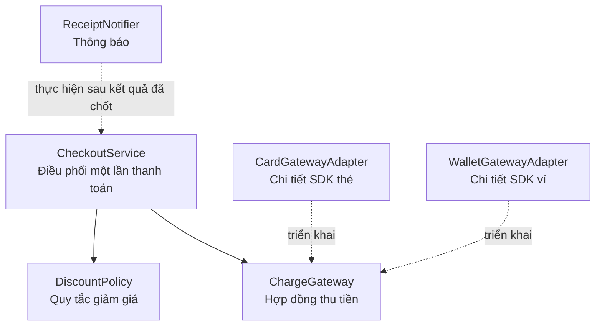

# Áp dụng SOLID theo vấn đề cần giải quyết

Trong module `CODE_QUALITY_FUNDAMENTALS`, mục tiêu của chất lượng mã nguồn là giúp phần mềm **đáng tin cậy, dễ hiểu và dễ thay đổi**. Ở chương **Cấu trúc và phụ thuộc**, SOLID là một bộ nguyên tắc hỗ trợ thiết kế trách nhiệm và quan hệ giữa các thành phần, đặc biệt trong lập trình hướng đối tượng. SOLID hữu ích nhất khi được dùng để **giải quyết một vấn đề thay đổi đã xác định**, thay vì để tăng số lượng interface, lớp hoặc mẫu thiết kế.

Giả sử một hệ thống bán hàng cần tính giảm giá, thu tiền và thông báo kết quả. Ban đầu, mọi việc nằm trong một phương thức. Sau vài tháng, chính sách khuyến mãi đổi thường xuyên, xuất hiện thêm nhà cung cấp thanh toán và một số nhà cung cấp không hỗ trợ hoàn tiền. Những thay đổi này có thể làm một lớp ngày càng nhiều nhánh, phụ thuộc chặt vào thư viện bên ngoài và khó kiểm thử. SOLID giúp trả lời: *Tách chỗ nào? Cho phép mở rộng điểm nào? Hợp đồng nào bắt buộc phải được giữ? Thành phần nào nên phụ thuộc vào thành phần nào?*

Sau bài học, bạn có thể:

- Giải thích năm nguyên tắc SRP, OCP, LSP, ISP, DIP bằng một vấn đề thực tế.
- Phân biệt triệu chứng của thiết kế khó thay đổi với nhu cầu trừu tượng hóa thực sự.
- Thiết kế ví dụ Java có ranh giới trách nhiệm, hợp đồng và chiều phụ thuộc hợp lý.
- Nhận diện trường hợp áp dụng SOLID máy móc khiến mã phức tạp hơn.
- Đề xuất kiểm thử và tiêu chí đánh giá sau refactor.

## 1. SOLID là công cụ xử lý áp lực thay đổi

Năm chữ viết tắt thường được hiểu như sau:

| Nguyên tắc | Câu hỏi thiết kế | Vấn đề thường muốn giảm |
| --- | --- | --- |
| **S — Single Responsibility Principle (SRP)** | Những thay đổi vì các nguyên nhân khác nhau có đang dồn vào cùng một thành phần không? | Sửa nghiệp vụ này làm ảnh hưởng hoặc bắt buộc hiểu nghiệp vụ khác. |
| **O — Open/Closed Principle (OCP)** | Điểm thay đổi dự kiến có thể được mở rộng qua một hợp đồng ổn định không? | Cứ thêm biến thể lại sửa chuỗi điều kiện ở một khối trung tâm. |
| **L — Liskov Substitution Principle (LSP)** | Mọi cách triển khai có giữ được hợp đồng mà bên gọi đang dựa vào không? | Thay đối tượng triển khai làm hỏng giả định, đổi ý nghĩa hoặc ném lỗi bất ngờ. |
| **I — Interface Segregation Principle (ISP)** | Bên dùng có phải biết hoặc triển khai thao tác không liên quan đến nhu cầu của mình không? | Interface quá rộng, phương thức không hỗ trợ, các bên gọi bị khớp nối không cần thiết. |
| **D — Dependency Inversion Principle (DIP)** | Chính sách nghiệp vụ có phụ thuộc trực tiếp vào chi tiết kỹ thuật hay không? | Thay thư viện, dịch vụ ngoài hoặc môi trường kiểm thử buộc sửa logic lõi. |

Các nguyên tắc có quan hệ nhưng không đồng nghĩa. Một lớp có trách nhiệm rõ ràng (SRP) vẫn có thể phụ thuộc trực tiếp SDK thanh toán (vấn đề DIP). Một interface nhỏ (ISP) vẫn có thể có cách triển khai vi phạm hợp đồng (vấn đề LSP). Một kiến trúc nhiều interface chưa chắc mở rộng dễ nếu cứ bổ sung biến thể phải sửa tất cả lớp gọi (vấn đề OCP).

### Bắt đầu từ triệu chứng thay vì tên nguyên tắc

| Triệu chứng quan sát được | Câu hỏi cần điều tra | Nguyên tắc gợi ý |
| --- | --- | --- |
| Một lớp phải sửa khi thay phí giao hàng, mẫu email và SQL | Các thay đổi có đến từ những nhu cầu độc lập không? | SRP |
| Thêm loại ưu đãi luôn phải sửa chuỗi `if/else` ở một lớp trung tâm | Có một tập biến thể thực sự cần mở rộng thường xuyên không? | OCP |
| Một cách triển khai trả `null` hoặc ném `UnsupportedOperationException` thay cho kết quả đã cam kết | Hợp đồng có mô tả đúng những gì mọi cách triển khai cung cấp không? | LSP, ISP |
| Một client chỉ cần thu tiền nhưng phải phụ thuộc thêm hoàn tiền, thanh toán định kỳ | Interface đang phục vụ quá nhiều nhóm nhu cầu khác nhau không? | ISP |
| Muốn kiểm thử tính tiền phải chạy SDK thanh toán hoặc gọi mạng thật | Quy tắc nghiệp vụ có thể phụ thuộc vào một cổng trừu tượng không? | DIP, SRP |

Một triệu chứng có thể liên quan đến nhiều nguyên tắc. SOLID là các góc nhìn để tìm nguyên nhân và lựa chọn thiết kế phù hợp; không phải công thức có thứ tự bắt buộc.

## 2. SRP: nhóm những thay đổi cùng một lý do

**Single Responsibility Principle** thường được diễn đạt là “một thành phần có một lý do để thay đổi”. “Lý do” ở đây nên hiểu là một nguồn yêu cầu hoặc trách nhiệm có tính gắn kết, chứ không phải mỗi lớp chỉ được có một phương thức.

Trong hệ thống bán hàng, có ít nhất ba mối quan tâm:

- **Chính sách giá:** quy tắc giảm giá, làm tròn, điều kiện hưởng ưu đãi.
- **Thanh toán:** kết nối nhà cung cấp, xử lý phản hồi, mã tham chiếu giao dịch.
- **Thông báo:** soạn nội dung, chọn kênh và gửi thông báo.

Nếu một `CheckoutService` chứa tất cả chi tiết trên, thay mẫu email có thể khiến lớp tính tiền phải sửa và kiểm thử lại những đường không liên quan. Một thiết kế hợp lý là để `CheckoutService` **điều phối quy trình thanh toán**, còn từng chính sách và tích hợp có điểm thay đổi riêng.



Sơ đồ mô tả **trách nhiệm và hợp đồng**, không có nghĩa mọi hệ thống phải đặt tên lớp đúng như vậy. Ranh giới tốt phụ thuộc vào quy trình và khả năng thay đổi độc lập trong thực tế.

### Những hiểu lầm về SRP

- **Một lớp chỉ có một phương thức:** một lớp tính phí có thể gồm các phương thức liên quan chặt chẽ tới cùng quy tắc.
- **Không bao giờ có lớp điều phối:** bản thân quy trình checkout vẫn cần một nơi điều phối; trách nhiệm của nơi đó là vận hành quy trình, không phải biết chi tiết SDK và khuôn mẫu email.
- **Tách càng nhiều càng tốt:** nếu mọi thao tác bị đẩy sang lớp trung gian chỉ chuyển tiếp lời gọi, người đọc phải nhảy qua nhiều file mà không nhận được ranh giới nghiệp vụ rõ hơn.

Quy tắc thực dụng: khi một yêu cầu thay đổi, thử xác định *phạm vi nhỏ nhất có thể chịu trách nhiệm cho nó*. Nếu các thay đổi độc lập thường buộc sửa cùng một lớp, đó là dấu hiệu đáng xem xét.

## 3. OCP: mở rộng đúng điểm thường thay đổi

**Open/Closed Principle** gợi ý rằng một đơn vị có thể **mở để mở rộng hành vi** nhưng **đóng đối với việc sửa liên tục cấu trúc đã ổn định**. Không nên diễn giải thành “không bao giờ được chỉnh sửa mã cũ”.

Giả sử cửa hàng hiện có hai chính sách giảm giá: không giảm và giảm 10% từ ngưỡng 1.000.000 đồng. Nếu `CheckoutService` chứa một chuỗi điều kiện theo tên khuyến mãi, mỗi loại mới sẽ buộc sửa lớp điều phối và tăng rủi ro hồi quy. Nếu biến thể thật sự cần bổ sung thường xuyên, có thể tách điểm mở rộng bằng hợp đồng `DiscountPolicy`.

Hợp đồng nghiệp vụ cần rõ trước khi tạo interface:

> Với một đơn hàng hợp lệ, `discountFor(order)` trả về giá trị không `null`, không âm và không vượt quá tổng tiền đơn hàng; phương thức chỉ tính toán, không tự thu tiền hay gửi thông báo. Quy tắc làm tròn và đơn vị tiền cần được xác định nhất quán.

Khi có hợp đồng đó, một chính sách mới có thể được thêm bằng một cách triển khai mới. Mã điều phối không cần sửa khi chỉ thay công thức giảm giá và cách chọn chính sách được xử lý tại điểm cấu hình.

**OCP có giới hạn:** điểm mở rộng là một lựa chọn thiết kế, không phải lời hứa hỗ trợ vô hạn biến thể. Khi nghiệp vụ thay đổi bản chất, hợp đồng cũng có thể cần được điều chỉnh có chủ đích. Mỗi interface và lớp chính sách thêm vào đều mang chi phí đọc hiểu, cấu hình và kiểm thử.

### Ví dụ Java: thay quy tắc bằng cách thay chính sách

Đoạn mã dưới đây minh họa các kiểu và đối tượng cần thiết cho một luồng checkout đơn giản. Ví dụ giả định tiền Việt được biểu diễn bằng số nguyên đồng trong `BigDecimal`, không có thuế, phí vận chuyển hay quy trình hoàn tiền. Các điều kiện ngoài phạm vi này cần được xác định riêng trong hệ thống thực.

```java
import java.math.BigDecimal;
import java.math.RoundingMode;
import java.util.Objects;

record Order(String id, BigDecimal subtotal) {
    Order {
        if (id == null || id.isBlank() || subtotal == null
                || subtotal.signum() < 0
                || subtotal.stripTrailingZeros().scale() > 0) {
            throw new IllegalArgumentException("Invalid order");
        }
    }
}

interface DiscountPolicy {
    // Contract: non-null, 0 <= result <= order.subtotal()
    BigDecimal discountFor(Order order);
}

final class NoDiscountPolicy implements DiscountPolicy {
    @Override
    public BigDecimal discountFor(Order order) {
        return BigDecimal.ZERO;
    }
}

final class ThresholdDiscountPolicy implements DiscountPolicy {
    private static final BigDecimal MIN_SUBTOTAL =
            new BigDecimal("1000000");
    private static final BigDecimal RATE = new BigDecimal("0.10");

    @Override
    public BigDecimal discountFor(Order order) {
        if (order.subtotal().compareTo(MIN_SUBTOTAL) < 0) {
            return BigDecimal.ZERO;
        }
        return order.subtotal()
                .multiply(RATE)
                .setScale(0, RoundingMode.DOWN);
    }
}
```

Để bổ sung chính sách giảm giá khác, ví dụ giảm theo mã đối tác, có thể tạo `PartnerDiscountPolicy` với cùng hợp đồng mà không sửa các điều kiện bên trong `CheckoutService`. Tên chính sách, cách chọn và kết hợp nhiều ưu đãi cũng là quyết định nghiệp vụ: không nên giả định rằng mọi chính sách có thể tự động cộng dồn.

Chỉ tạo một interface như trên khi chính sách là một **điểm biến thiên có thật**. Nếu sản phẩm có đúng một quy tắc đơn giản và ổn định, một hàm hoặc lớp cụ thể có tên rõ nghĩa có thể đủ dễ hiểu hơn.

## 4. LSP: các cách triển khai phải giữ hợp đồng chung

**Liskov Substitution Principle** nói về khả năng thay thế: nơi đang dùng hợp đồng của một kiểu phải có thể dùng một cách triển khai khác mà vẫn giữ được những kỳ vọng hợp lệ của bên gọi. Điều này áp dụng với kế thừa lớp và cả việc triển khai interface.

Với `DiscountPolicy`, bên gọi cần tin rằng giảm giá luôn nằm trong khoảng từ 0 tới tổng đơn. Cách triển khai sau **vi phạm** hợp đồng:

```java
final class InvalidDiscountPolicy implements DiscountPolicy {
    @Override
    public BigDecimal discountFor(Order order) {
        return order.subtotal().negate(); // Sai: trả giảm giá âm
    }
}
```

Nếu checkout lấy `subtotal - discount`, kết quả có thể **tăng** tiền thay vì giảm. Chương trình vẫn biên dịch; lỗi nằm trong **ngữ nghĩa hợp đồng**.

Một cách triển khai cũng có thể vi phạm LSP khi:

- Đòi hỏi điều kiện đầu vào nghiêm ngặt hơn điều kiện đã công bố; ví dụ chỉ chấp nhận đơn hàng trên 1.000.000 đồng dù hợp đồng nói mọi `Order` hợp lệ đều tính được (đơn dưới ngưỡng phải trả 0).
- Trả `null`, giá trị âm, giá trị lớn hơn tổng đơn hoặc dữ liệu không đạt bảo đảm đầu ra.
- Tự gửi email hoặc thu tiền trong một phương thức được cam kết là phép tính không có tác dụng phụ.
- Bất ngờ ném `UnsupportedOperationException` cho một thao tác mà interface yêu cầu mọi triển khai phải hỗ trợ.

LSP còn bao gồm việc không phá vỡ **bất biến**, **hậu điều kiện** và những đặc tính hành vi quan trọng mà client dựa vào. Một lớp con không nên tăng yêu cầu tiền điều kiện hoặc giảm bảo đảm hậu điều kiện so với hợp đồng gốc.

### Kết hợp LSP với thiết kế kiểm thử hợp đồng

Kiểm thử mỗi chính sách riêng là cần thiết, nhưng vẫn nên có **bộ kiểm thử chung** cho mọi cách triển khai. Chẳng hạn, với mọi `Order` hợp lệ trong tập mẫu:

1. Gọi `discountFor(order)` không gây lỗi ngoài hợp đồng.
2. Kết quả không được `null`.
3. Kết quả `>= 0` và `<= order.subtotal()`.
4. Giá trị đơn hàng ban đầu không bị thay đổi.

Thực tế cần thêm kiểm thử giá trị sát ngưỡng, trường hợp không đủ điều kiện và quy tắc làm tròn. Kiểm thử hợp đồng **không chứng minh mọi hành vi của mọi triển khai đều đúng**, nhưng làm rõ kỳ vọng mà mọi chính sách bắt buộc chia sẻ.

Đáng lưu ý: không phải mọi biến thể nghiệp vụ có thể thay thế cho nhau. Nếu một nhà cung cấp không hỗ trợ hoàn tiền, ép nó vào hợp đồng “mọi nhà cung cấp đều hoàn tiền được” sẽ tạo ra một hợp đồng sai ngay từ đầu. Đây là nơi LSP liên hệ với ISP.

## 5. ISP: chỉ phụ thuộc vào khả năng thực sự cần

**Interface Segregation Principle** khuyên không buộc client phụ thuộc vào các thao tác mà nó không sử dụng. Vấn đề hay gặp là interface “đa năng”:

```java
// Minh họa thiết kế quá rộng
interface FullPaymentProvider {
    void charge(String orderId, BigDecimal amount);
    void refund(String paymentId, BigDecimal amount);
    void startSubscription(String customerId);
}
```

Ứng dụng chỉ cần thu tiền sẽ bị ràng buộc vào hoàn tiền và thanh toán định kỳ. Một cổng thanh toán chỉ hỗ trợ thu tiền có thể phải viết những phương thức ném `UnsupportedOperationException`. Kết quả vừa tăng khớp nối vừa khiến client dựa vào một hợp đồng không đúng.

Tách theo **nhu cầu của client**:

```java
record PaymentReceipt(String providerReference) {}

interface ChargeGateway {
    // Hợp đồng nghiệp vụ: trả receipt khi thu thành công,
    // hoặc trả lỗi theo quy tắc đã định khi thất bại.
    PaymentReceipt charge(String orderId, BigDecimal amount);
}

interface RefundGateway {
    void refund(String providerReference, BigDecimal amount);
}
```

Một adapter có thể triển khai cả hai interface nếu dịch vụ ngoài hỗ trợ. Adapter chỉ thu tiền chỉ cần triển khai `ChargeGateway`. `CheckoutService` phụ thuộc đúng khả năng thu tiền; quy trình hoàn tiền phụ thuộc `RefundGateway`.

Không cần chia interface đến mức mỗi phương thức đều có interface riêng. Nếu các thao tác luôn được một nhóm client sử dụng cùng nhau, hợp đồng chung có thể rõ ràng hơn. Mục tiêu của ISP là **giảm phụ thuộc không liên quan**, không phải tối đa hóa số lượng interface.

## 6. DIP: quy tắc nghiệp vụ không gắn chặt chi tiết kỹ thuật

**Dependency Inversion Principle** gợi ý:

- Thành phần chứa chính sách nghiệp vụ cấp cao không nên phụ thuộc trực tiếp vào chi tiết cấp thấp như SDK thanh toán, thư viện email hay truy vấn SQL.
- Cả hai phía nên phụ thuộc vào một **trừu tượng phù hợp với nhu cầu nghiệp vụ**; hợp đồng này không cần kế thừa từ kiểu dữ liệu của nhà cung cấp.

Nếu `CheckoutService` tự tạo `ExternalPaymentSdkClient` và gọi các phương thức cụ thể của SDK, đổi nhà cung cấp có thể buộc sửa mã điều phối; kiểm thử đơn vị cũng khó chạy độc lập. Thay vào đó, cho lớp điều phối phụ thuộc vào `ChargeGateway`.

```java
record CheckoutResult(BigDecimal chargedAmount, PaymentReceipt receipt) {}

final class CheckoutService {
    private final DiscountPolicy discountPolicy;
    private final ChargeGateway chargeGateway;

    CheckoutService(
            DiscountPolicy discountPolicy,
            ChargeGateway chargeGateway) {
        this.discountPolicy = Objects.requireNonNull(discountPolicy);
        this.chargeGateway = Objects.requireNonNull(chargeGateway);
    }

    CheckoutResult checkout(Order order) {
        Objects.requireNonNull(order);
        BigDecimal discount = discountPolicy.discountFor(order);

        // Phòng vệ tại ranh giới khi thay chính sách.
        if (discount == null || discount.signum() < 0
                || discount.compareTo(order.subtotal()) > 0) {
            throw new IllegalStateException("Invalid discount");
        }

        BigDecimal payable = order.subtotal().subtract(discount);
        PaymentReceipt receipt = chargeGateway.charge(order.id(), payable);
        if (receipt == null) {
            throw new IllegalStateException("Missing payment receipt");
        }
        return new CheckoutResult(payable, receipt);
    }
}
```

Lớp `CheckoutService` diễn đạt quy trình: tính giảm giá, xác minh hợp đồng giảm giá, thu số tiền còn lại và trả kết quả. Nó không biết tên SDK, URL endpoint, mã HTTP hay định dạng thông điệp của từng nhà cung cấp.

Một adapter ở vùng hạ tầng sẽ **chuyển đổi** lời gọi `ChargeGateway.charge` thành lời gọi SDK và ánh xạ kết quả/lỗi của nhà cung cấp thành kiểu ứng dụng đã công bố. Ví dụ:

```java
// Ví dụ trừu tượng, adapter cụ thể cần dựa vào SDK thật.
final class CardGatewayAdapter implements ChargeGateway {
    private final CardSdkClient sdk;

    CardGatewayAdapter(CardSdkClient sdk) {
        this.sdk = sdk;
    }

    @Override
    public PaymentReceipt charge(String orderId, BigDecimal amount) {
        String reference = sdk.capture(orderId, amount);
        return new PaymentReceipt(reference);
    }
}
```

Ở đây `CardSdkClient` đại diện cho một API giả định của nhà cung cấp để minh họa ranh giới adapter, **không phải lớp có sẵn trong JDK**. Mã xây dựng ứng dụng (*composition root*) có nhiệm vụ tạo `CardGatewayAdapter` với SDK thật và truyền vào `CheckoutService`.

**DIP không đồng nghĩa với dependency injection (DI).** Constructor injection ở ví dụ trên là một kỹ thuật chuyển phụ thuộc vào lớp; DIP là quyết định **chiều phụ thuộc giữa chính sách và chi tiết**. Có thể thực hiện constructor injection thủ công mà không cần Spring hoặc DI container.

Thêm một interface mà chính sách vẫn đọc trực tiếp dữ liệu đặc thù của SDK không thật sự đảo chiều phụ thuộc. Hợp đồng `ChargeGateway` cần được viết bằng **ngôn ngữ nghiệp vụ mà checkout sử dụng**, còn việc ánh xạ sang chi tiết nhà cung cấp thuộc adapter.

## 7. Từ triệu chứng đến lựa chọn thiết kế

Không phải lúc nào cũng cần áp dụng đầy đủ cả năm nguyên tắc. Tình huống cụ thể sẽ quyết định bước cải tiến hợp lý.

### Tình huống A: một quy tắc đơn giản, hiếm thay đổi

Ứng dụng nội bộ có đúng một quy tắc giảm phí, được mô tả rõ và ít khi sửa. Việc tạo `PricingStrategyFactory`, nhiều chính sách con và một registry có thể làm nhiều người phải đọc hơn mà không giảm rủi ro. Một hàm thuần như `calculateFee(...)`, với đầu vào/đầu ra rõ ràng và kiểm thử điểm biên, có thể đủ.

**Điểm quyết định:** khả năng mở rộng trong tương lai chỉ là giả thuyết, còn chi phí abstraction phát sinh ngay hôm nay. OCP không yêu cầu thiết kế trước mọi biến thể chưa có bằng chứng.

### Tình huống B: cùng lớp bị sửa bởi ba nhóm yêu cầu độc lập

Mỗi lần đổi giá, biểu mẫu thông báo hoặc nhà cung cấp thanh toán đều phải sửa một lớp 1.000 dòng. Lỗi ở phần thông báo từng làm đường tính tiền không thể triển khai.

**Hướng xử lý:** điều tra lý do thay đổi, xác định trách nhiệm độc lập (SRP), rồi tách thành các thành phần có hợp đồng rõ. Đặt công thức tiền ở chính sách riêng; đặt chi tiết API thanh toán và gửi email ở adapter. Chỉ thêm cơ chế mở rộng chính sách (OCP) khi có nhiều biến thể thật.

**Cần đo lại:** thay đổi một quy tắc giá có còn buộc sửa phần email hay SDK không; kiểm thử chính sách có chạy không cần mạng không; lỗi hồi quy có giảm trong các lần thay đổi cùng loại không.

### Tình huống C: thêm cổng thanh toán thứ ba

Hai cổng trước hỗ trợ thu tiền và hoàn tiền, cổng mới chỉ hỗ trợ thu tiền. Nếu interface chung yêu cầu `refund`, cách triển khai mới phải ném `UnsupportedOperationException`.

**Hướng xử lý:** áp dụng ISP tách `ChargeGateway` và `RefundGateway`; giữ LSP bằng cách mọi `ChargeGateway` đều thực hiện đúng hợp đồng thu tiền. Dùng DIP để chính sách checkout không phụ thuộc SDK cụ thể. Việc hỗ trợ hoàn tiền trở thành **năng lực riêng**, được quy trình hoàn tiền kiểm tra và quyết định rõ ràng.

**Điểm cần tránh:** đừng viết `if (gateway instanceof NewProvider)` trong checkout để né việc nhà cung cấp không hỗ trợ hoàn tiền. Điều này khiến chính sách nghiệp vụ biết chi tiết hạ tầng và tạo điều kiện đặc biệt khó duy trì.

### Tình huống D: quy tắc kinh doanh thay đổi bản chất

Trước đây ưu đãi luôn là một khoản tiền giảm; nay cần “mua hai tặng một”, hoàn xu hoặc cho trả góp. Không phải hành vi mới nào cũng diễn đạt hợp lý bằng `BigDecimal discountFor(Order)`.

**Hướng xử lý:** xem xét lại hợp đồng miền nghiệp vụ. Có thể cần kết quả định giá giàu thông tin hơn, ví dụ một `PriceAdjustment` có loại điều chỉnh, hoặc tách chương trình thưởng điểm khỏi phần tính giảm giá. Trong trường hợp này, **sửa hợp đồng hiện tại một cách có kiểm soát** có thể đúng hơn cố kéo giãn nó để giữ nguyên bề ngoài của OCP.

SOLID hỗ trợ thay đổi an toàn, nhưng không thể quyết định thay nhóm sản phẩm rằng “ưu đãi” có ý nghĩa gì.

## 8. Ranh giới giữa trừu tượng và phức tạp không cần thiết

Một số thiết kế trông giống SOLID nhưng gây ra vấn đề khác:

| Cách làm máy móc | Rủi ro | Hướng tiếp cận tốt hơn |
| --- | --- | --- |
| Mỗi lớp phải có interface tương ứng, dù chỉ có một cách dùng | Khó lần theo mã, nhiều tệp trung gian, tên trùng lặp | Tạo interface tại ranh giới cần thay thế, tách phụ thuộc hoặc kiểm thử. |
| Mỗi `if` là một subclass | Bùng nổ lớp, luồng quyết định bị phân tán | Giữ điều kiện đơn giản; chỉ tách chính sách khi các biến thể có ý nghĩa độc lập. |
| Mọi lớp chỉ có một phương thức | Các trách nhiệm gắn kết bị chia nhỏ vô cớ | Dùng “lý do thay đổi” của SRP, không đếm số phương thức. |
| Interface gốc đưa ra hợp đồng quá rộng | Lớp triển khai không thể đáp ứng, vi phạm LSP/ISP | Thu hẹp theo nhu cầu của client và mô tả rõ tiền/hậu điều kiện. |
| Đưa tất cả đối tượng qua một service locator toàn cục | Phụ thuộc ẩn, kiểm thử và truy vết khó | Truyền tường minh những phụ thuộc mà một thành phần thực sự cần. |
| Tạo lớp trừu tượng nhưng để kiểu dữ liệu SDK lộ vào miền nghiệp vụ | Thay SDK vẫn phải sửa logic lõi | Để adapter chuyển đổi sang kiểu có ý nghĩa nghiệp vụ. |
| Chia nhỏ quá mức một quy trình cần tính nhất quán | Khó theo dõi và bảo vệ bất biến xuyên thành phần | Tách trách nhiệm trong khi giữ rõ ranh giới giao dịch và hợp đồng. |

**Cohesion** (tính gắn kết) và **coupling** (mức độ phụ thuộc) là hai hướng quan sát hữu ích: những thao tác chung một trách nhiệm nên có tính gắn kết cao; các trách nhiệm độc lập nên chỉ phụ thuộc nhau qua ranh giới cần thiết. SOLID có thể giúp đạt điều đó, nhưng không tạo ra lợi ích tự động.

### Đừng đánh đổi tính đúng đắn để có hình thức đẹp

Ví dụ checkout có nhiều hoạt động: trừ tồn kho, thu tiền, lưu đơn, phát sự kiện và gửi thông báo. Chỉ tách ra năm interface không khiến tất cả hoạt động trở thành **một giao dịch nguyên tử**. Nếu thanh toán thành công nhưng ghi đơn thất bại, hệ thống vẫn phải có phương án đối soát hoặc xử lý bù. Nếu client thử lại sau timeout, cần định nghĩa tính lặp an toàn (*idempotency*) để tránh thu tiền hai lần.

SOLID giúp **ai chịu trách nhiệm phần nào** và **thành phần phụ thuộc vào hợp đồng nào**; tính đúng đắn, độ tin cậy, xử lý đồng thời, bảo mật và phục hồi sự cố vẫn cần thiết kế riêng. Không nên dùng sơ đồ lớp như bằng chứng rằng thay đổi đã an toàn.

## 9. Kiểm thử để chứng minh lợi ích của thiết kế

Một bản refactor theo SOLID phải bảo vệ hành vi hiện có. Kiểm thử nên tập trung vào **hợp đồng được sử dụng**, thay vì kiểm tra tên lớp hay số lượng interface.

### 9.1. Kiểm thử checkout không cần SDK thanh toán

Vì `CheckoutService` phụ thuộc vào `ChargeGateway`, có thể truyền một cổng giả trong kiểm thử đơn vị. Ví dụ với JUnit 5, sử dụng các kiểu Java đã định nghĩa ở các đoạn mã trước:

```java
import static org.junit.jupiter.api.Assertions.assertEquals;
import static org.junit.jupiter.api.Assertions.assertNotNull;
import static org.junit.jupiter.api.Assertions.assertTrue;

import java.math.BigDecimal;
import java.util.List;
import java.util.concurrent.atomic.AtomicReference;
import org.junit.jupiter.api.Test;

class CheckoutServiceTest {
    @Test
    void chargesAmountAfterDiscount() {
        AtomicReference<String> capturedId = new AtomicReference<>();
        AtomicReference<BigDecimal> capturedAmount =
                new AtomicReference<>();

        ChargeGateway fakeGateway = (orderId, amount) -> {
            capturedId.set(orderId);
            capturedAmount.set(amount);
            return new PaymentReceipt("payment-123");
        };

        CheckoutService service = new CheckoutService(
                new ThresholdDiscountPolicy(), fakeGateway);
        CheckoutResult result = service.checkout(
                new Order("order-1", new BigDecimal("1000000")));

        assertEquals("order-1", capturedId.get());
        assertEquals(new BigDecimal("900000"), capturedAmount.get());
        assertEquals(new BigDecimal("900000"), result.chargedAmount());
        assertEquals("payment-123",
                result.receipt().providerReference());
    }

    @Test
    void everyDiscountPolicyRespectsBasicContract() {
        List<DiscountPolicy> policies = List.of(
                new NoDiscountPolicy(),
                new ThresholdDiscountPolicy());
        List<Order> orders = List.of(
                new Order("zero", BigDecimal.ZERO),
                new Order("below", new BigDecimal("999999")),
                new Order("at", new BigDecimal("1000000")),
                new Order("above", new BigDecimal("1000001")));

        for (DiscountPolicy policy : policies) {
            for (Order order : orders) {
                BigDecimal discount = policy.discountFor(order);
                assertNotNull(discount);
                assertTrue(discount.signum() >= 0);
                assertTrue(discount.compareTo(order.subtotal()) <= 0);
            }
        }
    }
}
```

Kiểm thử đầu tiên cung cấp bằng chứng rằng checkout dùng kết quả giảm giá để gọi đúng cổng thu tiền, mà không khởi tạo SDK thật. Kiểm thử thứ hai minh họa một **bộ kiểm thử hợp đồng** áp dụng cho các chính sách, liên quan đến LSP. Khi thêm chính sách mới, cần bổ sung nó vào tập cách triển khai được kiểm chứng và viết thêm ca riêng cho điều kiện nghiệp vụ đặc thù.

Hai bài kiểm thử này không chứng minh adapter thanh toán thực sự hoạt động; adapter cần kiểm thử tích hợp hoặc kiểm thử hợp đồng với môi trường giả lập phù hợp. Trong hệ thống thực còn phải kiểm tra lỗi mạng, mã phản hồi, timeout, yêu cầu trùng và bảo vệ dữ liệu nhạy cảm.

### 9.2. Kiểm thử hành vi trước và sau refactor

Giả sử lớp cũ xử lý giảm giá bằng `if/else`. Trước khi tách thành `DiscountPolicy`:

1. **Ghi rõ hợp đồng hiện hành:** mức giảm, ngưỡng, làm tròn, xử lý đơn không hợp lệ, kết quả khi thanh toán thất bại.
2. **Tạo kiểm thử đặc tả hành vi:** dưới ngưỡng, bằng ngưỡng, trên ngưỡng, các biên giá trị và lỗi đầu vào.
3. **Tách cấu trúc với yêu cầu đổi nghiệp vụ:** chuyển logic sang chính sách trước, giữ hành vi; sau đó mới thay quy tắc ưu đãi theo yêu cầu mới.
4. **Kiểm thử các bên sử dụng hợp đồng:** từ checkout tới gateway, dữ liệu đơn hàng và phản hồi API nếu có.
5. **Review ranh giới mới:** tránh logic bị trùng ở hai nơi, tham chiếu SDK lọt vào miền nghiệp vụ hoặc chi phí cấu hình tăng không cần thiết.

Nếu quy tắc cũ có hành vi sai, hãy ghi nhận và phân biệt **sửa lỗi có chủ đích** với **refactor giữ hành vi**. Gộp hai loại thay đổi mà không nói rõ sẽ làm việc xác định nguyên nhân lỗi hồi quy khó hơn.

## 10. Cách ra quyết định khi review mã

Trong review một lớp hoặc một đề xuất refactor, có thể dùng chuỗi câu hỏi sau:

1. **Thay đổi nào đang gây khó khăn?** Có ví dụ về yêu cầu, lỗi, vị trí phải sửa hoặc thời gian tìm hiểu không?
2. **Những trách nhiệm nào thật sự độc lập?** Mỗi trách nhiệm thuộc một nhóm quy tắc hoặc một lý do thay đổi nào?
3. **Biến thể nào có khả năng xuất hiện?** Có bằng chứng từ yêu cầu đang có hay chỉ suy đoán xa?
4. **Hợp đồng chung là gì?** Đầu vào, đầu ra, lỗi, tác dụng phụ và bất biến nào mọi cách triển khai phải giữ?
5. **Client thực sự cần thao tác nào?** Có phương thức dư thừa hoặc triển khai phải ném `UnsupportedOperationException` không?
6. **Chiều phụ thuộc đang đi về đâu?** Logic lõi có biết trực tiếp SDK, SQL, framework hoặc cấu hình hạ tầng không?
7. **Thay đổi thiết kế có thực sự đơn giản hơn?** Người mới có thể theo dõi luồng dễ hơn, kiểm thử nhanh hơn, và thay một quy tắc có cần sửa ít nơi hơn không?

Một phương án refactor hợp lý nên có lợi ích xác định được, ví dụ: “Tách quy tắc giảm giá khỏi checkout để khi thêm loại ưu đãi chỉ bổ sung chính sách và kiểm thử tương ứng; checkout vẫn nhận `DiscountPolicy` và không đổi cách thu tiền”.

Tránh lập luận vòng tròn như “cần thêm lớp vì dự án phải theo SOLID”. Không có dấu hiệu thay đổi hoặc hợp đồng rõ ràng, việc thêm tầng trừu tượng có thể làm cả độ phức tạp và chi phí kiểm thử tăng lên.

### Các tiêu chí quan sát sau cải tiến

| Điều muốn cải thiện | Bằng chứng có thể quan sát |
| --- | --- |
| Dễ tìm nơi sửa quy tắc | Người phát triển xác định đúng chính sách mà không phải đọc SDK hoặc lớp thông báo. |
| Ít ảnh hưởng ngoài ý muốn | Thay một công thức không buộc sửa logic gửi email hoặc tích hợp thanh toán. |
| Đổi nhà cung cấp đơn giản hơn | Chỉ adapter và cấu hình lựa chọn thay đổi khi hợp đồng nghiệp vụ được giữ. |
| Dễ kiểm thử | Có thể kiểm thử tính giảm giá và phối hợp checkout không cần mạng hoặc DB thật. |
| Hợp đồng ổn định | Mọi `DiscountPolicy` đều vượt qua bộ kiểm thử hợp đồng chung. |
| Độ phức tạp chấp nhận được | Người đọc thấy rõ trách nhiệm, không phải đi qua nhiều lớp chuyển tiếp vô nghĩa. |

Không nên dùng riêng số lượng lớp, interface, tỷ lệ bao phủ hay một chỉ số độ phức tạp để tuyên bố thiết kế tốt. Các chỉ số chỉ giúp chọn nơi cần xem xét; kết luận phải gắn với hành vi và chi phí thay đổi thực tế.

## 11. Tình huống thực hành

**Bài 1 — Chẩn đoán theo triệu chứng.** Một lớp `OrderManager` vừa tính khuyến mãi, kiểm tra tồn kho, ghi SQL và gửi email. Đội sản phẩm thường đổi quy tắc khuyến mãi, trong khi đội vận hành đổi nội dung email. Hãy chỉ ra những lý do thay đổi độc lập, đề xuất các ranh giới hợp lý và giải thích nơi quy trình đặt hàng được điều phối.

**Bài 2 — Chọn OCP có điều kiện.** Một hệ thống có một quy tắc phí duy nhất, ổn định ba năm; hệ thống khác phải thêm một loại khuyến mãi hằng tháng. Hãy quyết định khi nào cần `DiscountPolicy`, khi nào hàm cụ thể là đủ. Nêu chi phí của mỗi phương án.

**Bài 3 — Kiểm tra LSP.** Có ba cách triển khai `DiscountPolicy`: A trả giá trị hợp lệ, B trả `null` khi không đủ điều kiện, C tự ghi bản ghi thanh toán khi tính giảm giá. Cách nào vi phạm hợp đồng đã nêu? Sửa chúng như thế nào và nên có những kiểm thử chung gì?

**Bài 4 — Phân tách interface.** Một cổng vận chuyển hỗ trợ tính phí và tạo nhãn; một đối tác chỉ hỗ trợ tra cứu phí. Nếu client báo giá chỉ cần tính phí, hãy thiết kế interface nhỏ đủ dùng và đề xuất cách ứng dụng phát hiện khả năng tạo nhãn mà không ép mọi đối tác triển khai thao tác không hỗ trợ.

**Bài 5 — Đảo chiều phụ thuộc.** `CheckoutService` đang khởi tạo SDK của nhà cung cấp A. Hãy vẽ sơ đồ phụ thuộc trước/sau, giới thiệu một cổng nghiệp vụ, đặt adapter phù hợp và viết kiểm thử checkout với cổng giả. Giải thích vì sao có thể làm việc này mà không cần DI framework.

**Bài 6 — Tình huống vượt ra ngoài SOLID.** Checkout gọi thanh toán thành công rồi mất kết nối trước khi ghi đơn. Hãy nêu tại sao tách lớp theo SRP/DIP chưa đủ để bảo đảm không thu tiền hai lần; đề xuất những hợp đồng và biện pháp cần bổ sung cho việc thử lại hoặc đối soát.

Tiêu chí tự đánh giá: bạn có thể nêu **vấn đề cụ thể**, chọn nguyên tắc phù hợp, viết **hợp đồng hành vi**, giải thích sự thay đổi **chiều phụ thuộc**, bảo vệ hành vi bằng kiểm thử và chỉ ra được **đánh đổi** của thiết kế mới.

## Ghi nhớ

**SOLID không phải danh sách việc phải làm với mọi lớp.** SRP giúp xác định ranh giới thay đổi; OCP giúp mở rộng tại những điểm biến thiên có thật; LSP buộc các cách triển khai giữ hợp đồng; ISP thu gọn điều client phải phụ thuộc; DIP giữ chính sách nghiệp vụ độc lập với chi tiết hạ tầng. Kết hợp đúng mức, chúng có thể giúp mã đáng tin cậy hơn khi thay đổi, dễ đọc và dễ kiểm thử. Hãy bắt đầu từ **triệu chứng có thể quan sát**, chọn ranh giới đơn giản nhất giải quyết được vấn đề, rồi xác minh hành vi và chi phí bảo trì sau khi chỉnh sửa.
