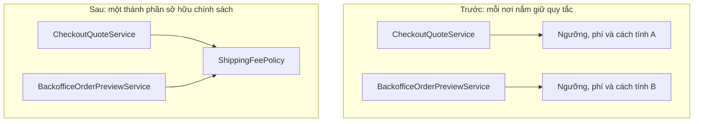
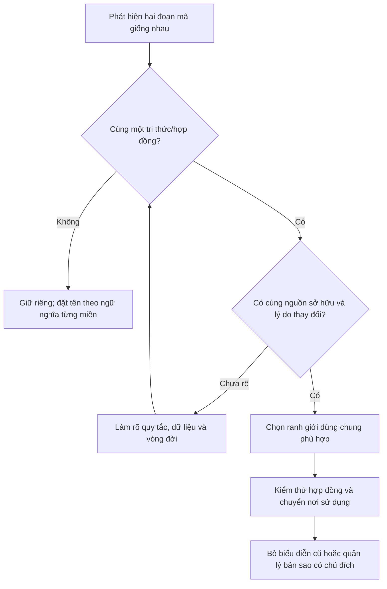

# DRY: loại trùng tri thức thay vì gộp mọi đoạn mã giống nhau

> **Chương:** Cấu trúc và phụ thuộc  
> **Học phần:** CODE_QUALITY_FUNDAMENTALS — Hiểu những thuộc tính quyết định mã nguồn có đáng tin cậy, dễ hiểu và dễ thay đổi hay không.

Khi review code, ta thường nghe nhận xét: “Hai đoạn này giống nhau, hãy trích thành một hàm cho đúng DRY”. Đôi khi nhận xét ấy giúp loại bỏ một lỗi bảo trì thực sự. Nhưng nếu hai đoạn mã chỉ **tình cờ có cú pháp giống nhau** và đại diện cho **hai quy tắc độc lập**, việc buộc chúng dùng chung một hàm có thể tạo ra phụ thuộc khó hiểu hơn cả phần mã lặp ban đầu.

**DRY** (*Don't Repeat Yourself*) nên được hiểu là tránh có nhiều biểu diễn độc lập của **cùng một tri thức mà hệ thống phải giữ nhất quán**. Tri thức ở đây có thể là quy tắc nghiệp vụ, thuật toán với hợp đồng đã xác định, định nghĩa dữ liệu, quy ước giao tiếp hoặc một quyết định thiết kế. Vấn đề cốt lõi là: **khi một sự thật thay đổi, có bao nhiêu nơi cần được sửa và kiểm tra để hệ thống tiếp tục đúng?**

Phạm vi bài học là tổ chức mã và phụ thuộc trong Java. Ta sẽ phân biệt sự lặp lại về cú pháp với sự trùng lặp tri thức, chọn ranh giới trừu tượng phù hợp, kiểm thử các quy tắc sau khi tập trung hóa và nhận diện các trường hợp cố gộp mã khiến hệ thống khó thay đổi hơn.

## 1. DRY thực sự muốn giải quyết vấn đề gì?

Giả sử hệ thống bán hàng quy định: **đơn hàng có tổng tiền sau giảm giá từ 500.000 VND trở lên được miễn phí giao hàng tiêu chuẩn**. Cùng quy tắc này xuất hiện ở trang thanh toán, màn hình xem trước đơn của nhân viên và dịch vụ tạo vận đơn.

Nếu ba vị trí tự viết điều kiện:

```java
if (subtotalAfterDiscountVnd >= 500_000L) {
    standardShippingFeeVnd = 0L;
}
```

thì khi chính sách đổi ngưỡng lên 600.000 VND, nhóm phải nhớ sửa cả ba vị trí. Chỉ cần bỏ sót một chỗ, khách hàng có thể thấy phí giao hàng ở màn hình đặt hàng khác với phí ghi trên đơn.

Đây là **trùng lặp tri thức**: nhiều nơi độc lập cùng giữ câu trả lời cho câu hỏi “ngưỡng miễn phí giao hàng tiêu chuẩn hiện tại là bao nhiêu và áp dụng cho số tiền nào?”.

Ngược lại, hai hàm sau có thể trông giống nhau:

```java
String normalizeCouponCode(String value) {
    return value.trim().toUpperCase(Locale.ROOT);
}

String normalizeWarehouseCode(String value) {
    return value.trim().toUpperCase(Locale.ROOT);
}
```

Nhưng mã giảm giá do khách hàng nhập và mã kho do hệ thống quản lý có thể có **quy tắc thay đổi độc lập**. Một ngày nào đó, mã giảm giá có thể phải giữ nguyên chữ hoa/chữ thường, còn mã kho vẫn chuẩn hóa. Gộp chúng thành một hàm `normalizeCode()` chỉ vì hiện tại cùng gọi `trim()` và `toUpperCase()` có thể tạo phụ thuộc giữa hai miền nghiệp vụ không liên quan.

**Câu hỏi quan trọng:** hai đoạn mã giống nhau vì cùng biểu diễn **một quy tắc**, hay chỉ giống vì **hai quy tắc khác nhau đang chọn cùng cách thực hiện**?

## 2. Phân biệt ba kiểu trùng lặp

| Kiểu trùng lặp | Ví dụ | Có nhất thiết phải loại bỏ? |
| --- | --- | --- |
| **Trùng cú pháp** (*textual duplication*) | Hai vòng lặp hoặc hai biểu thức điều kiện viết giống nhau | Không. Cần biết lý do và hợp đồng của từng đoạn |
| **Trùng cách làm** (*implementation duplication*) | Hai thành phần cùng dùng cách chuẩn hóa chuỗi hoặc phép tính giống nhau | Chỉ nên chia sẻ nếu hành vi, quyền sở hữu và hướng thay đổi phù hợp |
| **Trùng tri thức** (*knowledge duplication*) | Cùng ngưỡng, cùng định nghĩa trạng thái, cùng quy tắc tính phí được duy trì độc lập ở nhiều nơi | Thường là tín hiệu rõ cần tìm một nguồn có thẩm quyền hoặc cơ chế đồng bộ |

Trùng cú pháp có thể là **dấu hiệu để điều tra**, nhưng chưa phải bằng chứng vi phạm DRY. Ngược lại, trùng tri thức có thể xảy ra **dù mã khác hẳn nhau**:

```java
// Trong dịch vụ báo giá:
boolean freeShipping = totalVnd >= 500_000L;
```

```sql
-- Trong truy vấn của báo cáo nội bộ:
CASE WHEN order_subtotal_after_discount >= 500000
     THEN 0 ELSE 30000 END AS shipping_fee
```

Hai biểu diễn khác ngôn ngữ nhưng có thể đang duy trì cùng một chính sách. Khi chính sách đổi, chúng có nguy cơ không đồng bộ. Tuy nhiên, ví dụ trên chỉ thật sự là **cùng tri thức** nếu cả hai dùng cùng căn cứ tính phí, cùng thời điểm và cùng phạm vi đơn hàng. Nếu báo cáo cần giữ **phí đã chốt trong lịch sử**, nó phải đọc phí đã ghi nhận khi đặt hàng thay vì tự tính lại bằng chính sách hiện tại.

### Tri thức trùng lặp có thể nằm ngoài câu lệnh

Không chỉ điều kiện `if` mới có vấn đề. Cùng một quy tắc có thể xuất hiện trong:

- Hằng số, tệp cấu hình, biểu thức SQL hoặc stored procedure.
- Mã backend, frontend và ứng dụng di động.
- Khai báo schema, lớp DTO, bộ xác thực và tài liệu hợp đồng API.
- Bộ sinh mã, thông báo lỗi và tài liệu hướng dẫn vận hành.

Giải pháp không phải lúc nào cũng là “mọi thành phần cùng import một lớp”. Có khi cần **một hợp đồng chuẩn**, nguồn cấu hình có thẩm quyền hoặc công cụ sinh biểu diễn tương thích. Chọn cách phù hợp với ranh giới triển khai và quyền sở hữu dữ liệu.

## 3. Tại sao trùng tri thức làm giảm chất lượng?

Giả sử một nhóm sửa ngưỡng giao hàng ở bốn nơi. Mỗi nơi có thể dùng tên khác nhau, kiểu dữ liệu khác nhau hoặc được kiểm thử bởi một nhóm khác. Khi đó, thay đổi tưởng như nhỏ kéo theo nhiều câu hỏi:

1. Đã tìm hết nơi triển khai cùng chính sách chưa?
2. Mỗi nơi có áp dụng cho **tổng tiền sau giảm giá**, hay có nơi dùng **tổng tiền trước giảm giá**?
3. Có hệ thống nào dùng dữ liệu lịch sử và cần giữ chính sách cũ không?
4. Những bản triển khai khác nhau được phát hành cùng lúc hay theo phiên bản riêng?
5. Nếu hai nơi không đồng bộ, ai được xem là nguồn đúng?

Những câu hỏi này làm tăng **chi phí thay đổi** và **rủi ro sai lệch hành vi**. Trùng tri thức còn khiến việc review, kiểm thử và điều tra lỗi khó khăn vì một sửa đổi phải được đối chiếu với nhiều bản sao.

Một thiết kế DRY phù hợp mang lại các lợi ích cụ thể:

- **Một điểm quyết định quy tắc:** người bảo trì biết sửa nơi nào khi nghiệp vụ thay đổi.
- **Hợp đồng nhất quán hơn:** những nơi sử dụng cùng nhận một nghĩa của đầu vào, đầu ra, ngoại lệ và đơn vị.
- **Kiểm thử tập trung cho quy tắc:** có thể kiểm tra kỹ giá trị biên ngay tại thành phần sở hữu chính sách.
- **Phụ thuộc dễ giải thích:** thành phần sử dụng phụ thuộc vào chính sách chung, thay vì tự duy trì bản sao.

DRY **không bảo đảm** hệ thống tự động chính xác hoặc dễ kiểm thử. Nếu chính sách dùng chung sai, lỗi có thể ảnh hưởng đến tất cả nơi gọi. Quy tắc càng quan trọng, việc tập trung hóa càng cần đi kèm bằng chứng kiểm thử và trách nhiệm sở hữu rõ.

## 4. Ví dụ Java: tập trung chính sách miễn phí giao hàng

Xét chính sách minh họa:

- Phí giao hàng tiêu chuẩn: **30.000 VND**.
- Miễn phí giao hàng tiêu chuẩn khi **tổng tiền hàng sau giảm giá từ 500.000 VND trở lên**.
- Phí giao hàng nhanh: **50.000 VND**, không áp dụng ngưỡng miễn phí ở trên.
- Tổng tiền hàng sau giảm giá phải là số nguyên **không âm**, tính bằng VND.

Đây là quy tắc giả định để thực hành tổ chức mã, không phải chính sách của một sản phẩm cụ thể. Giả sử cả luồng báo giá ở checkout lẫn luồng xem trước đơn trong hệ thống quản trị **đều dùng đúng chính sách này**.

### 4.1. Hai nơi độc lập cùng duy trì quy tắc

```java
final class CheckoutQuoteService {
    long shippingFeeVnd(long subtotalAfterDiscountVnd, boolean express) {
        if (subtotalAfterDiscountVnd < 0L) {
            throw new IllegalArgumentException("Negative subtotal");
        }
        if (express) {
            return 50_000L;
        }
        return subtotalAfterDiscountVnd >= 500_000L ? 0L : 30_000L;
    }
}
```

```java
final class BackofficeOrderPreviewService {
    long shippingFeeVnd(long subtotalAfterDiscountVnd, boolean express) {
        if (subtotalAfterDiscountVnd < 0L) {
            throw new IllegalArgumentException("Negative subtotal");
        }
        if (express) {
            return 50_000L;
        }
        return subtotalAfterDiscountVnd >= 500_000L ? 0L : 30_000L;
    }
}
```

Hai luồng có những trách nhiệm khác nhau, nhưng cùng nắm giữ **ngưỡng miễn phí, mức phí và điều kiện áp dụng**. Khi chính sách thay đổi, đây là nhiều biểu diễn độc lập của một quyết định nghiệp vụ.

### 4.2. Đưa quy tắc về một thành phần có tên và hợp đồng rõ

Tạo một chính sách giao hàng có trách nhiệm tính phí:

```java
import java.util.Objects;

public final class ShippingFeePolicy {
    private static final long STANDARD_FEE_VND = 30_000L;
    private static final long EXPRESS_FEE_VND = 50_000L;
    private static final long FREE_STANDARD_MIN_SUBTOTAL_VND = 500_000L;

    public enum DeliveryMode {
        STANDARD,
        EXPRESS
    }

    /**
     * Tính phí giao hàng (VND) theo tổng tiền sau giảm giá.
     * Không thực hiện thay đổi trạng thái hay gọi dịch vụ bên ngoài.
     *
     * @throws IllegalArgumentException nếu tổng tiền âm
     * @throws NullPointerException nếu mode là null
     */
    public long calculateFeeVnd(
            long subtotalAfterDiscountVnd, DeliveryMode mode) {
        if (subtotalAfterDiscountVnd < 0L) {
            throw new IllegalArgumentException("Negative subtotal");
        }
        Objects.requireNonNull(mode, "mode");

        if (mode == DeliveryMode.EXPRESS) {
            return EXPRESS_FEE_VND;
        }
        return subtotalAfterDiscountVnd >= FREE_STANDARD_MIN_SUBTOTAL_VND
                ? 0L
                : STANDARD_FEE_VND;
    }
}
```

Giờ hai nơi sử dụng chính sách thông qua một phụ thuộc:

```java
import java.util.Objects;

final class CheckoutQuoteService {
    private final ShippingFeePolicy shippingFeePolicy;

    CheckoutQuoteService(ShippingFeePolicy shippingFeePolicy) {
        this.shippingFeePolicy =
                Objects.requireNonNull(shippingFeePolicy, "shippingFeePolicy");
    }

    long shippingFeeVnd(long subtotalAfterDiscountVnd, boolean express) {
        ShippingFeePolicy.DeliveryMode mode = express
                ? ShippingFeePolicy.DeliveryMode.EXPRESS
                : ShippingFeePolicy.DeliveryMode.STANDARD;

        return shippingFeePolicy.calculateFeeVnd(
                subtotalAfterDiscountVnd, mode);
    }
}
```

```java
import java.util.Objects;

final class BackofficeOrderPreviewService {
    private final ShippingFeePolicy shippingFeePolicy;

    BackofficeOrderPreviewService(ShippingFeePolicy shippingFeePolicy) {
        this.shippingFeePolicy =
                Objects.requireNonNull(shippingFeePolicy, "shippingFeePolicy");
    }

    long previewShippingFeeVnd(
            long subtotalAfterDiscountVnd,
            ShippingFeePolicy.DeliveryMode mode) {
        return shippingFeePolicy.calculateFeeVnd(
                subtotalAfterDiscountVnd, mode);
    }
}
```

**Điểm thay đổi:** hai luồng vẫn đảm nhiệm nhiệm vụ của riêng mình, nhưng **không tự triển khai chính sách tính phí**. Chúng nhận thành phần `ShippingFeePolicy` và dùng hợp đồng chung.

Đây là một lựa chọn phù hợp khi hai nơi thuộc cùng ứng dụng hoặc các module có thể chia sẻ một thành phần đáng tin cậy. Nếu các thành phần chạy ở những dịch vụ triển khai độc lập, có thể cần một dịch vụ chính sách, một nguồn cấu hình có thẩm quyền hoặc hợp đồng phiên bản rõ ràng; không mặc định chia sẻ cùng thư viện nhị phân là tối ưu.

### 4.3. Sơ đồ phụ thuộc trước và sau



Sơ đồ biểu thị **quan hệ sử dụng quy tắc**. Nó không có nghĩa tất cả hệ thống phải dùng chung một cơ sở dữ liệu hay một mô hình đối tượng. Mục tiêu là làm rõ ai **sở hữu định nghĩa chính sách** và ai **sử dụng kết quả**.

### 4.4. Kiểm thử chính sách tại điểm sở hữu

Một lớp chính sách chung nên có các kiểm thử phản ánh hợp đồng nghiệp vụ, đặc biệt là giá trị biên:

```java
import static org.junit.jupiter.api.Assertions.assertEquals;
import static org.junit.jupiter.api.Assertions.assertThrows;

import org.junit.jupiter.api.Test;

class ShippingFeePolicyTest {
    private final ShippingFeePolicy policy = new ShippingFeePolicy();

    @Test
    void standardShippingHasFeeBelowThreshold() {
        assertEquals(30_000L, policy.calculateFeeVnd(
                499_999L, ShippingFeePolicy.DeliveryMode.STANDARD));
    }

    @Test
    void standardShippingIsFreeAtThreshold() {
        assertEquals(0L, policy.calculateFeeVnd(
                500_000L, ShippingFeePolicy.DeliveryMode.STANDARD));
    }

    @Test
    void expressShippingIsChargedAboveThreshold() {
        assertEquals(50_000L, policy.calculateFeeVnd(
                600_000L, ShippingFeePolicy.DeliveryMode.EXPRESS));
    }

    @Test
    void negativeSubtotalIsRejected() {
        assertThrows(IllegalArgumentException.class,
                () -> policy.calculateFeeVnd(
                        -1L, ShippingFeePolicy.DeliveryMode.STANDARD));
    }
}
```

Hãy chú ý: kiểm thử sử dụng **giá trị mong đợi từ quy tắc nghiệp vụ**, thay vì lấy chính hằng số trong `ShippingFeePolicy` để tạo ra kỳ vọng. Nếu kiểm thử chỉ so sánh mã với chính mã, một lỗi sửa hằng số có thể làm cả hai phía cùng sai mà test vẫn xanh.

Sau khi tập trung hóa, vẫn nên có kiểm thử ở ranh giới quan trọng: checkout truyền **đúng tổng tiền sau giảm giá** và chọn đúng chế độ giao hàng; hệ thống quản trị dùng cùng chính sách; dữ liệu được lưu hoặc gửi sang bên khác khớp với kết quả đã tính. **Một bộ unit test cho lớp chung không thay thế kiểm thử tích hợp cho mọi nơi sử dụng**.

## 5. Khi hai đoạn mã giống nhau nhưng không nên gộp

### 5.1. Hai quy tắc thuộc hai miền khác nhau

Quay lại ví dụ chuẩn hóa mã:

```java
import java.util.Locale;

String normalizeCouponCode(String rawCode) {
    return rawCode.trim().toUpperCase(Locale.ROOT);
}

String normalizeWarehouseCode(String rawCode) {
    return rawCode.trim().toUpperCase(Locale.ROOT);
}
```

Giả sử nhóm tiếp thị quyết định mã coupon phải **phân biệt chữ hoa/chữ thường** để tương thích một đối tác, nhưng nhóm kho vẫn yêu cầu toàn bộ mã kho viết hoa. Nếu trước đó trích chung:

```java
String normalizeCode(String rawCode) {
    return rawCode.trim().toUpperCase(Locale.ROOT);
}
```

thì sửa `normalizeCode` theo yêu cầu tiếp thị có thể gây sai mã kho. Việc trích hàm đã tạo ra **phụ thuộc thay đổi** không có trong nghiệp vụ.

Chỉ nên dùng chung khi thực sự có một **quy ước chuẩn hóa chung được công bố và sở hữu rõ**, ví dụ mọi định danh của một giao thức tích hợp phải tuân cùng một định nghĩa. “Hiện tại dùng cùng hai lệnh” chưa đủ chứng minh rằng các miền phải thay đổi cùng nhau.

### 5.2. Hai giá trị hiện bằng nhau nhưng có lịch sử khác nhau

Giả sử phí vận chuyển được chốt khi khách đặt hàng là `30_000` VND. Về sau, chính sách hiện tại đổi thành `40_000` VND. Báo cáo lịch sử phải dùng **phí đã ghi nhận trong đơn**, không tính lại từ chính sách mới.

```java
long currentFeeVnd = shippingFeePolicy.calculateFeeVnd(
        currentSubtotalVnd, deliveryMode);

long invoicedFeeVnd = savedOrder.getShippingFeeChargedVnd();
```

Hai giá trị có thể trùng nhau vào ngày đặt hàng, nhưng đại diện cho **hai sự thật khác nhau**:

- `currentFeeVnd`: chính sách đang áp dụng với đơn mới hoặc báo giá mới.
- `invoicedFeeVnd`: giá trị giao dịch đã được ghi nhận tại một thời điểm.

Không nên loại bỏ `shippingFeeChargedVnd` chỉ vì có thể tính phí từ bảng chính sách hiện tại. Đây là một **ảnh chụp nghiệp vụ có giá trị lịch sử**, cần bảo toàn để đối soát và xử lý khiếu nại.

### 5.3. Cùng hình thức nhưng khác hợp đồng thất bại

Hai thao tác có thể đều gọi `repository.save(...)`, nhưng một thao tác cập nhật bản nháp có thể cho phép thử lại dễ dàng, còn thao tác chốt đơn hàng có thể phải bảo đảm không tạo thanh toán hoặc thông báo trùng.

Trích cả hai thành một phương thức chung chỉ vì cùng lưu dữ liệu có thể che khác biệt về **giao dịch, idempotency, ngoại lệ và phục hồi**. Hãy giữ ranh giới phản ánh hành vi mà từng bên phải bảo đảm.

### 5.4. Sự lặp lại làm ví dụ hoặc kiểm thử rõ hơn

Trong bài kiểm thử, việc viết riêng các trường hợp **499.999 VND** và **500.000 VND** giúp người review nhận diện quy tắc biên. Trích mọi giá trị mong đợi vào một helper dùng chung với phần cài đặt có thể giảm lặp văn bản nhưng làm mất tính độc lập của bằng chứng.

Đôi khi vài dòng lặp lại trong các bài kiểm thử giúp mỗi test **tự thể hiện bối cảnh và kỳ vọng**. Có thể trích dữ liệu dựng chung khi nó thật sự gây phiền toái bảo trì, nhưng đừng làm test khó đọc hoặc gắn chặt nó với thuật toán cần kiểm tra.

## 6. Phụ thuộc thay đổi quan trọng hơn số dòng trùng nhau

Một dấu hiệu hữu ích để quyết định có nên trừu tượng hóa là **lý do thay đổi**:

| Câu hỏi | Nếu câu trả lời là “có” |
| --- | --- |
| Hai nơi phải thay đổi cùng nhau khi một quy tắc nghiệp vụ đổi không? | Có khả năng đang trùng tri thức |
| Cùng một nhóm hoặc hợp đồng có thẩm quyền quyết định quy tắc không? | Có cơ sở để gom quyền sở hữu |
| Có thể nêu một tên và một hợp đồng chung mà cả hai nơi chấp nhận không? | Một trừu tượng chung có thể hữu ích |
| Hai nơi sẽ có lý do khác nhau để thay đổi trong tương lai không? | Cần thận trọng với việc gộp |
| Việc dùng chung có buộc module ổn định phụ thuộc module thường xuyên thay đổi không? | Nên xem lại hướng phụ thuộc |
| Thay đổi ở một nơi có thể làm hỏng nơi không liên quan không? | Trừu tượng có thể tạo coupling không mong muốn |

**Cùng thay đổi vì cùng một chính sách** là tín hiệu DRY mạnh hơn **cùng chứa một vòng lặp**. Để đánh giá, cần hiểu tên gọi, quyền sở hữu, ranh giới miền nghiệp vụ và các nơi gọi thực tế.

Hãy hình dung quan hệ phụ thuộc mong muốn:

```text
Luồng checkout --------\
                        >---- Chính sách giao hàng có hợp đồng rõ
Luồng quản trị --------/
```

Nếu trừu tượng được đặt sai nơi, ví dụ `ShippingFeePolicy` lại import UI của checkout hoặc gọi trực tiếp một thành phần quản trị, các module có thể rơi vào vòng phụ thuộc. Thành phần sở hữu quy tắc nên có **ranh giới tương đối ổn định**, chỉ biết những dữ liệu và hợp đồng cần thiết cho việc tính phí.

Không phải lúc nào cũng cần một interface, lớp base hay framework cấu hình phức tạp. Với một phép tính thuần ổn định và được sử dụng ở vài nơi trong cùng ứng dụng, một lớp chính sách nhỏ có tên rõ và kiểm thử đủ tốt có thể là thiết kế phù hợp.

## 7. DRY qua các ranh giới hệ thống: một nguồn có thẩm quyền, nhiều biểu diễn

Trong một hệ thống có backend, ứng dụng di động, dữ liệu và dịch vụ bên ngoài, **không thể luôn dùng chung một đoạn Java**. DRY lúc này đòi hỏi xác định ai sở hữu tri thức, cách các bản sao nhận thay đổi và hậu quả khi lệch phiên bản.

| Trường hợp | Nguồn có thẩm quyền phù hợp | Cách tránh lệch tri thức |
| --- | --- | --- |
| Ngưỡng miễn phí giao hàng do nghiệp vụ quản lý | Chính sách hoặc cấu hình được sở hữu rõ | Các luồng dùng dịch vụ/chính sách chung hoặc nhận cấu hình phiên bản |
| Định dạng API giữa hai dịch vụ | Hợp đồng API đã thống nhất | Sinh client/DTO khi phù hợp, kiểm thử hợp đồng và tương thích phiên bản |
| Quy tắc xác thực quyền truy cập | Dịch vụ/tầng thực thi có quyền quyết định | Backend bắt buộc kiểm tra quyền; frontend chỉ phản ánh khả năng và hỗ trợ trải nghiệm |
| Số tiền đã thanh toán của đơn cũ | Bản ghi giao dịch đã xác nhận | Lưu snapshot có thể đối soát, không tính lại từ chính sách mới |
| Tài liệu về mã lỗi | Hợp đồng lỗi được quản lý phiên bản | Dẫn tài liệu và kiểm thử từ định nghĩa được công bố |

Một số hình thức **lặp lại có chủ đích** vẫn cần tồn tại:

- Frontend có thể kiểm tra dữ liệu trước khi gửi để phản hồi nhanh, nhưng backend vẫn phải **xác minh độc lập** khi thực hiện thao tác quan trọng. Đây là bảo vệ ở các ranh giới khác nhau, không phải lý do để xóa kiểm tra phía server.
- Dịch vụ độc lập có thể giữ bản sao dữ liệu theo mô hình riêng để chịu lỗi hoặc triển khai độc lập. Khi ấy, cần nói rõ nguồn có thẩm quyền, cơ chế cập nhật, độ trễ và cách xử lý dữ liệu cũ.
- Client hoặc mã DTO được **sinh từ một đặc tả** có thể xuất hiện ở nhiều nơi. Điều quan trọng là các tệp được sinh không bị chỉnh độc lập dẫn đến nhiều nguồn định nghĩa.

“Một nguồn sự thật” là **một quyền quyết định có thể truy vết** đối với một quy tắc; nó không nhất thiết là một máy chủ, một bảng dữ liệu hay một lớp dùng chung cho toàn hệ thống.

## 8. Cân bằng DRY với tính độc lập và khả năng thay đổi

Trừu tượng hóa giúp loại bỏ trùng tri thức, nhưng tạo thêm một quan hệ phụ thuộc. Người dùng chung một chính sách có thể được hưởng tính nhất quán; đồng thời, việc thay đổi chính sách giờ cần xét ảnh hưởng tới mọi bên sử dụng.

| Lựa chọn | Lợi ích | Chi phí/giới hạn |
| --- | --- | --- |
| Giữ hai bản cài đặt độc lập | Mỗi nơi có thể thay đổi riêng; dễ hiểu trong phạm vi nhỏ | Dễ lệch nếu thực sự là cùng một quy tắc |
| Trích hàm hoặc lớp dùng chung | Một định nghĩa quy tắc; kiểm thử tập trung | Tạo phụ thuộc; cần API ổn định và tránh gọi ngược lên tầng sử dụng |
| Chia sẻ thư viện giữa module/dịch vụ | Thống nhất logic đã đóng gói | Cần quản lý phiên bản, triển khai và tương thích |
| Gọi một dịch vụ chính sách trung tâm | Quy tắc có một chủ sở hữu tại thời điểm xử lý | Có chi phí mạng, độ trễ, khả năng sẵn sàng và hợp đồng lỗi |
| Dùng cấu hình/đặc tả chuẩn rồi phân phối | Có nguồn quyết định, nhiều nơi đọc/sinh từ cùng định nghĩa | Phải kiểm soát đồng bộ, cache, phiên bản và dữ liệu cũ |

Không nên biến mọi chỗ lặp thành một “siêu tiện ích” chứa điều kiện cho mọi phòng ban. Một API chung với nhiều cờ như `calculateFee(..., boolean isAdmin, boolean preview, boolean useLegacyRule)` thường báo hiệu những chính sách độc lập đã bị trộn. Khi nhu cầu tách biệt xuất hiện, hãy làm rõ **quy tắc dùng chung** và **những khác biệt có chủ đích** thay vì thêm cờ không giới hạn.

Một nguyên tắc hữu ích: **abstraction tốt làm lộ khái niệm chung có thật**; abstraction yếu chỉ giấu sự giống nhau về cú pháp.

## 9. Quy trình refactor theo tinh thần DRY

### Bước 1: Ghi rõ các nơi nghi ngờ trùng lặp

Liệt kê những đoạn mã, cấu hình hoặc tài liệu đang thể hiện cùng một quyết định. Đừng kết luận chỉ từ kết quả công cụ tìm mã giống nhau; hãy đọc ngữ cảnh của từng nơi.

### Bước 2: Phát biểu tri thức dưới dạng một câu nghiệp vụ

Ví dụ: “Đơn giao tiêu chuẩn có tổng tiền sau giảm giá từ 500.000 VND trở lên được miễn phí giao hàng”. Nếu không thể viết **một câu áp dụng đúng cho mọi nơi**, có thể đây là những quy tắc khác nhau.

### Bước 3: Kiểm tra quyền sở hữu và lý do thay đổi

Ai có quyền đổi ngưỡng? Hai nơi có thực sự phải cập nhật cùng thời điểm không? Có bản ghi lịch sử hoặc phiên bản cũ cần giữ nguyên không? Câu trả lời quyết định có nên tập trung hóa.

### Bước 4: Chọn ranh giới chung nhỏ nhất đủ nghĩa

Tạo một hàm, lớp chính sách, hợp đồng hoặc cấu hình có tên rõ. Hợp đồng cần nêu đầu vào (đơn vị, trạng thái), kết quả, ngoại lệ và tác dụng phụ. Tránh để thành phần dùng chung phụ thuộc vào chi tiết UI hoặc luồng xử lý của một nơi gọi.

### Bước 5: Bảo vệ hành vi bằng các kiểm thử có ý nghĩa

Kiểm thử giá trị biên, điều kiện đặc biệt và kết quả dự kiến bằng kỳ vọng độc lập với mã cài đặt. Với tác dụng phụ, kiểm tra thêm số lần, thứ tự và trạng thái sau lỗi nếu chúng thuộc hợp đồng.

### Bước 6: Chuyển từng nơi sử dụng sang quy tắc chung

Kiểm tra rằng mỗi nơi truyền **cùng loại dữ liệu** và dùng đúng kết quả. Không gộp nhầm tổng tiền trước giảm giá với tổng tiền sau giảm giá, hoặc áp dụng chính sách hiện tại cho dữ liệu lịch sử.

### Bước 7: Xóa bản quy tắc cũ sau khi đối chiếu

Khi mọi nơi đã chuyển thành công, xóa những hằng số, nhánh xử lý hoặc cấu hình cũ không còn là nguồn có thẩm quyền. Nếu còn cần bản sao do ranh giới triển khai, phải xác định cơ chế đồng bộ và kiểm tra sự tương thích, thay vì để hai nguồn độc lập không được quản lý.

Một sơ đồ quyết định gọn:



**Không có số lần lặp bắt buộc** trước khi được phép trích hàm. Quy tắc kinh nghiệm “đợi tới lần lặp thứ ba” có thể giúp tránh trừu tượng hóa quá sớm, nhưng nếu hai nơi đã biểu diễn cùng một chính sách tiền bạc quan trọng, chờ thêm bản sao thứ ba không làm hệ thống an toàn hơn. Ngược lại, hai đoạn đơn giản có khả năng thay đổi độc lập có thể nên tiếp tục nằm riêng.

## 10. Kiểm thử và review sau khi loại trùng tri thức

Sau một refactor DRY, đừng chỉ kiểm tra hai phương thức có dùng chung helper hay không. Cần xác minh **hợp đồng quan sát được**:

| Điều cần kiểm tra | Ví dụ câu hỏi |
| --- | --- |
| Quy tắc dùng chung | Ngưỡng 500.000 VND và cách tính phí có một nơi sở hữu rõ không? |
| Ngữ nghĩa đầu vào | Mọi nơi đều truyền tổng tiền **sau giảm giá** tính bằng VND không? |
| Trường hợp biên | 499.999 và 500.000 VND cho kết quả chính xác không? |
| Các biến thể hợp lệ | Giao nhanh có bị miễn phí ngoài ý muốn không? |
| Tính độc lập của kiểm thử | Kỳ vọng được viết từ đặc tả hay lấy lại từ hằng số cần kiểm tra? |
| Tác dụng phụ và ngoại lệ | Refactor có đổi cách báo lỗi hoặc thời điểm cập nhật trạng thái không? |
| Hướng phụ thuộc | Lớp chính sách có import thành phần UI hay phụ thuộc vòng không? |
| Dữ liệu lịch sử | Có vô tình tính lại giao dịch đã chốt bằng chính sách mới không? |
| Ranh giới triển khai | Các dịch vụ khác phiên bản xử lý tương thích thế nào? |

Khi một chính sách thực sự được dùng chung, mỗi thay đổi cần xem xét **phạm vi ảnh hưởng mới**. Tập trung hóa giảm số nơi phải sửa quy tắc nhưng cũng làm một lỗi trong thành phần chung lan tới nhiều luồng. Kiểm thử hợp đồng và một số luồng tích hợp quan trọng giúp đánh giá rủi ro này.

## 11. Những ngộ nhận thường gặp

### “Có hai đoạn code giống nhau là vi phạm DRY”

Không nhất thiết. Nếu hai đoạn đại diện cho hai quy tắc độc lập, trích chung có thể tạo coupling và khiến các nhóm phải phối hợp mỗi khi một quy tắc thay đổi.

### “Chỉ có một hàm tính toán là hệ thống đã có một nguồn sự thật”

Chưa đủ nếu frontend, truy vấn SQL hoặc batch job vẫn tự tính lại cùng một chính sách theo cách riêng. Cần xác định mọi biểu diễn cùng tri thức và chiến lược đồng bộ tại những ranh giới không thể chia sẻ code.

### “Muốn DRY thì dữ liệu dẫn xuất nào cũng phải bỏ”

Ảnh chụp đơn giá, phí và thuế tại thời điểm giao dịch là dữ liệu có ý nghĩa riêng. Xóa giá trị đã chốt để tính lại từ quy tắc hiện tại có thể làm sai hóa đơn và báo cáo lịch sử.

### “Dùng chung càng nhiều lớp càng dễ bảo trì”

Một thư viện chứa mọi quy tắc từ nhiều miền có thể trở thành điểm phụ thuộc lớn và khiến thay đổi nhỏ ảnh hưởng rộng. Hãy chia sẻ tại **ranh giới tri thức thực sự chung**, giữ phần khác biệt ở đúng nơi sở hữu.

### “Có một helper chung thì không cần kiểm thử ở nơi gọi”

Kiểm thử helper chỉ chứng minh helper đáp ứng những trường hợp đã kiểm tra. Một nơi gọi vẫn có thể truyền sai tiền tệ, nhầm trạng thái hoặc dùng phí sai thời điểm; kiểm thử tích hợp vẫn cần thiết khi rủi ro có ý nghĩa.

### “Hai bản cài đặt phải bị xóa hết, kể cả ở hệ thống độc lập”

Đôi khi triển khai độc lập, bảo mật hoặc độ sẵn sàng yêu cầu nhiều bản sao có kiểm soát. Khi đó DRY hướng tới **một hợp đồng có thẩm quyền và cơ chế bảo đảm nhất quán**, không nhất thiết là một tệp code duy nhất.

## 12. Bài tập áp dụng

Một ứng dụng có ba thành phần:

1. `CheckoutService` tính phí vận chuyển tiêu chuẩn bằng `0` nếu tổng tiền **sau giảm giá** từ 500.000 VND, nếu thấp hơn thì 30.000 VND.
2. `AdminPreviewService` cũng tính phí theo đúng quy tắc trên để xem trước **đơn chưa chốt**.
3. `InvoiceHistoryService` đọc phí vận chuyển đã thu của **đơn cũ**. Hiện tại đôi khi phí này cũng bằng 0 hoặc 30.000 VND.

Đồng thời có hai phương thức:

```java
String normalizePromoCode(String raw) {
    return raw.trim().toUpperCase(Locale.ROOT);
}

String normalizeBinLocationCode(String raw) {
    return raw.trim().toUpperCase(Locale.ROOT);
}
```

Nhóm kinh doanh dự kiến thay ngưỡng giao hàng tiêu chuẩn lên 600.000 VND, còn nhóm kho không có kế hoạch thay cách viết mã vị trí hàng.

Hãy thực hiện:

1. Chỉ ra những nơi đang **trùng tri thức**, những nơi chỉ **giống kết quả** hoặc **giống cú pháp**. Giải thích lý do.
2. Đề xuất thành phần có quyền sở hữu chính sách tính phí, hợp đồng của nó và dữ liệu mà các luồng phải truyền vào.
3. Nêu cách giữ đúng phí đã chốt của hóa đơn cũ khi quy tắc hiện tại đổi.
4. Quyết định có nên trích hai phương thức `normalize...` thành một helper không. Những bằng chứng nào sẽ khiến bạn đổi quyết định?
5. Viết các trường hợp kiểm thử cho ngưỡng mới: **599.999 VND**, **600.000 VND**, giao nhanh và đầu vào âm; thêm một kiểm thử nơi gọi sử dụng đúng tổng tiền sau giảm giá.
6. Nếu checkout chạy ở backend còn ứng dụng di động hiển thị phí ước tính, mô tả cách thiết kế để thông tin hiển thị không được xem là giá chốt và backend vẫn là bên xác nhận phí phải thu.
7. Vẽ sơ đồ phụ thuộc sau refactor, xác định nơi được sửa khi chính sách đổi lần tiếp theo và những thành phần không nên bị ảnh hưởng.

Một lời giải tốt không nhất thiết có ít tệp Java nhất. Nó phải chỉ rõ **tri thức nào là chung, ai có thẩm quyền thay đổi, cách người dùng chung tiếp cận tri thức đó và chỗ nào cần giữ độc lập**.

## Ghi nhớ

DRY nhằm loại bỏ **nhiều biểu diễn độc lập của cùng một tri thức cần giữ nhất quán**. Đừng gộp hai đoạn mã chỉ vì chúng giống nhau hôm nay; trước tiên hãy xác nhận chúng có cùng hợp đồng, cùng chủ sở hữu và cùng lý do thay đổi. Khi tri thức thực sự chung, hãy đặt nó tại ranh giới phù hợp, bảo vệ bằng kiểm thử có ý nghĩa và làm rõ hướng phụ thuộc. Thiết kế tốt giúp một thay đổi nghiệp vụ được thực hiện đúng nơi, trong khi những quy tắc độc lập vẫn có quyền phát triển theo nhu cầu riêng.
