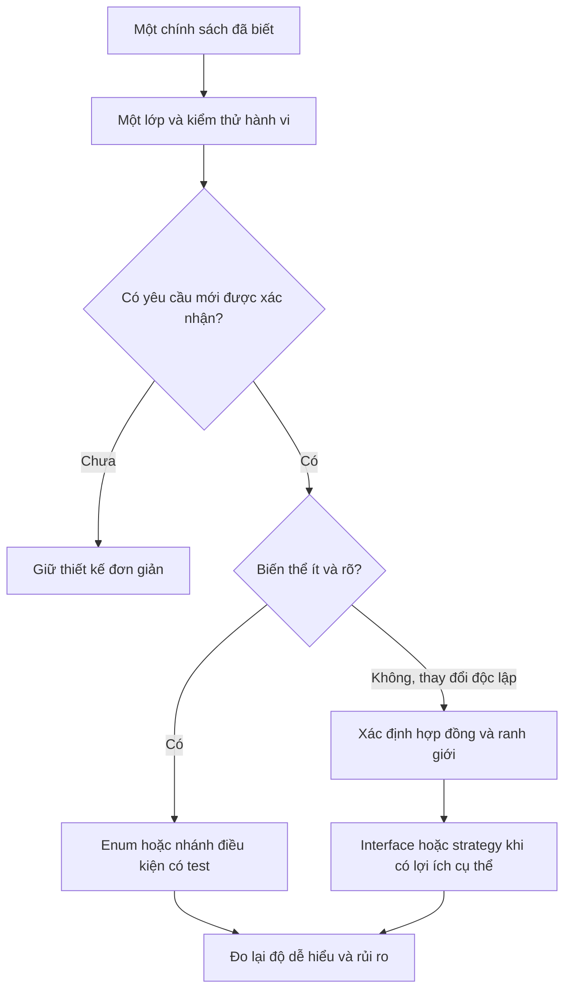
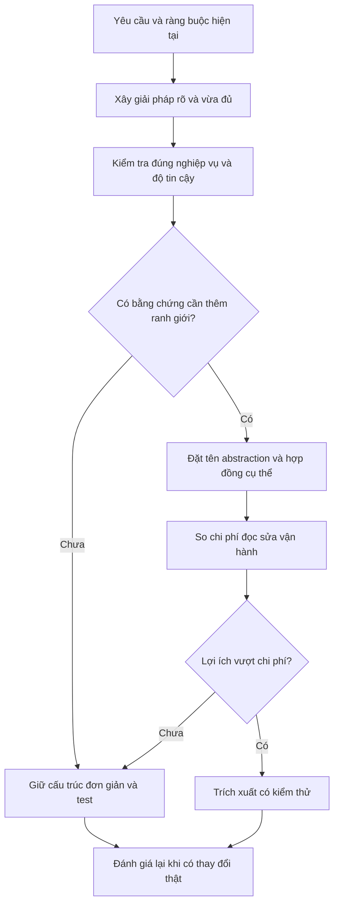

# KISS và YAGNI trong lựa chọn mức trừu tượng

## 1. Vấn đề: thiết kế để dễ thay đổi nhưng không tạo thêm gánh nặng

Khi xây dựng một chức năng, lập trình viên thường phải quyết định: viết logic ngay trong một lớp, tách thành một phương thức, tạo lớp chuyên trách, hay định nghĩa interface cùng nhiều triển khai? Những lựa chọn này ảnh hưởng trực tiếp tới số khái niệm phải hiểu, số tệp phải mở, độ phụ thuộc giữa các phần và chi phí sửa mã sau này.

Trong module `CODE_QUALITY_FUNDAMENTALS`, mục tiêu là **hiểu những thuộc tính quyết định mã nguồn có đáng tin cậy, dễ hiểu và dễ thay đổi hay không**. Thuộc chương **Cấu trúc và phụ thuộc**, bài này dùng hai nguyên tắc **KISS** và **YAGNI** để lựa chọn mức trừu tượng phù hợp với nhu cầu thật.

Hãy tưởng tượng nhóm đang viết quy tắc phí giao hàng: miễn phí nếu tổng tiền hàng đạt một ngưỡng; nếu không, thu một khoản cố định. Một thiết kế có thể chỉ cần một lớp với một phương thức. Thiết kế khác có thể tạo `ShippingStrategy`, `StrategyFactory`, `ShippingRuleRegistry`, `AbstractShippingProvider` và hệ thống cấu hình plugin. Thiết kế thứ hai có vẻ sẵn sàng cho tương lai, nhưng cũng buộc người đọc lần qua nhiều thành phần trước khi tìm được một phép so sánh đơn giản.

Ngược lại, dồn mọi thứ vào một phương thức khổng lồ cũng không phải cách tốt: khi tính phí dần phụ thuộc vào khu vực, đối tác vận chuyển, thời điểm và hợp đồng, việc tách trách nhiệm có thể trở nên cần thiết. Câu hỏi thực tế là: **điều gì cần được trừu tượng hóa ngay bây giờ, bằng chứng nào cho thấy cần thiết, và chi phí của mỗi tầng mới là gì?**

Sau bài học, người học có thể:

- Giải thích KISS và YAGNI, phân biệt sự đơn giản với việc bỏ qua yêu cầu quan trọng.
- Nhận diện các mức trừu tượng và chi phí phát sinh từ mỗi mức.
- Chọn giải pháp Java vừa đủ cho yêu cầu hiện tại, giữ chỗ thay đổi có lý do rõ ràng.
- Phân biệt trùng lặp cú pháp với trùng lặp quy tắc nghiệp vụ trước khi trích xuất abstraction.
- Chọn lúc nên giới thiệu interface, strategy, adapter hoặc lớp miền nghiệp vụ.
- Đánh giá quyết định bằng khả năng đọc, kiểm thử, phạm vi tác động và rủi ro vận hành.

## 2. Hiểu đúng hai nguyên tắc

### 2.1. KISS: Keep It Simple, Stupid

**KISS** khuyến khích chọn thiết kế đơn giản nhất **đủ để đáp ứng đúng các yêu cầu và ràng buộc đang có**. “Đơn giản” ở đây bao gồm việc dễ giải thích hành vi, dễ kiểm chứng, dễ phát hiện lỗi và dễ thay đổi khi có căn cứ; không có nghĩa là viết ít ký tự hoặc ít tệp nhất.

Ví dụ, thay vì tạo bộ máy xử lý luật động cho một chính sách duy nhất, hãy biểu diễn chính sách bằng tên rõ ràng, điều kiện biên và kiểm thử tương ứng. Nhưng nếu chính sách có giao dịch tiền, tính đồng thời và yêu cầu khôi phục, thì những bảo vệ đó là **phần thiết yếu của bài toán**. Bỏ chúng để hàm ngắn hơn là giản lược sai chỗ.

### 2.2. YAGNI: You Aren't Gonna Need It

**YAGNI** khuyên chưa xây chức năng, điểm mở rộng hoặc tầng trừu tượng **chỉ dựa trên khả năng có thể cần trong tương lai**, khi chưa có yêu cầu hoặc bằng chứng đủ mạnh. Việc “có thể sau này hỗ trợ 12 hãng vận chuyển” chưa tự nó biện minh cho một hệ thống plugin khi hiện tại chỉ có một quy tắc phí giao hàng.

YAGNI không có nghĩa là “không lập kế hoạch”, “không chuẩn bị khả năng mở rộng” hoặc “đợi đến lúc hệ thống hỏng mới sửa”. Nếu hợp đồng hiện tại đã yêu cầu hỗ trợ nhiều phiên bản API, nhiều phương thức thanh toán hoặc khôi phục khi mất mạng, đó là **nhu cầu đang có**, dù trường hợp đó ít xảy ra.

### 2.3. KISS và YAGNI bổ trợ nhau

| Câu hỏi | KISS giúp trả lời | YAGNI giúp trả lời |
| --- | --- | --- |
| Nên triển khai thế nào? | Chọn cấu trúc ít khái niệm nhất mà vẫn đúng và rõ | Chỉ triển khai năng lực hiện có căn cứ cần |
| Có cần thêm interface? | Interface có làm ranh giới dễ hiểu hơn chi phí nó tạo ra không? | Đã có hơn một triển khai thật hoặc một hợp đồng cần bảo vệ chưa? |
| Có nên tổng quát hóa? | Cách tổng quát có đơn giản hơn việc giải thích các trường hợp không? | Những biến thể ấy đã tồn tại hay mới là suy đoán? |
| Có nên viết test, validation, logging? | Chọn cách bảo vệ và quan sát gọn, rõ | Nếu đó là yêu cầu chất lượng hiện tại, đây không phải phần “thừa” |
| Có cần refactor sau khi yêu cầu đổi? | Giảm cấu trúc không cần thiết trong thiết kế mới | Chỉ thêm độ linh hoạt khi có thay đổi thực tế |

**Nguyên tắc thực hành:** tối ưu cho việc hiểu và thay đổi **trên các yêu cầu đã biết**, trong khi tránh những cam kết thiết kế cho tương lai chưa chắc xảy ra.

## 3. “Mức trừu tượng” thực sự là gì?

**Trừu tượng hóa (abstraction)** là chọn những đặc điểm quan trọng để đưa thành một khái niệm có tên và hợp đồng, đồng thời che giấu chi tiết mà bên sử dụng không cần quan tâm. Một abstraction tốt giúp người đọc suy luận ở mức phù hợp. Một abstraction kém chỉ chuyển logic đi nơi khác và bắt người đọc lần theo nhiều indirection.

Có thể hình dung một số mức thường gặp:

| Mức | Ví dụ | Khi thường phù hợp | Chi phí có thể phát sinh |
| --- | --- | --- | --- |
| Biểu thức hoặc khối lệnh cục bộ | `subtotal.compareTo(threshold) >= 0` | Điều kiện nhỏ, rõ ngay tại nơi dùng | Nếu lặp nhiều quy tắc thì dễ sai lệch |
| Phương thức có tên | `isEligibleForFreeShipping(...)` | Cần đặt tên cho một quy tắc hoặc kiểm thử riêng | Phải chuyển qua lời gọi mới để đọc |
| Lớp có trách nhiệm rõ | `ShippingFeeCalculator` | Một chính sách có dữ liệu cấu hình và bất biến | Phải quản lý đối tượng và vòng đời |
| Interface làm ranh giới | `ShippingQuoteProvider` | Nhiều bên gọi cần hợp đồng ổn định hoặc cần cách thay thế thật | Thêm một tầng điều hướng và hợp đồng |
| Strategy / nhiều triển khai | `StandardQuote`, `ExpressQuote` | Nhiều thuật toán độc lập thay đổi hoặc được chọn lúc chạy | Nhiều class, tổ hợp cấu hình và test |
| Framework / plugin / rule engine | Nạp quy tắc động từ cấu hình | Yêu cầu thật về mở rộng động, phát hành độc lập | Chi phí vận hành, versioning, an toàn và debug |

Mỗi tầng phải **mua được một lợi ích cụ thể**: giấu một chi tiết dễ thay đổi, đặt tên cho một quy tắc có nghĩa, giảm phụ thuộc, bảo vệ hợp đồng, hoặc cho phép các biến thể độc lập. Nếu chỉ thêm một lớp `DelegatingService` gọi lại đúng một phương thức cùng tên ở lớp bên dưới, chưa chắc đã tăng chất lượng.

Một lầm tưởng phổ biến là “nhiều interface thì coupling thấp”. Coupling phụ thuộc vào **ai cần biết gì**, mức ổn định của hợp đồng và chiều phụ thuộc, không chỉ số lượng `interface`. Một interface quá chung như `Processor<T>` có thể che mất ý nghĩa miền nghiệp vụ và khiến caller phải đọc implementation để biết điều gì xảy ra.

## 4. Ví dụ Java: phí giao hàng với đúng một quy tắc

Giả sử yêu cầu **đã được xác nhận** như sau:

- Tổng tiền hàng được cung cấp dưới dạng `BigDecimal`, không âm và đã được tính theo cùng một đồng tiền.
- Đơn có tổng tiền hàng **từ 200.00 trở lên** được miễn phí giao hàng tiêu chuẩn.
- Đơn dưới ngưỡng chịu phí giao hàng **30.00**.
- Tại thời điểm triển khai, chưa có hãng giao hàng, chế độ giao nhanh hoặc cấu hình theo vùng.
- Cần trả kết quả xác định, dễ kiểm thử, không gọi mạng.

### 4.1. Cám dỗ thiết kế quá sớm

Một thiết kế quá tổng quát có thể trông như sau:

```text
ShippingRule
  └── AbstractShippingRule
        └── ThresholdBasedShippingRule
ShippingRuleFactory
ShippingRuleRegistry
ShippingContext
ShippingExecutionPipeline
ShippingRuleConfigurationProvider
```

Nếu mọi yêu cầu đều đi qua đúng một quy tắc và không cần nạp luật động, các tầng này khiến thay đổi một ngưỡng phí phải đi qua nhiều lớp. Người đọc khó nhận ra ranh giới nghiệp vụ nào thực sự cần các thành phần ấy. Mỗi cơ chế bổ sung còn có thể cần cấu hình, xử lý lỗi và kiểm thử riêng.

### 4.2. Giải pháp vừa đủ

Một lớp nhỏ với hợp đồng rõ thường phù hợp hơn:

```java
import java.math.BigDecimal;
import java.util.Objects;

public final class ShippingFeeCalculator {
    private final BigDecimal freeShippingThreshold;
    private final BigDecimal standardShippingFee;

    public ShippingFeeCalculator(
            BigDecimal freeShippingThreshold,
            BigDecimal standardShippingFee) {
        this.freeShippingThreshold =
                requireNonNegative(freeShippingThreshold, "freeShippingThreshold");
        this.standardShippingFee =
                requireNonNegative(standardShippingFee, "standardShippingFee");
    }

    public BigDecimal calculateFor(BigDecimal merchandiseSubtotal) {
        requireNonNegative(merchandiseSubtotal, "merchandiseSubtotal");

        if (merchandiseSubtotal.compareTo(freeShippingThreshold) >= 0) {
            return BigDecimal.ZERO;
        }
        return standardShippingFee;
    }

    private static BigDecimal requireNonNegative(BigDecimal value, String name) {
        Objects.requireNonNull(value, name);
        if (value.signum() < 0) {
            throw new IllegalArgumentException(name + " must not be negative");
        }
        return value;
    }
}
```

Cách dùng:

```java
var calculator = new ShippingFeeCalculator(
        new BigDecimal("200.00"),
        new BigDecimal("30.00"));

BigDecimal fee = calculator.calculateFor(new BigDecimal("150.00"));
// fee = 30.00
```

Đoạn này đơn giản theo nghĩa quan trọng:

1. **Ý định dễ đọc:** tên phương thức và hai trường biểu diễn chính sách.
2. **Điều kiện biên tường minh:** tại đúng ngưỡng, phí bằng 0.
3. **Không có phụ thuộc ngầm:** tính toán chỉ dựa vào dữ liệu đưa vào constructor và tham số.
4. **Có kiểm tra dữ liệu:** không âm và khác `null`; không biến lỗi đầu vào thành khoản phí có vẻ hợp lệ.
5. **Dễ test:** không cần database, đồng hồ, HTTP hay framework.
6. **Dễ thay đổi chính sách số học:** giá trị ngưỡng và mức phí có thể thay qua cấu hình lúc khởi tạo mà không cần factory cho từng mức giá.

Ví dụ giả định các khoản tiền **cùng đơn vị tiền tệ** và chính sách không yêu cầu làm tròn. Trong nghiệp vụ thật, cần có hợp đồng về tiền tệ, thuế, tổng tiền dùng để xét ngưỡng và sự tin cậy của nguồn giá; nếu các điều kiện đó chưa được xử lý, không thể coi lớp nhỏ này là toàn bộ giải pháp cho hệ thống thanh toán.

### 4.3. Test bảo vệ hành vi, thay vì bảo vệ cấu trúc lớp

```java
import static org.junit.jupiter.api.Assertions.*;
import java.math.BigDecimal;
import org.junit.jupiter.api.Test;

class ShippingFeeCalculatorTest {
    private final ShippingFeeCalculator calculator =
            new ShippingFeeCalculator(
                    new BigDecimal("200.00"),
                    new BigDecimal("30.00"));

    @Test
    void chargesFeeBelowThreshold() {
        assertEquals(new BigDecimal("30.00"),
                calculator.calculateFor(new BigDecimal("199.99")));
    }

    @Test
    void makesShippingFreeAtExactThreshold() {
        assertEquals(BigDecimal.ZERO,
                calculator.calculateFor(new BigDecimal("200.00")));
    }

    @Test
    void makesShippingFreeAboveThreshold() {
        assertEquals(BigDecimal.ZERO,
                calculator.calculateFor(new BigDecimal("250.00")));
    }

    @Test
    void rejectsNegativeSubtotal() {
        assertThrows(IllegalArgumentException.class,
                () -> calculator.calculateFor(new BigDecimal("-1.00")));
    }

    @Test
    void rejectsNullSubtotal() {
        assertThrows(NullPointerException.class,
                () -> calculator.calculateFor(null));
    }
}
```

Các test xác nhận **nghiệp vụ**: dưới ngưỡng, đúng ngưỡng, trên ngưỡng và dữ liệu bất hợp lệ. Chúng không ràng buộc việc phải dùng bao nhiêu interface hoặc class. Nếu sau này thay cấu trúc để đáp ứng yêu cầu thật, các test hành vi vẫn hữu ích.

## 5. Khi một yêu cầu mới thật sự xuất hiện, hãy mở rộng từ bằng chứng

Sau một thời gian, sản phẩm bổ sung **giao hàng nhanh**: phí cố định 50.00 và không được miễn phí theo ngưỡng 200.00. Đây là yêu cầu mới **đã được xác nhận**, nên YAGNI không còn là lý do để bỏ qua nó.

Có hai lựa chọn phổ biến: thêm một nhánh rõ ràng nếu số biến thể ít và cố định; hoặc tách nhiều policy độc lập nếu quy tắc thực sự thay đổi riêng, có tích hợp khác nhau, hoặc được chọn theo cấu hình lúc chạy.

### 5.1. Hai biến thể đơn giản có thể dùng enum và switch

Đoạn ví dụ độc lập sau sử dụng Java 17+:

```java
import java.math.BigDecimal;
import java.util.Objects;

public final class ShippingQuotes {
    public enum DeliveryMode { STANDARD, EXPRESS }

    private final BigDecimal freeThreshold;
    private final BigDecimal standardFee;
    private final BigDecimal expressFee;

    public ShippingQuotes(BigDecimal freeThreshold,
                          BigDecimal standardFee,
                          BigDecimal expressFee) {
        this.freeThreshold = nonNegative(freeThreshold);
        this.standardFee = nonNegative(standardFee);
        this.expressFee = nonNegative(expressFee);
    }

    public BigDecimal feeFor(BigDecimal subtotal, DeliveryMode mode) {
        nonNegative(subtotal);
        Objects.requireNonNull(mode, "mode");

        return switch (mode) {
            case STANDARD -> subtotal.compareTo(freeThreshold) >= 0
                    ? BigDecimal.ZERO : standardFee;
            case EXPRESS -> expressFee;
        };
    }

    private static BigDecimal nonNegative(BigDecimal amount) {
        Objects.requireNonNull(amount, "amount");
        if (amount.signum() < 0) {
            throw new IllegalArgumentException("amount must not be negative");
        }
        return amount;
    }
}
```

Một `switch` có hai nhánh rõ nghĩa vẫn có thể đơn giản hơn hai lớp kế thừa và một factory. Kiểm thử cần xác nhận giao nhanh **luôn thu phí** theo quy tắc giả định, kể cả khi tổng đơn vượt ngưỡng miễn phí của giao tiêu chuẩn.

Nếu lớp cũ là API công khai đang có caller, không được xóa `calculateFor(BigDecimal)` một cách tùy tiện. Có thể giữ phương thức cũ như một adapter cho chế độ tiêu chuẩn, đồng thời thêm API mới. Quyết định chuyển đổi cần xét tương thích hành vi, source và binary.

### 5.2. Khi nào strategy hoặc interface trở nên hợp lý?

Giả sử sau đó có yêu cầu thật: mỗi đơn vị vận chuyển báo giá qua API riêng; một số có timeout, cơ chế xác thực hoặc điều khoản giá khác nhau; nhóm cần thay đổi từng tích hợp độc lập. Một hợp đồng như dưới đây lúc này có ý nghĩa cụ thể:

```java
public interface ShippingQuoteProvider {
    ShippingQuote quote(ShippingRequest request);
}
```

Đây là **phác thảo hợp đồng**, với `ShippingQuote` và `ShippingRequest` là các kiểu miền nghiệp vụ được định nghĩa trong ứng dụng thực. Nó chưa phải chương trình hoàn chỉnh; cần thêm mô hình lỗi, đơn vị tiền, timeout và quy tắc xử lý kết quả chưa xác định.

Interface này có thể tạo ranh giới giúp logic đặt hàng không phụ thuộc vào SDK của từng nhà vận chuyển. Nó **không** nên được đưa vào chỉ để “phòng khi sau này có nhiều hãng”. Lý do tạo abstraction lúc này là **đã có ranh giới và biến thể thật**.

### 5.3. Lộ trình tiến hóa thiết kế



Đây không phải luật “đúng hai biến thể dùng switch, đúng ba biến thể dùng strategy”. Ngưỡng phụ thuộc vào độ khác biệt của hành vi, tần suất thay đổi, ảnh hưởng tới caller, độ khó test và khả năng vận hành.

## 6. Trùng lặp và trừu tượng hóa: khi nào nên hợp nhất?

Một động cơ phổ biến để tạo abstraction là nguyên tắc **DRY** (*Don't Repeat Yourself*). Tuy nhiên, nhìn thấy hai đoạn code giống nhau **chưa chứng minh** chúng là cùng một quy tắc.

### 6.1. Trùng lặp cú pháp khác với trùng lặp kiến thức

Giả sử hai nghiệp vụ có công thức giống nhau:

```java
BigDecimal invoiceAmount =
        unitPrice.multiply(BigDecimal.valueOf(quantity));

BigDecimal reimbursementAmount =
        approvedRate.multiply(BigDecimal.valueOf(units));
```

Việc cả hai gọi `multiply` chưa đủ để tạo `GenericAmountCalculationEngine`. Hai phép tính có thể có quy tắc làm tròn, quyền duyệt, audit, thời điểm định giá và nguyên nhân thay đổi khác nhau. Hợp nhất vội có thể khiến sửa hoàn tiền vô tình đổi hành vi của hóa đơn.

Ngược lại, nếu cùng một quy tắc “phí giao hàng tiêu chuẩn miễn phí từ ngưỡng X” được sao chép vào API, batch job và ứng dụng nội bộ, mỗi bản sửa riêng có thể gây sai lệch. Khi đã xác nhận đây là **một quy tắc nghiệp vụ duy nhất**, đặt nó tại một nơi và cho các bên gọi dùng chung là một abstraction có ích.

### 6.2. Ba câu hỏi trước khi trích xuất

1. **Có cùng nguyên nhân thay đổi không?** Nếu hai đoạn phải thay đồng thời khi chính sách thay, có thể chúng là một khái niệm.
2. **Có cùng hợp đồng và ràng buộc không?** Nếu một bên làm tròn lên và bên kia làm tròn xuống, chỉ giống vài phép toán là chưa đủ.
3. **Abstraction mới có tên diễn đạt đúng khái niệm không?** Nếu chỉ đặt tên `CommonUtils`, `BaseProcessor` hoặc `AbstractSomething`, có thể ý nghĩa chia sẻ chưa rõ.

Một cách tiếp cận thực dụng là để một mức trùng lặp nhỏ tồn tại trong thời gian ngắn khi chưa hiểu sự biến đổi, rồi trích xuất khi mẫu thay đổi đủ rõ. Điều này khác với việc chấp nhận **trùng lặp có nguy cơ làm sai dữ liệu hoặc quy tắc dùng chung đã được xác nhận**.

### 6.3. “Nhầm abstraction” có thể đắt hơn trùng lặp tạm thời

Khi hai tình huống bị gộp sai, người sửa thường thêm cờ `specialCase`, `ignoreValidation` hoặc `mode` vào một hàm chung. Sau vài lần, hàm phải hiểu cả hai miền nghiệp vụ và rất khó biết tham số nào hợp lệ với nhánh nào. Trường hợp ấy nên xem xét **tách lại abstraction** thành các chính sách có nghĩa riêng, dù làm phát sinh vài dòng code giống nhau.

## 7. Ranh giới phụ thuộc: khi nào abstraction giúp giảm coupling?

Trừu tượng hóa có ích rõ nhất khi tách được **chính sách ổn định** khỏi **chi tiết có thể biến động**, nhất là I/O, cơ sở dữ liệu, dịch vụ bên ngoài hoặc nguồn thời gian.

Ví dụ, một hàm tính thời hạn không cần tự gọi đồng hồ hệ thống:

```java
import java.time.Duration;
import java.time.Instant;

public final class DeadlinePolicy {
    private DeadlinePolicy() {}

    public static boolean isExpired(
            Instant createdAt, Duration allowedDuration, Instant now) {
        if (allowedDuration.isNegative()) {
            throw new IllegalArgumentException("duration must be non-negative");
        }
        return !now.isBefore(createdAt.plus(allowedDuration));
    }
}
```

Ví dụ làm rõ dependency vào thời gian bằng tham số `now`. Ở ranh giới HTTP hoặc application service, caller có thể truyền `clock.instant()`. Nhờ vậy test có thể kiểm tra ranh giới chính xác mà không cần mock một hệ thống toàn cục. Trong ứng dụng thật nên kiểm tra cả tham số `null` và giới hạn giá trị thời gian theo hợp đồng.

Không cần tạo `TimeProviderInterface`, `SystemTimeProviderImpl` và `TimeProviderFactory` chỉ vì có một phép so sánh. Java đã có `Clock` nếu thực sự cần đối tượng đồng hồ có thể thay thế; hoặc truyền trực tiếp `Instant` nếu chính sách chỉ cần một mốc. **Ưu tiên tận dụng abstraction đã ổn định của nền tảng** trước khi tự xây framework mới.

### 7.1. Interface không phải điều kiện tiên quyết của kiểm thử

Để test hàm thuần, hãy gọi nó trực tiếp. Với lớp gọi database, constructor injection một dependency thích hợp có thể hữu ích; nhưng không có nghĩa mọi lớp `Service` đều phải có interface `IService` riêng. Nếu chỉ có một triển khai, không có ranh giới công khai cần bảo vệ và việc test không đòi hỏi thay thế thành phần, lớp cụ thể vẫn có thể dễ hiểu và dễ sửa.

Câu hỏi đúng là: **dependency nào cần được kiểm soát và tại sao?** Có thể vì hạ tầng khó chạy trong test, vì nhà cung cấp bên ngoài thay đổi hợp đồng, hoặc vì một miền nghiệp vụ cần độc lập với framework. Nêu được lý do này thì abstraction có căn cứ.

### 7.2. Tránh abstraction rò rỉ chi tiết

Một interface kiểu `PaymentGateway` mà phương thức trả về trực tiếp kiểu response chỉ có trong SDK của hãng A khiến miền nghiệp vụ vẫn phụ thuộc vào hãng A. Tên interface không tự che giấu chi tiết. Nếu muốn bảo vệ ranh giới, cần kiểu dữ liệu và mô hình lỗi do ứng dụng sở hữu, đồng thời adapter chịu trách nhiệm chuyển đổi từ SDK.

Ngược lại, biến mọi HTTP status, header và cơ chế retry thành một framework do nhóm tự viết có thể quá phức tạp. Ranh giới tốt giữ **những khái niệm mà bên sử dụng cần** và giấu **những chi tiết bên sử dụng không cần**.

## 8. Đơn giản không đồng nghĩa với bỏ qua độ tin cậy

KISS và YAGNI thường bị dùng sai để biện minh cho những quyết định làm hệ thống yếu hơn:

| Khẳng định dễ gây hiểu lầm | Vấn đề | Cách hiểu phù hợp |
| --- | --- | --- |
| “Chỉ một lần thanh toán nên chưa cần xử lý trùng” | Timeout có thể dẫn tới thu tiền hai lần | Nếu cần bảo đảm không thu trùng, idempotency/đối soát là yêu cầu hiện tại |
| “Ít code hơn nên không cần validation” | Đầu vào sai tạo trạng thái sai hoặc lỗi khó hiểu | Kiểm tra đúng ranh giới và bất biến là phần của hành vi đúng |
| “Có thể sau này mới cần log lỗi” | Sự cố production xảy ra trước khi có khả năng chẩn đoán | Tín hiệu tối thiểu để phát hiện và xử lý lỗi quan trọng là nhu cầu hiện tại |
| “Một hàm lớn là KISS vì không phải mở nhiều file” | Nhiều trách nhiệm trộn lẫn làm sửa đổi rủi ro | Chọn ranh giới giúp người đọc hiểu và test được hành vi |
| “Dùng interface ở mọi nơi sẽ dễ mở rộng” | Tầng điều hướng và hợp đồng chưa có ích lợi rõ | Tạo interface khi ranh giới hoặc biến thể thật cần đến |
| “YAGNI nghĩa là chưa cần nghĩ tới migration” | Schema thay đổi có thể làm hỏng phiên bản đang chạy | Tương thích trong rollout thực tế là ràng buộc hiện tại |
| “Tối ưu hiệu năng trước để khỏi sửa lại” | Tối ưu sớm có thể tạo code khó hiểu mà chưa giải quyết vấn đề đo được | Đo nút thắt và đáp ứng mục tiêu hiệu năng đã xác định |

Đặc biệt, bảo vệ **tính nhất quán dữ liệu, bảo mật, ranh giới tài nguyên và khả năng khôi phục** không phải “gold-plating” khi hệ thống đang có nguy cơ thực tế. Một đoạn xử lý chuyển tiền cần cơ chế an toàn khác một phép đổi định dạng chuỗi; KISS phải được áp dụng trong bối cảnh hậu quả khi sai.

## 9. Chọn mức trừu tượng bằng những câu hỏi cụ thể

Thay vì hỏi “nên dùng pattern nào?”, hãy đánh giá những biến số ảnh hưởng trực tiếp tới chất lượng:

| Yếu tố | Dấu hiệu nghiêng về đơn giản trực tiếp | Dấu hiệu nghiêng về abstraction rõ ràng |
| --- | --- | --- |
| Số biến thể thật | Một chính sách đã biết | Nhiều thuật toán có quy tắc riêng |
| Tần suất thay đổi | Ít thay đổi, có test rõ | Nhiều nhóm sửa độc lập theo nhịp khác nhau |
| Nơi sử dụng | Một chỗ gọi, phạm vi cục bộ | Nhiều caller phụ thuộc vào một hợp đồng ổn định |
| Độ biến động của dependency | Tính toán thuần, không I/O | Nhà cung cấp ngoài, cơ sở dữ liệu hoặc runtime biến động |
| Rủi ro khi sai | Đường đi đơn giản, sửa dễ đảo ngược | Dữ liệu hoặc tiền, cần cô lập và kiểm thử riêng |
| Chi phí nhận thức | Một hàm ngắn đủ diễn đạt | Caller phải hiểu nhiều điều kiện và tác dụng phụ |
| Nhu cầu mở rộng | Giả định chưa được xác nhận | Yêu cầu đã được chấp thuận hoặc đang vận hành |
| Tương thích | Chỉ nội bộ, caller kiểm soát được | Public API, nhiều phiên bản client hoặc schema |

Không nên cộng điểm cơ học rồi tuyên bố “5/8 là dùng strategy”. Đây là bảng giúp nhóm **trình bày bằng chứng và đánh đổi**. Một yêu cầu an toàn hoặc tương thích quan trọng có thể đủ để cần ranh giới rõ, dù các tiêu chí khác nghiêng về giải pháp nhỏ.

### 9.1. Hãy so sánh tổng chi phí, không chỉ số dòng

Một abstraction mới thường có chi phí:

- **Đọc hiểu:** thêm tên, interface, class và bước điều hướng.
- **Thay đổi:** thêm hợp đồng phải giữ, biến thể phải đồng bộ, test phải chạy.
- **Vận hành:** nếu abstraction liên quan plugin, runtime selection hoặc cấu hình, có thêm điểm lỗi và cách chẩn đoán.
- **Tương thích:** public API mới có thể cần versioning và lộ trình migration.
- **Phối hợp:** nhiều đội hoặc kho mã cần thống nhất nghĩa của hợp đồng.

Nó cũng có thể **tiết kiệm** chi phí khi loại bỏ thay đổi lan rộng, gom một quy tắc nghiệp vụ hoặc cô lập hạ tầng. Quyết định đúng là xem lợi ích thực tế có bù được các chi phí ấy hay không.

### 9.2. Trì hoãn quyết định khó đảo ngược khi có thể

Nếu chưa biết sau này phí giao hàng sẽ phụ thuộc vào hãng nào, có thể giữ chính sách tính phí trong một lớp nhỏ, test đủ trường hợp và chưa đưa chi tiết nhà cung cấp vào API công khai. Như vậy nhóm vẫn có khả năng thay đổi mà không phải dự đoán trước cấu trúc cuối cùng.

Khi một quyết định khó đổi về sau, như schema dữ liệu công khai hoặc hợp đồng đối tác, cần làm rõ từ đầu và thiết kế tương thích theo yêu cầu thật. **Trì hoãn việc chọn một cấu trúc chưa cần thiết khác với trì hoãn hiểu những cam kết đã tồn tại.**

## 10. Các dấu hiệu của trừu tượng hóa quá mức và quá ít

### 10.1. Trừu tượng hóa quá mức

- Một chức năng nhỏ phải đi qua nhiều `Manager`, `Factory`, `Handler` và `Provider` nhưng chỉ có một triển khai.
- Có các phương thức “hook” không ai gọi, tham số cấu hình không có giá trị ngoài mặc định.
- Class con chỉ ghi đè một hàm để chuyển tiếp nguyên vẹn sang class cha.
- Nhiều kiểu generic và cờ điều khiển khiến người đọc phải biết framework nội bộ mới hiểu nghiệp vụ.
- Thêm một chức năng nhỏ chủ yếu là sửa cấu hình đăng ký, mapping và adapter mà không thay đổi quy tắc thật.

### 10.2. Trừu tượng hóa quá ít

- Cùng một quy tắc nghiệp vụ được sao chép ở nhiều nơi và thay đổi không đồng bộ.
- Một lớp phụ trách xác thực, tính tiền, gọi API và ghi database, khó test bất biến.
- Caller phải biết chi tiết SDK bên ngoài và xử lý trực tiếp tất cả ngoại lệ của nhà cung cấp.
- Mọi thay đổi của một quy tắc buộc sửa nhiều module không liên quan.
- Những điều kiện phức tạp bị lặp lại nhưng không có tên, bảng quyết định hoặc test cho trường hợp chồng chéo.

### 10.3. Đánh giá dựa trên trải nghiệm sửa thật

Độ dài class, số interface hay điểm metric chỉ là **tín hiệu**. Một module 500 dòng vẫn có thể rõ nếu quy tắc tuần tự và tập trung; một “clean architecture” gồm nhiều lớp rỗng có thể rất khó lần theo. Hãy quan sát một thay đổi thực tế: phải đọc bao nhiêu nơi, có phải hiểu chi tiết không liên quan không, test nào chứng minh giữ nguyên hành vi, và có phát sinh lỗi do phụ thuộc ẩn không?

## 11. Quy trình áp dụng KISS và YAGNI trong một thay đổi

1. **Mô tả hợp đồng hiện tại.** Viết ngắn gọn đầu vào, đầu ra, điều kiện biên, lỗi, bất biến và đối tượng sử dụng. Không thể quyết định mức trừu tượng chỉ từ tên task.
2. **Đánh dấu giả định về tương lai.** Phân biệt yêu cầu đã xác nhận, ràng buộc kỹ thuật bắt buộc và khả năng “có thể sau này”.
3. **Viết giải pháp trực tiếp có thể đọc được.** Ưu tiên cấu trúc đã có của codebase, tên nghiệp vụ rõ và dependency tường minh.
4. **Thêm bảo vệ thiết yếu.** Validation, xử lý lỗi đúng, kiểm thử đường chính/biên và cơ chế vận hành phù hợp hậu quả khi sai.
5. **Xem nơi nào đang gánh nhiều nghĩa.** Nếu một hàm vừa tính toán vừa gọi mạng, hoặc cùng quy tắc bị sao chép ở nhiều nơi, cân nhắc tạo ranh giới có mục đích.
6. **Đề xuất abstraction bằng một câu lý do.** Ví dụ: “Tách `ShippingQuoteProvider` vì hai đối tác đã có API riêng và đơn hàng không nên biết SDK của họ.” Nếu không viết được lý do gắn với nhu cầu, nên xem lại.
7. **Kiểm chứng bằng thay đổi và test cụ thể.** Đọc diff, xác nhận hành vi giữ nguyên, xem số nơi phải sửa và rủi ro khi deploy.
8. **Đánh giá lại khi bối cảnh đổi.** Một interface từng không cần có thể trở nên cần thiết khi yêu cầu mới xuất hiện. Không phải giữ thiết kế ban đầu bằng mọi giá.



Sơ đồ thể hiện tư duy ra quyết định, không yêu cầu nhóm thực hiện một cuộc họp riêng cho mỗi biến cục bộ. Với sửa đổi nhỏ, các câu hỏi có thể được trả lời ngay khi review. Với thay đổi API hoặc dữ liệu có ảnh hưởng rộng, nên ghi lại quyết định và kế hoạch tương thích.

## 12. Bài tập tình huống

### Bài tập 1 — Một quy tắc đang bị xây quá mức

Nhóm chỉ cần kiểm tra số tiền đơn hàng để miễn phí vận chuyển. Một pull request thêm 6 class, 3 interface và một factory; chưa có yêu cầu hỗ trợ nhà vận chuyển khác. Hãy đề xuất cấu trúc tối thiểu, chỉ ra trường hợp nào cần xử lý rõ (đơn âm, đúng ngưỡng, đồng tiền), và giải thích vì sao không cần factory ở thời điểm này.

### Bài tập 2 — Hai đoạn giống nhau có nên hợp nhất?

Phần tính chiết khấu cho khách VIP và phần tính hoàn tiền cùng nhân một giá trị với tỷ lệ 0.9. Tuy nhiên, chiết khấu thay theo chiến dịch, còn hoàn tiền theo điều khoản hợp đồng đã ký. Hãy phân biệt trùng lặp cú pháp với trùng lặp quy tắc, rồi nêu bằng chứng cần có trước khi xây một engine chung.

### Bài tập 3 — Khi nào interface đáng giá?

Một service đang gọi duy nhất nhà cung cấp thanh toán A. Kế hoạch đã ký yêu cầu bổ sung B trong quý tới, hai bên có mã lỗi và cách đối soát khác nhau. Hãy xác định ranh giới cần tách, kiểu kết quả miền nghiệp vụ cần thống nhất, test nào cần chạy cho cả A và B, và phần chi tiết nào nên để trong adapter.

### Bài tập 4 — KISS và độ tin cậy

Một người đề xuất bỏ idempotency key khỏi API đặt hàng vì “chỉ có một nút bấm thanh toán”. Hãy giải thích các đường lặp có thể xảy ra khi mạng timeout, việc xử lý kết quả chưa xác định và vì sao các cơ chế này có thể là yêu cầu chất lượng hiện tại.

### Bài tập 5 — Chọn mức abstraction sau thay đổi thật

Ban đầu, tính phí giao hàng chỉ có một mức cố định và ngưỡng miễn phí. Giờ nhóm có hai chế độ `STANDARD` và `EXPRESS` với phí khác nhau. Hãy viết bảng quyết định, chọn giữa `switch` và strategy, rồi cho biết điều kiện nào sẽ khiến bạn đổi quyết định về sau.

### Bài tập 6 — Review trừu tượng hóa

Một module có `AbstractBaseManager<T>`, `GenericProcessor<T>` và `ProcessorRegistry`, nhưng mỗi phần chỉ được một class dùng. Hãy mô tả cách truy vết mục đích thật, phân biệt abstraction cần giữ để bảo vệ public API với abstraction có thể bỏ, và cách viết test trước khi thu gọn cấu trúc.

Mỗi bài nên được trả lời bằng ba phần: **yêu cầu đã được xác nhận**, **cấu trúc và hợp đồng đề xuất**, **bằng chứng kiểm chứng cùng rủi ro còn lại**.

## 13. Ghi nhớ

- **KISS** yêu cầu thiết kế đơn giản nhất còn đáp ứng đúng hợp đồng, ràng buộc chất lượng và điều kiện vận hành; ít dòng code không phải thước đo đủ.
- **YAGNI** giúp tránh xây năng lực hoặc cơ chế mở rộng chưa có căn cứ. Nó không biện minh cho việc bỏ qua validation, bảo mật, tính nhất quán hay phục hồi đang cần.
- **Mỗi tầng abstraction đều có giá**: thêm khái niệm, hợp đồng, nơi điều hướng và trách nhiệm kiểm thử. Chỉ thêm khi có lợi ích có thể giải thích.
- **Trùng lặp cú pháp chưa chắc là trùng lặp nghiệp vụ**. Hợp nhất đúng quy tắc dùng chung; đừng gộp những khái niệm có nguyên nhân thay đổi khác nhau.
- **Interface có ích khi tạo ranh giới thật**, cô lập phụ thuộc dễ biến động hoặc hỗ trợ các biến thể được sử dụng. Không phải lớp nào cũng cần interface.
- **Thiết kế có thể tiến hóa**: bắt đầu từ yêu cầu thật, bảo vệ hành vi bằng test, trích xuất abstraction khi xuất hiện bằng chứng và tiếp tục đánh giá sau thay đổi.

Một lựa chọn tốt giúp người kế tiếp trả lời nhanh ba câu hỏi: **mã này làm gì, cần biết những khái niệm nào để sửa nó, và tại sao từng ranh giới tồn tại?** Khi câu trả lời rõ ràng, mã nguồn có cơ hội vừa dễ hiểu, vừa đáng tin cậy, vừa đủ linh hoạt để thay đổi theo nhu cầu thực tế.
