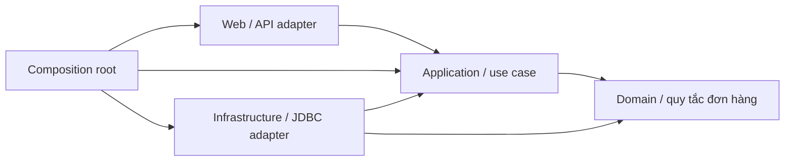
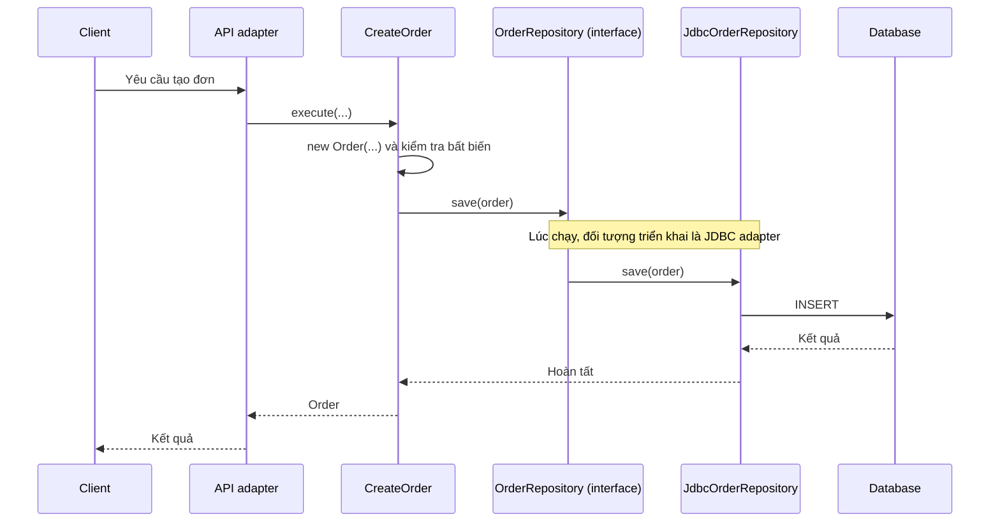

# Phân biệt tổ chức tệp với ranh giới kiến trúc thực sự

Một dự án Java có thể có các thư mục `controller/`, `service/`, `repository/` và `domain/` được sắp xếp rất gọn, nhưng khi đổi cơ sở dữ liệu, cả bộ điều khiển API lẫn quy tắc tính tiền đều phải sửa. Ngược lại, một ứng dụng nhỏ chứa ít package vẫn có thể dễ bảo trì nếu các thành phần có trách nhiệm rõ, giao tiếp qua hợp đồng ổn định và không dựa vào chi tiết bên trong của nhau.

Trong chương **Cấu trúc và phụ thuộc** của module **CODE_QUALITY_FUNDAMENTALS**, cần phân biệt hai việc: **tổ chức tệp** giúp người phát triển tìm mã; còn **ranh giới kiến trúc** quyết định thành phần nào được phép biết, sử dụng và thay đổi thành phần nào. Khả năng phân biệt đó giúp đánh giá mã nguồn có đáng tin cậy, dễ hiểu và dễ thay đổi khi yêu cầu nghiệp vụ hoặc công nghệ thay đổi hay không.

## 1. Cấu trúc thư mục là bản đồ; ranh giới là quy tắc quan hệ

Giả sử mã nguồn được sắp xếp:

```text
src/main/java/com/example/orders/
├── controller/
│   └── OrderController.java
├── service/
│   └── OrderService.java
├── repository/
│   └── JdbcOrderRepository.java
└── model/
    └── Order.java
```

Cấu trúc này chỉ nói **tệp nào nằm ở đâu**. Nó chưa trả lời:

- `OrderService` có thể trực tiếp tạo `JdbcOrderRepository` không?
- `OrderController` có được chạy SQL hoặc tự tính giảm giá không?
- `Order` có phụ thuộc vào HTTP, JDBC hay framework không?
- Khi đổi JDBC sang một kho dữ liệu khác, cần sửa những thành phần nào?
- Thành phần nào sở hữu quy tắc “giảm giá không vượt tiền hàng”?

Muốn trả lời, phải xem **quan hệ phụ thuộc, hợp đồng và quyền sở hữu trách nhiệm**.

| Góc nhìn | Tổ chức tệp / package | Ranh giới kiến trúc |
| --- | --- | --- |
| Mục đích chính | Đặt mã ở vị trí dễ tìm | Kiểm soát sự phụ thuộc và phạm vi ảnh hưởng của thay đổi |
| Dấu hiệu dễ thấy | Thư mục, tên tệp, tên package | Chiều import, lời gọi, hợp đồng công khai, dữ liệu và trách nhiệm |
| Cách kiểm tra | Xem cây thư mục | Theo dõi mã gọi, kiểu dữ liệu, đường dữ liệu, các thay đổi lan truyền |
| Khả năng bảo vệ | Tự nó không ngăn thành phần gọi xuyên lớp | Có thể dùng giới hạn truy cập, module, kiểm thử kiến trúc và review |
| Dấu hiệu vấn đề | Tệp khó tìm, tên folder không phản ánh chức năng | Một thay đổi cục bộ kéo theo sửa nhiều nơi không liên quan |

**Một package có tên `domain` không tự động tạo “domain layer”.** Nếu lớp trong package đó gọi thẳng REST client, trả về `ResponseEntity` hoặc biết cấu trúc bảng SQL, quy tắc nghiệp vụ đã phụ thuộc vào chi tiết kỹ thuật bất kể vị trí tệp.

## 2. Những phụ thuộc thực sự cần quan sát

Khi nói “A phụ thuộc B”, cần hỏi **phụ thuộc theo nghĩa nào**. Những loại sau có thể giao nhau:

| Loại phụ thuộc | Ví dụ | Tác động đến khả năng thay đổi |
| --- | --- | --- |
| **Mã nguồn / biên dịch** | `CreateOrder` import `JdbcOrderRepository` | Thay kiểu, API hoặc thư viện JDBC có thể buộc lớp nghiệp vụ sửa/biên dịch lại |
| **Lời gọi lúc chạy** | `CreateOrder` gọi thao tác `save` của một đối tượng repository | Cần hợp đồng rõ về thành công, thất bại, độ trễ và tác dụng phụ |
| **Dữ liệu** | Nhiều thành phần cùng đọc/ghi một bảng `orders` | Đổi schema hoặc quy tắc trạng thái có thể lan ra nhiều nơi dù không import nhau |
| **Thứ tự/thời gian** | Giữ hàng phải xong trước khi thu tiền | Thay đổi thứ tự có thể phá bất biến hoặc tạo tình huống lỗi mới |
| **Triển khai/vận hành** | Hai dịch vụ chỉ hoạt động khi cùng nâng phiên bản | Chia thành hai repository chưa tạo khả năng phát hành độc lập |
| **Hiểu biết về chi tiết nội bộ** | Một lớp kiểm tra mã lỗi đặc thù của nhà cung cấp thanh toán | Thay nhà cung cấp kéo theo sửa logic nghiệp vụ |

**Phụ thuộc lúc biên dịch** và **đường gọi lúc chạy** không nhất thiết cùng chiều. Một dịch vụ nghiệp vụ có thể gọi `OrderRepository.save(...)` qua interface; lúc chạy, lời gọi đến một đối tượng JDBC, nhưng mã nguồn nghiệp vụ **không cần import lớp JDBC**. Đây là điểm trọng tâm của cách tổ chức ranh giới theo **đảo chiều phụ thuộc** (*dependency inversion*).

Mặt khác, một ứng dụng có thể không có import trực tiếp mà vẫn bị liên kết chặt qua tên bảng, chuỗi sự kiện, dữ liệu toàn cục hoặc thứ tự gọi API. Vì vậy chỉ quét import là **cần thiết nhưng chưa đủ** để hiểu kiến trúc.

## 3. Một cấu trúc thư mục đẹp nhưng ranh giới vẫn bị xuyên thủng

Xét hệ thống tạo đơn hàng. Chính sách minh họa: tiền hàng không âm, khoản giảm giá không âm và không vượt tiền hàng; số phải thanh toán bằng tiền hàng trừ giảm giá.

Một đoạn mã dạng sau có thể nằm trong thư mục `service/`:

```java
package com.example.orders.service;

import com.example.orders.repository.JdbcOrderRepository;

public final class CreateOrderService {
    private final JdbcOrderRepository jdbcOrders;

    public CreateOrderService(JdbcOrderRepository jdbcOrders) {
        this.jdbcOrders = jdbcOrders;
    }

    public long create(long id, long subtotalVnd, long discountVnd) {
        if (subtotalVnd < 0 || discountVnd < 0
                || discountVnd > subtotalVnd) {
            throw new IllegalArgumentException("invalid amounts");
        }
        long amountDueVnd = subtotalVnd - discountVnd;
        jdbcOrders.insertOrder(id, amountDueVnd);
        return amountDueVnd;
    }
}
```

Đây là **trích đoạn minh họa**: giả sử lớp `JdbcOrderRepository` có phương thức `insertOrder(long, long)`. Không cần có toàn bộ dự án để thấy vấn đề: `CreateOrderService` **gọi và biết một lớp lưu trữ cụ thể**. Việc chuyển tệp repository sang package khác không loại bỏ sự phụ thuộc đó.

Hệ quả thực tế:

1. Muốn thử nghiệp vụ tạo đơn thường phải chuẩn bị một lớp JDBC cụ thể hoặc dùng cách thay thế khó khăn hơn.
2. Nếu đổi cơ chế lưu trữ, lời khai báo trường, constructor và lời gọi trong lớp nghiệp vụ có nguy cơ phải sửa.
3. Nếu `JdbcOrderRepository` phát lộ `SQLException` hoặc kiểu dữ liệu của bảng, chi tiết lưu trữ có thể tràn lên phần nghiệp vụ.
4. Nhóm có thể cho rằng đã có “ba lớp kiến trúc” chỉ vì có ba thư mục, trong khi khả năng thay thế chi tiết kỹ thuật còn yếu.

Điều này **không có nghĩa** mọi lớp được phép phụ thuộc JDBC đều sai. Một adapter lưu trữ được tạo ra chính để làm việc với JDBC. Vấn đề là **thành phần có trách nhiệm giữ quy tắc nghiệp vụ** bị buộc biết về lựa chọn lưu trữ cụ thể.

## 4. Ranh giới có nghĩa: lõi sở hữu hợp đồng, phần ngoài triển khai chi tiết

Một cách cấu trúc khác là đặt **mô hình và quy tắc nghiệp vụ** ở lõi; **use case** biết giao diện lưu trữ; **adapter JDBC** triển khai giao diện ấy; phần khởi tạo ứng dụng nối các thành phần với nhau.



**Mũi tên trong sơ đồ này là chiều phụ thuộc mã nguồn**: bộ điều khiển và adapter lưu trữ đều biết hợp đồng của ứng dụng; lõi không biết một lớp JDBC cụ thể. **Dòng xử lý lúc chạy** có thể đi từ web vào ứng dụng, sau đó qua interface ở ứng dụng tới adapter JDBC:



Hai sơ đồ cùng đúng ở hai góc nhìn khác nhau. Không được lấy **thứ tự gọi** làm lý do để mọi lớp phải phụ thuộc trực tiếp vào chi tiết triển khai của bước tiếp theo.

### 4.1. Định nghĩa quy tắc trong mô hình nghiệp vụ

Với **Java 17**, có thể mô tả một đơn hàng bằng `record`. Tệp `domain/Order.java`:

```java
package com.example.orders.domain;

public record Order(
        long id,
        long merchandiseSubtotalVnd,
        long discountAmountVnd) {

    public Order {
        if (id <= 0 || merchandiseSubtotalVnd < 0
                || discountAmountVnd < 0
                || discountAmountVnd > merchandiseSubtotalVnd) {
            throw new IllegalArgumentException("invalid order amounts or id");
        }
    }

    public long amountDueVnd() {
        return merchandiseSubtotalVnd - discountAmountVnd;
    }
}
```

Ranh giới này bảo vệ bất biến: tổng tiền hàng và giảm giá hợp lệ, tiền cần thanh toán không âm. Với các đầu vào không âm đã kiểm tra, phép trừ `long` không gây tràn số. Mô hình không import HTTP, JDBC hay cấu hình cơ sở dữ liệu.

Trong hệ thống thật, mô hình đơn hàng còn nhiều quy tắc khác. Ở đây ta cố ý giữ ít quy tắc để nhìn rõ **mối quan hệ phụ thuộc**, không dùng ví dụ này như thiết kế đầy đủ cho thương mại điện tử.

### 4.2. Use case phụ thuộc vào hợp đồng do ứng dụng kiểm soát

Tệp `application/OrderRepository.java`:

```java
package com.example.orders.application;

import com.example.orders.domain.Order;

public interface OrderRepository {
    void save(Order order);
}
```

Tệp `application/CreateOrder.java`:

```java
package com.example.orders.application;

import com.example.orders.domain.Order;
import java.util.Objects;

public final class CreateOrder {
    private final OrderRepository orders;

    public CreateOrder(OrderRepository orders) {
        this.orders = Objects.requireNonNull(orders, "orders");
    }

    public Order execute(
            long id, long merchandiseSubtotalVnd, long discountAmountVnd) {

        Order order = new Order(
                id, merchandiseSubtotalVnd, discountAmountVnd);
        orders.save(order);
        return order;
    }
}
```

Lớp `CreateOrder` biết **hành vi cần thiết** là “lưu một đơn hàng hợp lệ”; nó không biết lưu bằng câu lệnh SQL nào. Khi khởi tạo một `Order` lỗi, constructor ném ngoại lệ trước khi repository được gọi. Đây là kết quả trực tiếp từ cách đặt hợp đồng và bất biến.

Interface `OrderRepository` **thuộc phía đang cần chức năng**, không buộc phải nằm cùng adapter. Đặt hợp đồng ở ứng dụng khiến một chi tiết lưu trữ mới có thể triển khai nó mà không cần kéo mã JDBC vào lõi.

### 4.3. Adapter bên ngoài thực hiện việc lưu trữ

Tệp `infrastructure/JdbcOrderRepository.java`:

```java
package com.example.orders.infrastructure;

import com.example.orders.application.OrderRepository;
import com.example.orders.domain.Order;
import java.sql.Connection;
import java.sql.PreparedStatement;
import java.sql.SQLException;
import java.util.Objects;
import javax.sql.DataSource;

public final class JdbcOrderRepository implements OrderRepository {
    private final DataSource dataSource;

    public JdbcOrderRepository(DataSource dataSource) {
        this.dataSource = Objects.requireNonNull(dataSource, "dataSource");
    }

    @Override
    public void save(Order order) {
        String sql =
                "INSERT INTO orders (id, amount_due_vnd) VALUES (?, ?)";

        try (Connection connection = dataSource.getConnection();
             PreparedStatement statement = connection.prepareStatement(sql)) {

            statement.setLong(1, order.id());
            statement.setLong(2, order.amountDueVnd());
            statement.executeUpdate();
        } catch (SQLException error) {
            throw new IllegalStateException("cannot persist order", error);
        }
    }
}
```

Ví dụ giả sử bảng `orders` có cột `id` và `amount_due_vnd`, và `DataSource` đã được cấu hình. Adapter là nơi hợp lý để chứa SQL, kết nối và thao tác với driver. Trong ứng dụng thực tế, cần xác định thêm **hợp đồng lỗi** (ví dụ trùng mã đơn, mất kết nối, timeout), giao dịch và cách lưu đủ dữ liệu để tái dựng đơn. Việc dùng `IllegalStateException` ở đây chỉ để minh họa cách che kiểu `SQLException` khỏi use case, chưa phải chiến lược xử lý lỗi hoàn chỉnh.

### 4.4. Thành phần khởi tạo được phép biết cả hai phía

Tệp `bootstrap/OrderWiring.java`:

```java
package com.example.orders.bootstrap;

import com.example.orders.application.CreateOrder;
import com.example.orders.infrastructure.JdbcOrderRepository;
import javax.sql.DataSource;

public final class OrderWiring {
    private OrderWiring() {}

    public static CreateOrder createUseCase(DataSource dataSource) {
        return new CreateOrder(new JdbcOrderRepository(dataSource));
    }
}
```

`OrderWiring` là **composition root**: nơi lắp các đối tượng chạy thật. Nó được phép phụ thuộc vào chi tiết JDBC và use case vì trách nhiệm của nó chính là **chọn cấu hình triển khai**. Điều cần tránh là để chi tiết JDBC len vào `CreateOrder` hoặc `Order`.

Với framework dependency injection, vị trí lắp ghép có thể do cấu hình hoặc container đảm nhiệm. **Dùng annotation DI không tự bảo đảm kiến trúc tốt**; cần kiểm tra lớp được inject là hợp đồng hay lớp chi tiết, và chiều phụ thuộc thực sự trong mã.

### 4.5. Kiểm tra bằng khả năng thay thế, không dựa vào tên thư mục

Lõi của ví dụ có thể được kiểm thử bằng repository giả, không cần chuẩn bị cơ sở dữ liệu:

```java
package com.example.orders.application;

import com.example.orders.domain.Order;
import java.util.concurrent.atomic.AtomicReference;
import org.junit.jupiter.api.Test;

import static org.junit.jupiter.api.Assertions.assertEquals;
import static org.junit.jupiter.api.Assertions.assertNull;
import static org.junit.jupiter.api.Assertions.assertSame;
import static org.junit.jupiter.api.Assertions.assertThrows;

class CreateOrderTest {
    @Test
    void createsValidOrderWithoutJdbc() {
        AtomicReference<Order> saved = new AtomicReference<>();
        CreateOrder useCase = new CreateOrder(saved::set);

        Order created = useCase.execute(12L, 500_000L, 50_000L);

        assertEquals(450_000L, created.amountDueVnd());
        assertSame(created, saved.get());
    }

    @Test
    void invalidDiscountDoesNotReachRepository() {
        AtomicReference<Order> saved = new AtomicReference<>();
        CreateOrder useCase = new CreateOrder(saved::set);

        assertThrows(IllegalArgumentException.class,
                () -> useCase.execute(12L, 100_000L, 120_000L));

        assertNull(saved.get());
    }
}
```

Điều được minh họa là **lõi có thể được thực thi với một triển khai khác của hợp đồng lưu trữ**, trong khi `CreateOrder` giữ nguyên mã. Kiểm thử trên chưa chứng minh adapter JDBC hoạt động với schema thật: phần đó vẫn cần kiểm thử tích hợp với cơ sở dữ liệu phù hợp. Hai lớp có kiểm thử riêng vì **mỗi ranh giới có loại rủi ro khác nhau**.

## 5. Dấu hiệu ranh giới thực sự tồn tại

Một ranh giới hữu ích không chỉ được mô tả trên sơ đồ, mà có thể quan sát khi viết mã và thay đổi hệ thống.

| Tín hiệu | Câu hỏi kiểm chứng | Dấu hiệu ranh giới rõ |
| --- | --- | --- |
| **Chiều phụ thuộc** | Lõi nghiệp vụ có import HTTP/JDBC/framework cụ thể không? | Quy tắc nghiệp vụ không cần biết chi tiết adapter |
| **Hợp đồng** | Bên dùng cần hành vi nào, đầu vào/đầu ra và lỗi được định nghĩa ra sao? | Hợp đồng phục vụ use case; chi tiết nằm bên triển khai |
| **Quyền sở hữu** | Thành phần nào được phép thay đổi bất biến đơn hàng? | Một nơi chịu trách nhiệm bảo vệ quy tắc nhất quán |
| **Khả năng thay thế** | Đổi JDBC sang một adapter khác có cần sửa quy tắc đơn hàng không? | Lõi giữ nguyên; thay phần lắp ghép và adapter |
| **Tính độc lập kiểm thử** | Kiểm thử tính tiền có cần mạng/cơ sở dữ liệu không? | Quy tắc thuần được kiểm thử không cần hạ tầng |
| **Lan truyền thay đổi** | Đổi định dạng API có buộc sửa tính tiền hoặc schema không? | Phần ánh xạ biên chịu thay đổi nếu nghĩa nghiệp vụ không đổi |
| **Giới hạn dữ liệu** | Có thành phần ngoài tự ghi bảng hoặc sửa trạng thái thuộc về module khác? | Mọi cập nhật đi qua giao diện và quy tắc sở hữu thích hợp |

Không nên áp đặt rằng “mỗi lần đổi đều chỉ sửa đúng một tệp”. Có những yêu cầu nghiệp vụ **thực sự phải** thay đổi nhiều thành phần, chẳng hạn thêm một bước thanh toán mới. Điểm cần giảm là sự **lan truyền do phụ thuộc không cần thiết**, không phải mọi thay đổi có phạm vi rộng.

## 6. Những thứ trông như ranh giới nhưng có thể không phải

### 6.1. Chia package nhưng vẫn gọi xuyên quy tắc

Ví dụ `com.example.orders.api` tự tính giảm giá còn `com.example.orders.application` cũng tính lại giảm giá. Dù có package riêng, đã hình thành **hai nơi sở hữu cùng một quy tắc**, dễ lệch khi ngưỡng thay đổi. Cần xác định nơi ra quyết định và phần nào chỉ chuyển đổi dữ liệu.

### 6.2. Dùng interface nhưng vẫn lộ chi tiết công nghệ

Một interface tên `OrderRepository` nhưng nhận `ResultSet` và ném `SQLException` sẽ kéo khái niệm JDBC vào nơi sử dụng:

```java
// Ví dụ hợp đồng làm rò rỉ chi tiết, không phải thiết kế khuyến nghị:
interface OrderRepository {
    java.sql.ResultSet findRows(String sql) throws java.sql.SQLException;
}
```

Đổi tên lớp thành “port” chưa đủ. Hợp đồng nên mô tả hành vi có ý nghĩa như `save(Order order)`, `findById(OrderId id)`, cùng cách biểu diễn lỗi phù hợp nghiệp vụ. **Không phải mọi tầng đều cần interface**: nếu một chi tiết nội bộ ổn định, không có nhu cầu thay thế và interface chỉ lặp lại chữ ký lớp duy nhất, nó có thể tăng số khái niệm phải theo dõi mà không bảo vệ được thay đổi nào.

### 6.3. Tách dịch vụ nhưng dùng chung dữ liệu để sửa trực tiếp

Hai microservice `orders` và `billing` có thể nằm ở hai repository, chạy hai tiến trình nhưng vẫn viết trực tiếp cùng bảng `orders.payment_status`. Khi thay schema hoặc quy tắc trạng thái, chúng phải phát hành phối hợp. **Ranh giới triển khai** đã có, nhưng **ranh giới sở hữu dữ liệu và thay đổi** còn yếu.

Một lựa chọn thường gặp là mỗi dịch vụ sở hữu dữ liệu của mình và công bố hợp đồng API/sự kiện cần thiết. Tuy nhiên, lựa chọn này dẫn đến độ trễ, tính nhất quán cuối cùng, retry và đối soát. Không nên chuyển sang microservice chỉ vì muốn cây thư mục trông “đúng kiến trúc”.

### 6.4. Thư mục `shared` trở thành đường vòng

Đưa đối tượng nghiệp vụ, enum trạng thái và các hàm tính phí vào `shared` để mọi module dùng có thể tạo sự gắn kết ngoài dự kiến. Khi một module cần đổi riêng, toàn bộ nơi dùng `shared` bị ảnh hưởng. Chỉ nên dùng chung thứ thật sự có cùng **ngữ nghĩa, vòng đời và trách nhiệm sở hữu**; những dữ liệu trao đổi giữa các module có thể cần đối tượng chuyển đổi tại ranh giới thay vì chia sẻ mô hình nội bộ.

### 6.5. Tách lớp nhỏ nhưng tạo vòng phụ thuộc

Các lớp `OrderService → PaymentService → OrderService` vẫn tạo chu trình phụ thuộc dù tệp nằm ở hai package khác nhau. Chu trình khiến khó xác định thứ tự khởi tạo, trách nhiệm điều phối và tác động khi sửa. Muốn xử lý, cần tìm **hợp đồng hoặc trách nhiệm bị đặt sai**, chẳng hạn chuyển việc điều phối sang một use case rõ ràng hoặc dùng sự kiện khi có yêu cầu nghiệp vụ phù hợp.

## 7. Ranh giới về dữ liệu, giao dịch và lỗi cũng quan trọng

Tổ chức code chỉ là một góc nhìn. Với nghiệp vụ có cập nhật trạng thái, phải hỏi:

- **Ai sở hữu bất biến?** Ví dụ “tiền hàng không âm”, “đơn đã thanh toán không được thu lần hai”.
- **Khi nào bất biến được bảo đảm?** Sau mỗi thao tác công khai, trong một giao dịch cơ sở dữ liệu hay sau khi các hệ thống đối soát?
- **Lỗi có thể lan qua ranh giới thế nào?** Exception kỹ thuật, kết quả từ chối nghiệp vụ hay trạng thái chưa rõ?
- **Thành phần nào quyết định retry?** Nếu lời gọi đã thành công ở phía đối tác nhưng phản hồi bị mất, thử lại có thể thực hiện hai lần nếu thiếu idempotency.

Ví dụ `OrderRepository.save(...)` ở phần trước che SQL khỏi use case, nhưng không tự quyết định **tạo đơn và trừ tồn kho có cùng giao dịch hay không**. Nếu hai thao tác nằm ở hai dịch vụ, một interface repository không thể tự bảo đảm tính nguyên tử của cả luồng. Khi đó cần một thiết kế giao dịch, trạng thái và phục hồi được mô tả rõ.

Ranh giới kiến trúc tốt cho phép trả lời: **bên nào chịu trách nhiệm xử lý thất bại**, và **hợp đồng nào vẫn đúng khi thất bại**. Chỉ vẽ ô “payment service” và mũi tên giao tiếp là chưa đủ.

## 8. Làm sao kiểm tra ranh giới trong một dự án Java?

Một quy trình đánh giá thực tế gồm các bước:

1. **Chọn một thay đổi cụ thể**, chẳng hạn đổi cơ chế lưu đơn từ JDBC sang một adapter khác hoặc thay quy tắc giảm giá. Tránh đánh giá kiến trúc chỉ từ sơ đồ.
2. **Tìm nơi sở hữu quy tắc:** yêu cầu “giảm giá không vượt tiền hàng” được kiểm tra ở đâu? Có bao nhiêu bản sao?
3. **Vẽ đồ thị phụ thuộc:** ghi thành phần nào import loại nào, gọi API nào và truy cập dữ liệu nào. Phân biệt chiều import với dòng yêu cầu lúc chạy.
4. **Xem hợp đồng tại biên:** dữ liệu đầu vào/đầu ra, lỗi và đơn vị nghiệp vụ có độc lập với thư viện cụ thể không?
5. **Thử tác động của thay đổi:** nếu đổi adapter, những tệp nào thật sự cần sửa? Nếu cập nhật chính sách, các tầng chuyển đổi dữ liệu có bị tác động không?
6. **Kiểm tra hành vi và ranh giới:** chạy kiểm thử đơn vị của quy tắc, kiểm thử tích hợp adapter và các luồng xuyên thành phần có liên quan.

Để đánh giá không chỉ dựa vào cảm giác, có thể ghi bằng chứng:

| Giả thuyết | Quan sát trước thay đổi | Bằng chứng mong muốn sau cải thiện |
| --- | --- | --- |
| Quy tắc tính tiền đang phụ thuộc JDBC | Use case import `JdbcOrderRepository` | Không còn import JDBC ở application/domain; vẫn kiểm thử được tính tiền |
| API và nghiệp vụ đang trộn nhau | Controller tự quyết định giảm giá | Controller chuyển dữ liệu, use case/domain giữ quy tắc |
| Có nhiều nơi tự sửa trạng thái đơn | API và job nền cùng cập nhật bảng trực tiếp | Có hợp đồng sở hữu cập nhật được tài liệu hóa và kiểm thử |
| Đổi một quy tắc gây sửa quá rộng | Sửa ngưỡng giá phải cập nhật nhiều bản sao | Quy tắc có điểm quản lý rõ; các đường đi dùng cùng nghĩa |

Đây là **tiêu chí quan sát** cho một thay đổi được đề xuất, không phải phép đo đã thực hiện. Trước khi công bố hiệu quả, cần đo và kiểm tra trong dự án thật; số tệp được sửa không phải thước đo duy nhất của khả năng bảo trì.

### 8.1. Công cụ giúp bảo vệ chiều phụ thuộc

Trong Java, nhóm có thể dùng kết hợp:

- **Phạm vi truy cập:** chọn `private`, package-private hoặc `public` phù hợp; tránh công khai kiểu nội bộ không cần thiết.
- **Ranh giới module/build:** mô-đun Java (JPMS), module Gradle/Maven hoặc cấu trúc build khác có thể hạn chế classpath và chiều phụ thuộc.
- **Kiểm tra kiến trúc:** công cụ như ArchUnit có thể kiểm tra quy tắc package, loại phụ thuộc và phát hiện một số chu trình.
- **Review và kiểm thử tích hợp:** bổ sung những quan hệ mà công cụ chỉ nhìn mã nguồn không xác minh đầy đủ, như SQL truy cập bảng ngoài quyền sở hữu hoặc tương thích sự kiện.

Ví dụ kiểm tra **phụ thuộc lớp trực tiếp** với ArchUnit (giả định dự án đã cấu hình thư viện tương ứng):

```java
package com.example.orders.architecture;

import com.tngtech.archunit.junit.AnalyzeClasses;
import com.tngtech.archunit.junit.ArchTest;
import com.tngtech.archunit.lang.ArchRule;

import static com.tngtech.archunit.lang.syntax.ArchRuleDefinition.noClasses;

@AnalyzeClasses(packages = "com.example.orders")
class BoundaryRulesTest {
    @ArchTest
    static final ArchRule applicationDoesNotKnowInfrastructure =
            noClasses()
                .that().resideInAPackage("..application..")
                .should().dependOnClassesThat()
                .resideInAnyPackage("..infrastructure..", "..web..");

    @ArchTest
    static final ArchRule domainDoesNotKnowAdapters =
            noClasses()
                .that().resideInAPackage("..domain..")
                .should().dependOnClassesThat()
                .resideInAnyPackage("..application..",
                                    "..infrastructure..",
                                    "..web..");
}
```

Hai quy tắc này giúp cảnh báo khi một người vô tình thêm import hay tham chiếu kiểu phá chiều phụ thuộc đã chọn. Chúng **không chứng minh** ranh giới dữ liệu, giao dịch, runtime reflection hoặc thay đổi triển khai độc lập là đúng. Cần ghép với đặc tả, kiến trúc thực tế và các bài kiểm thử hành vi liên quan.

### 8.2. Khi nào không cần thêm tầng hoặc interface?

Nếu một công cụ CLI nhỏ chỉ tính tổng giá trị từ tệp CSV và không có nhiều chi tiết cần thay thế, vài lớp rõ trách nhiệm có thể đủ. Tạo `CsvPort`, `CsvAdapter`, `CsvFactory` và `CsvCoordinator` khi không có biến thể hay lý do thay đổi rõ ràng có thể làm việc đọc mã mất thêm công sức.

Hãy đặt câu hỏi **“ranh giới này bảo vệ thay đổi hoặc bất biến nào?”**. Nếu không trả lời được bằng tình huống cụ thể, có thể giữ cấu trúc đơn giản và tạo ranh giới khi nhu cầu thực sự xuất hiện.

## 9. Bài tập vận dụng

**Tình huống:** một hệ thống quản lý khóa học có các thư mục `controller`, `service`, `repository` và `model`. Quan sát được:

- `EnrollmentController` trực tiếp truy vấn bảng `enrollment` để kiểm tra số suất còn lại.
- `EnrollmentService` tự tạo `MySqlEnrollmentRepository` và dùng kiểu `ResultSet`.
- Một job nền cũng cập nhật số suất bằng SQL riêng.
- Khi đổi quy tắc “khóa học tối đa 30 học viên” thành “giới hạn theo từng lớp”, nhóm phải sửa controller, service và job.
- Các kiểm thử tạo đăng ký đều cần chạy MySQL.

Hãy thực hiện:

1. **Xác định ba chỗ ranh giới bị xuyên thủng.** Với mỗi chỗ, chỉ ra phụ thuộc hoặc quy tắc nào đang nằm sai trách nhiệm.
2. **Vẽ chiều phụ thuộc mong muốn.** Phân biệt controller, use case đăng ký, mô hình giữ bất biến, hợp đồng lưu trữ và adapter MySQL.
3. **Đề xuất hợp đồng.** Lớp nghiệp vụ cần những thao tác nào để kiểm tra và giữ suất? Nên biểu diễn trường hợp hết chỗ, đăng ký trùng và lỗi cơ sở dữ liệu ra sao?
4. **Đánh giá đồng thời.** Nếu hai người đăng ký suất cuối cùng cùng lúc, chỉ kiểm tra `remaining > 0` ở Java có đủ không? Cần cơ chế giao dịch/đồng bộ nào tại nơi lưu trữ?
5. **Đề xuất bằng chứng.** Nêu kiểm thử đơn vị nào có thể chạy không cần MySQL, kiểm thử tích hợp nào vẫn cần MySQL và quy tắc nào có thể được kiểm tra tự động.

**Hướng tự đối chiếu:** Thư mục gọn không bảo vệ ranh giới nếu controller và job tự thao tác bảng nghiệp vụ. Một thiết kế hợp lý để quy tắc đăng ký và cách báo “hết suất” được sở hữu rõ; use case phụ thuộc vào hợp đồng thích hợp, adapter MySQL thực thi lưu trữ. Tuy nhiên, **giữ suất cuối cùng là vấn đề cập nhật đồng thời**, nên kiểm tra trước rồi ghi sau bằng hai thao tác độc lập có thể gây vượt giới hạn. Cần xem xét thao tác cập nhật có điều kiện hoặc giao dịch với cơ chế khóa phù hợp, rồi kiểm thử dưới tình huống tranh chấp. Việc thêm interface không tự giải quyết điều đó.

## 10. Ghi nhớ

- **Thư mục và package giúp điều hướng**, nhưng không tự giới hạn import, truy cập dữ liệu hay quyền sửa quy tắc.
- **Ranh giới kiến trúc được xác định bằng quan hệ thực tế**: chiều phụ thuộc, hợp đồng, trách nhiệm, dữ liệu và cách xử lý lỗi.
- **Lõi nghiệp vụ nên độc lập với chi tiết dễ thay đổi khi điều đó đem lại giá trị**; adapter và composition root xử lý việc tích hợp công nghệ.
- **Interface chỉ hữu ích khi bảo vệ một hợp đồng có ý nghĩa**; tên “port”, “service” hay “repository” không thay thế phân tích phụ thuộc.
- **Đánh giá bằng tác động thay đổi và kiểm thử**: thay adapter, bảo vệ bất biến, kiểm tra đường lỗi, xác nhận những nơi thật sự phải sửa.

Kiến trúc dễ thay đổi không được tạo ra chỉ bằng thao tác di chuyển tệp. Nó được hình thành khi nhóm **chỉ rõ ai sở hữu quyết định nghiệp vụ, ai được phép phụ thuộc vào ai, và điều gì được bảo đảm qua mỗi ranh giới**.
