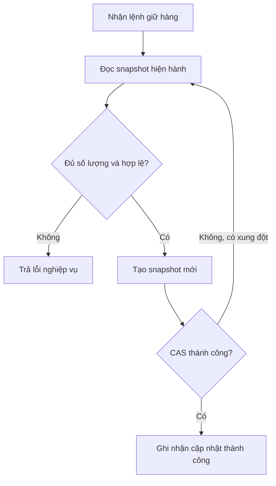

# Giá trị bất biến và thay đổi có kiểm soát

## 1. Mục tiêu bài học

Trong chương **Dữ liệu và trạng thái** của module **CODE_QUALITY_FUNDAMENTALS**, chúng ta tìm hiểu cách biểu diễn dữ liệu để người đọc biết **giá trị nào được bảo đảm không đổi**, **ai được phép thay đổi trạng thái** và **mỗi thay đổi phải tuân theo quy tắc nào**.

Module hướng đến việc hiểu những thuộc tính quyết định mã nguồn có **đáng tin cậy, dễ hiểu và dễ thay đổi** hay không. Giá trị bất biến giúp hạn chế tác động ngoài ý muốn; cơ chế thay đổi có kiểm soát giúp bảo vệ quy tắc nghiệp vụ, đặc biệt khi nhiều phần mã cùng truy cập trạng thái.

Sau bài học, bạn có thể:

- Phân biệt **giá trị bất biến (immutable value)** với **trạng thái có thể thay đổi (mutable state)**.
- Giải thích vì sao `final`, `record` hoặc một collection không sửa được chưa tự bảo đảm toàn bộ đồ thị đối tượng là bất biến.
- Thiết kế một phép chuyển trạng thái rõ ràng: nhận trạng thái cũ và yêu cầu hợp lệ, tạo trạng thái mới mà không sửa giá trị cũ.
- Nhận diện nguy cơ cập nhật thất lạc khi hai luồng cùng sửa trạng thái, và hiểu vai trò của cập nhật nguyên tử.
- Chọn giữa snapshot bất biến, cập nhật thông qua một đối tượng đóng gói và giao dịch dữ liệu theo quy mô bài toán.

## 2. Giá trị và trạng thái khác nhau ở đâu?

**Giá trị (value)** mô tả một tập dữ liệu tại một thời điểm. Ví dụ: giá tiền 120.000 VND, địa chỉ giao hàng đã được xác nhận, hoặc ảnh chụp số lượng tồn kho lúc 10:00. Hai giá trị có nội dung như nhau thường có thể được sử dụng thay thế cho nhau khi chỉ xét nội dung đó.

**Trạng thái (state)** là thông tin hiện hành của một đối tượng hay hệ thống tại một thời điểm và có thể thay đổi qua một chuỗi hành động. Ví dụ, số lượng sản phẩm còn bán được thay đổi khi có đơn được giữ hàng, hủy hoặc nhập kho.

**Bất biến (immutability)** nghĩa là sau khi một giá trị đã được tạo, nội dung quan sát được qua hợp đồng của nó không thể bị thay đổi. Muốn phản ánh dữ liệu mới, chương trình tạo **giá trị khác**. Điều này không có nghĩa cả ứng dụng không có trạng thái: một biến hoặc nơi lưu trữ vẫn có thể chuyển từ việc tham chiếu **snapshot A** sang **snapshot B**.

**Thay đổi có kiểm soát (controlled mutation)** nghĩa là việc cập nhật trạng thái diễn ra tại ranh giới có trách nhiệm, qua hành động được định nghĩa rõ, có kiểm tra điều kiện và không để người gọi tự ý sửa dữ liệu bên trong.

Ví dụ:

| Cách biểu diễn | Điều người đọc cần biết | Rủi ro thường gặp |
| --- | --- | --- |
| `Map<String, Integer>` dùng chung, ai cũng có thể `put` | Mọi nơi có thể thay tồn kho | Một thay đổi có thể phá quy tắc và khó truy nguyên. |
| Snapshot bất biến + hàm `reserve` trả snapshot mới | Một phép tính biến đổi có đầu vào/đầu ra rõ | Nếu nhiều luồng thay snapshot hiện hành không nguyên tử, vẫn mất cập nhật. |
| Đối tượng quản lý trạng thái, chỉ mở phương thức `reserve` | Việc thay đổi phải đi qua một hợp đồng nghiệp vụ | Bản thân phương thức vẫn phải xử lý đồng thời và bảo vệ bất biến. |
| Cơ sở dữ liệu với giao dịch và kiểm tra điều kiện | Nhiều tiến trình có thể phối hợp trên dữ liệu bền vững | Cần thiết kế khóa, phiên bản, giao dịch và cách xử lý xung đột. |

Điểm cần nhớ: **giá trị bất biến giúp ổn định điều ta đọc; cơ chế cập nhật quyết định trạng thái hiện hành được thay thế an toàn ra sao**.

## 3. Những hiểu lầm về `final`, `record` và collection

Java có nhiều công cụ hỗ trợ bất biến, nhưng mỗi công cụ có phạm vi bảo đảm khác nhau.

### 3.1. `final` chỉ ngăn đổi tham chiếu của biến

```java
final java.util.List<String> items = new java.util.ArrayList<>();
items.add("SKU-A"); // Hợp lệ: nội dung List vẫn thay đổi.
// items = new java.util.ArrayList<>(); // Không hợp lệ: đổi tham chiếu.
```

Biến `items` không thể trỏ sang danh sách khác, nhưng đối tượng `ArrayList` vẫn có thể bị sửa. Đặt `final` cho một trường chứa `Map` hay `List` cũng không làm các phần tử bên trong tự trở thành bất biến.

### 3.2. `record` không tự tạo bất biến sâu

```java
record UnsafeSnapshot(java.util.List<String> skus) {}

var source = new java.util.ArrayList<String>();
source.add("SKU-A");
var snapshot = new UnsafeSnapshot(source);
source.add("SKU-B");

System.out.println(snapshot.skus()); // [SKU-A, SKU-B]
```

Trường thành phần của `record` là `final`, nhưng giá trị đang trỏ tới là một danh sách có thể thay đổi. Người gọi còn có thể lấy `snapshot.skus()` rồi sửa trực tiếp nếu danh sách vẫn cho phép.

### 3.3. Sao chép phòng vệ khi tạo snapshot

```java
import java.util.List;
import java.util.Objects;

public record SkuSnapshot(List<String> skus) {
    public SkuSnapshot {
        Objects.requireNonNull(skus, "skus");
        skus = List.copyOf(skus);
    }
}
```

`List.copyOf` tạo một collection không cho sửa nội dung qua API và tách snapshot khỏi một nguồn `ArrayList` có thể bị thay đổi sau đó. Nó từ chối phần tử `null`; điều này phù hợp khi hợp đồng không chấp nhận SKU null.

Tuy nhiên, đây là **sao chép nông (shallow copy)**: nếu phần tử là một đối tượng mutable, có thể sửa nội dung của chính phần tử ấy qua một tham chiếu khác. Trong ví dụ, `String` là bất biến nên danh sách `String` có thể được xem là snapshot giá trị an toàn theo phạm vi đã mô tả.

**`Collections.unmodifiableList(original)` khác với `List.copyOf(original)`:** cách đầu tạo một *view* không cho sửa qua view, nhưng vẫn có thể phản ánh các sửa đổi thực hiện qua `original`. Khi cần một ảnh chụp độc lập, hãy chọn cách tạo bản sao hoặc xây dựng một kiểu giá trị riêng với quyền sở hữu dữ liệu rõ ràng.

## 4. Ví dụ Java 17: tồn kho được biểu diễn bằng snapshot bất biến

Giả sử một ứng dụng quản lý **số lượng còn sẵn để giữ cho đơn hàng** theo mã hàng (`SKU`). Trong phạm vi ví dụ, nhóm xác định hợp đồng:

1. `availableBySku` chứa các SKU đã biết và số lượng nguyên **không âm**; khóa SKU không được trống.
2. Yêu cầu giữ hàng cần SKU đã có trong danh mục và `units > 0`.
3. Không được giữ quá số lượng còn sẵn. Giữ hàng thành công giảm tồn kho đúng `units`.
4. Mỗi **lần giữ hàng thành công** tạo phiên bản mới với `version` tăng một.
5. Snapshot cũ không đổi sau khi tạo snapshot mới. Phiên bản ban đầu do nơi khởi tạo trạng thái quyết định.

Ví dụ này chỉ mô tả **giữ số lượng còn sẵn trong bộ nhớ**. Nó không tự thực hiện thanh toán, hết hạn giữ hàng, nhập kho, đồng bộ nhiều máy hoặc lưu dữ liệu bền vững.

### 4.1. Một giá trị mang bất biến và phép chuyển trạng thái

```java
// InventoryState.java
import java.util.HashMap;
import java.util.Map;
import java.util.Objects;

public record InventoryState(
        long version, Map<String, Integer> availableBySku) {

    public InventoryState {
        if (version < 0) {
            throw new IllegalArgumentException("version must not be negative");
        }
        Objects.requireNonNull(availableBySku, "availableBySku");

        for (var entry : availableBySku.entrySet()) {
            String sku = Objects.requireNonNull(entry.getKey(), "sku");
            Integer available =
                    Objects.requireNonNull(entry.getValue(), "available");
            if (sku.isBlank() || available < 0) {
                throw new IllegalArgumentException("invalid inventory entry");
            }
        }
        availableBySku = Map.copyOf(availableBySku);
    }

    public InventoryState reserve(String sku, int units) {
        if (sku == null || sku.isBlank()) {
            throw new IllegalArgumentException("sku must not be blank");
        }
        if (units <= 0) {
            throw new IllegalArgumentException("units must be positive");
        }

        Integer available = availableBySku.get(sku);
        if (available == null) {
            throw new UnknownSku(sku);
        }
        if (available < units) {
            throw new InsufficientStock(sku);
        }

        Map<String, Integer> next = new HashMap<>(availableBySku);
        next.put(sku, available - units);
        return new InventoryState(Math.addExact(version, 1), next);
    }

    public static final class UnknownSku extends RuntimeException {
        public UnknownSku(String sku) {
            super("Unknown SKU: " + sku);
        }
    }

    public static final class InsufficientStock extends RuntimeException {
        public InsufficientStock(String sku) {
            super("Insufficient stock for SKU: " + sku);
        }
    }
}
```

Các điểm đáng chú ý:

- **Bất biến tại thời điểm khởi tạo:** constructor kiểm tra phiên bản và từng bản ghi, rồi tạo bản sao bằng `Map.copyOf`. Người gọi không thể sửa tồn kho của snapshot bằng `availableBySku().put(...)`.
- **Bất biến của giá trị thành phần:** khóa `String` và số lượng `Integer` là bất biến. Nếu map chứa đối tượng mutable, sao chép map thôi chưa đủ.
- **Ý nghĩa nghiệp vụ được đặt tên:** `reserve` cho biết hành động giữ hàng, thay vì để caller tự tính và gọi `put`.
- **Thất bại không sửa trạng thái:** SKU lạ hoặc không đủ hàng khiến hàm ném ngoại lệ trước khi tạo trạng thái mới; snapshot cũ vẫn còn nguyên.
- **Không sửa đối tượng hiện hành:** thao tác tạo `HashMap` mới rồi trả một `InventoryState` khác; `Math.addExact` ngăn phiên bản bị tràn âm thầm.
- **Hợp đồng kiểm soát hành vi:** chỉ các phép chuyển trạng thái được cho phép mới nên trở thành phương thức công khai. Việc trả map đọc được không đồng nghĩa cho phép caller thay map.

Ví dụ cách dùng:

```java
import java.util.Map;

var original = new InventoryState(
        0, Map.of("SKU-A", 5, "SKU-B", 2));
var afterReservation = original.reserve("SKU-A", 3);

System.out.println(original.availableBySku().get("SKU-A"));         // 5
System.out.println(afterReservation.availableBySku().get("SKU-A"));  // 2
System.out.println(original.version());                             // 0
System.out.println(afterReservation.version());                      // 1
```

Ta có thể đối chiếu hai snapshot để biết hành động nào làm thay đổi dữ liệu. Không cần lo rằng một tham chiếu đến `original` bất ngờ nhận giá trị mới khi mã ở nơi khác thay đổi `afterReservation`.

### 4.2. Tính đúng đắn của chuyển trạng thái

Một phép biến đổi như `reserve` có đầu vào gồm **trạng thái cũ** và **lệnh cần thực hiện**, rồi trả trạng thái mới hoặc báo lỗi. Đây là một hàm **không có tác dụng phụ lên dữ liệu bên ngoài** trong phạm vi ví dụ; vì vậy ta dễ kiểm tra các bất biến:

| Trường hợp | Kết quả mong đợi |
| --- | --- |
| `reserve("SKU-A", 3)` với tồn kho 5 | Snapshot mới có 2 đơn vị, version tăng một. |
| `reserve("SKU-A", 5)` với tồn kho 5 | Snapshot mới có 0 đơn vị; được phép vì không vượt tồn kho. |
| `reserve("SKU-A", 6)` với tồn kho 5 | Báo không đủ hàng, snapshot cũ không bị sửa. |
| `reserve("SKU-C", 1)` với SKU chưa biết | Báo SKU không tồn tại theo hợp đồng. |
| `reserve("SKU-A", 0)` | Báo yêu cầu không hợp lệ. |
| Thay dữ liệu trong map dùng để tạo snapshot | Không làm snapshot đã tạo thay đổi. |

Tính bất biến không tự bảo đảm **quy tắc nghiệp vụ đúng**. Nếu chương trình trừ nhầm số lượng, tạo ra một snapshot sai vẫn là lỗi. Giá trị bất biến làm sai lệch dễ định vị và tái hiện hơn, nhưng kiểm thử và đặc tả vẫn cần thiết.

## 5. Thay thế snapshot hiện hành: kiểm soát cập nhật đồng thời

Đến đây, mỗi `InventoryState` là bất biến. Tuy nhiên, ứng dụng vẫn phải xác định **snapshot nào đang là trạng thái hiện hành**.

Một cách viết nguy hiểm khi có nhiều luồng là:

```java
InventoryState before = current.get();
InventoryState after = before.reserve("SKU-A", 1);
current.set(after); // Không an toàn khi luồng khác cũng cập nhật.
```

Giả sử ban đầu chỉ còn **1** đơn vị. Hai luồng có thể cùng đọc snapshot phiên bản 0, cùng tạo snapshot có tồn kho 0, rồi lần lượt gọi `set`. Cả hai cùng báo rằng mình đã giữ hàng thành công, dù hệ thống chỉ có một đơn vị. Đây là lỗi **cập nhật thất lạc (lost update)**. Việc snapshot bất biến không ngăn hai luồng cùng dựa vào một ảnh chụp cũ.

Để thay thế snapshot có kiểm soát trong **một tiến trình Java**, ta có thể dùng `AtomicReference` với phép **compare-and-set (CAS)**:

```java
// InMemoryInventory.java
import java.util.Objects;
import java.util.concurrent.atomic.AtomicReference;

public final class InMemoryInventory {
    private final AtomicReference<InventoryState> current;

    public InMemoryInventory(InventoryState initialState) {
        this.current = new AtomicReference<>(
                Objects.requireNonNull(initialState, "initialState"));
    }

    public InventoryState snapshot() {
        return current.get();
    }

    public InventoryState reserve(String sku, int units) {
        while (true) {
            InventoryState before = current.get();
            InventoryState after = before.reserve(sku, units);
            if (current.compareAndSet(before, after)) {
                return after;
            }
            // Có cập nhật khác chen vào: đọc trạng thái mới và tính lại.
        }
    }
}
```

Khi CAS thành công, tham chiếu hiện hành được thay bằng snapshot mới như **một thao tác nguyên tử**. Nếu có luồng khác đã thay trạng thái sau lần đọc của mình, CAS thất bại và vòng lặp đọc lại trạng thái mới, rồi **kiểm tra điều kiện giữ hàng lại**.

Với 1 đơn vị còn lại, chỉ một luồng có thể cập nhật thành công từ phiên bản 0. Luồng còn lại thử lại trên phiên bản 1, thấy tồn kho bằng 0 và nhận `InsufficientStock`. Kết quả này phù hợp với quy tắc không giữ quá hàng còn sẵn.



**Lưu ý về tác dụng phụ:** hàm được chạy lại trong vòng CAS phải giữ tính thuần trong phạm vi cập nhật. Không gửi email, thu tiền hoặc phát sự kiện nghiệp vụ bên trong `InventoryState.reserve`, vì nếu CAS thất bại thì phép tính có thể chạy nhiều lần. Các tác dụng phụ liên quan cần một thiết kế nhất quán riêng, chẳng hạn ghi sự kiện trong giao dịch dữ liệu hoặc dùng outbox ở hệ thống có lưu trữ bền vững.

**Giới hạn của ví dụ:** `AtomicReference` chỉ phối hợp các luồng cùng dùng đúng đối tượng `InMemoryInventory` trong một JVM. Nó không tự lưu dữ liệu khi tiến trình tắt, không đồng bộ giữa các instance và không giải quyết giữ hàng đồng thời qua nhiều dịch vụ. Vòng CAS cũng có thể tốn công tính lại khi xung đột cao, nhất là khi mỗi lần sửa phải sao chép cả map.

## 6. Kiểm thử giá trị bất biến và cập nhật

Cần kiểm thử cả hai thuộc tính: **không sửa được snapshot cũ** và **việc thay trạng thái hiện hành tuân theo quy tắc**.

Ví dụ JUnit 5:

```java
import static org.junit.jupiter.api.Assertions.assertEquals;
import static org.junit.jupiter.api.Assertions.assertNotSame;
import static org.junit.jupiter.api.Assertions.assertThrows;

import java.util.HashMap;
import java.util.Map;
import org.junit.jupiter.api.Test;

class InventoryStateTest {
    @Test
    void snapshotDefensivelyCopiesInputMap() {
        Map<String, Integer> input = new HashMap<>();
        input.put("SKU-A", 5);
        var snapshot = new InventoryState(0, input);

        input.put("SKU-A", 99);
        assertEquals(Integer.valueOf(5),
                snapshot.availableBySku().get("SKU-A"));
        assertThrows(UnsupportedOperationException.class,
                () -> snapshot.availableBySku().put("SKU-A", 7));
    }

    @Test
    void reserveProducesANewValueWithoutChangingTheOldOne() {
        var before = new InventoryState(0, Map.of("SKU-A", 5));
        var after = before.reserve("SKU-A", 3);

        assertNotSame(before, after);
        assertEquals(Integer.valueOf(5),
                before.availableBySku().get("SKU-A"));
        assertEquals(Integer.valueOf(2),
                after.availableBySku().get("SKU-A"));
        assertEquals(0L, before.version());
        assertEquals(1L, after.version());
    }

    @Test
    void insufficientStockDoesNotMutateTheSnapshot() {
        var before = new InventoryState(0, Map.of("SKU-A", 1));

        assertThrows(InventoryState.InsufficientStock.class,
                () -> before.reserve("SKU-A", 2));
        assertEquals(Integer.valueOf(1),
                before.availableBySku().get("SKU-A"));
        assertEquals(0L, before.version());
    }
}
```

Một kiểm thử phối hợp hai luồng có thể kiểm tra rằng chỉ một lần giữ hàng thành công khi chỉ còn một đơn vị:

```java
import static org.junit.jupiter.api.Assertions.assertEquals;

import java.util.Map;
import java.util.concurrent.Callable;
import java.util.concurrent.CountDownLatch;
import java.util.concurrent.Executors;
import java.util.concurrent.Future;
import org.junit.jupiter.api.Test;

class InMemoryInventoryTest {
    @Test
    void concurrentReservationsDoNotOversellOneUnit() throws Exception {
        var store = new InMemoryInventory(
                new InventoryState(0, Map.of("SKU-A", 1)));
        var start = new CountDownLatch(1);
        var pool = Executors.newFixedThreadPool(2);

        Callable<Boolean> attempt = () -> {
            start.await();
            try {
                store.reserve("SKU-A", 1);
                return true;
            } catch (InventoryState.InsufficientStock e) {
                return false;
            }
        };

        try {
            Future<Boolean> first = pool.submit(attempt);
            Future<Boolean> second = pool.submit(attempt);
            start.countDown();

            int successes = (first.get() ? 1 : 0)
                    + (second.get() ? 1 : 0);
            assertEquals(1, successes);
            assertEquals(Integer.valueOf(0),
                    store.snapshot().availableBySku().get("SKU-A"));
            assertEquals(1L, store.snapshot().version());
        } finally {
            pool.shutdownNow();
        }
    }
}
```

Phép thử nhiều luồng là một **tín hiệu kiểm chứng hữu ích**, nhưng không thay thế phân tích tính nguyên tử hoặc kiểm thử tải, vì lịch chạy của các luồng không cố định. Cần thêm trường hợp hai luồng giữ số lượng khác nhau, nhiều lần cập nhật liên tiếp, đầu vào sai, SKU không tồn tại và tình huống version tràn (nếu hệ thống có thể hoạt động đến giới hạn đó).

Trong thiết kế thực, cũng cần kiểm thử tầng lưu trữ và đường đi của giao dịch, bởi một bộ test trên `InMemoryInventory` không chứng minh tính đúng đắn của hệ thống phân tán.

## 7. Khi dữ liệu nằm trong database hoặc nhiều tiến trình

Khi ứng dụng chạy trên nhiều JVM, mỗi instance có `AtomicReference` riêng. Việc cập nhật tại một máy không bảo đảm máy khác nhìn thấy thay đổi. Với tồn kho cần bền vững, **database** thường là nơi điều phối cập nhật.

Một hướng triển khai là phép trừ có điều kiện trong cùng transaction tại database. Ví dụ SQL mang tính minh họa, giả sử bảng có các cột `sku`, `available` và `version`:

```sql
UPDATE inventory
SET available = available - :units,
    version = version + 1
WHERE sku = :sku
  AND available >= :units
  AND version = :expected_version;
```

Trước khi chạy, ứng dụng phải kiểm tra `:units > 0` và hợp đồng đầu vào. Khi **một dòng** được cập nhật, thao tác giữ hàng thành công cho SKU đó theo điều kiện của truy vấn. Khi **không có dòng nào** được cập nhật, có thể là SKU không tồn tại, không đủ tồn kho hoặc phiên bản đọc trước đã cũ: caller cần xử lý hoặc đọc lại trạng thái để phân loại đúng lý do, và quyết định có thử lại hay trả lỗi.

Điều kiện `available >= :units` giúp tránh số âm tại thời điểm cập nhật, còn `version = :expected_version` là một dạng **kiểm soát đồng thời lạc quan (optimistic concurrency control)**. Tính nguyên tử phụ thuộc vào database, transaction và ràng buộc thực tế. Với một đơn hàng gồm nhiều SKU, nếu cần giữ **tất cả hoặc không giữ gì**, cần thiết kế ranh giới transaction cho nhiều dòng hoặc cơ chế nhất quán khác; một câu `UPDATE` đơn lẻ không giải quyết toàn bộ luồng nghiệp vụ.

Ngay cả khi dùng database, các bản **giá trị bất biến** ở tầng ứng dụng vẫn có ích: kết quả đọc được mô tả rõ, không bị thành phần khác sửa âm thầm và có thể kiểm thử các quy tắc tính toán độc lập với I/O.

## 8. Bất biến không có nghĩa phải tạo bản sao cho mọi thay đổi

Giá trị bất biến thường giúp đọc hiểu và kiểm thử, nhưng có chi phí:

| Lựa chọn | Điểm mạnh | Chi phí hoặc giới hạn |
| --- | --- | --- |
| Snapshot bất biến + tạo bản sao | Dễ so sánh trước/sau; ít thay đổi ngoài ý muốn; dễ truyền giữa các thành phần | Có thể cấp phát và sao chép nhiều dữ liệu mỗi lần cập nhật. |
| Mutable object đóng gói, cập nhật bằng phương thức | Không cần sao chép toàn bộ cấu trúc cho mỗi phép sửa; có thể giữ bất biến tại một ranh giới | Cần kiểm soát tham chiếu, đồng thời, transaction và thời điểm quan sát. |
| Cấu trúc dữ liệu persistent/structural sharing | Có thể chia sẻ phần lớn cấu trúc giữa các phiên bản | Độ phức tạp thư viện, bộ nhớ và hiệu năng cụ thể cần đánh giá. |
| Transaction trong database | Phối hợp cập nhật bền vững trên nhiều tiến trình | I/O, khóa hoặc xung đột, độ trễ và vận hành database. |

Trong ví dụ, `new HashMap<>(availableBySku)` tốn **O(n)** thời gian và bộ nhớ phụ trội theo số SKU, dù chỉ đổi một mục. `Map.copyOf` trong constructor còn có thể tiếp tục tạo bản sao. Phương án này phù hợp để **minh họa và quản lý tập dữ liệu nhỏ**, nhưng có thể không phù hợp với kho hàng lớn thay đổi liên tục. Cần đo và lựa chọn mô hình lưu trữ phù hợp thay vì áp dụng bất biến sâu một cách máy móc.

Một đối tượng mutable vẫn có thể **chất lượng tốt** nếu không để lộ collection có thể sửa, chỉ cho phép các phương thức theo nghiệp vụ, bảo vệ bất biến và xử lý đồng thời phù hợp. Ví dụ, một aggregate trong transaction có thể sửa một trường nội bộ, rồi chỉ công bố kết quả hợp lệ sau khi commit. **Điều cần kiểm soát là quyền và quy tắc thay đổi**, không phải cấm mọi phép gán.

## 9. Những lỗi thiết kế thường gặp

**Trả trực tiếp một collection mutable từ getter.** Người gọi có thể `put` hoặc `remove` mà không qua kiểm tra quy tắc. Cần trả snapshot đọc được, bản sao phù hợp hoặc API thao tác có trách nhiệm.

**Cho rằng `final` hoặc `record` bảo đảm bất biến sâu.** Nếu thành phần bên trong là `List<MutableProduct>`, người khác vẫn có thể sửa từng `MutableProduct`. Cần dùng giá trị thành phần bất biến hoặc sao chép sâu có kiểm soát khi hợp đồng yêu cầu.

**Dùng một snapshot cũ để ghi đè trạng thái mới.** Đọc rồi gọi `set` không có kiểm tra xung đột có thể mất cập nhật. Cần cập nhật nguyên tử hoặc giao dịch phù hợp nơi lưu trạng thái thật.

**Chạy tác dụng phụ trong phép cập nhật có thể thử lại.** Vòng CAS, callback retry hoặc xử lý lại thông điệp có thể gọi logic nhiều lần. Không được tự động gửi hai email, trừ tiền hai lần hoặc phát hai sự kiện chỉ vì hàm đã bị gọi lại.

**Cho phép trạng thái không hợp lệ tồn tại rồi hy vọng caller sửa sau.** Ví dụ số lượng âm được ghi vào map rồi mới kiểm tra ở controller khác. Nên đặt bất biến tại ranh giới tạo hoặc cập nhật trạng thái, ngay nơi có đủ ngữ cảnh để kiểm tra.

**Sao chép sâu mọi đối tượng không cần thiết.** Điều này có thể làm tăng CPU và GC, đặc biệt với cấu trúc lớn; cần xét chi phí thực tế và quyền sở hữu dữ liệu.

**Nhầm tính bất biến với tính nhất quán phân tán.** Mỗi JVM có bản ghi bất biến riêng vẫn có thể giữ tồn kho khác nhau. Phải xác định nguồn trạng thái có thẩm quyền và cơ chế cập nhật xuyên tiến trình.

## 10. Cách review thay đổi dữ liệu và trạng thái

Khi đọc một đoạn mã có trạng thái, hãy kiểm tra theo thứ tự:

1. **Dữ liệu nào là giá trị, dữ liệu nào là trạng thái hiện hành?** Ai sở hữu nó, ai đọc được và ai được phép cập nhật?
2. **Các bất biến là gì?** Ví dụ tồn kho không âm, SKU hợp lệ, phiên bản tăng khi thành công, dữ liệu cũ không bị sửa.
3. **Đường cập nhật chính thức nằm ở đâu?** Caller có thể sửa nội dung map qua getter hoặc giữ tham chiếu mutable không?
4. **Nếu thao tác thất bại, trạng thái còn nguyên không?** Có trường hợp thay một nửa rồi ném ngoại lệ không?
5. **Nếu hai yêu cầu đến đồng thời thì sao?** Có mất cập nhật, giữ trùng hàng hay ghi đè bản mới bằng dữ liệu cũ không?
6. **Nếu tiến trình dừng hoặc có nhiều máy, trạng thái có được duy trì đúng không?** Bất biến trong bộ nhớ chưa đủ để trả lời câu hỏi này.
7. **Giá phải trả cho bất biến là gì?** Số lần sao chép, cấp phát, độ phức tạp và giới hạn quy mô có phù hợp yêu cầu không?
8. **Có thể kiểm thử trường hợp biên và quan sát sự cố không?** Kiểm tra đầu vào bất hợp lệ, xung đột cập nhật và đường thất bại.

Cách tiếp cận này giúp giữ mã **đáng tin cậy** vì các bất biến được bảo vệ; **dễ hiểu** vì thay đổi có ranh giới và tên gọi rõ; **dễ thay đổi** vì một quy tắc không bị phân tán ở nhiều caller.

## 11. Câu hỏi tự kiểm tra

**Câu 1.** Một trường `private final List<OrderLine> lines` có phải bất biến không nếu `OrderLine` có setter, còn constructor chỉ gọi `List.copyOf(lines)`?

**Câu 2.** Hai luồng đều nhận một `InventoryState` bất biến có tồn kho bằng 1, cùng tạo trạng thái mới có tồn kho 0. Vì sao hai luồng vẫn có thể cùng báo thành công nếu code dùng `current.set(after)`?

**Câu 3.** Tại sao việc trả trạng thái mới qua `reserve` giúp kiểm thử trường hợp “không đủ hàng” thuận lợi hơn việc để caller tự `put` vào map?

**Câu 4.** Khi ứng dụng chạy trên hai server, `AtomicReference` có bảo đảm không giữ trùng một đơn vị tồn kho không? Cần thêm ranh giới nào?

**Câu 5.** Với một kho có hàng triệu SKU cập nhật liên tục, tại sao tạo lại toàn bộ `HashMap` sau mỗi lần giữ hàng có thể không phù hợp?

**Gợi ý trả lời:** (1) Chưa bất biến sâu: các `OrderLine` có thể bị sửa từ nơi khác. (2) Bất biến của ảnh chụp không đồng nghĩa việc thay tham chiếu là nguyên tử theo điều kiện; `set` thiếu kiểm tra xung đột. (3) Quy tắc và đường thất bại được tập trung; snapshot cũ vẫn nguyên để đối chiếu. (4) Không; cần nguồn lưu trữ có thẩm quyền và cập nhật đồng thời an toàn qua nhiều tiến trình, thường bằng transaction/điều kiện cập nhật ở database. (5) Chi phí sao chép O(n), cấp phát và GC có thể lớn; cần đo và chọn cấu trúc hoặc cách cập nhật khác.

## 12. Ghi nhớ

**Giá trị bất biến giúp điều đã quan sát không bị thay đổi ngoài ý muốn; thay đổi có kiểm soát giúp trạng thái hiện hành chỉ chuyển sang giá trị hợp lệ.** Trong Java, `final`, `record` và collection không sửa được là công cụ hỗ trợ, nhưng phải xét cả các đối tượng thành phần, quyền sở hữu dữ liệu và ranh giới đồng thời. Một hàm chuyển trạng thái dễ kiểm thử không thể thay thế cập nhật nguyên tử hay giao dịch khi nhiều bên cùng sửa. Chọn cơ chế phù hợp với quy mô và yêu cầu để mã nguồn vừa **đáng tin cậy, dễ hiểu, vừa có thể thay đổi an toàn**.
