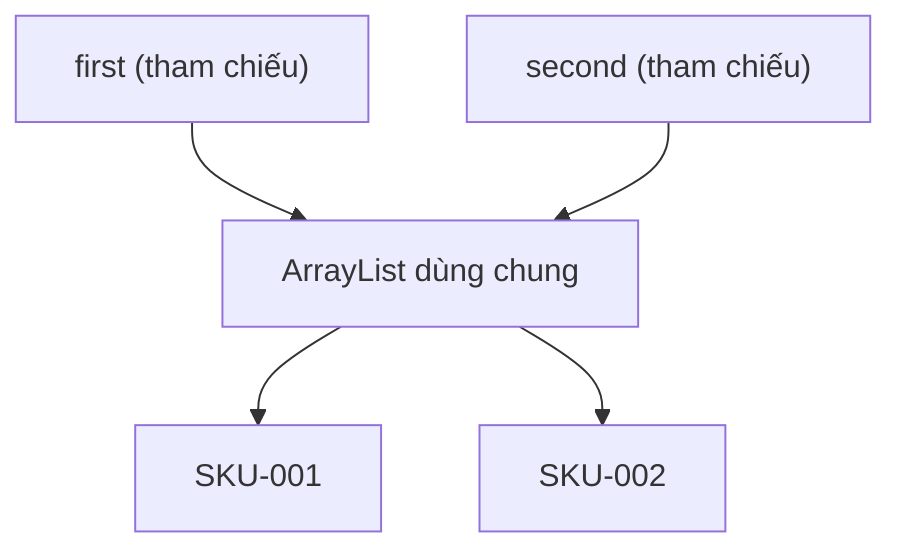
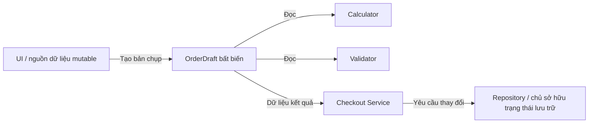

# Quyền sở hữu đối tượng và tham chiếu dùng chung

Một phương thức tính tổng tiền giỏ hàng có thể cho kết quả đúng vào lúc kiểm thử, nhưng sau đó tổng tiền lại thay đổi dù không ai gọi phương thức “cập nhật giỏ”. Nguyên nhân đôi khi không nằm trong thuật toán tính tiền, mà ở chỗ **hai thành phần cùng giữ tham chiếu đến một đối tượng có thể thay đổi**. Một thành phần sửa dữ liệu, thành phần kia quan sát thấy thay đổi ngoài dự kiến.

Trong chương **Dữ liệu và trạng thái** của `CODE_QUALITY_FUNDAMENTALS`, chúng ta tìm hiểu **quyền sở hữu đối tượng (object ownership)** và **tham chiếu dùng chung (shared references)**. Chủ đề này giúp trả lời một câu hỏi quan trọng của chất lượng mã nguồn: *Ai được quyền thay đổi trạng thái, và thành phần nào cần biết khi trạng thái thay đổi?* Làm rõ quyền sở hữu giúp mã **đáng tin cậy, dễ hiểu và dễ thay đổi** hơn.

Sau bài này, bạn có thể nhận diện tình huống *aliasing*, phân biệt chia sẻ tham chiếu với chia sẻ trạng thái có thể thay đổi, áp dụng bản sao phòng vệ trong Java, hiểu giới hạn của `final` và `record`, và đánh giá những lựa chọn khi phải chia sẻ dữ liệu giữa các luồng.

## 1. Đối tượng, tham chiếu và quyền sở hữu

Trong Java, một biến kiểu đối tượng chứa một **giá trị tham chiếu** đến đối tượng (hoặc `null`). Hai biến khác nhau có thể giữ tham chiếu đến **cùng một đối tượng**:

```java
import java.util.ArrayList;
import java.util.List;

List<String> first = new ArrayList<>();
first.add("SKU-001");

List<String> second = first;
second.add("SKU-002");

System.out.println(first);  // [SKU-001, SKU-002]
```

Dòng `second = first` không tạo một danh sách mới. Nó sao chép **giá trị tham chiếu**, nên cả `first` và `second` cùng trỏ tới một `ArrayList`. Khi gọi `second.add(...)`, trạng thái của danh sách chung thay đổi, và `first` nhìn thấy thay đổi đó.

Hiện tượng nhiều đường truy cập cùng chỉ đến một đối tượng được gọi là **aliasing**. Bản thân aliasing không phải lỗi. Vấn đề nảy sinh khi đối tượng dùng chung **có thể thay đổi (mutable)** và các bên không có hợp đồng rõ về quyền sửa, thời điểm sửa hoặc cách phối hợp.



**Quyền sở hữu** trong thiết kế phần mềm là quy ước xác định **thành phần chịu trách nhiệm quản lý vòng đời, trạng thái và các thay đổi hợp lệ của một đối tượng**. Java không có cơ chế kiểm tra quyền sở hữu tĩnh kiểu trình biên dịch như một số ngôn ngữ khác; vì vậy, ranh giới sở hữu trong Java thường được thể hiện bằng đóng gói, API, kiểu bất biến, sao chép dữ liệu, kiểm thử và quy ước nhóm.

Một đối tượng có thể được nhiều nơi **đọc**, nhưng chỉ một thành phần nên là **nguồn quyết định** về các thay đổi nghiệp vụ đối với nó, trừ khi có cơ chế phối hợp được thiết kế rõ.

### Phân biệt các khái niệm gần nhau

| Khái niệm | Ý nghĩa | Ví dụ |
| --- | --- | --- |
| **Tham chiếu (reference)** | Giá trị dùng để truy cập một đối tượng | Biến `List<String> cart` |
| **Aliasing** | Nhiều tham chiếu truy cập cùng một đối tượng | `second = first` |
| **Mutable state** | Trạng thái đối tượng có thể thay đổi sau khi tạo | `ArrayList.add()`, thay đổi trường của đối tượng |
| **Ownership** | Trách nhiệm và quyền kiểm soát đối với trạng thái/vòng đời đối tượng | `OrderDraft` kiểm soát danh sách dòng hàng bên trong |
| **Defensive copy** | Sao chép khi nhận/trả dữ liệu nhằm tránh chia sẻ mutable state ngoài ý muốn | `List.copyOf(input)` với phần tử bất biến |
| **Immutable object** | Trạng thái quan sát được không đổi sau khi tạo | `String`, một kiểu giá trị chỉ gồm dữ liệu bất biến |
| **Thread safety** | Hành vi vẫn đúng khi nhiều luồng truy cập theo hợp đồng | Trạng thái được đồng bộ hoặc không thể bị sửa |

**Bất biến** và **an toàn luồng** có liên hệ nhưng không đồng nghĩa: một đối tượng bất biến, được khởi tạo và công bố đúng cách, thường dễ dùng chung an toàn hơn; một đối tượng mutable vẫn có thể dùng chung nếu mọi đường truy cập được đồng bộ nhất quán.

## 2. Vì sao dùng chung tham chiếu có thể gây lỗi khó đoán?

Giả sử bộ phận checkout tạo một đối tượng chứa các dòng hàng rồi tính tổng. Nếu nó giữ nguyên danh sách do bên ngoài đưa vào, thành phần khác có thể thay đổi dữ liệu qua tham chiếu ban đầu.

Ví dụ đơn giản:

```java
import java.util.List;

record CartLine(String sku, int quantity, long unitPriceVnd) {}

final class UnsafeOrderDraft {
    private final List<CartLine> lines;

    UnsafeOrderDraft(List<CartLine> lines) {
        this.lines = lines;
    }

    List<CartLine> lines() {
        return lines;
    }

    long totalVnd() {
        long total = 0L;
        for (CartLine line : lines) {
            long lineTotal =
                    Math.multiplyExact(line.quantity(), line.unitPriceVnd());
            total = Math.addExact(total, lineTotal);
        }
        return total;
    }
}
```

Đoạn này minh họa **lỗi ranh giới sở hữu**, chưa kiểm tra đầy đủ đầu vào. `Math.multiplyExact` và `Math.addExact` phát hiện tràn số nguyên trong phép tính tiền; chúng không ngăn việc dữ liệu bị sửa từ nơi khác.

Hãy xem mã gọi:

```java
import java.util.ArrayList;
import java.util.List;

List<CartLine> input = new ArrayList<>();
input.add(new CartLine("SKU-A", 1, 100_000L));

UnsafeOrderDraft draft = new UnsafeOrderDraft(input);
System.out.println(draft.totalVnd());  // 100000

input.add(new CartLine("SKU-B", 1, 50_000L));
System.out.println(draft.totalVnd());  // 150000
```

Không ai gọi phương thức cập nhật trên `draft`, nhưng tổng tiền vẫn thay đổi vì `draft.lines` và `input` tham chiếu tới cùng một danh sách. Thậm chí người gọi có thể sửa dữ liệu qua `draft.lines().clear()`.

Đây là **hai đường làm rò rỉ khả năng thay đổi trạng thái**:

1. **Rò rỉ khi nhận dữ liệu:** Constructor giữ nguyên danh sách mutable do bên ngoài quản lý.
2. **Rò rỉ khi trả dữ liệu:** Getter trả lại tham chiếu đến danh sách mutable nội bộ.

Các hệ quả có thể gặp gồm tổng tiền không ổn định, trạng thái bị thay đổi không qua kiểm tra nghiệp vụ, kiểm thử phụ thuộc vào thứ tự lời gọi và khó xác định *ai* gây ra thay đổi.

**Điểm dễ nhầm:** `private final List<CartLine> lines` chỉ ngăn gán lại **trường `lines`** sau khi tạo. Nó **không** làm `ArrayList` trở thành bất biến.

## 3. Thiết kế lại: một đối tượng làm chủ trạng thái đơn hàng

Nếu một đơn nháp được kỳ vọng là **ảnh chụp (snapshot)** của dữ liệu tại thời điểm tạo, constructor nên nhận dữ liệu rồi lưu một phiên bản mà người gọi không thể thay đổi qua tham chiếu cũ.

Trong Java 17, ta có thể dùng `record` cho một dòng hàng chứa toàn giá trị bất biến, sau đó dùng `List.copyOf` để tạo danh sách không cho sửa.

```java
import java.util.List;
import java.util.Objects;

record CartLine(String sku, int quantity, long unitPriceVnd) {
    CartLine {
        Objects.requireNonNull(sku, "sku");
        if (sku.isBlank() || quantity <= 0 || unitPriceVnd < 0) {
            throw new IllegalArgumentException("Invalid cart line");
        }
    }
}

final class OrderDraft {
    private final List<CartLine> lines;

    OrderDraft(List<CartLine> lines) {
        Objects.requireNonNull(lines, "lines");
        if (lines.isEmpty()) {
            throw new IllegalArgumentException("Cart must not be empty");
        }

        // CartLine chỉ gồm String và các giá trị nguyên, nên mỗi phần tử
        // không có trạng thái mutable cần sao chép thêm.
        this.lines = List.copyOf(lines);
    }

    List<CartLine> lines() {
        return lines;
    }

    long totalVnd() {
        long total = 0L;
        for (CartLine line : lines) {
            long lineTotal = Math.multiplyExact(
                    (long) line.quantity(), line.unitPriceVnd());
            total = Math.addExact(total, lineTotal);
        }
        return total;
    }
}
```

Đoạn mã trên là **phiên bản thay thế** cho ví dụ `UnsafeOrderDraft`: hai đoạn định nghĩa `CartLine` không được đặt cùng một package khi biên dịch. `record` cần Java 16 trở lên và các ví dụ sử dụng Java 17.

Có ba điểm quan trọng:

- **Sao chép tại ranh giới đầu vào:** `List.copyOf(lines)` tạo ra danh sách không sửa được, có nội dung tương ứng tại thời điểm tạo. Việc người gọi sửa danh sách mutable ban đầu sau đó không làm danh sách của `OrderDraft` thay đổi.
- **Không trả đường truy cập có thể sửa:** Getter trả danh sách không hỗ trợ `add`, `remove` hoặc `set`. Không cần sao chép thêm ở getter trong trường hợp cụ thể này, vì cả danh sách lẫn từng `CartLine` đều bất biến về trạng thái.
- **Kiểm tra bất biến nghiệp vụ:** Mỗi `CartLine` có SKU hợp lệ, số lượng dương, đơn giá không âm; `OrderDraft` yêu cầu danh sách không rỗng. Mã gọi không thể bỏ qua các điều kiện ấy bằng cách sửa phần tử sau khi tạo.

`List.copyOf` từ chối phần tử `null` bằng `NullPointerException`. Nó có thể tái sử dụng một danh sách vốn đã không sửa được thay vì luôn cấp phát một `List` khác; **bảo đảm cần dựa vào là nội dung danh sách không bị thay đổi qua nguồn mutable**, không phải hai biến có địa chỉ khác nhau.

Ví dụ này chọn dữ liệu **bất biến sau khi tạo** vì phù hợp với một ảnh chụp dùng trong tính toán. Nếu nghiệp vụ cần giỏ hàng có thể thay đổi trong suốt phiên mua sắm, nên tạo một thành phần sở hữu giỏ mutable với các phương thức như `addItem`, `changeQuantity` và `removeItem`, rồi sinh `OrderDraft` bất biến khi bắt đầu checkout. Không nên cưỡng ép bất biến cho mọi đối tượng bằng mọi giá.

### 3.1. Kiểm thử việc tách quyền sở hữu với JUnit 5

```java
import static org.junit.jupiter.api.Assertions.assertEquals;
import static org.junit.jupiter.api.Assertions.assertThrows;

import java.util.ArrayList;
import java.util.List;
import org.junit.jupiter.api.Test;

class OrderDraftTest {
    @Test
    void laterChangesToInputDoNotChangeDraft() {
        List<CartLine> input = new ArrayList<>();
        input.add(new CartLine("SKU-A", 1, 100_000L));

        OrderDraft draft = new OrderDraft(input);
        input.add(new CartLine("SKU-B", 1, 50_000L));

        assertEquals(1, draft.lines().size());
        assertEquals(100_000L, draft.totalVnd());
    }

    @Test
    void returnedListCannotBeModified() {
        OrderDraft draft = new OrderDraft(
                List.of(new CartLine("SKU-A", 1, 100_000L)));

        assertThrows(UnsupportedOperationException.class, () ->
                draft.lines().add(new CartLine("SKU-B", 1, 50_000L)));
    }

    @Test
    void invalidLineAndEmptyDraftAreRejected() {
        assertThrows(IllegalArgumentException.class, () ->
                new CartLine("SKU-A", 0, 100_000L));
        assertThrows(IllegalArgumentException.class, () ->
                new OrderDraft(List.of()));
    }
}
```

Các test này kiểm chứng hợp đồng ranh giới sở hữu: **sửa nguồn đầu vào không sửa được snapshot**, getter không cho sửa danh sách và dữ liệu không hợp lệ bị từ chối. Chúng chưa chứng minh ứng dụng checkout xử lý thanh toán, lưu đơn hoặc gửi thông báo đúng; các phần đó cần kiểm thử riêng.

Một test về bất biến nên kiểm tra **hành vi quan sát được** thay vì yêu cầu hai đối tượng phải có địa chỉ bộ nhớ khác nhau. API có thể tái sử dụng đối tượng bất biến mà vẫn giữ đúng hợp đồng.

## 4. Java truyền tham số bằng giá trị, kể cả đối với tham chiếu

Một ngộ nhận phổ biến là Java “truyền object theo tham chiếu”. Cách diễn đạt chính xác hơn: **Java luôn truyền đối số bằng giá trị**. Khi đối số là tham chiếu, giá trị được sao chép là **tham chiếu** đến đối tượng, nên cả bên gọi và bên được gọi có thể truy cập cùng đối tượng mutable.

```java
import java.util.List;
import java.util.ArrayList;

static void addItem(List<String> items) {
    items.add("SKU-B");
}

static void replaceList(List<String> items) {
    items = new ArrayList<>();
    items.add("ONLY-LOCAL");
}
```

Nếu người gọi giữ `List<String> cart = new ArrayList<>(List.of("SKU-A"))`:

- Gọi `addItem(cart)` làm `cart` có thêm `"SKU-B"`, vì phương thức sửa **đối tượng được tham chiếu**.
- Gọi `replaceList(cart)` không thay đổi biến `cart` của người gọi, vì phương thức chỉ **gán lại bản sao tham chiếu cục bộ** của tham số.

Sự khác biệt này hữu ích khi phân tích tác dụng phụ. Đừng chỉ hỏi “phương thức có trả giá trị mới không?”; hãy hỏi **“Nó có sửa đối tượng mà người gọi cũng đang giữ tham chiếu không?”**.

## 5. Bản sao nông, bản sao sâu và danh sách không cho sửa

Không phải mọi cách “copy” đều tách quyền sở hữu ở mức cần thiết. Đặc biệt, **sao chép cấu trúc danh sách** và **sao chép các đối tượng nằm bên trong** là hai việc khác nhau.

| Kỹ thuật | Đối tượng danh sách có độc lập không? | Phần tử bên trong có được sao chép không? | Điều cần lưu ý |
| --- | --- | --- | --- |
| `List<T> alias = original` | Không | Không | Hai biến truy cập cùng `List` |
| `new ArrayList<>(original)` | Có | Không | Bản sao **nông**: phần tử vẫn dùng chung tham chiếu |
| `Collections.unmodifiableList(original)` | Không; đây là một **view** | Không | Không sửa qua view được, nhưng sửa `original` vẫn thấy trong view |
| `List.copyOf(original)` | Nội dung danh sách được cố định với nguồn mutable | Không | Danh sách không sửa được; có thể tái sử dụng nguồn vốn đã bất biến |
| Sao chép từng phần tử mutable | Tùy cách triển khai | Có, nếu được sao chép đầy đủ | Cần quy định rõ tầng nào cần sao chép |

### 5.1. Vì sao bản sao nông chưa bảo vệ được phần tử mutable?

```java
import java.util.ArrayList;
import java.util.List;

final class MutableLine {
    private int quantity;

    MutableLine(int quantity) {
        this.quantity = quantity;
    }

    int quantity() {
        return quantity;
    }

    void setQuantity(int quantity) {
        this.quantity = quantity;
    }
}

MutableLine line = new MutableLine(1);
List<MutableLine> source = new ArrayList<>(List.of(line));

List<MutableLine> copy = List.copyOf(source);
line.setQuantity(10);

System.out.println(copy.get(0).quantity()); // 10
```

`copy` là danh sách không cho sửa cấu trúc nhưng **phần tử `MutableLine` vẫn là đối tượng chung**. Người giữ tham chiếu `line` có thể thay đổi `quantity`, và `copy.get(0)` quan sát thấy giá trị mới.

Nếu cần snapshot thực sự, ta có thể chuyển phần tử sang kiểu giá trị bất biến như `record CartLine(...)`, hoặc tạo bản sao độc lập của từng phần tử và những đối tượng con mutable mà phần tử sở hữu.

**Không nên kết luận “đã dùng `List.copyOf` nên toàn bộ object graph là bất biến”.** Nó chỉ bảo đảm tính không sửa được của **cấu trúc danh sách được trả về**, cùng ranh giới snapshot ở cấp danh sách.

### 5.2. Vì sao `Collections.unmodifiableList` có thể gây bất ngờ?

```java
import java.util.ArrayList;
import java.util.Collections;
import java.util.List;

List<String> source = new ArrayList<>(List.of("A"));
List<String> view = Collections.unmodifiableList(source);

source.add("B");
System.out.println(view); // [A, B]
```

`view.add("C")` sẽ ném `UnsupportedOperationException`, nhưng `view` vẫn phản ánh thay đổi từ `source`. Đây là một **lớp vỏ không cho sửa qua đường truy cập đó**, không phải ảnh chụp độc lập.

Nếu yêu cầu là một bản snapshot, hãy dùng `List.copyOf(source)` khi phần tử phù hợp, hoặc `Collections.unmodifiableList(new ArrayList<>(source))` khi cần giữ cách tương thích với các phiên bản Java cũ (vẫn là sao chép nông).

## 6. `final`, `record` và mảng: những giới hạn cần biết

### 6.1. `final` bảo vệ biến tham chiếu, không đóng băng đối tượng

```java
final List<String> tags = new ArrayList<>();
tags.add("paid");   // Hợp lệ: sửa đối tượng được tham chiếu.
// tags = new ArrayList<>(); // Không hợp lệ: gán lại biến final.
```

Tương tự, một trường `private final List<String> tags` chỉ giữ tham chiếu không bị gán lại; nếu nó trỏ tới `ArrayList`, danh sách vẫn thay đổi qua phương thức hoặc alias khác.

### 6.2. `record` không tự tạo bất biến sâu

`record` cho ta trường `private final` và các accessor cùng `equals`, `hashCode`, `toString` mặc định, nhưng nếu thành phần là mảng hoặc đối tượng mutable, dữ liệu vẫn có thể thay đổi.

```java
record Scores(int[] values) {}

int[] source = {10, 20};
Scores scores = new Scores(source);

source[0] = 99;
System.out.println(scores.values()[0]); // 99

scores.values()[1] = 88;
```

`record` ở đây giữ **tham chiếu đến mảng**, và accessor mặc định trả chính tham chiếu đó. Vì mảng mutable, hai phía đều có thể sửa.

Nếu thực sự cần sở hữu một snapshot của mảng, phải sao chép cả lúc **nhận vào** lẫn lúc **trả ra**:

```java
import java.util.Objects;

record SafeScores(int[] values) {
    SafeScores {
        Objects.requireNonNull(values, "values");
        values = values.clone();
    }

    @Override
    public int[] values() {
        return values.clone();
    }
}
```

Trong **compact canonical constructor** của `record`, Java tự gán trường từ tham số sau phần thân constructor; việc gán `values = values.clone()` bảo đảm trường nhận mảng đã sao chép. Accessor `values()` trả mảng mới nên người gọi không lấy được mảng nội bộ để sửa trực tiếp.

**Lưu ý:** Mảng số nguyên ở ví dụ chỉ chứa giá trị nguyên thủy. Nếu là mảng các đối tượng mutable, `clone()` vẫn chỉ tạo **bản sao nông** của mảng; cần xem xét sao chép cả các phần tử.

### 6.3. Khi nào không cần copy?

Sao chép mọi thứ vô điều kiện có thể tạo nhiều cấp phát và chi phí xử lý. Khi dữ liệu thật sự bất biến, ví dụ `String` hoặc một `record` chỉ gồm các giá trị bất biến, nhiều thành phần có thể dùng chung đối tượng mà không lo nó bị sửa.

Một số trường hợp phù hợp để **mượn tham chiếu (borrowing)** theo quy ước là thao tác nội bộ ngắn, có ranh giới rõ, không lưu giữ tham chiếu sau lời gọi và không sửa đối tượng. Tuy nhiên Java không cưỡng chế quy tắc “không giữ lại tham chiếu”; API công khai nên diễn đạt rõ hoặc tránh dựa vào thỏa thuận mong manh.

## 7. Quyền sở hữu và đồng thời: khi nhiều luồng cùng truy cập

Tham chiếu dùng chung trở nên đặc biệt đáng chú ý khi có **nhiều luồng (threads)**. Một luồng đọc trong lúc luồng khác sửa cùng trạng thái mutable có thể gây **data race**, quan sát trạng thái không nhất quán hoặc làm hỏng bất biến.

Ví dụ bộ đếm tồn kho:

```java
final class UnsafeStock {
    private int available = 1;

    boolean reserveOne() {
        if (available > 0) {
            available--;
            return true;
        }
        return false;
    }
}
```

Hai luồng cùng gọi `reserveOne()` có thể đều đọc `available > 0` trước khi luồng nào giảm giá trị, rồi cả hai đều cho rằng mình giữ được hàng. `available--` là một chuỗi thao tác đọc–tính–ghi, **không tự động nguyên tử**. Sự cố phụ thuộc lịch thực thi, nên chạy thử vài lần không xuất hiện lỗi cũng không chứng minh an toàn.

Nếu tất cả thao tác liên quan được thực hiện trên **cùng một instance trong cùng JVM**, có thể đồng bộ toàn bộ bước kiểm tra và cập nhật:

```java
final class SynchronizedStock {
    private int available = 1;

    synchronized boolean reserveOne() {
        if (available <= 0) {
            return false;
        }

        available--;
        return true;
    }

    synchronized int available() {
        return available;
    }
}
```

`synchronized` trên hai phương thức instance sử dụng monitor của **cùng đối tượng**. Khi tất cả đường truy cập `available` đều tuân theo monitor đó, bước “kiểm tra còn hàng rồi giảm số lượng” trở thành một thao tác không bị hai luồng xen vào nhau trên instance này; các lần đọc qua `available()` cũng được đồng bộ.

Nhưng giới hạn rất quan trọng: **khóa của một instance trong một JVM không phối hợp được nhiều instance hoặc nhiều máy chủ**. Nếu tồn kho được chia sẻ qua cơ sở dữ liệu và nhiều ứng dụng cùng cập nhật, cần thiết kế giao dịch, cập nhật có điều kiện, locking hoặc cơ chế cạnh tranh phù hợp **tại nơi sở hữu dữ liệu thực**.

### Những nhầm lẫn về concurrency

- `volatile int available` hỗ trợ **khả năng nhìn thấy** thay đổi và quy tắc thứ tự bộ nhớ của truy cập volatile, nhưng **không biến** chuỗi `if (available > 0) available--` thành một thao tác nguyên tử.
- `ConcurrentHashMap` giúp nhiều thao tác trên map an toàn hơn khi chạy đồng thời; nhưng chuỗi “`get` rồi `put`” vẫn có thể sai nếu cần một thao tác nguyên tử. Khi phù hợp, dùng `compute`, `putIfAbsent` hoặc thao tác nguyên tử được API hỗ trợ.
- `List.copyOf` ngăn sửa cấu trúc danh sách qua danh sách nhận được; nếu phần tử là mutable và bị chia sẻ, vấn đề tranh chấp vẫn tồn tại.
- `final` không thay thế cho đồng bộ khi các trường bên trong tham chiếu đến trạng thái mutable.
- Một đối tượng bất biến cũng phải được **khởi tạo và công bố an toàn**; tránh để `this` thoát ra khi constructor chưa hoàn tất.

Quyền sở hữu rõ ràng giảm bề mặt cần đồng bộ: thay vì để nhiều nơi sửa chung một đối tượng, có thể giao toàn bộ thay đổi cho một thành phần, còn các bên khác nhận snapshot bất biến hoặc gửi **yêu cầu thao tác** cho chủ sở hữu trạng thái.

## 8. Các mô hình quyền sở hữu thường gặp

Không có một cách quản lý tham chiếu phù hợp cho mọi hệ thống. Một số mô hình hữu ích:

| Mô hình | Cách hoạt động | Khi phù hợp | Điều cần kiểm tra |
| --- | --- | --- | --- |
| **Sở hữu riêng (exclusive ownership theo quy ước)** | Một thành phần quản lý đối tượng mutable; không để lộ đường sửa trực tiếp | Aggregate nghiệp vụ, bộ tích lũy nội bộ | Có alias đi ra ngoài qua getter/callback không? |
| **Snapshot bất biến** | Tạo dữ liệu không thể sửa từ nơi sử dụng | DTO đọc, báo cáo, dữ liệu chuyển giữa các bước | Thành phần con có thật sự bất biến không? |
| **Chia sẻ chỉ đọc** | Nhiều nơi truy cập dữ liệu không đổi | Bảng cấu hình đã xác thực, hằng số nghiệp vụ | Có nơi nào còn giữ tham chiếu có thể sửa không? |
| **Chia sẻ mutable có phối hợp** | Các bên cùng dùng trạng thái, mọi thay đổi theo cơ chế đồng bộ và giao dịch | Cache, hàng đợi, bộ đếm hoặc kho dữ liệu chung | Có đường cập nhật nào bỏ qua cơ chế phối hợp không? |
| **Chuyển giao quyền quản lý theo quy ước** | Bên gọi bàn giao đối tượng và cam kết không sửa/dùng lại | Buffer hoặc cấu trúc hiệu năng cao có hợp đồng chặt | Java không tự cưỡng chế; ai chịu trách nhiệm khi vi phạm? |

Không nên dựa vào **ý định ngầm** kiểu “hàm này chắc sẽ không sửa danh sách” nếu dữ liệu đi qua nhiều module và được lưu lâu dài. Khi cần hợp đồng mạnh, thường an toàn hơn nếu API chỉ nhận **giá trị bất biến** hoặc chủ sở hữu thực hiện copy ở ranh giới.

### Sơ đồ mô hình ranh giới trạng thái



Sơ đồ minh họa một lựa chọn thiết kế: UI có thể duy trì giỏ hàng mutable, còn phần tính toán checkout nhận một snapshot nhất quán. Repository quản lý việc cập nhật dữ liệu lưu trữ theo hợp đồng. Nếu nghiệp vụ yêu cầu dữ liệu luôn mới nhất ở từng thời điểm, một snapshot cố định có thể chưa đủ và cần kiểm tra lại trạng thái trước khi cam kết giao dịch.

## 9. Những đánh đổi và giới hạn thực tế

**Sao chép nhiều làm tăng chi phí.** `List.copyOf`, `clone` và deep copy có thể tạo thêm cấp phát, sử dụng bộ nhớ và CPU. Nếu dữ liệu rất lớn, sao chép liên tục có thể làm hiệu năng hoặc độ trễ xấu đi. Trong hệ thống thực tế, hãy chọn ranh giới cần snapshot và đo tác động trước khi tối ưu.

**Bất biến không có nghĩa dữ liệu luôn mới.** Snapshot giúp nhất quán trong một bước xử lý, nhưng có thể trở nên cũ so với trạng thái bên ngoài. Ví dụ, giá sản phẩm đã được chụp lại trong `OrderDraft` không tự phản ánh thay đổi giá sau đó. Nghiệp vụ phải quyết định thời điểm “chốt giá”, thời điểm xác nhận tồn kho và hành vi khi dữ liệu thay đổi.

**Đóng gói không tự giải quyết nhất quán phân tán.** Một lớp có API rõ nhưng lưu dữ liệu ở cơ sở dữ liệu chung vẫn cần cơ chế transaction, version hoặc kiểm soát cập nhật đồng thời giữa nhiều tiến trình.

**Immutable wrapper không đồng nghĩa với deep immutability.** `Collections.unmodifiableList` là view và `List.copyOf` chỉ cố định cấu trúc danh sách, không biến phần tử mutable thành bất biến.

**Dùng chung dữ liệu có thể có lợi.** Cấu hình đã khởi tạo, chuỗi và các kiểu giá trị bất biến có thể được tái sử dụng hiệu quả. Không cần tạo bản sao chỉ vì có nhiều biến tham chiếu tới cùng một đối tượng.

Khi chọn phương án, đặt câu hỏi **“Thành phần nào phải được phép thay đổi dữ liệu này, và bên còn lại cần một snapshot hay một nguồn dữ liệu đang sống?”**. Câu trả lời quyết định việc copy, API truy cập, đồng bộ và kiểm thử.

## 10. Checklist khi review mã có trạng thái dùng chung

1. **Ai tạo và ai sở hữu dữ liệu?** Thành phần nào chịu trách nhiệm bảo toàn bất biến và quản lý vòng đời?
2. **Dữ liệu có mutable không?** Phân biệt trường `final` với đối tượng được tham chiếu; kiểm tra cả thành phần con.
3. **Tham chiếu có thoát ra ngoài không?** Constructor giữ nguyên danh sách từ caller? Getter trả thẳng collection hoặc mảng mutable? Callback giữ tham chiếu sau lời gọi?
4. **Có hợp đồng sao chép rõ không?** Dùng view, shallow copy hay deep copy? Bên sử dụng có hiểu được mức bảo đảm?
5. **Giá trị có thể thay đổi ngoài ý định không?** Việc tính toán lặp lại có cho kết quả khác dù API không cho sửa?
6. **Có nhiều luồng hoặc tiến trình không?** Mọi cập nhật trạng thái có được phối hợp đúng ở nơi sở hữu thật không?
7. **Có kiểm thử các đường rò rỉ không?** Thử sửa nguồn sau khi truyền vào, thử sửa kết quả getter, thử phần tử mutable và trường hợp đồng thời có rủi ro.
8. **Chi phí và độ mới có phù hợp không?** Snapshot đủ mới cho nghiệp vụ? Copy có gây chi phí đáng kể không?
9. **Có thể giảm số chủ thể được quyền sửa không?** Đưa thao tác thay đổi qua phương thức nghiệp vụ rõ ràng thay vì công bố danh sách hoặc trường mutable.

## 11. Bài tập tự đánh giá

**Câu 1.** Một lớp có trường `private final List<String> roles`, constructor nhận `List<String> roles` rồi gán `this.roles = roles`. Vì sao chưa thể kết luận danh sách vai trò an toàn?

*Gợi ý:* `final` chỉ ngăn gán lại trường; caller có thể giữ tham chiếu `roles` và thay đổi `ArrayList`. Cần xác định hợp đồng sở hữu hoặc tạo snapshot ở constructor.

**Câu 2.** Đoạn `List<MutableLine> copy = List.copyOf(source)` có bảo đảm số lượng của từng dòng hàng không thay đổi không?

*Gợi ý:* Không, nếu `MutableLine` là đối tượng mutable còn bị chia sẻ. `List.copyOf` chỉ cố định cấu trúc danh sách, không sao chép sâu từng phần tử.

**Câu 3.** Vì sao `Collections.unmodifiableList(source)` có thể hiển thị thêm phần tử sau khi nguồn `source` được sửa?

*Gợi ý:* Nó là **view** không cho sửa qua view, không phải snapshot. Nó vẫn phản ánh trạng thái của danh sách nguồn.

**Câu 4.** Trong `record Scores(int[] values) {}`, vì sao có thể sửa `scores.values()[0]`? Có thể làm gì để bảo vệ dữ liệu?

*Gợi ý:* Mảng là mutable; record lưu và trả tham chiếu mảng. Sao chép mảng tại constructor và getter, hoặc thay bằng kiểu dữ liệu bất biến phù hợp.

**Câu 5.** Hai luồng gọi `reserveOne()` trên cùng một `UnsafeStock`. Vì sao cả hai có thể cùng nhận `true` dù chỉ còn một sản phẩm?

*Gợi ý:* Đọc điều kiện và giảm số lượng là chuỗi thao tác không nguyên tử. Cần đồng bộ toàn bộ bước kiểm tra–cập nhật hoặc sử dụng cơ chế nguyên tử phù hợp.

**Câu 6.** Dùng `synchronized` trên một instance `SynchronizedStock` có bảo đảm không bán quá hàng nếu ba máy chủ cùng quản lý một bảng tồn kho không?

*Gợi ý:* Không. Monitor Java chỉ phối hợp các luồng cùng dùng một instance trong một JVM. Cần cơ chế kiểm soát cạnh tranh tại cơ sở dữ liệu hoặc hệ thống sở hữu tồn kho.

**Câu 7.** Vì sao không nên luôn deep copy toàn bộ object graph mỗi lần truyền tham số?

*Gợi ý:* Có chi phí bộ nhớ, CPU và độ phức tạp. Chỉ copy theo ranh giới sở hữu và mức bảo đảm cần thiết; dữ liệu bất biến có thể dùng chung an toàn khi được khởi tạo, công bố đúng cách.

## Ghi nhớ

**Tham chiếu dùng chung chỉ trở thành rủi ro lớn khi nhiều bên có thể thay đổi cùng trạng thái mà thiếu hợp đồng và cơ chế phối hợp rõ ràng.** Trong Java, việc gán biến, truyền tham số, sử dụng `final` hoặc `record` không tự động tạo quyền sở hữu độc quyền và không tự tạo bất biến sâu.

Hãy thiết kế ranh giới dữ liệu dựa trên người **sở hữu quyền thay đổi**, người **chỉ cần đọc**, và thời điểm cần **snapshot ổn định**. Dùng đóng gói, validation, defensive copy, kiểu bất biến và đồng bộ đúng nơi; đồng thời xem xét chi phí copy và độ mới của dữ liệu. Khi các quy tắc sở hữu được thể hiện trong API và kiểm thử, mã nguồn sẽ **dễ hiểu, dễ kiểm chứng và đáng tin cậy hơn** khi hệ thống phát triển.
