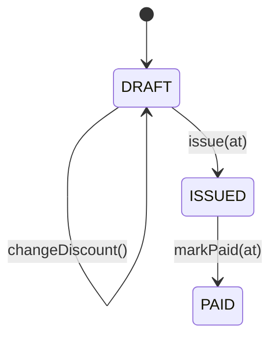

# Giữ bất biến liên quan đến nhiều trường

Một lớp Java có thể kiểm tra từng trường riêng lẻ mà vẫn cho phép tạo đối tượng sai về nghiệp vụ: `discount` không âm nhưng lớn hơn `subtotal`; hóa đơn có trạng thái `PAID` nhưng thiếu thời điểm thanh toán; ngày trả phòng hợp lệ nhưng đứng trước ngày nhận phòng. Những lỗi này xuất hiện vì **tính hợp lệ không nằm trong từng trường độc lập mà nằm ở quan hệ giữa các trường**.

Trong chương **Dữ liệu và trạng thái** thuộc **CODE_QUALITY_FUNDAMENTALS**, bài học tập trung vào cách xác định, biểu diễn và bảo vệ **bất biến liên quan đến nhiều trường** (*cross-field invariants*). Đây là một phần quan trọng của việc hiểu những thuộc tính làm mã nguồn **đáng tin cậy, dễ hiểu và dễ thay đổi**: người đọc có thể nhìn vào kiểu dữ liệu và thao tác để biết một đối tượng hợp lệ là gì, còn người sửa mã có thể thay đổi trạng thái mà không vô tình phá vỡ quy tắc nghiệp vụ.

## Mục tiêu học tập

Sau bài này, bạn có thể:

1. Phân biệt kiểm tra hợp lệ **từng trường** với kiểm tra hợp lệ **quan hệ giữa nhiều trường**.
2. Phát biểu bất biến bằng quy tắc cụ thể, bảng trạng thái và điều kiện có thể kiểm thử.
3. Nhận diện nguy cơ của nhiều setter, dữ liệu dẫn xuất được lưu trùng và cập nhật từng phần.
4. Sử dụng constructor, factory, phương thức chuyển trạng thái và đối tượng bất biến trong Java để duy trì bất biến.
5. Phân biệt bảo vệ bất biến trong bộ nhớ với ràng buộc ở cơ sở dữ liệu và giao dịch đồng thời.
6. Thiết kế kiểm thử cho các giá trị biên, tổ hợp trạng thái và các lần chuyển trạng thái không hợp lệ.

## 1. Bất biến của một đối tượng là gì?

**Bất biến** (*invariant*) là điều kiện phải đúng ở mọi trạng thái được công bố là hợp lệ của một đối tượng hoặc hệ thống. Chẳng hạn, nếu nghiệp vụ không cho phép số dư âm, điều kiện `balance >= 0` phải đúng sau mỗi thao tác đã hoàn tất.

Với một trường, việc kiểm tra thường tương đối trực tiếp:

```java
if (subtotalCents < 0) {
    throw new IllegalArgumentException("Subtotal must be non-negative");
}
```

Nhưng có những quy tắc chỉ có nghĩa khi xem **nhiều trường cùng lúc**:

```text
0 <= discountCents <= subtotalCents

payableCents = subtotalCents - discountCents

status == PAID
    => issuedAt != null
       AND paidAt != null
       AND paidAt >= issuedAt
```

Nếu kiểm tra `discountCents >= 0` và `subtotalCents >= 0` riêng rẽ, đối tượng có `subtotalCents = 100_000` và `discountCents = 150_000` vẫn lọt qua. Cả hai trường đều hợp lệ khi xét đơn lẻ, nhưng **tổ hợp** của chúng không hợp lệ.

Một ví dụ khác là kỳ lưu trú:

```java
record Stay(java.time.LocalDate checkIn,
            java.time.LocalDate checkOut) {
    public Stay {
        java.util.Objects.requireNonNull(checkIn);
        java.util.Objects.requireNonNull(checkOut);
        if (!checkOut.isAfter(checkIn)) {
            throw new IllegalArgumentException(
                    "Check-out must be after check-in");
        }
    }
}
```

Cả hai ngày đều có thể là `LocalDate` hợp lệ, nhưng quy tắc `checkOut.isAfter(checkIn)` chỉ kiểm tra được khi xét chung hai giá trị.

### Ba phạm vi bất biến thường gặp

| Phạm vi | Ví dụ | Nơi thường kiểm soát |
| --- | --- | --- |
| **Một trường** | `quantity > 0`, `email` không rỗng. | Value object, constructor, kiểm tra đầu vào. |
| **Nhiều trường của một đối tượng** | Giảm giá không vượt tiền hàng; trạng thái `PAID` cần thời điểm thanh toán. | Constructor/factory, thao tác thay đổi trạng thái, DB `CHECK`. |
| **Nhiều đối tượng hoặc bản ghi** | Tổng số chỗ đã bán không vượt sức chứa; mỗi mã voucher chỉ được dùng một lần. | Transaction, khóa/ràng buộc duy nhất, kiểm soát đồng thời. |

Bài này tập trung vào phạm vi thứ hai, đồng thời chỉ ra ranh giới với phạm vi thứ ba để tránh tưởng rằng một constructor có thể bảo vệ toàn bộ hệ thống.

## 2. Biến yêu cầu thành quy tắc có thể kiểm tra

Xét một hóa đơn có các thông tin:

- `subtotalCents`: tổng tiền trước giảm giá, tính theo đơn vị tiền nhỏ nhất của loại tiền đã chọn trong ví dụ.
- `discountCents`: số tiền giảm giá.
- `status`: `DRAFT` (nháp), `ISSUED` (đã phát hành) hoặc `PAID` (đã thanh toán).
- `issuedAt`: thời điểm phát hành.
- `paidAt`: thời điểm thanh toán.

Để tập trung vào bất biến, ta **giả định hợp đồng nghiệp vụ của ví dụ** như sau: tiền không âm; mức giảm không vượt tổng tiền; chỉ hóa đơn nháp được sửa giảm giá; hóa đơn phải được phát hành trước khi được đánh dấu đã thanh toán; các mốc thời gian dùng `Instant`, và thanh toán không được xảy ra trước thời điểm phát hành. Đây là quy tắc minh họa, **không phải quy định mặc định** cho tất cả hệ thống kế toán.

### Bảng bất biến

| Mã | Điều kiện phải đúng | Điều xảy ra nếu vi phạm |
| --- | --- | --- |
| I1 | `id` khác `null` và không chỉ chứa khoảng trắng. | Không xác định được hóa đơn cần xử lý. |
| I2 | `subtotalCents >= 0`. | Tổng tiền hàng không hợp lệ theo hợp đồng ví dụ. |
| I3 | `0 <= discountCents <= subtotalCents`. | Giảm giá âm hoặc vượt số tiền hàng. |
| I4 | `DRAFT`: `issuedAt == null` và `paidAt == null`. | Bản nháp mang dữ liệu của trạng thái khác. |
| I5 | `ISSUED`: `issuedAt != null` và `paidAt == null`. | Đã phát hành mà thiếu mốc phát hành hoặc có mốc thanh toán không phù hợp. |
| I6 | `PAID`: cả hai mốc khác `null` và `paidAt >= issuedAt`. | Thanh toán không có lịch sử thời gian hợp lệ. |
| I7 | Tiền cần trả bằng `subtotalCents - discountCents`. | Giá trị tiền cần trả mâu thuẫn với các thành phần của hóa đơn. |

I3, I4, I5, I6 và I7 đều liên quan đến **từ hai trường trở lên**. Bởi vậy, chúng không thể được bảo vệ đầy đủ nếu mỗi setter chỉ xem trường của riêng mình.

### Bảng trạng thái hợp lệ

| `status` | `issuedAt` | `paidAt` | Hợp lệ theo ví dụ? |
| --- | --- | --- | --- |
| `DRAFT` | `null` | `null` | Có. |
| `DRAFT` | Có giá trị | `null` | Không. |
| `ISSUED` | Có giá trị | `null` | Có. |
| `ISSUED` | Có giá trị | Có giá trị | Không. |
| `PAID` | Có giá trị | Có giá trị, không trước `issuedAt` | Có. |
| `PAID` | `null` | Có giá trị | Không. |
| `PAID` | Có giá trị | Có giá trị trước `issuedAt` | Không. |

Bảng này vừa là tài liệu cho lập trình viên vừa là nguồn để xây dựng bộ kiểm thử. Nó cũng giúp phát hiện **trạng thái bị thiếu đặc tả**: nếu nghiệp vụ hỗ trợ hủy hóa đơn hay hoàn tiền, cần quy định thêm mốc và chuyển trạng thái tương ứng.

## 3. Vì sao những setter độc lập dễ phá bất biến?

Một lớp dữ liệu có thể được viết như sau:

```java
class MutableInvoice {
    long subtotalCents;
    long discountCents;
    long payableCents;
    String status;
    java.time.Instant issuedAt;
    java.time.Instant paidAt;

    void setSubtotalCents(long value) {
        if (value < 0) {
            throw new IllegalArgumentException("Negative subtotal");
        }
        this.subtotalCents = value;
    }

    void setDiscountCents(long value) {
        if (value < 0) {
            throw new IllegalArgumentException("Negative discount");
        }
        this.discountCents = value;
    }
}
```

Đoạn mã trên cho phép:

```java
MutableInvoice invoice = new MutableInvoice();
invoice.setSubtotalCents(100_000);
invoice.setDiscountCents(150_000); // Mỗi setter đều chấp nhận.
```

Lúc này `discountCents > subtotalCents`. Trường `payableCents` cũng có nguy cơ lỗi thời vì các setter không cập nhật nó. Nếu sau đó bổ sung `setStatus("PAID")`, đối tượng còn có thể ở trạng thái đã thanh toán nhưng không có `issuedAt` và `paidAt`.

Một cách vá thường gặp là thêm kiểm tra quan hệ vào từng setter:

```java
void setDiscountCents(long value) {
    if (value < 0 || value > subtotalCents) {
        throw new IllegalArgumentException("Invalid discount");
    }
    discountCents = value;
}
```

Kiểm tra này chặn giảm giá vượt tổng hiện tại, nhưng lại làm phát sinh vấn đề **thứ tự cập nhật**. Ví dụ muốn đổi `(subtotal=100, discount=80)` thành `(subtotal=50, discount=40)`: nếu giảm subtotal trước, bất biến tạm thời bị phá; nếu có nhiều trường liên quan, người gọi phải tự sắp thứ tự setter. Khi có luồng khác cùng đọc dữ liệu, đối tượng còn có thể bị quan sát ở trạng thái dở dang.

**Quy tắc thực hành:** nếu nhiều trường tạo thành **một đơn vị nhất quán**, hãy cung cấp **một thao tác cập nhật ý nghĩa nghiệp vụ** để kiểm tra cả tổ hợp trước khi công bố trạng thái mới. Đừng buộc người gọi tự phối hợp hàng loạt setter mà không có bảo đảm nguyên tử.

## 4. Giảm số lượng trạng thái có thể biểu diễn

Một biện pháp quan trọng là tránh lưu những giá trị có thể tính chắc chắn từ trường khác. Với tiền cần trả:

```text
payableCents = subtotalCents - discountCents
```

Nếu đồng thời lưu `subtotalCents`, `discountCents` **và** `payableCents` như ba giá trị có thể sửa độc lập, ta phải duy trì thêm một bất biến I7. Mỗi lần một trong hai giá trị đầu thay đổi đều có nguy cơ bỏ quên cập nhật giá trị thứ ba.

Thay vào đó, có thể chỉ lưu hai thành phần và **tính giá trị dẫn xuất khi cần**:

```java
long payableCents() {
    return subtotalCents - discountCents;
}
```

Với miền giá trị `0 <= discountCents <= subtotalCents <= Long.MAX_VALUE`, phép trừ trên không gây tràn `long`. Nếu nghiệp vụ phải hỗ trợ nhiều loại tiền, thuế phức tạp hoặc quy tắc làm tròn, cần mô hình hóa thêm đơn vị tiền tệ và phép tính tương ứng; không nên tự suy rằng phép trừ đơn giản luôn là công thức cuối cùng.

**Không lưu dữ liệu dẫn xuất** không phải lúc nào cũng khả thi. Đôi khi hệ thống phải lưu tổng tiền tại thời điểm chốt giao dịch, dù sau đó danh mục giá thay đổi. Khi ấy giá trị đã chốt là **sự kiện nghiệp vụ riêng**, cần hợp đồng bất biến riêng, thay vì chỉ là một bản sao tính toán tùy tiện.

## 5. Mô hình Java 17 giữ bất biến xuyên nhiều trường

Java `record` phù hợp để biểu diễn một giá trị bất biến theo các thành phần được khai báo. **Compact constructor** cho phép kiểm tra mọi trường cùng lúc trước khi đối tượng hợp lệ được tạo xong. Ví dụ dưới đây có thể đặt trong file `Invoice.java` và sử dụng Java 17.

```java
import java.time.Instant;
import java.util.Objects;

enum InvoiceStatus {
    DRAFT, ISSUED, PAID
}

public record Invoice(
        String id,
        long subtotalCents,
        long discountCents,
        InvoiceStatus status,
        Instant issuedAt,
        Instant paidAt) {

    public Invoice {
        if (id == null || id.isBlank()) {
            throw new IllegalArgumentException("Invoice ID is required");
        }
        if (subtotalCents < 0
                || discountCents < 0
                || discountCents > subtotalCents) {
            throw new IllegalArgumentException(
                    "Discount must be between 0 and subtotal");
        }
        Objects.requireNonNull(status, "status");

        switch (status) {
            case DRAFT -> {
                if (issuedAt != null || paidAt != null) {
                    throw new IllegalArgumentException(
                            "Draft cannot have issue or payment time");
                }
            }
            case ISSUED -> {
                if (issuedAt == null || paidAt != null) {
                    throw new IllegalArgumentException(
                            "Issued invoice requires issue time only");
                }
            }
            case PAID -> {
                if (issuedAt == null || paidAt == null
                        || paidAt.isBefore(issuedAt)) {
                    throw new IllegalArgumentException(
                            "Paid invoice has inconsistent times");
                }
            }
        }
    }

    public static Invoice draft(
            String id, long subtotalCents, long discountCents) {
        return new Invoice(id, subtotalCents, discountCents,
                InvoiceStatus.DRAFT, null, null);
    }

    public long payableCents() {
        return subtotalCents - discountCents;
    }

    public Invoice changeDiscount(long newDiscountCents) {
        if (status != InvoiceStatus.DRAFT) {
            throw new IllegalStateException(
                    "Only draft invoices can change discount");
        }
        return draft(id, subtotalCents, newDiscountCents);
    }

    public Invoice issue(Instant at) {
        if (status != InvoiceStatus.DRAFT) {
            throw new IllegalStateException(
                    "Only draft invoices can be issued");
        }
        return new Invoice(id, subtotalCents, discountCents,
                InvoiceStatus.ISSUED,
                Objects.requireNonNull(at, "at"), null);
    }

    public Invoice markPaid(Instant at) {
        if (status != InvoiceStatus.ISSUED) {
            throw new IllegalStateException(
                    "Only issued invoices can be paid");
        }
        return new Invoice(id, subtotalCents, discountCents,
                InvoiceStatus.PAID, issuedAt,
                Objects.requireNonNull(at, "at"));
    }
}
```

### Những điều mà cấu trúc này bảo vệ

1. **Mọi constructor call phải thỏa I1–I6.** Ví dụ, không thể tạo `InvoiceStatus.PAID` với `paidAt == null` qua constructor trên.
2. **I7 không cần đồng bộ thủ công.** `payableCents()` tính từ hai giá trị đã được kiểm tra cùng nhau.
3. **Đối tượng cũ không bị sửa dở dang.** `changeDiscount`, `issue` và `markPaid` trả về một bản ghi mới; nếu kiểm tra thất bại, lời gọi ném ngoại lệ và đối tượng cũ vẫn giữ nguyên.
4. **Hành động có ý nghĩa rõ ràng.** `issue` và `markPaid` thể hiện chuyển trạng thái; người đọc không phải lần theo các lời gọi `setStatus`, `setIssuedAt`, `setPaidAt` riêng lẻ.
5. **Mốc thời gian do bên gọi cung cấp.** Điều này cho phép kiểm thử thời gian xác định, thay vì giấu `Instant.now()` trong quy tắc miền.

### Ví dụ sử dụng

```java
import java.time.Instant;

Invoice draft = Invoice.draft("INV-42", 500_000, 75_000);
System.out.println(draft.payableCents()); // 425000

Instant issueTime = Instant.parse("2026-11-16T03:00:00Z");
Invoice issued = draft.issue(issueTime);

Instant paymentTime = Instant.parse("2026-11-16T03:05:00Z");
Invoice paid = issued.markPaid(paymentTime);

System.out.println(draft.status());  // DRAFT
System.out.println(issued.status()); // ISSUED
System.out.println(paid.status());   // PAID
```

Ở đây ba biến trỏ đến **ba giá trị trạng thái khác nhau**; `draft` không tự biến thành `paid`. Khi lưu dữ liệu, ứng dụng phải cập nhật phiên bản hiện hành trong repository theo quy tắc đồng thời, không được giả định rằng tạo `paid` trong bộ nhớ đồng nghĩa cơ sở dữ liệu đã lưu kết quả.

### Giới hạn của mô hình

Vì `Invoice` là `public record`, mã khác vẫn có thể gọi trực tiếp constructor và tạo một giá trị `PAID` có đủ mốc thời gian mà **không đi qua** `draft.issue(...).markPaid(...)`. Constructor bảo vệ **tính hợp lệ của ảnh chụp trạng thái** (*state validity*), còn phương thức chuyển trạng thái giúp bảo vệ **quy trình thao tác được khuyến nghị**. Muốn cưỡng chế lịch sử chuyển trạng thái trên toàn ứng dụng, cần đóng gói quyền tạo trạng thái hoặc kiểm tra chuyển đổi tại một aggregate/application service và khi ghi vào database.

Ngoài ra, `record` không tự làm mọi thành phần trở nên bất biến nếu nó chứa collection hoặc đối tượng có thể sửa. Ví dụ `List<LineItem>` cần được sao chép phòng vệ với `List.copyOf` khi tạo, và bản thân `LineItem` cũng phải có quy tắc bất biến phù hợp.

## 6. Đổi toàn bộ trạng thái bằng một thao tác

Với đối tượng mutable, có thể giữ bất biến mà không nhất thiết chuyển cả hệ thống sang `record`. Điểm quan trọng là **không công bố trạng thái trung gian** và kiểm tra toàn bộ dữ liệu mới trước khi áp dụng.

Ví dụ, một lớp có khả năng thay đổi tổng và giảm giá nên tránh hai setter độc lập:

```java
final class InvoiceAmounts {
    private long subtotalCents;
    private long discountCents;

    InvoiceAmounts(long subtotalCents, long discountCents) {
        replaceAmounts(subtotalCents, discountCents);
    }

    synchronized void replaceAmounts(long newSubtotal, long newDiscount) {
        if (newSubtotal < 0 || newDiscount < 0
                || newDiscount > newSubtotal) {
            throw new IllegalArgumentException("Invalid amounts");
        }
        subtotalCents = newSubtotal;
        discountCents = newDiscount;
    }

    synchronized long payableCents() {
        return subtotalCents - discountCents;
    }
}
```

Hai trường được kiểm tra như **một tổ hợp**, rồi được sửa trong một vùng đồng bộ. Với ví dụ cục bộ này, cả thao tác đọc và ghi dùng cùng khóa, nên `payableCents()` không quan sát bản cập nhật dở dang. Nếu chương trình thêm getter không đồng bộ, chia sẻ reference mutable ra ngoài hoặc cập nhật bằng đường khác, bảo đảm có thể bị phá vỡ.

Một lựa chọn khác là tạo một **value object bất biến** cho cặp số tiền và chỉ thay **một tham chiếu** đến object mới trong aggregate. Phương án phù hợp phụ thuộc vào khả năng chia sẻ trạng thái, nhu cầu hiệu năng và chính sách đồng thời. `synchronized` trong JVM cũng **không tự bảo vệ** dữ liệu lưu ở database hoặc nhiều tiến trình khác nhau.

## 7. Trạng thái và chuyển trạng thái là hai loại quy tắc

Một đối tượng `PAID` có thời gian hợp lệ vẫn chưa chứng minh hóa đơn thực sự đi qua trạng thái `ISSUED`. Cần phân biệt:

| Loại quy tắc | Câu hỏi | Ví dụ |
| --- | --- | --- |
| **Bất biến trạng thái** | Dữ liệu hiện tại có nhất quán không? | `PAID` có `issuedAt`, `paidAt` và thứ tự thời gian đúng. |
| **Tiền điều kiện của thao tác** | Trạng thái nào được phép thực hiện hành động? | Chỉ `DRAFT` được `issue()`. |
| **Hậu điều kiện** | Nếu thao tác thành công, trạng thái mới phải thế nào? | Sau `issue(at)`, `status == ISSUED` và `issuedAt == at`. |
| **Quy tắc lịch sử** | Có sự kiện hoặc trình tự nào bắt buộc đã xảy ra? | Trước khi `PAID` phải tồn tại giao dịch thanh toán hợp lệ. |

Sơ đồ vòng đời minh họa:



Theo hợp đồng của ví dụ, **không có** đường chuyển `DRAFT → PAID` hoặc `PAID → ISSUED`. Nếu hệ thống thực tế cho phép hủy, hoàn tiền hoặc sửa hóa đơn sau phát hành, cần thay đổi mô hình và quy tắc có chủ đích. Không tự thêm một phương thức `setStatus(...)` cho phép mọi chuyển đổi chỉ vì nó nhanh hơn.

Trong hệ thống thanh toán thực tế, thời điểm `PAID` thường cần được xác nhận từ giao dịch với nhà cung cấp và chống xử lý lặp; việc gọi `markPaid(at)` trên object Java chỉ thể hiện **chuyển trạng thái miền**, chưa thực hiện hoặc xác minh một khoản thanh toán.

## 8. Bất biến ở ranh giới dữ liệu: DTO, JSON và persistence

Các giá trị có thể đến từ form, JSON, message queue, CSV hoặc database. Ví dụ một request cập nhật hóa đơn:

```json
{
  "subtotalCents": 100000,
  "discountCents": 125000
}
```

Kiểm tra `subtotalCents >= 0` và `discountCents >= 0` riêng ở API vẫn để lọt request này. Một cách xử lý rõ ràng:

1. **Giải mã và kiểm tra định dạng:** JSON có đúng kiểu số, không thiếu trường bắt buộc, và giá trị nằm trong miền kiểu Java?
2. **Tạo giá trị miền:** dùng constructor/factory để kiểm tra tương quan hai trường.
3. **Kiểm tra quyền và trạng thái hiện tại:** chỉ cho thay đổi giảm giá ở hóa đơn `DRAFT` theo hợp đồng.
4. **Ghi kết quả nguyên tử:** cập nhật trạng thái cùng phiên bản dữ liệu, kiểm tra xung đột đồng thời.
5. **Ánh xạ lỗi có chủ đích:** phân biệt đầu vào sai, vi phạm nghiệp vụ và xung đột cập nhật; không để chi tiết exception nội bộ tình cờ trở thành hợp đồng API.

Validation annotation như `@NotNull`, `@PositiveOrZero` hữu ích cho kiểm tra từng trường, nhưng **không đủ** cho `discount <= subtotal` hoặc tổ hợp `status/issuedAt/paidAt`. Có thể dùng validation cấp đối tượng, constructor hoặc dịch vụ miền để biểu diễn quan hệ, tùy kiến trúc. Dù adapter đã kiểm tra, domain vẫn nên giữ bất biến của nó vì dữ liệu có thể đến từ đường khác ngoài HTTP.

### Nguy cơ khi cập nhật từng phần

Một API `PATCH` có thể chỉ gửi `discountCents`. Khi đó server cần kiểm tra giá trị mới **cùng các trường hiện đang lưu** để biết tổ hợp sau cập nhật có hợp lệ không. Nếu mỗi request được kiểm tra dựa trên một bản sao cũ nhưng cập nhật DB không kiểm tra phiên bản, hai thay đổi đồng thời có thể tạo trạng thái cuối không như người dùng mong đợi.

Không nên mặc định `PATCH` sửa đúng một trường là hợp lệ chỉ vì trường đó vượt qua validator riêng lẻ. **Tính hợp lệ phải được đánh giá trên ảnh chụp tổng thể sẽ được lưu**, với cơ chế kiểm soát đồng thời phù hợp.

## 9. Bảo vệ các quy tắc ở cơ sở dữ liệu

Giả sử nhiều đường viết dữ liệu tồn tại: API, job nền, import, hoặc nhiều phiên bản ứng dụng chạy đồng thời. Chỉ kiểm tra trong Java không đủ để ngăn một đường khác ghi trạng thái sai. Với các bất biến cùng một hàng, cơ sở dữ liệu quan hệ có thể bảo vệ bằng `NOT NULL` và `CHECK`.

Ví dụ SQL theo cú pháp PostgreSQL:

```sql
CREATE TABLE invoices (
    id VARCHAR(80) PRIMARY KEY,
    subtotal_cents BIGINT NOT NULL
        CHECK (subtotal_cents >= 0),
    discount_cents BIGINT NOT NULL
        CHECK (discount_cents >= 0
               AND discount_cents <= subtotal_cents),
    status VARCHAR(20) NOT NULL
        CHECK (status IN ('DRAFT', 'ISSUED', 'PAID')),
    issued_at TIMESTAMPTZ,
    paid_at TIMESTAMPTZ,
    version BIGINT NOT NULL DEFAULT 0,
    CHECK (
        (status = 'DRAFT'
            AND issued_at IS NULL
            AND paid_at IS NULL)
        OR
        (status = 'ISSUED'
            AND issued_at IS NOT NULL
            AND paid_at IS NULL)
        OR
        (status = 'PAID'
            AND issued_at IS NOT NULL
            AND paid_at IS NOT NULL
            AND paid_at >= issued_at)
    )
);
```

Ràng buộc trên kiểm tra các quan hệ giữa những cột **trong cùng một hàng**. Chúng hữu ích như một lớp bảo vệ cuối khi một đường ghi dữ liệu bỏ sót validation của ứng dụng.

Nếu cần lưu số tiền thanh toán cuối cùng, có thể cân nhắc **cột được tính từ biểu thức** (nếu hệ quản trị hỗ trợ), hoặc lưu một giá trị chốt có lý do nghiệp vụ cụ thể. Tránh lưu một `payable_cents` cập nhật tay mà không có cơ chế bảo đảm `payable_cents = subtotal_cents - discount_cents`.

### Cập nhật có điều kiện để bảo vệ chuyển trạng thái

Một transaction muốn đánh dấu hóa đơn đã thanh toán có thể dùng câu lệnh **kiểm tra trạng thái hiện tại ngay trong cập nhật**:

```sql
UPDATE invoices
SET status = 'PAID',
    paid_at = :payment_time,
    version = version + 1
WHERE id = :invoice_id
  AND status = 'ISSUED'
  AND issued_at <= :payment_time;
```

Ứng dụng phải kiểm tra số hàng được cập nhật. Nếu bằng 0, hóa đơn có thể không tồn tại, đang ở trạng thái khác, hoặc `payment_time` không hợp lệ; cần đọc lại để xác định lỗi nghiệp vụ và chính sách retry. Việc cập nhật có điều kiện làm cho phép chuyển trạng thái được xét tại thời điểm ghi, tránh tình huống kiểm tra trước rồi bị một giao dịch khác đổi trạng thái trong khoảng trống.

Khi cần tránh **mất cập nhật** (*lost update*) giữa hai thao tác sửa nội dung hóa đơn, có thể dùng `version` kiểu optimistic locking:

```sql
UPDATE invoices
SET subtotal_cents = :new_subtotal,
    discount_cents = :new_discount,
    version = version + 1
WHERE id = :invoice_id
  AND status = 'DRAFT'
  AND version = :expected_version;
```

`CHECK` tiếp tục bảo vệ tổ hợp số tiền; `version` giúp phát hiện người khác đã thay đổi hàng giữa lúc đọc và ghi. Ứng dụng cần xử lý xung đột thay vì âm thầm ghi đè hoặc retry bằng dữ liệu cũ vô hạn.

### Giới hạn của ràng buộc cùng một hàng

Một DB `CHECK` thông thường không phù hợp để chứng minh quy tắc như “tổng tiền các dòng hàng bằng số tiền đầu hóa đơn” nếu các dòng nằm ở nhiều hàng hoặc bảng khác nhau. Các ràng buộc liên bản ghi đòi thiết kế transaction, khóa, truy vấn/cập nhật nguyên tử, ràng buộc đặc thù của DB hoặc cơ chế đối soát. **Đừng suy từ việc một record Java luôn hợp lệ rằng toàn hệ thống chắc chắn nhất quán.**

## 10. Kiểm thử bất biến theo tổ hợp và ranh giới

Một bộ kiểm thử tốt không chỉ hỏi “hóa đơn hợp lệ có tạo được không?”, mà còn kiểm tra **các tổ hợp không hợp lệ bị từ chối** và **thao tác thất bại không làm hỏng trạng thái cũ**.

Ví dụ JUnit 5 cho lớp `Invoice` ở mục 5:

```java
import static org.junit.jupiter.api.Assertions.*;

import java.time.Instant;
import org.junit.jupiter.api.Test;

class InvoiceTest {
    private static final Instant ISSUED_AT =
            Instant.parse("2026-11-16T03:00:00Z");

    @Test
    void computesPayableFromValidComponents() {
        Invoice invoice = Invoice.draft("INV-42", 500_000, 75_000);
        assertEquals(425_000L, invoice.payableCents());
        assertEquals(InvoiceStatus.DRAFT, invoice.status());
    }

    @Test
    void acceptsBoundaryDiscountValues() {
        assertEquals(100L, Invoice.draft("A", 100, 0).payableCents());
        assertEquals(0L, Invoice.draft("B", 100, 100).payableCents());
        assertEquals(0L, Invoice.draft("C", 0, 0).payableCents());
    }

    @Test
    void rejectsCrossFieldAmountViolations() {
        assertThrows(IllegalArgumentException.class,
                () -> Invoice.draft("A", 100, 101));
        assertThrows(IllegalArgumentException.class,
                () -> Invoice.draft("B", 100, -1));
        assertThrows(IllegalArgumentException.class,
                () -> Invoice.draft("C", -1, 0));
    }

    @Test
    void rejectsInconsistentStateAndTimestamps() {
        assertThrows(IllegalArgumentException.class,
                () -> new Invoice("A", 100, 10,
                        InvoiceStatus.PAID, null, ISSUED_AT));
        assertThrows(IllegalArgumentException.class,
                () -> new Invoice("B", 100, 10,
                        InvoiceStatus.DRAFT, ISSUED_AT, null));
        assertThrows(IllegalArgumentException.class,
                () -> new Invoice("C", 100, 10,
                        InvoiceStatus.ISSUED, ISSUED_AT, ISSUED_AT));
    }

    @Test
    void transitionsPreserveInvariantAndOriginalSnapshot() {
        Invoice draft = Invoice.draft("INV-42", 100, 25);
        Invoice issued = draft.issue(ISSUED_AT);
        Invoice paid = issued.markPaid(ISSUED_AT.plusSeconds(60));

        assertEquals(InvoiceStatus.DRAFT, draft.status());
        assertNull(draft.issuedAt());
        assertEquals(InvoiceStatus.ISSUED, issued.status());
        assertNull(issued.paidAt());
        assertEquals(InvoiceStatus.PAID, paid.status());
        assertTrue(!paid.paidAt().isBefore(paid.issuedAt()));
        assertEquals(75L, paid.payableCents());
    }

    @Test
    void invalidUpdateDoesNotPartiallyChangeObject() {
        Invoice draft = Invoice.draft("INV-42", 100, 25);
        assertThrows(IllegalArgumentException.class,
                () -> draft.changeDiscount(101));
        assertEquals(25L, draft.discountCents());
        assertEquals(75L, draft.payableCents());
    }

    @Test
    void rejectsInvalidTransitionAndTimeOrder() {
        Invoice draft = Invoice.draft("INV-42", 100, 25);
        assertThrows(IllegalStateException.class,
                () -> draft.markPaid(ISSUED_AT));

        Invoice issued = draft.issue(ISSUED_AT);
        assertThrows(IllegalArgumentException.class,
                () -> issued.markPaid(ISSUED_AT.minusSeconds(1)));
        assertThrows(IllegalStateException.class,
                () -> issued.changeDiscount(20));
    }
}
```

**Tính độc lập của đối tượng mới là điều cần quan sát:** sau lời gọi không hợp lệ, `draft` vẫn giữ giảm giá ban đầu, và các bản ghi `issued`, `paid` không làm thay đổi `draft`. Nếu một phương thức sửa trực tiếp nhiều trường mutable, kiểm thử phải kiểm tra cả việc **không để lại thay đổi một phần** sau lỗi.

### Ma trận giá trị biên

| `subtotalCents` | `discountCents` | Trạng thái / thời gian | Kỳ vọng |
| ---: | ---: | --- | --- |
| 100 | 0 | `DRAFT, null, null` | Hợp lệ; cần trả 100. |
| 100 | 100 | `DRAFT, null, null` | Hợp lệ; cần trả 0. |
| 100 | 101 | `DRAFT, null, null` | Từ chối vì giảm quá tổng. |
| 100 | -1 | `DRAFT, null, null` | Từ chối vì giảm âm. |
| -1 | 0 | `DRAFT, null, null` | Từ chối vì tổng âm. |
| 100 | 10 | `ISSUED, null, null` | Từ chối do thiếu ngày phát hành. |
| 100 | 10 | `PAID, issuedAt, paidAt trước issuedAt` | Từ chối do sai thứ tự thời gian. |
| 100 | 10 | `PAID, issuedAt, paidAt bằng issuedAt` | Hợp lệ theo quy tắc ví dụ. |
| `Long.MAX_VALUE` | `Long.MAX_VALUE` | `DRAFT, null, null` | Hợp lệ; cần trả 0, không tràn phép trừ. |

Với những bất biến mang tính đại số, có thể bổ sung **property-based testing**: sinh nhiều cặp `subtotal`, `discount` mà `0 <= discount <= subtotal` và kiểm tra kết quả luôn không âm, không lớn hơn `subtotal`. Với cặp ngoài miền hợp lệ, việc tạo đối tượng phải bị từ chối. Tuy nhiên, sinh dữ liệu tự động **không sửa được một bất biến đã đặc tả sai nghiệp vụ**.

## 11. Các lỗi tư duy thường gặp

**“Mỗi field có annotation hợp lệ thì cả object hợp lệ.”** Những annotation độc lập không chứng minh quan hệ như `discount <= subtotal` hoặc `paidAt >= issuedAt`. Cần một nơi đánh giá **toàn bộ tổ hợp**.

**“Chỉ cần một setter kiểm tra giá trị mới.”** Setter có thể phụ thuộc các trường đang giữ giá trị cũ và khiến việc cập nhật hai trường đòi thứ tự đặc biệt. Nên có thao tác thay toàn bộ tổ hợp hoặc tạo object mới.

**“Nếu cập nhật xong đúng thì trạng thái giữa chừng không quan trọng.”** Luồng khác, callback hoặc exception có thể quan sát trạng thái không nhất quán. Hợp đồng phải xác định thời điểm công bố thay đổi và bảo vệ theo mô hình đồng thời thực tế.

**“Lưu thêm trường tính toán giúp code rõ hơn.”** Trường dẫn xuất được sửa độc lập tạo thêm ràng buộc phải duy trì. Nếu cần snapshot đã chốt, hãy đặt tên và hợp đồng riêng cho nó.

**“`record` tự giải quyết mọi tính nhất quán.”** Constructor kiểm soát quan hệ giữa các thành phần bất biến. Nó không chứng minh lịch sử chuyển trạng thái, bảo vệ DB hay biến các collection mutable bên trong thành bất biến sâu.

**“Có DB `CHECK` là đủ.”** `CHECK` mạnh với dữ liệu cùng hàng nhưng không thay thế transaction và kiểm soát đồng thời khi quy tắc trải rộng nhiều hàng hoặc có tác dụng phụ bên ngoài.

**“Bất biến càng chặt càng tốt.”** Bất biến sai yêu cầu sẽ loại bỏ dữ liệu hợp lệ. Ví dụ, cho phép hay không cho phép tổng tiền bằng 0 là quyết định nghiệp vụ; mã ví dụ cho phép nhưng hệ thống thật có thể khác.

## 12. Quy trình thực hành khi thêm hoặc sửa trường dữ liệu

1. **Xác định những trường liên quan với nhau.** Đừng chỉ đọc mô tả của trường mới; tìm các quy tắc nối nó với những trường đã có.
2. **Viết bất biến bằng câu cụ thể và ví dụ.** Nêu rõ dấu bằng được phép hay không, thời gian lấy theo nguồn nào, giá trị `null` có ý nghĩa gì.
3. **Lập bảng tổ hợp hợp lệ/không hợp lệ.** Đặc biệt khi có nhiều cờ, status và trường tùy chọn.
4. **Loại bỏ dữ liệu dẫn xuất không cần lưu.** Nếu phải lưu, xác định ai cập nhật và nguồn chân lý.
5. **Đưa validation vào điểm tạo hoặc thay trạng thái.** Constructor, factory, value object hay thao tác cấp miền cần xem **toàn bộ trạng thái mới**.
6. **Bảo đảm cập nhật đủ nguyên tử.** Không để người gọi phải tự gọi nhiều setter; bảo vệ đồng thời ở cấp bộ nhớ và lưu trữ phù hợp.
7. **Kiểm thử giá trị biên, tổ hợp và chuyển trạng thái.** Bao gồm lỗi xảy ra giữa quá trình cập nhật.
8. **Rà soát các đường nạp/ghi dữ liệu.** HTTP, batch, queue, ORM, migration và database constraint phải thống nhất hợp đồng.
9. **Khi nghiệp vụ đổi, cập nhật đồng bộ.** Nếu xuất hiện trạng thái `VOIDED` hoặc chính sách hoàn tiền, hãy đổi đặc tả, constructor, phương thức chuyển, DB và kiểm thử tương ứng.

## 13. Câu hỏi tự kiểm tra

**Câu 1.** `subtotal=100` và `discount=150` đều có kiểu `long` và từng trường đều không âm. Vì sao hóa đơn vẫn sai?

*Gợi ý:* Bất biến I3 so sánh hai trường: `discount <= subtotal`. Kiểm tra kiểu hoặc điều kiện từng trường không đủ.

**Câu 2.** Một đối tượng mutable có `setStart` và `setEnd`, mỗi setter kiểm tra thứ tự ngày so với trường còn lại. Tại sao người gọi có thể gặp khó khi đổi cả khoảng thời gian?

*Gợi ý:* Giá trị trung gian có thể tạm vi phạm điều kiện dù cặp cuối hợp lệ. Nên có thao tác `reschedule(newStart, newEnd)` kiểm tra chung và cập nhật có kiểm soát.

**Câu 3.** Record `Invoice` có thể được tạo trực tiếp ở trạng thái `PAID` với đầy đủ timestamp. Điều đó chứng minh đã có giao dịch thanh toán thật chưa?

*Gợi ý:* Chưa. Constructor chứng minh ảnh chụp dữ liệu thỏa bất biến; lịch sử chuyển trạng thái và xác nhận thanh toán phải được bảo vệ ở luồng nghiệp vụ/lưu trữ.

**Câu 4.** Vì sao không nên thêm trường mutable `payableCents` nếu có thể luôn tính từ `subtotalCents` và `discountCents`?

*Gợi ý:* Nó tạo thêm bất biến đồng bộ I7. Quên cập nhật một trường có thể làm dữ liệu mâu thuẫn.

**Câu 5.** Hai request cùng sửa giảm giá của một hóa đơn nháp, cả hai đều qua validation khi đọc. Cần thêm gì để tránh mất cập nhật?

*Gợi ý:* Kiểm soát đồng thời, ví dụ phiên bản optimistic locking trong lệnh `UPDATE`, kiểm tra số hàng ảnh hưởng và xử lý xung đột theo hợp đồng.

## Ghi nhớ

- Một giá trị có thể **hợp lệ theo kiểu và theo từng trường** nhưng **không hợp lệ theo tổ hợp trường**.
- Bất biến cần được phát biểu bằng **quan hệ cụ thể**, gồm miền số, sự hiện diện của dữ liệu theo trạng thái và thứ tự thời gian.
- **Constructor/factory kiểm tra toàn bộ đối tượng**, thao tác miền thay đổi các trường liên quan cùng nhau, và dữ liệu dẫn xuất nên được tính từ nguồn chân lý khi có thể.
- Đối tượng bất biến giúp tránh trạng thái dở dang trong bộ nhớ; **giao dịch, ràng buộc DB và kiểm soát đồng thời** bảo vệ dữ liệu khi nhiều nơi cùng đọc và ghi.
- Kiểm thử cần bao gồm **tổ hợp không hợp lệ, giá trị biên, chuyển trạng thái và thất bại giữa chừng**, không chỉ trường hợp thành công thông thường.

**Câu hỏi thiết kế:** “Nếu trường A thay đổi, những điều kiện nào của B, C hoặc trạng thái hiện tại cũng phải thay đổi theo?” Những điều kiện đó chính là các bất biến cần đưa vào hợp đồng và kiểm soát tại ranh giới phù hợp.
