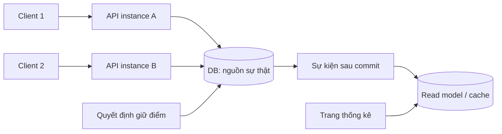

# Tính nhất quán khi có truy cập đồng thời

Trong module `CODE_QUALITY_FUNDAMENTALS`, chúng ta tìm hiểu những thuộc tính quyết định mã nguồn có **đáng tin cậy, dễ hiểu và dễ thay đổi** hay không. Ở chương **Dữ liệu và trạng thái**, tính nhất quán khi truy cập đồng thời là khả năng giữ cho những dữ liệu liên quan phản ánh **một trạng thái hợp lệ** dù nhiều yêu cầu, luồng hoặc dịch vụ có thể đọc và cập nhật chúng cùng lúc.

Một đoạn mã chạy đúng khi chỉ có một yêu cầu không bảo đảm sẽ đúng khi nhiều yêu cầu cùng đến. Chẳng hạn, hai yêu cầu cùng giữ chỗ 70 điểm từ ví chỉ có 100 điểm: nếu cả hai đọc số dư trước khi bên kia ghi lại, chúng có thể cùng nhận kết quả thành công. Ngay cả khi số dư sau cùng không âm, hệ thống vẫn có thể đã chấp nhận quá số điểm thật sự có thể dùng.

Để đánh giá một thiết kế, cần xác định **bất biến của dữ liệu**, **thời điểm một thay đổi được coi là có hiệu lực**, **ai được cập nhật trạng thái** và **mức nhất quán nào người sử dụng thật sự cần**. Khóa, biến nguyên tử và giao dịch là phương tiện thực thi các quyết định đó; tự bản thân chúng không thể định nghĩa quy tắc nghiệp vụ.

Sau bài học, người học có thể:

- Phân biệt trạng thái riêng, trạng thái dùng chung, ảnh chụp nhất quán và dữ liệu có thể chấp nhận trễ.
- Nhận diện lost update, check-then-act, đọc dữ liệu không đồng nhất và write skew.
- Thiết kế thao tác nguyên tử cho nhiều trường dữ liệu trong một JVM bằng Java.
- Xác định khi nào cần điều kiện cập nhật, version, giao dịch và mức cô lập tại cơ sở dữ liệu.
- Xây dựng kiểm thử đồng thời dựa trên bất biến và kết quả quan sát được.
- Đánh giá đánh đổi giữa tính nhất quán, độ trễ, khả năng sẵn sàng và độ phức tạp.

## 1. Tính nhất quán là tính nhất quán của điều gì?

**Trạng thái (state)** là tập dữ liệu mô tả tình hình hiện tại của hệ thống: số dư, số điểm đang giữ chỗ, trạng thái đơn hàng, phiên bản hồ sơ hoặc tiến độ xử lý sự kiện. **Trạng thái dùng chung có thể thay đổi** (*shared mutable state*) xuất hiện khi hai hay nhiều tác vụ có thể truy cập cùng dữ liệu và ít nhất một tác vụ ghi.

Ta không thể đánh giá tính nhất quán mà không biết **điều kiện bắt buộc đúng**. Ví dụ, ví điểm thưởng có hai trường:

- `available`: số điểm chưa dành cho giao dịch nào.
- `reserved`: số điểm đã giữ cho các yêu cầu chưa hoàn tất.

Nếu khởi tạo ví với 100 điểm và trong ví dụ này chỉ thực hiện **giữ chỗ** hoặc **giải phóng giữ chỗ** (chưa có chi tiêu hay nạp thêm), các bất biến có thể là:

\[
available \geq 0,\quad reserved \geq 0,\quad available + reserved = 100
\]

Giữ chỗ 70 điểm phải tạo ra chuyển trạng thái **(100, 0) → (30, 70)**. Giải phóng 20 điểm phải tạo ra **(30, 70) → (50, 50)**. Trong cả hai trường hợp, cập nhật hai trường và trả kết quả thành công là **một quyết định nghiệp vụ**.

Nếu thêm hành động chi tiêu, hoàn điểm hoặc nạp điểm, bất biến tổng bằng 100 không còn đúng nguyên dạng: cần định nghĩa lại bằng những đại lượng như tổng điểm đã nạp, đã chi và đã hoàn. Điều quan trọng là **viết bất biến phù hợp với thao tác thực tế**, thay vì áp dụng bất biến của một ví dụ cho mọi hệ thống.

### Đúng với từng trường chưa đủ để đúng với cả trạng thái

Giả sử tác vụ A giữ chỗ 70 điểm bằng cách ghi `available = 30` trước, sau đó mới ghi `reserved = 70`. Tác vụ B đọc hai trường ở giữa và thấy **(30, 0)**. Hai số đều không âm nhưng tổng là 30, trái với bất biến của hệ thống đang xét.

Ngược lại, nếu A ghi `reserved = 70` trước, tác vụ B có thể thấy **(100, 70)**, tổng thành 170. Vì vậy, tính nhất quán thường là tính chất của **một nhóm dữ liệu và các chuyển trạng thái**, không phải chỉ của từng biến.

Ta cần phân biệt hai yêu cầu:

1. **Tính nhất quán khi cập nhật:** bên ghi giữ các bất biến trước và sau thao tác đã cam kết; các bước trung gian không bị quan sát như trạng thái hoàn tất.
2. **Tính nhất quán khi đọc:** bên đọc nhận được tổ hợp trường thuộc cùng một thời điểm hoặc cùng phiên bản được công bố theo hợp đồng.

Nếu chỉ khóa đường ghi nhưng cho đọc từng trường không đồng bộ, vẫn có thể trả về một tổ hợp không nhất quán.

## 2. Những lỗi xuất hiện khi nhiều thao tác xen kẽ

### 2.1. Check-then-act và mất cập nhật

Một cách làm dễ sai là chia việc “kiểm tra đủ điểm” và “trừ điểm” thành các bước độc lập:

```java
final class UnsafeWallet {
    long available = 100;
    long reserved = 0;

    boolean reserve(long points) {
        if (points <= 0 || available < points) {
            return false;
        }
        available -= points;
        reserved += points;
        return true;
    }
}
```

Hai luồng cùng gọi `reserve(70)` có thể cùng đọc `available == 100` nên đều trả `true`. Tùy lịch xen kẽ, các phép đọc–tính–ghi có thể làm mất cập nhật của nhau, tạo giá trị âm hoặc tạo trạng thái cuối không tương ứng với số yêu cầu được xác nhận. Đây là ví dụ **race condition**, vì kết quả phụ thuộc cách xen kẽ các bước giữa các luồng.

Một lịch thực thi minh họa cho **lost update**:

| Bước | Yêu cầu A | Yêu cầu B | Giá trị ghi cuối |
| --- | --- | --- | --- |
| 1 | Đọc `available = 100` | | 100 |
| 2 | | Đọc `available = 100` | 100 |
| 3 | Tính giá trị mới 30 | | 100 |
| 4 | | Tính giá trị mới 30 | 100 |
| 5 | Ghi 30 | | 30 |
| 6 | | Ghi 30 | 30 |

Hệ thống chỉ trừ 70 điểm một lần ở dữ liệu lưu cuối, nhưng có thể đã báo **hai lần giữ chỗ thành công**. Chỉ nhìn số dư cuối là 30 sẽ không đủ nhận ra hai lời hứa nghiệp vụ đã được phát ra.

### 2.2. Đọc tổ hợp trường từ nhiều phiên bản

Đọc `available` rồi `reserved` bằng hai thao tác riêng có thể thu được số liệu ở hai thời điểm khác nhau. Hiện tượng này có thể xảy ra ngay cả khi **mỗi trường riêng lẻ** được đọc/ghi nguyên tử. Điều kiện nghiệp vụ liên quan đến nhiều trường đòi hỏi **ảnh chụp nhất quán** (*consistent snapshot*) hoặc ranh giới đọc có bảo đảm tương đương.

Ví dụ, giao diện chỉ cần hiển thị “Tổng điểm hiện có” vẫn nên nhận một đối tượng kết quả chứa `available`, `reserved` và `version` từ một lần đọc đã được bảo vệ, thay vì tự ghép từng trường từ các lời gọi độc lập.

### 2.3. Write skew và sai lệch giữa nhiều bản ghi

Một lỗi khác không nhất thiết ghi đè cùng một trường: hai giao dịch cùng đọc một điều kiện trên **nhiều bản ghi**, rồi mỗi giao dịch cập nhật một bản ghi khác nhau. Ví dụ, điều kiện “mỗi ca trực phải có ít nhất một người làm việc” có thể bị phá khi hai nhân viên cùng xin nghỉ: mỗi giao dịch đọc thấy người còn lại đang trực rồi tự chuyển trạng thái của mình thành nghỉ.

Dưới một số mức cô lập giao dịch hoặc cơ chế snapshot, cả hai cập nhật trên hai dòng khác nhau có thể commit, khiến ca trực không còn ai. Đây là **write skew**. Nó cho thấy **không có lost update trên cùng một hàng** chưa đủ để bảo vệ bất biến trải trên nhiều hàng.

### 2.4. Độ trễ dữ liệu và trạng thái cuối cùng

Trong hệ thống có cache, bản sao đọc (*read replica*) hoặc hệ thống tìm kiếm, dữ liệu đọc được có thể **trễ hơn nguồn chính**. Đây không nhất thiết là lỗi nếu hợp đồng cho phép: ví dụ số lượt xem bài viết có thể trễ vài giây. Nhưng không được dùng kết quả đọc trễ như căn cứ duy nhất để xác nhận hạn mức tài chính hoặc cấp phát tài nguyên có giới hạn.

| Hiện tượng | Dấu hiệu | Bất biến hoặc hợp đồng bị ảnh hưởng |
| --- | --- | --- |
| Check-then-act | Hai yêu cầu đều được chấp nhận trên cùng điều kiện cũ | Số yêu cầu thành công vượt tài nguyên có sẵn |
| Lost update | Kết quả ghi sau che mất cập nhật trước | Số lần thay đổi không tương ứng dữ liệu cuối |
| Đọc không đồng nhất | Các trường đọc từ các phiên bản khác nhau | Tổ hợp trường không phải trạng thái hợp lệ |
| Write skew | Nhiều giao dịch cập nhật các hàng khác nhau dựa trên cùng điều kiện | Bất biến giữa nhiều hàng bị phá |
| Đọc dữ liệu trễ | Bản sao/cache chưa nhận cập nhật mới | Bên đọc đưa quyết định trên thông tin cũ |
| Xử lý lại yêu cầu | Timeout khiến một lệnh được gửi thêm lần nữa | Tác dụng phụ có thể diễn ra hai lần |

## 3. Ba câu hỏi kỹ thuật cần tách bạch

**Tính nguyên tử (atomicity):** những bước tham gia một quyết định có được thực hiện như một đơn vị không bị xen kẽ theo hợp đồng hay không? Ví dụ kiểm tra điểm và chuyển điểm từ `available` sang `reserved` phải là một thao tác nguyên tử ở ranh giới ví.

**Tính hiển thị (visibility):** khi tác vụ A cập nhật dữ liệu, tác vụ B có bảo đảm quan sát được kết quả phù hợp không? Trong Java, quan hệ *happens-before* qua khóa hoặc cơ chế đồng bộ phù hợp tạo những bảo đảm về hiển thị và thứ tự.

**Tính thứ tự (ordering):** điều gì được phép quan sát trước hoặc sau? Với hai trường liên quan, việc mỗi lần đọc trả ra một giá trị mới không tự bảo đảm hai giá trị đến từ cùng một trạng thái.

Các khái niệm trên liên quan nhưng khác nhau:

- Khai báo một biến `volatile` hỗ trợ bảo đảm về hiển thị và thứ tự, nhưng **không** biến chuỗi `if (available >= points) available -= points` thành thao tác nguyên tử.
- `AtomicLong` cung cấp các thao tác nguyên tử cho **một giá trị** và có thể phù hợp cho bộ đếm độc lập. Nếu bất biến trải trên `available` và `reserved`, việc dùng hai `AtomicLong` riêng không tạo giao dịch nguyên tử giữa chúng.
- Hai phương thức `synchronized` trên **hai đối tượng có khóa khác nhau** không mặc nhiên bảo vệ cùng một trạng thái chia sẻ.
- Trường `final` ngăn thay tham chiếu sau khởi tạo, nhưng không làm đối tượng được tham chiếu trở thành bất biến nếu nội dung bên trong vẫn sửa được.

Trong JVM, *data race* theo Java Memory Model xảy ra khi có các truy cập xung đột (ít nhất một ghi) không được sắp thứ tự theo quan hệ *happens-before*. Một đoạn mã có data race có thể có hành vi khó suy luận vì thứ tự/hiển thị không được bảo đảm. Tuy nhiên, kể cả khi từng thao tác đồng bộ riêng, một **race condition về nghiệp vụ** vẫn có thể tồn tại nếu nhiều bước liên quan chưa được gộp thành một quyết định.

## 4. Một JVM: bảo vệ toàn bộ chuyển trạng thái

Giả sử ví thưởng phải có **một trạng thái nhất quán** khi đọc và cập nhật. Có thể đặt cả ba trường `available`, `reserved`, `version` dưới cùng một khóa trên đối tượng `RewardWallet`:

```java
record WalletSnapshot(long available, long reserved, long version) {}

final class RewardWallet {
    private long available;
    private long reserved;
    private long version;

    RewardWallet(long openingPoints) {
        if (openingPoints < 0) {
            throw new IllegalArgumentException("Negative opening points");
        }
        available = openingPoints;
    }

    synchronized boolean reserve(long points) {
        if (points <= 0) {
            throw new IllegalArgumentException("Points must be positive");
        }
        if (available < points) {
            return false;
        }
        available -= points;
        reserved += points;
        version++;
        return true;
    }

    synchronized void release(long points) {
        if (points <= 0 || reserved < points) {
            throw new IllegalArgumentException("Invalid release");
        }
        reserved -= points;
        available += points;
        version++;
    }

    synchronized WalletSnapshot snapshot() {
        return new WalletSnapshot(available, reserved, version);
    }
}
```

Ở đây, chỉ có các phương thức của `RewardWallet` được phép đọc/ghi trạng thái nội bộ và các phương thức đều sử dụng cùng khóa đối tượng. Vì `openingPoints` được kiểm tra không âm, mỗi lần `reserve` chỉ chuyển điểm từ `available` sang `reserved` khi đủ, và `release` chỉ chuyển ngược tối đa lượng `reserved`, bất biến tổng điểm được giữ trong phạm vi các thao tác này. Với các ràng buộc đó, phép cộng không vượt giá trị `long` ban đầu, nhưng khi thêm thao tác nạp điểm hoặc tích lũy mới phải xem xét tràn số.

**Vì sao phương thức `snapshot()` quan trọng?** Người đọc nhận về một đối tượng `record` có các trường kiểu nguyên thủy được tạo trong cùng vùng khóa. Không có cơ hội xen kẽ một cập nhật giữa thời điểm đọc `available` và `reserved` trong phương thức này. Người sử dụng có thể tự kiểm tra:

```java
RewardWallet wallet = new RewardWallet(100);
wallet.reserve(70);
WalletSnapshot state = wallet.snapshot();

// state.available() == 30
// state.reserved() == 70
// state.version() == 1
```

Nếu thay `snapshot()` bằng `getAvailable()` và `getReserved()` được đồng bộ **riêng**, hai lời gọi vẫn có thể xen kẽ với một yêu cầu khác. Khi hợp đồng cần ảnh chụp cả nhóm trường, cần một lời gọi đọc nhất quán hoặc một cơ chế snapshot tương đương.

### Một số điều kiện để cách làm này giữ được hiệu lực

1. **Không để lộ trạng thái mutable:** không đưa ra ngoài tham chiếu tới bộ sưu tập nội bộ hay cung cấp setter bỏ qua khóa.
2. **Mọi đường ghi phải tuân cùng ranh giới:** nếu thêm `expireReservation`, nó phải bảo vệ các trường liên quan theo quy tắc tương tự.
3. **Không giữ khóa quá lâu:** gọi API mạng, chờ cơ sở dữ liệu hoặc thực hiện callback bên ngoài trong vùng `synchronized` có thể làm tăng độ trễ và nguy cơ deadlock.
4. **Cần định nghĩa quy tắc khi lỗi xảy ra:** nếu thêm thao tác có thể ném exception sau khi sửa một phần trạng thái, phải thiết kế để không công bố trạng thái dở dang hoặc khôi phục trước khi kết thúc.
5. **Chỉ đúng trong phạm vi JVM này:** nhiều instance ứng dụng có các đối tượng ví riêng không cùng nắm khóa. Để bảo vệ một số dư chung, cần ranh giới cập nhật ở nguồn dữ liệu chung.

### Có thể dùng ảnh chụp bất biến và CAS

Nếu muốn công bố cả nhóm trường một cách nguyên tử, một lựa chọn khác là giữ **một `AtomicReference<WalletSnapshot>`** chứa một đối tượng bất biến, rồi thay cả đối tượng bằng `compareAndSet`. Mọi lần đọc `get()` trả về cùng một ảnh chụp (đại diện cho một phiên bản) và mọi lần ghi thành công thay toàn bộ trạng thái.

Trường hợp này khác với việc tạo **hai** `AtomicLong` riêng cho `available` và `reserved`: hai cập nhật nguyên tử độc lập vẫn có khoảng thời gian giữa chúng, nơi người đọc có thể thấy hai phiên bản không tương thích.

Trong một vòng CAS, nếu cập nhật thất bại vì tác vụ khác đã ghi trước, phải đọc lại và tính trạng thái mới; hàm tính toán có thể chạy nhiều lần, vì vậy **không đặt tác dụng phụ** như gửi email, phát sự kiện hoặc thu tiền vào phần có thể thử lại.

## 5. Nhiều instance: đặt bất biến ở nguồn dữ liệu chung

Hầu hết ứng dụng web có thể chạy trên nhiều JVM, container hoặc máy chủ. Khóa trong `RewardWallet` chỉ điều phối các luồng đang truy cập **chính đối tượng đó**. Hai instance có thể tạo hai đối tượng với cùng số dư đọc từ cơ sở dữ liệu và đồng thời ra quyết định sai nếu nguồn lưu trữ không kiểm soát cạnh tranh.

Giả sử bảng `reward_wallet` lưu một hàng cho mỗi ví:

```sql
CREATE TABLE reward_wallet (
    wallet_id BIGINT PRIMARY KEY,
    available BIGINT NOT NULL CHECK (available >= 0),
    reserved  BIGINT NOT NULL CHECK (reserved >= 0),
    version   BIGINT NOT NULL CHECK (version >= 0)
);
```

Đây là cấu trúc minh họa cho một hệ quản trị hỗ trợ ràng buộc `CHECK`. Việc định nghĩa kiểu dữ liệu và ràng buộc chính xác phải phù hợp với hệ quản trị thật. Ràng buộc “không âm” giúp chặn một số trạng thái sai ngay ở nguồn lưu trữ; nó **chưa** biểu đạt được các yêu cầu rộng hơn như “chỉ giữ điểm cho một đơn hàng một lần” hoặc “tổng điểm hợp lệ sau mọi loại giao dịch”.

### 5.1. Cập nhật có điều kiện trên một hàng

Với yêu cầu giữ `points > 0` đã được kiểm tra ở tầng nhận yêu cầu, ứng dụng có thể thực hiện một câu lệnh:

```sql
UPDATE reward_wallet
SET available = available - :points,
    reserved  = reserved + :points,
    version   = version + 1
WHERE wallet_id = :walletId
  AND available >= :points;
```

Ở hệ quản trị quan hệ phù hợp, câu lệnh cập nhật hàng được thực thi với bảo đảm nguyên tử của thao tác ghi trong giao dịch: kiểm tra điều kiện `available >= :points` và cập nhật các cột cùng thuộc một thao tác, tránh việc ứng dụng đọc số dư cũ rồi tự ghi đè giá trị mới. Hãy kiểm tra **số hàng bị ảnh hưởng**:

- **1 hàng:** yêu cầu giữ điểm đã cập nhật hàng thành công trong giao dịch. Nếu đang ở trong một giao dịch lớn hơn, vẫn cần chờ **commit thành công** trước khi khẳng định với bên ngoài.
- **0 hàng:** không tìm thấy ví hoặc điểm khả dụng không đủ tại thời điểm thực hiện; không được tự suy ra nguyên nhân nếu chưa đọc hoặc kiểm tra bổ sung.
- **Lỗi giao dịch:** cần xử lý lỗi khóa, deadlock, lỗi kết nối hoặc rollback theo cơ chế của cơ sở dữ liệu. Không mặc định rằng kết nối bị ngắt có nghĩa giao dịch chắc chắn chưa commit.

Câu lệnh minh họa giả định phép cộng không vượt phạm vi kiểu `BIGINT` và mọi thao tác khác cũng giữ bất biến. Trong hệ thống thật, cần có giới hạn, quy tắc xử lý tràn số và các ràng buộc phù hợp; kiểm tra đầu vào trước khi thực thi.

**Điểm mấu chốt:** không cần bắt mọi request chạy tuần tự toàn bộ ứng dụng khi cơ sở dữ liệu đã có cơ chế điều phối các cập nhật trên cùng hàng. Nhưng thao tác có **nhiều hàng hoặc bảng** thường cần một giao dịch và một chiến lược cô lập rõ ràng.

### 5.2. Optimistic locking khi người dùng sửa trên bản đọc cũ

Không phải mọi bài toán đều chỉ là “giữ đủ điểm”. Ví dụ, hai quản trị viên mở cùng một hồ sơ, mỗi người sửa một giá trị rồi lưu. Nếu hệ thống chấp nhận bản lưu sau bằng cách ghi đè cả hồ sơ, người lưu sau có thể làm mất cập nhật của người trước.

Một cách phát hiện là **optimistic locking** với trường phiên bản:

```sql
-- Đã đọc được version = :expectedVersion trước khi chỉnh sửa.
UPDATE customer_profile
SET display_name = :newName,
    version = version + 1
WHERE customer_id = :customerId
  AND version = :expectedVersion;
```

Nếu số hàng bị ảnh hưởng là **0**, có thể phiên bản đã đổi hoặc hồ sơ không còn tồn tại. Ứng dụng phải đọc lại, phân biệt nguyên nhân và quyết định: yêu cầu người dùng giải quyết xung đột, gộp thay đổi khi an toàn, hoặc thử lại có giới hạn. **Không** nên tự động ghi đè bản mới nếu hành vi đó làm mất quyết định của người khác.

Đối với cập nhật ví điểm, có thể kết hợp điều kiện đủ điểm với phiên bản nếu cần kiểm soát rõ dữ liệu mà bên gọi đã quan sát:

```sql
UPDATE reward_wallet
SET available = available - :points,
    reserved  = reserved + :points,
    version   = version + 1
WHERE wallet_id = :walletId
  AND version = :expectedVersion
  AND available >= :points;
```

Khi cập nhật không thành công, đọc lại phiên bản và số dư để quyết định theo **trạng thái mới**, tránh sử dụng lại vô hạn một quyết định từ trạng thái cũ. Nếu phiên bản tăng với mọi lần cập nhật hợp lệ, nó là tín hiệu phát hiện xung đột; **không tự động** biến nhiều hàng thành một ảnh chụp nhất quán.

### 5.3. Giao dịch và mức cô lập

Các mức cô lập thường được biết đến trong cơ sở dữ liệu quan hệ, nhưng **hành vi chi tiết có thể khác theo hệ quản trị, cấu hình và loại truy vấn**:

| Mức cô lập | Ý nghĩa thường được kỳ vọng | Rủi ro cần đánh giá |
| --- | --- | --- |
| `READ COMMITTED` | Câu lệnh đọc tránh thấy dữ liệu chưa commit từ giao dịch khác | Hai lần đọc có thể thấy kết quả khác nhau; chuỗi đọc–kiểm tra–ghi của ứng dụng không mặc nhiên an toàn. |
| `REPEATABLE READ` | Hướng tới giữ giá trị đã đọc nhất quán trong giao dịch theo cách triển khai của DB | Tùy DB, có thể vẫn gặp những bất biến xuyên hàng bị vi phạm như write skew. |
| `SERIALIZABLE` | Các giao dịch đã commit có hành vi tương đương một thứ tự thực thi tuần tự | Có thể tăng xung đột, chờ khóa hoặc giao dịch bị hủy và cần thử lại đúng cách. |

Không nên kết luận “đặt `@Transactional` là xong”. Annotation đó chỉ mở ranh giới giao dịch theo cấu hình framework; nó không tự chọn mức cô lập đủ mạnh cho mọi bất biến, không ngăn mọi yêu cầu trùng và không tạo giao dịch nguyên tử với dịch vụ ngoài.

Ví dụ về bất biến “ít nhất một người trực trong ca”: nếu hai giao dịch đọc nhiều hàng rồi mỗi giao dịch cập nhật một hàng khác nhau, cần cơ chế đảm bảo điều kiện **toàn ca** được giữ. Có thể thiết kế một hàng tổng hợp chịu tranh chấp, dùng khóa rõ ràng ở dữ liệu liên quan, áp dụng mức cô lập phù hợp như `SERIALIZABLE` khi cần, hoặc mô hình lại nghiệp vụ để kiểm chứng bất biến bằng ràng buộc đáng tin cậy.

Nếu dùng `SELECT ... FOR UPDATE` để khóa, phải kiểm tra nó khóa **những hàng nào** và liệu điều kiện có thể thay đổi do bản ghi mới xuất hiện hay không. Khóa một vài hàng có sẵn chưa chắc bảo vệ được bất biến trên một tập bản ghi có thể thay đổi. Cơ chế và cú pháp khóa khác nhau theo hệ quản trị.

### 5.4. Đọc nhiều hàng cũng cần một ảnh chụp nhất quán

Giả sử dashboard hiển thị tổng số điểm khả dụng trên nhiều ví. Nếu mỗi hàng được đọc tại một thời điểm khác nhau, một giao dịch chuyển điểm giữa hai ví có thể làm tổng tạm thời bị tính thiếu hoặc thừa trong quá trình đọc.

Đọc nhiều hàng bằng một truy vấn hoặc trong một giao dịch có cách quan sát nhất quán phù hợp sẽ khác với việc gọi lặp các truy vấn độc lập ngoài giao dịch. Hãy làm rõ yêu cầu:

- Báo cáo tài chính hay đối soát cần số liệu có thể giải thích theo một **mốc nhất quán**.
- Dashboard thống kê thời gian thực có thể chấp nhận vài giây trễ, nhưng cần ghi rõ tính gần đúng.
- Quyết định cấp phát hoặc thanh toán phải dựa trên nguồn và thao tác có bảo đảm đủ mạnh cho bất biến liên quan.

## 6. Lệnh được gửi lại: nhất quán còn bao gồm kết quả đã cam kết

Giao dịch nguyên tử không tự ngăn một yêu cầu hợp lệ bị thực hiện **hai lần** nếu client gửi lại sau timeout. Ví dụ lệnh `reserve(order-42, 70)` đã commit, nhưng client không nhận phản hồi; lần gọi tiếp theo có thể giữ thêm 70 điểm nếu ví còn đủ.

Để tránh xử lý trùng, một hệ thống thường cần **định danh yêu cầu duy nhất** (*idempotency key*) và bản ghi kết quả:

1. Client gửi `requestId` cố định cho cùng một ý định nghiệp vụ.
2. Server kiểm tra hoặc tạo bản ghi yêu cầu với ràng buộc duy nhất trên phạm vi thích hợp, ví dụ `(wallet_id, request_id)`.
3. Việc ghi nhận yêu cầu và cập nhật ví được phối hợp **nguyên tử trong cùng giao dịch** tại kho dữ liệu liên quan.
4. Khi yêu cầu cùng ID được gửi lại, server trả trạng thái/kết quả đã lưu hoặc tiếp tục quy trình đang dở theo hợp đồng, không tự tạo thêm một lần trừ điểm.
5. Nếu cùng ID nhưng payload khác nhau, hệ thống cần chính sách rõ ràng để báo xung đột thay vì coi như cùng yêu cầu.

Với hai request cùng khóa chống trùng đến đồng thời, **ràng buộc duy nhất của cơ sở dữ liệu** hoặc cơ chế điều phối tương đương phải phân định một request thắng; việc kiểm tra trước bằng `SELECT` rồi mới `INSERT` không đủ nếu không có bảo vệ giao dịch.

Khi quy trình gồm cập nhật DB và gửi sự kiện, cần phân biệt **tính nhất quán trong DB** với **tính nhất quán giữa các hệ thống**. Một cách thường dùng là ghi thay đổi nghiệp vụ cùng bản ghi sự kiện ở bảng *transactional outbox* trong một giao dịch, sau đó gửi từ outbox và xử lý phát lại ở bên nhận. Điều này giúp tránh mất sự kiện sau khi DB commit, nhưng bên tiêu thụ vẫn cần chống trùng và xử lý thứ tự nếu nghiệp vụ phụ thuộc thứ tự.

## 7. Tính nhất quán mạnh và nhất quán cuối cùng

Không phải mọi dữ liệu đều cần cùng một mức nhất quán. Phân biệt ba góc nhìn:

| Khái niệm | Phạm vi ý nghĩa | Ví dụ áp dụng |
| --- | --- | --- |
| **Linearizability (tính tuyến tính hóa)** | Mỗi thao tác trên đối tượng được quan sát như có hiệu lực tại một thời điểm, tôn trọng thứ tự thực giữa các thao tác không chồng lấp | Quyết định trừ hạn mức trên cùng một đối tượng dùng chung. |
| **Serializability (tính tuần tự hóa)** | Kết quả các giao dịch tương đương một thứ tự thực thi tuần tự nào đó | Giao dịch ngân sách hoặc bất biến trải trên nhiều hàng/bảng. |
| **Eventual consistency (nhất quán cuối cùng)** | Khi không có cập nhật mới và các thành phần tiếp tục trao đổi thành công theo giả định hệ thống, các bản sao có thể tiến tới trạng thái thống nhất | Chỉ số thống kê, chỉ mục tìm kiếm, bản sao phục vụ đọc. |

**Linearizability và serializability không phải hai tên cho cùng một bảo đảm.** Linearizability chú ý thứ tự thời gian thực của các thao tác; serializability chú ý tính tương đương tuần tự của giao dịch. Một hệ thống có thể cần cả hai yếu tố ở phạm vi khác nhau. Cách đảm bảo cụ thể còn phụ thuộc thiết kế và khả năng của nơi lưu dữ liệu.

Với dữ liệu chỉ cần nhất quán cuối cùng, các câu hỏi quan trọng là:

- **Độ trễ tối đa chấp nhận được** là bao nhiêu và có thể biết phiên bản dữ liệu hay thời điểm cập nhật gần nhất không?
- Người dùng có cần **read-your-writes** (vừa sửa xong thì chính mình phải thấy bản mới) hay không?
- Nếu sự kiện tới khác thứ tự, cập nhật được xử lý bằng phiên bản, sequence hoặc quy tắc gộp nào?
- Nếu một bản sao ngừng cập nhật lâu hơn dự kiến, giao diện có hiển thị trạng thái trễ hoặc giảm chức năng không?
- Bên nào được phép **ra quyết định có ràng buộc** dựa trên dữ liệu đó?

Ví dụ, giao diện tìm kiếm có thể hiển thị thông tin sản phẩm hơi trễ; nhưng chức năng trừ điểm nên kiểm tra hạn mức tại nguồn ghi có bảo đảm thích hợp. Việc trang giao diện hiển thị “còn đủ điểm” **không phải cam kết** rằng yêu cầu giữ điểm cuối cùng chắc chắn thành công, bởi một yêu cầu khác có thể đi trước.



Trong kiến trúc này, cả hai instance đều phải dựa vào nguồn ghi chung khi quyết định giữ điểm. Bản sao đọc được cập nhật về sau có thể thích hợp để hiển thị, nhưng không được tùy tiện thay thế cơ chế kiểm tra hạn mức.

## 8. Kiểm thử tính nhất quán: kiểm tra bất biến và phản hồi

Kiểm thử đồng thời nên định nghĩa **điều được phép xảy ra**, thay vì chỉ kiểm tra “không ném exception”. Với lớp `RewardWallet` ở mục 4, hai yêu cầu cùng giữ 70 từ 100 điểm phải dẫn tới **đúng một yêu cầu thành công** và ảnh chụp cuối **(30, 70)**.

Ví dụ JUnit 5:

```java
import static org.junit.jupiter.api.Assertions.assertEquals;

import java.util.concurrent.Callable;
import java.util.concurrent.CountDownLatch;
import java.util.concurrent.ExecutorService;
import java.util.concurrent.Executors;
import java.util.concurrent.Future;
import java.util.concurrent.TimeUnit;
import org.junit.jupiter.api.Test;

class RewardWalletConcurrencyTest {
    @Test
    void twoConcurrentReservationsKeepOneConsistentState()
            throws Exception {
        RewardWallet wallet = new RewardWallet(100);
        ExecutorService pool = Executors.newFixedThreadPool(2);
        CountDownLatch start = new CountDownLatch(1);

        Callable<Boolean> action = () -> {
            start.await();
            return wallet.reserve(70);
        };

        try {
            Future<Boolean> first = pool.submit(action);
            Future<Boolean> second = pool.submit(action);
            start.countDown();

            int successful =
                    (first.get(5, TimeUnit.SECONDS) ? 1 : 0)
                    + (second.get(5, TimeUnit.SECONDS) ? 1 : 0);

            WalletSnapshot snapshot = wallet.snapshot();
            assertEquals(1, successful);
            assertEquals(30L, snapshot.available());
            assertEquals(70L, snapshot.reserved());
            assertEquals(100L,
                    snapshot.available() + snapshot.reserved());
            assertEquals(1L, snapshot.version());
        } finally {
            pool.shutdownNow();
        }
    }
}
```

`CountDownLatch` khiến các tác vụ bắt đầu gần nhau, nhưng không bảo đảm mô phỏng mọi lịch xen kẽ có thể xảy ra. Một lần chạy thành công **không chứng minh** mã không có race. Cần kết hợp kiểm thử có chủ đích với kiểm tra thiết kế đồng bộ, kiểm thử tải và kiểm thử tích hợp nếu nơi lưu trạng thái nằm ngoài JVM.

Khi viết thêm ca kiểm thử, nên kiểm chứng các tình huống:

| Tình huống | Điều cần xác minh |
| --- | --- |
| Giữ đúng số điểm khả dụng | Được chấp nhận; `available=0`, `reserved` tăng tương ứng. |
| Giữ vượt số điểm khả dụng | Bị từ chối; không có trường nào thay đổi, version không tăng. |
| Hai yêu cầu cùng giữ quá tổng điểm | Tổng điểm được xác nhận không vượt nguồn và ảnh chụp cuối hợp lệ. |
| Giải phóng điểm và giữ điểm xen kẽ | Bất biến vẫn đúng; kết quả phù hợp một thứ tự thao tác được phép. |
| Đọc snapshot giữa các cập nhật | Không có tổ hợp trường từ hai phiên bản khác nhau. |
| Cập nhật cùng version từ hai request | Cùng một phiên bản không được dùng để ghi đè hai quyết định xung đột. |
| Thực hiện lại cùng idempotency key | Một kết quả nghiệp vụ được ghi nhận; không giữ điểm hai lần. |
| DB commit xong nhưng phản hồi thất lạc | Client có cách tra cứu trạng thái xác nhận trước khi thử lại. |
| Hệ thống phát sự kiện trễ hoặc trùng | Read model cuối cùng hội tụ theo quy tắc; không cộng đôi tác dụng phụ. |

Đối với cơ sở dữ liệu, cần kiểm thử tích hợp trên **đúng hệ quản trị, phiên bản và mức cô lập sử dụng khi triển khai**. Hai kết nối/giao dịch thực sự cạnh tranh sẽ giúp kiểm chứng số hàng cập nhật, xử lý xung đột phiên bản, rollback, deadlock và retry. Không nên suy hành vi của cơ sở dữ liệu thật chỉ từ một mock chỉ trả kết quả theo kịch bản đặt trước.

## 9. Đánh đổi khi thiết kế tính nhất quán

Thiết kế chặt chẽ không có nghĩa khóa toàn bộ ứng dụng. Mức đồng bộ phù hợp phụ thuộc phạm vi bất biến, rủi ro sai và yêu cầu độ trễ:

| Cách tiếp cận | Ưu điểm | Giới hạn cần biết |
| --- | --- | --- |
| Trạng thái cục bộ hoặc dữ liệu bất biến | Ít chia sẻ, giảm nhu cầu đồng bộ | Không phù hợp nếu nhiều tác vụ phải sửa cùng nguồn sự thật. |
| Khóa trên một đối tượng trong JVM | Dễ hiểu, giữ cùng lúc nhiều trường | Không phối hợp nhiều JVM; tranh chấp khi nhiều luồng dùng chung khóa. |
| Một `AtomicReference` chứa snapshot bất biến | Đọc trọn một phiên bản, cập nhật CAS | Vòng thử lại có thể tốn CPU khi cạnh tranh, không phù hợp tác dụng phụ bên trong vòng. |
| Một luồng sở hữu trạng thái, nhận yêu cầu qua hàng đợi | Dễ suy luận về thứ tự trên phần trạng thái được sở hữu | Có thể thành nút nghẽn; cần quản lý hàng đợi, backpressure và vòng đời. |
| Cập nhật có điều kiện tại DB | Bảo vệ được một hàng chung cho nhiều instance | Bất biến xuyên nhiều hàng cần thêm giao dịch và cơ chế phù hợp. |
| Optimistic locking bằng version | Phát hiện cập nhật trên bản cũ, hữu ích khi tranh chấp thấp | Có thể nhiều lần xung đột; cần quyết định cách hiển thị hoặc thử lại. |
| Giao dịch với mức cô lập mạnh hơn | Có thể bảo vệ ràng buộc rộng hơn | Tăng chi phí tranh chấp, khả năng rollback/retry và phụ thuộc DB. |
| Read model/eventual consistency | Đọc nhanh, tách tải báo cáo khỏi đường ghi | Dữ liệu có thể trễ; phải phân loại nơi dùng được và nơi không. |

Đừng tối ưu chỉ bằng throughput. Một hệ thống ghi rất nhanh nhưng đôi lúc xác nhận hai lần sử dụng cùng hạn mức không đạt yêu cầu về độ tin cậy. Ngược lại, yêu cầu tuyến tính hóa mọi bộ đếm thống kê sẽ làm tăng chi phí không cần thiết.

### Dấu hiệu nên điều tra trong code review

- Dùng `volatile` hoặc `AtomicLong` nhưng quyết định nghiệp vụ thực chất cần cập nhật **nhiều trường**.
- Một lớp có các getter riêng cho trạng thái liên quan, trong khi bên gọi tự ghép dữ liệu thành kết luận.
- Đọc trước kiểm tra sau, rồi ghi vào DB mà không có điều kiện cạnh tranh, version hay khóa/giao dịch thích hợp.
- Một thao tác quan trọng còn có đường ghi khác không tuân cùng kỷ luật.
- Hai dịch vụ cùng tự xem mình là nguồn sự thật của một dữ liệu.
- Bên gọi tự retry sau timeout mà không có cách biết request trước đã commit chưa.
- Dashboard từ cache bị dùng làm căn cứ cấp phát, thu tiền hoặc giữ hạn mức.
- Dùng `@Transactional` nhưng không xác định các bất biến và mức cô lập cần thiết.

Các dấu hiệu trên là điểm bắt đầu cho việc tìm hiểu, **không phải bằng chứng tự động rằng mã sai**. Cần đối chiếu hợp đồng và cơ chế bảo đảm thật sự đang có.

## 10. Bài thực hành

### Bài 1 — Vẽ lịch xen kẽ

Từ `UnsafeWallet` ở mục 2, mô tả ít nhất hai lịch thực thi khi hai luồng cùng giữ 70 điểm từ ví 100 điểm: một lịch tạo *lost update* và một lịch tạo trạng thái cuối vi phạm quy tắc giữ chỗ. Chỉ ra vì sao mọi phương thức chạy đúng ở môi trường một luồng vẫn chưa đủ.

### Bài 2 — Bảo vệ snapshot

Mở rộng `RewardWallet` với thao tác `consumeReserved(long points)` để tiêu dùng điểm đã giữ. Định nghĩa lại bất biến từ lúc có chi tiêu, cách tăng `version` và các giá trị cần trả ra trong `WalletSnapshot`. Giải thích vì sao không được chỉ thêm một setter trực tiếp cho `reserved`.

### Bài 3 — Cập nhật có điều kiện

Ứng dụng có ba instance truy cập cùng một hàng `reward_wallet`. Hãy viết câu lệnh SQL giữ `points` một cách an toàn, kiểm tra số hàng bị ảnh hưởng và mô tả những bước cần làm khi có xung đột hoặc giao dịch bị hủy. Nêu rõ điều kiện `points > 0` và nguồn kiểm chứng việc commit.

### Bài 4 — Tránh ghi đè hồ sơ

Hai người cùng mở hồ sơ ở `version=7`. A sửa tên và lưu thành công, đưa version lên 8; B đổi địa chỉ từ bản đã đọc và lưu sau. Với lệnh `UPDATE ... WHERE version=7`, giải thích vì sao B nhận xung đột. Đề xuất luồng giao diện cho phép B tải lại và xác nhận cách gộp thay đổi.

### Bài 5 — Bất biến xuyên nhiều hàng

Một ca trực có hai nhân viên và yêu cầu ít nhất một người trực. Hai yêu cầu xin nghỉ cùng lúc cập nhật hai hàng khác nhau. Giải thích vì sao chỉ có khóa trên mỗi hàng được sửa có thể chưa bảo vệ điều kiện toàn ca; đề xuất cách kiểm chứng với cơ sở dữ liệu và một cơ chế cô lập/khóa phù hợp.

### Bài 6 — Dữ liệu trễ và xử lý lại

Client vừa giữ điểm thành công tại DB nhưng màn hình thống kê vẫn hiển thị số dư cũ. Phân biệt lỗi nhất quán nghiêm trọng với độ trễ được cho phép theo hợp đồng. Sau đó giả sử client timeout trước khi nhận phản hồi: hãy thiết kế cách kiểm tra kết quả bằng `requestId` để không giữ điểm lần hai.

**Tiêu chí tự đánh giá:** mỗi lời giải phải nêu được bất biến, ranh giới đọc/ghi, cơ chế bảo đảm trong phạm vi một JVM hay nhiều instance, kết quả khi có xung đột và kiểm thử nào cho thấy hệ thống giữ đúng yêu cầu.

## Ghi nhớ

**Tính nhất quán khi truy cập đồng thời** không đơn thuần là đọc được một giá trị mới nhất. Nó là khả năng giữ **các bất biến trên những dữ liệu liên quan**, công bố trạng thái hoàn chỉnh và giải quyết đúng những thao tác cạnh tranh. Trong Java, hãy bảo vệ cả chuyển trạng thái lẫn ảnh chụp đọc bằng một ranh giới đồng bộ hoặc thay thế nguyên tử phù hợp. Với nhiều instance, đưa bảo đảm tới nguồn dữ liệu chung bằng cập nhật có điều kiện, version, giao dịch và mức cô lập đáp ứng bất biến. Chỉ dùng dữ liệu trễ ở những nơi hợp đồng cho phép, và chuẩn bị cách đối soát, chống trùng khi yêu cầu được gửi lại. Đánh giá độ tin cậy bằng **hành vi cuối cùng được cam kết cho người dùng**, không chỉ bằng việc từng biến riêng lẻ trông có vẻ hợp lệ.
