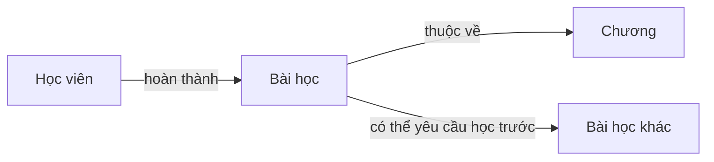

# Dữ liệu, quan hệ giữa dữ liệu và các phép toán cần hỗ trợ

## Mục tiêu học tập

Sau bài này, bạn có thể:

- Phân biệt **giá trị dữ liệu**, **thực thể**, **thuộc tính** và **quan hệ** giữa các thực thể.
- Xác định quan hệ theo khóa, thứ tự, thành viên, phân cấp, phụ thuộc hoặc mức ưu tiên; nhận biết quan hệ một–một, một–nhiều và nhiều–nhiều.
- Liệt kê được các phép toán hệ thống cần hỗ trợ trước khi chọn cấu trúc dữ liệu.
- Diễn đạt **bất biến** mà dữ liệu phải duy trì khi thêm, sửa, xóa hoặc duyệt.
- Chuyển một yêu cầu nghiệp vụ thành biểu diễn dữ liệu và thao tác phù hợp, đồng thời ước lượng chi phí thời gian, bộ nhớ.

## 1. Vấn đề không chỉ là lưu những giá trị riêng lẻ

Giả sử một nền tảng học tập lưu các giá trị sau:

```text
"arrays"        "Mảng và truy cập theo chỉ số"
"stack"         "Stack và nguyên tắc LIFO"
"queue"         "Queue và nguyên tắc FIFO"
"graph"         "Đồ thị và các quan hệ"
"student-01"    ["arrays", "stack"]
```

Những giá trị này chưa đủ để trả lời chính xác các câu hỏi: bài `graph` cần học trước những bài nào, `student-01` đã hoàn thành bài `queue` chưa, bài nào đứng trước `stack` trong một chương, hay mã bài học nào được phép trùng nhau?

Ta cần xác định **mỗi giá trị đại diện cho điều gì**, **các giá trị liên quan với nhau thế nào** và **chương trình cần thực hiện những phép toán gì**. Ba việc đó tạo nền tảng cho việc lựa chọn mảng, danh sách liên kết, stack, queue, bảng băm, cây, heap hay đồ thị.

Có thể hình dung một mô hình nhỏ gồm:



Sơ đồ chỉ biểu thị ý nghĩa quan hệ. Cách lưu chúng trong bộ nhớ còn tùy nhu cầu truy vấn và cập nhật.

## 2. Nhìn dữ liệu qua thực thể, thuộc tính và danh tính

### 2.1. Giá trị, bản ghi và thực thể

Một **giá trị** có thể là số `12`, chuỗi `"graph"`, cờ `True` hoặc thời điểm hoàn thành. Một **bản ghi** gom các thuộc tính mô tả cùng một đối tượng. Chẳng hạn:

```python
lesson = {
    "id": "stack",
    "title": "Stack và nguyên tắc LIFO",
    "duration_minutes": 35,
    "published": True,
}
```

Đây là một biểu diễn của **thực thể bài học** trong bài toán. `id` là **định danh**, còn `title`, `duration_minutes` và `published` là **thuộc tính**. Phải làm rõ định danh có thực sự duy nhất và ổn định hay không. Hai bài học có thể trùng tiêu đề, vì vậy dùng `title` làm khóa tra cứu duy nhất dễ tạo lỗi; một `id` được kiểm soát tính duy nhất thường phù hợp hơn.

Không nên nhầm **định danh** với **vị trí lưu trữ**. Bài `stack` có thể đổi từ vị trí thứ ba sang thứ tư trong danh sách nhưng vẫn là cùng một bài học. Tương tự, đối tượng Python trong bộ nhớ có thể được tạo lại sau khi tải dữ liệu mà định danh nghiệp vụ vẫn giữ nguyên.

### 2.2. Kiểu dữ liệu và miền giá trị hợp lệ

Kiểu dữ liệu quy định những dạng giá trị và phép toán tương ứng. Ngoài kiểu cơ bản như số nguyên, chuỗi hay boolean, nghiệp vụ còn có các ràng buộc như:

- `duration_minutes` là số nguyên không âm.
- `id` là chuỗi không rỗng và duy nhất trong phạm vi các bài học.
- `published` chỉ nhận `True` hoặc `False`.
- Mã bài học được tham chiếu ở nơi khác phải tồn tại trong tập bài học.

Những điều kiện này có thể gọi là **ràng buộc hợp lệ** hoặc **bất biến dữ liệu**. Một cấu trúc lưu trữ thuận tiện không tự đảm bảo mọi quy tắc nghiệp vụ; chương trình vẫn phải kiểm tra chúng.

## 3. Những loại quan hệ thường gặp giữa dữ liệu

**Quan hệ** mô tả một liên hệ có ý nghĩa giữa hai hay nhiều phần tử. Quan hệ có thể được lưu rõ ràng bằng liên kết, danh sách, tập hợp hoặc bảng ánh xạ; cũng có thể được suy ra từ thuộc tính và quy tắc nghiệp vụ.

| Loại quan hệ | Câu hỏi đặc trưng | Ví dụ | Cách biểu diễn thường gặp |
| --- | --- | --- | --- |
| **Thứ tự** | Phần tử nào đứng trước/sau? | Thứ tự các bài trong chương | Mảng, danh sách có thứ tự |
| **Ánh xạ theo khóa** | Với khóa này, giá trị tương ứng là gì? | `lessonId → Lesson` | Bảng băm, cây tìm kiếm |
| **Thành viên** | Phần tử có nằm trong tập không? | Học viên đã hoàn thành bài nào? | Tập hợp băm, bitset khi miền phù hợp |
| **Cha–con / phân cấp** | Phần tử thuộc nhánh nào? | Chương chứa mục, mục chứa bài | Cây |
| **Phụ thuộc / liên kết** | Phần tử nào nối hoặc phụ thuộc vào phần tử nào? | Bài `graph` yêu cầu `stack` và `queue` | Đồ thị, danh sách kề |
| **Ưu tiên** | Phần tử nào cần xử lý trước theo tiêu chí? | Bài nộp có hạn xử lý sớm nhất | Heap, hàng đợi ưu tiên |
| **Quan hệ theo lượt đến** | Yêu cầu nào tới trước? | Yêu cầu chấm bài | Queue |
| **Quan hệ theo lịch sử** | Thao tác nào xảy ra gần nhất? | Hoàn tác thao tác chỉnh sửa | Stack |

Các quan hệ có thể cùng tồn tại trên một tập thực thể. Bài học vừa có vị trí hiển thị trong chương, vừa có định danh để tra cứu, vừa có quan hệ tiên quyết với những bài khác. Không có lý do bắt buộc phải ép tất cả nhu cầu này vào một cấu trúc duy nhất.

### 3.1. Một–một, một–nhiều và nhiều–nhiều

**Bội số quan hệ** giúp xác định một đối tượng có thể liên hệ với bao nhiêu đối tượng khác:

- **Một–một (1–1):** một tài khoản gắn với tối đa một hồ sơ học viên chính và ngược lại, nếu hệ thống có quy tắc này.
- **Một–nhiều (1–N):** một chương có thể chứa nhiều bài học; mỗi bài thuộc đúng một chương, nếu mô hình nghiệp vụ quy định như vậy.
- **Nhiều–nhiều (N–N):** một học viên học nhiều khóa, và một khóa có nhiều học viên; quan hệ đăng ký phải lưu các cặp học viên–khóa học.

Ví dụ quan hệ nhiều–nhiều có thể lưu bằng các cặp:

```python
enrollments = {
    ("student-01", "course-ds"),
    ("student-01", "course-algo"),
    ("student-02", "course-ds"),
}

assert ("student-01", "course-ds") in enrollments
```

Tập hợp các cặp phù hợp khi cần kiểm tra một cặp đã tồn tại hay chưa. Nếu cần **liệt kê mọi khóa của một học viên** liên tục, có thể duy trì thêm ánh xạ `studentId → tập courseId`; đó là một chỉ mục cho chiều truy vấn cụ thể, đổi lại phải giữ đồng bộ khi đăng ký hoặc hủy đăng ký.

### 3.2. Quan hệ có hướng, không hướng và chu trình

Quan hệ *bài A cần học trước bài B* có **hướng**: `A → B` không đồng nghĩa `B → A`. Ngược lại, quan hệ *hai máy tính kết nối trực tiếp với nhau bằng một đường truyền hai chiều* có thể được mô hình bằng cạnh **không hướng**.

Một cấu trúc phân cấp như cây không có chu trình. Đồ thị tổng quát có thể có chu trình; riêng đồ thị phụ thuộc tiên quyết hợp lệ thường cần là **đồ thị có hướng không chu trình (DAG)**. Nếu `A` cần `B` và `B` cần `A`, không thể lập thứ tự học thỏa mãn cả hai điều kiện.

### 3.3. Thứ tự lưu trữ khác thứ tự nghiệp vụ

Thứ tự phần tử xuất hiện trong bộ nhớ, thứ tự người dùng thêm vào, thứ tự hiển thị và thứ tự ưu tiên là những khái niệm khác nhau. Chẳng hạn, nội dung có thể được xuất bản theo thời điểm tạo nhưng hiển thị theo trường `position`, còn hàng đợi chấm bài có thể ưu tiên hạn chót. Hãy ghi rõ **thứ tự nào phải được bảo toàn** trước khi chọn cấu trúc.

## 4. Phép toán: mô tả điều chương trình thực sự phải làm

**Phép toán trên dữ liệu** là một yêu cầu đọc hoặc thay đổi trạng thái dữ liệu. Những nhóm thao tác cơ bản gồm:

| Nhóm | Phép toán điển hình | Cần làm rõ |
| --- | --- | --- |
| **Truy cập** | `get(id)`, `get_at(index)`, lấy phần tử đầu/cuối | Truy cập theo khóa hay theo vị trí? |
| **Kiểm tra tồn tại** | `contains(id)`, `has_completed(student, lesson)` | Giá trị hoặc cặp quan hệ nào cần kiểm tra? |
| **Tìm kiếm / lọc** | Tìm tên chứa từ khóa, lấy bài đã xuất bản | Tìm theo điều kiện hay theo khóa duy nhất? |
| **Duyệt / liệt kê** | Liệt kê bài trong chương, liệt kê mọi bài tiên quyết | Duyệt theo thứ tự nào, có cần tránh lặp không? |
| **Thêm** | Thêm bài, thêm người đăng ký, thêm cạnh phụ thuộc | Có được trùng, cần cập nhật bao nhiêu chỉ mục? |
| **Cập nhật** | Đổi tiêu đề, vị trí, trạng thái hoàn thành | Bất biến nào có thể bị ảnh hưởng? |
| **Xóa** | Xóa bài, hủy đăng ký, bỏ một quan hệ tiên quyết | Quan hệ tham chiếu đến phần tử bị xóa sẽ xử lý ra sao? |
| **Lấy theo quy tắc** | `push/pop`, `enqueue/dequeue`, lấy ưu tiên cao nhất | LIFO, FIFO hay thứ tự ưu tiên? |
| **Tổng hợp** | Đếm bài đã học, thống kê theo chương | Cần quét dữ liệu hay duy trì số liệu tổng hợp? |

Đừng chỉ ghi yêu cầu chung là “hỗ trợ CRUD”. Ví dụ, `READ bài học` có thể mang ít nhất bốn nghĩa khác nhau: **lấy bài theo mã**, **lấy bài thứ `k`**, **liệt kê bài trong chương**, hoặc **tìm mọi bài tiên quyết của một bài**. Chúng dẫn đến những cách tổ chức và chi phí thực thi khác nhau.

### 4.1. Phân biệt phép toán truy vấn với phép toán cập nhật

- **Truy vấn (query)** quan sát trạng thái: lấy bài theo mã, kiểm tra học viên đã hoàn thành, đếm số đăng ký.
- **Cập nhật (mutation)** thay đổi trạng thái: thêm bài, đánh dấu hoàn thành, di chuyển vị trí, thêm cạnh tiên quyết.

Chọn cấu trúc theo riêng tốc độ truy vấn có thể khiến cập nhật trở nên đắt. Ví dụ, lưu thêm nhiều chỉ mục giúp tìm kiếm nhanh nhưng mỗi lần thêm hoặc xóa đều phải điều chỉnh tất cả chỉ mục liên quan.

### 4.2. Mô tả tiền điều kiện, kết quả và hậu điều kiện

Mỗi thao tác nên trả lời ba câu hỏi:

1. **Tiền điều kiện:** điều gì phải đúng trước khi thực hiện? Ví dụ: bài được đánh dấu hoàn thành phải tồn tại.
2. **Kết quả:** thao tác trả về gì hoặc thay đổi điều gì? Ví dụ: thêm mã bài vào tập bài đã hoàn thành.
3. **Hậu điều kiện / bất biến:** những điều gì tiếp tục đúng? Ví dụ: không có mã bài trùng, quan hệ tiên quyết chỉ trỏ đến bài hợp lệ.

Định nghĩa rõ như vậy giúp tránh các lỗi âm thầm như tham chiếu đến bài đã xóa, học viên bị đăng ký hai lần, hoặc heap không còn giữ đúng thứ tự ưu tiên.

## 5. Ví dụ xuyên suốt: mô hình dữ liệu cho chương học

Xét một chương có năm bài. Hệ thống cần hiển thị bài theo thứ tự biên tập, tra nhanh theo mã, kiểm tra điều kiện để học bài mới và đánh dấu bài đã hoàn thành.

### 5.1. Chọn biểu diễn đáp ứng từng quan hệ

```python
# Tra theo định danh: id -> thông tin bài học.
lessons_by_id = {
    "intro": {"title": "Nhập môn"},
    "arrays": {"title": "Mảng"},
    "stack": {"title": "Stack"},
    "queue": {"title": "Queue"},
    "graph": {"title": "Đồ thị"},
}

# Thứ tự hiển thị do người biên tập quyết định.
lesson_order = ["intro", "arrays", "stack", "queue", "graph"]

# Với mỗi bài, lưu tập bài phải hoàn thành trước đó (quan hệ có hướng).
prerequisites = {
    "intro": set(),
    "arrays": {"intro"},
    "stack": {"arrays"},
    "queue": {"arrays"},
    "graph": {"stack", "queue"},
}

# Với mỗi học viên, lưu tập bài đã hoàn thành.
completed_by_student = {
    "student-01": {"intro", "arrays", "stack"},
}
```

Chú ý: các tập `{...}` ở đây biểu diễn **quan hệ thành viên**, không mang thứ tự. `lesson_order` mới là nguồn dữ liệu để hiển thị theo thứ tự cụ thể. Một bài có thể có **nhiều bài tiên quyết**, do đó quan hệ tiên quyết không thể chỉ biểu diễn bằng một liên kết cha duy nhất như trong một cây thông thường.

### 5.2. Định nghĩa các thao tác đọc

```python
def get_lesson(lesson_id):
    """Trả về bài theo mã, hoặc None nếu không tồn tại."""
    return lessons_by_id.get(lesson_id)


def get_chapter_lessons():
    """Lấy danh sách bài theo thứ tự hiển thị."""
    return [lessons_by_id[id] for id in lesson_order]


def has_completed(student_id, lesson_id):
    """Học viên đã hoàn thành bài chưa?"""
    return lesson_id in completed_by_student.get(student_id, set())


def can_start(student_id, lesson_id):
    """Đã hoàn thành tất cả bài tiên quyết trực tiếp chưa?"""
    if lesson_id not in lessons_by_id:
        raise KeyError(f"Không tìm thấy bài: {lesson_id}")

    completed = completed_by_student.get(student_id, set())
    return prerequisites[lesson_id].issubset(completed)


assert get_lesson("arrays")["title"] == "Mảng"
assert get_chapter_lessons()[0]["title"] == "Nhập môn"
assert has_completed("student-01", "stack")
assert not can_start("student-01", "graph")  # Còn thiếu bài queue.
```

Trong ví dụ này, `can_start` kiểm tra **bài tiên quyết trực tiếp**. Hệ thống giả định dữ liệu hoàn thành trước đó đã được ghi hợp lệ; nếu cần kiểm chứng cả quan hệ tiên quyết bắc cầu bất chấp lịch sử ghi nhận, ta phải duyệt đồ thị phụ thuộc để tìm mọi tổ tiên của bài học.

### 5.3. Định nghĩa thao tác cập nhật và giữ bất biến

```python
def complete_lesson(student_id, lesson_id):
    """Ghi nhận hoàn thành một bài khi đã đạt điều kiện đầu vào."""
    if not can_start(student_id, lesson_id):
        raise ValueError("Chưa hoàn thành đủ bài tiên quyết")

    completed_by_student.setdefault(student_id, set()).add(lesson_id)


complete_lesson("student-01", "queue")
assert has_completed("student-01", "queue")
assert can_start("student-01", "graph")
```

Dùng `set` giúp thao tác `add` **không tạo bản sao trùng lặp** khi cùng bài được báo hoàn thành nhiều lần. Đây là lựa chọn tốt cho quan hệ thành viên: các phép `in` và `add` thường có chi phí trung bình kỳ vọng **O(1)** với tập hợp băm của Python.

Nhưng cấu trúc dữ liệu không tự biết **chính sách nghiệp vụ**. Ví dụ: học lại bài có được cập nhật thời điểm hoàn thành không; thêm một bài tiên quyết mới có áp dụng hồi tố với học viên cũ không; xóa bài khỏi chương có xóa lịch sử học không? Các quyết định này cần được định nghĩa ở tầng xử lý nghiệp vụ và dữ liệu bền vững, vượt ngoài khả năng của `set` hay `dict` riêng lẻ.

### 5.4. Đổi quan hệ tiên quyết cần kiểm soát chu trình

Giả sử ta định thêm yêu cầu “phải học `graph` trước `intro`”. Điều này không hợp lệ trong ví dụ vì `graph` vốn đã phụ thuộc vào `stack`, `stack` phụ thuộc vào `arrays`, và `arrays` phụ thuộc vào `intro`.

Để kiểm tra trước khi thêm cạnh mới, có thể duyệt quan hệ tiên quyết:

```python
def has_prerequisite_path(start, target):
    """Có đường đi từ start đến target qua các bài tiên quyết không?"""
    seen = set()
    pending = [start]

    while pending:
        current = pending.pop()
        if current == target:
            return True
        if current in seen:
            continue
        seen.add(current)
        pending.extend(prerequisites[current])

    return False


def add_prerequisite(lesson_id, required_id):
    if lesson_id not in lessons_by_id or required_id not in lessons_by_id:
        raise KeyError("Bài học tham chiếu không tồn tại")
    if has_prerequisite_path(required_id, lesson_id):
        raise ValueError("Quan hệ này sẽ tạo chu trình phụ thuộc")
    prerequisites[lesson_id].add(required_id)


assert has_prerequisite_path("graph", "intro")

try:
    add_prerequisite("intro", "graph")
except ValueError:
    pass  # Quan hệ không được thêm vì tạo chu trình.

assert "graph" not in prerequisites["intro"]
```

Nếu biểu diễn quan hệ bằng danh sách kề như `prerequisites`, mỗi lần kiểm tra đường đi có chi phí tối đa **O(V + E)** cho `V` bài học và `E` quan hệ tiên quyết. Khi cập nhật thường xuyên hoặc dữ liệu lớn, hệ thống có thể cần chiến lược kiểm tra khác; nhưng **điều kiện không có chu trình** vẫn phải được bảo vệ.

## 6. Từ phép toán đến lựa chọn cấu trúc dữ liệu

Cùng một dữ liệu có thể có nhiều biểu diễn. Chọn cấu trúc là chọn cách tiết kiệm tài nguyên cho **nhóm phép toán thường xuyên nhất**, trong khi vẫn giữ đúng ý nghĩa quan hệ và ràng buộc.

| Nhu cầu cụ thể | Cấu trúc gợi ý | Chi phí điển hình | Đánh đổi |
| --- | --- | --- | --- |
| Lấy bài thứ `i` trong chương | Mảng động chứa mã bài theo thứ tự | Truy cập chỉ số **O(1)** | Chèn/xóa giữa dãy thường **O(n)** |
| Tra bài theo `lessonId` | Bảng băm `id → Lesson` | Tra cứu **O(1)** kỳ vọng | Thêm bộ nhớ chỉ mục; phải giữ khóa duy nhất |
| Kiểm tra bài đã hoàn thành | Tập hợp băm theo học viên | `contains` **O(1)** kỳ vọng | Không biểu diễn thứ tự hoàn thành nếu chỉ lưu tập |
| Liệt kê bài tiên quyết trực tiếp | Danh sách/tập kề | **O(k)** để liệt kê `k` bài liên quan | Cần xác thực mã tham chiếu và chu trình |
| Tìm toàn bộ quan hệ trong đồ thị | Danh sách kề + BFS/DFS | **O(V + E)** | Tốn bộ nhớ **O(V + E)** cho biểu diễn kề |
| Lấy bài nộp sớm nhất theo thứ tự đến | Queue | Thêm cuối/lấy đầu **O(1)** với deque | Không hỗ trợ ưu tiên theo hạn chót |
| Hoàn tác thay đổi mới nhất | Stack | Thêm/lấy đỉnh **O(1)** hoặc khấu hao tùy cài đặt | Không có truy cập hiệu quả đến phần tử bất kỳ |
| Lấy tác vụ có hạn chót sớm nhất | Min-heap | Xem đỉnh **O(1)**, thêm/lấy đỉnh **O(log n)** | Tìm tác vụ bất kỳ theo mã có thể cần chỉ mục khác |

Trong bảng, `O(1)` của bảng băm/tập hợp băm là chi phí **kỳ vọng**, không phải cam kết cho mọi đầu vào. `O(1)` của thêm cuối mảng động thường là chi phí **khấu hao**, vì đôi khi mảng phải cấp phát vùng nhớ lớn hơn. Thực tế còn phụ thuộc ngôn ngữ, kích thước bản ghi, phân bố khóa và cách sử dụng bộ nhớ.

### 6.1. Đặt tên biến cho kích thước của quan hệ

Trong bài toán đồ thị và quan hệ, chỉ ký hiệu `n` đôi khi chưa đủ:

- `V`: số thực thể/đỉnh, chẳng hạn số bài học.
- `E`: số liên kết/cạnh, chẳng hạn số quan hệ tiên quyết.
- `k`: số liên kết thuộc một thực thể, chẳng hạn số bài tiên quyết trực tiếp của một bài.
- `q`: số truy vấn thực hiện trong một đợt xử lý.

Ví dụ, tra theo mã `q` lần bằng quét tuyến tính có thể tốn đến **O(qV)** thời gian; xây dựng bảng tra có chi phí **O(V)** trung bình kỳ vọng rồi dùng `q` lần tra cứu có thể tốn khoảng **O(V + q)**. Đó là lý do **tỷ lệ đọc–ghi** và số lần truy vấn quan trọng không kém lượng dữ liệu.

### 6.2. Chỉ mục phụ giúp đọc nhanh nhưng làm ghi phức tạp

Một hệ thống có thể giữ đồng thời:

```text
lessons_by_id:        mã -> thông tin bài
lesson_order:         danh sách mã theo thứ tự biên tập
prerequisites:        mã bài -> tập mã tiên quyết
completed_by_student: mã học viên -> tập mã bài đã học
```

Khi xóa bài `arrays`, chỉ xóa khỏi `lessons_by_id` là chưa đủ: `lesson_order`, các tập `prerequisites`, dữ liệu hoàn thành và có thể cả báo cáo đã tổng hợp sẽ còn tham chiếu đến mã không hợp lệ. Hệ thống phải có chính sách xử lý quan hệ tham chiếu và cập nhật chúng nhất quán, thường thông qua một giao dịch hoặc cơ chế bảo toàn tính toàn vẹn phù hợp với môi trường lưu trữ.

## 7. Quy trình thiết kế từ yêu cầu nghiệp vụ

Khi gặp bài toán mới, hãy làm lần lượt:

1. **Liệt kê thực thể và thuộc tính:** có những đối tượng nào, khóa định danh nào là duy nhất và ổn định?
2. **Vẽ quan hệ:** ai thuộc ai; quan hệ có hướng không; một–nhiều hay nhiều–nhiều; có cần thứ tự hoặc cho phép chu trình không?
3. **Viết các câu truy vấn thật:** ví dụ “mở bài theo mã”, “liệt kê bài theo chương”, “kiểm tra đủ bài tiên quyết”, thay vì chỉ “đọc dữ liệu”.
4. **Viết các phép cập nhật:** thêm, xóa, sửa phần tử hay quan hệ; mỗi cập nhật có ảnh hưởng đến chỉ mục và bản ghi khác không?
5. **Nêu bất biến và trường hợp lỗi:** mã không tồn tại, trùng khóa, tham chiếu mồ côi, chu trình, trùng đăng ký.
6. **Ước lượng quy mô và tần suất:** số phần tử, số cạnh quan hệ, số truy vấn/giây, tỷ lệ đọc–ghi, giới hạn bộ nhớ.
7. **So sánh, đo và điều chỉnh:** chọn biểu diễn đơn giản đáp ứng yêu cầu; đo trên dữ liệu thực tế, thêm chỉ mục khi lợi ích vượt chi phí duy trì.

**Ví dụ lựa chọn:** Với chỉ 30 bài và rất ít truy vấn theo mã, duyệt danh sách có thể đủ tốt và đơn giản. Khi có hàng triệu bài và cần tra bằng mã liên tục, bảng băm hoặc chỉ mục phù hợp trở nên hữu ích. Nếu cần truy vấn khoảng giá trị đã sắp xếp, phải xem xét một cấu trúc duy trì thứ tự thay vì giả định bảng băm xử lý tốt mọi loại tìm kiếm.

## 8. Lỗi tư duy thường gặp

- **Đồng nhất thứ tự với quan hệ phụ thuộc:** bài hiển thị trước không nhất thiết là điều kiện tiên quyết của bài sau. Thứ tự hiển thị và đồ thị tiên quyết cần được mô tả rõ.
- **Lấy vị trí trong mảng làm danh tính lâu dài:** chèn một phần tử trước đó có thể làm chỉ số thay đổi. Nếu cần tham chiếu ổn định, hãy dùng định danh.
- **Chỉ lưu chiều thuận mà quên truy vấn chiều ngược:** nếu thường xuyên hỏi “những học viên nào tham gia khóa X”, chỉ mục `studentId → courseId` chưa đáp ứng tối ưu; có thể cần chỉ mục bổ sung theo khóa học.
- **Không phân biệt phép toán logic với cài đặt:** queue có thể được cài bằng nhiều cách; hiệu suất phụ thuộc cách cài đặt, ví dụ lấy phần tử đầu của Python `list` thường cần dịch dữ liệu.
- **Tối ưu một thao tác mà bỏ qua cập nhật:** thêm chỉ mục tra cứu giúp đọc nhanh nhưng cũng tăng bộ nhớ và số bước sửa dữ liệu mỗi lần ghi.
- **Cho rằng cấu trúc dữ liệu bảo đảm mọi quy tắc nghiệp vụ:** một `set` ngăn phần tử trùng theo quy tắc so sánh của nó, nhưng không tự ngăn một học viên hoàn thành bài trước khi đủ điều kiện.

## 9. Bài tập vận dụng

**Bài 1 — Quan hệ giữa học viên và khóa học.** Một học viên có thể theo nhiều khóa, và mỗi khóa có nhiều học viên. Hãy chỉ ra bội số quan hệ, một phép kiểm tra thành viên và hai hướng tra cứu cần hỗ trợ.

*Gợi ý:* Đây là quan hệ nhiều–nhiều. Kiểm tra cặp `(studentId, courseId)` có tồn tại; liệt kê các khóa của học viên; liệt kê các học viên của khóa. Tùy tần suất, có thể duy trì một hoặc hai chỉ mục từ định danh sang tập định danh.

**Bài 2 — Ưu tiên xử lý.** Ban đầu hệ thống chấm bài nộp theo thứ tự nhận. Sau đó, yêu cầu đổi thành xử lý bài có hạn chót gần nhất trước. Nên thay đổi phép toán trừu tượng thế nào và chọn cấu trúc nào?

*Gợi ý:* Quy tắc từ FIFO chuyển sang lấy phần tử có khóa ưu tiên nhỏ nhất. Min-heap là ứng viên cho thao tác xem/lấy phần tử có hạn chót sớm nhất.

**Bài 3 — Xóa một bài học.** Bài `arrays` xuất hiện trong danh sách hiển thị, là tiên quyết của `stack` và `queue`, và có nhiều học viên đã hoàn thành. Kể ít nhất ba bất biến hoặc chính sách phải xem xét trước khi xóa.

*Gợi ý:* Không để mã tham chiếu bị mồ côi; giữ tính hợp lệ của quan hệ tiên quyết; quyết định cách giữ lịch sử hoàn thành và cách cập nhật danh sách hiển thị. Xóa có thể cần nhiều thay đổi được áp dụng nhất quán.

**Bài 4 — Tính chi phí.** Có `V` bài học và `E` quan hệ tiên quyết. Một hàm DFS duyệt toàn bộ quan hệ từ đồ thị biểu diễn bằng danh sách kề có độ phức tạp nào? Nếu kiểm tra thành viên bằng tập băm, điều gì làm cho chi phí kỳ vọng có thể khác trường hợp xấu nhất?

*Gợi ý:* Duyệt toàn bộ đồ thị là `O(V + E)` nếu mỗi đỉnh/cạnh được xét số lần hằng số. Bảng băm phụ thuộc cách băm, va chạm và cách cài đặt nên các chi phí O(1) thường là kỳ vọng.

## Tổng kết

Thiết kế cấu trúc dữ liệu bắt đầu từ ba câu hỏi: **lưu những thực thể và giá trị nào; các thực thể có quan hệ gì; hệ thống cần thực hiện những phép toán nào?** Khi mô tả rõ định danh, thứ tự, bội số quan hệ, điều kiện tiên quyết và bất biến, ta mới có cơ sở so sánh mảng, danh sách liên kết, stack, queue, bảng băm, cây, heap và đồ thị theo thời gian, bộ nhớ và chi phí duy trì tính nhất quán. Một mô hình dữ liệu đúng ý nghĩa cùng những thao tác được xác định rõ là nền tảng để lựa chọn cấu trúc thích hợp cho từng bài toán.
