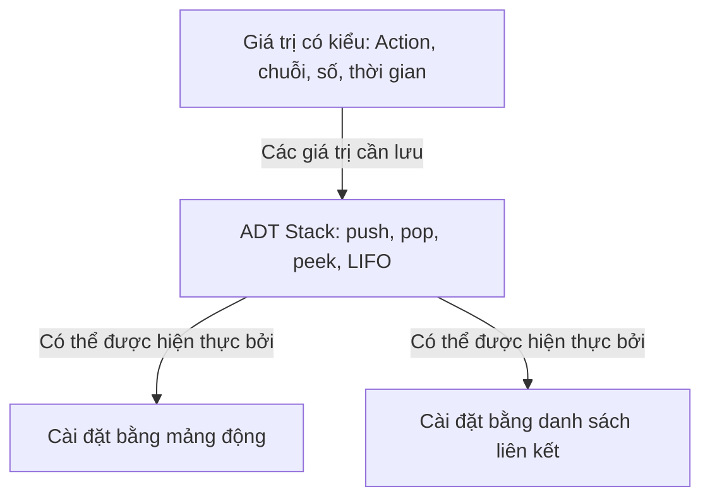

# Phân biệt kiểu dữ liệu, kiểu dữ liệu trừu tượng và cách cài đặt

## Mục tiêu học tập

Sau bài học, bạn có thể:

- Giải thích **kiểu dữ liệu** (data type), **kiểu dữ liệu trừu tượng** (abstract data type, ADT) và **cách cài đặt** (implementation) ở những mức độ trừu tượng khác nhau.
- Tách **hợp đồng hành vi** của một cấu trúc dữ liệu khỏi cách lưu phần tử và thuật toán thực hiện các thao tác.
- Mô tả ADT bằng trạng thái trừu tượng, các phép toán, tiền điều kiện, kết quả và bất biến.
- Đọc và xây dựng hai cách cài đặt cùng một ADT Stack bằng Python, rồi giải thích vì sao chúng hoạt động giống nhau nhưng có chi phí khác nhau.
- Áp dụng cách phân biệt này khi lựa chọn mảng, danh sách liên kết, queue, bảng băm, cây, heap hoặc đồ thị cho bài toán thực tế.

## 1. Một câu hỏi, ba tầng thiết kế

Trong ứng dụng soạn bài giảng, người dùng chỉnh sửa tiêu đề, chuyển vị trí bài học, rồi muốn **hoàn tác thao tác gần nhất**. Ta cần lưu một lịch sử có quy tắc: hành động được ghi sau phải được hoàn tác trước.

Có ba câu hỏi liên quan nhưng không giống nhau:

1. **Dữ liệu thuộc kiểu gì?** Một hành động có thể là bản ghi gồm `action_id`, `kind`, `payload` và `timestamp`. Mỗi trường có kiểu dữ liệu tương ứng.
2. **Tập hành động phải hành xử như thế nào?** Cần một *stack* cho phép `push` hành động mới và `pop` hành động gần nhất theo nguyên tắc LIFO (*last in, first out* — vào sau, ra trước).
3. **Stack thực sự lưu hành động ra sao?** Có thể dùng mảng động, danh sách liên kết hoặc cách biểu diễn khác, miễn các thao tác tuân thủ hợp đồng LIFO.



Tách ba tầng giúp ta thảo luận **đúng chức năng trước**, sau đó mới quyết định **tốc độ, bộ nhớ và độ phức tạp triển khai**.

## 2. Kiểu dữ liệu: giá trị nào và thao tác nào hợp lệ?

Một **kiểu dữ liệu (data type)** mô tả tập hợp giá trị có ý nghĩa và những thao tác có thể áp dụng cho các giá trị đó. Ví dụ:

| Kiểu | Ví dụ giá trị | Thao tác hoặc ràng buộc liên quan |
| --- | --- | --- |
| Số nguyên (`int`) | `0`, `42`, `-7` | Cộng, trừ, so sánh; miền giá trị phụ thuộc ngôn ngữ/cách biểu diễn |
| Chuỗi (`str`) | `"lesson-001"` | So sánh, nối chuỗi, tìm chuỗi con, lấy độ dài |
| Boolean (`bool`) | `True`, `False` | Phủ định, kết hợp các điều kiện logic |
| Kiểu bản ghi `Lesson` | Mã, tiêu đề, thời lượng | Đọc thuộc tính, cập nhật theo quy tắc nghiệp vụ |

Trong Python, ta có thể định nghĩa một kiểu bản ghi bằng `dataclass`:

```python
from dataclasses import dataclass


@dataclass
class Lesson:
    lesson_id: str
    title: str
    duration_minutes: int


lesson = Lesson("ds-001", "Nhập môn cấu trúc dữ liệu", 30)
assert lesson.duration_minutes == 30
```

Đoạn mã cho biết cấu trúc thuộc tính của một đối tượng `Lesson`; riêng các chú thích kiểu chưa tự bảo đảm mọi ràng buộc khi chạy. Chẳng hạn, Python không tự từ chối `duration_minutes=-5` chỉ vì trường được khai báo `int`: muốn thời lượng không âm, chương trình phải kiểm tra thêm.

**Kiểu dữ liệu không nhất thiết là kiểu nguyên thủy.** Kiểu do lập trình viên định nghĩa cũng là kiểu dữ liệu. Mặt khác, một ADT cũng có thể được xem là cách **đặc tả một kiểu dữ liệu ở mức trừu tượng**. Vì vậy, hai thuật ngữ *kiểu dữ liệu* và *kiểu dữ liệu trừu tượng* không phải hai nhóm hoàn toàn tách biệt: điểm khác nhau là **mức thông tin được đặc tả và mức chi tiết bị che giấu**.

## 3. ADT: quy định hành vi, không quy định vùng nhớ

**Kiểu dữ liệu trừu tượng (abstract data type — ADT)** mô tả dữ liệu qua các **phép toán công khai và ngữ nghĩa của chúng**, độc lập với việc phần tử được bố trí trong bộ nhớ ra sao. Có thể xem ADT như một *hợp đồng*: người sử dụng biết được phép gọi thao tác nào, thao tác đó có ý nghĩa gì và kết quả phải thỏa điều kiện nào.

Một đặc tả ADT thường gồm:

- **Trạng thái trừu tượng:** những phần tử hoặc quan hệ mà đối tượng đại diện, không cần thấy con trỏ hay mảng bên trong.
- **Các phép toán công khai:** tên thao tác, tham số, kết quả trả về.
- **Tiền điều kiện:** điều gì phải đúng để phép toán hợp lệ; ví dụ `pop` yêu cầu stack không rỗng.
- **Hậu điều kiện / ngữ nghĩa:** thao tác làm trạng thái thay đổi như thế nào, trả về phần tử nào.
- **Các quy tắc nhất quán:** những tính chất mọi trạng thái hợp lệ và mọi thao tác phải duy trì.
- **Quy ước lỗi:** khi thao tác không hợp lệ, trả giá trị đặc biệt hay phát sinh ngoại lệ.

Một ADT có thể dùng trong nhiều chương trình, được hiện thực bằng nhiều cách và được cài đặt bằng nhiều ngôn ngữ lập trình khác nhau.

### 3.1. Ví dụ đặc tả ADT Stack

Mô hình hóa trạng thái stack là dãy trừu tượng `S = [x₀, x₁, ..., xₖ]`, trong đó `x₀` là phần tử đáy và `xₖ` là phần tử đỉnh. Các phép toán:

| Phép toán | Tiền điều kiện | Hành vi và hậu điều kiện |
| --- | --- | --- |
| `push(x)` | Không có, nếu stack không bị giới hạn dung lượng | Đưa `x` lên đỉnh: `S' = S + [x]` |
| `pop()` | `S` không rỗng | Trả phần tử cuối `xₖ` và bỏ nó khỏi `S` |
| `peek()` | `S` không rỗng | Trả phần tử cuối `xₖ`, **không thay đổi** `S` |
| `is_empty()` | Không có | Trả `True` đúng khi `S` có 0 phần tử |
| `size()` | Không có | Trả số phần tử hiện có trong `S` |

Trong bài này, hợp đồng quy ước `pop()` và `peek()` trên stack rỗng sẽ gây **`IndexError`**. Một API khác có thể dùng kết quả có kiểu `Option` hoặc `Result`, nhưng phải mô tả rõ và duy trì nhất quán. Không nên mặc định trả `None` để biểu thị rỗng nếu `None` cũng là một giá trị hợp lệ được phép đưa vào stack.

Hệ quả quan trọng của hợp đồng là **LIFO**:

```text
Ban đầu:      []
push("A"):   [A]          đỉnh = A
push("B"):   [A, B]       đỉnh = B
push("C"):   [A, B, C]    đỉnh = C
pop():        [A, B]       trả C
pop():        [A]          trả B
```

Không có dòng nào trong đặc tả bắt buộc phải dùng mảng, nút liên kết hay một kích thước ô nhớ cụ thể. Đó là phần việc của **cài đặt**.

### 3.2. ADT khác chữ ký hàm và giao diện lập trình như thế nào?

Chữ ký `pop() -> T` chỉ cho biết thao tác không nhận tham số và trả về giá trị kiểu `T`. Nó **chưa cho biết** phần tử nào được trả về, stack thay đổi thế nào, hoặc điều gì xảy ra khi rỗng.

Trong một ngôn ngữ hướng đối tượng, `interface`, lớp trừu tượng hoặc `Protocol` có thể diễn đạt tên và kiểu của các phương thức. Nhưng các cấu trúc cú pháp đó không tự kiểm tra toàn bộ ngữ nghĩa LIFO. Một lớp có đủ phương thức `push` và `pop` mà `pop` lại lấy phần tử **đầu tiên được thêm** thì vẫn vi phạm ADT Stack, dù chữ ký phương thức hoàn toàn hợp lệ.

## 4. Cách cài đặt: biểu diễn trạng thái và thuật toán thao tác

**Cài đặt (implementation)** biến hợp đồng ADT thành mã thực thi, gồm hai quyết định cụ thể:

1. **Biểu diễn bên trong:** lưu phần tử bằng mảng, nút có liên kết, bảng băm, cây hay các vùng nhớ khác.
2. **Thuật toán thao tác:** làm thế nào để `push`, `pop`, `peek` và những thao tác còn lại bảo toàn hợp đồng.

Ví dụ, cùng một ADT Stack có thể cài đặt bằng **mảng động** hoặc **danh sách liên kết đơn**. Hai cách dưới đây cho kết quả quan sát được giống nhau qua các phương thức công khai.

### 4.1. Cài đặt Stack bằng mảng động của Python

```python
class ArrayStack:
    def __init__(self):
        self._items = []

    def push(self, value):
        self._items.append(value)

    def pop(self):
        if not self._items:
            raise IndexError("Stack rỗng")
        return self._items.pop()

    def peek(self):
        if not self._items:
            raise IndexError("Stack rỗng")
        return self._items[-1]

    def is_empty(self):
        return not self._items

    def size(self):
        return len(self._items)
```

Python `list` được triển khai theo mô hình mảng động. `append` bổ sung ở cuối và `pop()` không có chỉ số lấy phần tử cuối, vì vậy chúng trực tiếp đáp ứng quy tắc đỉnh stack.

**Bất biến biểu diễn:** phần tử ở cuối `_items` là đỉnh; `_items` chứa đúng các phần tử hiện có của stack theo thứ tự từ đáy đến đỉnh. Mỗi phép toán phải duy trì điều này.

### 4.2. Cài đặt cùng Stack bằng danh sách liên kết

```python
class _Node:
    def __init__(self, value, next_node=None):
        self.value = value
        self.next = next_node


class LinkedStack:
    def __init__(self):
        self._top = None
        self._size = 0

    def push(self, value):
        self._top = _Node(value, self._top)
        self._size += 1

    def pop(self):
        if self._size == 0:
            raise IndexError("Stack rỗng")
        value = self._top.value
        self._top = self._top.next
        self._size -= 1
        return value

    def peek(self):
        if self._size == 0:
            raise IndexError("Stack rỗng")
        return self._top.value

    def is_empty(self):
        return self._size == 0

    def size(self):
        return self._size
```

Ở đây, mỗi nút lưu một giá trị và tham chiếu đến nút kế tiếp. `_top` trỏ đến nút mới nhất. `push` tạo nút mới ở đầu, `pop` chuyển `_top` đến nút kế tiếp. Không cần duyệt đến cuối danh sách.

**Bất biến biểu diễn:** `_size` bằng đúng số nút có thể đi tới từ `_top`, và `_top is None` khi và chỉ khi `_size == 0`. Nút được trỏ bởi `_top` chính là đỉnh stack.

### 4.3. Một đoạn mã sử dụng được cả hai cài đặt

Đoạn kiểm tra sau giả định đã định nghĩa hai lớp ở trên. Nó chỉ dùng **các phép toán công khai của ADT**; không truy cập `_items`, `_top` hay `_Node`.

```python
def verify_stack(StackClass):
    stack = StackClass()
    assert stack.is_empty()
    assert stack.size() == 0

    stack.push(None)  # None là một phần tử hợp lệ, không có nghĩa stack rỗng.
    stack.push("A")
    stack.push("B")

    assert stack.size() == 3
    assert stack.peek() == "B"
    assert stack.size() == 3  # peek không lấy phần tử khỏi stack.
    assert stack.pop() == "B"
    assert stack.pop() == "A"
    assert stack.pop() is None
    assert stack.is_empty()

    try:
        stack.pop()
    except IndexError:
        pass
    else:
        raise AssertionError("pop trên stack rỗng phải gây IndexError")


for implementation in (ArrayStack, LinkedStack):
    verify_stack(implementation)
```

Nếu một tính năng chỉ gọi `push` và `pop`, nó không cần biết lớp đang lưu các phần tử trong mảng hay danh sách liên kết. Đây là ích lợi thực tế của **lập trình dựa trên hợp đồng**: có thể thay cài đặt để tối ưu mà không phải thay đổi hành vi mong đợi của mã sử dụng.

### 4.4. Giống ngữ nghĩa, khác chi phí

Với `n` phần tử, hai cài đặt có các đặc điểm điển hình:

| Khía cạnh | `ArrayStack` (mảng động) | `LinkedStack` (danh sách liên kết) |
| --- | --- | --- |
| `push` | **O(1) khấu hao**; một lần mở rộng mảng có thể mất O(n) | **O(1)** cho thao tác liên kết, chưa tính chi phí cấp phát biến động |
| `pop` ở đỉnh | **O(1)** đối với thao tác cuối mảng trong mô hình thông dụng | **O(1)** |
| `peek`, `is_empty`, `size` | **O(1)** | **O(1)** nhờ lưu `_size` |
| Bộ nhớ chứa `n` phần tử | **O(n)**; có thể giữ sức chứa dự phòng | **O(n)**; mỗi nút cần thêm tham chiếu và đối tượng chứa |
| Tính cục bộ bộ nhớ | Vùng chứa tham chiếu gần nhau, thường thuận lợi cho cache | Các nút có thể nằm rải rác, chi phí cấp phát và truy cập tham chiếu cao hơn |
| Mở rộng số phần tử | Có thể phải cấp phát lại vùng mảng | Tạo thêm nút, không cần dịch chuyển mảng |

`O(1)` và `O(n)` mô tả xu hướng tăng trưởng; chúng **không** đảm bảo cài đặt nào luôn chạy nhanh hơn trên mọi dữ liệu và môi trường. Ví dụ, mã Python tự tạo nhiều `_Node` có thể tốn bộ nhớ và thời gian đáng kể hơn so với `list` được tối ưu sẵn. Cần đo hiệu năng thực tế khi mức chênh lệch có ý nghĩa với ứng dụng.

## 5. Đừng nhầm ADT, cấu trúc dữ liệu, lớp và thuật toán

Các thuật ngữ dưới đây thường xuất hiện gần nhau nhưng mô tả những khía cạnh khác nhau:

| Thuật ngữ | Câu hỏi trọng tâm | Ví dụ |
| --- | --- | --- |
| **Kiểu dữ liệu** | Giá trị có dạng gì và được phép làm gì? | `int`, `str`, `Lesson` |
| **ADT** | Những phép toán và hành vi nào được hứa hẹn? | Stack LIFO, Queue FIFO, Set, Map |
| **Cấu trúc dữ liệu** | Phần tử được tổ chức và liên kết thế nào? | Mảng, danh sách liên kết, cây, bảng băm |
| **Cách cài đặt** | Biểu diễn nào và thuật toán nào hiện thực hợp đồng? | `ArrayStack`, `LinkedStack`, queue bằng `deque` |
| **Lớp / interface / API** | Mã được đóng gói và các phương thức được gọi thế nào? | Lớp Python có `push`, `pop`, `peek` |
| **Thuật toán** | Những bước nào biến đầu vào thành đầu ra hoặc thay đổi trạng thái? | Duyệt nút, dời phần tử, băm khóa, xoay cây |

Ranh giới không phải lúc nào cũng tuyệt đối. Ví dụ, nhiều tài liệu gọi *stack* là “cấu trúc dữ liệu” khi nói ở mức khái quát, nhưng xét về **hợp đồng thao tác**, stack là một ADT; còn mảng hoặc danh sách liên kết mới là những cấu trúc có thể hiện thực nó. Tương tự, `list` của Python là một kiểu/đối tượng thư viện có cách cài đặt mảng động cụ thể, không đồng nhất với mọi khái niệm *List ADT* trong sách lý thuyết.

**Một interface chưa đủ để chứng minh cài đặt đúng.** Hai lớp cùng có `pop()` nhưng một lớp trả phần tử đầu tiên thay vì phần tử mới nhất thì không tương đương về hành vi. Cần xác minh ngữ nghĩa bằng lập luận về bất biến, ví dụ biên và các kiểm tra theo hợp đồng.

## 6. Một ADT có nhiều cài đặt; một cấu trúc phục vụ nhiều ADT

Stack không phải ví dụ duy nhất. Cùng nguyên tắc tách hợp đồng và cài đặt áp dụng cho nhiều chủ đề trong module cấu trúc dữ liệu:

| ADT / mô hình | Hợp đồng tiêu biểu | Cách cài đặt có thể dùng | Đánh đổi nổi bật |
| --- | --- | --- | --- |
| **Queue** | Thêm cuối, lấy đầu theo FIFO | Mảng vòng (circular buffer), danh sách liên kết có đầu/cuối, `deque` | Lấy đầu bằng `list.pop(0)` của Python mất O(n) do phải dịch phần tử; deque hỗ trợ O(1) ở hai đầu |
| **Set** | Thêm, xóa, kiểm tra thành viên, không có phần tử trùng | Bảng băm, cây tìm kiếm cân bằng | Bảng băm cho kiểm tra thành viên O(1) kỳ vọng; cây cân bằng có thể duy trì thứ tự với O(log n) |
| **Map / Dictionary** | Ánh xạ khóa duy nhất sang giá trị; tra, thêm, cập nhật, xóa theo khóa | Bảng băm, cây tìm kiếm cân bằng | Tra chính xác theo khóa so với duyệt khóa có thứ tự và truy vấn khoảng |
| **Priority Queue** | Thêm phần tử; lấy/xem phần tử ưu tiên cao nhất hoặc thấp nhất | Heap nhị phân, mảng đã sắp xếp, cây cân bằng | Heap thường cho thêm và lấy đỉnh O(log n), xem đỉnh O(1); thứ tự của phần tử đồng hạng cần quy ước riêng |
| **List / Sequence** | Giữ thứ tự; truy cập, chèn, xóa theo vị trí | Mảng động, danh sách liên kết | Truy cập theo chỉ số O(1) ở mảng động, thường O(n) ở danh sách liên kết |
| **Graph** | Tập đỉnh, tập cạnh; thêm cạnh, tìm lân cận, duyệt quan hệ | Danh sách kề, ma trận kề | Danh sách kề thường dùng O(V + E) bộ nhớ; ma trận kề dùng O(V²) nhưng kiểm tra cạnh theo chỉ số O(1) |

Trong bảng, `V` là số đỉnh, `E` là số cạnh. Các mức chi phí được nêu dựa trên giả định cài đặt thông dụng; chẳng hạn cây tìm kiếm **cân bằng** giữ chiều cao O(log n), trong khi cây không cân bằng có thể suy giảm đến O(n).

### 6.1. Ví dụ về Queue: cùng FIFO nhưng cách dùng thư viện khác nhau

```python
from collections import deque

queue = deque()
queue.append("submission-01")
queue.append("submission-02")

assert queue.popleft() == "submission-01"
assert queue.popleft() == "submission-02"
```

`deque` hiện thực queue phù hợp vì thêm ở cuối và lấy ở đầu đều có chi phí O(1). Nếu thay bằng `list` rồi gọi `pop(0)`, kết quả logic vẫn FIFO nhưng mỗi lần lấy đầu tốn O(n). **ADT quy định kết quả**, trong khi **cài đặt quyết định chi phí**.

### 6.2. Ví dụ về Map: cùng tra theo khóa, khác khả năng duy trì thứ tự

Giả sử nền tảng học tập cần tìm bài theo `lesson_id`. Một bảng băm thường là lựa chọn tốt vì phép tra theo khóa có chi phí trung bình kỳ vọng O(1). Nhưng nếu tính năng chính chuyển thành “liệt kê tất cả mã bài trong khoảng từ `a` đến `d` theo thứ tự”, một *ordered map* cài bằng cây tìm kiếm cân bằng có thể phù hợp hơn. Hợp đồng cần nói rõ có hỗ trợ duyệt có thứ tự hay không; không thể mặc định mọi Map đều cung cấp cùng khả năng đó.

## 7. Chọn cài đặt theo những phép toán cần hỗ trợ

Khi thiết kế hoặc chọn cấu trúc dữ liệu cho một bài toán, hãy đi theo thứ tự:

1. **Xác định giá trị và kiểu:** đối tượng nào được lưu, thuộc tính nào cần thiết, giá trị nào hợp lệ?
2. **Viết hợp đồng ADT:** các phép toán công khai và hành vi cần bảo đảm là gì? Trả về gì khi rỗng, khi trùng khóa hoặc khi không tìm thấy?
3. **Liệt kê bất biến:** quy tắc LIFO/FIFO, khóa duy nhất, thuộc tính heap hay quan hệ không có chu trình phải được duy trì ra sao?
4. **Ước lượng khối lượng thao tác:** đọc nhiều hay ghi nhiều; tra theo mã, truy cập theo chỉ số hay cần lấy phần tử ưu tiên?
5. **So sánh các cài đặt:** chi phí thời gian trung bình/trường hợp xấu/khấu hao, bộ nhớ, chi phí cập nhật và độ phức tạp mã nguồn.
6. **Kiểm tra hợp đồng và đo đạc:** xác minh các trường hợp biên, rồi đo bằng dữ liệu và mẫu thao tác gần với sản phẩm thực tế.

**Ví dụ lựa chọn:** Với lịch sử hoàn tác chỉ cần `push`, `pop` và `peek`, cài đặt Stack dựa trên mảng động thường đơn giản và hiệu quả. Nếu yêu cầu thay đổi thành “tìm ngẫu nhiên một sự kiện cũ theo mã”, Stack đơn thuần không còn đáp ứng tốt mọi thao tác; có thể cần bổ sung chỉ mục theo mã, đổi ADT hoặc thiết kế lại luồng thao tác. Lúc đó, điều cần xem xét trước là **hợp đồng của tính năng đã thay đổi thế nào**.

## 8. Các ngộ nhận cần tránh

- **“ADT là một lớp trừu tượng trong Java/Python.”** Không chính xác. ADT là đặc tả hành vi ở mức khái niệm; lớp trừu tượng, interface hoặc protocol chỉ là một trong các công cụ diễn đạt hay hỗ trợ cài đặt.
- **“Cứ có `push` và `pop` là Stack.”** Chưa đủ. `pop` phải trả đúng phần tử vào sau cùng; ngoại lệ, việc thay đổi trạng thái và các trường hợp biên cũng phải đúng hợp đồng.
- **“ADT quyết định độ phức tạp O(1).”** Không đúng nếu chưa nêu các yêu cầu về hiệu suất. Stack LIFO không bắt buộc phải cài bằng mảng động; một cách cài đặt kém vẫn có thể mất O(n) cho `pop` mà không làm sai quy tắc LIFO.
- **“Một cấu trúc dữ liệu chỉ cài được một ADT.”** Không đúng. Mảng động có thể hiện thực List, Stack hoặc Queue; nhưng với Queue dùng `pop(0)` thì hiệu suất khác đáng kể so với deque hoặc mảng vòng.
- **“Độ phức tạp thời gian là tiêu chí duy nhất.”** Bộ nhớ, tính cục bộ bộ nhớ, số lần cấp phát, độ dễ kiểm tra và yêu cầu truy cập đồng thời cũng có thể quyết định phương án phù hợp.

## 9. Bài tập tự kiểm tra

**Tình huống 1.** Một lập trình viên tạo lớp `History` với hai phương thức `push()` và `pop()`. Khi gọi `push("A")`, `push("B")` rồi `pop()`, lớp trả `"A"`. Lớp này có thỏa hợp đồng Stack không?

*Gợi ý:* Không. Kết quả phải là `"B"`. Tên phương thức và chữ ký không thay thế được ngữ nghĩa LIFO.

**Tình huống 2.** Một hệ thống dùng `list` của Python để xếp hàng yêu cầu và lấy phần tử bằng `pop(0)`. Cài đặt có giữ đúng nguyên tắc FIFO không? Có thể cải thiện điều gì?

*Gợi ý:* FIFO vẫn đúng nhưng `pop(0)` làm dịch các phần tử còn lại, tốn O(n). Dùng `collections.deque` hoặc một queue được cài bằng mảng vòng để lấy đầu hiệu quả hơn.

**Tình huống 3.** Hai cài đặt Set, một dùng bảng băm và một dùng cây cân bằng, đều trả lời đúng cho `add`, `remove`, `contains`. Nếu cần in phần tử theo thứ tự tăng dần, bạn sẽ kiểm tra thêm yêu cầu nào của hợp đồng?

*Gợi ý:* Cần quy định có hỗ trợ duyệt có thứ tự hay không. Nếu đó là chức năng chính, một ordered set trên cây cân bằng có thể phù hợp; tập băm không mặc nhiên duy trì thứ tự sắp xếp.

**Tình huống 4.** Một Stack cài bằng danh sách liên kết có `_size = 3` nhưng từ `_top` chỉ lần theo được hai nút. Lỗi thuộc tầng nào?

*Gợi ý:* Bất biến **biểu diễn của cài đặt** đã bị phá vỡ. Hợp đồng `size()` sẽ trả sai kết quả và cần sửa phương thức duy trì `_size` hoặc các liên kết.

## Tổng kết

**Kiểu dữ liệu** diễn tả giá trị và những thao tác hợp lệ; **ADT** đặc tả trạng thái và hành vi có thể quan sát qua các phép toán; **cách cài đặt** quyết định biểu diễn cụ thể và thuật toán thực thi. Một ADT có thể có nhiều cài đặt với thời gian và bộ nhớ khác nhau, trong khi một cấu trúc như mảng hoặc danh sách liên kết có thể được dùng cho nhiều ADT. Khi lựa chọn cấu trúc dữ liệu, hãy bắt đầu từ **hợp đồng đúng đắn**, xác định **bất biến**, rồi đánh giá **chi phí của những thao tác thực sự cần hỗ trợ**.
