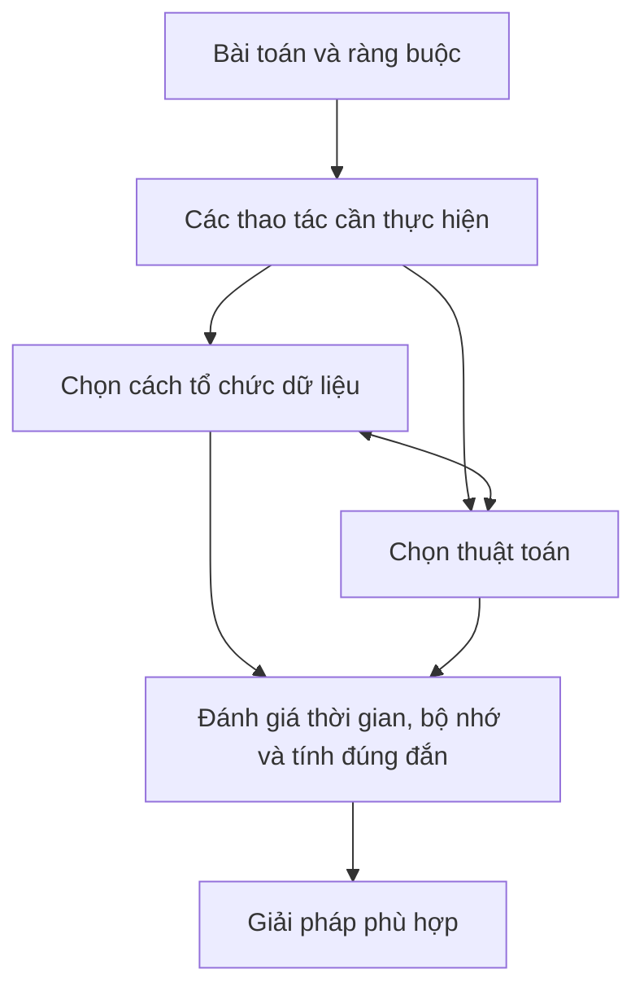
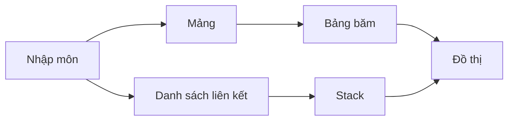

# Mối liên hệ giữa cấu trúc dữ liệu và thuật toán

## Mục tiêu học tập

Sau bài này, bạn có thể:

- Phân biệt vai trò của **cấu trúc dữ liệu** và **thuật toán**, đồng thời giải thích vì sao hai thành phần phải được thiết kế cùng nhau.
- Phân tích cách biểu diễn dữ liệu ảnh hưởng đến tốc độ tìm kiếm, duyệt, chèn, xóa và kết quả của thuật toán.
- Giải thích vì sao cùng một thuật toán ở mức ý tưởng có thể có độ phức tạp khác nhau khi dùng mảng, bảng băm, queue, heap hoặc cách biểu diễn đồ thị khác nhau.
- Nhận diện **bất biến** mà các phép toán phải duy trì để thuật toán trả kết quả đúng.
- Lựa chọn một cặp cấu trúc dữ liệu – thuật toán dựa trên mẫu truy vấn, chi phí thời gian, bộ nhớ và tính đúng đắn.

## 1. Hai thành phần cùng giải quyết một bài toán

Giả sử một nền tảng học tập có hàng trăm nghìn bài học. Người dùng yêu cầu: “Mở bài có mã `ds-042`”. Để đáp ứng, chương trình cần giải quyết đồng thời hai việc:

- **Tổ chức dữ liệu:** các bài học đang nằm trong một danh sách, một bảng ánh xạ mã bài đến nội dung, hay một cây tìm kiếm?
- **Xử lý dữ liệu:** chương trình lần lượt so sánh từng mã, tra cứu bằng hàm băm, hay thực hiện tìm kiếm trên tập dữ liệu đã được sắp xếp?

**Cấu trúc dữ liệu (data structure)** quyết định cách biểu diễn, lưu trữ và truy cập các phần tử cùng quan hệ giữa chúng. **Thuật toán (algorithm)** là một quy trình gồm các bước xác định nhằm biến đầu vào thành kết quả mong muốn, hoặc cập nhật trạng thái dữ liệu theo quy tắc.

Một cách liên hệ hữu ích là:



Không thể đánh giá thuật toán một cách đầy đủ nếu bỏ qua cách dữ liệu được tổ chức. Ngược lại, cấu trúc dữ liệu chỉ thực sự hữu ích khi các thuật toán có thể thực hiện những thao tác cần thiết trên nó.

Ví dụ: **tìm kiếm nhị phân** rất hiệu quả nếu dữ liệu có thứ tự và hỗ trợ truy cập nhanh theo chỉ số; sử dụng cùng ý tưởng này trên danh sách liên kết sẽ mất lợi thế truy cập ngẫu nhiên. **Duyệt theo chiều rộng** cần một cơ chế lấy phần tử theo thứ tự vào trước, ra trước; một queue giúp duy trì chính thứ tự đó.

## 2. Cùng một yêu cầu tìm kiếm, nhiều cặp cấu trúc – thuật toán

Xét danh sách các bài học được lưu theo thứ tự nhập liệu:

```python
lessons = [
    {"id": "ds-003", "title": "Queue"},
    {"id": "ds-001", "title": "Mảng"},
    {"id": "ds-004", "title": "Đồ thị"},
    {"id": "ds-002", "title": "Stack"},
]
```

### 2.1. Danh sách không sắp xếp và thuật toán tìm kiếm tuyến tính

Nếu chỉ có danh sách trên, cách trực tiếp nhất là xem từng phần tử:

```python
def find_linear(items, lesson_id):
    for item in items:
        if item["id"] == lesson_id:
            return item
    return None


assert find_linear(lessons, "ds-002")["title"] == "Stack"
assert find_linear(lessons, "ds-999") is None
```

Với `n` bài học, tìm kiếm tuyến tính có độ phức tạp **O(n)** trong trường hợp xấu nhất, vì có thể phải kiểm tra cả `n` phần tử. Nó vẫn có ưu điểm: không cần xây chỉ mục phụ, đơn giản khi dữ liệu nhỏ hoặc rất ít lần tra cứu.

### 2.2. Mảng có thứ tự và thuật toán tìm kiếm nhị phân

Nếu bài học được **sắp xếp tăng dần theo mã**, ta có thể liên tục loại bỏ một nửa vùng tìm kiếm. Ví dụ dùng `bisect` của Python:

```python
from bisect import bisect_left

sorted_lessons = sorted(lessons, key=lambda item: item["id"])
ids = [item["id"] for item in sorted_lessons]


def find_binary(lesson_id):
    i = bisect_left(ids, lesson_id)
    if i < len(ids) and ids[i] == lesson_id:
        return sorted_lessons[i]
    return None


assert find_binary("ds-002")["title"] == "Stack"
assert find_binary("ds-999") is None
```

Việc tìm trong mảng đã sắp xếp mất **O(log n)** lần so sánh trong trường hợp xấu nhất. Tuy nhiên, cần tính cả **chi phí chuẩn bị dữ liệu**: sắp xếp thông thường tốn **O(n log n)**; nếu duy trì một mảng đã sắp xếp, thêm hoặc xóa phần tử giữa dãy thường tốn **O(n)** do dịch chuyển phần tử.

Mẫu thao tác quyết định hiệu quả chung: nếu sắp xếp một lần rồi truy vấn rất nhiều lần, chi phí chuẩn bị có thể đáng giá. Nếu dữ liệu liên tục thay đổi, yêu cầu giữ mảng có thứ tự có thể làm cập nhật tốn kém.

> **Điều kiện đúng đắn:** tìm kiếm nhị phân chỉ đúng khi các khóa đã được sắp xếp theo đúng thứ tự so sánh dùng trong thuật toán. Bỏ qua tiền điều kiện này có thể trả kết quả sai, dù mã vẫn chạy bình thường.

### 2.3. Bảng băm và thuật toán tra cứu theo khóa

Nếu nhu cầu chính là tìm chính xác một bài qua mã định danh, có thể tạo bảng ánh xạ:

```python
lessons_by_id = {item["id"]: item for item in lessons}


def find_by_id(lesson_id):
    return lessons_by_id.get(lesson_id)


assert find_by_id("ds-002")["title"] == "Stack"
assert find_by_id("ds-999") is None
```

Tra cứu bằng `dict` của Python thường có chi phí **O(1) kỳ vọng**, nhưng trường hợp xấu nhất có thể là **O(n)** khi xảy ra va chạm băm bất lợi. Tạo bảng từ `n` bản ghi thường cần **O(n)** thời gian kỳ vọng và **O(n)** bộ nhớ bổ sung. Bài toán phải bảo đảm mã định danh là duy nhất; nếu có khóa trùng, biểu thức tạo `dict` trên sẽ chỉ giữ bản ghi cuối ứng với khóa đó.

### 2.4. Đặt ba giải pháp cạnh nhau

| Cặp cấu trúc – thuật toán | Chuẩn bị | Tìm một mã | Điều kiện và đánh đổi |
| --- | --- | --- | --- |
| Danh sách không sắp xếp + quét tuyến tính | Không cần chỉ mục | **O(n)** xấu nhất | Đơn giản; không yêu cầu dữ liệu có thứ tự |
| Mảng sắp xếp + tìm nhị phân | Sắp xếp **O(n log n)** | **O(log n)** | Phải giữ thứ tự; chèn vào giữa có thể O(n) |
| Bảng băm + tra theo khóa | Xây chỉ mục **O(n)** kỳ vọng | **O(1)** kỳ vọng | Dùng thêm O(n) bộ nhớ; không tự hỗ trợ tìm kiếm theo khoảng đã sắp xếp |

Chẳng hạn, nếu có `q` lần truy vấn trên tập dữ liệu ít thay đổi, chi phí tổng quát lần lượt là **O(qn)** cho quét tuyến tính, **O(n log n + q log n)** cho cách sắp xếp rồi tìm nhị phân, và **O(n + q)** kỳ vọng cho bảng băm. Các biểu thức này chỉ là mô hình chi phí; cần đo đạc thực tế khi lựa chọn triển khai.

## 3. Thuật toán khai thác các phép toán mà cấu trúc dữ liệu cung cấp

Một thuật toán thường cần những phép toán nền như `append`, `pop`, `contains`, `get`, `enqueue` hoặc `dequeue`. Cấu trúc dữ liệu khác nhau cung cấp chi phí và đôi khi cả ngữ nghĩa khác nhau cho từng phép toán.

| Phép toán cần thiết | Cấu trúc phù hợp thường gặp | Lý do |
| --- | --- | --- |
| Lấy phần tử thứ `i` | Mảng / mảng động | Truy cập theo chỉ số **O(1)** |
| Thêm rồi lấy phần tử mới nhất | Stack | Duy trì **LIFO**, dùng trong hoàn tác hoặc DFS |
| Lấy phần tử được đưa vào sớm nhất | Queue | Duy trì **FIFO**, dùng trong BFS và xử lý tuần tự |
| Kiểm tra đã thăm một phần tử chưa | Set / bảng băm | `contains` thường **O(1) kỳ vọng** |
| Lấy phần tử có độ ưu tiên nhỏ nhất | Min-heap / priority queue | Xem phần tử nhỏ nhất **O(1)**, thêm/lấy đỉnh **O(log n)** |
| Tìm giá trị theo khóa | Map dựa trên bảng băm hoặc cây tìm kiếm | Tùy nhu cầu tra chính xác hay duy trì thứ tự |
| Duyệt các phần tử kề trong mạng | Danh sách kề hoặc ma trận kề | Cách biểu diễn quyết định chi phí truy cập quan hệ |

Điều quan trọng là **phép toán mà thuật toán cần**. Ví dụ, thuật toán chấm bài theo thứ tự nhận có thể dùng queue. Nếu đổi quy tắc thành “chấm bài có hạn chót gần nhất”, bài toán cần **lấy phần tử theo ưu tiên**; một heap phù hợp hơn queue FIFO.

## 4. Ví dụ sâu hơn: biểu diễn đồ thị làm thay đổi chi phí duyệt

Giả sử các bài học liên kết với nhau theo quan hệ “có thể học tiếp”. Ta biểu diễn mỗi bài bằng một **đỉnh**, mỗi hướng chuyển bằng một **cạnh có hướng**:



Hai cách biểu diễn phổ biến là:

- **Danh sách kề:** mỗi đỉnh gắn với danh sách những đỉnh có cạnh đi ra. Bộ nhớ **O(V + E)**, phù hợp khi đồ thị thưa, tức số cạnh tương đối ít.
- **Ma trận kề:** bảng `V × V` ghi có hay không có cạnh từ đỉnh `u` đến `v`. Bộ nhớ **O(V²)**, kiểm tra trực tiếp một cạnh có thể **O(1)** sau khi ánh xạ đỉnh thành chỉ số.

Ở đây `V` là số đỉnh và `E` là số cạnh. Hai biểu diễn mô tả cùng đồ thị về mặt ngữ nghĩa, nhưng thuật toán duyệt sẽ có đặc điểm hiệu suất khác nhau.

### 4.1. BFS: thuật toán duyệt theo chiều rộng sử dụng queue

**Breadth-first search (BFS)** khám phá các đỉnh lần lượt theo số cạnh từ điểm bắt đầu. Trong đồ thị **không có trọng số**, BFS có thể tìm đường đi với **ít cạnh nhất** đến đích.

```python
from collections import deque

graph = {
    "intro": ["arrays", "linked-list"],
    "arrays": ["hash-table"],
    "linked-list": ["stack"],
    "hash-table": ["graph"],
    "stack": ["graph"],
    "graph": [],
}


def shortest_path_by_edges(adjacency, start, target):
    """Tìm đường có ít cạnh nhất trên đồ thị không trọng số."""
    if start not in adjacency or target not in adjacency:
        raise KeyError("Đỉnh bắt đầu hoặc kết thúc không tồn tại")

    queue = deque([start])
    parent = {start: None}  # Cũng ghi nhận các đỉnh đã phát hiện.

    while queue:
        current = queue.popleft()
        if current == target:
            path = []
            while current is not None:
                path.append(current)
                current = parent[current]
            return path[::-1]

        for neighbor in adjacency[current]:
            if neighbor not in parent:
                parent[neighbor] = current
                queue.append(neighbor)

    return None


path = shortest_path_by_edges(graph, "intro", "graph")
assert path == ["intro", "arrays", "hash-table", "graph"]
assert shortest_path_by_edges(graph, "graph", "intro") is None
```

Tại sao queue quan trọng? Khi lấy một đỉnh khỏi đầu hàng, các đỉnh ở số cạnh gần hơn đã được xử lý trước các đỉnh xa hơn. Ghi `parent` khi **thêm đỉnh vào queue** bảo đảm mỗi đỉnh chỉ được đưa vào hàng một lần và giữ được đường ngắn nhất theo số cạnh. Sử dụng `collections.deque` cho `append` và `popleft` giúp mỗi thao tác đầu/cuối có chi phí **O(1)**.

Với **danh sách kề** và phép kiểm tra đã phát hiện bằng bảng băm, BFS tốn **O(V + E)** thời gian trong trường hợp xấu nhất, cùng **O(V)** bộ nhớ phụ cho hàng đợi và bảng `parent`. Nếu dùng **ma trận kề**, khi xử lý một đỉnh thường phải quét cả hàng có `V` phần tử để tìm các đỉnh kề, vì vậy chi phí duyệt có thể là **O(V²)**.

### 4.2. DFS: cùng đồ thị, khác chiến lược và kết quả bảo đảm

**Depth-first search (DFS)** thường dùng **stack** hoặc ngăn xếp lời gọi đệ quy để đi sâu theo một nhánh trước khi quay lui. DFS có thể kiểm tra tính liên thông, phát hiện chu trình hoặc duyệt hết các đỉnh có thể đến, nhưng **không bảo đảm** đường đi đầu tiên tìm thấy là đường có ít cạnh nhất.

```python
def can_reach_dfs(adjacency, start, target):
    if start not in adjacency or target not in adjacency:
        raise KeyError("Đỉnh bắt đầu hoặc kết thúc không tồn tại")

    stack = [start]
    visited = set()

    while stack:
        current = stack.pop()
        if current == target:
            return True
        if current in visited:
            continue
        visited.add(current)
        stack.extend(adjacency[current])

    return False


assert can_reach_dfs(graph, "intro", "graph")
assert not can_reach_dfs(graph, "graph", "intro")
```

BFS và DFS có thể cùng đạt **O(V + E)** khi dùng danh sách kề, nhưng mục tiêu và thứ tự xử lý khác nhau. **Đổi queue sang stack không chỉ là thay cấu trúc cho nhanh hơn; đó là thay chiến lược duyệt, từ đó thay cả bảo đảm của thuật toán.**

> **Lưu ý về ý nghĩa dữ liệu:** nếu các cạnh là quan hệ *tiên quyết* thay vì *có thể học tiếp*, việc tìm đường ít cạnh nhất không đồng nghĩa tìm được lộ trình học hợp lệ. Một bài có thể cần hoàn thành **tất cả** bài tiên quyết; bài toán khi ấy thường liên quan đến kiểm tra chu trình và sắp xếp tô pô trên đồ thị có hướng không chu trình.

## 5. Cấu trúc dữ liệu ảnh hưởng đến tính đúng đắn của thuật toán

Không phải mọi sai lầm đều biểu hiện bằng chương trình chạy chậm. Dùng sai cấu trúc hoặc phá vỡ quy tắc lưu trữ có thể khiến **thuật toán trả lời sai**.

### 5.1. Bất biến và tiền điều kiện

**Bất biến (invariant)** là tính chất cần giữ đúng trong những trạng thái được quy định của một cấu trúc hoặc quá trình. Một số ví dụ:

| Cấu trúc hoặc thuật toán | Điều kiện phải duy trì | Hậu quả nếu vi phạm |
| --- | --- | --- |
| Dãy sắp xếp + tìm nhị phân | Khóa có thứ tự theo quy tắc so sánh | Có thể bỏ qua phần tử cần tìm |
| Min-heap + lấy ưu tiên nhỏ nhất | Khóa của cha không lớn hơn khóa của con | Phần tử ở đỉnh có thể không phải phần tử ưu tiên nhất |
| Bảng băm + tra khóa | Hàm băm và phép so sánh khóa tương thích, khóa sử dụng ổn định khi lưu | Có thể không tìm lại được mục đã thêm |
| Queue + BFS | Lấy phần tử theo FIFO, các đỉnh được mở rộng theo từng lớp | Không còn bảo đảm đường ít cạnh nhất nếu đổi cách lấy tùy ý |
| Cây tìm kiếm nhị phân | Khóa cây con trái/ phải tuân theo thứ tự quy ước | Tìm kiếm có thể đi sai nhánh |
| Danh sách liên kết | Liên kết nút và các tham chiếu đầu/cuối đúng trạng thái | Có thể mất nút, lặp vô hạn hoặc sai thứ tự |

Một thuật toán cài đặt đúng phải **bảo toàn bất biến qua từng bước thay đổi**. Ví dụ, thêm một phần tử vào heap không chỉ là đặt vào cuối mảng; còn phải thực hiện thao tác dịch lên (*sift-up*) khi cần để khôi phục tính chất heap. Việc “đặt giá trị vào đúng chỗ” là một thuật toán nhằm duy trì cấu trúc dữ liệu.

### 5.2. Thuật toán cũng tạo ra và duy trì cấu trúc dữ liệu

Mối liên hệ diễn ra theo **hai chiều**:

- Thuật toán **sử dụng** cấu trúc dữ liệu: BFS lấy đỉnh từ queue; Dijkstra chọn đỉnh có khoảng cách tạm thời nhỏ nhất từ priority queue; tìm nhị phân truy cập phần tử giữa của mảng.
- Thuật toán **duy trì** cấu trúc dữ liệu: chèn vào heap cần sift-up; xóa gốc heap cần sift-down; cây AVL có thể xoay nút để giữ cân bằng; bảng băm có thể tái băm khi tăng sức chứa.

Độ phức tạp của một phép toán trên cấu trúc dữ liệu thường chính là độ phức tạp của **thuật toán cài đặt phép toán đó**. Vì vậy bảng “thao tác của cấu trúc dữ liệu mất O(log n)” thực chất đang tóm tắt chi phí của một cách cài đặt và các bước thuật toán bên trong.

## 6. Chọn cấu trúc dữ liệu đúng có thể đổi độ phức tạp thuật toán

### 6.1. Thuật toán đường đi ngắn nhất trên đồ thị có trọng số

BFS chỉ bảo đảm ít cạnh nhất trong đồ thị không trọng số (hoặc mọi cạnh có cùng trọng số). Khi các cạnh có **chi phí khác nhau và không âm**, có thể dùng thuật toán **Dijkstra** để tìm đường có tổng trọng số nhỏ nhất.

Dijkstra liên tục cần chọn đỉnh chưa được xử lý có **khoảng cách tạm thời nhỏ nhất**. Có hai cách triển khai thao tác lựa chọn này:

| Cách chọn đỉnh nhỏ nhất | Chi phí lựa chọn | Độ phức tạp điển hình của Dijkstra |
| --- | --- | --- |
| Quét các đỉnh chưa xử lý trong mảng | **O(V)** mỗi lần | **O(V² + E)** khi dùng danh sách kề; thường viết **O(V²)** cho đồ thị đơn |
| Dùng min-heap / priority queue, danh sách kề | Thêm/lấy đỉnh **O(log V)** theo mô hình điển hình | **O((V + E) log V)** cho đồ thị đơn, với cách triển khai heap thông dụng |

Hai cách cài đặt giải cùng một bài toán; điểm khác là **cấu trúc dữ liệu dùng cho bước chọn đỉnh**. Với đồ thị thưa và đủ lớn, heap thường mang lại lợi thế. Với đồ thị dày đặc hoặc kích thước nhỏ, cách quét đơn giản đôi khi cạnh tranh tốt hơn nhờ chi phí thực thi thấp.

Điều kiện **trọng số không âm** là quan trọng đối với Dijkstra. Chọn heap tốt đến đâu cũng không sửa được việc áp dụng sai thuật toán cho đồ thị có cạnh âm.

### 6.2. Đừng chỉ nhìn độ phức tạp của một thao tác

Giả sử hệ thống cần xử lý `q` truy vấn tìm bài trong `n` bản ghi và có `u` lần cập nhật:

- Danh sách không sắp xếp có thể tìm O(n), nhưng thêm cuối dễ và không cần duy trì chỉ mục.
- Bảng băm có thể tìm O(1) kỳ vọng, nhưng cần thêm bộ nhớ và đồng bộ chỉ mục khi dữ liệu thay đổi.
- Cây tìm kiếm cân bằng thường cho tìm, chèn, xóa **O(log n)** và hỗ trợ duyệt theo thứ tự khóa.

Chi phí cần xét là **chi phí toàn bộ vòng đời xử lý**, không chỉ thời gian thực hiện một câu truy vấn. Nếu hệ thống hiếm khi tra mã mà chủ yếu xuất toàn bộ bài theo thứ tự, danh sách hoặc mảng có thể là lựa chọn hợp lý. Khi số lượng truy vấn chính xác theo mã tăng mạnh, chỉ mục bổ sung có thể tạo ra lợi ích đáng kể.

## 7. Thời gian, bộ nhớ và tính cục bộ dữ liệu

Độ phức tạp thời gian không phải tiêu chí duy nhất. Mọi cấu trúc dữ liệu đều chiếm bộ nhớ, và cách phần tử nằm trong bộ nhớ có thể ảnh hưởng lớn đến tốc độ thực tế.

| Cấu trúc | Thế mạnh điển hình | Chi phí hoặc giới hạn đáng cân nhắc |
| --- | --- | --- |
| Mảng động | Truy cập chỉ số O(1); dữ liệu tham chiếu liên tiếp thuận lợi cho cache | Chèn/xóa giữa dãy O(n); có thể cần vùng nhớ dự phòng |
| Danh sách liên kết | Chèn/xóa gần nút đã biết O(1) khi có đủ tham chiếu | Truy cập vị trí bất kỳ O(n); thêm tham chiếu và cấp phát nút |
| Bảng băm | Tìm và kiểm tra thành viên O(1) kỳ vọng | Tốn bộ nhớ chỉ mục; chi phí va chạm và tái băm |
| Cây tìm kiếm cân bằng | Duy trì thứ tự; tra/chèn/xóa O(log n) | Nhiều liên kết và xử lý cân bằng |
| Heap nhị phân | Lấy phần tử ưu tiên tốt; thường lưu trong mảng | Tìm một phần tử bất kỳ theo khóa có thể O(n) |
| Danh sách kề | Bộ nhớ O(V + E), duyệt nhanh trên đồ thị thưa | Kiểm tra sự tồn tại của một cạnh có thể phải dò danh sách kề |
| Ma trận kề | Kiểm tra cạnh O(1) bằng chỉ số | Bộ nhớ O(V²), bất lợi nếu rất ít cạnh |

**Phân biệt chi phí xấu nhất, trung bình và khấu hao:** `append` trên mảng động thường O(1) **khấu hao** dù đôi khi phải sao chép O(n) phần tử để mở rộng. Tra cứu bảng băm thường O(1) **kỳ vọng**, song có thể suy giảm khi phân bố băm kém. Bảng chi phí Big O không thay thế đo lường trên dữ liệu và môi trường thực tế.

Đôi khi thuật toán sử dụng cấu trúc phụ **O(n) bộ nhớ** để giảm thời gian tính toán. Ví dụ, tập `visited` trong BFS/DFS ngăn duyệt lặp vô ích; bỏ nó trên đồ thị có chu trình có thể gây lặp vô hạn hoặc tái xử lý rất nhiều đỉnh. Bộ nhớ bổ sung ở đây hỗ trợ cả **tính đúng đắn** lẫn **hiệu suất**.

## 8. Quy trình thiết kế một giải pháp hiệu quả

Khi lựa chọn cấu trúc dữ liệu và thuật toán cho một hệ thống, bạn có thể áp dụng quy trình sau:

1. **Mô tả dữ liệu và quan hệ:** có những thực thể nào, khóa định danh nào duy nhất, có thứ tự hoặc liên kết theo hướng nào?
2. **Xác định câu hỏi cần trả lời:** tìm theo mã, lọc theo điều kiện, lấy yêu cầu cũ nhất, tìm ưu tiên cao nhất, hay tìm đường đi?
3. **Viết đặc tả phép toán:** kết quả đúng là gì; khi rỗng, khi không có đường đi hay khi trùng khóa thì hệ thống xử lý thế nào?
4. **Chọn thuật toán theo yêu cầu:** quét tuyến tính, tìm nhị phân, BFS/DFS, Dijkstra hoặc một quy trình khác.
5. **Chọn cấu trúc hỗ trợ các bước quan trọng:** mảng cho truy cập chỉ số; queue cho BFS; stack cho DFS; set cho kiểm tra đã thăm; heap cho lấy giá trị ưu tiên.
6. **Chứng minh tiền điều kiện và bất biến:** dữ liệu có thứ tự để tìm nhị phân; heap giữ tính chất ưu tiên; trọng số không âm cho Dijkstra; đồ thị tiên quyết không có chu trình nếu cần sắp xếp tô pô.
7. **Tính cả chi phí chuẩn bị và cập nhật:** xây chỉ mục, sắp xếp, thêm/xóa phần tử, đồng bộ nhiều cách biểu diễn.
8. **Kiểm thử và đo đạc:** đánh giá cả kết quả đúng lẫn thời gian, bộ nhớ trên quy mô và tần suất thao tác gần thực tế.

**Ví dụ tích hợp:** Nền tảng học tập có hàng đợi chấm bài. Nếu yêu cầu chỉ là xử lý theo thứ tự tiếp nhận, thuật toán lấy yêu cầu từ `deque` theo FIFO vừa đơn giản vừa phù hợp. Khi hệ thống chuyển sang xử lý bài gần đến hạn trước, thuật toán phải lấy tác vụ có khóa ưu tiên nhỏ nhất; một min-heap hỗ trợ bước này hiệu quả. Nếu người dùng còn cần tìm hoặc hủy một tác vụ theo `submission_id`, có thể bổ sung bảng băm ánh xạ mã tới trạng thái tác vụ và thiết kế quy tắc đồng bộ phù hợp.

## 9. Các hiểu lầm dễ gặp

- **“Thuật toán nào có Big O tốt là đủ, dùng cấu trúc nào cũng được.”** Không đúng. Một thao tác truy cập giữa mảng mất O(1), nhưng trên danh sách liên kết thường cần duyệt O(n). Chi phí của thuật toán thay đổi theo cách lưu dữ liệu.
- **“BFS chỉ cần một danh sách bất kỳ.”** BFS yêu cầu lấy phần tử theo FIFO; trên Python `list`, gọi `pop(0)` khiến lấy đầu tốn O(n), còn `deque.popleft()` cho O(1). Nếu lấy theo LIFO, thuật toán đã chuyển sang chiến lược kiểu DFS.
- **“Thay cấu trúc dữ liệu chỉ ảnh hưởng tốc độ.”** Không hẳn. Cấu trúc đi kèm thứ tự và bất biến có thể quyết định kết quả thuật toán, như FIFO trong BFS hoặc thuộc tính heap trong priority queue.
- **“Bảng băm luôn tốt hơn cây.”** Bảng băm thường tốt cho tra chính xác theo khóa, nhưng cây cân bằng hỗ trợ duyệt có thứ tự và truy vấn khoảng một cách tự nhiên.
- **“Đã có cấu trúc dữ liệu thì không cần thuật toán cập nhật.”** Không đúng. Các thao tác như tái băm, xoay cây và điều chỉnh heap là thuật toán duy trì bất biến biểu diễn.

## 10. Bài tập vận dụng

### Bài 1: tìm kiếm lặp lại

Một trang quản trị có 200.000 bài học và cần mở bài bằng mã hàng chục nghìn lần mỗi ngày. So sánh quét tuyến tính, tìm nhị phân trên mảng sắp xếp và tra bằng bảng băm. Khi nào chi phí xây chỉ mục đáng trả?

*Gợi ý:* Tính cả số lần truy vấn, tần suất cập nhật và dung lượng chỉ mục. Nếu chủ yếu tra chính xác theo mã và ít thay đổi, bảng băm thường là ứng viên tốt; nếu cần truy vấn theo khoảng khóa, mảng sắp xếp hoặc cây cân bằng có thể phù hợp.

### Bài 2: đồ thị có trọng số

Một hệ thống tìm lộ trình học có chi phí học mỗi cạnh khác nhau. Có thể dùng BFS để tìm lộ trình có **tổng chi phí nhỏ nhất** không? Nếu mọi chi phí đều không âm, thuật toán nào phù hợp và cấu trúc nào hỗ trợ bước chọn tối ưu?

*Gợi ý:* BFS chỉ tối ưu số cạnh trong đồ thị không trọng số hoặc mọi cạnh cùng trọng số. Với trọng số không âm, có thể dùng Dijkstra và min-heap để chọn khoảng cách tạm thời nhỏ nhất.

### Bài 3: phát hiện lỗi trong bất biến

Một chương trình chèn vào min-heap nhưng quên điều chỉnh vị trí sau khi thêm. `heap[0]` còn chắc chắn là phần tử nhỏ nhất không? Lỗi thuộc về cấu trúc hay thuật toán?

*Gợi ý:* Thuật toán chèn chưa duy trì bất biến heap, khiến cách biểu diễn không còn hợp lệ. Lỗi nằm trong cài đặt thao tác trên cấu trúc và có thể làm thuật toán lấy ưu tiên sai.

### Bài 4: biểu diễn đồ thị

Một đồ thị có `V = 10.000` đỉnh và chỉ khoảng `E = 20.000` cạnh. Vì sao danh sách kề thường phù hợp hơn ma trận kề nếu mục tiêu là duyệt BFS/DFS? Mức bộ nhớ tăng theo tham số nào?

*Gợi ý:* Danh sách kề dùng O(V + E) bộ nhớ; ma trận kề dùng O(V²). Duyệt bằng danh sách kề có thể đạt O(V + E), đặc biệt hữu ích khi đồ thị thưa.

## Tổng kết

**Cấu trúc dữ liệu tổ chức trạng thái; thuật toán khai thác và thay đổi trạng thái đó theo các quy tắc để giải quyết bài toán.** Chúng tác động qua lại: cách biểu diễn quyết định chi phí và tiền điều kiện của các bước thuật toán; các thuật toán thêm, xóa và điều chỉnh lại bảo vệ bất biến của cấu trúc. Khi thiết kế một giải pháp, hãy đánh giá **cặp cấu trúc dữ liệu – thuật toán** dựa trên kết quả phải đúng, thao tác thực tế, độ phức tạp thời gian, bộ nhớ và chi phí duy trì. Đó là nền tảng để chọn mảng, danh sách liên kết, stack, queue, bảng băm, cây, heap và đồ thị một cách có lý do thay vì theo thói quen.
