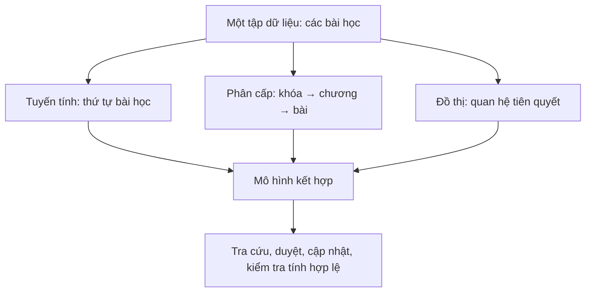
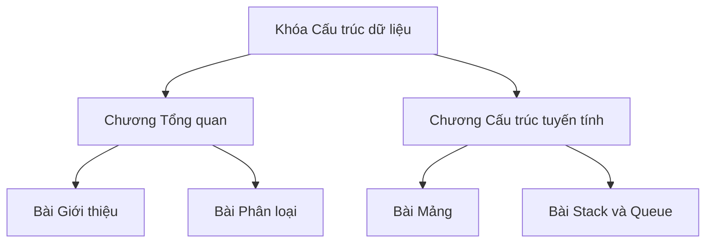
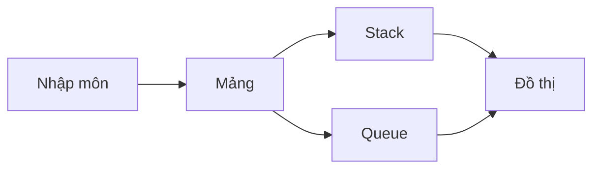
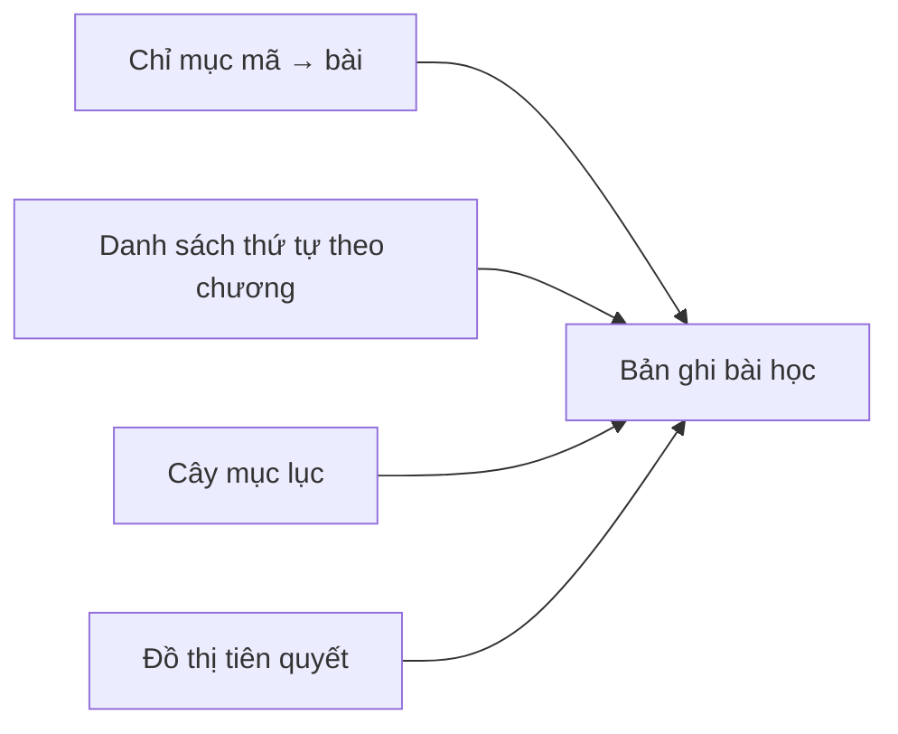

# Cấu trúc tuyến tính, phân cấp, đồ thị và kết hợp

## Mục tiêu học tập

Sau bài này, bạn có thể:

- Nhận biết các cách tổ chức dữ liệu **tuyến tính**, **phân cấp**, **dạng đồ thị** và **kết hợp nhiều cấu trúc** qua ví dụ thực tế.
- Phân biệt **thứ tự xử lý**, **quan hệ cha – con** và **quan hệ liên kết tổng quát**; giải thích vì sao chúng cần những mô hình khác nhau.
- So sánh mảng, danh sách liên kết, stack, queue, cây, heap và các cách biểu diễn đồ thị theo thao tác và độ phức tạp thời gian, bộ nhớ.
- Chỉ ra những **bất biến** phải giữ đúng khi thêm, xóa, sắp xếp hoặc thay đổi quan hệ giữa các phần tử.
- Thiết kế một mô hình có nhiều chỉ mục cho cùng dữ liệu và nhận diện chi phí đồng bộ giữa các cấu trúc.

## 1. Phân loại theo quan hệ giữa các phần tử

Giả sử một nền tảng học tập có các bài `Nhập môn`, `Mảng`, `Stack`, `Queue`, `Đồ thị`. Mỗi bài có mã định danh, thuộc một chương, có vị trí hiển thị và có thể yêu cầu hoàn thành những bài khác trước khi học. Cùng một tập bài học có thể nhìn qua nhiều quan hệ:

1. **Tuyến tính:** bài nào đứng trước hay đứng sau trong danh sách hiển thị?
2. **Phân cấp:** bài thuộc chương nào, chương thuộc khóa học nào?
3. **Đồ thị:** bài nào là điều kiện tiên quyết của bài nào, kể cả khi một bài cần nhiều bài khác?
4. **Kết hợp:** làm sao vừa tra bài nhanh theo mã, vừa hiển thị đúng thứ tự, vừa kiểm tra điều kiện tiên quyết?



Đây là cách phân loại theo **ý nghĩa quan hệ và mô hình thao tác**, không phải một hệ phân loại tuyệt đối, loại trừ nhau. Chẳng hạn **cây là một dạng đồ thị đặc biệt**; một heap thường có hình dạng cây nhị phân gần đầy nhưng có thể lưu bằng mảng; một queue là quy tắc truy cập theo FIFO và có thể cài bằng danh sách liên kết hoặc mảng vòng. Vì vậy, khi chọn cấu trúc dữ liệu, cần phân biệt **mô hình trừu tượng** với **biểu diễn trong bộ nhớ**.

## 2. Cấu trúc tuyến tính: nhấn mạnh thứ tự của phần tử

Một **cấu trúc tuyến tính** sắp xếp các phần tử thành một dãy có thứ tự logic. Trừ hai đầu dãy, phần tử thường có một phần tử đứng ngay trước và một phần tử đứng ngay sau trong thứ tự đó. Một dãy tuyến tính không bắt buộc phải được đặt ở các ô nhớ liên tiếp: danh sách liên kết có thể lưu nút ở nhiều địa chỉ khác nhau mà vẫn giữ cùng một thứ tự logic.

```text
Thứ tự bài học trong một chương:

   [Nhập môn] -> [Mảng] -> [Stack] -> [Queue] -> [Đồ thị]
       0          1          2         3          4
```

### 2.1. Mảng và mảng động: thuận lợi cho truy cập theo vị trí

**Mảng (array)** lưu dãy phần tử có thể truy cập bằng chỉ số. Ở mức mô hình cơ bản, mảng có các phần tử nằm trong vùng nhớ liên tiếp; các ngôn ngữ có thể cài kiểu mảng với kích thước cố định, trong khi **mảng động** có thể mở rộng bằng cách cấp phát vùng chứa lớn hơn khi cần.

Ví dụ, `list` của Python thường được dùng như mảng động:

```python
lesson_order = ["intro", "arrays", "stack", "queue", "graph"]

assert lesson_order[2] == "stack"  # Truy cập theo chỉ số.

lesson_order.insert(3, "linked-list")  # Chèn vào giữa, dịch phần tử phía sau.
assert lesson_order[3] == "linked-list"

lesson_order.remove("linked-list")
assert lesson_order == ["intro", "arrays", "stack", "queue", "graph"]
```

Đặc trưng chi phí với mảng động thông dụng:

- Truy cập chỉ số hợp lệ: **O(1)**.
- Duyệt hết `n` phần tử: **O(n)**.
- Thêm vào cuối: **O(1) khấu hao**, vì đôi khi phải mở rộng vùng nhớ và sao chép các tham chiếu cũ.
- Chèn hoặc xóa ở đầu/giữa: **O(n)** trong trường hợp xấu nhất, vì phải dịch chuyển những phần tử còn lại.

Mảng động phù hợp với danh sách có thứ tự cần **đọc theo vị trí thường xuyên** hoặc cần duyệt tuần tự. Nó không tự bảo đảm các phần tử có mã duy nhất; đó là một bất biến nghiệp vụ cần kiểm tra riêng.

### 2.2. Danh sách liên kết: thứ tự được giữ bằng các liên kết

**Danh sách liên kết (linked list)** chứa các nút; mỗi nút có giá trị và ít nhất một tham chiếu đến nút kế tiếp. Danh sách liên kết đôi còn có tham chiếu đến nút trước:

```text
head                                    tail
  |                                       |
  v                                       v
[A | next] -> [B | next] -> [C | None]

Danh sách liên kết đôi:
None <- [A] <-> [B] <-> [C] -> None
```

Chèn một nút ngay sau nút **đã biết** trong danh sách liên kết đơn thường chỉ cần cập nhật vài tham chiếu, tức **O(1)**. Nhưng tìm nút ở vị trí thứ `i` vẫn cần đi qua tối đa `i` nút, tức **O(n)**. Xóa một nút trong danh sách liên kết đơn cũng cần biết nút đứng trước (hoặc xử lý đặc biệt ở đầu); vì vậy không thể khẳng định mọi lần xóa bất kỳ đều O(1).

Mỗi nút phải lưu thêm tham chiếu, phát sinh chi phí cấp phát và thường có tính cục bộ bộ nhớ kém hơn mảng. **O(1) cho việc chèn tại nút đã biết** không có nghĩa danh sách liên kết luôn nhanh hơn mảng trong thực tế.

### 2.3. Stack và queue: giới hạn cách truy cập một dãy

**Stack** và **queue** mô tả hành vi của một dãy phần tử, thường được trình bày như **kiểu dữ liệu trừu tượng (ADT)**:

| Cấu trúc | Quy tắc lấy phần tử | Phép toán phổ biến | Tình huống |
| --- | --- | --- | --- |
| **Stack** | LIFO: vào sau, ra trước | `push`, `pop`, `peek` | Hoàn tác, xử lý lời gọi hàm, DFS |
| **Queue** | FIFO: vào trước, ra trước | `enqueue`, `dequeue`, `front` | Hàng đợi yêu cầu, BFS, xử lý sự kiện theo lượt đến |

```python
from collections import deque

# Stack bằng list: phần tử cuối là đỉnh.
undo_stack = []
undo_stack.append("đổi tiêu đề")
undo_stack.append("chuyển vị trí bài")
assert undo_stack.pop() == "chuyển vị trí bài"

# Queue bằng deque: thêm cuối, lấy đầu.
grading_queue = deque(["submission-01", "submission-02"])
grading_queue.append("submission-03")
assert grading_queue.popleft() == "submission-01"
```

Trong Python, `list.append` và `list.pop()` ở cuối thường **O(1) khấu hao**; `deque.append` và `deque.popleft` tại hai đầu là **O(1)**. Nếu dùng `list.pop(0)` để lấy đầu queue, các phần tử còn lại phải dịch vị trí, dẫn đến **O(n)**. Cùng quy tắc FIFO có thể được cài bằng nhiều cấu trúc, nhưng hiệu suất khác nhau.

**Bất biến của cấu trúc tuyến tính** thường xoay quanh thứ tự: phần tử mới nhất là đỉnh stack; phần tử vào sớm nhất chưa xử lý nằm ở đầu queue; dãy vị trí hiển thị không chứa mã bài trùng nếu nghiệp vụ yêu cầu duy nhất.

## 3. Cấu trúc phân cấp: biểu diễn quan hệ cha – con

**Cấu trúc phân cấp** thích hợp khi một phần tử được tổ chức bên dưới một phần tử cấp cao hơn, ví dụ:



Mô hình điển hình là **cây có gốc (rooted tree)**. Một cây có các thành phần:

- **Gốc (root):** nút không có cha.
- **Nút cha / nút con (parent / child):** quan hệ phân cấp trực tiếp.
- **Lá (leaf):** nút không có con.
- **Độ sâu (depth):** số cạnh từ gốc đến một nút.
- **Chiều cao (height):** số cạnh dài nhất từ nút xuống một lá; chiều cao của cây là chiều cao của gốc.
- **Cây con (subtree):** một nút cùng toàn bộ hậu duệ của nó.

Với một cây có gốc hữu hạn, mỗi nút **ngoại trừ gốc có đúng một cha**, mọi nút đều đi tới được từ gốc và không có chu trình. Khi bỏ chiều của các liên kết cha – con, hai nút bất kỳ trong cùng cây có đúng một đường đi đơn giữa chúng. Một tập nhiều cây không nối nhau gọi là **rừng (forest)**.

### 3.1. Biểu diễn và duyệt cây

Có thể lưu cây bằng đối tượng lồng nhau, danh sách con, hoặc ánh xạ `node_id → parent_id`. Ví dụ minh họa bằng các nút lồng nhau:

```python
outline = {
    "name": "Khóa Cấu trúc dữ liệu",
    "children": [
        {
            "name": "Tổng quan",
            "children": [
                {"name": "Giới thiệu", "children": []},
                {"name": "Phân loại", "children": []},
            ],
        },
        {
            "name": "Cấu trúc tuyến tính",
            "children": [
                {"name": "Mảng", "children": []},
                {"name": "Stack và Queue", "children": []},
            ],
        },
    ],
}


def preorder_names(node):
    """Duyệt cha trước rồi đến các cây con theo thứ tự đã lưu."""
    yield node["name"]
    for child in node["children"]:
        yield from preorder_names(child)


names = list(preorder_names(outline))
assert names[:3] == ["Khóa Cấu trúc dữ liệu", "Tổng quan", "Giới thiệu"]
assert len(names) == 7
```

Đây là kiểu duyệt **DFS theo thứ tự trước (preorder)**. Với `n` nút, duyệt toàn cây cần **O(n)** thời gian. Phần bộ nhớ phụ cho lời gọi đệ quy tăng theo **độ cao của cây O(h)**, chưa tính danh sách kết quả nếu có. Trong Python, cây quá sâu có thể vượt giới hạn đệ quy; khi đó có thể dùng stack tường minh.

Nếu cần duyệt từng cấp từ trên xuống (level-order traversal), có thể dùng **queue**. Như vậy, một thuật toán trên **cấu trúc phân cấp** có thể dùng **cấu trúc tuyến tính** làm phương tiện xử lý.

### 3.2. Cây nhị phân, cây tìm kiếm và heap không đồng nghĩa

**Cây nhị phân (binary tree)** giới hạn mỗi nút có tối đa hai con. Nhưng chỉ riêng đặc điểm đó chưa bảo đảm tìm kiếm nhanh:

| Loại cây | Bất biến hoặc ràng buộc | Ý nghĩa đối với thao tác |
| --- | --- | --- |
| Cây có gốc nói chung | Mỗi nút trừ gốc có một cha; không chu trình | Thuận lợi biểu diễn phân cấp, duyệt hậu duệ |
| Cây nhị phân | Tối đa hai con/nút | Chưa tự bảo đảm thứ tự khóa |
| Cây tìm kiếm nhị phân (BST) | Theo quy ước khóa phân biệt: khóa cây con trái nhỏ hơn nút, khóa cây con phải lớn hơn nút | Tìm kiếm phụ thuộc chiều cao `h`, thường **O(h)**; có thể O(n) khi lệch |
| BST cân bằng | Duy trì chiều cao **O(log n)** | Tra cứu, thêm, xóa thường **O(log n)** |
| Min-heap nhị phân | Cây gần đầy; khóa cha không lớn hơn khóa các con | Xem phần tử nhỏ nhất **O(1)**, thêm/lấy gốc **O(log n)** |

Một **min-heap** không phải BST: giá trị ở cây con phải không nhất thiết lớn hơn tất cả giá trị ở cây con trái. Heap chỉ bảo đảm phần tử nhỏ nhất ở gốc nhờ ràng buộc cục bộ giữa cha và con; tìm một khóa bất kỳ trong heap nhị phân có thể tốn **O(n)**. Heap thường được lưu bằng **mảng**: với chỉ số gốc bằng `0`, các con của nút `i` nằm tại `2i + 1` và `2i + 2`, nếu chỉ số hợp lệ. Đây là ví dụ **quan hệ logic dạng cây được biểu diễn trên bộ nhớ dạng mảng**.

### 3.3. Khi nào cây không diễn đạt đủ quan hệ?

Một bài học có thể thuộc một chương duy nhất trong cây nội dung, nhưng có thể yêu cầu **hai bài tiên quyết ở hai chương khác nhau**. Nếu cố gắng lưu hai quan hệ ấy như quan hệ cha – con trong cùng cây, quy tắc “mỗi nút chỉ có một cha” sẽ bị phá vỡ. Trường hợp này cần chuyển sang mô hình liên kết tổng quát hơn.

## 4. Cấu trúc đồ thị: biểu diễn quan hệ nhiều chiều

**Đồ thị (graph)** gồm tập đỉnh (vertices) và tập cạnh (edges) nối các đỉnh. Đỉnh có thể là bài học, người dùng, thiết bị hoặc địa điểm; cạnh thể hiện quan hệ giữa chúng. Khác với cây phân cấp, một đỉnh trong đồ thị có thể liên kết với nhiều đỉnh khác theo nhiều hướng.



Trong ví dụ này, quy ước cạnh `A → B` là **phải học A trước B**. Bài `Đồ thị` cần cả `Stack` và `Queue`; đó là quan hệ **nhiều đầu vào** mà một cây cha – con không biểu diễn trung thực bằng một cha duy nhất.

### 4.1. Có hướng, không hướng, có chu trình và không chu trình

- **Đồ thị có hướng:** cạnh `A → B` không mặc nhiên suy ra `B → A`. Phù hợp quan hệ phụ thuộc, theo dõi, luồng xử lý.
- **Đồ thị vô hướng:** cạnh biểu thị kết nối hai chiều, chẳng hạn một liên kết mạng vật lý hai chiều trong mô hình đơn giản.
- **Đồ thị có chu trình:** có đường đi có hướng trở lại đỉnh xuất phát (đối với đồ thị có hướng). Có thể hợp lệ với mạng giao thông hoặc liên kết xã hội.
- **Đồ thị có hướng không chu trình (DAG):** phù hợp cho những quan hệ tiên quyết phải có thứ tự khả thi. Một DAG có thể có nhiều đỉnh nguồn và một đỉnh có nhiều tiền nhiệm, nên DAG không nhất thiết là cây.

Với đồ thị tiên quyết, chu trình kiểu `A → B → C → A` khiến không thể xếp lịch học thỏa cả ba điều kiện. Việc **phát hiện chu trình** là yêu cầu đúng đắn của dữ liệu, không chỉ là vấn đề hiệu suất.

### 4.2. Hai cách lưu đồ thị phổ biến

Giả sử có `V` đỉnh và `E` cạnh:

| Đặc điểm | Danh sách kề (adjacency list) | Ma trận kề (adjacency matrix) |
| --- | --- | --- |
| Biểu diễn | Mỗi đỉnh lưu những đỉnh kề | Ô `(u, v)` chỉ ra có cạnh `u → v` hay không |
| Bộ nhớ | **O(V + E)** | **O(V²)** |
| Liệt kê các đỉnh kề của `u` | **O(deg(u))** để duyệt các đỉnh kề | Thường **O(V)** để quét một hàng |
| Kiểm tra cạnh `u → v` | **O(deg(u))** nếu là danh sách, hoặc trung bình kỳ vọng O(1) nếu tập băm | **O(1)** khi đã có chỉ số đỉnh |
| Thích hợp | Đồ thị thưa, cần duyệt quan hệ | Đồ thị dày đặc hoặc cần kiểm tra cạnh trực tiếp nhiều |

`deg(u)` ở đây là số cạnh đi ra từ `u` trong đồ thị có hướng. Nếu biểu diễn đồ thị vô hướng, mỗi cạnh được ghi vào danh sách kề của hai đầu mút. Bộ nhớ O(V + E) tính cả các cấu trúc phục vụ ánh xạ đỉnh.

Ví dụ danh sách kề lưu **chiều đi tới bài cần học tiếp**:

```python
next_lessons = {
    "intro": ["arrays"],
    "arrays": ["stack", "queue"],
    "stack": ["graph"],
    "queue": ["graph"],
    "graph": [],
}

assert set(next_lessons["arrays"]) == {"stack", "queue"}
```

Chú ý: đây là danh sách **bài có thể đến sau**, không phải danh sách bài **phải học trước**. Hai chiều biểu diễn có thể được chuyển đổi, nhưng cần xác định rõ ý nghĩa cạnh để không đảo ngược phụ thuộc khi viết thuật toán.

### 4.3. Sắp xếp tô pô: thuật toán dựa trên quan hệ phụ thuộc

Với đồ thị có hướng không chu trình, **sắp xếp tô pô (topological sort)** tạo một thứ tự sao cho mọi bài tiên quyết đứng trước bài phụ thuộc. Ta có thể lưu đồ thị theo chiều `bài → tập bài tiên quyết` và dùng thuật toán Kahn:

```python
from collections import deque

prerequisites = {
    "intro": set(),
    "arrays": {"intro"},
    "stack": {"arrays"},
    "queue": {"arrays"},
    "graph": {"stack", "queue"},
}


def topological_order(requires):
    """Trả thứ tự học hợp lệ; báo lỗi nếu có mã lạ hoặc chu trình."""
    dependents = {lesson: [] for lesson in requires}
    remaining = {lesson: len(priors) for lesson, priors in requires.items()}

    for lesson, priors in requires.items():
        for prior in priors:
            if prior not in dependents:
                raise KeyError(f"Bài tiên quyết không tồn tại: {prior}")
            dependents[prior].append(lesson)

    ready = deque(lesson for lesson, count in remaining.items() if count == 0)
    result = []

    while ready:
        lesson = ready.popleft()
        result.append(lesson)
        for next_lesson in dependents[lesson]:
            remaining[next_lesson] -= 1
            if remaining[next_lesson] == 0:
                ready.append(next_lesson)

    if len(result) != len(requires):
        raise ValueError("Quan hệ tiên quyết chứa chu trình")
    return result


order = topological_order(prerequisites)
assert order.index("intro") < order.index("arrays")
assert order.index("stack") < order.index("graph")
assert order.index("queue") < order.index("graph")

cyclic = {lesson: set(priors) for lesson, priors in prerequisites.items()}
cyclic["intro"].add("graph")
try:
    topological_order(cyclic)
except ValueError:
    pass  # Chu trình được phát hiện.
else:
    raise AssertionError("Phải phát hiện chu trình")
```

Trong thuật toán này, `remaining` lưu số bài tiên quyết chưa được giải phóng của mỗi bài; `ready` là queue chứa các bài hiện không còn điều kiện tiên quyết chưa xử lý. **Bất biến:** chỉ đưa bài vào `ready` khi mọi bài đứng trước nó đã được xử lý. Trên danh sách kề, thuật toán chạy trong **O(V + E)** thời gian và dùng **O(V + E)** bộ nhớ phụ trong biểu diễn ở ví dụ. Có thể tồn tại **nhiều thứ tự tô pô hợp lệ**; kết quả không nhất thiết trùng thứ tự biên tập trong giao diện.

## 5. Cấu trúc kết hợp: một thực thể, nhiều góc truy cập

**Cấu trúc kết hợp** là cách phối hợp nhiều cấu trúc để đáp ứng đồng thời nhiều loại truy vấn. Đây là một **quyết định thiết kế**, không phải tên của một loại cấu trúc duy nhất có chung một quy tắc hình học.

Một hệ thống học tập thực tế có thể cần:

| Nhu cầu | Cấu trúc lưu trữ / chỉ mục | Vì sao cần? |
| --- | --- | --- |
| Mở bài học theo mã | Bảng băm `lesson_id → Lesson` | Tra cứu theo khóa nhanh |
| Hiển thị bài trong chương theo thứ tự | Mảng động các mã bài cho mỗi chương | Duyệt có thứ tự, truy cập chỉ số |
| Hiển thị mục lục khóa học | Cây `khóa → chương → mục → bài` | Duyệt các nhánh phân cấp |
| Xác định điều kiện tiên quyết | Đồ thị có hướng | Một bài có thể phụ thuộc nhiều bài khác |
| Xếp yêu cầu chấm bài theo lượt đến | Queue | Duy trì FIFO |
| Xử lý công việc gần hạn nhất | Min-heap | Lấy ưu tiên nhỏ nhất hiệu quả |



Thực tế có thể chỉ giữ **một bản ghi chính** cho mỗi bài học, còn các cấu trúc khác chứa **mã định danh hoặc tham chiếu**, tránh sao chép dữ liệu thuộc tính ở nhiều nơi. Cách này vẫn tiêu tốn bộ nhớ phụ cho chỉ mục nhưng giảm nguy cơ tiêu đề, thời lượng hoặc trạng thái được sửa tại một nơi mà nơi khác không biết.

### 5.1. Ví dụ cài đặt kết hợp ba quan hệ

Trong đoạn Python sau, một `Catalog` giữ: (1) bảng tra theo mã, (2) thứ tự bài trong mỗi chương và (3) đồ thị tiên quyết. Hàm thêm bài cập nhật đúng cả ba biểu diễn.

```python
class Catalog:
    def __init__(self):
        self.by_id = {}
        self.order_by_chapter = {}
        self.requires = {}

    def add_lesson(self, lesson_id, title, chapter_id):
        if lesson_id in self.by_id:
            raise ValueError("Mã bài đã tồn tại")

        self.by_id[lesson_id] = {"title": title, "chapter": chapter_id}
        self.order_by_chapter.setdefault(chapter_id, []).append(lesson_id)
        self.requires[lesson_id] = set()

    def move_lesson(self, lesson_id, new_chapter_id):
        if lesson_id not in self.by_id:
            raise KeyError("Bài học không tồn tại")
        old_chapter = self.by_id[lesson_id]["chapter"]
        if old_chapter == new_chapter_id:
            return

        self.order_by_chapter[old_chapter].remove(lesson_id)
        self.order_by_chapter.setdefault(new_chapter_id, []).append(lesson_id)
        self.by_id[lesson_id]["chapter"] = new_chapter_id

    def add_prerequisite(self, lesson_id, required_id):
        if lesson_id not in self.by_id or required_id not in self.by_id:
            raise KeyError("Bài học tham chiếu không tồn tại")

        # Nếu required_id đã phụ thuộc vào lesson_id, thêm cạnh mới sẽ tạo chu trình.
        pending = [required_id]
        seen = set()
        while pending:
            current = pending.pop()
            if current == lesson_id:
                raise ValueError("Quan hệ tiên quyết tạo chu trình")
            if current in seen:
                continue
            seen.add(current)
            pending.extend(self.requires[current])

        self.requires[lesson_id].add(required_id)


catalog = Catalog()
catalog.add_lesson("intro", "Nhập môn", "overview")
catalog.add_lesson("arrays", "Mảng", "linear")
catalog.add_lesson("stack", "Stack", "linear")
catalog.add_prerequisite("arrays", "intro")
catalog.add_prerequisite("stack", "arrays")

assert catalog.by_id["arrays"]["title"] == "Mảng"
assert catalog.order_by_chapter["linear"] == ["arrays", "stack"]
assert catalog.requires["stack"] == {"arrays"}

catalog.move_lesson("stack", "advanced")
assert catalog.order_by_chapter["linear"] == ["arrays"]
assert catalog.by_id["stack"]["chapter"] == "advanced"

try:
    catalog.add_prerequisite("intro", "stack")
except ValueError:
    pass  # Không được tạo chu trình intro -> stack -> arrays -> intro.
else:
    raise AssertionError("Quan hệ vòng phải bị từ chối")
```

`add_lesson` tạo các biểu diễn liên quan để tránh **tham chiếu mồ côi**. `move_lesson` chuyển mã bài giữa hai danh sách thứ tự và cập nhật thuộc tính chương; trong ví dụ, di chuyển một bài sang chương mới **đưa nó vào cuối chương mới**. `add_prerequisite` kiểm tra đường đi trước khi tạo cạnh phụ thuộc, nhằm giữ đồ thị không có chu trình.

Đây là ví dụ trong một tiến trình, chưa có cơ chế giao dịch, lưu bền vững hay xử lý cập nhật đồng thời. Ứng dụng thực tế cần bảo đảm thay đổi trên **nhiều chỉ mục cùng thành công hoặc được khôi phục an toàn** khi có lỗi, đồng thời quyết định chính sách khi xóa bài vẫn còn học viên hoặc bài khác tham chiếu.

### 5.2. Đánh đổi của mô hình kết hợp

Một chỉ mục phụ có thể làm thao tác đọc nhanh hơn nhưng tăng tổng bộ nhớ. Chẳng hạn:

- Tra bài qua `by_id`: **O(1) kỳ vọng** theo khóa.
- Thêm mã vào cuối danh sách của chương: **O(1) khấu hao**.
- Chuyển bài sang chương khác: tìm và xóa mã trong danh sách cũ có thể **O(k)**, với `k` là số bài của chương cũ.
- Kiểm tra một quan hệ mới có tạo chu trình không: DFS trên đồ thị tiên quyết có chi phí tối đa **O(V + E)**.

Khi dữ liệu lớn và thường xuyên di chuyển bài, có thể cân nhắc thêm chỉ mục vị trí hoặc đổi cấu trúc giữ thứ tự. Nhưng chỉ mục mới lại cần cập nhật khi chèn/xóa, vì vậy phải so sánh **tổng chi phí vận hành**. Với một cấu trúc kết hợp, **tính nhất quán giữa các biểu diễn** trở thành bất biến quan trọng không kém tính đúng đắn của từng cấu trúc thành phần.

## 6. Đặt các mô hình cạnh nhau

| Tiêu chí | Tuyến tính | Phân cấp dạng cây | Đồ thị tổng quát | Kết hợp |
| --- | --- | --- | --- | --- |
| **Quan hệ nổi bật** | Trước/sau, thứ tự truy cập | Cha/con, tổ tiên/hậu duệ | Liên kết giữa các đỉnh, có thể nhiều hướng | Nhiều loại quan hệ đồng thời |
| **Hình dung** | Dãy các phần tử | Một gốc và các nhánh (hoặc rừng) | Các đỉnh và cạnh | Chỉ mục, cây, danh sách, đồ thị cùng tham chiếu dữ liệu |
| **Chu trình** | Không xuất hiện trong mô hình dãy hữu hạn thông thường | Không được có trong cây | Có thể có, trừ các loại như DAG | Tùy quy tắc từng thành phần |
| **Truy vấn điển hình** | Lấy phần tử thứ `i`, thêm cuối, lấy đầu | Duyệt nhánh, tìm cha, tìm hậu duệ | Tìm đường đi, quan hệ phụ thuộc, đỉnh kề | Tra mã + hiển thị thứ tự + kiểm tra phụ thuộc |
| **Bất biến chủ đạo** | Thứ tự và vị trí đầu/cuối hợp lệ | Quan hệ cha duy nhất, không chu trình | Đỉnh/cạnh hợp lệ, quy tắc hướng/trọng số | Các chỉ mục cùng biểu diễn một trạng thái hợp lệ |
| **Chi phí cần xem xét** | Dịch chuyển, truy cập chỉ số, liên kết nút | Độ cao cây, chi phí duyệt hoặc cân bằng | Số đỉnh `V`, cạnh `E`, mật độ đồ thị | Tổng bộ nhớ và chi phí cập nhật nhiều cấu trúc |

Điều cần ghi nhớ là **phân loại không tự quyết định độ phức tạp**. “Tuyến tính” có thể là mảng truy cập chỉ số O(1) hoặc danh sách liên kết truy cập vị trí O(n); “cây” có thể là BST không cân bằng tìm O(n) hoặc cây cân bằng tìm O(log n); “đồ thị” có thể lưu bằng danh sách kề O(V + E) hay ma trận kề O(V²) bộ nhớ. Muốn biết chi phí, phải xác định **phép toán, biểu diễn và thuật toán cụ thể**.

## 7. Quy trình lựa chọn theo bài toán

Khi phân tích một yêu cầu mới, hãy làm rõ từng bước:

1. **Liệt kê thực thể và khóa định danh.** Có những phần tử nào? Cần tra bằng mã cố định hay chỉ theo vị trí?
2. **Xác định quan hệ thực chất.** Một dãy có thứ tự, cây cha – con, mạng liên kết nhiều chiều, hay cả ba?
3. **Xác định thao tác chính.** Tìm theo mã, chèn giữa dãy, lấy phần tử mới nhất, duyệt hậu duệ, tìm đường đi, kiểm tra tiên quyết?
4. **Viết bất biến.** Có được trùng phần tử? Mỗi nút có bao nhiêu cha? Có cho phép chu trình? Các chỉ mục phải đồng bộ điều gì?
5. **Chọn cấu trúc và cài đặt.** Mảng động, danh sách liên kết, deque, bảng băm, cây, heap, danh sách kề hay ma trận kề đáp ứng tốt nhất thao tác nào?
6. **Ước lượng thời gian và bộ nhớ.** Xét cả tìm kiếm, thêm, xóa, duyệt, xây dựng chỉ mục và chi phí lưu quan hệ.
7. **Đo trên dữ liệu gần thực tế.** Các ký hiệu Big O thể hiện xu hướng khi quy mô tăng, nhưng hằng số thực thi, cache, cấp phát bộ nhớ và tần suất đọc/ghi cũng ảnh hưởng kết quả.

Ví dụ, hệ thống quản lý **lịch sử hoàn tác** đơn giản chỉ cần Stack. Hệ thống **quản lý thư mục** phù hợp với cây nếu mỗi mục có một cha. **Mạng kết nối hoặc quan hệ phụ thuộc nhiều–nhiều** cần đồ thị. Một **nền tảng học tập đầy đủ** thường cần mô hình kết hợp vì phải hỗ trợ nhiều thao tác khác nhau trên cùng tập bài.

## 8. Những nhầm lẫn phổ biến

- **“Cấu trúc tuyến tính nghĩa là dữ liệu nằm liên tiếp trong RAM.”** Không đúng: đó là thứ tự *logic*. Danh sách liên kết giữ thứ tự qua con trỏ/tham chiếu dù các nút nằm rải rác.
- **“Cây và đồ thị là hai loại hoàn toàn độc lập.”** Không đúng: cây là một trường hợp đặc biệt của đồ thị. Điểm quan trọng là những ràng buộc làm cho nó có cấu trúc phân cấp.
- **“Một DAG luôn là cây.”** Không đúng: DAG có thể có nhiều đỉnh nguồn, một đỉnh nhiều tiền nhiệm và nhiều đường đi giữa hai đỉnh.
- **“Heap là cây tìm kiếm nhị phân.”** Không đúng: heap duy trì thứ tự cha – con để chọn cực trị; BST giữ thứ tự toàn bộ hai cây con để tìm theo khóa.
- **“Có nhiều chỉ mục thì dữ liệu luôn cập nhật nhanh.”** Không đúng: đọc có thể nhanh hơn, nhưng thêm/xóa phải điều chỉnh và đồng bộ tất cả những chỉ mục liên quan.
- **“Sắp xếp tô pô là thứ tự duy nhất của DAG.”** Không đúng: khi có các đỉnh độc lập, có thể tồn tại nhiều thứ tự thỏa mọi cạnh phụ thuộc.
- **“Dùng đồ thị tiên quyết là đủ để hiển thị menu theo thứ tự.”** Không đúng: thứ tự học bắt buộc và thứ tự biên tập là hai quan hệ khác nhau; ứng dụng có thể cần giữ cả hai.

## 9. Bài tập vận dụng

**Bài 1 — Phân loại quan hệ.** Một khóa học gồm nhiều chương; mỗi chương chứa nhiều bài. Một bài được phép có hai bài tiên quyết thuộc hai chương khác nhau. Hãy chọn cấu trúc cho **mục lục** và **điều kiện tiên quyết**.

*Gợi ý:* Mục lục có dạng cây cha – con nếu mỗi bài thuộc đúng một chương. Các điều kiện tiên quyết nên biểu diễn bằng đồ thị có hướng, vì một bài có thể phụ thuộc nhiều bài khác. Cần kiểm tra chu trình để bảo đảm có lịch học hợp lệ.

**Bài 2 — Chọn giữa mảng và danh sách liên kết.** Một ứng dụng thường xuyên cần hiển thị phần tử thứ `i` trong danh sách nhưng hiếm khi chèn giữa. Khi nào mảng động là lựa chọn phù hợp hơn?

*Gợi ý:* Truy cập chỉ số O(1) và tính cục bộ bộ nhớ tốt là ưu thế của mảng động. Danh sách liên kết thường phải duyệt O(n) để tìm vị trí thứ `i`.

**Bài 3 — Queue hay heap?** Bộ phận chấm bài thay đổi từ “chấm theo thứ tự nộp” sang “chấm bài có hạn gần nhất trước”. Hãy xác định bất biến cần thay đổi và cấu trúc gợi ý.

*Gợi ý:* Quy tắc FIFO được thay bằng quy tắc cực tiểu của khóa ưu tiên; min-heap giúp xem phần tử nhỏ nhất O(1), thêm/lấy gốc O(log n).

**Bài 4 — Biểu diễn đồ thị.** Một mạng có `V = 50.000` đỉnh nhưng mỗi đỉnh trung bình chỉ có ba cạnh đi ra. Danh sách kề và ma trận kề khác nhau thế nào về bộ nhớ?

*Gợi ý:* Với `E` cùng bậc với `V`, danh sách kề cần O(V + E), còn ma trận kề cần O(V²), thường rất lãng phí cho đồ thị thưa.

**Bài 5 — Tính nhất quán của mô hình kết hợp.** Một bài được chuyển từ chương `basic` sang `advanced`, nhưng mã bài vẫn nằm trong `order_by_chapter["basic"]`. Những truy vấn nào có thể sai và cần cập nhật những gì?

*Gợi ý:* Danh sách bài theo chương cũ và chương mới sẽ không nhất quán với bản ghi bài. Phải xóa mã khỏi dãy của chương cũ, thêm vào vị trí thích hợp ở chương mới và cập nhật thuộc tính chương một cách nhất quán.

## Tổng kết

**Cấu trúc tuyến tính** tổ chức phần tử thành dãy có thứ tự; **cấu trúc phân cấp** biểu diễn quan hệ cha – con với những ràng buộc của cây; **đồ thị** mô tả quan hệ tổng quát có thể có nhiều cạnh, nhiều hướng và chu trình; **cấu trúc kết hợp** phối hợp nhiều cách biểu diễn để hỗ trợ các thao tác khác nhau trên cùng dữ liệu. Khi lựa chọn, hãy bắt đầu từ **quan hệ thực tế và bất biến cần bảo vệ**, sau đó đánh giá thao tác, độ phức tạp thời gian, bộ nhớ và chi phí duy trì các cấu trúc cùng nhau. Cách nhìn này là nền tảng để học sâu hơn về mảng, danh sách liên kết, stack, queue, bảng băm, cây, heap và đồ thị trong những bài tiếp theo.
