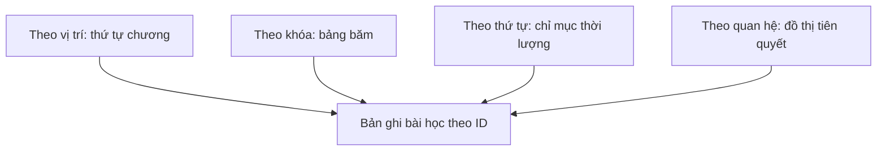

# Truy cập theo vị trí, khóa, thứ tự và quan hệ

## Mục tiêu học tập

Sau bài này, bạn có thể:

- Phân biệt bốn kiểu yêu cầu truy cập: **theo vị trí**, **theo khóa**, **theo thứ tự** và **theo quan hệ**.
- Xác định phép toán cần thiết từ câu hỏi nghiệp vụ, trước khi quyết định dùng mảng, danh sách liên kết, bảng băm, cây hay đồ thị.
- Phân tích độ phức tạp thời gian và bộ nhớ của những cách truy cập phổ biến; phân biệt chi phí chuẩn bị chỉ mục, truy vấn và cập nhật.
- Hiểu những bất biến cần giữ đúng khi thay đổi vị trí, khóa định danh, thứ tự sắp xếp hoặc liên kết giữa các phần tử.
- Thiết kế mô hình kết hợp nhiều cách truy cập trên cùng tập dữ liệu mà vẫn giữ các biểu diễn nhất quán.

## 1. Cùng dữ liệu, bốn cách đặt câu hỏi

Giả sử nền tảng học tập lưu các bài học. Mỗi bài có mã định danh (`id`), tiêu đề, thời lượng, chương và những bài cần hoàn thành trước. Người dùng có thể đặt bốn câu hỏi khác nhau:

1. **Theo vị trí:** “Trong chương này, bài ở vị trí số 3 là bài nào?”
2. **Theo khóa:** “Hãy mở bài có mã `ds-stack`.”
3. **Theo thứ tự:** “Hãy liệt kê các bài từ ngắn đến dài”, hoặc “lấy các bài có thời lượng từ 20 đến 40 phút”.
4. **Theo quan hệ:** “Bài `ds-graph` cần những bài tiên quyết nào, kể cả tiên quyết gián tiếp?”

Cả bốn câu hỏi đều liên quan đến *truy cập dữ liệu*, nhưng mỗi câu yêu cầu một cách tổ chức và một tập phép toán khác nhau.

| Cách truy cập | Đầu vào thường gặp | Kết quả | Cấu trúc gợi ý |
| --- | --- | --- | --- |
| **Vị trí (positional)** | Chỉ số `i`, đầu/cuối dãy | Phần tử tại vị trí hoặc đoạn dãy | Mảng, mảng động; danh sách liên kết nếu chủ yếu duyệt/nối nút |
| **Khóa (key-based)** | `lesson_id`, `student_id` | Giá trị tương ứng hoặc trạng thái có/không | Map / bảng băm, cây tìm kiếm |
| **Thứ tự (ordered)** | Cận dưới, cận trên, hạng, giá trị nhỏ nhất | Các phần tử theo thứ tự hoặc trong khoảng | Mảng đã sắp xếp, cây tìm kiếm cân bằng, heap cho lấy cực trị |
| **Quan hệ (relational)** | Đỉnh, cạnh, phần tử nguồn và đích | Hàng xóm, đường đi, tổ tiên, thành phần liên thông | Cây hoặc đồ thị với danh sách/ma trận kề |

Một kiểu truy cập không quyết định hoàn toàn cấu trúc. Ví dụ, bảng băm và cây cân bằng đều tra được theo khóa nhưng chỉ cây có thứ tự mới hỗ trợ truy vấn khoảng một cách tự nhiên. Bài toán thực tế thường cần **nhiều chỉ mục bổ trợ** trên cùng một tập bản ghi.

## 2. Truy cập theo vị trí: phần tử thứ `i` là gì?

Vị trí mô tả chỗ đứng của phần tử trong một **dãy có thứ tự logic**. Dãy có thể là danh sách bài trong một chương, các mẫu dữ liệu của tín hiệu, hoặc những dòng trong bảng kết quả hiển thị.

```text
Chỉ số:         0          1          2         3
Thứ tự bài:  [Nhập môn] -> [Mảng] -> [Stack] -> [Queue]
```

Trong Python, một `list` là cấu trúc giống **mảng động**: các vị trí được đánh số từ `0` đến `len(items) - 1`.

```python
lesson_ids = ["ds-intro", "ds-array", "ds-stack", "ds-queue"]

third_lesson = lesson_ids[2]
assert third_lesson == "ds-stack"

first_two = lesson_ids[:2]
assert first_two == ["ds-intro", "ds-array"]

lesson_ids.insert(2, "ds-linked-list")
assert lesson_ids[3] == "ds-stack"  # Vị trí đã thay đổi sau chèn.
```

**Truy cập một chỉ số hợp lệ** trên mảng động mất **O(1)** thời gian, vì địa chỉ ô chứa có thể tính trực tiếp từ chỉ số. Tuy nhiên, **chèn/xóa ở giữa** thường mất **O(n)** vì các tham chiếu phía sau cần dịch chuyển. Lấy một đoạn dãy dài `k` phần tử bằng phép cắt tạo bản sao như trên mất **O(k)** thời gian và bộ nhớ bổ sung.

### 2.1. Định danh không nên phụ thuộc vào vị trí

Khi chèn bài `ds-linked-list`, bài `ds-stack` chuyển từ chỉ số `2` sang `3`. Nếu chương trình dùng `2` như định danh lâu dài của bài `ds-stack`, một liên kết cũ sẽ trỏ sai sau khi sắp xếp hoặc chèn bài. **Chỉ số** đại diện cho vị trí trong một dãy tại một thời điểm; **khóa định danh** đại diện cho cùng một thực thể qua các lần đổi vị trí.

Vì vậy, một thiết kế phổ biến là để danh sách theo thứ tự chỉ chứa **mã bài học**, rồi tra nội dung qua bảng ánh xạ mã sang bản ghi.

### 2.2. Danh sách liên kết và chi phí tìm vị trí

Danh sách liên kết giữ thứ tự bằng các tham chiếu giữa các nút:

```text
head
 |
 v
[ds-intro] -> [ds-array] -> [ds-stack] -> [ds-queue] -> None
```

Muốn lấy phần tử có chỉ số `i`, thuật toán thường phải đi từ đầu qua `i` liên kết, tốn **O(i)**, tối đa **O(n)**. Ngược lại, nếu đã có tham chiếu đến nút và đủ thông tin liên kết cần thiết, có thể chèn nút mới gần đó trong **O(1)**.

Sự khác biệt quan trọng là **truy cập ngẫu nhiên theo vị trí** và **cập nhật tại vị trí đã biết**. Khi ứng dụng liên tục đọc bài thứ `i`, mảng động thường phù hợp hơn. Khi chủ yếu nối hoặc bỏ các nút đã biết, danh sách liên kết có thể thuận tiện, dù chi phí tham chiếu và cấp phát nút cũng cần được cân nhắc.

### 2.3. Vị trí đầu/cuối có quy tắc đặc biệt

Hai ADT thường dùng trên dãy là **Stack** (LIFO — vào sau, ra trước) và **Queue** (FIFO — vào trước, ra trước). Chúng giới hạn cách truy cập đầu/cuối:

```python
from collections import deque

stack = []
stack.append("sửa tiêu đề")
stack.append("đổi vị trí")
assert stack.pop() == "đổi vị trí"  # Lấy hành động mới nhất.

queue = deque(["submission-01", "submission-02"])
queue.append("submission-03")
assert queue.popleft() == "submission-01"  # Lấy yêu cầu đến trước.
```

Sử dụng `list.pop(0)` cho queue làm các phần tử còn lại dịch chuyển, chi phí **O(n)**; `deque.popleft()` thực hiện lấy đầu trong **O(1)**. Do đó cần mô tả chính xác **vị trí nào được đọc hoặc cập nhật**: đầu, cuối, vị trí bất kỳ hay vị trí đã biết.

## 3. Truy cập theo khóa: tìm một thực thể ổn định

Khóa (**key**) là thuộc tính dùng để nhận diện hoặc định vị một bản ghi. Ví dụ `lesson_id="ds-stack"` có thể không đổi dù tiêu đề và vị trí hiển thị thay đổi.

### 3.1. Map và bảng băm

Một **Map ADT** mô tả ánh xạ từ khóa duy nhất đến giá trị. Cách cài đặt thường gặp là **bảng băm (hash table)**; Python `dict` cho phép tra, thêm, cập nhật và xóa theo khóa:

```python
lessons_by_id = {
    "ds-intro": {"title": "Nhập môn", "minutes": 15},
    "ds-array": {"title": "Mảng", "minutes": 30},
    "ds-stack": {"title": "Stack", "minutes": 25},
}

assert lessons_by_id["ds-stack"]["minutes"] == 25
assert lessons_by_id.get("ds-missing") is None

lessons_by_id["ds-stack"]["title"] = "Stack và LIFO"
assert lessons_by_id["ds-stack"]["title"] == "Stack và LIFO"
```

Trong điều kiện băm và phân bố khóa phù hợp, tra cứu và cập nhật theo khóa có thời gian **O(1) kỳ vọng**; trường hợp xấu nhất có thể đạt **O(n)** do va chạm băm. Bảng băm thường dùng thêm bộ nhớ cho các ô chứa và duy trì chỉ mục.

**Bất biến quan trọng:** mỗi khóa có tối đa một giá trị đang được ánh xạ. Việc gán `lessons_by_id[key] = value` khi khóa đã tồn tại **thay giá trị cũ**; nếu nghiệp vụ yêu cầu từ chối mã trùng, chương trình phải kiểm tra trước khi thêm.

```python
def add_unique(mapping, lesson_id, lesson):
    if lesson_id in mapping:
        raise ValueError("Mã bài học đã tồn tại")
    mapping[lesson_id] = lesson


add_unique(lessons_by_id, "ds-graph", {"title": "Đồ thị", "minutes": 45})
assert "ds-graph" in lessons_by_id
```

Khóa dùng trong `dict` Python phải **hashable**: cách tính băm và so sánh phải ổn định trong suốt thời gian khóa nằm trong bảng. Chuỗi và số nguyên thường thích hợp; `list` khả biến không thể làm khóa trực tiếp. Một `tuple` chỉ hashable nếu tất cả phần tử của nó cũng hashable.

### 3.2. Tra theo khóa khác tìm theo điều kiện

`get("ds-stack")` là **tra cứu chính xác** một khóa đã biết. Câu hỏi “tìm mọi bài có tiêu đề chứa từ *cấu trúc*” là **lọc theo thuộc tính**, không thể mặc nhiên đạt O(1) nhờ bảng băm theo `id`. Nếu không có chỉ mục phù hợp, có thể phải duyệt **O(n)** bản ghi.

Nhiều yêu cầu khác nhau thường cần những chỉ mục riêng: `lesson_id → Lesson`, `student_id → thông tin học viên`, hoặc `course_id → tập student_id`. Mỗi chỉ mục tăng tốc một nhóm truy vấn nhưng cũng tốn bộ nhớ và chi phí duy trì khi cập nhật.

## 4. Truy cập theo thứ tự: đứng trước, đứng sau và nằm trong khoảng

**Thứ tự (order)** cần được quy định rõ. Thứ tự có thể là vị trí biên tập, thứ tự khóa tăng dần, thời điểm tạo, thời lượng hoặc mức ưu tiên xử lý. Các loại thứ tự này không nhất thiết trùng nhau.

Ví dụ, “bài đứng thứ ba trong chương” là **truy cập theo vị trí**. “Bài ngắn thứ ba khi xếp theo thời lượng” là **truy cập theo thứ hạng trên một thứ tự sắp xếp**. Hai thao tác khác nhau về dữ liệu đầu vào và cách duy trì thứ tự.

### 4.1. Mảng đã sắp xếp và tìm kiếm nhị phân

Giả sử cần lấy các bài có thời lượng trong khoảng từ 20 đến 35 phút, tính cả hai đầu. Ta có thể sắp xếp các bài theo thời lượng rồi dùng `bisect`:

```python
from bisect import bisect_left, bisect_right

lessons = [
    {"id": "ds-intro", "minutes": 15},
    {"id": "ds-stack", "minutes": 25},
    {"id": "ds-array", "minutes": 30},
    {"id": "ds-queue", "minutes": 30},
    {"id": "ds-graph", "minutes": 45},
]

sorted_lessons = sorted(lessons, key=lambda x: (x["minutes"], x["id"]))
durations = [item["minutes"] for item in sorted_lessons]


def duration_between(low, high):
    if low > high:
        return []
    left = bisect_left(durations, low)
    right = bisect_right(durations, high)
    return sorted_lessons[left:right]


found = duration_between(20, 35)
assert [item["id"] for item in found] == ["ds-stack", "ds-array", "ds-queue"]
assert duration_between(50, 60) == []
```

`bisect_left` tìm vị trí có thể chèn mà vẫn giữ thứ tự, trước các phần tử bằng khóa; `bisect_right` tìm vị trí ngay sau các phần tử bằng khóa. Với `n` phần tử, xác định hai ranh giới mất **O(log n)** lần so sánh mỗi lần; trả về đoạn chứa `k` phần tử cần thêm **O(k)** thời gian và bộ nhớ. Tổng truy vấn vì thế là **O(log n + k)** trong mô hình mảng đã sắp xếp. Bước sắp xếp chuẩn bị thường tốn **O(n log n)**.

**Tiền điều kiện:** `durations` phải luôn được sắp xếp tăng dần và tương ứng đúng vị trí với `sorted_lessons`. Nếu sửa thời lượng một bài nhưng không sắp xếp lại, tìm kiếm nhị phân có thể bỏ sót kết quả.

### 4.2. Khi dữ liệu thay đổi thường xuyên

Mảng đã sắp xếp truy vấn khoảng thuận tiện nhưng chèn hoặc xóa ở giữa thường tốn **O(n)** để dịch chuyển phần tử. Nếu hệ thống vừa cập nhật vừa truy vấn khoảng nhiều lần, một **cây tìm kiếm cân bằng** hoặc ordered map có thể phù hợp: tìm/chèn/xóa khóa thường **O(log n)** và liệt kê `k` phần tử liên tiếp trong khoảng có thể đạt **O(log n + k)** khi dùng thuật toán duyệt thích hợp.

Ở đây cây phải **duy trì cân bằng**; BST thông thường có thể suy giảm đến chiều cao O(n), làm mất lợi thế. Nếu có nhiều bài cùng thời lượng, cần quy định khóa phân biệt như `(minutes, lesson_id)` hoặc cho mỗi khóa thời lượng một danh sách/tập bài.

### 4.3. Thứ tự ưu tiên và heap

Một queue xử lý FIFO giữ **thứ tự đến**; nhưng khi cần liên tục chọn yêu cầu có thời hạn sớm nhất, có thể dùng **min-heap / priority queue**:

```python
import heapq

jobs = []
heapq.heappush(jobs, (15, "submission-b"))
heapq.heappush(jobs, (5, "submission-a"))
heapq.heappush(jobs, (30, "submission-c"))

assert jobs[0] == (5, "submission-a")
assert heapq.heappop(jobs) == (5, "submission-a")
```

Heap duy trì quan hệ **cha không lớn hơn con**, nên xem phần tử nhỏ nhất ở gốc mất **O(1)**; thêm hoặc lấy gốc thường **O(log n)**. Tuy nhiên, heap **không phải** một danh sách đã sắp xếp toàn bộ: không thể dùng nó để liệt kê tùy ý mọi bài trong một khoảng khóa với chi phí giống cây tìm kiếm cân bằng. Với các ưu tiên bằng nhau, ví dụ dùng thứ tự từ điển của `submission_id` làm tiêu chí phụ; nếu nghiệp vụ cần FIFO trong cùng mức ưu tiên, cần một bộ đếm thứ tự đến.

## 5. Truy cập theo quan hệ: đi từ phần tử này đến phần tử khác

Trong dữ liệu có quan hệ, câu hỏi thường là: “Những nút nào liên quan trực tiếp?”, “Có đường đi từ A đến B không?” hoặc “Tất cả nút phụ thuộc gián tiếp là gì?”. Chúng khác tra cứu theo khóa vì kết quả phụ thuộc vào **cạnh liên kết giữa nhiều thực thể**.

### 5.1. Cây cho quan hệ phân cấp

Trong cây nội dung `Khóa học → Chương → Bài`, mỗi nút (trừ gốc) có đúng một cha. Ta có thể lưu `parent_id` để tìm cha hoặc lưu danh sách con để duyệt hậu duệ. Nếu truy vấn liên tục theo cả hai hướng, có thể lưu cả `parent` và `children`, với điều kiện mọi lần di chuyển nút phải cập nhật nhất quán cả hai biểu diễn.

Số nút phải duyệt quyết định chi phí liệt kê hậu duệ. Tìm đường từ một nút lên gốc qua các liên kết cha mất **O(h)** với `h` là độ sâu của nút; duyệt toàn cây gồm `n` nút mất **O(n)**. Đặc điểm mỗi nút có một cha khiến cây không diễn đạt trực tiếp trường hợp một bài có **nhiều bài tiên quyết**.

### 5.2. Đồ thị cho quan hệ tổng quát

Xét đồ thị có hướng với quy ước “`A` là bài tiên quyết của `B`”. Ta lưu theo chiều `B → tập bài cần học trước`:

```python
prerequisites = {
    "ds-intro": set(),
    "ds-array": {"ds-intro"},
    "ds-stack": {"ds-array"},
    "ds-queue": {"ds-array"},
    "ds-graph": {"ds-stack", "ds-queue"},
}


def all_prerequisites(graph, lesson_id):
    """Tìm tất cả bài tiên quyết trực tiếp và gián tiếp."""
    if lesson_id not in graph:
        raise KeyError("Bài học không tồn tại")

    visited = set()
    pending = list(graph[lesson_id])

    while pending:
        current = pending.pop()
        if current in visited:
            continue
        if current not in graph:
            raise KeyError(f"Tham chiếu tiên quyết sai: {current}")
        visited.add(current)
        pending.extend(graph[current])

    return visited


assert prerequisites["ds-graph"] == {"ds-stack", "ds-queue"}
assert all_prerequisites(prerequisites, "ds-graph") == {
    "ds-intro", "ds-array", "ds-stack", "ds-queue"
}
```

Một bảng băm `lesson_id → tập hàng xóm` giúp tìm danh sách kề của một bài nhanh, sau đó dùng **DFS** với stack để lần theo các cạnh. Đoạn mã có thể xét tối đa `V` đỉnh và `E` cạnh, vì vậy chi phí thời gian **O(V + E)** trong trường hợp xấu nhất; bộ nhớ phụ cho `pending` và `visited` có thể tới **O(V + E)** ở cách viết này, do các đỉnh chưa thăm có thể xuất hiện lặp trong `pending`. Khi muốn bảo đảm mỗi đỉnh được đưa vào stack đúng một lần, có thể đánh dấu khi thêm vào stack và đạt bộ nhớ phụ **O(V)** trên đồ thị với biểu diễn hợp lệ.

Ở đồ thị tiên quyết, dữ liệu nên không có chu trình nếu cần lập một thứ tự học hợp lệ. Hàm trên dùng tập `visited` để **tránh lặp vô hạn**, nhưng **không phát hiện hay từ chối chu trình**: cần bước kiểm tra chu trình riêng khi thêm quan hệ. Đây là sự khác biệt giữa *thuật toán truy vấn có thể kết thúc* và *dữ liệu thỏa toàn bộ ràng buộc nghiệp vụ*.

### 5.3. Danh sách kề và ma trận kề

Giả sử đồ thị có `V` đỉnh, `E` cạnh và `deg(u)` cạnh đi ra từ đỉnh `u`:

| Thao tác | Danh sách kề | Ma trận kề |
| --- | --- | --- |
| Lưu trữ đồ thị | **O(V + E)** | **O(V²)** |
| Liệt kê các hàng xóm của `u` | **O(deg(u))** | **O(V)** để quét hàng |
| Kiểm tra cạnh `u → v` | **O(deg(u))** với danh sách; **O(1) kỳ vọng** với tập băm | **O(1)** khi đã có chỉ số đỉnh |
| Duyệt toàn bộ bằng BFS/DFS | **O(V + E)** | Thường **O(V²)** |

Đồ thị thưa (ít cạnh so với `V²`) thường phù hợp với danh sách kề; đồ thị dày đặc hoặc cần kiểm tra cạnh liên tục có thể hưởng lợi từ ma trận. Cần tính cả chi phí ánh xạ định danh đỉnh thành vị trí hàng/cột, vốn không tự được giải quyết bởi ma trận.

## 6. Kết hợp các cách truy cập trên một tập dữ liệu

Hệ thống quản lý bài học thường cần **đồng thời** truy cập theo vị trí, khóa, thứ tự và quan hệ. Một cách thiết kế là giữ bản ghi chính một lần và dùng các chỉ mục chứa mã định danh:

```text
lessons_by_id         : lesson_id -> Lesson
chapter_order         : chapter_id -> [lesson_id, ...]  (thứ tự biên tập)
ordered_by_duration    : các lesson_id sắp theo (minutes, lesson_id)
prerequisites          : lesson_id -> tập lesson_id tiên quyết
```

Sơ đồ quan hệ giữa các góc truy cập:



### 6.1. Ví dụ thiết kế chỉ mục tổng hợp

Đoạn mã dưới minh họa ba kiểu truy cập trực tiếp và xây lại một chỉ mục sắp xếp khi cần:

```python
from bisect import bisect_left, bisect_right

by_id = {
    "intro": {"title": "Nhập môn", "minutes": 15},
    "arrays": {"title": "Mảng", "minutes": 30},
    "stack": {"title": "Stack", "minutes": 25},
    "graph": {"title": "Đồ thị", "minutes": 45},
}

chapter_order = {"overview": ["intro", "arrays", "stack", "graph"]}
requires = {
    "intro": set(),
    "arrays": {"intro"},
    "stack": {"arrays"},
    "graph": {"stack"},
}


def get_at(chapter_id, index):
    lesson_id = chapter_order[chapter_id][index]
    return by_id[lesson_id]


def get_by_id(lesson_id):
    return by_id.get(lesson_id)


def build_duration_index():
    ids = sorted(by_id, key=lambda key: (by_id[key]["minutes"], key))
    times = [by_id[key]["minutes"] for key in ids]
    return ids, times


def duration_range(min_minutes, max_minutes):
    if min_minutes > max_minutes:
        return []
    ids, times = build_duration_index()
    lo = bisect_left(times, min_minutes)
    hi = bisect_right(times, max_minutes)
    return [by_id[key] for key in ids[lo:hi]]


assert get_at("overview", 2)["title"] == "Stack"
assert get_by_id("graph")["minutes"] == 45
assert [x["minutes"] for x in duration_range(20, 35)] == [25, 30]
assert requires["graph"] == {"stack"}
```

Ví dụ **xây lại chỉ mục thời lượng cho mỗi truy vấn**, nên tổng chi phí của `duration_range` có thể đến **O(n log n + k)**, với `k` kết quả trong khoảng. Nếu yêu cầu truy vấn lặp lại nhiều lần và dữ liệu ít đổi, có thể **lưu bộ chỉ mục đã sắp xếp** và xây lại khi dữ liệu thay đổi, hoặc sử dụng cấu trúc duy trì thứ tự để giảm chi phí truy vấn. Chỉ nhìn thấy `bisect` trong hàm rồi kết luận toàn bộ hàm là O(log n) sẽ là sai.

### 6.2. Các bất biến khi duy trì nhiều chỉ mục

Giả sử xóa bài `arrays` chỉ khỏi `by_id`, trong khi `chapter_order` và `requires` vẫn chứa mã đó. Lúc này truy cập theo vị trí có thể gây `KeyError`, và quan hệ tiên quyết trở thành **tham chiếu mồ côi**. Một mô hình kết hợp cần giữ những điều kiện như:

- Mỗi mã trong `chapter_order` tồn tại trong `by_id` và, nếu nghiệp vụ yêu cầu, chỉ xuất hiện một lần trong đúng chương.
- Mọi mã bài tiên quyết đều tồn tại; không có quan hệ tự phụ thuộc hoặc chu trình nếu đồ thị phải là DAG.
- Chỉ mục theo thời lượng dùng đúng giá trị hiện tại của bản ghi và luôn được sắp xếp theo khóa đã định.
- Thêm, sửa, xóa một bài phải cập nhật **tất cả cấu trúc liên quan** hoặc đánh dấu chỉ mục cần tái tạo trước khi truy vấn kế tiếp.

Trong chương trình thực tế có truy cập đồng thời hoặc lưu bền vững, một lần cập nhật nhiều chỉ mục cần cơ chế giao dịch/đồng bộ phù hợp. Cài đặt tốt không chỉ đảm bảo từng cấu trúc riêng lẻ hợp lệ mà còn đảm bảo **các góc nhìn tương ứng cùng một trạng thái dữ liệu**.

## 7. So sánh chi phí để lựa chọn đúng

Các mức dưới đây dựa trên cài đặt phổ biến với `n` phần tử; `k` là số kết quả trong đoạn/truy vấn, `V` là số đỉnh và `E` là số cạnh:

| Nhu cầu | Phương án | Chi phí truy cập | Chi phí cần tính thêm |
| --- | --- | --- | --- |
| Lấy phần tử thứ `i` | Mảng động | **O(1)** | Chèn/xóa giữa dãy **O(n)** |
| Lấy phần tử thứ `i` | Danh sách liên kết | **O(n)** xấu nhất | Chèn gần nút đã biết **O(1)** khi có đủ liên kết |
| Tra chính xác theo mã | Bảng băm | **O(1) kỳ vọng** | Xây chỉ mục **O(n)** kỳ vọng; bộ nhớ **O(n)** |
| Tra theo khóa có thứ tự | BST cân bằng | **O(log n)** | Duy trì cân bằng khi thêm/xóa; bộ nhớ cho nút |
| Lọc đoạn trên dãy đã sắp | Mảng + tìm nhị phân | **O(log n + k)** | Sắp xếp ban đầu **O(n log n)**, cập nhật giữa dãy **O(n)** |
| Lấy giá trị ưu tiên nhỏ nhất | Min-heap | Xem đỉnh **O(1)**; lấy đỉnh **O(log n)** | Không hỗ trợ tìm bất kỳ khóa nhanh nếu thiếu chỉ mục phụ |
| Duyệt quan hệ trên đồ thị | Danh sách kề + BFS/DFS | **O(V + E)** | Bộ nhớ biểu diễn **O(V + E)** |
| Kiểm tra cạnh trên đồ thị | Ma trận kề | **O(1)** theo chỉ số | Bộ nhớ **O(V²)** |

**Đừng coi Big O là thời gian chạy tuyệt đối.** O(1) có thể có hằng số lớn; một lần mở rộng mảng động có thể tốn O(n) dù `append` là O(1) **khấu hao**; bảng băm có thể suy giảm trong trường hợp xấu. Tính cục bộ bộ nhớ, kích thước phần tử, số lần cập nhật và ngôn ngữ/cách cài đặt ảnh hưởng đến kết quả đo thực tế.

### 7.1. Chi phí toàn bộ khối lượng công việc

Giả sử có `n` bài và thực hiện `q` lần tra cứu theo mã:

- Quét danh sách không có chỉ mục có thể tốn **O(qn)** thời gian trong trường hợp xấu nhất.
- Xây bảng băm một lần **O(n)** kỳ vọng rồi thực hiện `q` truy vấn **O(1)** kỳ vọng cho tổng thời gian **O(n + q)** kỳ vọng, đổi lại cần bộ nhớ chỉ mục.
- Nếu truy vấn chính là các khoảng thời lượng, bảng băm theo mã không thay thế được một cấu trúc duy trì thứ tự hoặc một thuật toán lọc phù hợp.

Trong trường hợp dữ liệu thay đổi rất nhiều, chi phí bảo trì chỉ mục có thể đáng kể. **Mẫu thao tác** quyết định lựa chọn, không phải tên gọi cấu trúc dữ liệu.

## 8. Quy trình chọn kiểu truy cập cho bài toán

1. **Viết câu hỏi thật cụ thể:** “bài thứ `i`”, “bài có mã `x`”, “các bài trong khoảng `a..b`” hay “mọi bài tiên quyết của `x`”?
2. **Xác định thứ tự và danh tính:** vị trí có thể đổi không; khóa nào là duy nhất; thứ tự biên tập có giống thứ tự sắp xếp theo thuộc tính không?
3. **Liệt kê phép cập nhật:** thêm ở đâu, xóa theo mã hay theo vị trí, sửa khóa sắp xếp hay tạo/bỏ một quan hệ?
4. **Nêu ràng buộc:** không trùng khóa, không tham chiếu mồ côi, thứ tự đã sắp phải duy trì, đồ thị tiên quyết không chu trình.
5. **Đo quy mô và tần suất:** số bản ghi, số cạnh, số kết quả trả về, tỷ lệ đọc–ghi và giới hạn bộ nhớ.
6. **Chọn một hoặc nhiều chỉ mục:** mảng cho vị trí, bảng băm cho khóa, cấu trúc sắp xếp cho khoảng và đồ thị cho liên kết; chỉ thêm chỉ mục khi có lợi rõ ràng.
7. **Kiểm tra toàn bộ chi phí:** xây dựng, truy cập, cập nhật và duy trì nhất quán; kiểm thử dữ liệu biên và đo trên tải gần thực tế.

Ví dụ, bảng bài học chỉ có 20 phần tử và mỗi ngày tra mã vài lần có thể dùng tìm tuyến tính mà vẫn đáp ứng tốt. Khi có hàng triệu bài và hàng nghìn truy vấn mỗi giây, chỉ mục theo mã thường có giá trị. Nếu người dùng cũng tìm khoảng thời lượng hoặc duyệt bài tiên quyết, cần thêm các biểu diễn đáp ứng những phép toán đó.

## 9. Những hiểu lầm thường gặp

- **“Truy cập theo vị trí và theo khóa là như nhau.”** Không đúng. Vị trí có thể thay đổi khi chèn/xóa; khóa định danh ổn định nếu được thiết kế như vậy.
- **“Có `dict` rồi thì mọi loại tìm kiếm đều O(1).”** Không đúng. Bảng băm theo mã thích hợp với tra chính xác; lọc theo điều kiện hoặc khoảng cần chỉ mục/thuật toán khác.
- **“Mảng đã sắp xếp cho mọi thao tác O(log n).”** Không đúng. Tìm nhị phân mất O(log n), nhưng chèn vào giữa thường phải dịch O(n) phần tử.
- **“Heap chứa các phần tử theo thứ tự tăng dần.”** Không đúng. Heap chỉ bảo đảm quan hệ thứ tự giữa cha và con, nhờ đó chọn cực trị hiệu quả.
- **“Tìm một đỉnh bằng ID là đã tìm hết quan hệ của nó.”** Không đúng. Tra ID chỉ xác định một đỉnh; khám phá các đỉnh liên quan có thể phải duyệt cạnh và các đỉnh khác.
- **“`visited` trong DFS bảo đảm đồ thị tiên quyết không chu trình.”** Không đúng. Tập đã thăm chỉ ngăn lặp lại khi duyệt; muốn xác nhận DAG cần thuật toán phát hiện chu trình hoặc sắp xếp tô pô.
- **“Giữ thêm nhiều chỉ mục luôn làm hệ thống nhanh hơn.”** Không đúng. Mỗi chỉ mục tiêu tốn bộ nhớ, tăng số thao tác ghi và đặt ra yêu cầu đồng bộ dữ liệu.

## 10. Bài tập vận dụng

**Bài 1 — Chọn cấu trúc.** Một chương có 500 bài theo thứ tự biên tập, người học thường nhấn “bài tiếp theo” hoặc “bài ở vị trí `i`”. Nên bắt đầu với cấu trúc nào và vì sao?

*Gợi ý:* Mảng động giữ thứ tự giúp truy cập theo chỉ số O(1), duyệt tuần tự thuận tiện. Khi chèn/xóa ở giữa sẽ phải tính chi phí dịch chuyển.

**Bài 2 — Phân biệt khóa và khoảng.** Hệ thống cần `getLesson(id)` và `getLessonsBetweenMinutes(20, 40)`. Một bảng băm duy nhất theo `id` có đủ để cả hai truy vấn đều nhanh không?

*Gợi ý:* Bảng băm hỗ trợ tra chính xác theo `id` với O(1) kỳ vọng; truy vấn khoảng thời lượng cần dãy sắp xếp, cây tìm kiếm có thứ tự hoặc quét toàn bộ dữ liệu.

**Bài 3 — Quan hệ tiên quyết.** Bài `graph` cần cả `stack` lẫn `queue`; cả hai bài này cần `arrays`. Nêu tập tiên quyết trực tiếp và gián tiếp của `graph`, rồi chọn cách biểu diễn và thuật toán duyệt phù hợp.

*Gợi ý:* Trực tiếp là `{stack, queue}`; gián tiếp có thêm `{arrays}`. Có thể dùng danh sách kề và DFS/BFS với tập đã thăm, chi phí tối đa O(V + E).

**Bài 4 — Vi phạm bất biến.** Khi cập nhật thời lượng bài `stack` từ 25 lên 50 phút, chương trình chỉ sửa `by_id` mà không sửa chỉ mục sắp xếp theo thời lượng. Hệ quả nào có thể xảy ra?

*Gợi ý:* Kết quả tìm theo khoảng hoặc thứ hạng có thể sai vì chỉ mục đã cũ. Cần cập nhật lại vị trí thích hợp hoặc đánh dấu chỉ mục cần tái tạo trước truy vấn.

**Bài 5 — Phân tích chi phí.** Có `n` bài học và `q` lần truy vấn mã. So sánh chi phí quét tuần tự mọi lần với xây bảng băm một lần rồi truy vấn. Khi nào chi phí bộ nhớ phụ của bảng băm có thể đáng trả?

*Gợi ý:* Quét có thể O(qn); bảng băm thường O(n + q) thời gian kỳ vọng sau khi tính cả xây dựng chỉ mục, đổi lại O(n) bộ nhớ phụ và chi phí cập nhật.

## Tổng kết

**Theo vị trí** là truy cập phần tử dựa trên chỗ đứng trong một dãy; **theo khóa** là nhận diện bản ghi bằng định danh; **theo thứ tự** là tìm cực trị, thứ hạng hoặc khoảng giá trị theo một tiêu chí; **theo quan hệ** là lần theo liên kết cha – con hoặc cạnh của đồ thị. Bốn cách truy cập dẫn tới những lựa chọn khác nhau giữa mảng, danh sách liên kết, bảng băm, cây, heap và đồ thị. Khi phối hợp nhiều cấu trúc, cần bảo vệ các bất biến và tính nhất quán giữa các chỉ mục. Chọn đúng cấu trúc dữ liệu bắt đầu từ **câu hỏi cần trả lời**, các phép cập nhật thường gặp và sự cân bằng giữa thời gian, bộ nhớ và tính đúng đắn.
