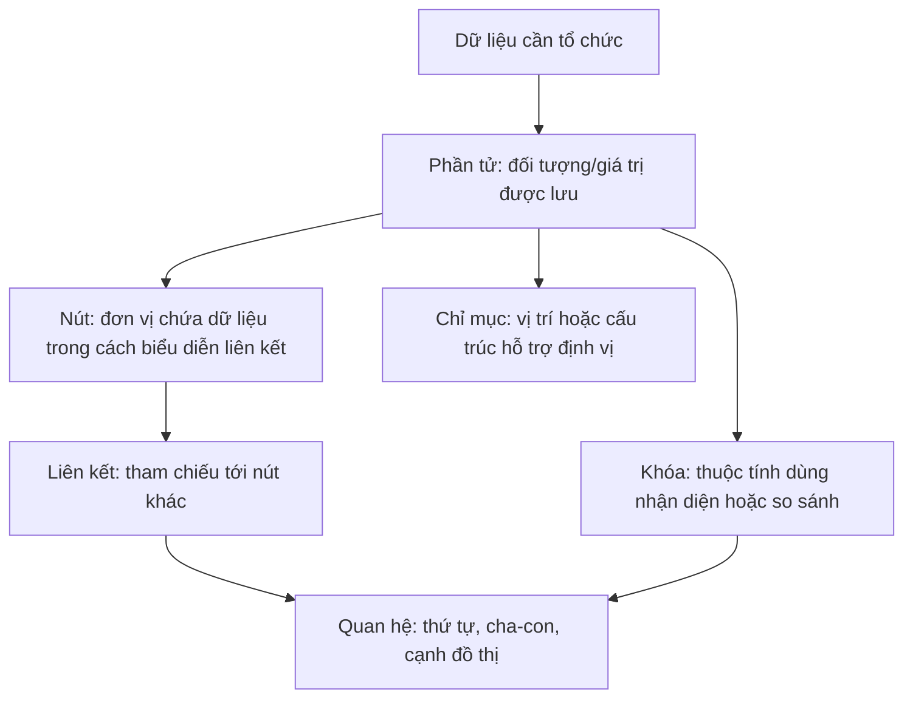
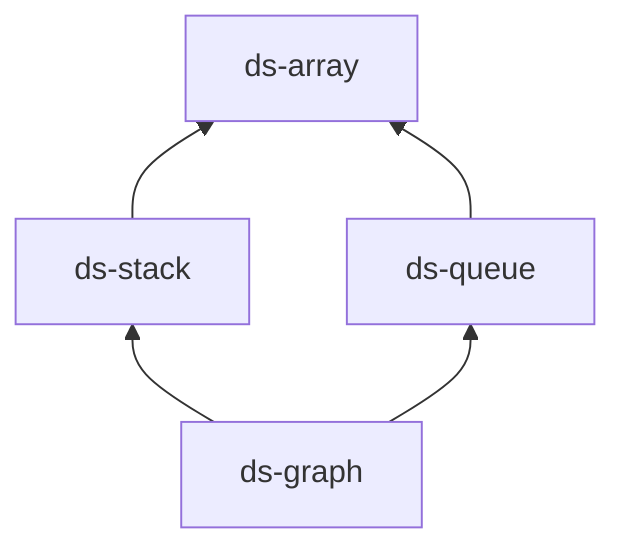

# Bản đồ thuật ngữ: phần tử, nút, liên kết, khóa và chỉ mục

## Mục tiêu học tập

Sau bài học, bạn có thể:

- Giải thích **phần tử (element)**, **nút (node)**, **liên kết (link/reference/edge)**, **khóa (key)** và **chỉ mục (index)**, phân biệt vai trò của chúng trong từng cấu trúc dữ liệu.
- Chỉ ra sự khác nhau giữa **giá trị**, **bản ghi**, **định danh**, **vị trí**, **tham chiếu** và **quan hệ**.
- Đọc được sơ đồ và mã Python sử dụng mảng, danh sách liên kết, bảng băm, cây và đồ thị mà không nhầm lẫn những thuật ngữ trên.
- Giải thích những bất biến quan trọng và chi phí truy cập, cập nhật khi tổ chức dữ liệu bằng vị trí, khóa, con trỏ hoặc chỉ mục bổ sung.
- Xây dựng một bảng thuật ngữ thống nhất khi thiết kế cấu trúc dữ liệu cho bài toán thực tế.

## 1. Vì sao cần một bản đồ thuật ngữ?

Giả sử một nền tảng học tập lưu bài **“Stack và nguyên tắc LIFO”**. Bài học có mã `ds-stack`, xuất hiện ở vị trí thứ ba trong chương, có thể được tìm bằng mã, và có quan hệ tiên quyết với bài `ds-array`.

Cùng một bài học có thể được nhắc tới bằng những câu sau:

- “Bài đó là một **phần tử** trong danh sách hiển thị.”
- “Nếu dùng danh sách liên kết, bài đó được chứa trong một **nút**.”
- “Nút đứng trước giữ **liên kết** đến nút chứa bài này.”
- “Mã `ds-stack` là **khóa** để tra cứu bài học.”
- “Trong danh sách, bài nằm ở **chỉ số** `2`; ngoài ra có thể tạo **chỉ mục tra cứu** `lesson_id → Lesson`.”

Những câu này có thể cùng đúng nhưng **không cùng nói về một thứ**. Từ ngữ chỉ chức năng, vai trò hay cách biểu diễn khác nhau. Nếu không phân biệt, ta dễ mắc lỗi như dùng chỉ số làm định danh lâu dài, tưởng rằng khóa bắt buộc là vị trí, hoặc cho rằng một liên kết giữa các bài học nhất thiết phải là con trỏ trong bộ nhớ.

Sơ đồ khái niệm:



Sơ đồ cho thấy các khái niệm thường đi cùng nhau, **không** có nghĩa mọi cấu trúc dữ liệu bắt buộc phải chứa đủ năm thành phần. Mảng không cần mỗi phần tử là một nút liên kết; tập hợp có thể không cho phép truy cập theo chỉ số; đồ thị có thể lưu cạnh bằng ma trận chứ không phải một đối tượng con trỏ riêng.

## 2. Phần tử (element): đơn vị dữ liệu mà ta đang quản lý

**Phần tử** là một thành viên của tập hợp, dãy hoặc cấu trúc dữ liệu đang xét. Phần tử có thể là số, chuỗi, bản ghi hoặc một đối tượng phức tạp.

```python
scores = [8, 9, 7]
lesson_ids = ["ds-array", "ds-stack", "ds-queue"]

lesson = {
    "id": "ds-stack",
    "title": "Stack và nguyên tắc LIFO",
    "duration_minutes": 35,
}

lessons = [lesson]

assert scores[0] == 8
assert lesson_ids[1] == "ds-stack"
assert lessons[0]["title"] == "Stack và nguyên tắc LIFO"
```

Trong `scores`, mỗi số là một phần tử. Trong `lesson_ids`, mỗi chuỗi mã là một phần tử. Trong `lessons`, mỗi **bản ghi bài học** là một phần tử. Ngay cả khi hai cấu trúc đều gọi đối tượng lưu bên trong là “phần tử”, nội dung và cách truy cập có thể khác nhau.

### 2.1. Phần tử, giá trị và bản ghi

- **Giá trị (value):** nội dung cụ thể như `8`, `"ds-stack"`, `True` hoặc một đối tượng `Lesson`.
- **Phần tử (element):** vai trò của một giá trị khi nó là thành viên của một cấu trúc. Một giá trị có thể xuất hiện ở nhiều vị trí hoặc trong nhiều tập hợp.
- **Bản ghi (record):** nhóm thuộc tính mô tả một đối tượng nghiệp vụ, ví dụ `id`, `title`, `duration_minutes` của bài học.
- **Thực thể (entity):** đối tượng có ý nghĩa trong bài toán, chẳng hạn *bài học* hay *học viên*. Một thực thể có thể được biểu diễn bằng nhiều bản ghi hoặc phiên bản dữ liệu qua thời gian.

Không nên đồng nhất **phần tử** với **ô nhớ**. Mảng động Python lưu các tham chiếu đến đối tượng; phần tử logic là đối tượng được chứa trong dãy theo hợp đồng mà chương trình sử dụng. Địa chỉ và cách tổ chức bộ nhớ cụ thể phụ thuộc cách cài đặt.

### 2.2. Phần tử có được trùng nhau không?

Điều đó tùy **kiểu dữ liệu trừu tượng và quy tắc so sánh**:

```python
sequence = ["ds-array", "ds-array", "ds-stack"]
unique_ids = {"ds-array", "ds-array", "ds-stack"}

assert len(sequence) == 3
assert len(unique_ids) == 2
```

Một **danh sách** thường cho phép phần tử trùng; một **Set ADT** không chứa các phần tử trùng theo quy tắc bình đẳng của nó. Nếu yêu cầu “mã bài học không được trùng”, đó là bất biến của mô hình nghiệp vụ hoặc chỉ mục theo khóa; không phải đặc tính của mọi cấu trúc dữ liệu.

## 3. Nút (node): đơn vị biểu diễn trong cấu trúc liên kết

**Nút** là đơn vị cấu thành thường gặp trong danh sách liên kết, cây và đồ thị. Một nút có thể chứa dữ liệu, metadata và các tham chiếu đến nút khác. Khác với **phần tử**, nút nhấn mạnh **cách tổ chức** chứ không chỉ nội dung mà người dùng quan tâm.

### 3.1. Nút trong danh sách liên kết

```text
head
 |
 v
[value: A | next] --> [value: B | next] --> [value: C | None]
```

Trong một danh sách liên kết đơn, mỗi nút có thể gồm `value` và `next`. `value` là dữ liệu của phần tử; `next` giữ liên kết đến nút tiếp theo.

```python
class Node:
    def __init__(self, value, next_node=None):
        self.value = value
        self.next = next_node


third = Node("ds-queue")
second = Node("ds-stack", third)
first = Node("ds-array", second)
head = first

assert head.value == "ds-array"
assert head.next.value == "ds-stack"
assert head.next.next is third
assert third.next is None
```

Trong mã này:

- Chuỗi `"ds-stack"` là **giá trị/phần tử logic** được lưu.
- `second` là một **nút** có trường `value` và `next`.
- `second.next` là **liên kết** đến nút `third`.
- `head` là **tham chiếu đến nút đầu**, không phải mã định danh của bài học.

Nếu đã biết tham chiếu tới một nút và muốn chèn một nút ngay sau nó, ta chỉ cần thay đổi vài liên kết, thường **O(1)** thời gian. Nhưng để tìm nút thứ `i`, ta phải đi theo các liên kết từ đầu, mất **O(i)**, tối đa **O(n)**. Như vậy, **truy cập một nút đã biết** và **tìm nút theo vị trí** là hai phép toán khác nhau.

### 3.2. Nút trong cây và đồ thị

Trong **cây**, nút đại diện cho một mục phân cấp và có thể mang các liên kết `left`, `right`, `parent` hoặc danh sách `children`. Trong **đồ thị**, một đỉnh (*vertex*) có thể được hiện thực bằng một đối tượng nút, nhưng cũng có thể chỉ là một mã nguyên hoặc chuỗi trong danh sách kề.

```text
         [Khóa học]             Nút gốc
          /     \
     [Chương A] [Chương B]       Nút con
      /    \
   [Bài 1] [Bài 2]             Nút lá
```

Trong cây có gốc, mỗi nút ngoài gốc thường có **đúng một cha** và không có chu trình. Trong đồ thị tổng quát, một đỉnh có thể có nhiều cạnh đi vào/đi ra, và có thể xuất hiện chu trình. Vì thế, không nên áp quy tắc “mỗi nút chỉ có một cha” cho mọi đồ thị.

**Lưu ý về thuật ngữ:** Trong lý thuyết đồ thị, từ chính xác thường là **đỉnh (vertex)**; trong một cách cài đặt đồ thị bằng các đối tượng liên kết, ta vẫn có thể gọi các đối tượng ấy là **nút**. Đỉnh là khái niệm của mô hình đồ thị, còn đối tượng nút là một lựa chọn biểu diễn.

## 4. Liên kết (link/reference/edge): quan hệ được biểu diễn như thế nào?

Từ **liên kết** có hai cách dùng phổ biến mà cần tách bạch:

1. **Tham chiếu/con trỏ (reference/pointer):** phương tiện ở mức cài đặt để từ một nút truy cập nút khác, như trường `next` của danh sách liên kết.
2. **Cạnh (edge):** quan hệ giữa hai đỉnh trong mô hình đồ thị, như “bài A là điều kiện tiên quyết của bài B”. Cạnh có thể được lưu bằng danh sách kề, ma trận kề, cặp đỉnh hoặc đối tượng riêng.

Tham chiếu là một **cách hiện thực**, trong khi cạnh là một **quan hệ logic**. Cạnh `A → B` không bắt buộc được cài bằng một con trỏ trực tiếp từ đối tượng A sang đối tượng B.

### 4.1. Ví dụ: liên kết trong danh sách liên kết

Với `first`, `second`, `third` ở trên:

```python
inserted = Node("ds-linked-list", second)
first.next = inserted

assert first.next.value == "ds-linked-list"
assert first.next.next is second
assert second.next is third
```

Chèn nút mới thay đổi cấu trúc liên kết mà không phải dịch các giá trị như chèn giữa mảng. Tuy nhiên, khi sửa con trỏ phải giữ bất biến: từ `head` có thể lần theo đúng các nút của danh sách, phần tử cuối có `next is None`, không vô tình làm mất phần còn lại hoặc tạo chu trình nếu danh sách được thiết kế không vòng.

### 4.2. Ví dụ: liên kết trong đồ thị có hướng

Giả sử một bài có thể yêu cầu hoàn thành nhiều bài tiên quyết. Ta dùng **danh sách kề** với chiều `bài → các bài tiên quyết`:

```python
prerequisites = {
    "ds-array": set(),
    "ds-stack": {"ds-array"},
    "ds-queue": {"ds-array"},
    "ds-graph": {"ds-stack", "ds-queue"},
}

assert "ds-stack" in prerequisites["ds-graph"]
assert "ds-queue" in prerequisites["ds-graph"]
```

Ở đây `"ds-stack"` trong tập hàng xóm là **mã đỉnh kề**, không phải con trỏ bộ nhớ. Quan hệ có hướng: `ds-graph → ds-stack` nói rằng bài đồ thị cần stack trước, không có nghĩa stack cần đồ thị trước.



Đồ thị tiên quyết thường phải là **đồ thị có hướng không chu trình (DAG)** để có thứ tự học hợp lệ. Nếu thêm cạnh gây vòng phụ thuộc, chương trình cần từ chối hoặc có chính sách xử lý riêng. Tập băm lưu các đỉnh kề cũng không tự bảo đảm đồ thị không có chu trình.

### 4.3. Liên kết trực tiếp và đường đi gián tiếp

- **Kề trực tiếp (adjacency):** `ds-graph` có cạnh trực tiếp tới `ds-stack`.
- **Đường đi (path):** `ds-graph → ds-stack → ds-array` là một chuỗi cạnh.
- **Đến được (reachability):** có ít nhất một đường đi từ đỉnh nguồn tới đỉnh đích.

Để kiểm tra một quan hệ gián tiếp, chỉ tra cứu một khóa trong bảng băm chưa đủ. Cần thuật toán duyệt đồ thị như DFS hoặc BFS:

```python
def reachable(graph, start, target):
    if start not in graph or target not in graph:
        raise KeyError("Đỉnh không tồn tại")

    stack = [start]
    visited = set()

    while stack:
        current = stack.pop()
        if current == target:
            return True
        if current in visited:
            continue

        visited.add(current)
        stack.extend(graph[current])

    return False


assert reachable(prerequisites, "ds-graph", "ds-array")
assert not reachable(prerequisites, "ds-array", "ds-graph")
```

Với danh sách kề và tập `visited`, DFS có thể duyệt tới `V` đỉnh và `E` cạnh, nên chi phí thời gian trong trường hợp xấu nhất là **O(V + E)**. Tập đã thăm giúp tránh xử lý lặp vô hạn trong đồ thị có chu trình, nhưng **không** tự xác nhận rằng đồ thị hợp lệ theo quy tắc tiên quyết.

## 5. Khóa (key): định vị hoặc sắp xếp dữ liệu

**Khóa** là giá trị/thuộc tính dùng để tra cứu, nhận diện, so sánh hoặc tổ chức các bản ghi. Khóa có thể là chuỗi mã định danh, số nguyên, hoặc một tổ hợp nhiều trường.

| Khái niệm | Ví dụ | Vai trò |
| --- | --- | --- |
| **Khóa định danh** | `lesson_id="ds-stack"` | Nhận diện một bài học qua thời gian |
| **Khóa tra cứu** | `student_id`, `course_id` | Chọn bản ghi hoặc nhóm bản ghi tương ứng |
| **Khóa sắp xếp** | `(duration_minutes, lesson_id)` | Quyết định thứ tự giữa các bản ghi |
| **Khóa ghép (composite key)** | `(student_id, course_id)` | Nhận diện một quan hệ đăng ký học |
| **Khóa băm** | Một chuỗi hoặc tuple hashable | Là đầu vào cho cơ chế băm và so sánh của bảng băm |

**Khóa không nhất thiết đồng nghĩa duy nhất trong toàn bộ dữ liệu.** `duration_minutes = 30` có thể xuất hiện ở nhiều bài; đây là khóa sắp xếp nhưng không phải định danh duy nhất. Khi bài toán yêu cầu ánh xạ một–một từ mã bài sang bản ghi, mới cần quy định **tính duy nhất của khóa định danh**.

### 5.1. Map: khóa và giá trị

```python
lessons_by_id = {
    "ds-array": {"title": "Mảng", "minutes": 30},
    "ds-stack": {"title": "Stack", "minutes": 35},
}

assert lessons_by_id["ds-stack"]["title"] == "Stack"
assert lessons_by_id.get("ds-missing") is None
```

Trong một **Map ADT**, mỗi khóa hiện có được ánh xạ tới một giá trị. Phần dữ liệu bên phải khóa có thể là bản ghi lớn, nhưng nó không làm khóa trở thành vị trí. Với Python `dict`, tra cứu theo khóa thường **O(1) kỳ vọng** nhờ bảng băm; trong trường hợp va chạm bất lợi, chi phí có thể cao hơn.

Gán `lessons_by_id["ds-stack"] = ...` **thay thế** giá trị của khóa đang có. Nếu nghiệp vụ cần từ chối thêm mã trùng, phải kiểm tra trước khi thêm; bản thân cú pháp gán không thực hiện chính sách ấy.

### 5.2. Khóa và tính ổn định

Một khóa dùng trong bảng băm phải có giá trị băm phù hợp với phép so sánh bằng nhau và cần ổn định trong thời gian được sử dụng làm khóa. Trong Python, chuỗi và tuple có các thành phần hashable thường là các lựa chọn phù hợp, còn `list` không hashable:

```python
completed = {
    ("student-01", "ds-stack"),
    ("student-01", "ds-array"),
}

assert ("student-01", "ds-stack") in completed
```

Tuple `(student_id, lesson_id)` có thể dùng như **khóa ghép** hoặc như một phần tử của tập hợp các quan hệ. Nhưng tuple chỉ là cấu trúc cú pháp; việc hai lần đăng ký cùng cặp có bị coi là trùng hay không còn phụ thuộc **quy tắc bình đẳng** của các thành phần và hợp đồng tập hợp/bảng ánh xạ.

### 5.3. Khóa tìm kiếm khác chỉ số vị trí

Giả sử dãy bài là:

```text
Vị trí:         0          1          2
Mã bài:     ds-array   ds-stack   ds-queue
```

Khi chèn `ds-linked-list` vào vị trí `1`, bài `ds-stack` chuyển từ chỉ số `1` sang `2`. Mã `ds-stack` vẫn giữ nguyên. Do vậy **vị trí có thể thay đổi sau thao tác chèn/xóa**, còn khóa nghiệp vụ nên được thiết kế đủ ổn định để tham chiếu cùng một thực thể.

## 6. Chỉ mục (index): một từ, hai lớp ý nghĩa

Trong cấu trúc dữ liệu, **chỉ mục** thường có hai cách dùng quan trọng:

1. **Chỉ số vị trí (positional index):** số nguyên `i` chỉ chỗ đứng trong mảng/dãy, thường bắt đầu từ `0` trong Python.
2. **Chỉ mục tra cứu (lookup index / secondary index):** một cấu trúc bổ sung giúp tìm nhanh một bản ghi hoặc nhóm bản ghi qua một thuộc tính, ví dụ bảng băm `lesson_id → Lesson` hoặc cấu trúc giữ thứ tự `duration → các lesson_id`.

Hai ý nghĩa liên quan đến **định vị**, nhưng không tương đương:

| Tiêu chí | Chỉ số vị trí | Chỉ mục tra cứu |
| --- | --- | --- |
| Bản chất | Số thứ tự trong một dãy | Cấu trúc hỗ trợ tìm theo khóa/thuộc tính |
| Đầu vào | `i = 2` | `lesson_id = "ds-stack"` |
| Thay đổi khi chèn giữa dãy? | Có thể thay đổi | Không nên đổi khóa định danh; phải duy trì chỉ mục phù hợp |
| Chi phí cơ bản | Truy cập mảng **O(1)** | Tùy cài đặt: băm **O(1) kỳ vọng**, cây cân bằng **O(log n)** |
| Bộ nhớ phụ | Là thuộc tính truy cập của dãy | Thường cần bộ nhớ để lưu chỉ mục và tham chiếu |

### 6.1. Một bản ghi, nhiều đường truy cập

Một hệ thống học tập có thể giữ bản ghi bài học một lần, sau đó duy trì nhiều cách nhìn:

```python
by_id = {
    "ds-array": {"title": "Mảng", "minutes": 30},
    "ds-stack": {"title": "Stack", "minutes": 35},
    "ds-queue": {"title": "Queue", "minutes": 25},
}

chapter_order = ["ds-array", "ds-stack", "ds-queue"]

assert by_id[chapter_order[1]]["title"] == "Stack"
```

Trong dòng `by_id[chapter_order[1]]`:

- `1` là **chỉ số vị trí** trong `chapter_order`.
- `chapter_order[1]` trả về chuỗi `"ds-stack"`, tức **khóa**.
- `by_id` là **bảng ánh xạ/chỉ mục theo khóa**.
- `by_id["ds-stack"]` trả về **bản ghi bài học** tương ứng.

Đây là ví dụ ngắn cho thấy **các mức truy cập có thể nối tiếp nhau**: dùng vị trí để lấy khóa, rồi dùng khóa để lấy dữ liệu.

### 6.2. Chỉ mục theo thuộc tính không duy nhất

Giả sử nhiều bài có cùng thời lượng `30` phút. Muốn tìm tất cả bài có thời lượng `30`, một bảng `minutes → một bài duy nhất` sẽ làm mất dữ liệu. Thay vào đó, có thể xây **chỉ mục đa giá trị**:

```python
from collections import defaultdict

records = [
    {"id": "a", "minutes": 30},
    {"id": "b", "minutes": 25},
    {"id": "c", "minutes": 30},
]

ids_by_minutes = defaultdict(set)
for record in records:
    ids_by_minutes[record["minutes"]].add(record["id"])

assert ids_by_minutes[30] == {"a", "c"}
```

Khi thêm, sửa hoặc xóa thời lượng của một bài, phải cập nhật cả **bản ghi chính** và **những tập mã liên quan**. Bảng chỉ mục này hỗ trợ tra cứu thời lượng bằng nhau, nhưng không tự hỗ trợ truy vấn khoảng `20..40` theo thứ tự tăng dần; muốn làm vậy hiệu quả có thể cần cấu trúc duy trì thứ tự.

### 6.3. Chỉ mục có thể được tạo theo nhiều cách

- **Bảng băm:** phù hợp tra chính xác một khóa, thường **O(1) kỳ vọng**.
- **Cây tìm kiếm cân bằng:** phù hợp tra cứu có thứ tự hoặc theo khoảng, thường **O(log n)** cho tìm/chèn/xóa.
- **Mảng đã sắp xếp:** dùng tìm nhị phân **O(log n)** cho một khóa; lấy đoạn kết quả dài `k` cần thêm **O(k)**, nhưng chèn giữa có thể **O(n)**.
- **Danh sách chỉ số/phần tử:** đủ cho dữ liệu nhỏ hoặc bài toán duyệt tuần tự, có thể không cần cấu trúc phức tạp.

Không nên nhầm “chỉ mục của cơ sở dữ liệu” với một kiểu cấu trúc duy nhất. Trong hệ quản trị dữ liệu, **index** là cơ chế tăng tốc truy vấn, có thể được cài bằng cây, bảng băm hoặc cơ chế khác. Trong Python, `items[i]` lại là thao tác truy cập bằng **chỉ số vị trí**. Khi viết thiết kế, hãy nói rõ đang sử dụng nghĩa nào.

## 7. Bản đồ theo từng cấu trúc dữ liệu

Một cách học từ vựng hiệu quả là đặt cùng năm khái niệm cạnh những cấu trúc thường gặp:

| Cấu trúc | Phần tử | Nút | Liên kết | Khóa | Chỉ mục |
| --- | --- | --- | --- | --- | --- |
| **Mảng / mảng động** | Giá trị tại mỗi vị trí | Thường không cần nút riêng | Thứ tự liền kề logic qua vị trí | Có thể là thuộc tính của giá trị, không bắt buộc | Chỉ số nguyên `0..n-1` |
| **Danh sách liên kết** | Giá trị trong nút | Nút chứa `value`, `next` | Tham chiếu `next`, có thể `prev` | Có thể là trường trong giá trị | Muốn lấy vị trí `i` thường phải duyệt |
| **Stack / queue** | Giá trị được đẩy/xếp hàng | Tùy cài đặt (mảng hay nút) | Tùy cài đặt | Không bắt buộc | Chủ yếu truy cập ở đỉnh/đầu/cuối theo hợp đồng |
| **Bảng băm / Map** | Cặp khóa–giá trị hoặc giá trị ánh xạ | Tùy cách xử lý va chạm | Tùy cách cài | Là cơ sở tra cứu | Các ô/bucket nội bộ và chỉ mục theo khóa là khái niệm khác chỉ số dãy nghiệp vụ |
| **Cây** | Dữ liệu/khóa lưu ở mỗi nút | Nút cây | Liên kết cha–con | Khóa so sánh nếu là BST | Có thể có chỉ mục bổ trợ; không mặc nhiên hỗ trợ truy cập theo vị trí |
| **Heap nhị phân** | Giá trị có độ ưu tiên | Nút logic của cây gần đầy | Quan hệ cha–con thường suy từ chỉ số mảng | Khóa ưu tiên | Chỉ số mảng giúp tìm cha/con |
| **Đồ thị** | Dữ liệu của đỉnh/cạnh | Đỉnh có thể hiện thực bằng nút | Cạnh giữa các đỉnh | ID đỉnh hoặc thuộc tính cạnh | Danh sách kề, ma trận kề, bảng ánh xạ ID → đỉnh |

Đặc biệt với **heap nhị phân lưu bằng mảng**, người học sẽ gặp cả **nút logic**, **liên kết cha–con** và **chỉ số** dù không có con trỏ `left` hay `right`:

```text
Mảng heap: [3, 7, 5, 12, 9]
Chỉ số:    0  1  2   3  4

             3 (0)
            /     \
         7 (1)   5 (2)
         /   \
      12 (3) 9 (4)
```

Với nút tại chỉ số `i`, hai chỉ số con trong cách lưu này là `2i + 1` và `2i + 2` nếu còn nằm trong phạm vi mảng. Quan hệ cha–con được **tính từ chỉ số**, không cần lưu các con trỏ riêng. Bất biến min-heap là **khóa cha không lớn hơn khóa con**; không phải mọi phần tử đều được sắp xếp tăng dần trong mảng.

## 8. Đừng nhầm thuật ngữ với hợp đồng và chi phí thao tác

Cùng tên một khái niệm không cho biết độ phức tạp nếu chưa xác định cấu trúc và phép toán cụ thể.

| Câu hỏi / thao tác | Điều cần biết | Chi phí điển hình |
| --- | --- | --- |
| Lấy phần tử thứ `i` của mảng động | Có chỉ số vị trí hợp lệ | **O(1)** |
| Lấy phần tử thứ `i` của danh sách liên kết đơn | Phải duyệt qua các nút trước đó | **O(i)**, xấu nhất **O(n)** |
| Chèn nút sau một nút đã biết | Đã có tham chiếu đến nút, danh sách cho phép chèn | **O(1)** cho cập nhật liên kết |
| Tra bản ghi theo khóa trong bảng băm | Khóa hashable, băm và so sánh phù hợp | **O(1) kỳ vọng**, xấu nhất có thể **O(n)** |
| Tra khóa trong BST cân bằng | Duy trì quy tắc thứ tự và cân bằng | **O(log n)** |
| Xem phần tử nhỏ nhất của min-heap | Bất biến thứ tự cha–con đang đúng | **O(1)** |
| Duyệt hết các đỉnh và cạnh bằng danh sách kề | Có tập đánh dấu đã thăm phù hợp | **O(V + E)** |

**Điểm then chốt:** Một cấu trúc dữ liệu không chỉ đặt tên cho “thứ gì được lưu”. Nó còn quy định **cách phần tử liên quan với nhau**, **điều kiện phải luôn đúng** và **chi phí của những thao tác được triển khai**.

### 8.1. Bất biến cần bảo vệ khi cập nhật

| Thành phần | Bất biến ví dụ | Lỗi có thể gặp |
| --- | --- | --- |
| Danh sách có thứ tự | Tham chiếu `head`, `next`, `tail` mô tả đúng các nút | Mất một đoạn danh sách, tạo chu trình ngoài ý muốn |
| Khóa định danh | Một mã bài chỉ trỏ đến một bản ghi hợp lệ | Mã trùng ghi đè dữ liệu |
| Chỉ số vị trí | Vị trí được diễn giải theo dãy hiện tại | Tham chiếu cũ trỏ sai sau khi chèn/xóa |
| Chỉ mục tra cứu | Mọi khóa và tham chiếu phản ánh dữ liệu chính hiện tại | Trả bản ghi đã xóa hoặc bỏ sót bản ghi mới |
| Cây tìm kiếm | Thứ tự khóa giữa hai cây con được giữ | Tìm sai nhánh sau cập nhật |
| Heap | Khóa cha không lớn hơn con đối với min-heap | Lấy sai phần tử ưu tiên nhỏ nhất |
| Đồ thị tiên quyết | Mọi ID cạnh đều tồn tại; không có chu trình | Không thể lập thứ tự học hợp lệ |

Một **chỉ mục phụ** giúp đọc nhanh nhưng làm tăng công việc ghi. Chẳng hạn, xóa bài `ds-stack` khỏi `by_id` chưa đủ nếu mã đó còn nằm trong danh sách thứ tự và trong tập tiên quyết của bài khác. Ứng dụng phải có chính sách xử lý các quan hệ liên quan và bảo đảm thay đổi nhất quán.

## 9. Tình huống tổng hợp: từ yêu cầu đến thuật ngữ đúng

Một khóa học có chương `basic` với ba bài `ds-array`, `ds-stack`, `ds-queue`. Một bài mới `ds-graph` có thể học sau khi hoàn thành `ds-stack` **và** `ds-queue`. Hệ thống cần hỗ trợ:

1. Hiển thị bài trong chương đúng thứ tự biên tập.
2. Tra bài theo mã nhanh.
3. Kiểm tra bài học có liên kết tiên quyết nào.
4. Đổi vị trí một bài hoặc xóa bài nhưng không để lại tham chiếu mồ côi.

Một biểu diễn đơn giản có thể gồm:

```python
lessons_by_id = {
    "ds-array": {"title": "Mảng"},
    "ds-stack": {"title": "Stack"},
    "ds-queue": {"title": "Queue"},
    "ds-graph": {"title": "Đồ thị"},
}

chapter_order = {
    "basic": ["ds-array", "ds-stack", "ds-queue", "ds-graph"],
}

prerequisites = {
    "ds-array": set(),
    "ds-stack": {"ds-array"},
    "ds-queue": {"ds-array"},
    "ds-graph": {"ds-stack", "ds-queue"},
}


def lesson_at(chapter_id, position):
    lesson_id = chapter_order[chapter_id][position]
    return lessons_by_id[lesson_id]


def lesson_by_key(lesson_id):
    return lessons_by_id.get(lesson_id)


def direct_prerequisites(lesson_id):
    if lesson_id not in prerequisites:
        raise KeyError("Bài học không tồn tại")
    return set(prerequisites[lesson_id])


assert lesson_at("basic", 1)["title"] == "Stack"
assert lesson_by_key("ds-stack")["title"] == "Stack"
assert direct_prerequisites("ds-graph") == {"ds-stack", "ds-queue"}
```

Hãy gọi đúng từng bộ phận:

- Bản ghi `{"title": "Stack"}` là **giá trị** được ánh xạ tới khóa `ds-stack` trong `lessons_by_id`.
- Mỗi chuỗi ID trong `chapter_order["basic"]` là **phần tử của danh sách thứ tự**.
- Số `1` truyền vào `lesson_at` là **chỉ số vị trí**, không phải khóa định danh.
- `lessons_by_id` là **bảng ánh xạ/chỉ mục theo khóa**.
- Hai mã trong `prerequisites["ds-graph"]` biểu diễn **quan hệ kề** với hai đỉnh tiên quyết.
- Trong mã nguồn này, không có đối tượng `Node` riêng: cả danh sách thứ tự lẫn đồ thị đều được biểu diễn bằng chuỗi, danh sách, tập và bảng ánh xạ của Python.

Giả sử người biên tập chèn bài mới vào đầu chương. Các **chỉ số vị trí** của những bài sau sẽ thay đổi, nhưng **mã định danh** vẫn có thể giữ nguyên. Nếu cập nhật tên bài trong bản ghi chính, danh sách thứ tự vẫn chỉ chứa mã và không cần sao chép tiêu đề. Tuy nhiên, nếu xóa một bài, phải xét cả **danh sách hiển thị** lẫn **đồ thị tiên quyết** để tránh các mã không còn tồn tại.

### 9.1. Khi nào cần thêm một loại chỉ mục?

Nếu hệ thống phải tìm hàng nghìn lần mỗi giây theo thời lượng, một bảng băm chỉ theo ID chưa giải quyết tốt yêu cầu ấy. Có thể bổ sung chỉ mục `duration_minutes → tập lesson_id` hoặc cấu trúc duy trì thứ tự. Chọn phương án dựa trên việc cần **tra chính xác**, **tìm khoảng** hay **xếp hạng**; mỗi chỉ mục mới cần được cập nhật khi sửa bài.

Đây là điểm giao nhau của thuật ngữ, **bất biến** và **đánh đổi thời gian – bộ nhớ**: bản đồ khái niệm giúp mô tả đúng vấn đề, còn việc chọn biểu diễn cụ thể quyết định chi phí thực thi.

## 10. Các nhầm lẫn phổ biến

- **“Phần tử và nút luôn là một.”** Không đúng. Phần tử là dữ liệu logic; nút là đơn vị biểu diễn có thể chứa phần tử và liên kết. Mảng có phần tử nhưng không cần nút liên kết riêng.
- **“Liên kết trong đồ thị luôn là con trỏ.”** Không đúng. Cạnh là quan hệ logic; có thể lưu bằng danh sách mã đỉnh hoặc ma trận kề.
- **“Chỉ số vị trí là khóa định danh.”** Không đúng. Chèn/xóa trong dãy có thể đổi chỉ số nhưng không nên đổi danh tính nghiệp vụ.
- **“Mọi khóa trong dữ liệu phải duy nhất.”** Không đúng. Khóa sắp xếp như thời lượng có thể trùng. Khóa định danh chỉ cần duy nhất khi mô hình quy định.
- **“Có bảng băm thì mọi kiểu truy vấn đều O(1).”** Không đúng. Tra chính xác theo khóa băm khác truy vấn khoảng đã sắp xếp hoặc duyệt quan hệ.
- **“Chỉ mục phụ luôn làm mọi thao tác nhanh hơn.”** Không đúng. Nó có thể tăng tốc một số truy vấn nhưng chiếm bộ nhớ và tăng chi phí cập nhật nhất quán.
- **“Một cây hoặc heap nhất thiết phải dùng con trỏ.”** Không đúng. Heap nhị phân có thể lưu trong mảng, suy ra con từ chỉ số.
- **“Đã có `visited` thì đồ thị tiên quyết không có chu trình.”** Không đúng. Tập đã thăm giúp thuật toán kết thúc, không thay thế bước kiểm tra tính hợp lệ của DAG.

## 11. Bài tập vận dụng

**Bài 1 — Gọi tên cho đúng.** Xét `items = ["A", "B", "C"]`. Trong biểu thức `items[1]`, đâu là phần tử và đâu là chỉ số? Nếu chèn `"X"` vào đầu dãy thì chỉ số của `"B"` thay đổi ra sao?

*Gợi ý:* `"B"` là phần tử ở chỉ số `1`; chèn vào đầu khiến `"B"` chuyển thành chỉ số `2`.

**Bài 2 — Nút và liên kết.** Một danh sách liên kết có `head → A → B → C`. Nếu muốn chèn `X` ngay sau nút `A` đã biết, cần thay đổi những tham chiếu nào? Nếu mất tham chiếu đến `B` trước khi nối lại thì có rủi ro gì?

*Gợi ý:* Tạo `X.next` trỏ tới `B`, sau đó đặt `A.next = X`. Nếu đổi `A.next` mà không giữ tham chiếu tới phần còn lại, đoạn danh sách sau đó có thể bị mất đường truy cập.

**Bài 3 — Khóa và chỉ mục.** Bảng học viên lưu `(student_id, course_id)` làm khóa ghép cho mỗi lượt đăng ký. Một học viên đăng ký nhiều khóa. Vì sao chỉ dùng `student_id` làm khóa của bảng ánh xạ một–một không biểu diễn đủ dữ liệu?

*Gợi ý:* Mỗi học viên có thể gắn nhiều khóa; nếu ánh xạ một `student_id` sang đúng một `course_id` thì các giá trị trước có thể bị thay thế. Có thể dùng khóa ghép hoặc ánh xạ học viên đến tập khóa học.

**Bài 4 — Cạnh đồ thị.** `prerequisites["graph"] = {"stack", "queue"}` có phải một nút chứa hai con của một cây không? Vì sao không thể kết luận như vậy chỉ từ đoạn dữ liệu này?

*Gợi ý:* Đây là quan hệ đồ thị từ bài `graph` tới hai bài tiên quyết. Đồ thị có thể có một đỉnh với nhiều quan hệ và không nhất thiết tuân theo quy tắc một cha của cây.

**Bài 5 — Chi phí.** Với `n` bài học, truy cập theo chỉ số trong mảng động, lấy phần tử ở vị trí `i` trong danh sách liên kết và tra mã bằng bảng băm khác nhau thế nào về chi phí?

*Gợi ý:* Mảng động O(1), danh sách liên kết O(i) (tối đa O(n)), bảng băm O(1) kỳ vọng nếu khóa và băm phù hợp. Chúng đang thực hiện các loại phép toán khác nhau.

**Bài 6 — Cập nhật nhất quán.** Bài `ds-stack` bị xóa khỏi `lessons_by_id` nhưng vẫn nằm trong `chapter_order` và `prerequisites["ds-graph"]`. Hãy kể hai loại truy vấn có thể sai và nêu những bất biến cần khôi phục.

*Gợi ý:* Hiển thị theo vị trí có thể không tìm thấy bản ghi, còn truy vấn quan hệ có thể chứa mã tiên quyết không tồn tại. Cần xác định chính sách xóa và cập nhật hoặc tái tạo các chỉ mục/quan hệ liên quan.

## Tổng kết

**Phần tử** là dữ liệu logic được chứa; **nút** là đơn vị biểu diễn có thể giữ dữ liệu và tham chiếu; **liên kết** là phương tiện hoặc quan hệ nối các phần, cần phân biệt con trỏ với cạnh đồ thị; **khóa** dùng để nhận diện, tra cứu hay so sánh; **chỉ mục** có thể là chỉ số vị trí trong dãy hoặc cấu trúc hỗ trợ tìm nhanh theo thuộc tính. Những từ này không hoán đổi cho nhau. Khi đọc hoặc thiết kế mảng, danh sách liên kết, stack, queue, bảng băm, cây, heap và đồ thị, hãy luôn hỏi: **đang nói đến dữ liệu, đơn vị lưu trữ, mối quan hệ, tiêu chí tìm kiếm hay cách định vị?** Từ đó mới xác định đúng phép toán, bất biến và chi phí thời gian, bộ nhớ của từng lựa chọn.
