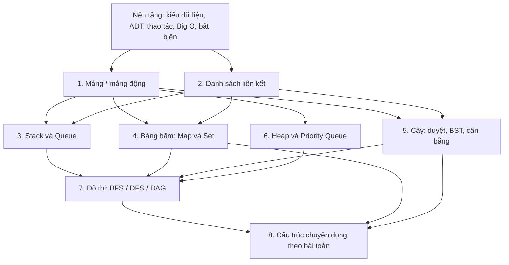
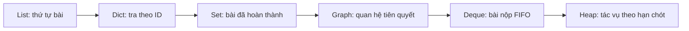

# Lộ trình học từ cấu trúc cơ bản đến cấu trúc chuyên dụng

## Mục tiêu học tập

Sau bài này, bạn có thể:

- Vẽ được **lộ trình học có điều kiện tiên quyết** từ mảng, danh sách liên kết đến stack, queue, bảng băm, cây, heap, đồ thị và những cấu trúc chuyên dụng.
- Giải thích **vì sao** nên học các cấu trúc theo trình tự đó, thay vì học thuộc tên hoặc bảng Big O riêng lẻ.
- Xác định thao tác công khai, **bất biến (invariant)**, độ phức tạp thời gian và bộ nhớ cần kiểm tra ở mỗi chặng.
- Biết khi nào nên **chọn cấu trúc sẵn có**, khi nào cần cài đặt để hiểu nguyên lý, và khi nào nên học thêm cấu trúc chuyên dụng.
- Tự đánh giá năng lực qua các bài tập chuyển chặng và một bài toán tích hợp gần với ứng dụng thực tế.

## 1. Nhìn toàn cảnh: học theo vấn đề, không chỉ theo tên

Một cấu trúc dữ liệu hữu ích khi nó giúp thực hiện **những phép toán mà bài toán yêu cầu**. Chẳng hạn:

- Muốn lấy bài thứ `i` của một chương: cần **truy cập theo vị trí**.
- Muốn hoàn tác thao tác sửa gần nhất: cần **LIFO** (*last in, first out*).
- Muốn xử lý yêu cầu theo thứ tự đến: cần **FIFO** (*first in, first out*).
- Muốn tìm bài theo mã: cần **tra cứu theo khóa**.
- Muốn lấy yêu cầu có hạn chót gần nhất: cần **truy cập theo độ ưu tiên**.
- Muốn xác định chuỗi bài tiên quyết: cần **duyệt quan hệ giữa các đỉnh**.

Lộ trình vì thế nên tiến từ **dữ liệu được biểu diễn ra sao**, sang **thao tác nào cần nhanh**, rồi mới tới **các quan hệ và chỉ mục phức tạp hơn**.



Mũi tên biểu thị **sự hỗ trợ về kiến thức**, không phải quy định cứng rằng phải học xong mọi nhánh mới được đọc nhánh tiếp theo. Ví dụ, bạn có thể tìm hiểu heap ngay sau mảng và cây nhị phân, trong khi việc dùng BFS chỉ cần hiểu queue, tập đã thăm và danh sách kề. Điều quan trọng là **đủ kiến thức để giải thích tại sao thuật toán đúng và chi phí đến từ đâu**.

### 1.1. Bảng định hướng từng chặng

| Chặng | Cấu trúc trọng tâm | Câu hỏi cần trả lời | Dấu hiệu đã nắm vững |
| --- | --- | --- | --- |
| 0 | Kiểu dữ liệu, ADT, bất biến, Big O | Thế nào là đặc tả đúng và chi phí thao tác? | Viết được hợp đồng và phân biệt xấu nhất / kỳ vọng / khấu hao |
| 1 | Mảng và mảng động | Làm sao truy cập nhanh theo vị trí? | Giải thích O(1) truy cập, O(n) chèn giữa |
| 2 | Danh sách liên kết | Làm sao thêm/xóa bằng cách thay liên kết? | Vẽ và cập nhật đúng `head`, `next`, `tail` |
| 3 | Stack, queue, deque | Thứ tự lấy phần tử quyết định thuật toán thế nào? | Cài được LIFO/FIFO, giải thích ứng dụng DFS/BFS |
| 4 | Map, Set, bảng băm | Tra cứu chính xác theo khóa ra sao? | Phân biệt khóa duy nhất, va chạm, O(1) kỳ vọng |
| 5 | Cây, BST cân bằng | Làm sao biểu diễn phân cấp và khóa có thứ tự? | Duyệt cây, phát biểu bất biến BST và vai trò cân bằng |
| 6 | Heap, priority queue | Làm sao lấy cực trị thường xuyên? | Thực hiện `sift-up`, `sift-down` và biết khi nào không dùng heap |
| 7 | Đồ thị | Làm sao truy vấn các quan hệ nhiều–nhiều? | Chọn biểu diễn, dùng BFS/DFS, hiểu chu trình và DAG |
| 8 | Cấu trúc chuyên dụng | Mẫu thao tác nào đòi hỏi tối ưu thêm? | Chọn đúng trie, DSU, cây đoạn, Fenwick hoặc mô hình kết hợp |

## 2. Chặng 0 — Học ngôn ngữ chung trước khi cài đặt

Đừng bắt đầu bằng việc học thuộc “mảng O(1), linked list O(n)” mà chưa xác định **đang thực hiện thao tác gì**.

### 2.1. Bốn nội dung tối thiểu

**Kiểu dữ liệu (data type):** giá trị hợp lệ và các thao tác trên giá trị. Ví dụ, bản ghi bài học có mã, tiêu đề, thời lượng.

**Kiểu dữ liệu trừu tượng (ADT):** hợp đồng hành vi không gắn với cách lưu trong bộ nhớ. Stack hứa hẹn `push`, `pop` theo LIFO; queue hứa hẹn FIFO.

**Bất biến (invariant):** tính chất phải được duy trì ở những trạng thái xác định. Ví dụ, `0 <= size <= capacity` cho bộ đệm giới hạn; mọi khóa trong Map là duy nhất; mọi cha trong min-heap không lớn hơn con.

**Độ phức tạp:** chi phí theo quy mô dữ liệu `n` hay `V, E` của đồ thị. Phải nói rõ đang đo thời gian hay bộ nhớ, và là trường hợp xấu nhất, kỳ vọng hay khấu hao.

### 2.2. Khung phân tích nên dùng ở mọi chặng

Trước khi viết một cấu trúc mới, hãy ghi:

1. **Trạng thái trừu tượng:** đang lưu dãy, tập, ánh xạ, cây hay mạng quan hệ?
2. **Phép toán:** đọc, tìm, thêm, xóa, cập nhật, duyệt hoặc lấy ưu tiên?
3. **Tiền điều kiện:** chỉ số có hợp lệ không, stack có rỗng không, khóa đã tồn tại chưa?
4. **Hậu điều kiện:** trả về gì và trạng thái biến đổi thế nào?
5. **Bất biến:** tính chất nào cần đúng trước và sau thao tác?
6. **Chi phí:** dùng thời gian và bộ nhớ bao nhiêu với từng phép toán?

Ví dụ, một Stack có thể quy ước `pop()` trên stack rỗng phát sinh `IndexError`. Cách cài bằng mảng hay danh sách liên kết khác nhau, nhưng **hợp đồng LIFO và quy ước lỗi** phải giống nhau nếu được tuyên bố là hai cài đặt thay thế cho nhau.

**Điều kiện chuyển chặng:** có thể giải thích vì sao **cùng một thuật toán** dùng cấu trúc khác nhau sẽ có chi phí khác nhau; nhận ra Big O không phải thời gian thực tế tính bằng mili giây.

## 3. Chặng 1 — Mảng và mảng động: hình thành trực giác về vị trí

Mảng là điểm xuất phát tốt vì quan hệ giữa **vị trí** và **truy cập** dễ quan sát:

```text
Chỉ số:       0          1          2          3
Giá trị: [ds-intro] [ds-array] [ds-stack] [ds-queue]
```

Với mảng động thông dụng:

| Thao tác | Chi phí điển hình |
| --- | --- |
| Lấy hoặc gán phần tử ở chỉ số `i` hợp lệ | **O(1)** |
| Duyệt `n` phần tử | **O(n)** |
| Thêm ở cuối | **O(1) khấu hao** |
| Chèn hoặc xóa ở đầu/giữa | **O(n)** trường hợp xấu nhất |
| Lấy một lát cắt gồm `k` phần tử bằng cách sao chép | **O(k)** thời gian và bộ nhớ |

**Vì sao thêm cuối không phải luôn O(1)?** Mảng động có thể giữ sức chứa dự phòng. Khi đầy, nó cần mở rộng vùng chứa và sao chép các tham chiếu cũ; một lần thêm như vậy có thể mất O(n), nhưng phân bổ qua chuỗi thao tác cho chi phí O(1) **khấu hao** với chiến lược tăng sức chứa phù hợp.

Ví dụ Python:

```python
order = ["intro", "arrays", "stack", "queue"]
assert order[2] == "stack"

order.insert(2, "linked-list")
assert order[2] == "linked-list"
assert order[3] == "stack"  # Chỉ số của stack đã đổi.
```

**Bài thực hành chặng 1:** xây một danh sách bài học hỗ trợ `get(i)`, `insert(i, value)` và `remove(i)`. Với mỗi thao tác, trình bày phần dãy nào phải được dịch chuyển; kiểm tra chỉ số âm, chỉ số vượt phạm vi và dãy rỗng.

**Điều kiện chuyển chặng:** phân biệt được **vị trí trong dãy** và **khóa định danh ổn định**. Một bài có thể chuyển từ vị trí 2 sang 3 nhưng vẫn là bài có mã `ds-stack`.

## 4. Chặng 2 — Danh sách liên kết: nhìn thấy chi phí của tham chiếu

Danh sách liên kết đơn gồm các **nút** mang giá trị và tham chiếu `next` đến nút kế tiếp:

```text
head
  |
  v
[A | next] --> [B | next] --> [C | None]
```

Trái với mảng, các nút không bắt buộc nằm liên tiếp trong bộ nhớ. Cập nhật liên kết có thể nhanh, nhưng tìm một vị trí cần đi qua các nút trước nó.

```python
class Node:
    def __init__(self, value, next_node=None):
        self.value = value
        self.next = next_node


head = Node("A", Node("B", Node("C")))

# Chèn X ngay sau nút đầu tiên đã biết.
head.next = Node("X", head.next)

values = []
current = head
while current is not None:
    values.append(current.value)
    current = current.next

assert values == ["A", "X", "B", "C"]
```

Chi phí đáng nhớ:

- Truy cập phần tử thứ `i`: **O(i)**, xấu nhất O(n).
- Chèn ngay sau nút **đã có tham chiếu**: **O(1)** cho thao tác liên kết và cấp phát nút trong mô hình thông dụng.
- Chèn vào vị trí `i` nếu chưa có tham chiếu: có thể cần **O(n)** để tìm.
- Duyệt `n` nút: **O(n)** thời gian; mỗi nút cần thêm vùng chứa tham chiếu.

**Bất biến phải bảo vệ:** từ `head` phải đi qua đúng các nút mong muốn; không làm mất đuôi danh sách; `tail.next` phải bằng `None` trong danh sách không vòng; `size` phải bằng số nút có thể duyệt được nếu có lưu bộ đếm.

**Bài thực hành chặng 2:** tự viết `prepend`, `insert_after`, `remove_head` và `to_list`; thử danh sách rỗng, một nút, nhiều nút. Sau đó so sánh việc **chèn giữa mảng** với **chèn sau nút đã biết**.

**Điều kiện chuyển chặng:** không khẳng định “danh sách liên kết luôn chèn/xóa O(1)” nếu trước đó còn phải tìm nút; hiểu rằng hiệu suất thực tế còn chịu chi phí cấp phát và cache.

## 5. Chặng 3 — Stack và queue: học cách thứ tự xử lý tạo ra thuật toán

Đến đây, hãy chuyển từ **cách lưu** sang **hợp đồng thao tác**:

- **Stack:** `push` đưa lên đỉnh, `pop` lấy phần tử mới nhất — **LIFO**.
- **Queue:** `enqueue` thêm cuối, `dequeue` lấy đầu — **FIFO**.

```python
from collections import deque

# Stack: hoàn tác thao tác gần nhất.
undo = []
undo.append("đổi tiêu đề")
undo.append("đổi chương")
assert undo.pop() == "đổi chương"

# Queue: xử lý yêu cầu đến trước.
requests = deque(["submission-01", "submission-02"])
requests.append("submission-03")
assert requests.popleft() == "submission-01"
```

Trong Python, `list.append` / `list.pop()` ở cuối có chi phí O(1) khấu hao/điển hình; `deque.append` và `deque.popleft` hỗ trợ **O(1)** tại hai đầu. Nếu dùng `list.pop(0)` để lấy đầu, các phần tử còn lại bị dịch chuyển, chi phí O(n).

**Vì sao chặng này đứng trước đồ thị?** DFS thường dùng stack (hoặc ngăn xếp lời gọi đệ quy); BFS dùng queue để mở rộng từng lớp. Chỉ cần thay cách lấy phần tử, chiến lược duyệt và bảo đảm của thuật toán có thể thay đổi.

**Bài thực hành chặng 3:** cài hai Stack có cùng hợp đồng, một bằng mảng động và một bằng danh sách liên kết; viết một bộ kiểm tra chạy được với cả hai. Tiếp theo cài queue và kiểm tra thứ tự với các phần tử `A, B, C`.

**Điều kiện chuyển chặng:** phân biệt được ADT với cách cài đặt; xác định quy ước khi rỗng; giải thích vì sao không thể tùy tiện đổi FIFO thành LIFO trong một thuật toán cần duyệt theo lớp.

## 6. Chặng 4 — Bảng băm: từ duyệt theo vị trí sang tra theo khóa

Khi ứng dụng cần hỏi “bài có mã `x` nằm ở đâu?” hàng nghìn lần, quét tuần tự danh sách O(n) thường không còn là lựa chọn ưu tiên. **Map** và **Set** giúp đặc tả thao tác theo khóa hoặc kiểm tra thành viên:

- **Map:** ánh xạ một khóa duy nhất sang một giá trị.
- **Set:** tập phần tử không trùng theo quan hệ bằng nhau.
- **Bảng băm (hash table):** một cách cài Map/Set phổ biến, thường tra cứu, thêm, xóa **O(1) kỳ vọng**, đổi lại O(n) bộ nhớ và có thể có trường hợp xấu O(n).

```python
lessons_by_id = {
    "intro": {"title": "Nhập môn"},
    "arrays": {"title": "Mảng"},
    "stack": {"title": "Stack"},
}

completed = {"intro", "arrays"}

assert lessons_by_id["stack"]["title"] == "Stack"
assert "arrays" in completed
assert "graph" not in completed
```

**Bất biến:** khóa của Map phải duy nhất trong ánh xạ; các khóa dùng với bảng băm phải tương thích với quy tắc băm và so sánh; những định danh tham chiếu đến bản ghi phải tồn tại nếu nghiệp vụ không cho phép tham chiếu mồ côi.

**Điểm dễ nhầm:** bảng băm theo `lesson_id` không tự hỗ trợ truy vấn “mọi bài có thời lượng từ 20 đến 40 phút theo thứ tự tăng dần”. Đó là bài toán **truy vấn khoảng theo thứ tự**, thường cần duyệt, dãy đã sắp xếp hoặc một chỉ mục có thứ tự.

**Bài thực hành chặng 4:** viết một bộ quản lý bài dùng `dict` để tra theo ID và `list` để giữ thứ tự chương. Khi thêm, di chuyển hoặc xóa bài, kiểm tra cả hai cấu trúc còn nhất quán.

**Điều kiện chuyển chặng:** phân biệt được O(1) **kỳ vọng** với O(1) chắc chắn; giải thích vì sao chỉ mục phụ giảm thời gian đọc nhưng tăng bộ nhớ và chi phí cập nhật.

## 7. Chặng 5 — Cây: từ danh sách tới phân cấp và khóa có thứ tự

Một **cây có gốc** mô tả quan hệ cha–con. Mỗi nút ngoài gốc có một cha, không có chu trình, và các nhánh tạo nên những **cây con**.

```text
           Khóa học
          /        \
      Tổng quan   Tuyến tính
       /   \        /   \
      A     B     Mảng  Stack
```

Đây là mô hình tự nhiên cho mục lục khóa học, thư mục và cấu trúc cú pháp. Nên học theo thứ tự:

1. Thuật ngữ `root`, `parent`, `child`, `leaf`, `depth`, `height`.
2. Duyệt **DFS**: preorder, inorder, postorder; duyệt theo cấp bằng **BFS**.
3. **Cây tìm kiếm nhị phân (BST)** với quy tắc khóa ở cây con trái nhỏ hơn nút và cây con phải lớn hơn nút, khi dùng khóa phân biệt.
4. Sự khác nhau giữa BST thường và **BST cân bằng**: tìm, thêm, xóa phụ thuộc chiều cao `h`, tức O(h); cây lệch có thể khiến h = O(n), còn cây cân bằng giữ h = O(log n).

Một ví dụ về duyệt phân cấp:

```python
outline = {
    "title": "Khóa Cấu trúc dữ liệu",
    "children": [
        {"title": "Tổng quan", "children": []},
        {"title": "Mảng", "children": []},
    ],
}


def preorder(node):
    yield node["title"]
    for child in node["children"]:
        yield from preorder(child)


assert list(preorder(outline)) == [
    "Khóa Cấu trúc dữ liệu", "Tổng quan", "Mảng"
]
```

Duyệt toàn bộ cây có `n` nút tốn O(n) thời gian; đệ quy dùng O(h) bộ nhớ ngăn xếp với `h` là chiều cao cây. Cây quá sâu có thể vượt giới hạn đệ quy của Python, nên cần hiểu cả cách duyệt bằng stack tường minh.

**Bài thực hành chặng 5:** dựng cây chương/bài, tìm nút lá, tính độ sâu, duyệt theo cấp. Sau đó cài BST tìm một khóa và thử chèn dãy tăng dần để thấy vấn đề cây lệch.

**Điều kiện chuyển chặng:** giải thích được vì sao **cây nhị phân bất kỳ không tự bảo đảm tìm O(log n)**, và vì sao cây phù hợp truy vấn khoảng có thứ tự hơn bảng băm trong nhiều thiết kế.

## 8. Chặng 6 — Heap và priority queue: tối ưu thao tác chọn cực trị

**Priority Queue ADT** cần thêm phần tử và lấy phần tử có **độ ưu tiên cao nhất/thấp nhất**. Min-heap nhị phân là cách cài đặt phổ biến:

- Cây nhị phân **gần đầy**; có thể lưu bằng mảng.
- **Bất biến min-heap:** khóa của cha không lớn hơn khóa của các con.
- Xem phần tử ở đỉnh: **O(1)**; thêm hoặc lấy đỉnh: **O(log n)** với heap nhị phân.

```python
import heapq

# (hạn chót, thứ tự đến, mã bài nộp)
jobs = []
heapq.heappush(jobs, (20, 0, "submission-a"))
heapq.heappush(jobs, (10, 1, "submission-b"))
heapq.heappush(jobs, (10, 2, "submission-c"))

assert heapq.heappop(jobs)[2] == "submission-b"
assert heapq.heappop(jobs)[2] == "submission-c"
```

Nếu hai hạn chót bằng nhau, số thứ tự đến trong tuple trên làm tiêu chí phụ. Heap **không phải** một mảng đã sắp xếp hoàn toàn; tìm một phần tử có mã tùy ý có thể mất O(n) nếu không có chỉ mục bổ sung.

**Bài thực hành chặng 6:** viết thao tác `sift_up` và `sift_down`, quan sát phần tử đổi chỗ ra sao khi thêm/lấy đỉnh. So sánh với phương án dùng danh sách không sắp xếp: thêm cuối O(1) khấu hao nhưng tìm phần tử nhỏ nhất O(n).

**Điều kiện chuyển chặng:** trả lời được câu hỏi “vì sao không dùng queue FIFO cho yêu cầu xử lý theo hạn chót?” và “vì sao heap không thay thế luôn bảng băm?”.

## 9. Chặng 7 — Đồ thị: bước từ phân cấp tới quan hệ tổng quát

Khi một bài có **nhiều bài tiên quyết**, quan hệ không còn là cây cha–con đơn giản. Ta cần đồ thị với các đỉnh và cạnh:

- **Có hướng:** cạnh `A → B` khác `B → A`.
- **Vô hướng:** liên kết không mang một chiều riêng.
- **DAG:** đồ thị có hướng **không chu trình**, phù hợp cho quan hệ tiên quyết và thứ tự thực hiện.
- **Có trọng số:** cạnh có thể mang khoảng cách, thời gian hoặc chi phí.

### 9.1. Biểu diễn trước khi học thuật toán

**Danh sách kề** lưu những đỉnh kề với từng đỉnh, cần O(V + E) bộ nhớ và phù hợp đồ thị thưa. **Ma trận kề** dùng O(V²) bộ nhớ, nhưng kiểm tra trực tiếp một cạnh theo hai chỉ số là O(1).

```python
# Chiều cạnh: bài học -> các bài cần hoàn thành trước.
requires = {
    "intro": [],
    "arrays": ["intro"],
    "stack": ["arrays"],
    "queue": ["arrays"],
    "graph": ["stack", "queue"],
}
```

### 9.2. Học thuật toán theo thứ tự

1. **DFS** với stack hoặc đệ quy: kiểm tra có đến được một đỉnh, duyệt thành phần, phát hiện chu trình khi dùng trạng thái duyệt thích hợp.
2. **BFS** với queue: duyệt theo lớp; tìm đường có **ít cạnh nhất** trong đồ thị không trọng số.
3. **Sắp xếp tô pô** trên DAG: mọi bài tiên quyết phải đứng trước bài phụ thuộc; phát hiện chu trình nếu không thể sắp được toàn bộ.
4. **Dijkstra** với priority queue: tìm đường có tổng trọng số nhỏ nhất khi **trọng số cạnh không âm**. Không thay BFS bằng Dijkstra một cách máy móc nếu yêu cầu và trọng số khác nhau.

Ví dụ duyệt các bài tiên quyết trực tiếp và gián tiếp bằng DFS:

```python
def all_prerequisites(graph, lesson_id):
    if lesson_id not in graph:
        raise KeyError("Bài học không tồn tại")

    visited = set()
    stack = list(graph[lesson_id])

    while stack:
        current = stack.pop()
        if current in visited:
            continue
        if current not in graph:
            raise KeyError(f"Tham chiếu không tồn tại: {current}")
        visited.add(current)
        stack.extend(graph[current])

    return visited


assert all_prerequisites(requires, "graph") == {
    "intro", "arrays", "stack", "queue"
}
```

Trong ví dụ này, tập `visited` giúp tránh xử lý một đỉnh nhiều lần và tránh lặp vô hạn nếu vô tình có chu trình. **Nó không chứng minh đồ thị không có chu trình.** Nếu nghiệp vụ yêu cầu DAG, phải kiểm tra riêng khi thêm cạnh hoặc sử dụng thuật toán phát hiện chu trình. Với danh sách kề, duyệt DFS/BFS có thể đạt **O(V + E)** thời gian.

**Bài thực hành chặng 7:** vẽ một đồ thị bài tiên quyết có nhánh hội tụ, chạy DFS và BFS, viết sắp xếp tô pô rồi thử cố ý thêm cạnh tạo chu trình.

**Điều kiện chuyển chặng:** phân biệt được **lấy các nút kề**, **tìm đường đi**, **đường ít cạnh nhất**, **thứ tự tô pô** và **đường có tổng trọng số nhỏ nhất**. Mỗi câu hỏi cần hợp đồng và thuật toán đúng.

## 10. Chặng 8 — Cấu trúc chuyên dụng: học khi nhận ra mẫu thao tác

Sau khi nắm mảng, danh sách liên kết, stack, queue, bảng băm, cây, heap và đồ thị, bạn có thể chọn học **cấu trúc chuyên dụng** dựa trên yêu cầu thực tế. Không cần cài tất cả trước khi giải được bài toán phổ biến.

| Cấu trúc / kỹ thuật | Khi nào nên tìm hiểu | Ý tưởng và chi phí điển hình |
| --- | --- | --- |
| **Trie (cây tiền tố)** | Tìm kiếm theo tiền tố, gợi ý từ khóa | Đi theo ký tự của khóa; thường O(L) theo độ dài khóa `L`, đổi lại tốn bộ nhớ cho các nhánh |
| **Disjoint Set Union (DSU/Union-Find)** | Hỏi hai phần tử có thuộc cùng nhóm kết nối vô hướng không? | `find`, `union` gần O(1) **khấu hao**: O(α(n)) với nén đường đi và gộp theo hạng/kích thước |
| **Fenwick tree (Binary Indexed Tree)** | Tổng tiền tố và cập nhật từng vị trí trên dãy | Cập nhật điểm, hỏi tổng tiền tố O(log n); thường dùng O(n) bộ nhớ |
| **Segment tree (cây đoạn)** | Truy vấn gộp trên đoạn và cập nhật dữ liệu | Tổng/min/max đoạn và cập nhật điểm thường O(log n) với phép kết hợp phù hợp; dùng O(n) bộ nhớ |
| **LRU cache với Map + danh sách liên kết đôi** | Giới hạn bộ nhớ đệm, loại mục ít dùng gần đây nhất | Tra theo khóa và chuyển vị trí O(1) kỳ vọng nếu có ánh xạ khóa tới nút và liên kết được cập nhật đúng |
| **Bloom filter** | Kiểm tra thành viên với rất ít bộ nhớ, chấp nhận sai dương | Có thể báo “có thể tồn tại” khi phần tử không có; không có sai âm đối với phần tử đã thêm trong mô hình chuẩn không xóa và cấu trúc còn nguyên vẹn |

Ký hiệu **α(n)** là hàm nghịch đảo Ackermann, tăng cực chậm ở quy mô thực tế. DSU rất phù hợp **kiểm tra thuộc cùng thành phần liên thông** trong đồ thị vô hướng qua các thao tác gộp, nhưng nó **không** tự trả về đường đi và không giải bài toán quan hệ tiên quyết có hướng.

**Fenwick tree** thường thuận tiện cho các phép toán cộng tổng và cập nhật điểm; **segment tree** linh hoạt hơn đối với nhiều phép kết hợp và các bài toán đoạn phức tạp. Mọi cấu trúc đều cần điều kiện đúng: ví dụ, muốn hỏi min trên đoạn thì thao tác gộp phải thể hiện được min; không phải cứ dùng một cây là mọi loại truy vấn đoạn đều giải được.

**Bài thực hành chặng 8:** chọn **một** nhu cầu thực tế rồi so sánh ít nhất hai phương án. Ví dụ, bộ gợi ý khóa học theo tiền tố: quét danh sách tiêu đề so với trie; hoặc thống kê số lượt học theo ngày: mảng tổng tiền tố tĩnh so với Fenwick tree khi có cập nhật.

**Điều kiện hoàn thành:** nêu được **tại sao phương án thông thường không đáp ứng đủ mẫu thao tác**, chỉ ra lợi ích đo được hoặc có thể ước lượng, và mô tả chi phí bộ nhớ/bảo trì của cấu trúc mới.

## 11. Dự án xuyên suốt: từ danh sách bài học tới hệ thống học tập

Một cách ghi nhớ bền vững là **nâng cấp cùng một bài toán** theo từng chặng. Giả sử ta xây hệ thống quản lý khóa học với các yêu cầu:

1. Giữ thứ tự bài trong từng chương.
2. Mở bài theo mã.
3. Chặn việc học bài chưa đủ điều kiện tiên quyết.
4. Xử lý hàng đợi bài nộp.
5. Nếu sau này có lịch ưu tiên, chọn bài nộp gần đến hạn trước.

Ta có thể tiến hóa từng bước:



Trong phiên bản tối thiểu bên dưới, `dict`, `list`, `set` và `deque` phối hợp để thực hiện **những phép toán đã được yêu cầu**. Đây là ví dụ minh họa trong một tiến trình, không phải dịch vụ có giao dịch hoặc lưu bền vững.

```python
from collections import deque


class LearningPlatform:
    def __init__(self):
        self.lessons_by_id = {}
        self.chapter_order = {}
        self.requires = {}
        self.submissions = deque()

    def add_lesson(self, lesson_id, title, chapter_id):
        if lesson_id in self.lessons_by_id:
            raise ValueError("Mã bài đã tồn tại")

        self.lessons_by_id[lesson_id] = {
            "title": title,
            "chapter_id": chapter_id,
        }
        self.chapter_order.setdefault(chapter_id, []).append(lesson_id)
        self.requires[lesson_id] = set()

    def add_prerequisite(self, lesson_id, required_id):
        if lesson_id not in self.requires or required_id not in self.requires:
            raise KeyError("Bài học không tồn tại")
        if lesson_id == required_id:
            raise ValueError("Bài không thể là tiên quyết của chính nó")

        # Cạnh có hướng: lesson_id -> required_id.
        # Nếu required_id đã dẫn ngược tới lesson_id thì thêm cạnh sẽ tạo vòng.
        pending = [required_id]
        seen = set()
        while pending:
            current = pending.pop()
            if current == lesson_id:
                raise ValueError("Quan hệ tiên quyết tạo chu trình")
            if current in seen:
                continue
            seen.add(current)
            pending.extend(self.requires[current])

        self.requires[lesson_id].add(required_id)

    def can_start(self, lesson_id, completed_ids):
        if lesson_id not in self.requires:
            raise KeyError("Bài học không tồn tại")
        # Giả định completed_ids chứa những bài đã hoàn thành hợp lệ.
        return self.requires[lesson_id].issubset(completed_ids)

    def enqueue_submission(self, submission_id):
        self.submissions.append(submission_id)

    def next_submission(self):
        if not self.submissions:
            raise IndexError("Không còn bài nộp")
        return self.submissions.popleft()


platform = LearningPlatform()
platform.add_lesson("intro", "Nhập môn", "overview")
platform.add_lesson("arrays", "Mảng", "linear")
platform.add_lesson("stack", "Stack", "linear")
platform.add_lesson("graph", "Đồ thị", "advanced")

platform.add_prerequisite("arrays", "intro")
platform.add_prerequisite("stack", "arrays")
platform.add_prerequisite("graph", "stack")

completed = {"intro", "arrays"}
assert platform.lessons_by_id["stack"]["title"] == "Stack"
assert platform.chapter_order["linear"] == ["arrays", "stack"]
assert platform.can_start("stack", completed)
assert not platform.can_start("graph", completed)

platform.enqueue_submission("submission-a")
platform.enqueue_submission("submission-b")
assert platform.next_submission() == "submission-a"

try:
    platform.add_prerequisite("intro", "graph")
except ValueError:
    pass  # Từ graph có thể đi tới intro qua các cạnh hiện tại.
else:
    raise AssertionError("Phải phát hiện chu trình")
```

### 11.1. Mỗi cấu trúc đóng góp gì?

| Thành phần | Cấu trúc sử dụng | Vai trò | Chi phí đáng chú ý |
| --- | --- | --- | --- |
| `lessons_by_id` | Bảng băm / Map | Tra bài theo mã | **O(1) kỳ vọng** |
| `chapter_order` | Map tới mảng động | Giữ thứ tự biên tập của chương | Truy cập vị trí O(1), chèn giữa O(k) với `k` bài trong chương |
| `requires` | Map tới Set | Lưu danh sách kề của đồ thị tiên quyết | Kiểm tra quan hệ trực tiếp O(1) kỳ vọng |
| `completed` | Set | Kiểm tra đã học bài hay chưa | Thành viên O(1) kỳ vọng |
| `submissions` | Queue bằng `deque` | Nhận/lấy bài nộp FIFO | Thêm cuối/lấy đầu O(1) |

Trong `add_prerequisite`, bước kiểm tra chu trình có thể duyệt tới `V` đỉnh và `E` cạnh, nên thời gian trường hợp xấu nhất là **O(V + E)**; không thể quy toàn bộ thao tác thêm quan hệ về O(1) chỉ vì các tập kề là bảng băm. `can_start` kiểm tra `d` tiên quyết trực tiếp, thường mất **O(d)** kỳ vọng theo số phần tử cần kiểm tra.

### 11.2. Các bất biến cần có trong dự án

- Mỗi mã bài trong `chapter_order` phải tồn tại trong `lessons_by_id` và thuộc đúng chương.
- Mỗi khóa trong `requires` phải đại diện cho một bài có thật; mọi mã tiên quyết cũng phải tồn tại.
- Đồ thị tiên quyết không được chứa chu trình có hướng.
- Danh sách bài nộp phải được xử lý theo FIFO; nếu chuyển sang ưu tiên theo hạn, cần đổi hợp đồng lựa chọn.
- Bài đã hoàn thành phải được ghi nhận theo chính sách nghiệp vụ, không chỉ chấp nhận tùy ý mọi ID.

Chương trình minh họa chưa có thao tác sửa/xóa bài, không có giao dịch qua nhiều chỉ mục và chưa xử lý đồng thời. Nếu bổ sung các chức năng ấy, phải nêu rõ chính sách xóa tham chiếu, khôi phục lỗi và đồng bộ hóa. Đó chính là lúc **độ phức tạp cài đặt** trở thành một phần của quyết định chọn cấu trúc dữ liệu.

## 12. Luyện tập theo chặng và tự đánh giá

Không nhất thiết chia lộ trình theo số ngày cố định. Hãy chuyển chặng khi có thể **giải thích, cài đặt một phiên bản nhỏ và kiểm tra được kết quả**, thay vì chỉ đọc xong lý thuyết.

| Năng lực | Bài kiểm tra ngắn | Điều kiện đạt |
| --- | --- | --- |
| Phân tích hợp đồng | Mô tả `push`, `pop` của Stack | Có tiền điều kiện, hậu điều kiện, LIFO và xử lý rỗng |
| Mảng | Chèn phần tử vào giữa dãy | Hiểu các phần tử bị dịch và chi phí O(n) |
| Liên kết | Chèn nút sau nút cho trước | Không mất đuôi danh sách, giải thích O(1) tại nút đã biết |
| Stack / Queue | Cho dãy `A,B,C`, dự đoán thứ tự lấy ra | Stack trả `C,B,A`; queue trả `A,B,C` |
| Bảng băm | Tạo Map ID → bài học và từ chối ID trùng | Tra đúng theo khóa; nêu O(1) kỳ vọng và bộ nhớ phụ |
| Cây | Duyệt một cây và thử BST lệch | Hiểu chiều cao quyết định chi phí |
| Heap | Chèn, lấy min, kiểm tra mỗi cha với con | Duy trì heap và nêu O(log n) |
| Đồ thị | Duyệt DAG, phát hiện chu trình | Dùng `visited` đúng mục đích và không nhầm DFS với kiểm tra DAG |
| Chuyên dụng | So sánh hai phương án cho một tải cụ thể | Có căn cứ về thao tác, thời gian, bộ nhớ và bất biến |

### 12.1. Một quy trình thực hành lặp lại được

Với **mỗi** cấu trúc, nên làm theo một chu trình ngắn:

1. **Vẽ trạng thái nhỏ** gồm 3–6 phần tử và viết các thao tác yêu cầu.
2. **Mô tả bất biến** trước khi viết mã.
3. **Cài đặt bản đơn giản**, không tối ưu sớm.
4. **Kiểm tra trường hợp biên**: rỗng, một phần tử, phần tử trùng, phần tử không tồn tại, chèn/xóa liên tiếp.
5. **So sánh với cấu trúc chuẩn** của ngôn ngữ khi có thể, ví dụ `list`, `dict`, `set`, `deque`, `heapq`.
6. **Tính độ phức tạp từng phép toán**, chỉ rõ chỗ cần cấp phát, sao chép, duyệt hoặc duy trì chỉ mục.
7. **Đo khi cần**, bằng dữ liệu và mẫu thao tác gần với bài toán cần giải.

Viết được một cách cài đặt từ đầu giúp hiểu bất biến và chi phí; trong sản phẩm thực tế, dùng cấu trúc thư viện đã được kiểm chứng thường hợp lý hơn nếu thư viện đáp ứng đúng hợp đồng.

## 13. Bảng tham chiếu nhanh khi chọn cấu trúc

Những mức sau là **chi phí điển hình theo giả định thông dụng**, không phải lời hứa hiệu năng trong mọi môi trường:

| Bài toán ưu tiên | Cấu trúc gợi ý | Thời gian thao tác chính | Điều cần nhớ |
| --- | --- | --- | --- |
| Lấy phần tử thứ `i` | Mảng động | **O(1)** | Chèn/xóa giữa dãy có thể O(n) |
| Chèn gần nút đã biết | Danh sách liên kết | **O(1)** cho cập nhật liên kết | Tìm nút theo vị trí có thể O(n) |
| Lấy phần tử mới nhất | Stack | Thường **O(1)** | LIFO; cách cài đặt cụ thể quyết định chi phí |
| Xử lý theo thứ tự đến | Queue / deque | **O(1)** ở hai đầu cho deque | FIFO; tránh `list.pop(0)` nếu thao tác dày |
| Tra ID chính xác | Bảng băm / Map | **O(1) kỳ vọng** | Bộ nhớ chỉ mục và va chạm băm |
| Tra khóa theo thứ tự/khoảng | BST cân bằng | **O(log n)** tìm/chèn/xóa | Cần giữ cân bằng |
| Lấy min/max thường xuyên | Heap / Priority Queue | Xem đỉnh O(1), lấy O(log n) | Không phải mảng sắp xếp hoàn toàn |
| Duyệt quan hệ nhiều–nhiều | Đồ thị danh sách kề | **O(V + E)** cho BFS/DFS | Phải kiểm soát hướng cạnh và chu trình |
| Tìm tiền tố | Trie | Thường **O(L)** theo độ dài từ khóa | Chi phí bộ nhớ tùy bộ chữ và cách cài |
| Hỏi thuộc cùng nhóm vô hướng | DSU | **O(α(n)) khấu hao** | Không trả đường đi và không thay thế đồ thị có hướng |
| Tổng tiền tố có cập nhật | Fenwick tree | **O(log n)** | Cần phép toán và mô hình cập nhật phù hợp |
| Truy vấn đoạn có cập nhật | Segment tree | Thường **O(log n)** | Cần phép kết hợp và bất biến của nút |

### 13.1. Những sai lầm nên tránh trong suốt lộ trình

- **Học thuộc bảng Big O nhưng không biết thao tác nào đang đo.** Ví dụ, tra theo ID trong Map khác hẳn tìm một giá trị bất kỳ trong heap.
- **Nhầm ADT với cách cài đặt.** Stack không bắt buộc dùng mảng; queue có thể hiện thực bằng mảng vòng hoặc danh sách liên kết.
- **Bỏ qua bất biến.** BST sai thứ tự, heap sai quan hệ cha–con và đồ thị tiên quyết có chu trình đều có thể cho kết quả không hợp lệ.
- **Cho rằng thêm chỉ mục luôn tốt hơn.** Chỉ mục giúp một số thao tác đọc nhanh nhưng tiêu tốn bộ nhớ và tăng việc cập nhật.
- **Nhầm độ phức tạp kỳ vọng với bảo đảm xấu nhất.** Tra bảng băm thường O(1) kỳ vọng; không phải mọi trường hợp đều O(1).
- **Dùng cấu trúc chuyên dụng khi chưa có nhu cầu.** Trie, DSU hay segment tree chỉ đáng học sâu hoặc triển khai khi có phép toán mà chúng hỗ trợ hiệu quả.
- **Chỉ kiểm tra đường đi thành công.** Phải thử dữ liệu rỗng, khóa trùng, tham chiếu lỗi, chu trình, chỉ số sai và nhiều lần cập nhật liên tiếp.

## 14. Bài tập tổng hợp

**Bài 1 — Giải thích lộ trình.** Vì sao học mảng và danh sách liên kết trước khi học Stack/Queue, rồi mới học DFS/BFS? Hãy nêu một cấu trúc đã học được tái sử dụng trong thuật toán mới.

*Gợi ý:* Mảng/danh sách liên kết giúp hiểu cách lưu; stack/queue xác định thứ tự lấy; DFS/BFS tận dụng đúng thứ tự đó để duyệt đồ thị.

**Bài 2 — Chọn cấu trúc theo thao tác.** Một dịch vụ giữ danh sách bài trong chương, tra nhanh bài theo mã và lưu danh sách những bài tiên quyết. Có nên dùng đúng một `list` cho tất cả không?

*Gợi ý:* Có thể kết hợp list giữ thứ tự, dict tra ID và đồ thị dạng danh sách kề để duyệt tiên quyết. Đánh đổi là bộ nhớ bổ sung và bất biến đồng bộ.

**Bài 3 — Nhận diện điều kiện sai.** Một lớp dùng BST nhưng chèn khóa tăng dần, không thực hiện cân bằng. Vì sao không thể kết luận tìm kiếm luôn O(log n)?

*Gợi ý:* Chiều cao có thể thành O(n), khiến tìm kiếm tuyến tính theo chuỗi nút. Cần cây cân bằng để giữ chiều cao O(log n).

**Bài 4 — Phân biệt queue và heap.** Hệ thống chấm bài chuyển từ “xử lý theo lúc nộp” sang “xử lý theo hạn chót”. Chỉ thay hàm lấy khỏi queue có đủ không?

*Gợi ý:* Cần đổi hợp đồng lựa chọn từ FIFO thành theo ưu tiên và chọn cấu trúc hỗ trợ lấy min, như min-heap; xử lý các yêu cầu cùng hạn và khả năng thay đổi ưu tiên.

**Bài 5 — Đồ thị tiên quyết.** Bài `graph` cần `stack` và `queue`; cả hai cần `arrays`. Một người học đã hoàn thành `stack` nhưng chưa hoàn thành `queue`. Có thể bắt đầu `graph` không? Thuật toán nào giúp kiểm tra một vòng phụ thuộc?

*Gợi ý:* Chưa thể bắt đầu nếu yêu cầu hoàn thành tất cả tiên quyết trực tiếp. Có thể phát hiện chu trình bằng DFS có trạng thái duyệt hoặc sắp xếp tô pô.

**Bài 6 — Khi nào học cấu trúc chuyên dụng?** Có một mảng gồm hàng triệu số, thường xuyên sửa từng vị trí và hỏi tổng của nhiều đoạn. So sánh quét đoạn trực tiếp với Fenwick tree hoặc segment tree; cần trả thêm những chi phí nào để được truy vấn nhanh?

*Gợi ý:* Quét mỗi đoạn dài `k` có thể O(k); cấu trúc tổng đoạn cho truy vấn/cập nhật thường O(log n), đổi lại có chi phí xây dựng, bộ nhớ và duy trì invariant.

**Bài 7 — Đo hiệu năng có mục tiêu.** Một nền tảng có vài trăm bài và mỗi ngày chỉ tra ID vài lần. Tại sao giải pháp quét danh sách vẫn có thể phù hợp dù Big O tệ hơn bảng băm?

*Gợi ý:* Với dữ liệu nhỏ và ít truy vấn, chi phí triển khai, bộ nhớ và đồng bộ chỉ mục có thể lớn hơn lợi ích tốc độ; dùng phép đo và yêu cầu thực tế để quyết định.

## Tổng kết

Lộ trình học cấu trúc dữ liệu đi từ **hiểu giá trị, thao tác và bất biến**, sang **mảng và liên kết**, tiếp đến **stack, queue và bảng băm**, rồi **cây, heap, đồ thị**; chỉ sau đó mới mở rộng đến **trie, DSU, Fenwick tree, segment tree hoặc mô hình kết hợp chuyên dụng** khi bài toán đòi hỏi. Mỗi chặng cần trả lời ba câu hỏi: **cấu trúc bảo đảm điều gì, thao tác nào được hỗ trợ và cái giá về thời gian, bộ nhớ, độ phức tạp cài đặt là bao nhiêu?** Học theo cách đó giúp lựa chọn cấu trúc có căn cứ, thay vì ghi nhớ một danh sách tên và công thức rời rạc.
