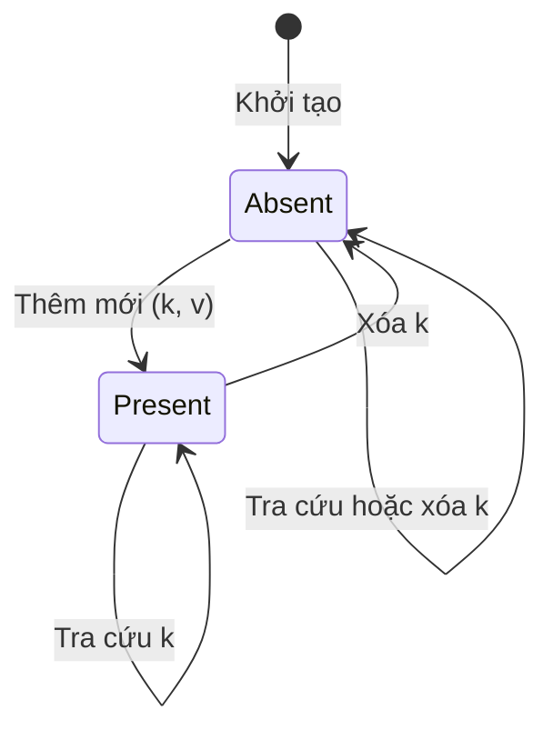

# Thêm mới, cập nhật, tra cứu và xóa theo khóa

Trong một hệ thống học tập, mỗi học viên có một mã định danh và một hồ sơ; trong kho hàng, mỗi sản phẩm có một mã SKU và số lượng tồn; trong thuật toán đồ thị, mỗi đỉnh có thể được gắn với khoảng cách tạm thời. Điểm chung của các bài toán này là cần **tìm và thay đổi dữ liệu thông qua khóa**.

Ở chương **Tập hợp và ánh xạ**, ta dùng **map (ánh xạ)** để tổ chức các cặp **khóa → giá trị** và **set (tập hợp)** để quản lý các khóa/phần tử hiện diện. Bài này tập trung vào bốn thao tác cốt lõi của map: **thêm mới, cập nhật, tra cứu và xóa theo khóa**, làm rõ hợp đồng của từng thao tác, các tình huống biên và độ phức tạp để lựa chọn cấu trúc dữ liệu phù hợp.

## 1. Bất biến nền tảng: một khóa có tối đa một giá trị hiện tại

Ta ký hiệu map là `M`. Mỗi cặp `(k, v)` trong `M` thể hiện rằng khóa `k` đang ánh xạ tới giá trị `v`. **Khóa không trùng**, nhưng giá trị có thể giống nhau ở nhiều khóa.

Ví dụ:

```text
M = {
    "SV01" → {"name": "An",   "score": 8.0},
    "SV02" → {"name": "Bình", "score": 8.0}
}
```

Hai học viên có thể cùng đạt `8.0`; điều đó không vi phạm tính duy nhất. Nhưng tại một thời điểm, khóa `"SV01"` chỉ có **một** giá trị hiện tại. Nếu cập nhật điểm của `SV01` thành `9.0`, map phải phản ánh giá trị mới ở chính khóa đó.

Trong thiết kế ADT, các bất biến chính là:

1. **Tính duy nhất của khóa:** không có hai mục độc lập có khóa được xem là bằng nhau.
2. **Liên hệ đúng khóa–giá trị:** tra cứu khóa hiện diện trả về giá trị hiện đang gắn với khóa đó.
3. **Kích thước:** `size(M)` là số khóa phân biệt, không phải số lần ghi hoặc số giá trị phân biệt.
4. **Khóa vắng mặt:** thao tác tra cứu phải có cách biểu diễn việc không tìm thấy, chẳng hạn ngoại lệ, một giá trị đánh dấu hoặc kiểu kết quả `Option`/`Maybe`.

Ta có thể mô tả map như một hàm bộ phận `M: K → V`: chỉ những khóa thuộc **miền xác định** `dom(M)` mới có giá trị. Các thao tác thêm/cập nhật/xóa làm thay đổi miền xác định hoặc giá trị liên kết của hàm này.

### Vì sao phải phân biệt thêm mới với cập nhật?

Giả sử cần đăng ký một mã tài khoản mới. Nếu mã đã được sử dụng, ta **không được ghi đè** thông tin của tài khoản cũ. Trái lại, khi người dùng sửa tên hiển thị, ta **chỉ muốn cập nhật tài khoản đang tồn tại**. Hai nghiệp vụ cần hai hợp đồng khác nhau, dù một số thư viện dùng cùng thao tác gán `map[key] = value` cho cả hai.

| Trường hợp | Thêm mới (insert if absent) | Cập nhật (update if present) | Gán / upsert |
| --- | --- | --- | --- |
| Khóa chưa tồn tại | Tạo cặp mới | Không thay đổi hoặc báo thiếu | Tạo cặp mới |
| Khóa đã tồn tại | Không thay đổi hoặc báo trùng | Thay giá trị cũ | Thay giá trị cũ |

**Upsert** là thao tác “có thì cập nhật, chưa có thì thêm”. Nó tiện lợi nhưng có thể che giấu lỗi nghiệp vụ nếu ta thực ra chỉ cho phép một trong hai trường hợp.

## 2. Vòng đời của một khóa

Theo dõi map `scores` khi chạy một chuỗi thao tác:

| Bước | Thao tác | Trạng thái sau thao tác | Kích thước |
| --- | --- | --- | --- |
| 0 | Khởi tạo | `{}` | 0 |
| 1 | Thêm `("SV01", 7.0)` | `{"SV01": 7.0}` | 1 |
| 2 | Thêm `("SV02", 8.0)` | `{"SV01": 7.0, "SV02": 8.0}` | 2 |
| 3 | Cập nhật `"SV01" → 9.0` | `{"SV01": 9.0, "SV02": 8.0}` | 2 |
| 4 | Tra cứu `"SV01"` | Trả `9.0`, trạng thái giữ nguyên | 2 |
| 5 | Xóa `"SV02"` | `{"SV01": 9.0}` | 1 |
| 6 | Xóa lại `"SV02"` | Không còn khóa để xóa | 1 |

Sơ đồ trạng thái cho **một khóa `k`**:



Điều quan trọng là **tra cứu không tự thay đổi map**; thêm mới và xóa có thể thay đổi số khóa, còn cập nhật giá trị của khóa có sẵn thì không.

## 3. Thêm mới theo khóa

Thêm mới (insert) nhận cặp `(key, value)`. Nếu khóa chưa có, map lưu cặp này và tăng số mục thêm một. Nếu đã có khóa tương đương, **thao tác thêm mới nghiêm ngặt** từ chối hoặc trả thông báo trùng. Cần nêu rõ điều này vì các API gán thông thường có thể ghi đè giá trị cũ.

```text
INSERT_IF_ABSENT(M, key, value):
    nếu CONTAINS_KEY(M, key):
        trả DUPLICATE_KEY
    lưu (key, value) vào M
    trả INSERTED
```

Ví dụ Python:

```python
students = {"SV01": "An"}

def insert_if_absent(mapping, key, value):
    if key in mapping:
        return False
    mapping[key] = value
    return True

print(insert_if_absent(students, "SV02", "Bình"))  # True
print(insert_if_absent(students, "SV01", "Chi"))   # False
print(students)  # {'SV01': 'An', 'SV02': 'Bình'}
```

Hàm `insert_if_absent` minh họa **ngữ nghĩa** và phù hợp trong chương trình chạy tuần tự. Nếu nhiều luồng hoặc tiến trình có thể sửa cùng một map, cặp thao tác “kiểm tra rồi gán” **không mặc nhiên nguyên tử**; cần cơ chế đồng bộ hoặc một API chèn có điều kiện nguyên tử của hệ thống tương ứng.

### Nếu thêm một khóa có giá trị giống giá trị cũ?

```python
grades = {"SV01": 8.0}
grades["SV02"] = 8.0
print(len(grades))  # 2
```

Đó vẫn là **hai mục hợp lệ**, bởi hai khóa khác nhau. Map bảo đảm khóa duy nhất, không bảo đảm giá trị duy nhất.

## 4. Cập nhật theo khóa

Cập nhật thay đổi giá trị của **một khóa đã có** mà không thay đổi số mục:

```text
UPDATE_IF_PRESENT(M, key, new_value):
    nếu không CONTAINS_KEY(M, key):
        trả NOT_FOUND
    thay giá trị gắn với key bằng new_value
    trả UPDATED
```

```python
grades = {"SV01": 7.5, "SV02": 8.0}

def update_if_present(mapping, key, value):
    if key not in mapping:
        return False
    mapping[key] = value
    return True

print(update_if_present(grades, "SV01", 9.0))  # True
print(update_if_present(grades, "SV99", 6.0))  # False
print(grades)  # {'SV01': 9.0, 'SV02': 8.0}
```

Trong Python, câu lệnh `grades["SV99"] = 6.0` là **upsert**: nó thêm khóa `SV99` nếu chưa có. Vì vậy, khi nghiệp vụ không cho phép tạo bản ghi mới, cần kiểm tra sự hiện diện trước hoặc dùng giao diện chỉ cập nhật phù hợp.

### Thay toàn bộ giá trị và thay một trường bên trong giá trị

Map có thể lưu đối tượng phức hợp. Ta cần phân biệt **thay giá trị của khóa** với **sửa nội dung đối tượng đang được tham chiếu**:

```python
profiles = {
    "SV01": {"name": "An", "score": 7.5}
}

# Thay toàn bộ giá trị hiện tại của khóa
profiles["SV01"] = {"name": "An", "score": 9.0}

# Sửa một trường trong dict đang là giá trị
profiles["SV01"]["score"] = 9.5

print(len(profiles))              # 1
print(profiles["SV01"]["score"])  # 9.5
```

Trong cả hai cách, số khóa của map vẫn là `1`. Tuy nhiên, cách sửa trực tiếp một đối tượng có thể ảnh hưởng đến **các tham chiếu khác cùng trỏ tới đối tượng đó**. Khi cần giữ lịch sử bất biến, hãy tạo bản sao/bản ghi mới thay vì sửa tại chỗ.

### Cập nhật dựa trên giá trị cũ

Bài toán đếm số lần xuất hiện yêu cầu lấy giá trị hiện tại, cộng thêm rồi lưu lại:

```python
events = ["SV01", "SV02", "SV01", "SV01"]
count_by_student = {}

for student_id in events:
    count_by_student[student_id] = count_by_student.get(student_id, 0) + 1

print(count_by_student)  # {'SV01': 3, 'SV02': 1}
```

Đây là ví dụ **cập nhật có điều kiện hoặc thêm mới**: nếu khóa chưa có, khởi tạo bộ đếm từ `0`; nếu đã có, tăng giá trị hiện tại. Trong môi trường có nhiều tác nhân đồng thời, phép “đọc → cộng → ghi” cũng cần cơ chế cập nhật nguyên tử để tránh mất lần tăng.

## 5. Tra cứu theo khóa

Tra cứu cần trả giá trị tương ứng với khóa, hoặc thông tin cho biết khóa không tồn tại. Về mặt ADT, tra cứu là thao tác **chỉ đọc**.

```text
LOOKUP(M, key):
    nếu CONTAINS_KEY(M, key):
        trả FOUND(value gắn với key)
    ngược lại:
        trả NOT_FOUND
```

Python có ba cách thông dụng:

```python
prices = {"SP01": 120_000, "SP02": 0}

print(prices["SP01"])                  # 120000
print(prices.get("SP99"))              # None
print(prices.get("SP99", -1))          # -1
print("SP02" in prices)                # True

# prices["SP99"] -> KeyError nếu chạy
```

Đặc biệt phải phân biệt **khóa không tồn tại** với **giá trị hợp lệ có vẻ “rỗng”**. Giá `0`, chuỗi `""`, `False`, list rỗng hoặc `None` đều có thể là giá trị thật:

```python
settings = {"nickname": None, "enabled": False}

print(settings.get("nickname"))  # None, nhưng khóa tồn tại
print(settings.get("missing"))   # None, nhưng khóa không tồn tại

print("nickname" in settings)    # True
print("missing" in settings)     # False
```

Khi `None` là giá trị hợp lệ mà muốn tra cứu trong một bước, sử dụng **sentinel** riêng biệt:

```python
missing = object()
value = settings.get("nickname", missing)

if value is missing:
    print("Không có khóa")
else:
    print("Khóa có mặt, giá trị:", value)   # ... None
```

Không viết `if prices.get("SP02"):` để kiểm tra tồn tại, bởi giá trị `0` sẽ bị hiểu thành sai. Nên dùng `"SP02" in prices` nếu mục tiêu là kiểm tra khóa.

### Tra cứu khóa khác tra cứu giá trị

```python
grade_by_student = {"SV01": 8.0, "SV02": 8.0}

print("SV01" in grade_by_student)             # True: kiểm tra khóa
print(8.0 in grade_by_student.values())       # True: tìm trong các giá trị
```

Map được tối ưu chủ yếu cho **tra cứu theo khóa**. Kiểm tra một giá trị có xuất hiện trong `values()` thường phải duyệt qua nhiều mục, nên có thể tốn `O(n)`. Nếu nghiệp vụ thường xuyên cần tìm ngược từ giá trị sang khóa, cân nhắc xây **chỉ mục phụ**; vì giá trị có thể lặp, chỉ mục ngược thường có dạng `giá trị → tập khóa`.

## 6. Xóa theo khóa

Xóa một khóa đồng nghĩa loại bỏ cặp `(key, value)` đang gắn với nó. Nếu khóa không tồn tại, hợp đồng của thao tác quyết định trả trạng thái không tìm thấy hay phát sinh lỗi.

```text
DELETE(M, key):
    nếu không CONTAINS_KEY(M, key):
        trả NOT_FOUND
    loại cặp có khóa key khỏi M
    giảm số khóa phân biệt
    trả DELETED
```

Trong Python:

```python
inventory = {"SP01": 12, "SP02": 0}

removed = inventory.pop("SP01")
print(removed)                  # 12
print(inventory)                # {'SP02': 0}

inventory.pop("SP99", None)     # Không có: trả None, không gây lỗi
# del inventory["SP99"]        # KeyError nếu khóa không tồn tại

# Cách xóa chỉ khi khóa có mặt
if "SP02" in inventory:
    del inventory["SP02"]
print(inventory)                # {}
```

Trong các ngôn ngữ khác, phương thức `remove` có thể trả `boolean`, giá trị cũ hoặc một cấu trúc `Option`. Khi **giá trị `None` là hợp lệ**, không thể chỉ dựa vào `pop(k, None)` để phân biệt “đã xóa khóa có giá trị None” với “khóa vắng mặt”; có thể kiểm tra tồn tại trước hoặc dùng sentinel phù hợp.

### Xóa trong hash map và cây cân bằng

Tùy cách cài đặt, xóa có các bước kỹ thuật khác nhau:

- **Hash map dùng chaining:** tìm cặp theo hash và phép so sánh bằng nhau, sau đó loại cặp khỏi vùng chứa va chạm.
- **Hash map dùng open addressing:** khi xóa, nhiều hiện thực phải dùng ô đánh dấu đã xóa (tombstone) hoặc dịch lại các mục để không phá vỡ đường tìm kiếm; không thể tùy tiện biến ô giữa chuỗi thăm dò thành ô “chưa từng sử dụng”.
- **Tree map:** tìm nút theo khóa, xóa nút và có thể cân bằng lại cây để bảo toàn hiệu năng.

Các bước này là chi tiết hiện thực; hợp đồng chung của ADT vẫn là **khóa bị xóa không còn tra cứu được**, các khóa khác vẫn hoạt động đúng.

## 7. Duy trì bất biến trước và sau thao tác

Cho map `M` ban đầu có `n` khóa và `k` là khóa đang xét. Ta dùng bảng để kiểm tra thiết kế và viết kiểm thử:

| Thao tác | Tiền điều kiện | Hậu điều kiện | Đổi `size(M)` |
| --- | --- | --- | --- |
| Thêm nghiêm ngặt `insert(k, v)` | `k ∉ dom(M)` | `M[k] = v` | `+1` |
| Thêm nghiêm ngặt nhưng `k` đã có | Không thỏa tiền điều kiện | Báo trùng/không đổi | `0` |
| Cập nhật `update(k, v)` | `k ∈ dom(M)` | `M[k] = v` | `0` |
| Cập nhật khi `k` vắng mặt | Không thỏa tiền điều kiện | Báo thiếu/không đổi | `0` |
| Tra cứu `lookup(k)` | Không cần | Trả giá trị hoặc thông báo thiếu; không sửa map | `0` |
| Xóa `delete(k)` khi `k` có | `k ∈ dom(M)` | `k ∉ dom(M)` | `−1` |
| Xóa khi `k` không có | Không thỏa tiền điều kiện | Báo thiếu/không đổi | `0` |
| Upsert `put(k, v)` | Không cần | `M[k] = v` | `+1` nếu mới; `0` nếu cũ |

Để kiểm tra kích thước, cần quan sát xem khóa **đã có trước thao tác** hay chưa, thay vì luôn tăng hoặc luôn giảm biến đếm sau một lời gọi.

### Bất biến của khóa và phép so sánh

Với cấu trúc dựa trên băm, nếu hai khóa được coi là bằng nhau thì chúng phải có hash tương thích; hash bằng nhau **không có nghĩa** là hai khóa bằng nhau. Các khóa cần ổn định theo quy tắc băm/so sánh trong thời gian lưu ở map:

```python
locations = {}
locations[("A", 10)] = "Kho phía bắc"  # tuple chứa phần tử hashable

# locations[["A", 10]] = "Kho phía bắc"
# TypeError: list không hashable trong Python
```

Với cây tìm kiếm cân bằng, quy tắc so sánh các khóa phải nhất quán để thao tác tìm/cập nhật/xóa đúng vị trí. Chẳng hạn, nếu miền khóa nghiệp vụ **không phân biệt chữ hoa**, phải chuẩn hóa định danh hoặc cung cấp bộ so sánh nhất quán. `"sv01"` và `"SV01"` mặc định là hai chuỗi khác nhau trong `dict` Python.

## 8. Độ phức tạp của bốn thao tác

Đặc tả ADT không tự quyết định hiệu năng; cấu trúc lưu trữ mới quyết định chi phí. Gọi `n` là số khóa hiện diện và `U` là độ lớn miền khóa khả dĩ.

| Cách cài đặt | Tra cứu khóa | Thêm/cập nhật khóa | Xóa khóa | Bộ nhớ điển hình |
| --- | --- | --- | --- | --- |
| **Hash map** | Trung bình `O(1)` | Trung bình `O(1)` | Trung bình `O(1)` | `O(n)` |
| **Cây tìm kiếm cân bằng** | `O(log n)` | `O(log n)` | `O(log n)` | `O(n)` |
| **Danh sách cặp chưa sắp** | `O(n)` | `O(n)` nếu phải kiểm tra trùng | `O(n)` | `O(n)` |
| **Mảng cặp đã sắp** | `O(log n)` qua tìm kiếm nhị phân | `O(n)` khi cần dịch phần tử | `O(n)` khi cần dịch phần tử | `O(n)` |
| **Địa chỉ trực tiếp** (khóa nguyên, miền nhỏ) | `O(1)` | `O(1)` | `O(1)` | `O(U)` |

**Giả định:** So sánh khóa, tính hash hoặc truy cập một ô bộ nhớ cơ bản được xem là `O(1)`. Với khóa chuỗi rất dài hoặc đối tượng phức tạp, chi phí băm và so sánh có thể phụ thuộc kích thước của khóa.

### Tại sao hash map có thể không đạt `O(1)`?

Hash map cần tính hash, tìm vùng chứa và kiểm tra các khóa ứng viên. Khi hash phân bố tốt, hệ số tải hợp lý và va chạm được xử lý hiệu quả, mỗi thao tác có thời gian trung bình hoặc kỳ vọng `O(1)`. Nhưng:

- Nhiều khóa va chạm có thể khiến việc tìm hoặc sửa một mục tốn `O(n)` ở một số hiện thực.
- Một lần **mở rộng và tái băm** có thể tốn `O(n)`; độ phức tạp chèn trung bình theo chuỗi thao tác thường được phân tích **khấu hao**.
- Các bảo đảm của từng thư viện có thể khác nhau; không nên tuyên bố mọi hash map luôn có giới hạn xấu nhất là `O(1)`.

Với cây tìm kiếm **cân bằng**, chiều cao `O(log n)` cho giới hạn tìm/thêm/xóa `O(log n)`, đồng thời hỗ trợ duyệt theo thứ tự khóa và truy vấn khoảng. Một cây tìm kiếm không tự cân bằng có thể suy biến thành chuỗi với chiều cao `O(n)`.

### Khi nào nên chọn cấu trúc nào?

Nếu công việc chủ yếu là đọc/cập nhật một SKU cụ thể theo mã, **hash map** thường hợp lý. Nếu cần “tất cả mã hàng từ `SP100` đến `SP200` theo thứ tự tăng dần”, **tree map** có trật tự sẽ thuận tiện hơn. Nếu miền khóa chỉ gồm vài nghìn số nguyên liên tiếp, mảng địa chỉ trực tiếp có thể hiệu quả; nhưng cấp phát theo `U` trở nên lãng phí nếu miền khóa cực lớn và thưa.

## 9. Ví dụ tổng hợp: quản lý tồn kho theo mã sản phẩm

Ta muốn triển khai các thao tác với điều kiện nghiệp vụ rõ ràng:

- **Thêm** một mã mới chỉ khi nó chưa có.
- **Cập nhật số lượng** chỉ với mã đã tồn tại; số lượng không âm.
- **Tra cứu** trả kết quả phân biệt mã thiếu với tồn kho `0`.
- **Xóa** theo mã và cho biết thao tác có thực sự xóa mục nào không.

```python
class Inventory:
    def __init__(self):
        self._quantities = {}

    def add_product(self, sku, quantity):
        if quantity < 0:
            raise ValueError("Số lượng không được âm")
        if sku in self._quantities:
            return False
        self._quantities[sku] = quantity
        return True

    def change_quantity(self, sku, quantity):
        if quantity < 0:
            raise ValueError("Số lượng không được âm")
        if sku not in self._quantities:
            return False
        self._quantities[sku] = quantity
        return True

    def find_quantity(self, sku):
        if sku not in self._quantities:
            return None  # Trong ví dụ này, số lượng luôn là số nguyên
        return self._quantities[sku]

    def delete_product(self, sku):
        if sku not in self._quantities:
            return False
        del self._quantities[sku]
        return True

    def product_count(self):
        return len(self._quantities)

inventory = Inventory()

assert inventory.add_product("SP01", 10) is True
assert inventory.add_product("SP01", 99) is False
assert inventory.product_count() == 1
assert inventory.find_quantity("SP01") == 10

assert inventory.change_quantity("SP01", 0) is True
assert inventory.find_quantity("SP01") == 0       # Có mã, hết hàng
assert inventory.change_quantity("SP99", 5) is False
assert inventory.find_quantity("SP99") is None     # Không có mã

assert inventory.delete_product("SP01") is True
assert inventory.delete_product("SP01") is False
assert inventory.product_count() == 0
```

Ví dụ cố tình sử dụng `None` để báo mã chưa tồn tại vì đã quy định **mọi giá trị hợp lệ đều là số nguyên không âm**. Trong hệ thống cho phép `None` như một giá trị hợp lệ, nên trả `(found, value)`, kết quả có nhãn hoặc một sentinel để không nhập nhằng.

### Trường hợp có xử lý đồng thời

Các phương thức trên thể hiện rõ hành vi **trong bối cảnh sử dụng tuần tự**. Nếu nhiều luồng, tiến trình hay yêu cầu API cùng ghi tồn kho, việc kiểm tra và gán/xóa phải có cơ chế đồng bộ hoặc giao dịch phù hợp. Ví dụ, hai yêu cầu cùng đọc số lượng `1` rồi cùng trừ `1` có thể bán quá số lượng thực tế nếu không kiểm soát thao tác đọc–sửa–ghi. Đây là yêu cầu của bài toán đồng thời và tính toàn vẹn dữ liệu, không phải đặc tính tự động được Map ADT bảo đảm.

## 10. Những lỗi thường gặp

1. **Gộp “thêm mới” và “cập nhật” khi nghiệp vụ yêu cầu phân biệt.** Câu lệnh `mapping[key] = value` của Python tạo mới nếu thiếu khóa; nó không phải một API “chỉ cập nhật”.
2. **Cho rằng giá trị `0`, `False`, `""` hay `None` có nghĩa là khóa vắng mặt.** Hãy dùng `key in mapping` hoặc sentinel riêng.
3. **Tăng hoặc giảm biến đếm vô điều kiện.** Thêm khóa trùng hoặc xóa khóa không tồn tại không làm thay đổi số khóa phân biệt.
4. **Dùng `key in map.values()` để kiểm tra khóa.** Tra cứu theo khóa phải thực hiện trên map hoặc tập khóa, không phải trên tập giá trị.
5. **Dùng list hoặc đối tượng không hashable làm khóa `dict` trong Python.** Khóa cần đáp ứng hợp đồng băm và phép so sánh.
6. **Xóa phần tử khi đang duyệt map.** Trong Python, thêm/xóa khóa giữa vòng lặp trên `dict` có thể gây `RuntimeError`. Có thể duyệt một bản sao danh sách khóa:

```python
scores = {"SV01": 8, "SV02": 0, "SV03": 9}
for student_id in list(scores):
    if scores[student_id] == 0:
        del scores[student_id]
print(scores)  # {'SV01': 8, 'SV03': 9}
```

7. **Dựa vào thứ tự duyệt của mọi loại map.** Map ADT không yêu cầu thứ tự. `dict` Python từ 3.7 bảo đảm thứ tự chèn; điều đó không đồng nghĩa với thứ tự tăng dần của khóa, và không áp dụng cho mọi kiểu hash map.
8. **Tưởng xóa mục sẽ xóa mọi đối tượng được tham chiếu bên ngoài.** Xóa cặp khóa–giá trị khỏi map chỉ loại liên hệ trong map. Đối tượng giá trị có thể vẫn tồn tại nếu còn tham chiếu ở nơi khác.

## 11. Tự luyện tập

**Bài 1 – Theo dõi trạng thái.** Bắt đầu với map rỗng; thực hiện upsert `("A", 1)`, upsert `("B", 1)`, upsert `("A", 2)`, xóa `"B"`, xóa `"C"`. Tính kích thước và trạng thái cuối.

**Bài 2 – Khóa thiếu hay giá trị `None`?** Với `M = {"A": None, "B": 0}`, cho biết kết quả của `"A" in M`, `M.get("C")` và lý do không được dùng `if M.get("B"):` để quyết định khóa `"B"` có mặt.

**Bài 3 – Chọn API.** Khi tạo tài khoản, mã đăng nhập phải duy nhất và không được ghi đè tài khoản cũ. Nên sử dụng ngữ nghĩa insert-if-absent, update-if-present hay upsert? Trình bày lý do.

**Bài 4 – Độ phức tạp.** Với `n` mã phân biệt, so sánh thời gian tra cứu theo khóa của hash map và cây tìm kiếm cân bằng. Nêu giả định đi kèm mỗi đánh giá.

**Bài 5 – Bài toán đếm.** Viết hàm nhận một danh sách mã và trả map `mã → số lần xuất hiện`. Sau đó xóa khỏi map những mã có số lần nhỏ hơn `2` mà không gây lỗi do sửa kích thước map khi đang duyệt.

**Bài 6 – Thiết kế giao diện.** Một kho hàng có thể lưu giá trị `None` khi chưa kiểm kê. Hãy thiết kế `lookup(sku)` sao cho phân biệt “không có SKU” và “có SKU nhưng chưa kiểm kê”.

<details>
<summary>Đáp án và gợi ý</summary>

1. Trạng thái cuối `{"A": 2}`, kích thước `1`; upsert lần hai trên `"A"` chỉ thay giá trị, xóa khóa `"C"` không đổi map.
2. `"A" in M` trả `True`. `M.get("C")` trả `None` theo mặc định. `M.get("B")` trả `0`, một giá trị `False` khi chuyển sang boolean dù khóa vẫn tồn tại.
3. Dùng insert-if-absent để phát hiện mã trùng và giữ nguyên thông tin tài khoản hiện có.
4. Hash map trung bình/kỳ vọng `O(1)` với băm tốt, kiểm soát tải và thao tác khóa cơ bản hằng số; cây tìm kiếm cân bằng `O(log n)` nhờ chiều cao logarit.
5. Một lời giải:

```python
def frequencies_at_least_two(ids):
    counts = {}
    for student_id in ids:
        counts[student_id] = counts.get(student_id, 0) + 1
    for student_id in list(counts):
        if counts[student_id] < 2:
            del counts[student_id]
    return counts

assert frequencies_at_least_two(["A", "B", "A", "C"]) == {"A": 2}
```

6. Trả cấu trúc có cờ tồn tại, chẳng hạn `(True, None)` khi có SKU nhưng chưa kiểm kê và `(False, None)` khi không có SKU; hoặc dùng kiểu `Option` để phân biệt hai trạng thái.

</details>

## Ghi nhớ

**Thêm mới** làm xuất hiện một khóa trước đó chưa có, **cập nhật** thay giá trị của khóa hiện có, **tra cứu** đọc giá trị hoặc xác định khóa vắng mặt, và **xóa** loại cặp theo khóa. **Upsert** kết hợp hai hành vi thêm/cập nhật và phải dùng đúng với quy tắc nghiệp vụ. Bất biến quan trọng nhất là **mỗi khóa phân biệt có tối đa một giá trị tại một thời điểm**. Hash map thường có các thao tác trung bình `O(1)`, trong khi cây tìm kiếm cân bằng cung cấp giới hạn `O(log n)` và thứ tự khóa. Chọn đúng hợp đồng thao tác, quy tắc bằng nhau của khóa và cấu trúc cài đặt để bảo đảm tính đúng đắn trước khi tối ưu hiệu năng.
