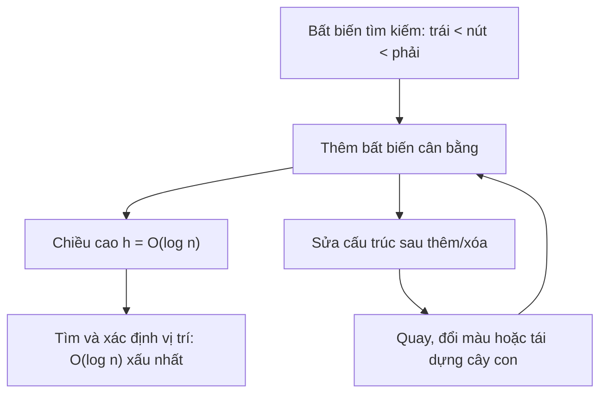

# Mục tiêu khống chế chiều cao và các dạng bất biến cân bằng

## Mục tiêu học tập

Sau bài này, bạn có thể:

- Giải thích vì sao **chiều cao của cây tìm kiếm** quyết định chi phí tìm, thêm, xóa và truy vấn khoảng.
- Phân biệt **cây tìm kiếm nhị phân (BST)** với **cây tìm kiếm cân bằng**: cùng bất biến thứ tự nhưng không cùng bảo đảm chiều cao.
- Phát biểu và đối chiếu những dạng **bất biến cân bằng** phổ biến: cân bằng chiều cao (AVL), cân bằng bằng màu/độ cao đen (Red–Black), cân bằng theo kích thước, ưu tiên ngẫu nhiên (treap) và ràng buộc bậc nhánh của B-tree.
- Mô tả vì sao **phép quay cây** có thể khôi phục cân bằng mà vẫn giữ nguyên thứ tự khóa.
- Đọc và vận dụng ví dụ Python cài **chèn AVL**, kiểm tra đồng thời bất biến BST, bất biến chiều cao và metadata lưu ở nút.
- Nhận diện các đánh đổi về thời gian, bộ nhớ và độ phức tạp bảo trì để lựa chọn cấu trúc phù hợp.

## 1. Vấn đề cốt lõi: BST đúng thứ tự vẫn có thể rất cao

Giả sử một nền tảng học tập cần tra bài theo khóa số nguyên duy nhất và đồng thời liệt kê bài theo khóa tăng dần. Một **cây tìm kiếm nhị phân (Binary Search Tree — BST)** có thể giải quyết hai nhu cầu ấy nếu duy trì:

- Mọi khóa trong **cây con trái** nhỏ hơn khóa tại nút.
- Mọi khóa trong **cây con phải** lớn hơn khóa tại nút.
- Quy tắc với **khóa trùng** được xác định trước; trong bài này, ta dùng khóa phân biệt và cập nhật giá trị nếu khóa đã tồn tại.

Ví dụ với các khóa `10, 20, 30, 40, 50`, có thể tạo hai hình dạng khác nhau:

```text
BST lệch hẳn sang phải:       BST được cân bằng:

10                                   30
  \                                 /  \
   20                             20    40
     \                           /        \
      30                        10         50
        \
         40
           \
            50
```

Cả hai cây đều thỏa **bất biến thứ tự của BST**. Nhưng để tìm `50`, cây lệch phải phải đi qua nhiều nút hơn. Nếu tiếp tục chèn các khóa tăng dần theo cách chèn BST thông thường, cây có thể trở thành một **danh sách liên kết** dưới hình thức nút cây.

**Chiều cao (height)** đo độ dài đường dài nhất đi từ một nút đến lá trong cây con của nó. Có hai quy ước phổ biến:

- Đếm **số cạnh**: cây chỉ có gốc cao 0.
- Đếm **số nút**: cây chỉ có gốc cao 1.

Bài này và ví dụ Python phía dưới sử dụng **số nút**:

```text
height(None) = 0
height(nút lá) = 1
height(node) = 1 + max(height(node.left), height(node.right))
```

Hai quy ước chênh nhau một đơn vị nhưng **không làm thay đổi bậc độ phức tạp**. Điều quan trọng là phải thống nhất khi tính và kiểm tra bất biến.

### 1.1. Vì sao các phép toán phụ thuộc chiều cao?

Ở mỗi nút BST, thuật toán so sánh khóa cần tìm với khóa hiện tại, rồi chỉ đi xuống **một nhánh**:

```python
def find(root, key):
    current = root
    while current is not None:
        if key == current.key:
            return current.value
        current = current.left if key < current.key else current.right
    return None
```

Đoạn mã giả định nút có `key`, `value`, `left` và `right`. Với cây cao `h`, số nút trên một đường từ gốc tới lá không vượt quá `h`; vì thế:

- **Tìm theo khóa:** O(h) thời gian, O(1) bộ nhớ phụ nếu duyệt lặp như ví dụ.
- **Tìm vị trí chèn:** O(h) thời gian; chèn BST thông thường ở lá thêm O(1) thao tác liên kết, chưa tính tái cân bằng.
- **Tìm nút để xóa:** O(h); việc nối lại các nhánh hoặc tìm nút kế tiếp theo thứ tự cũng phụ thuộc chiều cao.
- **Tìm điểm đầu của một truy vấn khoảng:** O(h); sau đó liệt kê thêm `k` kết quả có thể đạt O(h + k) nếu duyệt phù hợp.
- **Duyệt toàn cây theo thứ tự giữa (inorder):** O(n) cho `n` nút dù cây thấp hay cao, vì phải xem mọi nút.

Nếu cây lệch với `h = Θ(n)`, tìm có thể tốn **O(n)**. Nếu duy trì `h = O(log n)`, tìm theo khóa có giới hạn xấu nhất **O(log n)**. Đây chính là **mục tiêu khống chế chiều cao**.

## 2. Mục tiêu của cân bằng không phải tạo cây hoàn hảo

Một cây nhị phân đầy đủ và có các lá ở cùng độ sâu sẽ rất thấp, nhưng việc buộc mọi cây sau mỗi lần thêm/xóa phải luôn **đạt hình dạng thấp nhất tuyệt đối** là không cần thiết và có thể làm cập nhật tốn kém.

Cấu trúc cân bằng thực tế chọn một **ràng buộc yếu hơn nhưng dễ duy trì** để bảo đảm chiều cao vẫn tăng theo logarit:



Ta cần giữ riêng **hai nhóm bất biến**:

1. **Bất biến thứ tự**: nội dung và quan hệ khóa phải đúng để tìm kiếm rẽ đúng nhánh.
2. **Bất biến cân bằng**: hình dạng hoặc metadata phải bị ràng buộc đủ mạnh để đường đi không quá dài.

Một phép cập nhật có thể giữ nguyên bất biến thứ tự nhưng làm hỏng cân bằng. Ngược lại, một thao tác quay sai có thể làm cây trông thấp hơn nhưng phá thứ tự BST. Cài đặt đúng phải bảo vệ **cả hai**.

### 2.1. Định lượng mục tiêu

Với cây nhị phân cao `h` theo **số nút**, số nút tối đa là:

\[
n \le 2^h - 1.
\]

Từ đó chỉ suy ra **chiều cao phải đủ lớn để chứa n nút**, tức `h ≥ log₂(n+1)`; không suy ra giới hạn trên! Một cây một nhánh có thể cao đúng `n`.

Để được giới hạn **h ≤ c log₂(n+1)** với hằng số `c`, ta cần chứng minh rằng những hình dạng quá lệch bị **bất biến cân bằng** cấm. Mỗi họ cây cân bằng chọn một cách cấm khác nhau.

### 2.2. Thứ tự cân bằng là điều kiện bảo đảm, không chỉ là hình vẽ

Hai cây nhìn có vẻ cân đối khi chỉ quan sát vài mức đầu vẫn có thể có một nhánh rất sâu. Một **bất biến được phát biểu và kiểm tra được** mới cho phép chứng minh giới hạn chiều cao cho mọi chuỗi cập nhật hợp lệ.

Ví dụ, nói “trái và phải trông gần bằng nhau” chưa đủ. Phải chỉ ra:

- Đo bằng **chiều cao**, **số nút**, **màu**, **độ cao đen**, hay **kích thước nút trang**?
- Ràng buộc áp dụng tại **mọi nút** hay chỉ trên **toàn cây**?
- Khi thêm/xóa, thao tác nào khôi phục được ràng buộc?
- Bảo đảm là **trường hợp xấu nhất**, **kỳ vọng**, hay chỉ **khấu hao**?

## 3. AVL: bất biến cân bằng theo chiều cao cục bộ

**Cây AVL** là BST trong đó tại **mọi nút**:

\[
\left|h(\text{left})-h(\text{right})\right| \le 1.
\]

Ta định nghĩa **hệ số cân bằng**:

\[
\operatorname{balance}(v)=h(v.\text{left})-h(v.\text{right}).
\]

Vì thế mỗi nút AVL hợp lệ có hệ số thuộc `{-1, 0, 1}`.

```text
AVL hợp lệ:                      Không hợp lệ theo AVL:

        20                               20
       /  \                             /
     10    30                         10
    /                                  /
   5                                  5
                                     /
                                    2

Ở gốc bên trái:                 Ở gốc bên phải:
h(trái)=2, h(phải)=1            h(trái)=3, h(phải)=0
chênh lệch 1                    chênh lệch 3
```

AVL **không yêu cầu** mỗi nút có hai con, cũng không yêu cầu số nút của hai cây con bằng nhau. Nó chỉ giới hạn **chênh lệch chiều cao**. Việc cân bằng dựa trên số nút thay vì chiều cao là một họ thiết kế khác.

### 3.1. Vì sao AVL bảo đảm O(log n)?

Gọi `N(h)` là **số nút ít nhất** mà một cây AVL cao `h` có thể có, với `h(None)=0` và nút lá cao 1.

Để đạt chiều cao `h` mà có **ít nút nhất**, một cây con cao `h−1`, cây kia cao `h−2` — chênh nhau tối đa 1. Do đó:

\[
N(0)=0,\quad N(1)=1,\quad
N(h)=1+N(h-1)+N(h-2)\quad(h\ge2).
\]

Dãy này tăng theo cấp số gắn với **Fibonacci**; vì `N(h)` tăng theo hàm mũ của `h` nên đảo lại ta được `h = O(log n)`. Đây là lý do toán học khiến ràng buộc rất **cục bộ** ở mỗi nút dẫn đến bảo đảm chiều cao cho **toàn cây**.

Ví dụ:

| Chiều cao `h` (số nút) | `N(h)` nhỏ nhất |
| --- | ---: |
| 0 | 0 |
| 1 | 1 |
| 2 | 2 |
| 3 | 4 |
| 4 | 7 |
| 5 | 12 |
| 6 | 20 |

Không cần thuộc lòng bảng này; cần hiểu **không thể tạo một nhánh dài tùy ý mà vẫn thỏa chênh lệch chiều cao tối đa 1 ở mọi nút**.

### 3.2. Metadata cần lưu

Một nút AVL thường lưu:

- `key` và `value` của bản ghi.
- Tham chiếu `left` và `right`.
- `height` của cây con gốc tại nút (hoặc thông tin tương đương đủ để tái cân bằng).

Sau thêm/xóa một phần tử, metadata phải được cập nhật từ các nút bị ảnh hưởng **từ dưới lên**. Nếu `height` bị sai, công thức cân bằng sẽ cho kết quả sai ngay cả khi khóa BST vẫn đúng.

## 4. Phép quay cây: đổi hình dạng, giữ thứ tự

Phép **quay trái (left rotation)** và **quay phải (right rotation)** là thao tác cục bộ đổi quan hệ cha–con nhưng **bảo toàn thứ tự duyệt inorder**.

Ví dụ quay trái tại nút `x`:

```text
Trước quay trái tại x:           Sau quay trái:

       x                               y
      / \                             / \
     A   y                           x   C
        / \                         / \
       B   C                       A   B
```

Giả sử thứ tự BST thỏa `A < x < B < y < C` (ký hiệu so sánh các khóa thuộc cây con). Sau khi quay, thứ tự inorder vẫn là:

```text
A, x, B, y, C
```

Ta chỉ thay vài tham chiếu:

- `y` trở thành gốc cây con.
- `x.right` nhận cây con `B`.
- `y.left` nhận nút `x`.

Đây là **O(1)** thao tác liên kết cho một phép quay đơn, nếu đã có các nút cần quay. Nếu mỗi nút lưu chiều cao, phải cập nhật chiều cao của **nút đi xuống trước**, sau đó của **nút đi lên**.

Quay phải là phép đối xứng. Quay **không tự giải quyết mọi trường hợp mất cân bằng**: chương trình phải chọn đúng nút, hướng quay và đôi khi cần hai phép quay liên tiếp.

### 4.1. Bốn hình dạng mất cân bằng khi chèn AVL

| Trường hợp | Đường chèn làm cây cao về phía | Cách sửa điển hình |
| --- | --- | --- |
| **LL** (Left–Left) | Trái của con trái | Quay phải tại nút mất cân bằng |
| **RR** (Right–Right) | Phải của con phải | Quay trái tại nút mất cân bằng |
| **LR** (Left–Right) | Phải của con trái | Quay trái ở con trái, rồi quay phải ở nút |
| **RL** (Right–Left) | Trái của con phải | Quay phải ở con phải, rồi quay trái ở nút |

Ví dụ:

```text
Chèn 30, 10, 20 (LR):

      30               30                 20
     /                /                  /  \
   10       -->      20        -->      10   30
     \               /
      20            10

    Quay trái tại 10          Quay phải tại 30
```

Trong chèn AVL thông thường, có thể cần **một phép quay đơn hoặc một phép quay kép** sau khi chèn; tổng chi phí tìm điểm chèn và cập nhật metadata trên đường tổ tiên vẫn O(log n). Khi **xóa**, giảm chiều cao ở một nhánh có thể dẫn tới nhiều nút tổ tiên mất cân bằng, nên số lần điều chỉnh có thể lớn hơn.

## 5. Ví dụ Python: chèn AVL và kiểm chứng bất biến

Đây là một bản cài đặt học tập của **AVL Map** với khóa là số nguyên phân biệt; thêm một khóa đã tồn tại sẽ **cập nhật giá trị**. Mã dùng quy ước `h(None)=0` và `h(leaf)=1`.

```python
class AVLNode:
    def __init__(self, key, value):
        self.key = key
        self.value = value
        self.left = None
        self.right = None
        self.height = 1


def height(node):
    return 0 if node is None else node.height


def update_height(node):
    node.height = 1 + max(height(node.left), height(node.right))


def rotate_left(x):
    y = x.right                  # Điều kiện: x.right tồn tại.
    middle = y.left
    y.left = x
    x.right = middle
    update_height(x)             # Nút x đã đi xuống.
    update_height(y)
    return y                     # Gốc cây con mới.


def rotate_right(y):
    x = y.left                   # Điều kiện: y.left tồn tại.
    middle = x.right
    x.right = y
    y.left = middle
    update_height(y)             # Nút y đã đi xuống.
    update_height(x)
    return x


def insert(root, key, value):
    if root is None:
        return AVLNode(key, value)

    if key < root.key:
        root.left = insert(root.left, key, value)
    elif key > root.key:
        root.right = insert(root.right, key, value)
    else:
        root.value = value       # Khóa đã có: chỉ cập nhật giá trị.
        return root

    update_height(root)
    balance = height(root.left) - height(root.right)

    if balance > 1:              # Nặng bên trái.
        if key > root.left.key:  # LR: sửa con trái trước.
            root.left = rotate_left(root.left)
        return rotate_right(root)

    if balance < -1:             # Nặng bên phải.
        if key < root.right.key: # RL: sửa con phải trước.
            root.right = rotate_right(root.right)
        return rotate_left(root)

    return root


def find(root, key):
    current = root
    while current is not None:
        if key == current.key:
            return current.value
        current = current.left if key < current.key else current.right
    return None


def inorder_keys(root):
    if root is None:
        return []
    return (
        inorder_keys(root.left)
        + [root.key]
        + inorder_keys(root.right)
    )


def validate_avl(root, lower=None, upper=None):
    """Trả (chiều cao, số nút) và xác minh các bất biến."""
    if root is None:
        return 0, 0

    if lower is not None:
        assert lower < root.key, "Vi phạm BST ở cận dưới"
    if upper is not None:
        assert root.key < upper, "Vi phạm BST ở cận trên"

    left_h, left_n = validate_avl(root.left, lower, root.key)
    right_h, right_n = validate_avl(root.right, root.key, upper)

    assert abs(left_h - right_h) <= 1, "Vi phạm cân bằng AVL"
    actual_h = 1 + max(left_h, right_h)
    assert root.height == actual_h, "Metadata height không đúng"

    return actual_h, 1 + left_n + right_n


keys = [30, 20, 10, 25, 27, 40, 50, 45, 5, 35]
root = None
for key in keys:
    root = insert(root, key, f"lesson-{key}")
    validate_avl(root)           # Kiểm tra sau mỗi lần chèn.

assert inorder_keys(root) == sorted(keys)
assert find(root, 27) == "lesson-27"
assert find(root, 999) is None
assert validate_avl(root)[1] == len(keys)

root = insert(root, 25, "updated")
assert find(root, 25) == "updated"
assert validate_avl(root)[1] == len(keys)  # Không tạo khóa trùng.
```

### 5.1. Từng bất biến được kiểm tra ở đâu?

1. **BST:** tham số `lower` và `upper` buộc mọi nút trong cây con nằm đúng trong khoảng khóa của các tổ tiên; không chỉ kiểm tra quan hệ với cha trực tiếp.
2. **AVL:** chênh lệch chiều cao của hai cây con tại mỗi nút không vượt quá 1.
3. **Metadata:** `root.height` phải bằng chiều cao **thực tế tính lại từ các cây con**.
4. **Tính duy nhất của khóa:** chỉ nhánh `<` hoặc `>` mới thêm nút; trường hợp `==` chỉ thay giá trị.
5. **Thứ tự inorder:** sau chuỗi chèn và quay, các khóa duyệt theo thứ tự giữa vẫn tăng dần.

**Độ phức tạp của `insert`:** đường tìm và cập nhật tổ tiên dài O(log n); một hoặc hai phép quay cục bộ có chi phí O(1), nên mỗi lần chèn vào AVL hợp lệ mất **O(log n)** thời gian xấu nhất, dùng **O(log n)** bộ nhớ ngăn xếp đệ quy. Mỗi nút chiếm O(1) metadata bổ sung, tổng bộ nhớ cây O(n).

**Lưu ý về hàm kiểm chứng:** `validate_avl` duyệt **toàn bộ cây**, mất **O(n)** thời gian cho mỗi lần gọi; `inorder_keys` ở đây ghép list đệ quy cho dễ đọc nên có thể sao chép nhiều phần tử hơn cần thiết. Đây là **công cụ minh họa/kiểm thử**, không phải phần bắt buộc của thao tác chèn vận hành. Nếu muốn duyệt inorder O(n) thời gian với ít bộ nhớ trung gian hơn, dùng generator hoặc một danh sách kết quả chung.

Ví dụ chỉ cài **chèn**, chưa cài xóa. Xóa AVL cũng cần bảo toàn cả bất biến thứ tự, metadata và cân bằng; không nên lấy phép xóa BST thường rồi cho rằng cây vẫn là AVL.

## 6. Red–Black: bất biến màu và số nút đen trên đường đi

**Cây Đỏ–Đen (Red–Black Tree)** cũng là BST, nhưng dùng thêm một bit màu cho mỗi nút và những quy tắc thường được mô tả như sau:

1. Mỗi nút thật có màu **đỏ** hoặc **đen**.
2. Gốc được quy định là **đen** trong cách biểu diễn thông dụng.
3. Các nút lá giả `NIL` (sentinel) được coi là **đen**.
4. Nút **đỏ** không có con đỏ: không có hai nút đỏ thật liên tiếp trên một đường cha–con.
5. Từ một nút bất kỳ, mọi đường đi xuống các lá giả `NIL` thuộc cây con của nó có cùng **số nút đen**, theo một quy ước đếm nhất quán.

Điều kiện cuối gọi là bất biến **black-height (chiều cao đen)**. Nó **không** yêu cầu hai nhánh có cùng chiều cao tổng thể. Một nhánh có thể chứa nhiều nút đỏ xen kẽ với nút đen hơn nhánh kia, nhưng không thể có một chuỗi đỏ tùy ý dài.

```text
Ví dụ minh họa màu và quy tắc không có hai nút đỏ liền nhau:

              20(B)
             /     \
          10(R)    30(R)
          /   \     /   \
       NIL(B) NIL(B) NIL(B) NIL(B)

B = đen; R = đỏ; NIL = lá giả đen.
Mỗi đường gốc -> NIL có cùng số nút đen.
```

### 6.1. Vì sao chiều cao bị chặn?

Do **không có hai nút đỏ liên tiếp**, đường dài nhất không thể chứa quá nhiều nút đỏ so với nút đen. Do **mọi đường có cùng black-height**, một cây con có black-height `b` phải có đủ số nút thật, ít nhất theo bậc `2^b - 1`.

Kết hợp hai điều kiện, chiều cao tính bằng số cạnh của cây Đỏ–Đen với `n` nút thật có giới hạn quen thuộc:

\[
h \le 2\log_2(n+1).
\]

Như vậy tìm theo khóa trong cây Đỏ–Đen có **O(log n)** thời gian xấu nhất. Hằng số trong giới hạn chiều cao này khác AVL; Red–Black **không đòi chênh lệch chiều cao ≤ 1** tại từng nút.

### 6.2. Khôi phục bất biến sau cập nhật

Sau chèn hoặc xóa, Red–Black có thể cần:

- **Đổi màu** một số nút để khôi phục quy tắc nút đỏ và black-height.
- **Quay trái/quay phải** để thay hình dạng mà vẫn giữ thứ tự BST.
- Xử lý riêng các tình huống liên quan đến **cha**, **ông**, **chú/bác** hoặc nút anh em theo thuật toán của biến thể triển khai.

Metadata màu nhỏ; tuy nhiên phần mã sửa bất biến, nhất là xóa, thường nhiều trường hợp hơn một BST đơn giản. **AVL** và **Red–Black** đều bảo đảm O(log n) trường hợp xấu nhất cho các phép toán tìm/chèn/xóa nếu cài đúng, nhưng chọn họ nào cần xét cả tần suất cập nhật, chi phí xoay/đổi màu, bộ nhớ và thư viện sẵn có. Không nên khẳng định một họ luôn nhanh hơn họ kia chỉ từ tên gọi.

## 7. Các dạng bất biến cân bằng khác

Không phải mọi cây cân bằng đều dựa vào **chênh lệch chiều cao** hoặc **màu**.

### 7.1. Cân bằng theo kích thước cây con (weight/size balance)

Một cách tiếp cận là lưu `size(v)` — số nút trong cây con gốc tại `v` — rồi giới hạn độ lệch **số phần tử** giữa các nhánh, thay vì chỉ giới hạn độ lệch chiều cao.

```text
        node
       /    \
  subtree L  subtree R

size(node) = 1 + size(L) + size(R)
```

Các họ **weight-balanced trees** có ngưỡng và phép sửa khác nhau. Một quy tắc được chọn thích hợp, áp dụng nhất quán, có thể bảo đảm đường đi O(log n). Không thể khẳng định mọi điều kiện tùy ý kiểu “hai bên tương đối bằng nhau” đều đủ để chứng minh giới hạn ấy; cần biết chính xác định nghĩa và thuật toán tái cân bằng.

Lợi thế là metadata `size` cũng hữu ích cho truy vấn **thứ hạng** (*rank*), **phần tử thứ k** (*select*) và đếm phần tử trong một khoảng — những thao tác không được BST thông thường hỗ trợ nhanh nếu thiếu thông tin số lượng cây con.

### 7.2. Treap: thứ tự BST và ưu tiên kiểu heap

**Treap** kết hợp hai bất biến:

1. **Khóa (key)** thỏa thứ tự của BST.
2. **Độ ưu tiên (priority)** thỏa thứ tự cha–con của heap, chẳng hạn ưu tiên cha nhỏ hơn ưu tiên con.

Khi chèn khóa mới, chương trình thường gán một **độ ưu tiên ngẫu nhiên độc lập** và dùng quay hoặc thao tác chia/ghép phù hợp để bảo vệ cả hai bất biến.

```text
             (key=20, p=2)
              /         \
    (key=10, p=8)    (key=40, p=6)

Theo key:   10 < 20 < 40
Theo p:     2 < 8 và 2 < 6  (min-heap)
```

**Điểm quan trọng:** với ưu tiên ngẫu nhiên độc lập, treap có **chiều cao O(log n) theo kỳ vọng**; một lần tạo ưu tiên bất lợi vẫn có thể cho cây cao O(n). Vì vậy treap **không có cùng loại bảo đảm chiều cao xấu nhất** như AVL hoặc Red–Black. Nếu dùng ưu tiên cố định không ngẫu nhiên, không được tự nhận bảo đảm kỳ vọng ấy.

### 7.3. Scapegoat tree: giới hạn chiều cao bằng tái dựng cây con

Một họ cây khác theo dõi mối quan hệ giữa **chiều cao** và **kích thước** theo một tham số cân bằng; khi một nhánh lệch quá mức, nó có thể **tái dựng cả cây con** thành dạng cân đối thay vì luôn quay cục bộ.

Một lần tái dựng lớn có thể tốn **O(s)** cho cây con `s` nút, thậm chí O(n) ở một thao tác. Tuy nhiên, phân tích **khấu hao** có thể cho chi phí cập nhật O(log n) trên một chuỗi thao tác theo chính sách quản lý kích thước phù hợp, trong khi cây được giữ dưới ngưỡng chiều cao logarit phục vụ tìm kiếm.

Đây là ví dụ cho thấy:

- **Chi phí một lần cập nhật xấu nhất** có thể khác **chi phí khấu hao**.
- “Bảo đảm chiều cao” và “bảo đảm từng lần cập nhật đều O(log n) xấu nhất” là **hai phát biểu độc lập**.

### 7.4. Splay tree: giới hạn chi phí khấu hao, không chặn mọi chiều cao tức thời

**Splay tree** di chuyển nút vừa truy cập về gần gốc bằng chuỗi phép quay (`zig`, `zig-zig`, `zig-zag`). Nó không duy trì một bất biến tĩnh buộc **mọi trạng thái** phải có chiều cao O(log n).

Đổi lại, các phép toán thường có **O(log n) khấu hao** trong một chuỗi đủ dài, dù một truy cập riêng lẻ có thể tốn O(n). Vì thế, khi yêu cầu bảo đảm **độ trễ xấu nhất của một lần tìm**, không thể coi splay tương đương với AVL chỉ vì cả hai có thể xuất hiện ký hiệu O(log n) trong bảng.

## 8. B-tree: cân bằng bằng bậc phân nhánh và độ sâu các lá

**B-tree** là **cây tìm kiếm nhiều nhánh**, không phải BST nhị phân. Nó được thiết kế để một nút có thể chứa **nhiều khóa đã sắp xếp** và nhiều con, giúp giảm số mức cây — hữu ích khi việc truy cập một nút tương ứng đọc một trang bộ nhớ/đĩa.

Với một biến thể B-tree có **bậc tối thiểu `t ≥ 2`**:

- Mỗi nút không phải gốc chứa từ `t−1` đến `2t−1` khóa.
- Một nút trong không phải gốc có từ `t` đến `2t` con.
- Nếu gốc là nút trong, nó có ít nhất 2 con; một cây chỉ gồm gốc là trường hợp đặc biệt.
- Mọi **lá** nằm ở **cùng một độ sâu**.
- Khóa trong một nút được sắp xếp; các cây con nằm trong những khoảng khóa do các khóa của nút chia ra.

```text
Ví dụ B-tree nhiều nhánh (minh họa, không gắn một t cụ thể):

                  [20 | 40]
                 /    |    \
            [5|10]  [25|35] [45|60]

Các khóa trong một trang được sắp xếp.
Mọi lá ở cùng một mức.
```

Khi nút đầy, thao tác chèn có thể **tách nút**; khi xóa làm một nút thiếu khóa, thuật toán có thể **mượn từ anh em hoặc gộp nút**. Đó là các thao tác duy trì bất biến về **sức chứa, khoảng khóa và độ sâu lá**, chứ không phải quay AVL.

Chiều cao B-tree tăng theo `O(log_t n)` trong mô hình bậc tối thiểu `t` và các ràng buộc sức chứa tương ứng. Nếu một nút nằm trong một trang I/O, số lần đọc trang trên một đường tìm là **O(log_t n)**; chi phí CPU so sánh các khóa **bên trong từng trang** cũng cần tính riêng (có thể tìm nhị phân giữa các khóa đã sắp). Không nên đồng nhất thời gian CPU và số lần truy cập trang.

**B+ tree** là một biến thể thường dùng trong chỉ mục hệ quản trị cơ sở dữ liệu: dữ liệu/khóa tra cứu thường được tổ chức tại lá và lá có thể nối thành dãy phục vụ quét khoảng. Cách phân phối bản ghi cụ thể tùy thiết kế; không áp dụng nguyên xi các quy tắc AVL cho B+ tree.

## 9. Bảng so sánh các dạng bất biến và mức bảo đảm

| Họ cây | Bất biến định hướng cân bằng | Bảo đảm chiều cao | Hệ quả cho truy cập/cập nhật |
| --- | --- | --- | --- |
| **BST thường** | Chỉ giữ thứ tự khóa | Có thể Θ(n) | Tìm/chèn/xóa có thể O(n) |
| **AVL** | `|h(trái)−h(phải)| ≤ 1` tại mọi nút | **O(log n) xấu nhất** | Tìm/chèn/xóa O(log n) nếu tái cân bằng đúng |
| **Red–Black** | Màu đỏ/đen, không đỏ–đỏ, black-height đồng đều | **O(log n) xấu nhất** | Tìm/chèn/xóa O(log n) nếu sửa màu/quay đúng |
| **Weight-balanced** | Giới hạn tỷ lệ hoặc độ lệch kích thước cây con theo biến thể | **O(log n)** với chính sách đủ mạnh | Phù hợp thêm các truy vấn rank/select khi lưu size |
| **Treap ngẫu nhiên** | BST theo khóa + heap theo ưu tiên ngẫu nhiên | **O(log n) kỳ vọng** | Không có bảo đảm chiều cao xấu nhất của từng hình dạng |
| **Scapegoat** | Giới hạn lệch/kích thước bằng tái dựng cây con | **O(log n)** trong biến thể chuẩn | Cập nhật **O(log n) khấu hao**, một lần có thể O(n) |
| **Splay** | Tái tổ chức quanh khóa vừa truy cập; không giữ h logarit mọi lúc | Có thể Θ(n) ở một trạng thái | **O(log n) khấu hao** cho chuỗi thao tác |
| **B-tree** | Giới hạn số khóa/con và cùng độ sâu lá | **O(log_t n)** theo bậc `t` | Ít mức, hữu ích cho truy cập theo trang |

**Không so sánh bằng Big O mà bỏ qua loại bảo đảm.** “O(log n) xấu nhất”, “O(log n) kỳ vọng” và “O(log n) khấu hao” thể hiện những yêu cầu vận hành rất khác nhau.

### 9.1. Cân bằng nghiêm hơn có luôn tốt hơn?

Không nhất thiết. Ví dụ:

- Nếu ứng dụng **tìm kiếm rất nhiều**, chi phí đường đi ngắn và ổn định có thể đáng giá, nên AVL là một lựa chọn hợp lý.
- Nếu ứng dụng **thêm/xóa liên tục**, một cây cân bằng theo màu có thể tránh một số lần sửa chiều cao khắt khe hơn, nhưng còn phụ thuộc triển khai và tải thực.
- Nếu cần **rank/select**, có thể chọn cây có lưu kích thước cây con hoặc bổ sung metadata cho một cây cân bằng đang có.
- Nếu dữ liệu nằm trên **trang lưu trữ**, một cây nhiều nhánh như B-tree có thể giảm số lần I/O.
- Nếu có thể chấp nhận **bảo đảm kỳ vọng hoặc khấu hao**, treap hoặc splay có thể phù hợp một số mẫu công việc.

Trong sản phẩm, nên ưu tiên cấu trúc/thư viện đã được kiểm chứng trước khi tự viết cây cân bằng, nhất là phần xóa và xử lý khóa trùng. Lựa chọn thực tế còn phụ thuộc **số nút, kích thước khóa, tỷ lệ đọc/ghi, khả năng truy cập đồng thời và giới hạn bộ nhớ**.

## 10. Các bất biến ngoài cân bằng không được quên

Cây cân bằng không chỉ là một sơ đồ hình học. Một cài đặt thực tế còn có các bất biến về **khóa, tham chiếu và metadata**:

| Bất biến | Ví dụ | Nếu vi phạm |
| --- | --- | --- |
| **Thứ tự BST** | Mọi khóa cây con trái < nút < mọi khóa cây con phải | Tìm rẽ sai nhánh, bỏ sót bản ghi |
| **Khóa trùng** | Khóa trùng cập nhật giá trị hoặc được lưu theo chính sách xác định | Xuất hiện nhiều bản ghi trái với hợp đồng Map |
| **Metadata chiều cao** | `height(v)=1+max(height(left),height(right))` | Không phát hiện đúng nút cần quay |
| **Metadata kích thước** | `size(v)=1+size(left)+size(right)` | Truy vấn thứ hạng hoặc chọn phần tử thứ k sai |
| **Màu Red–Black** | Không nút đỏ nào có con đỏ; black-height nhất quán | Mất giới hạn chiều cao |
| **Tham chiếu cha–con** | Nếu lưu `parent`, cả hai chiều trỏ đúng sau quay | Cây bị đứt hoặc có đường đi sai |
| **Khóa so sánh** | Một quan hệ thứ tự bắc cầu, ổn định trên miền hợp lệ | BST/bisect/heap không bảo đảm kết quả đúng |
| **Cập nhật chỉ mục phụ** | Đổi khóa phải đổi vị trí và tham chiếu liên quan | Bản ghi sai hoặc mất khỏi chỉ mục |

Đặc biệt, **đổi trường tham gia so sánh khóa của một nút tại chỗ** có thể làm mất bất biến BST dù chiều cao không đổi. Muốn đổi khóa, thường phải **xóa khóa cũ và chèn khóa mới** hoặc thực hiện thao tác tái chỉ mục tương đương theo hợp đồng.

Nếu khóa là đối tượng tùy chỉnh, quy tắc so sánh cần ổn định và có thứ tự phù hợp. Khóa có giá trị `NaN` hoặc quan hệ “gần bằng nhau” không bắc cầu có thể làm sai cả việc sắp xếp lẫn cấu trúc cây. Độ cao cân bằng không thể khắc phục lỗi về **thứ tự khóa**.

## 11. Phân tích chi phí khi duy trì cây cân bằng

Giả sử cây có `n` nút, một truy vấn khoảng trả `k` kết quả:

| Thao tác | BST lệch | BST cân bằng (AVL/Red–Black) |
| --- | --- | --- |
| Tìm một khóa | O(n) xấu nhất | O(log n) xấu nhất |
| Tìm khóa gần nhất lớn hơn / nhỏ hơn | O(n) xấu nhất | O(log n) xấu nhất |
| Chèn một khóa | O(n) xấu nhất | O(log n) xấu nhất, gồm sửa cân bằng |
| Xóa một khóa | O(n) xấu nhất | O(log n) xấu nhất nếu thuật toán xóa đầy đủ |
| Truy vấn khoảng có `k` kết quả | O(n + k) xấu nhất khi chỉ số bị lệch | O(log n + k) với thuật toán duyệt khoảng thích hợp |
| Duyệt toàn bộ theo khóa tăng | O(n) | O(n) |
| Bộ nhớ nút và liên kết | O(n) | O(n) và O(1) metadata bổ sung cho mỗi nút |

Chi phí một lần **quay cục bộ** là O(1), nhưng toàn bộ chèn/xóa phải **tìm nút, sửa đường tổ tiên và cập nhật metadata**. Không được từ “quay O(1)” suy ra “chèn AVL O(1)”.

Trong ví dụ AVL đệ quy, bộ nhớ phụ trên một đường thao tác là O(log n); nếu dùng cây kèm con trỏ cha và thao tác lặp, có thể giảm ngăn xếp ngoài nhưng tăng metadata/độ phức tạp liên kết. B-tree có cách tính bộ nhớ và I/O khác, vì một nút chứa nhiều khóa.

### 11.1. Khi nào giới hạn xấu nhất quan trọng?

Một dịch vụ tra hàng triệu khóa, hoặc một thành phần phải bảo đảm độ trễ không tăng thành tuyến tính sau chuỗi khóa bất lợi, có lý do chọn cấu trúc **khống chế chiều cao xấu nhất**. Nếu chỉ cần tập dữ liệu nhỏ và ít cập nhật, một dãy đã sắp xếp hoặc `dict` theo khóa có thể đủ đơn giản và hiệu quả hơn.

Đánh giá **tổng khối lượng công việc**: nếu có nhiều lần tìm theo khóa, cập nhật ít, duy trì chỉ mục cân bằng có thể hợp lý. Nếu chỉ cần tra chính xác không cần thứ tự, bảng băm có thể có O(1) kỳ vọng. Nếu cần liên tục lấy phần tử nhỏ nhất, **min-heap** có thao tác O(1) xem gốc và O(log n) lấy gốc, nhưng không hỗ trợ tìm khóa tùy ý tốt như BST cân bằng.

## 12. Quy trình nhận diện một thiết kế cân bằng đúng

Khi gặp một cây được quảng cáo là “tìm kiếm cân bằng”, hãy tự hỏi:

1. **Đang duy trì thứ tự tìm kiếm nào?** Khóa có duy nhất không; xử lý hai khóa bằng nhau thế nào?
2. **Định nghĩa chiều cao là gì?** Đếm nút hay cạnh; giá trị cây rỗng bằng bao nhiêu?
3. **Bất biến cân bằng cụ thể?** Chênh chiều cao, màu, kích thước, ưu tiên, hay số khóa trên trang?
4. **Bất biến phải đúng ở đâu?** Mọi nút, mọi đường tới lá, hay chỉ giới hạn chiều cao toàn cục?
5. **Tại sao bất biến chặn được chiều cao?** Có lập luận kiểu Fibonacci, black-height hay sức chứa tối thiểu không?
6. **Thao tác cập nhật sửa được gì?** Quay, đổi màu, tách/gộp hay tái dựng; khi nào phải sửa metadata?
7. **Mức bảo đảm là gì?** Xấu nhất, kỳ vọng hay khấu hao; tìm kiếm và cập nhật có cùng mức bảo đảm không?
8. **Kiểm thử như thế nào?** Khóa tăng/giảm, chèn trùng, chèn/xóa xen kẽ, cây rỗng, một nút, nhiều nhánh, khóa biên.

Chỉ sau khi trả lời các câu hỏi ấy mới nên kết luận cấu trúc đáp ứng giới hạn hiệu năng của bài toán.

## 13. Các nhầm lẫn thường gặp

- **“BST luôn tìm O(log n).”** Sai. BST chỉ có thứ tự; chèn khóa tăng dần có thể làm chiều cao Θ(n).
- **“Cây cân bằng phải có hai cây con bằng số nút.”** Không đúng với AVL: nó cân bằng theo **chiều cao**, không buộc kích thước hai bên bằng nhau.
- **“Mỗi lần thêm AVL phải xây lại toàn cây.”** Sai. Phần lớn chỉ cần cập nhật đường tổ tiên và một phép quay đơn/kép khi mất cân bằng.
- **“Quay cây là đổi thứ tự khóa.”** Sai nếu quay đúng: quan hệ giữa các cây con được giữ để thứ tự inorder không đổi.
- **“Red–Black đòi hai nhánh cao bằng nhau.”** Sai. Nó ràng buộc black-height, không phải chiều cao tổng của từng nhánh.
- **“Treap lúc nào cũng cao O(log n) xấu nhất.”** Sai. Giới hạn logarit thông thường là **kỳ vọng** với ưu tiên ngẫu nhiên phù hợp.
- **“Splay luôn là cây cao O(log n).”** Sai. Bảo đảm quan trọng là **chi phí khấu hao**, không phải chiều cao của mọi trạng thái.
- **“B-tree là BST có nhiều phép quay hơn.”** Sai. B-tree có nhiều khóa/nút và dùng tách, mượn, gộp để giữ bậc nhánh và các lá cùng độ sâu.
- **“Hàm `validate_avl` O(n) nên mọi lần chèn AVL đều O(n).”** Sai. Đó là công cụ kiểm thử toàn cây; thuật toán chèn chuẩn chỉ xử lý đường liên quan và quay.
- **“Dùng cây cân bằng thì tự động xử lý đúng khóa trùng, khóa khả biến và thứ tự không bắc cầu.”** Sai. Các bất biến về khóa và dữ liệu vẫn phải được thiết kế riêng.

## 14. Bài tập vận dụng

**Bài 1 — BST lệch.** Chèn theo thứ tự `10, 20, 30, 40, 50` vào BST thông thường. Hãy vẽ cây, tính chiều cao theo số nút và mô tả thời gian tìm `50`. Vì sao bất biến thứ tự chưa đủ?

*Gợi ý:* Cây có một nhánh dài 5 nút. Trường hợp xấu nhất tổng quát đạt O(n), dù tất cả quan hệ khóa trái/nhỏ hơn và phải/lớn hơn vẫn đúng.

**Bài 2 — Kiểm tra AVL.** Một nút có cây trái cao 4, cây phải cao 2. Nút đó có thỏa AVL không? Nếu chênh lệch được sửa về 1, cần xác minh thêm điều gì để kết luận toàn bộ cây là AVL?

*Gợi ý:* Chênh lệch 2 là sai. Phải kiểm tra **mọi nút**, thứ tự BST và metadata, không chỉ nút vừa xét.

**Bài 3 — Nhận diện quay.** Chèn `30, 10, 20` vào AVL ban đầu rỗng. Hãy mô tả vì sao đây là trường hợp LR và hai phép quay cần thực hiện.

*Gợi ý:* Nút 30 nặng trái, đường chèn ở nhánh phải của 10; quay trái tại 10 rồi quay phải tại 30.

**Bài 4 — Chứng minh chiều cao.** Dựa trên `N(h)=1+N(h−1)+N(h−2)` của AVL, giải thích trực giác vì sao số nút tối thiểu tăng theo hàm mũ của h và do đó h tăng theo logarit của n.

*Gợi ý:* Đệ quy Fibonacci có tốc độ tăng hàm mũ. Muốn tăng chiều cao thêm nhiều mức phải có đủ nút ở cả hai cây con để không lệch quá 1.

**Bài 5 — Bất biến Red–Black.** Một đường gốc–NIL có 4 nút đen, đường khác có 3 nút đen theo cùng quy ước đếm. Cây có hợp lệ không? Điều kiện “không đỏ–đỏ” đã đủ bảo đảm chưa?

*Gợi ý:* Không hợp lệ vì black-height không đồng nhất. Cần đồng thời cả quy tắc màu và số nút đen trên mọi đường tương ứng.

**Bài 6 — Kỳ vọng hay xấu nhất?** Một treap dùng ưu tiên ngẫu nhiên, một AVL duy trì chênh chiều cao ≤ 1. Với yêu cầu khống chế độ trễ tìm kiếm của **mọi** tình huống đầu vào, bảo đảm lý thuyết của cấu trúc nào phù hợp hơn?

*Gợi ý:* AVL có O(log n) **xấu nhất**; treap chuẩn có O(log n) **kỳ vọng**, nhưng có thể xuất hiện hình dạng lệch.

**Bài 7 — Xóa và metadata.** Sau khi xóa một nút ở nhánh trái AVL, chiều cao cây con trái giảm. Vì sao cần xem xét các tổ tiên, kể cả khi bất biến BST vẫn được giữ?

*Gợi ý:* Chiều cao thay đổi có thể tạo chênh lệch 2 ở tổ tiên; phải cập nhật height và quay khi cần, có thể tại nhiều mức.

**Bài 8 — Chọn cho dữ liệu theo trang.** Một chỉ mục trên ổ đĩa chứa hàng triệu khóa, truy cập mỗi trang tốn nhiều hơn so sánh vài khóa trong RAM. Vì sao B-tree có thể phù hợp hơn cây nhị phân có mỗi nút một khóa?

*Gợi ý:* Nhiều khóa trên một trang tạo độ phân nhánh lớn, giảm số mức và số lần đọc trang; phải xét chi phí thao tác trong trang.

**Bài 9 — Thêm truy vấn thứ hạng.** Ứng dụng cần tìm “bài có khóa đứng thứ k”. Một BST cân bằng theo chiều cao có đủ thông tin để truy vấn nhanh ngay không? Cần bổ sung metadata gì?

*Gợi ý:* Có thể bổ sung `size` của từng cây con. Với kích thước đúng và chiều cao O(log n), có thể chọn phần tử thứ k theo đường đi, thay vì duyệt toàn bộ.

**Bài 10 — Phát hiện giả định sai.** Một nhóm tuyên bố “AVL chèn O(1) vì quay O(1)”, nhóm khác nói “mọi lần chèn AVL O(n) vì phải kiểm tra toàn cây”. Hãy chỉ ra thiếu sót trong cả hai lập luận và nêu chi phí thao tác chèn AVL đúng.

*Gợi ý:* Chèn phải tìm đường và cập nhật metadata O(log n); quay chỉ là phần cục bộ. Không cần quét toàn cây để xác nhận bất biến sau mỗi thao tác nếu thuật toán cài đúng.

## Tổng kết

**Mục tiêu của cây tìm kiếm cân bằng** là khống chế chiều cao để các thao tác đi theo đường từ gốc tới lá không suy giảm thành tuyến tính khi gặp chuỗi cập nhật bất lợi. BST cung cấp **bất biến thứ tự**, còn mỗi họ cây cân bằng bổ sung một cơ chế riêng: **AVL** giới hạn chênh lệch chiều cao, **Red–Black** giới hạn cấu trúc màu và black-height, **weight-balanced** dựa vào kích thước cây con, **treap** kết hợp BST với ưu tiên ngẫu nhiên, **scapegoat** dùng tái dựng, **splay** tối ưu khấu hao, và **B-tree** ràng buộc bậc nhánh cùng độ sâu lá. Phép quay, đổi màu, tách/gộp hay tái dựng chỉ đúng khi giữ nguyên **thứ tự khóa**, khôi phục **bất biến cân bằng** và cập nhật **metadata** liên quan. Khi lựa chọn, hãy phân biệt rõ bảo đảm **xấu nhất, kỳ vọng, khấu hao**, đồng thời cân nhắc bộ nhớ và độ phức tạp cài đặt theo thao tác của bài toán.
