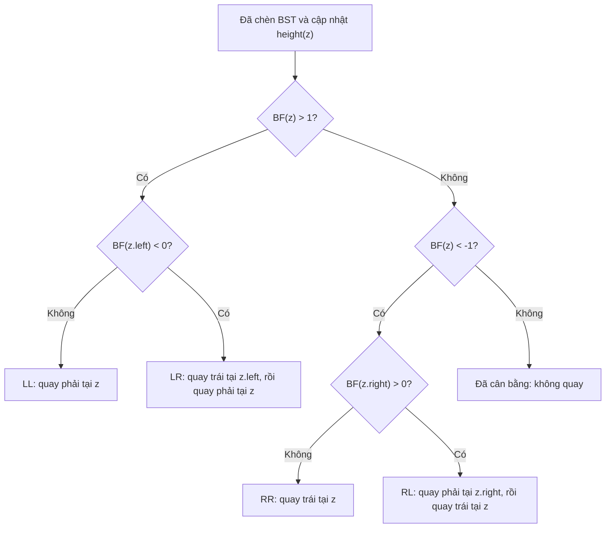

# Bốn trường hợp mất cân bằng khi chèn vào AVL

## Mục tiêu học tập

Sau bài học, bạn có thể:

- Xác định **tổ tiên đầu tiên mất cân bằng** sau một phép chèn AVL bằng chiều cao và hệ số cân bằng.
- Nhận diện chính xác bốn trường hợp **LL, RR, LR, RL** từ đường đi đến nút vừa chèn; không nhầm tên trường hợp với tên phép quay.
- Vẽ từng bước phép **quay đơn** và **quay kép**, kể cả khi có các cây con nằm giữa những khóa được quay.
- Giải thích vì sao các phép quay giữ nguyên **thứ tự BST** và khôi phục bất biến **`|BF| ≤ 1`**.
- Cài đặt và kiểm chứng thao tác **chèn AVL** bằng Python, xử lý khóa trùng và cập nhật đúng metadata chiều cao.
- Phân tích chi phí **O(log n)** của một lần chèn, đồng thời phân biệt các quy tắc sau **chèn** với sau **xóa**.

## 1. Vấn đề: chèn BST đúng thứ tự nhưng có thể làm cây AVL lệch

Giả sử nền tảng học tập lưu bài học theo một khóa có thứ tự, chẳng hạn mã số hoặc cặp `(duration_minutes, lesson_id)`. Một **cây tìm kiếm nhị phân (BST)** giúp tìm, thêm, duyệt khóa theo thứ tự. Nhưng nếu chỉ chèn như BST thường, một dãy khóa tăng dần có thể tạo ra một nhánh dài, khiến thao tác tốn O(n) trong trường hợp xấu nhất.

**AVL** là BST bổ sung điều kiện về chiều cao tại **mọi nút**:

\[
\left|h(v.left)-h(v.right)\right|\le 1.
\]

Phép chèn bắt đầu bằng việc **đi theo bất biến thứ tự BST để đặt khóa mới**, rồi khi trở về gốc, **cập nhật chiều cao và khôi phục cân bằng** ở những nút bị ảnh hưởng. Nếu phát sinh lệch, hình dạng đường chèn quyết định một trong **bốn trường hợp LL, RR, LR, RL**.

Ví dụ chèn `30, 20, 10`:

```text
Sau chèn 30:       Sau chèn 20:       Sau chèn 10 nếu chưa cân bằng:

    30                  30                  30
                       /                   /
                      20                  20
                                         /
                                        10
```

Cây cuối vẫn là BST vì `10 < 20 < 30`, nhưng tại nút `30`, cây trái cao 2 và cây phải cao 0 nên hệ số cân bằng là +2. AVL phải **quay phải tại `30`** để trở về cây:

```text
      20
     /  \
   10    30
```

Không phải lần chèn nào cũng cần quay: chỉ cần quay khi một nút trên đường cập nhật thực sự vi phạm bất biến AVL.

## 2. Quy ước chiều cao và hệ số cân bằng

Trong bài này, **chiều cao được đếm bằng số nút** trên đường dài nhất đi từ nút hiện tại tới lá:

\[
h(\varnothing)=0,\qquad h(v)=1+\max(h(v.left),h(v.right)).
\]

Nút lá cao 1. **Hệ số cân bằng** (balance factor, viết tắt **BF**) được định nghĩa:

\[
BF(v)=h(v.left)-h(v.right).
\]

| Chiều cao trái | Chiều cao phải | `BF` | Trạng thái |
| ---: | ---: | ---: | --- |
| 0 | 0 | 0 | Nút lá, hợp lệ |
| 2 | 2 | 0 | Cân bằng tại nút |
| 3 | 2 | +1 | Hợp lệ, trái cao hơn một mức |
| 2 | 3 | −1 | Hợp lệ, phải cao hơn một mức |
| 3 | 1 | +2 | **Vi phạm AVL, nặng trái** |
| 1 | 3 | −2 | **Vi phạm AVL, nặng phải** |

Các nút AVL hợp lệ chỉ có `BF∈{-1,0,+1}`. Với **một lần chèn vào cây AVL hợp lệ**, tại một tổ tiên bị mất cân bằng, độ lệch mới có thể là +2 hoặc −2. Chênh lệch +1 hay −1 **chưa phải lỗi**.

**Lưu ý dấu:** Có tài liệu định nghĩa `BF=h(right)-h(left)`, khiến dấu đổi ngược. Tất cả bảng và đoạn mã ở đây thống nhất với **trái trừ phải**.

### 2.1. Vì sao chỉ đường từ lá mới về gốc bị ảnh hưởng?

Một phép chèn BST thêm một nút lá vào **đúng một nhánh**. Những cây con không chứa nút mới không đổi cấu trúc, vì thế chiều cao của chúng không đổi. Chỉ những **tổ tiên của nút mới** có thể tăng chiều cao hoặc chuyển từ `BF` hợp lệ thành không hợp lệ.

Quy trình chèn AVL cơ bản:

1. So sánh khóa từ gốc để tìm vị trí chèn như BST.
2. Tạo nút lá có `height=1`; nếu khóa đã tồn tại, xử lý theo chính sách trùng khóa.
3. Đi ngược về gốc theo đường đã tìm.
4. Ở mỗi nút, tính lại `height` và `BF` từ chiều cao **đã cập nhật** của hai con.
5. Nếu `BF>1` hoặc `BF<-1`, xác định **hình dạng đường chèn** và quay thích hợp.
6. Nối **gốc cây con mới** vào đúng vị trí trong cây lớn hơn.

Với cách cài đặt đệ quy, bước 3–6 thường xảy ra khi các lời gọi `insert` trả về.

### 2.2. Tổ tiên mất cân bằng đầu tiên

Khi chèn vào một cây AVL hợp lệ, hãy xét các tổ tiên theo thứ tự **từ nút mới đi lên**. Nút đầu tiên có `|BF|=2` gọi là **tổ tiên mất cân bằng thấp nhất**.

Ở chèn AVL chuẩn, một phép quay đơn hoặc kép đúng tại tổ tiên này thường làm **chiều cao cây con được sửa trở về như trước khi chèn**, vì vậy **không cần quay tiếp ở các tổ tiên cao hơn** chỉ vì lần chèn đó. Một cài đặt đệ quy có thể vẫn đi qua các mức cha để cập nhật metadata, nhưng sẽ không phát sinh lần quay mới nếu bất biến trước chèn đã đúng.

Điều này **khác thao tác xóa AVL**, nơi chiều cao cây con có thể tiếp tục giảm sau khi quay và việc tái cân bằng có thể lan qua nhiều tổ tiên.

## 3. Nhận diện LL, RR, LR, RL bằng đường đi

Tên trường hợp được ghép từ **hai hướng liên tiếp** trên đường từ **tổ tiên mất cân bằng `z`** tới **nhánh vừa tăng chiều cao**:

- **LL (Left–Left):** từ `z` đi **trái**, rồi tiếp tục **trái**.
- **RR (Right–Right):** từ `z` đi **phải**, rồi tiếp tục **phải**.
- **LR (Left–Right):** từ `z` đi **trái**, rồi từ con trái đi **phải**.
- **RL (Right–Left):** từ `z` đi **phải**, rồi từ con phải đi **trái**.

Hai chữ **không phải tên phép quay**. Ví dụ, trường hợp **LL** cần **quay phải**, còn trường hợp **RR** cần **quay trái**.

| Trường hợp | `BF(z)` sau chèn | Nhánh cao thêm ở con nặng | Cách tái cân bằng |
| --- | ---: | --- | --- |
| **LL** | +2 | Con trái `y` nặng trái | **Quay phải** tại `z` |
| **RR** | −2 | Con phải `y` nặng phải | **Quay trái** tại `z` |
| **LR** | +2 | Con trái `y` nặng phải | **Quay trái tại `y`**, rồi **quay phải tại `z`** |
| **RL** | −2 | Con phải `y` nặng trái | **Quay phải tại `y`**, rồi **quay trái tại `z`** |

Với **chèn một khóa mới** và cây trước chèn hợp lệ, trong trường hợp mất cân bằng đầu tiên, BF của con nặng có hướng **cùng dấu** ở LL/RR hoặc **trái dấu** ở LR/RL; các giá trị tương ứng không bằng 0. Tuy nhiên, mã tổng quát thường dùng `>=0`/`<=0` ở nhánh quay đơn để có thể dùng lại cho thuật toán tái cân bằng sau **xóa**.

## 4. Trường hợp LL: lệch trái – trái, quay phải một lần

### 4.1. Ví dụ từng bước với khóa 30, 20, 10

Sau khi chèn `30` và `20`, nút `30` có `BF=+1`, chưa vi phạm. Chèn tiếp `10` làm đường đi từ `30` qua **trái tới `20`**, rồi **trái tới `10`**:

```text
TRƯỚC quay (LL):                 SAU quay phải tại 30:

          30  BF=+2                      20  BF=0
         /                               /  \
       20  BF=+1                       10    30
      /                                BF=0  BF=0
    10  BF=0
```

Các bước:

1. `y=20` là con trái của `z=30`.
2. Đưa `y` lên làm gốc cây con.
3. Đưa `z` xuống làm **con phải** của `y`.
4. Nếu `y` có cây con phải nằm giữa `y` và `z`, chuyển cây con đó thành **con trái của `z`**.
5. Cập nhật chiều cao của nút đi xuống `z` rồi của nút đi lên `y`.

Sau quay, cây cao 2 thay vì 3, BF mọi nút bằng 0. Dãy inorder trước và sau đều là `10,20,30`.

### 4.2. Trường hợp tổng quát có cây con

```text
           z                        y
          / \                      /   \
         y   D      --R-->        x     z
        / \                      / \   / \
       x   C                    A   B C   D
      / \
     A   B
```

Các khóa phải thỏa:

\[
A<x<B<y<C<z<D.
\]

Trước và sau quay phải tại `z`, inorder đều:

```text
in(A), x, in(B), y, in(C), z, in(D)
```

Không hề **hoán đổi giá trị khóa**; ta chỉ đổi liên kết. Các cây con `A`, `B`, `C`, `D` vẫn được giữ đầy đủ và đúng khoảng khóa.

**Mẹo nhớ:** **LL → Right rotation** tại tổ tiên mất cân bằng.

## 5. Trường hợp RR: lệch phải – phải, quay trái một lần

### 5.1. Ví dụ từng bước với khóa 10, 20, 30

Sau khi chèn `10` và `20`, nút `10` có `BF=−1`. Khi chèn `30`, đường đi từ `10` qua **phải đến `20`**, rồi **phải đến `30`**:

```text
TRƯỚC quay (RR):                 SAU quay trái tại 10:

    10  BF=-2                           20  BF=0
      \                                 /  \
      20  BF=-1                       10    30
        \                             BF=0  BF=0
        30  BF=0
```

Các bước:

1. `y=20` là con phải của `z=10`.
2. Đưa `y` lên thay `z`.
3. Đưa `z` xuống làm **con trái** của `y`.
4. Cây con **trái của `y` trước quay**, nếu có, chuyển thành **con phải của `z`**.
5. Cập nhật chiều cao `z` trước `y`.

Sau quay, inorder vẫn `10,20,30`; chiều cao cây con trở về mức 2.

### 5.2. Trường hợp tổng quát

```text
       z                                y
      / \                              / \
     A   y            --L-->         z   x
        / \                          / \ / \
       B   x                        A  B C  D
          / \
         C   D
```

Với thứ tự khóa `A<z<B<y<C<x<D`, cả hai hình dạng đều duyệt inorder:

```text
in(A), z, in(B), y, in(C), x, in(D)
```

**Mẹo nhớ:** **RR → Left rotation** tại tổ tiên mất cân bằng.

## 6. Trường hợp LR: lệch trái – phải, quay kép trái rồi phải

### 6.1. Vì sao quay phải ngay chưa đủ?

Chèn `30, 10, 20` tạo một đường **gấp khúc**: từ `30` xuống **trái** tới `10`, sau đó sang **phải** tới `20`.

```text
TRƯỚC (LR):

        30  BF=+2
       /
     10  BF=-1
       \
        20
```

Nếu quay phải ngay tại `30` thì `10` được đưa lên, nhưng `30` vẫn ở một nhánh bên phải tương đối dài:

```text
Quay phải vội tại 30:

       10
         \
          30
         /
        20
```

Gốc `10` của hình này có BF=−2: chưa phải AVL. Phải xử lý **góc gấp** trước khi quay tại tổ tiên.

### 6.2. Hai bước chính xác

```text
BƯỚC 0:                     BƯỚC 1:                     BƯỚC 2:

     30                          30                         20
    /                           /                          /  \
  10          --L tại 10-->    20         --R tại 30-->   10    30
    \                         /
     20                     10
```

1. **Quay trái tại con trái `10`**. Khi đó `20` lên dưới `30` và đường gấp khúc **LR** trở thành dạng thẳng **LL**.
2. **Quay phải tại `30`**. `20` lên làm gốc cây con, `10` và `30` làm hai con.
3. Cập nhật metadata sau **mỗi** phép quay theo thứ tự nút đi xuống trước nút đi lên.

Kết quả có `height=2`, mọi BF=0, inorder là `10,20,30`.

### 6.3. Giữ nguyên các cây con ở giữa

Đặt `z` là tổ tiên mất cân bằng, `y=z.left`, `x=y.right`. Gọi `A` là cây con trái của `y`; `B,C` là các cây con trái/phải của `x`; `D` là cây con phải của `z`:

```text
TRƯỚC (LR):                              SAU quay kép:

          z                                     x
         / \                                   / \
        y   D                                 y   z
       / \                   --L,R-->          / \ / \
      A   x                                 A  B C  D
         / \
        B   C
```

Theo BST:

\[
A<y<B<x<C<z<D.
\]

Dãy inorder hai bên:

```text
in(A), y, in(B), x, in(C), z, in(D)
```

**Điểm dễ sai:** nếu quên chuyển `B`, `C` về đúng hai phía sau quay kép, ta có thể làm mất dữ liệu hoặc khiến tìm kiếm rẽ sai, dù gốc mới `x` trông cân đối.

**Mẹo nhớ:** **LR → quay trái ở con trái, quay phải ở nút mất cân bằng**.

## 7. Trường hợp RL: lệch phải – trái, quay kép phải rồi trái

**RL** đối xứng với LR. Chèn `10, 30, 20` tạo đường từ `10` sang **phải** tới `30`, rồi sang **trái** tới `20`.

### 7.1. Hai bước chính xác

```text
BƯỚC 0:                  BƯỚC 1:                    BƯỚC 2:

   10                        10                         20
     \                         \                       /  \
      30    --R tại 30-->       20    --L tại 10-->   10    30
     /                           \
    20                            30
```

1. **Quay phải tại con phải `30`** để chuyển đường gấp khúc RL thành dạng thẳng RR.
2. **Quay trái tại tổ tiên mất cân bằng `10`**.
3. Kết nối gốc mới `20` trở lại cha của cây con hoặc cập nhật biến gốc toàn cây.

Sau quay, thứ tự inorder vẫn `10,20,30`.

### 7.2. Trường hợp tổng quát

Đặt `z` là tổ tiên mất cân bằng, `y=z.right`, `x=y.left`:

```text
TRƯỚC (RL):                          SAU quay kép:

          z                                  x
         / \                                / \
        A   y                              z   y
           / \             --R,L-->       / \ / \
          x   D                          A  B C  D
         / \
        B   C
```

Thứ tự khóa và inorder không đổi:

\[
A<z<B<x<C<y<D.
\]

```text
in(A), z, in(B), x, in(C), y, in(D)
```

**Mẹo nhớ:** **RL → quay phải ở con phải, quay trái ở nút mất cân bằng**.

## 8. Bản đồ quyết định: nhìn BF để chọn đúng phép quay

Với định nghĩa `BF(v)=h(v.left)-h(v.right)` và `z` là nút cần tái cân bằng:



Sơ đồ dùng so sánh BF của **con nặng**, nên không cần đọc lại khóa vừa chèn. Đây cũng là cách viết phần `rebalance` có thể tái sử dụng trong một cài đặt xóa AVL chuẩn nếu các tiền điều kiện và cập nhật metadata khác đã được xử lý.

### 8.1. Tương đương với cách xét khóa mới chèn

Trong **chèn với khóa phân biệt**:

- `BF(z)>1` và `key<z.left.key`: **LL**.
- `BF(z)>1` và `key>z.left.key`: **LR**.
- `BF(z)<-1` và `key>z.right.key`: **RR**.
- `BF(z)<-1` và `key<z.right.key`: **RL**.

Nhưng cách này **chỉ thích hợp với tình huống đang chèn một khóa**. Sau **xóa**, không có “khóa vừa chèn”; trạng thái con nặng có `BF=0` có thể xuất hiện và phải được xử lý đúng bằng quy tắc dựa vào BF.

### 8.2. Sai lầm thường gặp khi quan sát BF

- Nút có `BF=+1` hoặc `−1` **vẫn hợp lệ**; không nên quay chỉ vì hai nhánh không cao bằng nhau.
- Tổ tiên bị lệch trái **không luôn là LL**: phải kiểm tra hướng của con trái để phân biệt với **LR**.
- Tổ tiên bị lệch phải **không luôn là RR**: phải kiểm tra con phải để phân biệt với **RL**.
- Mỗi lần có đường gấp khúc **không nhất thiết đã mất cân bằng**: chỉ quay khi `|BF(z)|>1` tại nút liên quan.
- Mọi phép quay phải đồng thời giữ **bất biến thứ tự BST**, **thông tin chiều cao** và **gốc cây con**.

## 9. Ví dụ Python đầy đủ: chèn AVL xử lý cả bốn trường hợp

Phiên bản sau dùng khóa số nguyên phân biệt và lưu giá trị bất kỳ. Khi chèn khóa đã tồn tại, ta **cập nhật giá trị** nhưng không thêm nút. Mỗi lời gọi `insert` trả **gốc cây con mới**, vì một phép quay có thể đổi vị trí gốc.

### 9.1. Nút, chiều cao và hai phép quay

```python
class AVLNode:
    def __init__(self, key, value):
        self.key = key
        self.value = value
        self.left = None
        self.right = None
        self.height = 1


def height(node):
    return 0 if node is None else node.height


def update_height(node):
    node.height = 1 + max(height(node.left), height(node.right))


def balance_factor(node):
    if node is None:
        return 0
    return height(node.left) - height(node.right)


def rotate_left(x):
    """Quay trái tại x; yêu cầu x.right tồn tại."""
    y = x.right
    if y is None:
        raise ValueError("Không thể quay trái nếu thiếu con phải")

    middle = y.left
    y.left = x
    x.right = middle

    update_height(x)  # Nút đi xuống trước.
    update_height(y)
    return y


def rotate_right(y):
    """Quay phải tại y; yêu cầu y.left tồn tại."""
    x = y.left
    if x is None:
        raise ValueError("Không thể quay phải nếu thiếu con trái")

    middle = x.right
    x.right = y
    y.left = middle

    update_height(y)  # Nút đi xuống trước.
    update_height(x)
    return x
```

Các hàm quay chỉ cập nhật hai nút trực tiếp tham gia; chiều cao những cây con `A`, `B`, `C`, `D` không thay đổi cấu trúc bên trong nên có thể dùng lại. Không có trường `parent` ở đây: các lời gọi đệ quy sẽ dùng **giá trị gốc mới trả về** để gán lại `left`, `right` hoặc `root`.

### 9.2. Tái cân bằng và chèn

```python
def rebalance(node):
    """Khôi phục AVL sau khi một cây con thay đổi."""
    update_height(node)
    bf = balance_factor(node)

    if bf > 1:  # Trái nặng.
        if balance_factor(node.left) < 0:
            # LR: làm thẳng nhánh gấp khúc trước.
            node.left = rotate_left(node.left)
        # LL hoặc bước cuối của LR.
        return rotate_right(node)

    if bf < -1:  # Phải nặng.
        if balance_factor(node.right) > 0:
            # RL: làm thẳng nhánh gấp khúc trước.
            node.right = rotate_right(node.right)
        # RR hoặc bước cuối của RL.
        return rotate_left(node)

    return node


def insert(root, key, value):
    """Trả gốc AVL sau chèn, khóa trùng cập nhật giá trị."""
    if root is None:
        return AVLNode(key, value)

    if key < root.key:
        root.left = insert(root.left, key, value)
    elif key > root.key:
        root.right = insert(root.right, key, value)
    else:
        root.value = value
        return root

    return rebalance(root)


def search(root, key):
    current = root
    while current is not None:
        if key == current.key:
            return current.value
        current = current.left if key < current.key else current.right
    return None


def inorder_keys(root):
    """Generator trả khóa theo thứ tự tăng."""
    if root is not None:
        yield from inorder_keys(root.left)
        yield root.key
        yield from inorder_keys(root.right)
```

**Đường đi chèn:** hàm `insert` chỉ duyệt **một đường** theo khóa. Khi đệ quy trả về, mỗi tổ tiên được cập nhật chiều cao và xét BF. Nếu vi phạm, `rebalance` gọi đúng một phép quay đơn hoặc kép. Gốc cây con mới được gán ngay tại lời gọi cha, giữ nguyên khả năng đi tới mọi nút.

### 9.3. Tự kiểm tra cả thứ tự, BF và metadata

Không nên dùng chính `node.height` để “chứng minh” `node.height` đúng. Hàm sau **tính chiều cao thật từ các cây con** rồi đối chiếu với metadata:

```python
def validate(root, low=None, high=None):
    """Trả (chiều cao thật, số nút) và kiểm tra bất biến."""
    if root is None:
        return 0, 0

    # Giới hạn kế thừa từ các tổ tiên: kiểm tra BST toàn cây.
    if low is not None:
        assert low < root.key, "Vi phạm cận dưới BST"
    if high is not None:
        assert root.key < high, "Vi phạm cận trên BST"

    lh, ln = validate(root.left, low, root.key)
    rh, rn = validate(root.right, root.key, high)

    actual_height = 1 + max(lh, rh)
    assert root.height == actual_height, "Metadata height không đúng"
    assert abs(lh - rh) <= 1, "Có nút vi phạm AVL"
    return actual_height, 1 + ln + rn
```

Hàm này kiểm tra **ba loại bất biến độc lập**:

1. Thứ tự BST trên **mọi cây con** bằng cận dưới/cận trên từ tổ tiên.
2. Cân bằng `|BF|≤1` tính từ **chiều cao thực**, không dựa trên metadata có thể sai.
3. Metadata `height` bằng kết quả tính lại từ các nút con.

Đây là **công cụ kiểm thử O(n)**, không phải bước của thuật toán chèn AVL trong vận hành.

### 9.4. Ví dụ các trường hợp và kiểm tra thêm

```python
cases = {
    "LL": [30, 20, 10],
    "RR": [10, 20, 30],
    "LR": [30, 10, 20],
    "RL": [10, 30, 20],
}

for name, keys in cases.items():
    root = None
    for key in keys:
        root = insert(root, key, f"lesson-{key}")
        validate(root)

    assert root.key == 20, name
    assert list(inorder_keys(root)) == [10, 20, 30], name
    assert root.height == 2, name
    assert balance_factor(root) == 0, name
    assert search(root, 10) == "lesson-10", name
    assert validate(root) == (2, 3), name

# Chuỗi chèn dài hơn, với các nhánh không rỗng.
keys = [50, 20, 80, 10, 30, 70, 90, 5, 15, 25, 35, 60, 75]
root = None
for key in keys:
    root = insert(root, key, f"lesson-{key}")
    validate(root)

assert list(inorder_keys(root)) == sorted(keys)
assert validate(root)[1] == len(keys)
assert search(root, 25) == "lesson-25"
assert search(root, 999) is None

# Thêm khóa đã tồn tại phải thay giá trị, không tạo thêm nút.
root = insert(root, 25, "new-title")
assert search(root, 25) == "new-title"
assert validate(root)[1] == len(keys)

# Khởi đầu từ cây rỗng.
single = insert(None, 42, "one lesson")
assert validate(single) == (1, 1)
assert list(inorder_keys(single)) == [42]
```

**Bộ kiểm thử minh họa** cố ý gọi `validate` sau mỗi lần chèn để dễ phát hiện trạng thái sai sớm. Trong thực tế, muốn đánh giá hiệu năng chèn AVL cần **không tính phần kiểm chứng toàn cây này** vào thuật toán.

## 10. Phân tích độ phức tạp của chèn AVL

Gọi `n` là số nút hiện có, `h` là chiều cao của cây trước khi chèn.

| Công việc | Chi phí thời gian | Bộ nhớ phụ | Lý do |
| --- | --- | --- | --- |
| Tìm vị trí chèn | **O(h)** | O(h) với đệ quy | Chỉ đi một đường gốc–lá |
| Tạo nút lá mới | **O(1)** | **O(1)** | Một nút chứa khóa, giá trị và metadata |
| Cập nhật `height`/`BF` tại một nút | **O(1)** | **O(1)** | Đọc chiều cao hai con đã lưu |
| Một phép quay đơn | **O(1)** | **O(1)** | Số phép gán tham chiếu cố định |
| Một phép quay kép | **O(1)** | **O(1)** | Hai phép quay đơn liên tiếp |
| Cập nhật qua các tổ tiên | **O(h)** | O(h) với đệ quy | Mỗi tổ tiên trên một đường được xử lý |
| **Một lần chèn AVL hợp lệ** | **O(log n)** xấu nhất | **O(log n)** với bản đệ quy | Vì `h=O(log n)`, quay chỉ là phần cục bộ |
| Duyệt toàn bộ inorder | **O(n)** | O(h) ngoài kết quả | Phải ghé mọi nút |
| `validate` toàn cây | **O(n)** | O(h) | Đây là kiểm thử, không thuộc `insert` |

Chèn AVL không trở thành O(1) chỉ vì **một phép quay O(1)**. Nó phải tìm vị trí theo BST và cập nhật đường tổ tiên; phần đó mất O(log n) trên một AVL hợp lệ. Ngược lại, việc gọi `validate` O(n) trong bài tập **không biến thuật toán chèn chuẩn thành O(n)**.

Chi phí lưu trữ là **O(n)** cho `n` nút, mỗi nút bổ sung trường `height` bên cạnh khóa, giá trị và hai tham chiếu con. Bản đệ quy sử dụng thêm ngăn xếp O(log n). Một thiết kế dùng vòng lặp và tham chiếu `parent` có thể giảm phụ thuộc vào stack đệ quy, nhưng cần cập nhật thêm liên kết ngược sau mỗi phép quay.

### 10.1. Một hay nhiều lần quay sau khi chèn?

Với một lần **chèn** vào AVL đang hợp lệ:

- Trên đường từ lá mới lên gốc, tìm nút **thấp nhất** có `|BF|=2`.
- Nếu thuộc **LL** hoặc **RR**, thực hiện **một quay đơn**.
- Nếu thuộc **LR** hoặc **RL**, thực hiện **một quay kép**.
- Cây con được sửa có chiều cao trở lại như trước phép chèn, nên không cần các phép quay thêm ở tổ tiên chỉ vì lần chèn này.

Đoạn mã đệ quy trên vẫn tiếp tục trả về qua các mức cao hơn và tính lại chiều cao để giữ giao diện đơn giản. Các mức ấy không xuất hiện mất cân bằng mới khi đầu vào ban đầu là AVL hợp lệ.

## 11. Những tình huống biên cần xử lý rõ

### 11.1. Chèn một nút đầu tiên hoặc vào cây chỉ có một nút

Cây rỗng nhận nút mới có `height=1`, `BF=0`. Chèn nút thứ hai khiến gốc có BF ±1, **chưa cần quay**. Không được ép hai con phải luôn cùng chiều cao.

### 11.2. Khóa đã tồn tại

Nếu cấu trúc là **AVL Map** có khóa duy nhất, thêm cùng khóa nên **thay giá trị** hoặc từ chối theo hợp đồng. Đoạn mã ví dụ chọn **thay giá trị**: số nút và hình dạng không đổi, do đó không cần tái cân bằng khi không thay khóa.

Nếu bài toán phải lưu nhiều phần tử có cùng khóa sắp xếp (ví dụ nhiều bài cùng thời lượng), có thể:

- Dùng khóa ghép `(duration, lesson_id)` để tạo thứ tự duy nhất.
- Hoặc mỗi nút giữ một danh sách giá trị ứng với một khóa.

Không nên tùy tiện chèn khóa bằng nhau vào cả trái và phải vì có thể làm vi phạm quy tắc BST đang được hàm tìm kiếm sử dụng.

### 11.3. Cây con giữa không rỗng

Trong các hình minh họa ba nút, cây con giữa thường rỗng. Nhưng với cây lớn, quay phải tại `z` phải chuyển cây con phải của `y` sang con trái của `z`; quay trái tại `z` phải chuyển cây con trái của `y` sang con phải của `z`. **Quên cây con giữa** là lỗi làm mất dữ liệu phổ biến.

### 11.4. Quay làm đổi gốc cây

Sau quay, `root` của cây con có thể chuyển từ `z` thành `y` hoặc `x`. Hàm `insert` cần **trả về gốc mới** và bên gọi phải gán lại:

```python
root = insert(root, 15, "new lesson")
```

Nếu chỉ gọi `insert(root, ...)` mà bỏ giá trị trả về, một phép quay tại gốc có thể khiến biến `root` cũ không còn dẫn tới đầy đủ cây.

### 11.5. Dữ liệu khóa không có thứ tự nhất quán

AVL cần một quan hệ so sánh **bắc cầu và ổn định**. Dùng khóa như số thực `NaN` hoặc trộn khóa kiểu không so sánh được có thể khiến `<`, `>` và `==` không phân nhánh như mong đợi. Phải định nghĩa miền khóa hợp lệ và chính sách chuẩn hóa trước khi chèn.

Thay đổi khóa của một nút **ngay trong cây** cũng có thể phá bất biến BST dù BF vẫn hợp lệ. Cách an toàn thông thường là xóa khóa cũ, thêm khóa mới và giữ các chỉ mục khác nhất quán.

### 11.6. Phân biệt chèn và xóa AVL

Sau **xóa**, khi `BF(z)=+2` và `BF(z.left)=0`, quay phải **đơn** là phù hợp; tương tự `BF(z)=−2` và `BF(z.right)=0` cần quay trái đơn. Trường hợp BF con bằng 0 là lý do phần mã tái cân bằng dùng:

```text
if BF(z)>1:  chỉ quay kép khi BF(z.left)<0
if BF(z)<-1: chỉ quay kép khi BF(z.right)>0
```

Tuy nhiên, **có mã `rebalance` không đồng nghĩa đã cài xóa AVL đầy đủ**: phần xóa BST, thay successor/predecessor, nối gốc cây con và tiếp tục tái cân bằng những tổ tiên đều phải đúng. Sau xóa, chiều cao có thể giảm lan lên nhiều mức và cần nhiều lần điều chỉnh.

## 12. Một ví dụ nghiệp vụ: chỉ mục có thứ tự cho bài học

Giả sử nền tảng lưu các bài học và hỗ trợ hai kiểu truy cập:

1. **Mở bài theo `lesson_id`** — một bảng băm `by_id` thường phù hợp để tra chính xác theo mã.
2. **Liệt kê bài có thời lượng trong khoảng `[20, 40]` phút** — một cây AVL sắp theo khóa ghép `(minutes, lesson_id)` có thể hỗ trợ tìm cận và duyệt khoảng.

Khóa ghép giúp hai bài cùng 30 phút có **thứ tự xác định**, đồng thời không nhầm “cùng thời lượng” với “cùng một bài”. Khi thêm một bài:

- Thêm bản ghi vào bảng băm theo ID.
- Chèn `(minutes, lesson_id)` vào AVL, có thể đi qua một trong bốn tình huống LL/RR/LR/RL.
- Giữ bất biến: mỗi bản ghi trong `by_id` có đúng một khóa tương ứng trong chỉ mục thời lượng.

Khi sửa thời lượng, không được chỉ thay trường bản ghi rồi giữ khóa cũ trong AVL. Phải **loại khóa thứ tự cũ và chèn khóa mới** hoặc sử dụng một cơ chế tái chỉ mục tương đương. Chỉ mục giúp truy vấn nhanh hơn nhưng tăng **bộ nhớ và công việc cập nhật nhất quán**.

### 12.1. Chọn AVL có phải luôn tốt?

Không. Nếu chỉ cần tra theo ID, bảng băm có chi phí tra **O(1) kỳ vọng** và thường đơn giản hơn. Nếu tập dữ liệu ít cập nhật, mảng đã sắp có thể cho tìm nhị phân O(log n) với cách duyệt liên tiếp thuận lợi. AVL phát huy lợi thế khi ứng dụng cần **thứ tự**, **truy vấn khoảng** và **thêm/xóa** với bảo đảm O(log n) xấu nhất.

Các cấu trúc như Red–Black Tree cũng bảo đảm O(log n) xấu nhất nhưng dùng bất biến màu khác AVL. Không nên suy rằng AVL luôn nhanh hơn chỉ vì ràng buộc chiều cao chặt hơn; cần xét tỷ lệ đọc/ghi, thư viện có sẵn, kích thước dữ liệu và chi phí bộ nhớ.

## 13. Những lỗi thường gặp khi nhận diện bốn trường hợp

- **Gọi LL là quay trái.** Sai: LL miêu tả **đường chèn trái–trái**, cách sửa là **quay phải**.
- **Thấy BF dương là quay.** Sai: BF=+1 vẫn hợp lệ. Chỉ cân nhắc quay khi `|BF|>1`.
- **Chỉ nhìn BF của gốc toàn cây.** Sai: tổ tiên mất cân bằng có thể nằm sâu bên trong.
- **Nhầm LR với LL vì đều có BF(z)=+2.** Cần kiểm tra hướng của con trái hoặc đường chèn.
- **Nhầm RL với RR vì đều có BF(z)=−2.** Cần kiểm tra hướng của con phải.
- **Quay phải ngay trong LR.** Sai: hình dạng gấp khúc thường còn lệch; phải quay **trái ở con** trước.
- **Quay trái ngay trong RL.** Sai: phải quay **phải ở con** trước.
- **Quên chuyển cây con giữa.** Dễ mất khóa hoặc phá thứ tự BST dù cây trông cân đối.
- **Cập nhật chiều cao theo thứ tự ngược.** Nút đi lên có thể đọc metadata cũ của nút đi xuống.
- **Không nhận gốc mới sau quay.** Có thể mất đường truy cập từ `root` tới một phần cây.
- **Tin `height` khi kiểm thử `height`.** Hàm kiểm chứng phải tính lại chiều cao thật từ các con.
- **Đếm cả `validate` O(n) vào chi phí chèn AVL.** Đây là công cụ kiểm thử, không thuộc thuật toán chèn.
- **Áp dụng điều kiện dùng khóa vừa chèn cho thao tác xóa.** Sau xóa, cần xét BF của con nặng, kể cả trường hợp bằng 0.

## 14. Bài tập vận dụng

**Bài 1 — LL cơ bản.** Chèn `40, 25, 10` vào AVL rỗng. Hãy tính chiều cao/BF trước khi quay, xác định tổ tiên mất cân bằng và vẽ cây sau phép quay.

*Gợi ý:* `40` có BF=+2, `25` có BF=+1; quay phải tại `40`. Gốc mới `25`.

**Bài 2 — RR cơ bản.** Chèn `10, 20, 45`. Vì sao trường hợp này là RR mà không phải RL? Hãy ghi dãy inorder trước và sau.

*Gợi ý:* Đường từ `10` đến nút mới là phải–phải; quay trái tại `10`; inorder vẫn `10,20,45`.

**Bài 3 — LR hai bước.** Chèn `50, 20, 35`. Vẽ ba trạng thái: ngay sau chèn, sau quay ở con và sau quay ở tổ tiên. Nêu BF của gốc cuối.

*Gợi ý:* LR; quay trái tại `20` rồi quay phải tại `50`, kết quả gốc `35`, BF=0.

**Bài 4 — RL đối xứng.** Chèn `5, 25, 15`. Hai phép quay diễn ra tại những nút nào? Vì sao không chỉ quay trái tại `5`?

*Gợi ý:* Quay phải tại `25`, rồi quay trái tại `5`; quay trái ngay không sửa được hình dạng gấp khúc.

**Bài 5 — Chưa cần quay.** Sau chèn, nút gốc có `h(left)=3` và `h(right)=2`; con trái và con phải đều thỏa AVL. Có cần quay ở gốc không?

*Gợi ý:* BF(gốc)=+1 là hợp lệ. Nếu tất cả các nút đều hợp lệ thì không quay.

**Bài 6 — Xác định hình dạng từ BF.** Một tổ tiên `z` có `BF(z)=+2` và `BF(z.left)=−1`. Đây là trường hợp nào và chuỗi quay tương ứng?

*Gợi ý:* LR: trái ở con trái, phải ở `z`.

**Bài 7 — Vị trí cây con giữa.** Trong trường hợp LL tổng quát, `y=z.left` có cây con phải `C`. Sau quay phải tại `z`, `C` phải ở đâu?

*Gợi ý:* `C` trở thành `z.left` vì các khóa thuộc `C` nằm giữa `y` và `z`.

**Bài 8 — Chứng minh bảo toàn BST.** Với LR có `A<y<B<x<C<z<D`, viết dãy inorder trước và sau quay kép. Vì sao lập luận này áp dụng cho mọi kích thước cây con?

*Gợi ý:* Cả hai cho `in(A), y, in(B), x, in(C), z, in(D)`; bất biến thứ tự dựa trên khoảng khóa, không phụ thuộc số nút.

**Bài 9 — Phân tích chi phí.** Một bạn khẳng định “chèn AVL O(1) vì chỉ một quay kép”, bạn khác khẳng định “chèn O(n) vì phải kiểm tra toàn cây”. Hãy chỉ ra sai ở đâu.

*Gợi ý:* Đường tìm và cập nhật tổ tiên tốn O(log n); quay kép cục bộ O(1). Duyệt kiểm chứng toàn cây O(n) không bắt buộc của thuật toán.

**Bài 10 — Khóa trùng.** Khi chèn lại khóa `30` với một giá trị mới, ví dụ `insert` có tăng số nút không? Cây có cần quay chỉ vì cập nhật giá trị không?

*Gợi ý:* Không tăng số nút, hình dạng không đổi, nên không quay khi không sửa khóa.

**Bài 11 — Phân biệt chèn/xóa.** Sau khi xóa, `BF(z)=+2` nhưng `BF(z.left)=0`. Chọn quay đơn hay quay kép? Vì sao không thể dùng đơn giản quy tắc “vừa chèn về bên nào”?

*Gợi ý:* Quay phải đơn; xóa làm giảm chiều cao một nhánh, con nặng có thể có BF=0 và không có khóa vừa chèn.

**Bài 12 — Tự kiểm thử.** Viết thêm các trường hợp chèn khóa tăng dần, giảm dần, xen kẽ và khóa trùng. Sau mỗi bước, kiểm tra inorder, BF mọi nút, metadata `height` và tổng số nút.

*Gợi ý:* Giữ một tập khóa chuẩn để so với inorder, dùng `validate(root)` trong bộ thử, không đưa thao tác duyệt O(n) ấy vào thời gian chèn đo được.

## Tổng kết

Trong **chèn AVL**, mất cân bằng chỉ có thể xuất hiện trên đường từ **lá vừa chèn** tới gốc. Với `BF=h(left)-h(right)`, nút có `BF=+2` nặng trái, `BF=−2` nặng phải; phải xem thêm hướng của **con nặng** để chọn một trong bốn trường hợp. **LL → quay phải**, **RR → quay trái**, **LR → quay trái ở con rồi quay phải ở nút**, **RL → quay phải ở con rồi quay trái ở nút**. Các phép quay giữ nguyên **tập khóa, số nút và thứ tự inorder**, đồng thời khi chọn đúng sẽ khôi phục cân bằng. Nhờ cập nhật chiều cao và chỉ xử lý đường tổ tiên O(log n), thao tác chèn AVL có **O(log n) thời gian xấu nhất**; mỗi quay đơn/kép chỉ tốn **O(1)** thao tác liên kết. Khi triển khai, phải bảo vệ đồng thời **bất biến BST, giới hạn BF, metadata chiều cao và tham chiếu gốc mới**.
