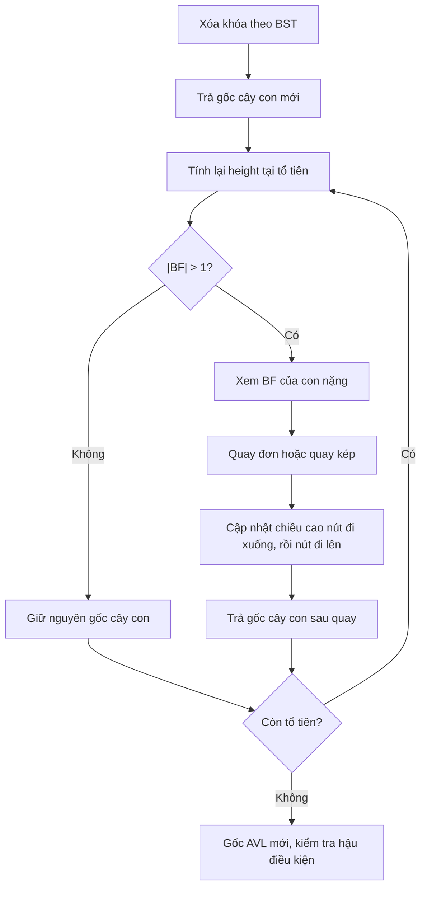

# Xóa trong AVL và lan truyền thay đổi chiều cao

## Mục tiêu học tập

Sau bài này, bạn có thể:

- Thực hiện đúng **ba dạng xóa trong cây tìm kiếm nhị phân (BST)**: xóa lá, xóa nút có một con và xóa nút có hai con.
- Giải thích vì sao sau xóa một cây con có thể **giảm chiều cao**, khiến nhiều tổ tiên lần lượt phải cập nhật và tái cân bằng.
- Tính chiều cao và **hệ số cân bằng (balance factor — BF)**, từ đó quyết định quay đơn hay quay kép ở từng nút.
- Xử lý chính xác trường hợp **BF của con nặng bằng 0** — khác biệt quan trọng giữa tái cân bằng sau xóa và sau chèn.
- Cài đặt xóa AVL bằng Python, bảo toàn thứ tự BST, độ cao lưu ở nút, số lượng khóa và hình dạng AVL; kiểm tra cả việc **xóa gốc** và **khóa không tồn tại**.
- Phân tích thời gian **O(log n)**, bộ nhớ ngăn xếp, chi phí cập nhật metadata và những lỗi dễ gặp khi dùng AVL làm chỉ mục có thứ tự.

## 1. Xóa trong AVL khó hơn xóa BST thường ở điểm nào?

Trong một BST có các khóa phân biệt, bất biến tìm kiếm là:

- Mọi khóa thuộc cây con trái **nhỏ hơn** khóa tại nút.
- Mọi khóa thuộc cây con phải **lớn hơn** khóa tại nút.
- Hai điều kiện áp dụng cho **toàn bộ cây con**, không chỉ với con trực tiếp.

Một AVL là BST có thêm **bất biến cân bằng theo chiều cao**:

\[
\forall v:\quad |h(v.left)-h(v.right)|\le 1.
\]

Xóa BST thường chỉ cần giữ thứ tự. Xóa AVL phải làm **cả hai việc**:

1. **Xóa khóa và nối lại cấu trúc BST** để không mất cây con hoặc tạo khóa sai vị trí.
2. **Cập nhật chiều cao và sửa cân bằng** cho các nút có thể bị ảnh hưởng trên đường trở lại gốc.

Ví dụ một cây AVL hợp lệ:

```text
             10
           /    \
          5      20
                /  \
               15   25

h(5)=1, h(20)=2
BF(10)=1-2=-1  (hợp lệ)
```

Sau khi xóa lá `5`, nút `10` trở thành nặng phải:

```text
       10                         20
         \                       /  \
          20       --L-->       10   25
         /  \                     \
        15   25                    15

BF(10) trước quay = 0-2=-2.
BF(20) trước quay = 1-1=0.
```

Quay trái tại `10` giúp cây trở lại AVL. Điểm cần chú ý là **con phải `20` có BF bằng 0**: đây là một tình huống điển hình của **xóa** mà một bộ quy tắc chỉ học qua bốn mẫu chèn có thể bỏ sót.

> Một phép xóa có thể gây **mất cân bằng ở nhiều mức tổ tiên**, dù sau khi sửa mức thấp hơn, cây con vừa sửa đã hợp lệ. Tính cân bằng ở một cây con không đồng nghĩa chiều cao của nó không đổi.

## 2. Quy ước chiều cao và dấu BF

Bài này tính chiều cao bằng **số nút trên đường dài nhất**:

\[
h(\varnothing)=0,\qquad
h(v)=1+\max\bigl(h(v.left),h(v.right)\bigr).
\]

Nút lá có chiều cao 1. Định nghĩa BF thống nhất:

\[
BF(v)=h(v.left)-h(v.right).
\]

| BF | Diễn giải | Có cần quay không? |
| ---: | --- | --- |
| `0` | Hai cây con cao bằng nhau | Không |
| `+1` | Cây trái cao hơn 1 | Không |
| `−1` | Cây phải cao hơn 1 | Không |
| `+2` | Cây trái quá cao | Cần sửa cân bằng |
| `−2` | Cây phải quá cao | Cần sửa cân bằng |

Với một lần xóa bắt đầu từ **AVL hợp lệ**, các nút trên đường xử lý có thể xuất hiện BF `+2` hoặc `−2` trước khi sửa. Một AVL hợp lệ yêu cầu `BF∈{-1,0,1}` tại **mọi nút**. Có tài liệu định nghĩa BF theo chiều `h(right)-h(left)`; khi đó dấu đảo ngược. Tất cả sơ đồ và mã dưới đây dùng **trái trừ phải**.

### 2.1. Khác biệt với phép chèn

**Chèn:** tăng chiều cao ở một nhánh; sau khi quay đúng tại tổ tiên mất cân bằng thấp nhất, chiều cao cây con thường trở về mức **trước khi chèn**, nên không cần thêm phép quay ở tổ tiên cao hơn chỉ do lần chèn đó.

**Xóa:** giảm chiều cao ở một nhánh; sau quay đúng, chiều cao cây con có thể **tiếp tục giảm**, làm tổ tiên của nó mất cân bằng. Do vậy, việc tái cân bằng sau xóa **phải có khả năng lan lên nhiều cấp**.

| Thuộc tính | Chèn AVL | Xóa AVL |
| --- | --- | --- |
| Thay đổi đầu tiên | Thêm một lá, một nhánh có thể cao thêm | Bỏ hoặc thay một nút, một nhánh có thể thấp đi |
| Nút cần xét | Các tổ tiên trên đường tới vị trí chèn | Các tổ tiên trên đường từ vị trí xóa vật lý |
| Số lần sửa cân bằng | Thường một quay đơn hoặc một quay kép ở điểm lệch đầu tiên | Có thể phải sửa ở **nhiều tổ tiên** |
| BF của con nặng bằng 0 tại điểm lệch | Không phải hình dạng điển hình của mất cân bằng đầu tiên do chèn | **Có thể xuất hiện và cần xử lý đúng** |
| Tiền điều kiện chung | Cây ban đầu là AVL hợp lệ | Cây ban đầu là AVL hợp lệ |

## 3. Trước khi cân bằng: ba trường hợp xóa BST

Giả sử đang xóa nút chứa khóa `k`. Bước đầu giống BST: so sánh `k` với khóa ở nút hiện tại và đi xuống đúng một nhánh. Nếu tìm được nút cần xóa, xử lý cấu trúc theo số con.

### 3.1. Trường hợp A — nút lá, không có con

```text
Trước xóa 15:             Sau xóa:

        20                     20
       /  \                   /  \
      10  30                 10   30
        \
         15
```

Nút `15` không có con, nên thay tham chiếu từ cha tới nó bằng `None`. Từ đây, chiều cao cây con tại `10` có thể giảm; phải đi ngược lên để cập nhật các tổ tiên.

**Lưu ý:** Sau khi xóa lá, có thể không cần quay nếu mọi BF vẫn trong khoảng hợp lệ. Xóa không đồng nghĩa “luôn quay”.

### 3.2. Trường hợp B — nút có đúng một con

```text
Trước xóa 10:             Sau xóa:

      20                       20
     /  \                     /  \
    10   30                  15   30
      \
       15
```

Thay tham chiếu từ cha tới nút `10` bằng tham chiếu tới **con duy nhất `15`**. Không tạo lại các khóa khác. Nếu dùng trường `parent`, phải sửa thêm tham chiếu cha của `15`.

Trong cài đặt đệ quy **không có `parent`**, hàm xóa tại nút `10` có thể đơn giản **trả về `node.right`**. Lời gọi cha sẽ gán kết quả này thành con của nó. Nếu xóa chính gốc cây, người gọi phải nhận **gốc mới**.

### 3.3. Trường hợp C — nút có hai con

Không thể chỉ bỏ nút đang có hai con: làm vậy sẽ mất đường nối tới một hoặc cả hai cây con. Cách thường dùng là thay khóa tại nút bằng **khóa kế tiếp theo thứ tự inorder (inorder successor)**:

- Successor là nút có **khóa nhỏ nhất trong cây con phải**.
- Nút successor **không có con trái** vì nó là cực tiểu của cây con ấy.
- Copy **cả khóa lẫn giá trị tương ứng** của successor vào vị trí nút cần xóa.
- Sau đó **xóa vật lý successor ở vị trí cũ** trong cây con phải, vốn thuộc trường hợp lá hoặc chỉ có một con phải.

```text
Trước xóa 40:

           40
         /    \
       20      60
              /  \
             50   70
            /
           45    <- successor của 40

Sau thay khóa/giá trị của 40 bằng 45, rồi xóa 45 cũ:

           45
         /    \
       20      60
              /  \
             50   70
```

Nút được xóa **về mặt logic** có khóa `40`, nhưng **vị trí thay đổi liên kết vật lý** là nơi successor `45` bị loại khỏi cây con phải. Vì vậy, việc cập nhật chiều cao phải đi lên **từ đường xóa successor**, không chỉ từ nút từng giữ khóa `40`.

**Phương án đối xứng:** dùng **inorder predecessor**, tức khóa lớn nhất trong cây con trái; sau đó xóa predecessor ở vị trí cũ. Cả hai cách đều hợp lệ khi giữ đúng thứ tự BST và xử lý cây con còn lại.

### 3.4. Sao chép khóa/giá trị khác chuyển nút vật lý

Ví dụ Python ở phần sau sử dụng cách **chép cặp `key, value`** vào nút cần xóa rồi xóa successor. Điều này đơn giản cho một **Map** lưu bản ghi theo khóa, nhưng không bảo đảm giữ **đồng nhất đối tượng nút** nếu hệ thống bên ngoài đang giữ tham chiếu trực tiếp đến từng nút.

Nếu ứng dụng yêu cầu **handle tới nút** có danh tính ổn định hoặc duy trì các tham chiếu `parent`, chiến lược chuyển nút vật lý có thể phù hợp hơn, đổi lại nhiều liên kết phải sửa. Cần quy định rõ hợp đồng, không xem việc sao chép khóa như lựa chọn đúng trong mọi cấu trúc.

## 4. Lan truyền chiều cao sau xóa: đi ngược từ dưới lên

Một cây AVL lưu `height` ở các nút để tính BF trong O(1). Sau khi xóa và nối lại BST, metadata không tự đúng: phải tính lại:

```python
def height(node):
    return 0 if node is None else node.height


def update_height(node):
    node.height = 1 + max(height(node.left), height(node.right))


def balance_factor(node):
    return height(node.left) - height(node.right)
```

Quy trình ở **mỗi tổ tiên**:

1. Đã nhận được **gốc cây con mới** sau khi xóa ở bên trái hoặc bên phải.
2. Gán lại `node.left` hoặc `node.right` để không mất cây con.
3. Cập nhật `height(node)`.
4. Nếu `BF` còn trong `{-1,0,+1}`, giữ nguyên nút và **tiếp tục trả về**.
5. Nếu `BF` thành `+2` hoặc `−2`, dùng BF của **con nặng** để chọn quay.
6. Cập nhật metadata sau quay và trả **gốc mới của cây con** lên tổ tiên tiếp theo.



### 4.1. Vì sao phải tiếp tục xét tổ tiên dù cây con đã hợp lệ?

Giả sử một nút `p` trước xóa có cây con trái cao 3 và cây con phải cao 4, tức `BF(p)=−1`. Một phép xóa ở sâu trong cây con trái có thể buộc **nhiều lần sửa cân bằng ở dưới** rồi làm chiều cao cây con trái giảm từ 3 xuống 2:

| Trạng thái tại `p` | `h(left)` | `h(right)` | `BF(p)` |
| --- | ---: | ---: | ---: |
| Trước xóa | 3 | 4 | −1, hợp lệ |
| Sau khi nhánh trái thấp đi | 2 | 4 | **−2, cần sửa** |

Cây con trái mới có thể đã là AVL hoàn toàn hợp lệ. Tuy nhiên, từ góc nhìn của `p`, nó vừa thấp hơn một mức, làm `p` vi phạm. Tái cân bằng tại `p` có thể lại làm chiều cao toàn cây con `p` giảm, khiến **tổ tiên của `p`** cũng phải xét tiếp.

Do đó thuật toán xóa AVL không dừng chỉ vì “đã quay xong một lần”; nó chỉ kết thúc sau khi đã **duy trì lại bất biến cho mọi nút có thể bị ảnh hưởng** trên đường tới gốc.

### 4.2. Có thể tối ưu dừng sớm không?

Có. Một cài đặt lặp có thể mang theo thông tin **chiều cao cây con có thật sự giảm không**. Nếu sau cập nhật chiều cao của cây con đang xét **bằng chiều cao trước xóa**, những tổ tiên cao hơn sẽ không bị ảnh hưởng chiều cao bởi phép xóa ấy, nên có thể dừng phần lan truyền.

Tuy nhiên, cách cài đệ quy đơn giản thường **cứ trả về qua mọi tổ tiên và gọi `rebalance`**. Cách này dễ kiểm tra đúng đắn và vẫn có thời gian O(log n) vì đường từ lá đến gốc của AVL chỉ dài O(log n).

## 5. Chọn phép quay sau xóa: bốn trường hợp và dấu BF của con nặng

Đặt `z` là tổ tiên đang vi phạm, với:

\[
BF(z)=h(z.left)-h(z.right).
\]

Trước khi quay phải chọn **nhánh đang cao hơn**, sau đó xét **BF của con nặng**:

| BF ở `z` | BF của con nặng | Cấu hình tương ứng | Thao tác sửa |
| --- | --- | --- | --- |
| `BF(z)=+2` | `BF(z.left)≥0` | Trái–trái (bao gồm con BF=0) | **Quay phải tại `z`** |
| `BF(z)=+2` | `BF(z.left)<0` | Trái–phải (LR) | Quay trái `z.left`, rồi quay phải `z` |
| `BF(z)=−2` | `BF(z.right)≤0` | Phải–phải (bao gồm con BF=0) | **Quay trái tại `z`** |
| `BF(z)=−2` | `BF(z.right)>0` | Phải–trái (RL) | Quay phải `z.right`, rồi quay trái `z` |

Quay trái/phải đúng **không đổi dãy inorder**. Nó chỉ thay vài tham chiếu giữa hai nút và cây con nằm giữa:

```text
Quay trái tại x:                Quay phải tại y:

      x            y                  y            x
     / \          / \                / \          / \
    A   y   ->   x   C              x   C   ->   A   y
       / \      / \                 / \              / \
      B   C    A   B               A   B            B   C
```

Cây con `B` **phải được chuyển đúng vị trí** để các khoảng khóa vẫn hợp lệ. Sau quay, cập nhật chiều cao của **nút đi xuống trước**, rồi tới **nút đi lên**.

### 5.1. Trường hợp đặc biệt: BF của con nặng bằng 0

Quay lại ví dụ `10, 5, 20, 15, 25` ở mục 1.

Trước xóa `5`, cây cao 3:

```text
             10  h=3, BF=-1
            /  \
       5 h=1   20 h=2, BF=0
               / \
              15  25
```

Sau xóa `5`:

```text
            10  BF=-2
              \
               20  BF=0
              /  \
             15  25
```

Do `BF(10)=−2` và `BF(20)=0≤0`, chọn **quay trái đơn**:

```text
             20 h=3, BF=+1
            /  \
      10 h=2    25 h=1
          \
           15 h=1
```

Kết quả đặc biệt:

- Bất biến AVL đã được khôi phục.
- Chiều cao cây con sau quay **vẫn bằng 3**, bằng trước khi xóa.
- Vì chiều cao của cây con **không đổi**, nếu có cha phía trên, phép xóa không gây thêm thay đổi chiều cao ở cha ấy.

Trường hợp đối xứng:

```text
Trước xóa 40:                  Sau xóa 40 và quay phải tại 30:

         30                                20
        /  \                              /  \
       20   40                           10   30
      /  \                                   /
     10   25                                25

BF(30) sau xóa = +2, BF(20) = 0.
```

**Sai lầm phổ biến:** dùng điều kiện `BF(con)>0` để quay đơn phía trái, hoặc `BF(con)<0` để quay đơn phía phải, rồi bỏ qua BF=0. Khi xóa, phép quay **đơn** vẫn cần dùng cho trường hợp con BF=0.

### 5.2. Khi BF con nặng khác 0, chiều cao thường giảm tiếp

Xét một nút `z=40` có con trái cao 3 và con phải cao 2 trước xóa:

```text
TRƯỚC xóa 45, h(gốc)=4:

             40
           /    \
         20      50
        /  \     /
      10   25  45
     /  \
    5   15

BF(40)=+1, BF(20)=+1.
```

Xóa lá `45` làm cây phải của `40` từ cao 2 thành cao 1. Giờ `BF(40)=+2`, `BF(20)=+1`; quay **phải tại `40`**:

```text
SAU xóa 45 và quay phải:

             20
           /    \
         10      40
        /  \    /  \
       5   15  25   50

h(gốc mới)=3 (trước xóa: 4).
```

Cây con được sửa đã là AVL, **nhưng chiều cao giảm từ 4 xuống 3**. Nếu nó nằm dưới một tổ tiên khác, tổ tiên đó cần nhận thông tin chiều cao mới để tính lại BF.

Đây là khác biệt trực tiếp với ví dụ **BF con nặng bằng 0** ở trên.

## 6. Ví dụ xóa gây lệch theo bốn hình dạng

Bốn hình dạng LL/RR/LR/RL vẫn có mặt khi xóa, nhưng cách phát sinh là **một nhánh ở phía đối diện giảm chiều cao**, không phải có khóa mới được thêm vào nhánh cao.

### 6.1. LL sau xóa: nặng trái, con trái có BF dương

```text
Ban đầu (h=4):                 Xóa 45:                    Quay phải tại 40:

         40                         40                           20
        /  \                       /  \                         /    \
      20    50                   20    50                      10      40
     / \   /                    / \                          / \    / \
   10  25 45                  10  25                         5  15 25  50
  / \                         / \
 5  15                       5  15

BF(40) sau xóa = +2; BF(20)=+1 -> LL, quay phải.
```

Chiều cao cây con gốc mới giảm một mức, nên có thể **lan truyền lên tổ tiên**.

### 6.2. RR sau xóa: nặng phải, con phải có BF âm

```text
Trước xóa 5:                    Sau xóa 5:

          20                           20
         /  \                         /  \
       10    40                      10   40
      /     /  \                          /  \
     5     30   50                       30   50
                / \                           / \
               45  55                         45 55
```

Sau xóa, `BF(20)=−2` và `BF(40)=−1`. **Quay trái tại `20`**, đưa `40` lên làm gốc cây con. Đây là trường hợp **RR**, đối xứng của LL.

### 6.3. LR sau xóa: nặng trái, con trái lại nặng phải

```text
Trước xóa 45:                   Sau xóa 45:

           40                         40
         /    \                     /    \
       20      50                 20      50
      /  \     /                 /  \
     10  30   45                10   30
        /  \                        /  \
       25  35                      25  35

BF(40) sau xóa = +2; BF(20) = -1.
```

Cây con trái `20` cao hơn cây phải nhưng bên trong nó lại cao về **phải**, nên:

1. Quay **trái tại `20`** để đưa `30` lên.
2. Quay **phải tại `40`** để đưa `30` làm gốc cây con.

```text
Sau hai phép quay:

               30
             /    \
           20      40
          /  \    /  \
         10  25  35   50
```

Dãy inorder trước xóa là `10,20,25,30,35,40,45,50`; sau xóa và quay là `10,20,25,30,35,40,50`. **Chỉ khóa 45 biến mất**, thứ tự của mọi khóa còn lại không đổi.

### 6.4. RL sau xóa: nặng phải, con phải lại nặng trái

```text
Trước xóa 15:                    Sau xóa 15:

           20                          20
          /  \                        /  \
        10    40                     10   40
          \  / \                         / \
          15 30 50                       30 50
            /  \                         / \
           25  35                       25 35

BF(20) sau xóa = -2; BF(40)=+1.
```

Thực hiện **quay phải tại `40`**, sau đó **quay trái tại `20`**:

```text
              30
            /    \
           20     40
          / \    /  \
         10 25  35   50
```

**Cần phân biệt:** hai lần quay đơn ghép thành một **lần sửa cân bằng kép tại cùng tổ tiên**. Trong xóa AVL, có thể phải lặp việc sửa cân bằng ở **các tổ tiên khác**, tức có thêm những lần quay sau đó.

## 7. Ví dụ Python tự chứa: chèn, xóa, tìm và kiểm tra AVL

Để tập trung vào **xóa và lan truyền chiều cao**, mã dưới sử dụng:

- Khóa **số nguyên phân biệt**, so sánh theo thứ tự tự nhiên.
- Giá trị `value` gắn với khóa; một khóa đã tồn tại được cập nhật giá trị khi `insert`.
- `height(None)=0`; không có con trỏ `parent`.
- Mọi hàm `insert` và `delete` trả về **gốc cây con mới**, giúp lời gọi cha gắn lại đúng sau quay.
- `delete` phát sinh `KeyError` nếu khóa không tồn tại; không âm thầm bỏ qua yêu cầu xóa sai.

### 7.1. Nút, metadata và các phép quay nguyên thủy

```python
class AVLNode:
    def __init__(self, key, value):
        self.key = key
        self.value = value
        self.left = None
        self.right = None
        self.height = 1


def height(node):
    return 0 if node is None else node.height


def update_height(node):
    node.height = 1 + max(height(node.left), height(node.right))


def balance_factor(node):
    return height(node.left) - height(node.right)


def rotate_left(x):
    y = x.right
    if y is None:
        raise ValueError("Quay trái cần con phải")

    middle = y.left
    x.right = middle
    y.left = x

    update_height(x)  # Nút x đi xuống.
    update_height(y)  # Nút y đi lên.
    return y


def rotate_right(y):
    x = y.left
    if x is None:
        raise ValueError("Quay phải cần con trái")

    middle = x.right
    y.left = middle
    x.right = y

    update_height(y)  # Nút y đi xuống.
    update_height(x)  # Nút x đi lên.
    return x
```

Mỗi phép quay cục bộ đổi số lượng **hằng số** tham chiếu và tính lại chiều cao hai nút, nên mất **O(1) thời gian và O(1) bộ nhớ phụ**, nếu chiều cao các cây con không bị thay đổi bên trong đã đúng. Quay kép gồm hai quay đơn, vẫn O(1) ở cấp cục bộ.

### 7.2. Hàm tái cân bằng dùng chung cho chèn và xóa

```python
def rebalance(node):
    """Tính lại chiều cao; sửa vi phạm AVL tại node nếu có."""
    update_height(node)
    bf = balance_factor(node)

    if bf > 1:
        # BF con trái < 0: LR; bằng 0 cũng dùng quay phải đơn.
        if balance_factor(node.left) < 0:
            node.left = rotate_left(node.left)
        return rotate_right(node)

    if bf < -1:
        # BF con phải > 0: RL; bằng 0 cũng dùng quay trái đơn.
        if balance_factor(node.right) > 0:
            node.right = rotate_right(node.right)
        return rotate_left(node)

    return node
```

Hai điều kiện **`<0` và `>0`** kiểm tra có cần quay kép không. Khi BF con nặng bằng 0, chương trình **không vào nhánh quay kép** mà thực hiện quay đơn tương ứng. Đây là chi tiết rất dễ sai khi lấy mã chèn AVL viết riêng rồi dùng lại cho xóa.

### 7.3. Chèn AVL để tạo dữ liệu thực hành

```python
def insert(node, key, value):
    if node is None:
        return AVLNode(key, value)

    if key < node.key:
        node.left = insert(node.left, key, value)
    elif key > node.key:
        node.right = insert(node.right, key, value)
    else:
        node.value = value
        return node

    return rebalance(node)
```

Ví dụ tập trung vào **xóa**, nhưng phải có một thao tác chèn đúng để tạo cây AVL hợp lệ ban đầu. Việc cập nhật giá trị ở khóa đã tồn tại không đổi cấu trúc hay chiều cao.

### 7.4. Hàm xóa AVL hoàn chỉnh cho ba dạng BST

```python
def min_node(node):
    """Lấy nút có khóa nhỏ nhất trong cây con không rỗng."""
    current = node
    while current.left is not None:
        current = current.left
    return current


def delete(node, key):
    """Xóa key và trả lại gốc AVL mới; KeyError nếu không có key."""
    if node is None:
        raise KeyError(key)

    if key < node.key:
        node.left = delete(node.left, key)

    elif key > node.key:
        node.right = delete(node.right, key)

    else:  # Đã tìm thấy nút cần xóa.
        # 0 con hoặc chỉ 1 con: trả thẳng cây con còn lại.
        if node.left is None:
            return node.right
        if node.right is None:
            return node.left

        # Hai con: dùng successor, nhỏ nhất trong cây phải.
        successor = min_node(node.right)
        node.key = successor.key
        node.value = successor.value

        # Xóa successor ở vị trí vật lý cũ.
        node.right = delete(node.right, successor.key)

    # Mỗi tổ tiên trên đường xóa phải tính lại BF.
    # Có thể cần quay ở nhiều độ cao khác nhau.
    return rebalance(node)
```

**Tại sao trả thẳng cây con trong trường hợp có 0/1 con?** Cây con được trả vốn là cây AVL hợp lệ. Nút cha của nó sẽ nhận gốc mới qua phép gán `parent.left = delete(...)` hoặc `parent.right = delete(...)`, rồi tự tính lại `height` và BF. Nếu nút bị xóa chính là gốc, bên ngoài phải gọi:

```python
root = delete(root, key)
```

**Tại sao không chỉ sao chép successor rồi dừng?** Khi đã thay cặp `key, value`, cây phải vẫn còn successor cũ. Nếu không xóa tiếp, cây sẽ chứa **hai bản sao cùng khóa** và vi phạm hợp đồng khóa duy nhất. Khi xóa successor, các tổ tiên trong cây phải và nút đang giữ khóa mới đều phải được cập nhật chiều cao.

**Tại sao có thể tái cân bằng nhiều cấp?** Sau khi `delete(node.left, key)` hoặc `delete(node.right, key)` trả về cây con mới, `rebalance(node)` được gọi tại **mỗi mức trên đường đệ quy trở lên**, không có giả định rằng quay ở mức thấp đã kết thúc toàn bộ ảnh hưởng của phép xóa.

### 7.5. Tìm kiếm, duyệt inorder và kiểm chứng bất biến

```python
def search(root, key):
    current = root
    while current is not None:
        if key == current.key:
            return current.value
        current = current.left if key < current.key else current.right
    return None


def inorder_keys(root):
    if root is not None:
        yield from inorder_keys(root.left)
        yield root.key
        yield from inorder_keys(root.right)


def validate_avl(root, lower=None, upper=None):
    """Trả (chiều cao thật, số nút) và kiểm tra mọi bất biến."""
    if root is None:
        return 0, 0

    # Kiểm tra thứ tự BST trong cả cây con, không chỉ con trực tiếp.
    if lower is not None:
        assert lower < root.key, "Vi phạm cận dưới BST"
    if upper is not None:
        assert root.key < upper, "Vi phạm cận trên BST"

    left_h, left_n = validate_avl(root.left, lower, root.key)
    right_h, right_n = validate_avl(root.right, root.key, upper)

    real_height = 1 + max(left_h, right_h)
    assert root.height == real_height, "Metadata height sai"
    assert abs(left_h - right_h) <= 1, "Vi phạm cân bằng AVL"

    return real_height, 1 + left_n + right_n
```

Hàm `validate_avl` **tính lại chiều cao thật từ dưới lên**, rồi đối chiếu với metadata ở từng nút. Vì kiểm tra toàn cây nên mất **O(n)** thời gian và dùng O(h) ngăn xếp; đây là **công cụ kiểm thử**, không phải một bước của thuật toán xóa chuẩn.

### 7.6. Bộ ví dụ cho lá, một con, hai con và gốc

```python
root = None
keys = [
    40, 20, 60, 10, 30, 50, 70,
    5, 15, 25, 35, 45, 55, 65, 75,
]

for key in keys:
    root = insert(root, key, f"lesson-{key}")
    validate_avl(root)

expected = set(keys)
assert list(inorder_keys(root)) == sorted(expected)
assert root.key == 40

# 1. Xóa nút lá.
root = delete(root, 25)
expected.remove(25)
assert search(root, 25) is None
assert validate_avl(root)[1] == len(expected)

# 2. Lúc này nút 30 chỉ có một con phải là 35.
root = delete(root, 30)
expected.remove(30)
assert 35 in set(inorder_keys(root))
assert validate_avl(root)[1] == len(expected)

# 3. Xóa gốc 40 (có hai con), dùng successor ở cây con phải.
root = delete(root, 40)
expected.remove(40)
assert list(inorder_keys(root)) == sorted(expected)
assert validate_avl(root)[1] == len(expected)

# 4. Không tìm thấy khóa: chính sách là báo KeyError.
try:
    root = delete(root, 999)
except KeyError:
    pass
else:
    raise AssertionError("Phải báo lỗi khi khóa không tồn tại")

assert list(inorder_keys(root)) == sorted(expected)
assert validate_avl(root)[1] == len(expected)

# 5. Xóa lần lượt các khóa còn lại, kể cả xóa nút cuối cùng.
for key in sorted(expected):
    root = delete(root, key)
    validate_avl(root)

assert root is None
assert list(inorder_keys(root)) == []
```

### 7.7. Kiểm thử các trường hợp quay sau xóa

Các dãy dưới được thiết kế để sau khi xây AVL hợp lệ, phép xóa gây ra dạng lệch được ghi ở cột đầu. Sau tái cân bằng, `root.key` là khóa ở gốc của cây con minh họa.

```python
scenarios = [
    # Tên, thứ tự thêm, khóa xóa, khóa gốc sau xóa.
    ("LL", [40, 20, 50, 10, 25, 45, 5, 15], 45, 20),
    ("RR", [20, 10, 40, 5, 30, 50, 45, 55], 5, 40),
    ("LR", [40, 20, 50, 10, 30, 45, 25, 35], 45, 30),
    ("RL", [20, 10, 40, 15, 30, 50, 25, 35], 15, 30),
]

for name, keys, removed, expected_root in scenarios:
    root = None
    for key in keys:
        root = insert(root, key, str(key))
        validate_avl(root)

    old_height, old_count = validate_avl(root)
    root = delete(root, removed)
    new_height, new_count = validate_avl(root)

    assert root.key == expected_root, name
    assert list(inorder_keys(root)) == sorted(set(keys) - {removed}), name
    assert new_count == old_count - 1, name
    assert new_height <= old_height, name

# BF của con nặng bằng 0: quay trái đơn, chiều cao gốc giữ nguyên.
root = None
for key in [10, 5, 20, 15, 25]:
    root = insert(root, key, str(key))

assert validate_avl(root) == (3, 5)
root = delete(root, 5)
assert root.key == 20
assert validate_avl(root) == (3, 4)
assert list(inorder_keys(root)) == [10, 15, 20, 25]

# Trường hợp đối xứng: con trái có BF=0, quay phải.
root = None
for key in [30, 20, 40, 10, 25]:
    root = insert(root, key, str(key))
root = delete(root, 40)
assert root.key == 20
assert validate_avl(root) == (3, 4)
```

Các kiểm tra này thể hiện **hợp đồng cần đạt**. Chúng giúp người học thử thêm dữ liệu ngẫu nhiên, chuỗi khóa tăng/giảm, xóa gốc lặp lại và so sánh với `dict` để kiểm chứng tập khóa. Việc kiểm thử chuyên sâu hơn có thể dùng phương pháp tạo trường hợp (*property-based testing*), nhưng không thay thế lý luận về bất biến.

## 8. Phân tích chi phí xóa AVL

Đặt `n` là số nút trước xóa, `h` là chiều cao cây và `k` là số kết quả của một truy vấn khoảng.

| Thành phần | Thời gian | Bộ nhớ phụ | Giải thích |
| --- | --- | --- | --- |
| Tìm nút cần xóa | **O(h)** | O(h) đệ quy | Đi một nhánh theo khóa |
| Tìm successor trong cây con phải | **O(h)** xấu nhất | **O(1)** nếu dùng vòng lặp | Đi liên tiếp sang trái |
| Bỏ/nối lại nút có 0 hoặc 1 con | **O(1)** tại vị trí đã tìm | **O(1)** | Thay một tham chiếu |
| Tính lại `height`, BF tại một nút | **O(1)** | **O(1)** | Đọc metadata hai con |
| Một quay đơn hoặc kép | **O(1)** | **O(1)** | Số phép gán hữu hạn |
| Tái cân bằng dọc đường về gốc | **O(h)** | O(h) đệ quy | Có thể sửa ở nhiều tổ tiên |
| **Toàn bộ xóa AVL** | **O(log n)** xấu nhất | **O(log n)** đệ quy | AVL bảo đảm `h=O(log n)` |
| Duyệt toàn bộ theo inorder | **O(n)** | O(h) ngoài kết quả | Phải thăm mọi nút |
| Kiểm tra `validate_avl` | **O(n)** | O(h) | Chỉ phục vụ kiểm thử |

Việc xóa nút có **hai con** không dẫn đến O(n) vì successor có thể tìm theo một đường BST, không phải quét toàn bộ cây. Sau đó việc xóa successor và cập nhật tổ tiên cũng chỉ theo đường chiều cao O(log n).

Tổng số lần quay trong **một phép xóa** có thể là O(log n) do có nhiều tổ tiên cần sửa; mỗi lần quay cục bộ O(1), nên tổng phần quay vẫn O(log n). Không nên khẳng định “xóa AVL nhiều nhất một phép quay” như thường gặp với thao tác **chèn**.

### 8.1. Bộ nhớ và chi phí duy trì

AVL lưu `n` nút, mỗi nút thường có `key`, `value`, `left`, `right` và `height`; tổng bộ nhớ **O(n)**. Với cài đặt đệ quy, ngăn xếp có độ sâu O(log n). Một cài đặt dùng `parent` và vòng lặp có thể giảm phụ thuộc vào ngăn xếp đệ quy nhưng cần bảo vệ thêm bất biến con–cha sau quay.

Trong ứng dụng lớn, chi phí quan trọng khác gồm **cấp phát/giải phóng nút**, **khả năng tận dụng cache**, **đồng bộ khi cập nhật nhiều chỉ mục** và **giao dịch** khi sửa dữ liệu lưu bền vững. Ký hiệu Big O không tự phản ánh toàn bộ các chi phí ấy.

### 8.2. Vì sao việc kiểm chứng O(n) không thuộc độ phức tạp xóa?

Trong ví dụ học tập, gọi `validate_avl(root)` sau mỗi xóa giúp phát hiện sai rất sớm nhưng tốn O(n) vì đi qua tất cả nút. **Phân tích thuật toán xóa** phải tách:

- **`delete` + `rebalance`:** O(log n) trên cây AVL hợp lệ.
- **Bộ thử đọc toàn cây sau thao tác:** O(n), được thêm vào để xác minh trong bài học.

Không nên trộn chi phí của **công cụ kiểm tra** vào chi phí lõi của cấu trúc dữ liệu khi so sánh các phương án.

## 9. Bất biến và các lỗi rất dễ mắc

### 9.1. Bảng hậu điều kiện

| Thành phần | Điều phải đúng sau xóa | Nếu vi phạm |
| --- | --- | --- |
| **Tập khóa** | Chỉ khóa yêu cầu bị loại, các khóa khác còn nguyên | Mất hoặc trùng khóa |
| **Thứ tự BST** | Mọi cây con trái nhỏ hơn nút, phải lớn hơn nút | Tìm kiếm rẽ sai nhánh |
| **AVL** | `|BF|≤1` tại tất cả nút | Chiều cao không còn được chặn logarit |
| **Metadata** | `height(v)=1+max(height(left),height(right))` | Quyết định quay sai |
| **Gốc cây con** | Lời gọi cha hoặc biến `root` nhận gốc mới | Mất đường truy cập tới các nút |
| **Nút có hai con** | Successor/predecessor cũ đã bị xóa đúng vị trí | Hai nút cùng khóa |
| **Khóa–giá trị** | Khóa mới đi kèm đúng giá trị của successor | Trả dữ liệu sai cho khóa |
| **Chỉ mục phụ** | Quan hệ tham chiếu đến bản ghi đã xóa được xử lý theo chính sách | Tham chiếu mồ côi, kết quả không nhất quán |

### 9.2. Những hiểu lầm phổ biến

- **“Xóa BST đúng là đủ cho AVL.”** Sai: có thể đúng thứ tự nhưng lệch chiều cao ở nhiều tổ tiên.
- **“Xóa luôn làm chiều cao giảm.”** Sai: xóa một lá có thể không làm chiều cao toàn cây đổi.
- **“Sau khi quay một lần, không cần xét tổ tiên.”** Sai: sau xóa, cây con đã sửa có thể **tiếp tục giảm chiều cao**.
- **“BF của con nặng bằng 0 thì phải quay kép.”** Sai: với `BF(z)=+2` và `BF(z.left)=0`, quay phải đơn; phía đối xứng quay trái đơn.
- **“Có hai con thì chỉ cần chép successor, không cần xóa nó.”** Sai: tạo hai khóa trùng và sai cấu trúc.
- **“Chép khóa là đủ; không cần chép giá trị.”** Sai với Map giữ cặp khóa–giá trị: khóa mới có thể bị gắn với giá trị cũ.
- **“Quên gốc mới không ảnh hưởng vì nút cũ vẫn còn.”** Sai: nút cũ có thể không còn là gốc, các khóa khác không còn đến được từ tham chiếu cũ.
- **“Quay kép làm thay đổi thứ tự inorder.”** Sai: phép quay đúng giữ thứ tự của những khóa còn lại.
- **“Có thể sửa khóa của một nút tại chỗ tùy ý.”** Sai: trừ khi thay khóa theo quy trình bảo toàn BST, việc đổi khóa có thể phá thứ tự.
- **“Một lần xóa phải duyệt toàn cây để tính lại BF.”** Không cần: chỉ đường tổ tiên bị ảnh hưởng cần cập nhật; metadata giúp mỗi nút tính BF O(1).
- **“Nếu xóa khóa không tồn tại, cứ im lặng là chuẩn.”** Không có chuẩn duy nhất. Chọn hợp đồng rõ ràng: báo lỗi, trả cờ hay không thay đổi; ví dụ này chọn `KeyError`.
- **“Chi phí xóa AVL là O(1) vì mỗi quay là O(1).”** Sai: còn tìm nút, successor và lan truyền chiều cao O(log n).

## 10. Ứng dụng: chỉ mục bài học có thứ tự và quan hệ tới bản ghi

Một nền tảng học tập có thể giữ:

- `by_id` là bảng băm `lesson_id → Lesson` để tra nhanh chính xác theo ID.
- Một AVL dùng khóa `(duration_minutes, lesson_id)` để liệt kê bài theo khoảng thời lượng.
- Một đồ thị tiên quyết dùng ID bài để mô tả quan hệ học trước–học sau.

Khi xóa bài `ds-stack`:

1. Xác định ID, thời lượng và các quan hệ liên quan.
2. Xóa khóa `(duration, lesson_id)` khỏi AVL, xử lý cả **xóa BST lẫn các lần giảm chiều cao**.
3. Xóa bản ghi khỏi `by_id`.
4. Xử lý tham chiếu tới `ds-stack` trong đồ thị tiên quyết theo **chính sách nghiệp vụ** (từ chối xóa nếu còn phụ thuộc, xóa quan hệ, hoặc thay thế).
5. Bảo đảm cập nhật nhiều chỉ mục **nhất quán**, nhất là khi thao tác có thể lỗi giữa chừng hoặc có truy cập đồng thời.

AVL hỗ trợ tìm, thêm, xóa theo khóa có thứ tự **O(log n) trường hợp xấu nhất**, và truy vấn khoảng với `k` kết quả có thể đạt **O(log n + k)**. Tuy nhiên, nếu chỉ cần tra theo ID chính xác, bảng băm có **O(1) kỳ vọng** và thường dễ vận hành hơn. Lựa chọn cấu trúc nên dựa vào **mẫu truy vấn thực tế, bất biến, bộ nhớ và chi phí cập nhật**.

### 10.1. Vì sao xóa AVL không phải giao dịch hoàn chỉnh?

Hàm `delete` chỉ duy trì trạng thái **của cây AVL trong bộ nhớ**. Nó không tự bảo đảm cập nhật nguyên tử với bảng băm, danh sách thứ tự, cơ sở dữ liệu hay đồ thị tiên quyết. Một dịch vụ thực tế cần cơ chế **giao dịch, khóa đồng bộ hoặc mô hình bất biến/phiên bản** phù hợp để các góc nhìn không mâu thuẫn khi có lỗi hoặc truy cập đồng thời.

## 11. Quy trình tự kiểm tra một thuật toán xóa AVL

Trước khi nhận một cài đặt là đúng, hãy trả lời:

1. **Khóa tìm ở đâu?** Tìm theo đúng thứ tự BST và xử lý khóa không tồn tại ra sao?
2. **Nút có mấy con?** Xóa lá, nối một con hay thay bằng successor/predecessor?
3. **Vị trí xóa vật lý là đâu?** Với hai con, phải theo đường đến successor/predecessor cũ.
4. **Gốc cây con nào được trả về?** Có nối đúng với cha hoặc cập nhật `root` toàn cây?
5. **Chiều cao nào bị thay đổi?** Những tổ tiên nào cần tính lại `height`?
6. **BF nào vi phạm?** Với BF ±2, BF của con nặng là âm, dương hay bằng 0?
7. **Quay đơn hay kép?** Các cây con ở giữa có được giữ đúng khoảng khóa không?
8. **Chiều cao sau sửa giảm hay giữ nguyên?** Có cần tiếp tục xét tổ tiên?
9. **Bất biến BST, AVL và metadata có cùng đúng không?** Không thể chỉ kiểm tra một nhóm.
10. **Giá trị nghiệp vụ và chỉ mục khác có nhất quán không?** Khóa–giá trị, ID tham chiếu, bản ghi phụ.

Khi luyện tập, nên vẽ cây **trước xóa, ngay sau xóa BST, sau từng lần quay**; ghi `h` và BF ở những nút liên quan. Điều đó giúp nhận biết sai sót nhanh hơn việc chỉ nhìn dạng cây cuối.

## 12. Bài tập vận dụng

**Bài 1 — Xóa lá không cần quay.** Cho AVL có gốc `20`, con trái `10` và con phải `30`. Xóa `10`. Tính BF gốc sau xóa, chiều cao và cho biết có cần quay không.

*Gợi ý:* Cây gốc có con phải cao 1, trái rỗng, BF=−1. Vẫn là AVL, không quay.

**Bài 2 — Nút một con.** Trong BST, nút `15` chỉ có con phải `18`. Khi xóa `15`, tham chiếu nào được thay? Nếu `15` là gốc toàn cây thì ứng dụng cần làm gì?

*Gợi ý:* Cha của `15` trỏ thẳng đến `18`; nếu là gốc thì `root` nhận `18`.

**Bài 3 — Successor và giá trị.** Xóa `40` trong cây có `40.left=20` và `40.right=60`, trong đó `60.left=50` và `50.left=45`. Successor là khóa nào, và vì sao cần xóa nó ở vị trí cũ?

*Gợi ý:* Successor là `45`. Phải chép cả khóa/giá trị rồi xóa `45` cũ để không còn hai nút cùng khóa.

**Bài 4 — BF con nặng bằng 0.** Trước xóa, gốc `10` có trái `5` và phải `20` với hai lá `15,25`. Xóa `5`, xác định BF của gốc và con nặng, chọn quay và tính chiều cao sau quay.

*Gợi ý:* BF(gốc)=−2, BF(con phải)=0; quay trái đơn. Chiều cao sau sửa vẫn là 3.

**Bài 5 — Mất cân bằng LL sau xóa.** Dùng cây ở mục 5.2, xóa `45`. Hãy tính BF tại `40` và `20`, vẽ sau quay rồi so chiều cao trước/sau.

*Gợi ý:* BF(40)=+2, BF(20)=+1, quay phải tại `40`. Chiều cao gốc cây con giảm từ 4 xuống 3.

**Bài 6 — Mất cân bằng LR sau xóa.** Xét cây `40` với con trái `20` (con `10` và `30`; `30` có `25,35`) và con phải `50` có con `45`. Xóa `45`; vì sao phải quay kép?

*Gợi ý:* BF(40)=+2 nhưng BF(20)=−1, nên quay trái tại `20` rồi phải tại `40`.

**Bài 7 — Mất cân bằng RL sau xóa.** Cho cây đối xứng với Bài 6: gốc `20`, nhánh trái `10` có `15`, nhánh phải `40` có `30` (con `25,35`) và `50`. Xóa `15`, chọn chuỗi quay và gốc mới.

*Gợi ý:* BF(20)=−2, BF(40)=+1; quay phải tại `40`, rồi trái tại `20`; gốc mới `30`.

**Bài 8 — Lan truyền qua nhiều tổ tiên.** Một tổ tiên `p` có cây trái cao 3 và cây phải cao 4. Sau xóa ở cây trái, phần cây trái đã được tái cân bằng nhưng còn cao 2. Tính BF mới của `p` và giải thích vì sao phải kiểm tra nó.

*Gợi ý:* BF từ −1 thành −2. Cây con trái hợp lệ không ngăn tổ tiên bị lệch.

**Bài 9 — Phân biệt quay và lời gọi xóa.** Một sinh viên nói “xóa AVL chỉ O(1) vì quay O(1)”, sinh viên khác nói “xóa O(n) vì gọi `validate_avl`”. Chỉ ra sự thiếu sót trong cả hai lập luận.

*Gợi ý:* Tìm, successor và cập nhật dọc chiều cao O(log n); kiểm chứng toàn cây là việc bổ sung của bộ thử, không phải một bước bắt buộc.

**Bài 10 — Chứng minh bảo toàn inorder.** Vẽ quay trái tại `x` có con phải `y` và các cây con `A, B, C`. Giải thích vì sao `B` phải trở thành con phải của `x`.

*Gợi ý:* Vì `A<x<B<y<C`, inorder trước/sau cùng `in(A), x, in(B), y, in(C)`.

**Bài 11 — Gốc và khóa không tồn tại.** Hãy xác định hành vi của `delete(None, 7)` và `delete(root, 999)` trong ví dụ. Thử xóa liên tục tới khi cây rỗng.

*Gợi ý:* Hợp đồng chọn phát sinh `KeyError` với khóa không tồn tại; sau xóa khóa cuối cùng, `root is None`.

**Bài 12 — Kiểm thử hệ thống.** Một danh mục lưu `by_id` và AVL theo `(minutes, id)`. Khi xóa một bài có các quan hệ tiên quyết còn tham chiếu, nêu ít nhất ba bất biến phải bảo vệ và một chính sách lỗi phù hợp.

*Gợi ý:* Mọi ID chỉ mục và quan hệ phải hợp lệ; khóa AVL khớp dữ liệu chính; bản ghi bị xóa không còn truy cập được. Có thể từ chối xóa nếu còn phụ thuộc hoặc cập nhật các quan hệ trong cùng giao dịch.

## Tổng kết

**Xóa AVL** bắt đầu bằng ba trường hợp **xóa BST**: bỏ nút lá, nối nút có một con, hoặc thay nút có hai con bằng **successor/predecessor** rồi xóa bản sao cũ. Bước tiếp theo bắt buộc là **lan truyền thay đổi chiều cao từ vị trí xóa vật lý về gốc**, cập nhật BF và quay đúng khi gặp `+2` hoặc `−2`. Điểm phân biệt với chèn là sau xóa **có thể phải tái cân bằng nhiều tổ tiên**, và **BF của con nặng bằng 0** vẫn dẫn tới **quay đơn**. Khi cài đặt, phải bảo toàn đồng thời **thứ tự BST, bất biến AVL, metadata chiều cao, khóa–giá trị và gốc cây con mới**. Với cây AVL hợp lệ, toàn bộ thao tác xóa vẫn có **O(log n) thời gian xấu nhất** và O(log n) bộ nhớ phụ trong bản đệ quy, dù mỗi phép quay cục bộ chỉ tốn O(1).
