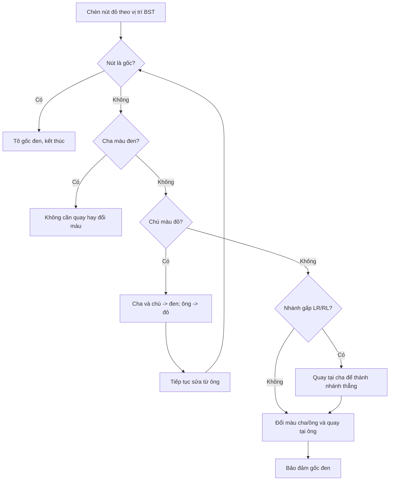

# Cây đỏ–đen: màu nút, lá rỗng và chiều cao đen

## Mục tiêu học tập

Sau bài học, bạn có thể:

- Mô tả **cây đỏ–đen (Red–Black Tree)** là một cây tìm kiếm nhị phân (BST) được tăng cường **bất biến màu** để khống chế chiều cao.
- Phân biệt **nút thật**, **lá rỗng `NIL`**, **màu đỏ/đen** và **chiều cao đen (black-height)**; tính đúng black-height theo một quy ước thống nhất.
- Kiểm tra năm quy tắc đỏ–đen và lý giải vì sao chúng cho chiều cao **O(log n)** trong trường hợp xấu nhất.
- Hiểu vai trò riêng của **phép quay**, **đổi màu** và **đưa lỗi lên tổ tiên** khi chèn; mô phỏng trường hợp chú đỏ, chú đen, nhánh thẳng và nhánh gấp.
- Đọc và vận dụng ví dụ Python chèn cây đỏ–đen bằng một **sentinel `NIL` đen**, cùng bộ kiểm tra BST, màu nút, số nút đen và liên kết cha–con.
- Phân biệt những vấn đề khi **xóa nút đen** với chèn; hiểu các nhóm trường hợp sửa lỗi mà không nhầm chúng với thuật toán xóa AVL.
- Đánh giá thời gian, bộ nhớ và độ phức tạp triển khai khi chọn Red–Black Tree cho một chỉ mục có thứ tự.

## 1. Động cơ: thứ tự BST đúng chưa đủ để tìm nhanh

Trong hệ thống học tập, giả sử ta muốn lưu bài theo khóa `(duration_minutes, lesson_id)` để:

- Tìm một bài theo khóa có thứ tự.
- Chèn và xóa bài khi thay đổi danh mục.
- Liệt kê các bài trong một khoảng thời lượng theo thứ tự tăng.

**Cây tìm kiếm nhị phân (BST)** giữ quy tắc: với một nút có khóa `k`, mọi khóa cây con trái nhỏ hơn `k`, mọi khóa cây con phải lớn hơn `k`. Trong một BST thường, chuỗi chèn khóa tăng dần có thể tạo ra cây **lệch một phía**:

```text
Chèn 10, 20, 30, 40 theo BST thông thường:

10
  \
   20
     \
      30
        \
         40
```

BST này vẫn đúng thứ tự, nhưng chiều cao theo số cạnh là 3 với 4 nút. Tổng quát, chiều cao `h` có thể tăng tới `Θ(n)`; việc tìm, chèn và xóa theo một đường gốc–lá có thể mất `O(n)`.

**Cây đỏ–đen (Red–Black Tree, viết tắt RB Tree)** bổ sung **màu đỏ hoặc đen** ở từng nút và quy tắc về **số nút đen trên các đường đi**. Những quy tắc đó cấm các nhánh dài tùy ý, bảo đảm chiều cao `O(log n)` dù thứ tự thêm khóa bất lợi.

> Cân bằng trong RB Tree không có nghĩa hai cây con luôn cao bằng nhau. Nó là bảo đảm toàn cục rút ra từ **một tập bất biến màu và black-height**.

## 2. Thành phần biểu diễn: nút thật, khóa và lá `NIL`

Một nút thật thường chứa:

| Trường | Vai trò |
| --- | --- |
| `key` | Khóa so sánh để giữ bất biến BST |
| `value` | Bản ghi gắn với khóa |
| `color` | `RED` hoặc `BLACK` |
| `left` và `right` | Tham chiếu đến nút con hoặc `NIL` |
| `parent` (tùy thiết kế) | Tham chiếu đi lên, tiện khi quay và sửa lỗi |

Đặc trưng quan trọng: trong mô hình lý thuyết, **mọi chỗ thiếu con đều được xem là một lá rỗng `NIL` màu đen**. Vì vậy, khi một nút thật không có con trái/phải, điều đó **không đồng nghĩa đường đi dừng trước khi tính lá đen**.

```text
                20(B)
               /     \
           10(R)     30(R)
           /   \      /   \
       NIL(B) NIL(B) NIL(B) NIL(B)

B = đen; R = đỏ.
Các NIL là lá rỗng, KHÔNG phải bản ghi dữ liệu thật.
```

Mô hình trên giúp phát biểu bất biến black-height trên mọi đường từ nút thật tới **lá rỗng**. Một cài đặt có thể dùng:

1. **Một đối tượng sentinel `NIL` duy nhất** được chia sẻ bởi tất cả lá rỗng; hoặc
2. `None` để biểu diễn thiếu con rồi **quy ước logic** rằng `None` có màu đen.

Cả hai cách có thể đúng. Bài này dùng **sentinel duy nhất** trong ví dụ Python, để truy cập `node.left.color` hay `uncle.color` mà không phải xử lý `None` ở mọi nhánh. Không được coi việc dùng sentinel chung là tạo chu trình **giữa các nút dữ liệu thật**.

### 2.1. Sentinel dùng chung là gì?

Giả sử `tree.nil` là đối tượng đen đại diện cho mọi lá rỗng:

```python
# Mô phỏng ý tưởng, chưa phải toàn bộ RB Tree.
class Node:
    def __init__(self, key=None, color="BLACK"):
        self.key = key
        self.color = color
        self.left = None
        self.right = None


nil = Node()
nil.left = nil
nil.right = nil

leaf = Node(10, "RED")
leaf.left = nil
leaf.right = nil

assert leaf.left is leaf.right is nil
assert nil.color == "BLACK"
```

**Mục đích sentinel:** giữ một đối tượng có thể đọc màu mà không cần tạo vô số lá thật. Sentinel không tính vào **`n`, số khóa dữ liệu**; nó vẫn tham gia vào **đếm số nút đen trên đường tới lá** theo quy ước đã chọn.

**Chú ý khi xóa:** nếu dùng một sentinel chung và thuật toán cần đi từ lá rỗng lên `parent`, phải thiết kế cách truyền hoặc cập nhật thông tin cha cho đúng. Ví dụ chèn phía dưới không cần đi từ `NIL` lên cha, nên nó giữ `nil.parent` cố định. Không thể bê nguyên cách đó sang mọi biến thể xóa.

## 3. Năm bất biến đỏ–đen

Theo cách mô tả thông dụng, RB Tree là một BST thỏa:

1. **Màu nút:** mỗi nút thật có đúng một màu, **đỏ** hoặc **đen**.
2. **Gốc đen:** gốc cây màu **đen** nếu cây không rỗng.
3. **Lá rỗng đen:** mọi lá `NIL` được xem là **đen**.
4. **Không đỏ–đỏ:** nút **đỏ** không có **con đỏ**. Nói cách khác, không có hai nút đỏ thật liên tiếp trên một đường cha–con.
5. **Chiều cao đen nhất quán:** từ một nút bất kỳ, **mọi đường đi xuống các lá `NIL` hậu duệ đều có cùng số nút đen**, đếm theo cùng quy ước.

Ngoài năm quy tắc màu này, cây **bắt buộc giữ bất biến thứ tự BST**:

\[
\forall x:\quad
\text{key(left subtree)}<x.key<
\text{key(right subtree)}.
\]

Nhiều tài liệu trình bày gốc đen như một quy ước chuẩn hóa chứ không xem nó là quy tắc thiết yếu để chứng minh giới hạn chiều cao; nếu gốc đỏ nhưng các quy tắc khác đúng, có thể tô gốc thành đen để có biểu diễn chuẩn. Trong bài này, ta luôn yêu cầu **gốc đen**.

### 3.1. Vì sao cấm đỏ–đỏ?

Nếu không cấm hai nút đỏ liên tiếp, một nhánh có thể kéo dài bằng rất nhiều nút đỏ mà **không tăng số nút đen**. Khi đó black-height không còn kiểm soát được chiều cao thật.

Ví dụ không hợp lệ:

```text
       20(B)
      /
    10(R)
    /
   5(R)     <- Nút đỏ có con đỏ, vi phạm quy tắc 4.
```

Chỉ cần đường từ `20` tới `5` chứa hai nút đỏ liên tiếp là **sai**, dù một số đường khác có thể đủ nút đen.

### 3.2. Vì sao không phải cứ cha–con khác màu là hợp lệ?

Một cây có thể **không chứa đỏ–đỏ** nhưng vi phạm **black-height**:

```text
           20(B)
          /     \
       10(B)   30(B)
       /
     5(B)

Các chỗ thiếu con là NIL(B).
```

Từ `20`, đường qua `10` và `5` tới `NIL` có **nhiều nút đen hơn** đường qua `30` tới `NIL`. Vì vậy cây trên **không phải RB Tree hợp lệ**, dù mọi nút thật đều màu đen và không có nút đỏ kề nút đỏ.

### 3.3. Các quy tắc độc lập nhau

| Quy tắc | Bảo vệ điều gì? | Nếu bỏ qua |
| --- | --- | --- |
| BST | Tìm kiếm rẽ nhánh đúng | Có thể không tìm được khóa |
| Hai màu hợp lệ | Dữ liệu trạng thái rõ ràng | Không thể áp dụng phép sửa màu |
| Gốc đen | Biểu diễn chuẩn, dễ kiểm tra | Thuật toán hoặc validator khác quy ước |
| `NIL` đen | Có mốc đen kết thúc đường | Black-height bị diễn giải không nhất quán |
| Không đỏ–đỏ | Chặn số nút đỏ trên đường dài | Có thể tạo chuỗi đỏ quá dài |
| Black-height đồng đều | Buộc mọi nhánh có đủ nút đen | Một nhánh có thể dài vượt trội |

**Không một quy tắc riêng lẻ nào thay được tất cả quy tắc còn lại.** Thao tác chèn/xóa đúng phải giữ **BST, màu, sentinel và black-height** cùng lúc.

## 4. Chiều cao đen (black-height): đếm thế nào cho nhất quán?

Định nghĩa dùng trong bài:

> **`bh(x)`** là số **nút màu đen** trên bất kỳ đường đi nào **từ ngay sau nút `x` tới một lá `NIL` hậu duệ**, **không tính `x`**, **có tính lá `NIL` đen ở cuối**.

Trong một cây đỏ–đen hợp lệ, mọi đường như vậy có cùng số nút đen, nên `bh(x)` xác định tốt.

Với cách đếm này:

- Một **nút thật là lá** (hai con đều `NIL`) có `bh(leaf)=1`: đường từ sau lá thật tới `NIL` chứa một lá đen.
- Nếu `x` có hai con thật, hãy đếm số nút đen trên đường đi từ từng con xuống `NIL`; hai kết quả phải bằng nhau.
- Màu của chính `x` **không trực tiếp cộng vào `bh(x)`**, vì định nghĩa **loại trừ `x`**.
- Ta không gán `bh(nil)` theo cùng cách đếm đường xuống thêm một lá nữa; sentinel là **điểm kết thúc**.

### 4.1. Ví dụ tính black-height

```text
                   40(B)
                  /     \
               20(R)   60(B)
               /   \    /   \
           10(B) 30(B) 50(R) 70(R)
            /\     /\    /\    /\
           NIL    NIL   NIL   NIL   (mọi lá rỗng màu đen)
```

Cây này **hợp lệ**:

- Tại nút `20(R)`: mỗi đường xuống `NIL` đi qua một con đen (`10` hoặc `30`) và một `NIL` đen, nên `bh(20)=2`.
- Tại nút `60(B)`: mỗi đường xuống `NIL` đi qua một con đỏ (`50` hoặc `70`) và một `NIL` đen, nên `bh(60)=1`.
- Tại gốc `40(B)`: đường qua `20(R)`, `10(B)`, `NIL(B)` có **2 nút đen** sau gốc; đường qua `60(B)`, `50(R)`, `NIL(B)` cũng có **2 nút đen** sau gốc. Do đó `bh(40)=2`.

Nếu vẽ cây mà chỉ ghi `NIL` ở một vài vị trí, cần hiểu **mọi vị trí thiếu con đều có `NIL` đen**, không được chỉ đếm những chữ `NIL` tình cờ được in ra.

### 4.2. Phân biệt `height` và `black-height`

| Đại lượng | Đo điều gì? | Nút đỏ có được tính? |
| --- | --- | --- |
| **Chiều cao `h`** | Số cạnh hoặc nút trên đường dài nhất tới lá, theo quy ước | Có, vì mọi nút thật góp vào đường |
| **Black-height `bh(x)`** | Số **nút đen** từ sau `x` tới `NIL`, gồm `NIL` | Không |
| **Độ sâu (depth)** | Khoảng cách từ gốc tới một nút | Có, không xét màu |
| **Số nút `n`** | Số khóa/nút thật trong cây | Tất cả nút thật, không tính sentinel |

Các thuật toán RB Tree thường không lưu `black-height` tại từng nút; bất biến này được **duy trì gián tiếp qua quy tắc quay và đổi màu**. Nếu cài đặt lưu thêm metadata đếm nút đen, phải cập nhật chúng nhất quán khi sửa cây.

### 4.3. Cách đếm trong bộ kiểm tra Python

Trong ví dụ kiểm chứng phía dưới, hàm đệ quy trả về số nút đen trên đường từ **nút hiện tại đến `NIL`**, **có tính chính nút hiện tại nếu đen**. Vì thế:

```text
check(NIL) trả về 1  (đếm lá rỗng đen).
check(nút đỏ) = check(con) + 0.
check(nút đen) = check(con) + 1.
```

Ta kiểm tra **hai kết quả từ con trái/phải bằng nhau**. Đây là cách triển khai tương đương với định nghĩa `bh(x)` loại trừ chính `x` ở trên, không phải hai lý thuyết khác nhau.

## 5. Vì sao các bất biến khống chế chiều cao O(log n)?

Đây là kết quả nền tảng của RB Tree. Gọi:

- `n`: số **nút thật** trong cây, không tính lá `NIL`.
- `h`: chiều cao của cây, **đếm số cạnh** từ gốc tới nút thật sâu nhất (cây một nút có `h=0`).
- `b=bh(root)`: chiều cao đen của gốc, theo quy ước mục 4.

### 5.1. Đường dài không thể có quá nhiều nút đỏ

Do **không có hai nút đỏ liên tiếp**, trên một đường từ gốc tới lá rỗng, số nút đỏ không thể vượt trội hơn số nút đen. Vì gốc đen và `NIL` đen, các nút thật trên đường có tổng chiều dài không quá một hằng số lần số nút đen.

Ý chính:

\[
h \le 2b
\]

với quy ước `h` theo số cạnh tới nút thật sâu nhất và `b=bh(root)` ở đây (cận này đủ dùng dù không phải chặt nhất trong mọi hình dạng).

Nếu cho phép các nút đỏ nằm liên tiếp tùy ý, bất đẳng thức này sẽ không còn được đảm bảo.

### 5.2. Black-height buộc phải có đủ nút thật

Một cây con có chiều cao đen `b` không thể chỉ là một nhánh đơn dài với rất ít nút. Quy tắc **mọi đường tới `NIL` có cùng số nút đen** buộc các nhánh có đủ cấu trúc.

Lập luận quy nạp theo black-height cho số nút thật tối thiểu:

\[
n \ge 2^b - 1.
\]

Trực giác: mỗi lần cần thêm một mức đen trên **mọi đường** trong cây con thì phải có đủ nút ở cả hai phía để duy trì cùng black-height. Trong trường hợp nhỏ nhất, số nút thật tăng tối thiểu theo cấp số mũ của `b`.

Từ đó:

\[
b \le \log_2(n+1).
\]

### 5.3. Ghép hai kết quả

\[
h \le 2b \le 2\log_2(n+1).
\]

Vậy **chiều cao RB Tree là O(log n) trong trường hợp xấu nhất**.

Hệ quả: các thao tác đi dọc một đường từ gốc xuống, như **tìm khóa** hay **xác định vị trí chèn**, mất **O(log n)** với cấu trúc hợp lệ.

**Điều cần nhớ:** chứng minh không chỉ dựa vào “cây có màu”. Cần đồng thời **không đỏ–đỏ** và **black-height bằng nhau** để ngăn hai cách tạo cây quá cao.

### 5.4. RB Tree không đòi cân bằng chặt như AVL

**AVL** yêu cầu `|height(left)-height(right)|≤1` ở **mọi nút**, dựa trực tiếp trên chiều cao hai cây con.

**RB Tree** chỉ yêu cầu các bất biến màu và số nút đen. Hai nhánh có thể khác chiều cao tổng thể đáng kể hơn nhưng vẫn không phá giới hạn O(log n).

| Yếu tố | AVL | Red–Black |
| --- | --- | --- |
| Metadata thường lưu | Chiều cao hoặc hệ số cân bằng | Màu đỏ/đen |
| Ràng buộc chính | Chênh chiều cao hai con tối đa 1 | Không đỏ–đỏ, black-height đồng đều |
| Chiều cao | O(log n) xấu nhất | O(log n) xấu nhất |
| Sửa sau cập nhật | Quay và cập nhật chiều cao | Quay, đổi màu và xử lý vi phạm màu |
| Tìm theo khóa | O(log n) xấu nhất | O(log n) xấu nhất |
| Đặc điểm | Giới hạn chiều cao chặt hơn | Cho phép nhiều hình dạng hợp lệ hơn |

Không nên khẳng định một họ **luôn nhanh hơn** chỉ từ bảng Big O: chi phí thực tế còn phụ thuộc tần suất thêm/xóa, số lần quay, bộ nhớ, CPU cache và chất lượng triển khai.

## 6. Vai trò của quay và đổi màu

Khi **chèn** một nút vào RB Tree, trước hết ta tìm vị trí như BST. Nút mới thường được gán **màu đỏ**:

- Nút đỏ mới **không tăng số nút đen** trên các đường đi qua nó.
- Nhưng nếu cha nó cũng đỏ, quy tắc **không đỏ–đỏ** bị vi phạm.
- Thuật toán phải xử lý vi phạm bằng **đổi màu**, **quay** hoặc cả hai, có thể đi ngược lên những tổ tiên.

### 6.1. Quay trái và quay phải bảo toàn thứ tự BST

Quay trái tại `x` có con phải `y`:

```text
TRƯỚC:                          SAU quay trái:

        x                              y
       / \                            / \
      A   y                          x   C
         / \                        / \
        B   C                      A   B
```

Với thứ tự `A < x < B < y < C`, dãy inorder trước và sau đều:

```text
in(A), x, in(B), y, in(C)
```

Quay phải là phép đối xứng. **Một phép quay không tự đổi màu**; việc giữ black-height sau sửa lỗi phụ thuộc cách **kết hợp quay với đổi màu** phù hợp.

### 6.2. Đổi màu giải quyết loại vi phạm nào?

Giả sử `P` là cha đỏ của nút `Z` vừa chèn; `G` là ông đen; `U` là chú/bác (*uncle*, con còn lại của ông). Khi `U` **đỏ**, ta có thể:

- Đổi `P` từ đỏ thành đen.
- Đổi `U` từ đỏ thành đen.
- Đổi `G` từ đen thành đỏ.

Sự phân bố số nút đen trên các đường trong cây con của `G` được bảo toàn tương ứng, nhưng **`G` vừa đỏ có thể kề một cha đỏ cao hơn**. Lỗi đỏ–đỏ vì thế được **đẩy lên trên**; phải tiếp tục xử lý.

Nếu `G` trở thành gốc toàn cây, tô gốc thành đen ở cuối để giữ quy tắc gốc đen.

```text
TRƯỚC (P và U đỏ):              SAU đổi màu:

           G(B)                        G(R)
          /    \                      /    \
        P(R)   U(R)                  P(B)   U(B)
        /                           /
      Z(R)                        Z(R)

Giữ số nút đen mỗi đường trong cây con G,
nhưng phải kiểm tra cha của G nếu G không phải gốc.
```

## 7. Chèn Red–Black: các trường hợp dựa vào màu chú

Trong phần này:

- `Z`: nút đỏ đang được sửa vi phạm.
- `P = Z.parent`: cha, đang đỏ khi cần vào vòng sửa.
- `G = P.parent`: ông; trong cấu hình vi phạm bình thường ông phải tồn tại.
- `U`: nút **chú** của `Z`, tức con còn lại của `G` ngoài `P`. `U` có thể là `NIL` đen.

### 7.1. Trường hợp 0 — chèn nút gốc

Nếu cây rỗng, tạo nút mới rồi tô **đen** vì nút đó là gốc. Hai con là `NIL` đen. Không cần quay.

```text
             10(B)
            /    \
        NIL(B)  NIL(B)
```

### 7.2. Trường hợp 1 — cha đen, không có vi phạm đỏ–đỏ

Chèn một nút **đỏ** dưới cha đen không làm tăng số nút đen trên đường từ cha xuống `NIL`. Các quy tắc RB vẫn đúng; có thể **kết thúc** sửa lỗi.

```text
         20(B)
        /
      10(R)  <- mới chèn, cha đen.
```

### 7.3. Trường hợp 2 — cha đỏ, chú đỏ: đổi màu và đi lên

```text
Trước chèn 1:                     Sau xử lý đổi màu:

             10(B)                        10(B)  <- tô lại gốc
            /    \                        /    \
          5(R)   15(R)                   5(B)   15(B)
         /                              /
       1(R)                           1(R)
```

Khi phát hiện `P` và `U` đỏ, trước tiên đổi màu `P,U` thành đen và `G` thành đỏ. Vì `G` trong ví dụ là gốc, bước kết thúc tô lại `G` đen. Không cần quay.

Nếu `G` còn có cha đỏ, phải **tiếp tục** sửa vi phạm đỏ–đỏ tại vị trí `G` mới tô đỏ.

### 7.4. Trường hợp 3 — cha đỏ, chú đen, đường thẳng

Ví dụ chèn `10,20,30`:

```text
TRƯỚC sửa (RR):                 SAU quay trái + đổi màu:

     10(B)                            20(B)
        \                             /    \
        20(R)                       10(R)  30(R)
           \
           30(R)

Chú của 30 là NIL(B).
```

Đây là đường **phải–phải** tính từ ông `G=10`. Thực hiện:

1. Đổi `P=20` thành **đen**.
2. Đổi `G=10` thành **đỏ**.
3. **Quay trái tại `G`**.

Kết quả giữ thứ tự BST và black-height; lỗi đỏ–đỏ tại `20/30` được giải quyết.

Trường hợp **trái–trái (LL)** đối xứng: `G` có con trái `P` đỏ, `Z` nằm bên trái `P`, chú đen. Đổi màu `P` đen, `G` đỏ rồi **quay phải tại `G`**.

### 7.5. Trường hợp 4 — cha đỏ, chú đen, đường gấp

Ví dụ chèn `30,10,20`:

```text
TRƯỚC (LR):                   Quay trái tại P=10:

         30(B)                         30(B)
        /                             /
      10(R)                         20(R)
         \                         /
         20(R)                   10(R)
```

Bước đầu **quay trái tại cha `P=10`** để chuyển gấp **LR** thành thẳng **LL**. Sau đó:

1. Đổi nút đang giữ vai trò cha mới `20` thành **đen**.
2. Đổi ông `30` thành **đỏ**.
3. **Quay phải tại `30`**.

```text
SAU quay kép và đổi màu:

            20(B)
           /    \
         10(R)  30(R)
```

**RL** đối xứng: quay phải tại cha đỏ ở phía phải, rồi đổi màu và quay trái tại ông. Đây là hai phép quay trong cùng một lần sửa tại một cụm nút.

### 7.6. Bảng quyết định lúc chèn

| Tình trạng | Xử lý | Có thể còn phải đi lên? |
| --- | --- | --- |
| Nút mới trở thành gốc | Tô gốc đen | Không |
| Cha đen | Giữ nút mới đỏ | Không |
| Cha đỏ, chú đỏ | Đổi cha và chú đen; ông đỏ | **Có**, kiểm tra cha của ông |
| Cha đỏ, chú đen, nhánh thẳng | Đổi màu cha/ông, quay tại ông | Thường kết thúc vi phạm cục bộ |
| Cha đỏ, chú đen, nhánh gấp | Quay tại cha để thành nhánh thẳng, rồi đổi màu và quay tại ông | Thường kết thúc vi phạm cục bộ |

Các tên LL/RR/LR/RL ở đây giúp **nhận diện hình dạng** nhưng điều kiện sửa RB Tree phụ thuộc thêm **màu chú và màu các nút**. Không được lấy quy tắc AVL kiểm tra BF rồi áp vào Red–Black Tree.



## 8. Ví dụ Python: RB Tree chèn với sentinel `NIL`

Ví dụ sau là **Red–Black Map** minh họa, hỗ trợ:

1. `insert(key,value)`: thêm khóa số nguyên; khóa trùng **cập nhật giá trị** và không tăng số nút.
2. `get(key)`: tra giá trị theo thứ tự BST.
3. `items()`: duyệt inorder theo khóa tăng.
4. `validate()`: kiểm tra thứ tự, màu, black-height, sentinel và các liên kết `parent`.

**Giới hạn:** mã này **chưa cài xóa**; phần xóa RB Tree được phân tích về ý tưởng ở mục 10. Mục đích là quan sát rõ tác dụng của **đổi màu, quay và các lá rỗng đen**.

### 8.1. Nút, màu và sentinel

```python
RED = "RED"
BLACK = "BLACK"


class RBNode:
    def __init__(self, key, value, color=RED):
        self.key = key
        self.value = value
        self.color = color
        self.left = None
        self.right = None
        self.parent = None


class RBTree:
    def __init__(self):
        # Chỉ có MỘT sentinel NIL chung cho toàn bộ cây.
        self.nil = RBNode(None, None, BLACK)
        self.nil.left = self.nil
        self.nil.right = self.nil
        self.nil.parent = self.nil
        self.root = self.nil

    def _rotate_left(self, x):
        y = x.right
        if y is self.nil:
            raise ValueError("Quay trái cần con phải thật")

        x.right = y.left
        if y.left is not self.nil:
            y.left.parent = x

        y.parent = x.parent
        if x.parent is self.nil:
            self.root = y
        elif x is x.parent.left:
            x.parent.left = y
        else:
            x.parent.right = y

        y.left = x
        x.parent = y

    def _rotate_right(self, y):
        x = y.left
        if x is self.nil:
            raise ValueError("Quay phải cần con trái thật")

        y.left = x.right
        if x.right is not self.nil:
            x.right.parent = y

        x.parent = y.parent
        if y.parent is self.nil:
            self.root = x
        elif y is y.parent.left:
            y.parent.left = x
        else:
            y.parent.right = x

        x.right = y
        y.parent = x
```

Hai phép quay cập nhật **gốc**, **tham chiếu cha–con** và **cây con giữa**. Chúng không tự đổi màu. Ở đây `self.nil.parent` được giữ là chính sentinel vì quá trình chèn không cần tìm cha của lá rỗng; `validate` cũng không dùng trường cha của `NIL` làm cha trực tiếp của từng lá.

### 8.2. Tìm, chèn BST và sửa màu

Các phương thức dưới đây thuộc **cùng lớp `RBTree`**. Để chạy thử, hãy **ghép ba khối mã ở mục 8.1, 8.2 và 8.3 thành một lớp duy nhất**, giữ nguyên thụt lề của các phương thức, rồi chạy các lệnh kiểm tra ở mục 8.4. Việc chia khối chỉ nhằm giải thích từng phần, không phải ba chương trình Python chạy độc lập.

```python
    def get(self, key):
        if type(key) is not int:
            raise TypeError("Khóa phải là số nguyên")
        node = self.root
        while node is not self.nil:
            if key == node.key:
                return node.value
            node = node.left if key < node.key else node.right
        return None

    def insert(self, key, value):
        if type(key) is not int:
            raise TypeError("Khóa phải là số nguyên")

        parent = self.nil
        current = self.root
        while current is not self.nil:
            parent = current
            if key == current.key:
                current.value = value
                return False  # Không thêm nút mới.
            current = (
                current.left if key < current.key else current.right
            )

        # Nút mới đỏ, hai con là các lá rỗng NIL đen.
        z = RBNode(key, value, RED)
        z.left = self.nil
        z.right = self.nil
        z.parent = parent

        if parent is self.nil:
            self.root = z
        elif key < parent.key:
            parent.left = z
        else:
            parent.right = z

        self._fix_insert(z)
        return True

    def _fix_insert(self, z):
        # Nếu cha đen thì không có vi phạm đỏ-đỏ.
        while z.parent.color == RED:
            grandparent = z.parent.parent

            if z.parent is grandparent.left:
                uncle = grandparent.right
                if uncle.color == RED:
                    # Chú đỏ: đẩy vi phạm lên ông.
                    z.parent.color = BLACK
                    uncle.color = BLACK
                    grandparent.color = RED
                    z = grandparent
                else:
                    # Chú đen: sửa gấp -> thẳng, rồi quay ông.
                    if z is z.parent.right:
                        z = z.parent
                        self._rotate_left(z)
                    z.parent.color = BLACK
                    z.parent.parent.color = RED
                    self._rotate_right(z.parent.parent)
            else:
                # Các trường hợp đối xứng khi cha ở bên phải ông.
                uncle = grandparent.left
                if uncle.color == RED:
                    z.parent.color = BLACK
                    uncle.color = BLACK
                    grandparent.color = RED
                    z = grandparent
                else:
                    if z is z.parent.left:
                        z = z.parent
                        self._rotate_right(z)
                    z.parent.color = BLACK
                    z.parent.parent.color = RED
                    self._rotate_left(z.parent.parent)

        self.root.color = BLACK
        self.root.parent = self.nil

    def items(self):
        def walk(node):
            if node is not self.nil:
                yield from walk(node.left)
                yield (node.key, node.value)
                yield from walk(node.right)
        return walk(self.root)
```

**Phân tích từng giai đoạn:**

- `insert` tìm vị trí theo thứ tự BST và gắn nút mới màu **đỏ**; nếu khóa cũ đã tồn tại, chỉ cập nhật giá trị.
- Vòng `while` chỉ chạy nếu **cha đỏ**. Vì gốc phải đen trước cập nhật, khi cha đỏ thì ông của nút đang xét luôn là một nút thật trong cấu hình hợp lệ.
- Nếu **chú đỏ**, mã chỉ đổi màu và di chuyển `z` lên **ông**; đây là bước có thể lặp trên nhiều tổ tiên.
- Nếu **chú đen**, mã sửa hình dạng bằng một hoặc hai phép quay và đổi màu, khôi phục vi phạm cục bộ.
- Sau vòng lặp, `root` luôn được tô **đen** và có cha là sentinel.

### 8.3. Kiểm chứng thứ tự và black-height

Bổ sung phương thức `validate` vào lớp `RBTree`:

```python
    def validate(self):
        """Trả (số nút thật, black count của đường gốc->NIL,
        chiều cao theo số nút thật); kiểm tra các bất biến.
        """
        nil = self.nil
        assert nil.color == BLACK
        assert nil.left is nil and nil.right is nil

        if self.root is nil:
            return 0, 1, 0

        assert self.root.color == BLACK
        assert self.root.parent is nil
        seen = set()

        def visit(node, parent, lower, upper):
            if node is nil:
                # Đường tới lá rỗng tính một nút đen NIL.
                return 0, 1, 0  # (số nút, black count, chiều cao)

            identity = id(node)
            assert identity not in seen, "Nút bị lặp hoặc có chu trình"
            seen.add(identity)
            assert node.parent is parent, "Liên kết parent không đúng"
            assert node.color in (RED, BLACK), "Màu không hợp lệ"

            if lower is not None:
                assert lower < node.key, "Sai cận dưới BST"
            if upper is not None:
                assert node.key < upper, "Sai cận trên BST"

            if node.color == RED:
                assert node.left.color == BLACK, "Con trái đỏ-đỏ"
                assert node.right.color == BLACK, "Con phải đỏ-đỏ"

            left_n, left_b, left_h = visit(
                node.left, node, lower, node.key
            )
            right_n, right_b, right_h = visit(
                node.right, node, node.key, upper
            )
            assert left_b == right_b, "Black-height khác nhau"

            black_here = 1 if node.color == BLACK else 0
            return (
                1 + left_n + right_n,
                left_b + black_here,
                1 + max(left_h, right_h),
            )

        return visit(self.root, nil, None, None)
```

Giá trị `black count` trả về ở đây **tính cả gốc nếu gốc đen và lá `NIL`**. Nếu muốn black-height `bh(root)` đúng theo định nghĩa loại trừ gốc, hãy lấy kết quả đó **trừ đi 1** (vì gốc luôn đen trong cây không rỗng). Hàm `validate` kiểm tra **hai nhánh cùng black count** tại mọi nút; đó là điều quan trọng để bảo đảm quy tắc 5.

**Lưu ý kỹ thuật:** `validate` duyệt toàn cây O(n), phục vụ kiểm thử. Không cần gọi nó sau mỗi lần chèn trong dịch vụ thực tế để đạt giới hạn O(log n).

### 8.4. Các tình huống kiểm thử

Sau khi ghép ba khối phương thức vào cùng `RBTree`, dùng những trường hợp sau để tự kiểm tra:

```python
scenarios = {
    "RR": [10, 20, 30],
    "LL": [30, 20, 10],
    "LR": [30, 10, 20],
    "RL": [10, 30, 20],
    "uncle_red": [10, 5, 15, 1],
    "larger": [50, 20, 80, 10, 30, 70, 90,
               5, 15, 25, 35, 60, 75],
}

for name, keys in scenarios.items():
    tree = RBTree()
    for count_expected, key in enumerate(keys, start=1):
        assert tree.insert(key, f"lesson-{key}")
        count, black_count, height_nodes = tree.validate()
        assert count == count_expected  # Mỗi scenario chỉ có khóa phân biệt.

    assert [key for key, _ in tree.items()] == sorted(keys), name
    assert tree.get(keys[-1]) == f"lesson-{keys[-1]}", name
    assert tree.get(999) is None
    assert tree.root.color == BLACK

    # Cập nhật khóa cũ: không thêm nút, không sửa màu.
    old_count = tree.validate()[0]
    assert not tree.insert(keys[0], "updated")
    assert tree.get(keys[0]) == "updated"
    assert tree.validate()[0] == old_count

tree = RBTree()
assert tree.root is tree.nil
assert tree.validate() == (0, 1, 0)
assert tree.insert(42, "one")
assert tree.root.color == BLACK
assert tree.validate() == (1, 2, 1)
```

**Ý nghĩa kiểm thử:** cần xem cả **thứ tự inorder**, **màu**, **black-height**, **gốc đen**, **liên kết cha** và **số nút**. Một cây có inorder tăng dần **chưa đủ** để gọi là RB Tree hợp lệ.

## 9. Hình dung vòng sửa màu qua ví dụ thực tế

Xét chuỗi chèn `10, 5, 15, 1`:

### Bước 1 — chèn gốc

```text
       10(B)
```

Nút `10` được tạo đỏ rồi tô lại đen vì là gốc.

### Bước 2 — chèn 5

```text
        10(B)
        /
      5(R)
```

Cha `10` đen, không cần sửa.

### Bước 3 — chèn 15

```text
        10(B)
       /     \
     5(R)   15(R)
```

Hai con đỏ dưới cha đen là **hợp lệ**. Không yêu cầu “hai con của nút đen phải đen”.

### Bước 4 — chèn 1

```text
         10(B)                      10(B)
        /     \                    /     \
      5(R)    15(R)      ->      5(B)   15(B)
     /                          /
    1(R)                       1(R)
```

Cha `5` đỏ, chú `15` cũng đỏ. Đổi cha/chú đen, ông `10` đỏ, rồi do ông là gốc nên tô đen lần cuối. **Không quay**.

Nếu chỉ nhớ LL/LR/RR/RL rồi cố quay phải tại `10`, ta sẽ bỏ qua quy tắc **chú đỏ → đổi màu**, có thể gây lỗi black-height. Màu của chú là thông tin quyết định.

## 10. Xóa trong Red–Black Tree: lý do phải xử lý “thiếu đen”

Xóa BST có ba dạng quen thuộc:

1. **Nút lá:** bỏ nút.
2. **Nút một con:** nối con lên vị trí nút bị xóa.
3. **Nút hai con:** dùng successor/predecessor rồi xóa vị trí thay thế vật lý, hoặc chuyển nút vật lý theo biến thể cài đặt.

Trong RB Tree, xóa **đúng thứ tự BST** chưa đủ. Màu của **nút thật sự bị đưa ra khỏi vị trí trong cấu trúc** quyết định có cần sửa bất biến màu hay không.

### 10.1. Xóa một nút đỏ dễ hơn

Ví dụ:

```text
Trước:                     Sau xóa 10(R):

          20(B)                    20(B)
         /     \                      \
      10(R)    30(R)                  30(R)
```

Nếu xóa một **lá thật đỏ**, ta không làm giảm số nút đen của bất kỳ đường đi nào. Quan hệ đen–đỏ thường vẫn hợp lệ, nên không cần pha sửa “thiếu đen”.

**Chú ý:** không được tổng quát quá mức thành “mọi nút đỏ đều xóa trực tiếp được”. Với nút có hai con, thuật toán có thể **thay vị trí vật lý khác**, nên phải xét màu của nút bị loại thực sự theo quy trình.

### 10.2. Xóa nút đen có thể tạo “thiếu một nút đen”

Xét cây tối giản:

```text
           20(B)
          /     \
       10(B)   30(B)
```

Nếu xóa `10(B)` và thay bằng `NIL(B)` mà không sửa thêm, đường từ gốc qua phía trái có **ít nút đen hơn** đường qua `30(B)`. Bất biến black-height bị phá.

Một số thuật toán diễn giải tình trạng này bằng **“đen kép” (double black)** hoặc **“thiếu đen”** trên nút thay thế `x`. Đây chủ yếu là **khái niệm kế toán bất biến khi sửa lỗi**, không bắt buộc là màu thứ ba lưu thật trong trường `color` của nút.

### 10.3. Những nhóm trường hợp khi sửa lỗi sau xóa

Các thuật toán chuẩn thường xét `x` là vị trí đang mang lỗi black-height, `p` là cha của `x`, `w` là **anh/em (sibling)** của `x`:

| Tình trạng anh/em `w` | Ý tưởng sửa | Vì sao chưa thể kết thúc luôn? |
| --- | --- | --- |
| **`w` đỏ** | Đổi màu `w` và `p`, quay quanh `p` để chuyển sang cấu hình anh/em đen | Cần xét tiếp cấu hình mới |
| **`w` đen, cả hai con đen** | Tô `w` đỏ để cân bằng số đen cục bộ và đưa lỗi lên `p` | Có thể cần xử lý ở tổ tiên |
| **`w` đen, con gần đỏ, con xa đen** | Đổi màu và quay tại `w` để tạo cấu hình con xa đỏ | Chưa xử lý xong lỗi tại `x` |
| **`w` đen, con xa đỏ** | Đổi màu phù hợp, quay quanh `p` để khôi phục black-height | Có thể kết thúc sửa lỗi cục bộ |

“Con **gần**” và “con **xa**” ở đây được xác định theo vị trí của `x` so với `p`. Nếu `x` nằm bên trái `p`, con gần của `w` là con **trái** của `w`, con xa là con **phải**; nếu `x` nằm bên phải, các hướng đảo lại.

**Mục đích bài này** là nắm vững màu nút, `NIL` và black-height — nền tảng để hiểu xóa. Mã Python mục 8 chỉ cài chèn; **không** nhận phần bảng trên là một hàm xóa hoàn chỉnh. Xóa RB Tree còn phải xử lý chính xác việc nối lại `parent`, successor, sentinel và những trường hợp biên trong pha sửa lỗi.

### 10.4. Vì sao sentinel đặc biệt quan trọng khi xóa?

Vị trí `x` thay thế nút đen bị xóa có thể chính là **`NIL`**. Khi đó thuật toán vẫn cần biết `p` và `w` để xét các trường hợp sửa lỗi.

Với **một sentinel dùng chung**, không thể xem `nil.parent` là **cha riêng cố định của mọi lá rỗng cùng lúc**. Một cách cài xóa có thể:

- Tạm cập nhật `nil.parent` theo vị trí đang xử lý, rồi dùng cẩn thận theo ngữ cảnh; hoặc
- Truyền `parent` tường minh vào hàm sửa lỗi để không phụ thuộc vào `nil.parent` dùng chung.

Nếu bỏ qua vấn đề này, mã xóa có thể sai đúng ở những trường hợp **xóa nút đen có con thay thế rỗng**, dù chèn và tìm vẫn chạy tốt.

## 11. Độ phức tạp thời gian và bộ nhớ

Đặt `n` là số **nút thật**, `h=O(log n)` là chiều cao RB Tree:

| Thao tác | Thời gian điển hình/xấu nhất theo bất biến RB | Ghi chú |
| --- | --- | --- |
| Tìm khóa | **O(log n) xấu nhất** | Đi một đường gốc–lá |
| Xác định vị trí chèn | **O(log n) xấu nhất** | Theo quan hệ thứ tự BST |
| Chèn và sửa màu/quay | **O(log n) xấu nhất** | Có thể đổi màu dọc đường tổ tiên; số phép quay trong thuật toán chèn chuẩn bị chặn hằng số |
| Xóa và sửa lỗi màu | **O(log n) xấu nhất** | Xử lý một đường tổ tiên với các trường hợp sửa |
| Lấy min/max | **O(log n) xấu nhất** | Đi hết sang trái/phải |
| Liệt kê `k` khóa trong khoảng | **O(log n + k)** với thuật toán duyệt thích hợp | Tìm cận rồi duyệt kết quả |
| Duyệt inorder toàn bộ | **O(n)** | Phải thăm mọi nút |
| Một phép quay cục bộ | **O(1)** | Thay số lượng liên kết cố định |
| Kiểm tra toàn cây bằng `validate` | **O(n)** | Công cụ kiểm thử, không phải bước bắt buộc khi chèn |

### 11.1. Bộ nhớ

Mỗi nút thật giữ một số trường cố định: khóa, giá trị, hai con, màu và có thể tham chiếu cha. Tổng bộ nhớ nút là **O(n)**; một sentinel chung tốn **O(1)** bộ nhớ bổ sung.

Trong cài đặt ở mục 8, thuật toán tìm và chèn hoạt động **lặp**, không dùng ngăn xếp đệ quy trên đường tìm. Phần `validate` dùng đệ quy nên cần bộ nhớ ngăn xếp **O(h)**. Nếu một bản cài inorder hoặc xóa dùng đệ quy, cần tính riêng bộ nhớ của lời gọi ấy.

**Không nên hiểu thêm một bit màu nghĩa là cả nút chỉ tốn thêm đúng một bit trong mọi ngôn ngữ:** đối tượng, tham chiếu, căn lề bộ nhớ và biểu diễn chuỗi màu như `"RED"`/`"BLACK"` trong Python có chi phí thực tế lớn hơn mô hình lý thuyết.

### 11.2. Vai trò của kích thước khóa

Khi ghi `O(log n)` cho tìm/chèn, ta thường giả định **một phép so sánh khóa là O(1)**. Nếu khóa là chuỗi rất dài, so sánh từ điển có thể tốn thời gian theo số ký tự; chi phí thực tế là số lần so sánh **nhân với** chi phí so sánh khóa.

Khóa của RB Tree cần **thứ tự nhất quán, bắc cầu**. Đừng dùng các giá trị `NaN` không được xử lý chính sách hoặc thay đổi nội dung khóa tại chỗ khi nút đã ở trong cây, vì có thể phá BST dù mọi màu đều hợp lệ.

## 12. Ứng dụng: bản đồ và tập hợp có thứ tự

Một nền tảng cấu trúc dữ liệu có thể cần đồng thời:

- `by_id` là bảng băm `lesson_id → Lesson` để tra chính xác theo ID.
- `by_duration` là cây có thứ tự theo `(duration_minutes, lesson_id)` để duyệt các bài theo khoảng thời lượng.
- `prerequisites` là đồ thị theo ID để kiểm tra quan hệ tiên quyết.

Red–Black Tree là một cách hiện thực **ordered Map/Set**: giữ thứ tự và cho các thao tác tìm/chèn/xóa O(log n) xấu nhất. Ví dụ:

```text
Khóa sắp xếp: (phút, ID)

(20, "ds-array")
(30, "ds-queue")
(30, "ds-stack")
(45, "ds-graph")
```

Hai bài cùng 30 phút vẫn có khóa phân biệt nhờ ID. Khi sửa thời lượng của `ds-stack` từ 30 lên 40:

1. Phải loại khóa thứ tự cũ `(30, "ds-stack")` khỏi cây.
2. Chèn khóa mới `(40, "ds-stack")`.
3. Cập nhật bản ghi chính và các chỉ mục liên quan theo một chính sách nhất quán.

**Không** được đổi trực tiếp khóa trên một nút đang nằm trong BST rồi kỳ vọng phép quay hay màu nút sẽ tự sửa thứ tự.

### 12.1. Chọn RB Tree hay cấu trúc khác?

| Nhu cầu | Cấu trúc nên cân nhắc | Đánh đổi |
| --- | --- | --- |
| Chỉ tra ID chính xác | Bảng băm | O(1) kỳ vọng, không tự hỗ trợ thứ tự khóa |
| Cần thứ tự, thêm/xóa thường xuyên | AVL hoặc Red–Black | O(log n) xấu nhất; mã và metadata phức tạp hơn |
| Dữ liệu gần như tĩnh, tìm nhiều | Mảng đã sắp | Tìm nhị phân O(log n), nhưng chèn/xóa giữa O(n) |
| Cần lấy cực trị liên tục | Heap | Lấy ưu tiên tốt, không thuận cho tìm khóa bất kỳ |
| Chỉ mục theo trang lưu trữ | B-tree/B+ tree | Nhiều khóa mỗi trang, ít mức I/O |

Không có quy tắc rằng “RB Tree luôn tốt hơn AVL” hoặc ngược lại. RB Tree cho phép các nhánh khác chiều cao hơn một chút, nhưng có chính sách đổi màu/quay khác; AVL cân bằng chiều cao chặt hơn nhưng cũng cần cập nhật chiều cao. Cần chọn theo **mẫu đọc/ghi, khả năng duy trì, thư viện được kiểm chứng, kích thước dữ liệu và bộ nhớ**.

### 12.2. Nhiều chỉ mục nghĩa là nhiều bất biến

Nếu tồn tại cả `by_id` và một cây theo thời lượng, thao tác xóa hoặc sửa phải bảo đảm:

1. Mỗi khóa của cây sắp xếp tham chiếu đúng một bản ghi trong `by_id`.
2. Thời lượng và ID trong khóa sắp xếp đúng với phiên bản dữ liệu hiện tại.
3. Mọi cạnh trong đồ thị tiên quyết tham chiếu ID còn hợp lệ theo chính sách nghiệp vụ.
4. Cây sau cập nhật vẫn giữ **BST và toàn bộ quy tắc Red–Black**.

Khôi phục bất biến của riêng RB Tree **không tự bảo đảm giao dịch** của nhiều chỉ mục. Nếu có lỗi giữa các cập nhật hoặc nhiều luồng cùng sửa, ứng dụng cần cơ chế đồng bộ/giao dịch phù hợp.

## 13. Những hiểu lầm dễ gặp

- **“Nút `NIL` không có màu, nên bỏ qua khi đếm.”** Sai theo quy ước bài này: `NIL` màu đen và có tính vào số nút đen trên đường tới lá.
- **“NIL là một nút dữ liệu với khóa `None`.”** Sai: nó là sentinel, không được đưa vào `n` hay kết quả inorder.
- **“Mọi cây có gốc đen và không đỏ–đỏ đều hợp lệ.”** Sai: còn phải có black-height đồng đều và thứ tự BST.
- **“Hai con của một nút đen bắt buộc đều đen.”** Sai: nút đen có thể có con đỏ, miễn mọi quy tắc còn lại đúng.
- **“Hai đường hợp lệ phải dài bằng nhau theo số cạnh.”** Sai: chỉ **số nút đen** theo quy ước phải bằng nhau; số nút đỏ có thể khác.
- **“Chèn RB Tree luôn phải quay.”** Sai: cha đen không cần sửa; chú đỏ thường xử lý bằng đổi màu và đi lên.
- **“Có nhánh gấp thì cứ áp quy tắc AVL.”** Không đủ: RB Tree phải xét màu cha, chú và ông trước khi chọn sửa.
- **“Quay tự sửa màu và black-height.”** Sai: quay chỉ sửa liên kết; thuật toán phải đổi màu đúng lúc.
- **“Mọi lần đổi màu đều kết thúc ở ông.”** Sai: ông đổi thành đỏ có thể kề cha đỏ, lỗi phải đi lên.
- **“Chiều cao đen bằng chiều cao cây.”** Sai: chiều cao đen chỉ đếm các nút đen, còn chiều cao cây tính cả nút đỏ.
- **“Xóa nút đen đơn giản như xóa BST.”** Sai: cần sửa đường bị thiếu đen nếu black-height bị phá.
- **“Double black là màu thứ ba bắt buộc lưu ở nút.”** Sai: thường chỉ là cách diễn giải trạng thái sửa lỗi.
- **“Một sentinel chung có `parent` riêng cho mọi chỗ thiếu con.”** Sai: cần xử lý cha theo ngữ cảnh khi xóa.
- **“Validator O(n) nghĩa là chèn RB Tree O(n).”** Sai: kiểm tra toàn cây là bước bổ sung, không phải lõi chèn.

## 14. Bài tập vận dụng

**Bài 1 — Nhận diện các lá rỗng.** Vẽ RB Tree có gốc `20(B)` và hai con `10(R)`, `30(R)`. Thêm toàn bộ các lá `NIL(B)` vào hình; có bao nhiêu nút thật, bao nhiêu vị trí `NIL`?

*Gợi ý:* Có 3 nút thật, 4 vị trí lá rỗng. Khi dùng một sentinel chung, số **đối tượng sentinel** có thể chỉ là 1.

**Bài 2 — Đếm chiều cao đen.** Trong cây ở Bài 1, tính `bh(20)`, `bh(10)` theo định nghĩa **không tính chính nút đang xét nhưng tính `NIL`**.

*Gợi ý:* `bh(20)=1`, `bh(10)=1`. Đường từ sau gốc qua nút đỏ tới lá đen có một nút đen.

**Bài 3 — Vi phạm đỏ–đỏ.** Cho đường `40(B) → 20(R) → 10(R) → NIL(B)`. Quy tắc nào sai? Nếu chú của `10` là `NIL(B)`, hình dạng nhánh nào cần xử lý khi chèn?

*Gợi ý:* Cha đỏ kề con đỏ; nếu `20` là con trái của `40` và `10` con trái của `20`, đó là nhánh LL, quay phải tại ông và đổi màu phù hợp.

**Bài 4 — Black-height không đều.** Một cây chỉ có các nút đen `20`, `10`, `30`, `5` với `10` con trái `20`, `30` con phải `20` và `5` con trái `10`. Giải thích vì sao cây sai dù không có đỏ–đỏ.

*Gợi ý:* Đường qua `5` có thêm một nút đen so với đường qua `30`; không cùng black-height.

**Bài 5 — Chèn có chú đỏ.** Chèn `10, 5, 15, 1` theo RB Tree. Tại sao lần chèn `1` cần **đổi màu** nhưng không phải quay? Màu cuối của gốc là gì?

*Gợi ý:* Cha và chú cùng đỏ; đổi cha/chú đen, ông đỏ rồi tô lại ông đen vì là gốc.

**Bài 6 — Chèn nhánh thẳng.** Chèn `10, 20, 30`. Hãy ghi màu trước/sau sửa, hướng quay và khóa ở gốc cuối.

*Gợi ý:* Cha đỏ, chú `NIL` đen, RR; tô `20` đen, `10` đỏ, quay trái tại `10`. Gốc mới `20(B)`.

**Bài 7 — Chèn nhánh gấp.** Chèn `30, 10, 20`. Xác định lần lượt hai phép quay và các nút cần đổi màu.

*Gợi ý:* LR: quay trái tại `10`, sau đó tô `20` đen, `30` đỏ rồi quay phải tại `30`.

**Bài 8 — Vì sao O(log n)?** Tóm tắt hai ý tưởng trong chứng minh `h≤2log₂(n+1)`. Hãy giải thích tại sao riêng black-height đồng đều hoặc riêng không đỏ–đỏ là chưa đủ.

*Gợi ý:* Không đỏ–đỏ chặn số nút đỏ xen giữa các nút đen; black-height đồng đều buộc số nút tối thiểu tăng theo cấp số mũ của số mức đen.

**Bài 9 — Đếm `NIL` trong kiểm chứng.** Một hàm đệ quy trả 1 khi gặp `NIL` và cộng 1 nếu nút thật màu đen. Hàm đó trả về black-height có tính nút gốc không? Muốn `bh(root)` theo định nghĩa bài này phải làm gì?

*Gợi ý:* Có tính gốc nếu gốc đen; đối với cây không rỗng hãy trừ một khỏi kết quả từ gốc.

**Bài 10 — Xóa lá đen.** Từ cây `20(B)` với hai con `10(B)`, `30(B)`, xóa `10`. Nếu chỉ thay bằng `NIL` mà không sửa gì, quy tắc nào bị phá? “Double black” có ý nghĩa gì?

*Gợi ý:* Đường trái thiếu một nút đen; double black là cách theo dõi phần đen thiếu để sửa cân bằng màu.

**Bài 11 — Sentinel khi xóa.** Vì sao một sentinel `NIL` duy nhất không thể có một trường `parent` cố định đúng cho mọi lá rỗng trong cùng thời điểm? Đề xuất một cách xử lý.

*Gợi ý:* Các vị trí rỗng thuộc những cha khác nhau. Có thể truyền cha tường minh khi sửa lỗi hoặc cập nhật `nil.parent` theo vị trí đang xử lý, với hợp đồng rõ ràng.

**Bài 12 — Kiểm thử tự động.** Mở rộng ví dụ Python bằng chuỗi chèn tăng, giảm, ngẫu nhiên và cập nhật khóa trùng. Sau mỗi lần chèn, so sánh inorder với tập khóa chuẩn và kiểm tra `validate()`.

*Gợi ý:* Đánh giá cả số nút, gốc đen, không đỏ–đỏ, black-height và cận khóa BST. Không dùng chi phí validator để tính thời gian chèn cốt lõi.

**Bài 13 — Chọn cấu trúc.** Một dịch vụ cần tra ID chính xác và trả các bài theo khoảng thời lượng, trong khi danh mục cập nhật liên tục. So sánh bảng băm, mảng đã sắp, AVL và Red–Black về thao tác, bộ nhớ và độ phức tạp cài đặt.

*Gợi ý:* Có thể phối hợp Map theo ID với chỉ mục có thứ tự; chi phí duy trì hai chỉ mục và bất biến cập nhật là phần không thể bỏ qua.

## Tổng kết

**Cây đỏ–đen** là BST duy trì thêm **màu đỏ/đen**, quy tắc **gốc đen, `NIL` đen, không hai nút đỏ liên tiếp** và **cùng số nút đen trên mọi đường từ một nút tới các lá rỗng**. Với quy ước `bh(x)` không tính chính `x` nhưng tính `NIL`, các quy tắc cho phép chứng minh **chiều cao O(log n) xấu nhất**, dù các nhánh không nhất thiết cao bằng nhau. Khi **chèn**, nút mới thường đỏ; **cha đen** thì không cần sửa, **chú đỏ** thì đổi màu và có thể đẩy lỗi lên, **chú đen** thì dùng quay kết hợp đổi màu theo nhánh thẳng/gấp. Khi **xóa nút đen**, việc duy trì black-height phức tạp hơn và cần xử lý trạng thái “thiếu đen”, kể cả trường hợp nút thay thế là `NIL`. Chọn RB Tree khi cần **thứ tự khóa cùng bảo đảm tìm, thêm, xóa O(log n)**; đồng thời chú ý bất biến BST, sentinel, chi phí bộ nhớ và mức độ phức tạp của mã triển khai.
