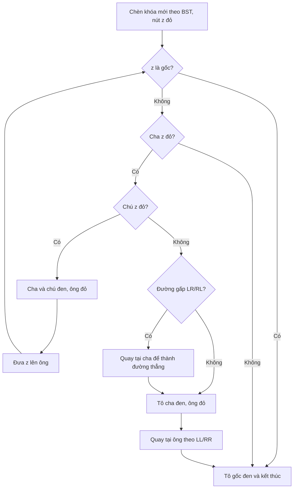

# Khôi phục bất biến đỏ–đen sau khi chèn

## Mục tiêu học tập

Sau bài học, bạn có thể:

- Giải thích **vì sao chèn một nút đỏ** vào cây tìm kiếm đỏ–đen thường thuận lợi hơn chèn một nút đen.
- Phát hiện chính xác bất biến nào có thể bị vi phạm sau bước chèn BST, đặc biệt là **hai nút đỏ liên tiếp**.
- Phân biệt các tình huống **cha đen**, **cha đỏ – chú đỏ**, **cha đỏ – chú đen** với nhánh **thẳng (LL/RR)** hoặc **gấp (LR/RL)**.
- Thực hiện đúng chuỗi **đổi màu**, **quay trái**, **quay phải** và cập nhật **gốc/cha** mà không làm sai thứ tự BST.
- Phát biểu bất biến của vòng sửa sau chèn, lý giải vì sao cần **đưa vi phạm lên ông** khi chú đỏ và vì sao vòng lặp phải kết thúc.
- Cài đặt phép chèn và kiểm chứng bằng Python với **lá rỗng `NIL` màu đen**, xác nhận thứ tự, màu, **black-height** và liên kết nút.
- Phân tích chi phí **O(log n)**, phân biệt chi phí tìm khóa, đổi màu, quay và kiểm chứng toàn cây.

## 1. Bài toán: giữ thứ tự BST chưa đủ

Một nền tảng học tập có thể duy trì chỉ mục bài học theo khóa `(duration_minutes, lesson_id)`. Ta muốn tìm, thêm, xóa và duyệt bài theo thứ tự một cách hiệu quả. **Cây tìm kiếm nhị phân (BST)** bảo đảm:

- Mọi khóa trong cây con trái **nhỏ hơn** khóa tại nút.
- Mọi khóa trong cây con phải **lớn hơn** khóa tại nút.
- Quy tắc áp dụng cho **toàn bộ hậu duệ**.

Nhưng BST thông thường có thể cao tuyến tính nếu liên tục chèn các khóa tăng dần:

```text
Chèn 10, 20, 30 vào BST không cân bằng:

10
  \
   20
     \
      30
```

Cây tìm kiếm **đỏ–đen (Red–Black Tree)** bổ sung màu **đỏ/đen** và các ràng buộc đường đi từ gốc đến lá rỗng. Sau khi chèn theo BST, thuật toán sửa lại màu và đôi khi quay cây để tiếp tục bảo đảm **chiều cao O(log n)** trong trường hợp xấu nhất.

Mục tiêu của bài này là **pha khôi phục bất biến sau khi chèn** (*insertion fix-up*). Ta chỉ xét khóa có thứ tự nhất quán và phân biệt; nếu dùng như Map, chèn trùng khóa **cập nhật giá trị**, không tạo nút trùng.

## 2. Nhắc lại đầy đủ các bất biến của cây đỏ–đen

Theo một quy ước phổ biến, cây đỏ–đen là BST thỏa năm quy tắc:

1. **Mỗi nút thật có một màu**, đỏ (`RED`) hoặc đen (`BLACK`).
2. **Gốc là đen** nếu cây không rỗng.
3. **Mọi lá rỗng `NIL` là đen.**
4. **Không có nút đỏ nào có con đỏ**; tương đương không có hai nút thật đỏ liên tiếp trên một quan hệ cha–con.
5. **Mọi đường đi từ cùng một nút xuống các lá `NIL` hậu duệ có cùng số nút đen**, khi dùng một quy tắc đếm thống nhất.

```text
                    20(B)
                  /       \
               10(R)     30(R)
              /    \     /    \
            NIL   NIL   NIL   NIL
             B     B     B     B

B = BLACK; R = RED; NIL = lá rỗng màu đen.
```

Đây là cây hợp lệ. **Hai con đỏ của một cha đen hoàn toàn được phép**; điều bị cấm là một **nút đỏ có con đỏ**. Mỗi đường từ gốc xuống lá rỗng đi qua cùng số nút đen.

### 2.1. Lá rỗng không phải một nút dữ liệu

Mô hình lý thuyết thường vẽ một `NIL` đen cho **mỗi vị trí thiếu con**. Trong mã, có thể chia sẻ **một sentinel `NIL` duy nhất** cho toàn cây:

```text
nút dữ liệu.left  ───┐
                    ├──> sentinel NIL(BLACK)
nút dữ liệu.right ───┘
```

Sentinel không có khóa bài học, **không được xuất hiện khi duyệt inorder** và **không tính vào số nút thật `n`**. Tuy nhiên, nó là **mốc đen ở cuối mỗi đường** khi tính black-height.

Không nên gán cho sentinel một `parent` riêng cố định của tất cả vị trí rỗng: các vị trí ấy có cha khác nhau. Ví dụ chèn trong bài **không cần đi từ `NIL` lên cha** và có thể giữ `nil.parent` tự trỏ về sentinel; với thuật toán xóa cần thiết kế riêng việc xác định cha của nút thay thế rỗng.

### 2.2. Quy ước black-height của bài

Đặt `bh(x)` là **số nút đen từ ngay sau nút `x` xuống một lá `NIL` hậu duệ**, **không tính `x`**, **có tính lá `NIL` màu đen**. Để có nghĩa, các đường từ `x` đến `NIL` phải có cùng số nút đen.

Ví dụ:

```text
                   40(B)
                  /     \
               20(R)    60(B)
              /   \     /   \
           10(B) 30(B) 50(R) 70(R)
            /\     /\    /\    /\
           NIL    NIL   NIL   NIL
```

Ở đây `bh(40)=2`:

- Đi trái: `20(R)`, `10(B)`, `NIL(B)` → **2** nút đen sau `40`.
- Đi phải: `60(B)`, `50(R)`, `NIL(B)` → **2** nút đen sau `40`.

Trong ví dụ Python, validator tính **số nút đen từ chính nút đang thăm đến `NIL`** để thuận tiện đệ quy: `visit(NIL)=1`; tại nút thật, cộng 1 nếu nút đó đen. Kết quả ở gốc của cây không rỗng **nhiều hơn `bh(root)` một đơn vị** vì có tính chính gốc đen. Hai cách đếm tương đương nếu dùng nhất quán.

## 3. Tại sao nút mới thường được tô đỏ?

Khi chèn vào RB Tree, ta **tìm vị trí giống BST**, tạo nút thật mới `z` ở nơi trước đó là một `NIL` rồi đặt:

```text
z.color = RED
z.left = NIL
z.right = NIL
```

Giả sử trước chèn cây hợp lệ. Một nút **đỏ** thay chỗ một lá rỗng:

- Có hai con `NIL` đen.
- **Không thêm nút đen mới** vào đường đi qua nút vừa chèn; mỗi đường cũ đến `NIL` nay đi qua `z(R)` rồi `NIL(B)`.
- Vì vậy **không làm hỏng black-height** ngay tại bước chèn BST.
- Không làm sai thứ tự BST vì vị trí được tìm bằng phép so sánh khóa.

Chỉ còn hai khả năng đáng quan tâm:

1. **`z` là gốc mới:** gốc đỏ vi phạm quy tắc 2; chỉ cần tô **đen**.
2. **Cha của `z` cũng đỏ:** vi phạm quy tắc 4 (**đỏ–đỏ**); phải sửa màu và/hoặc quay.

Nếu cha **đen**, chèn xong đã hợp lệ, **không cần quay**. Đây là lý do chèn một nút đỏ làm quy trình sửa đơn giản hơn việc mặc định chèn nút đen, vì chèn đen có thể làm các đường tới lá không còn cùng black-height.

### 3.1. Tình huống không cần sửa

```text
Trước chèn 5:              Sau chèn 5(R):

       10(B)                     10(B)
       /   \                     /   \
     NIL   NIL                 5(R)  NIL
                              /  \
                            NIL  NIL
```

Cha `10` đen, số nút đen trên mọi đường từ gốc tới `NIL` vẫn bằng nhau. Bất biến đỏ–đen được giữ nguyên.

## 4. Bốn vai trò phải xác định: z, cha, ông, chú

Khi cha của nút đỏ `z` cũng đỏ, đặt:

- `z` (*current*): nút đỏ đang mang vi phạm cần sửa.
- `p=z.parent` (*parent*): **cha đỏ** của `z`.
- `g=p.parent` (*grandparent*): **ông**, thông thường màu **đen** ở thời điểm xét vi phạm.
- `u` (*uncle*): **chú/bác**, con còn lại của `g` ngoài `p`; `u` có thể là `NIL` đen.

```text
                g(B)
               /    \
             p(R)    u(?)
            /
          z(R)

? = RED hoặc BLACK (kể cả NIL đen).
```

**Tại sao `g` chắc chắn tồn tại khi thuật toán chuẩn vào vòng sửa?** Cây được giữ gốc đen sau mỗi thao tác hoàn chỉnh. Nếu `p` đỏ thì `p` không thể là gốc của cây hợp lệ ở đầu vòng chèn; vì vậy `p` phải có ông `g` là một nút thật. Các lần đổi màu đưa `z` lên ông vẫn phải giữ bất biến vòng lặp phù hợp.

**Không quyết định quay chỉ bằng hình dạng LL/RR/LR/RL.** Trước tiên phải xem **màu của chú `u`**:

- Chú **đỏ**: **đổi màu** và có thể đưa lỗi lên ông.
- Chú **đen**: **quay kết hợp đổi màu**; nhánh thẳng hoặc gấp quyết định quay nào trước.

Đây là điểm phân biệt chính giữa **sửa chèn RB Tree** và **tái cân bằng AVL**, nơi thường xét chênh lệch chiều cao.

## 5. Trường hợp A: cha đỏ, chú đỏ — đổi màu và đưa lỗi lên

Xét hình dạng:

```text
TRƯỚC:                               SAU BƯỚC ĐỔI MÀU:

          g(B)                                   g(R)
        /      \                                /      \
      p(R)     u(R)                           p(B)     u(B)
     /                                       /
   z(R)                                    z(R)
```

Thao tác:

1. **`p.color = BLACK`**.
2. **`u.color = BLACK`**.
3. **`g.color = RED`**.
4. **Chuyển nút đang xét lên `z = g`**, vì `g` đỏ có thể lại kề **cha đỏ** ở mức cao hơn.

### 5.1. Vì sao đổi ba màu lại giữ số nút đen?

Trước đổi màu, mỗi đường bắt đầu tại `g(B)` và đi qua `p(R)` hoặc `u(R)` có **một nút đen ở `g`** và không có nút đen tại `p/u`.

Sau đổi màu, mỗi đường ấy có **một nút đen ở `p/u`** nhưng không còn nút đen tại `g`. **Tổng số nút đen trên mỗi đường trong cả cây con gốc `g` không đổi.**

Việc đổi màu không sửa hình dạng nên **bất biến BST** cũng không đổi.

Tuy nhiên, `g` giờ đỏ. Nếu cha của `g` cũng đỏ, cặp đỏ–đỏ mới xuất hiện ở **cao hơn**. Vì vậy thuật toán không được kết thúc ngay sau đổi màu mà phải **lặp lại với `z=g`**.

### 5.2. Ví dụ chèn 10, 5, 15, 1

```text
Sau ba khóa đầu:                Sau chèn 1 (trước sửa):

        10(B)                          10(B)
       /     \                        /     \
     5(R)    15(R)                   5(R)  15(R)
                                   /
                                  1(R)
```

Cha `5` đỏ, chú `15` đỏ. Đổi `5` và `15` thành **đen**, đổi `10` thành **đỏ**. Vì `10` là gốc, cuối thuật toán tô lại `10` **đen**:

```text
Kết quả:

        10(B)
       /     \
     5(B)    15(B)
    /
  1(R)
```

Không có phép quay nào. Đây là một ví dụ quan trọng cho thấy **không phải mọi lần chèn RB Tree đều phải quay**.

### 5.3. Lỗi đỏ–đỏ có thể lan lên nhiều tầng

Nếu `g` còn có một cha đỏ, việc đổi `g` thành đỏ đã tạo một cặp đỏ–đỏ mới. Một vòng lặp có thể tiếp tục:

```text
Sửa màu ở cấp thấp
       |
       v
Tô ông hiện tại thành đỏ
       |
       v
Ông trở thành z mới
       |
       v
Nếu cha z còn đỏ: xét chú ở cấp cao hơn
```

Việc đi lên này diễn ra trên **đường tổ tiên**, không duyệt toàn bộ cây. Số cấp bị ảnh hưởng nhiều nhất là O(h), với `h=O(log n)` của RB Tree hợp lệ ban đầu.

## 6. Trường hợp B: cha đỏ, chú đen — đường thẳng LL/RR

Với chú đen (có thể là `NIL`), chỉ đổi màu như trường hợp chú đỏ sẽ làm black-height không nhất quán. Cần **đổi màu kết hợp quay**.

### 6.1. LL: quay phải tại ông

Chèn lần lượt `30, 20, 10`:

```text
TRƯỚC SỬA:                         SAU SỬA:

          30(B)                          20(B)
         /                              /     \
       20(R)                          10(R)  30(R)
      /
    10(R)

Chú của 10: NIL(B).
```

Các bước:

1. `p=20` đỏ, `g=30` đen, `u=NIL` đen.
2. Đổi **`p` thành đen**, đổi **`g` thành đỏ**.
3. **Quay phải tại `g=30`**.

Gốc cây con mới là `20(B)`. Mọi khóa vẫn có inorder `10,20,30`; không còn hai nút đỏ liền nhau; black-height được bảo toàn.

**Không nhầm:** **LL** là hình dạng đường từ ông xuống cha rồi con; tên phép sửa là **quay phải**.

### 6.2. RR: quay trái tại ông

Chèn `10, 20, 30`:

```text
TRƯỚC SỬA:                          SAU SỬA:

     10(B)                                20(B)
         \                               /     \
         20(R)                          10(R)  30(R)
             \
             30(R)

Chú của 30: NIL(B).
```

Thao tác đối xứng:

1. Đổi `p=20` thành **đen**.
2. Đổi `g=10` thành **đỏ**.
3. **Quay trái tại `g=10`**.

Dãy inorder trước/sau vẫn `10,20,30`. Chỉ thay liên kết và màu tại vài nút liên quan.

### 6.3. Khi có các cây con trung gian

Trong ví dụ ba khóa, những nhánh giữa hai nút quay thường rỗng. Nhưng một phép quay trên cây thật phải **chuyển đúng cây con giữa**:

```text
Quay phải:

       g                           p
      / \                         / \
     p   D        ---->          A   g
    / \                             / \
   A   B                           B   D
```

Trước và sau quay, các khóa đều theo thứ tự `in(A), p, in(B), g, in(D)`. Một phép quay **đúng** bảo toàn thứ tự BST; việc **đổi màu** làm phần còn lại để giữ black-height.

Quên gắn cây con `B` thành con trái của `g` là lỗi có thể **làm mất nhiều bản ghi** dù hình vẽ các khóa chính trông cân đối.

## 7. Trường hợp C: cha đỏ, chú đen — đường gấp LR/RL

Ở đường gấp, cần **một phép quay tại cha** để chuyển về dạng thẳng, rồi xử lý như LL/RR.

### 7.1. LR: quay trái tại cha, rồi quay phải tại ông

Chèn `30, 10, 20`:

```text
TRƯỚC (LR):                 SAU QUAY TRÁI TẠI 10:

         30(B)                       30(B)
        /                           /
      10(R)                       20(R)
         \                        /
         20(R)                  10(R)
```

Bước 1: **quay trái tại `p=10`**. Nút `20` trở thành cha mới trên nhánh trái, cấu hình gấp LR trở thành cấu hình thẳng LL.

Bước 2: **đổi `20` thành đen**, đổi `30` thành đỏ rồi **quay phải tại `30`**:

```text
KẾT QUẢ:

          20(B)
         /     \
       10(R)   30(R)
```

Đôi khi người học cố tô `10` đen trước khi quay bước 1; điều đó dễ dẫn đến việc **đổi màu sai nút** sau khi vai trò cha thay đổi. Cách an toàn là biến đường gấp thành đường thẳng, sau đó áp dụng chính xác quy tắc cha/ông của trường hợp LL.

### 7.2. RL: quay phải tại cha, rồi quay trái tại ông

Chèn `10, 30, 20`:

```text
TRƯỚC (RL):                 SAU QUAY PHẢI TẠI 30:

     10(B)                       10(B)
          \                           \
          30(R)                       20(R)
         /                               \
       20(R)                             30(R)
```

Sau đó **tô `20` đen**, **`10` đỏ** và **quay trái tại `10`**:

```text
KẾT QUẢ:

          20(B)
         /     \
       10(R)   30(R)
```

### 7.3. Bảng ghi nhớ các trường hợp chú đen

| Hình dạng từ ông `g` | Biến đổi hình dạng | Đổi màu và quay kết thúc |
| --- | --- | --- |
| **LL** | Đã thẳng | Cha `p` đen; ông `g` đỏ; **quay phải `g`** |
| **RR** | Đã thẳng | Cha `p` đen; ông `g` đỏ; **quay trái `g`** |
| **LR** | **Quay trái tại cha `p`** | Cha mới đen; ông đỏ; **quay phải `g`** |
| **RL** | **Quay phải tại cha `p`** | Cha mới đen; ông đỏ; **quay trái `g`** |

**Điểm then chốt:** LL/RR/LR/RL trong bảng này chỉ dùng **sau khi biết chú đen**. Nếu chú đỏ, phải đổi màu theo mục 5, không được quay theo bảng này ngay.

## 8. Sơ đồ quyết định cho pha khôi phục sau chèn



Tư duy tương đương dưới dạng các nhánh:

```text
CHÈN z MÀU ĐỎ
    |
    +-- z là gốc? -------- Có --> tô đen, kết thúc
    |
    +-- cha đen? --------- Có --> hợp lệ, kết thúc
    |
    +-- cha đỏ, chú đỏ --> đổi màu, z = ông, lặp
    |
    +-- cha đỏ, chú đen
         |
         +-- nhánh gấp? -> quay tại cha để duỗi thẳng
         |
         +-- đổi màu cha/ông, quay tại ông, kết thúc cục bộ
```

Thuật toán luôn kết thúc bằng việc **bảo đảm gốc đen**. Không được giả định sau đổi màu chú đỏ thì gốc tự động vẫn đen.

## 9. Bất biến vòng lặp và lý do thuật toán kết thúc

Một thuật toán chèn có thể mô tả như sau:

> **Đầu mỗi vòng sửa**, mọi nút vẫn thỏa **thứ tự BST** và số nút đen trên các đường đi vẫn được bảo toàn; nếu có vi phạm màu cần sửa thì đó là **đỏ–đỏ giữa nút đỏ `z` và cha đỏ của nó**, hoặc trường hợp gốc đỏ được chuẩn hóa ở cuối.

Giải thích:

- **Bước chèn đỏ** không tăng black-height và không sửa thứ tự BST.
- **Chú đỏ:** đổi màu `p,u,g` giữ tổng số nút đen trên các đường của cây con `g`, có thể chuyển lỗi đỏ–đỏ từ `z/p` lên `g` và cha của `g`.
- **Chú đen:** quay/đổi màu xử lý vi phạm đỏ–đỏ **mà không tạo thêm lỗi trên đường tổ tiên**; sau đó có thể kết thúc vòng.
- **Gốc:** tô đen để khôi phục quy tắc gốc đen; việc thêm một nút đen **ở chính gốc** làm tăng số nút đen của mọi đường từ gốc xuống `NIL` như nhau, nên vẫn hợp lệ.

### 9.1. Đại lượng tiến triển

Mỗi lần vào trường hợp **chú đỏ**, nút đang xét được nâng từ `z` lên **ông `g`**, tức độ sâu giảm ít nhất hai cấp. Do đó số vòng lặp kiểu này bị chặn bởi độ dài đường gốc–lá.

Trường hợp **chú đen** thực hiện một hoặc hai phép quay và xử lý xong vi phạm cục bộ. Khi cha đen, vòng lặp dừng; khi tới gốc, bước cuối tô đen.

Vì cây trước chèn là RB Tree hợp lệ có chiều cao `h=O(log n)`, phần đổi màu lặp tối đa O(log n) tầng. **Số phép quay trong một lần chèn chuẩn được chặn bởi 2** (không kể các thay đổi màu).

### 9.2. Tại sao chiều cao RB Tree là O(log n)?

Hai ràng buộc cung cấp chứng minh:

1. **Không hai nút đỏ liên tiếp** → trên đường đi, số nút đỏ không thể vượt quá một hằng số lần số nút đen.
2. **Black-height bằng nhau** → cây con có black-height `b` cần ít nhất `2^b−1` nút thật.

Với `n` nút thật, `h` là chiều cao **đếm cạnh tới nút thật sâu nhất**, và `b=bh(root)` theo quy ước loại trừ chính gốc nhưng tính `NIL`:

\[
n\ge 2^b-1,\qquad h\le 2b
\quad\Longrightarrow\quad h\le 2\log_2(n+1).
\]

Giới hạn này là **trường hợp xấu nhất**, không phải chỉ trung bình hay kỳ vọng. Nó giải thích vì sao tìm kiếm theo khóa và xử lý đường tổ tiên trong một cây hợp lệ đều có bậc logarit.

## 10. Ví dụ Python tự chứa: chèn và tự sửa Red–Black Tree

Đoạn mã sau sử dụng **một sentinel `NIL` đen**, liên kết `parent` cho nút thật và hợp đồng **khóa số nguyên phân biệt**. Nếu thêm khóa đã có, mã chỉ **cập nhật giá trị**, không tạo nút mới hay thay màu.

Đây là ví dụ triển khai **chèn**, **tìm**, **duyệt inorder** và **kiểm tra bất biến**. **Chưa cài xóa**: quy tắc sửa sau xóa RB Tree khác và cần xử lý trạng thái thiếu đen riêng.

### 10.1. Nút, sentinel và phép quay

```python
RED = "RED"
BLACK = "BLACK"


class RBNode:
    def __init__(self, key, value, color=RED):
        self.key = key
        self.value = value
        self.color = color
        self.left = None
        self.right = None
        self.parent = None


class RBMap:
    def __init__(self):
        self.nil = RBNode(None, None, BLACK)
        self.nil.left = self.nil
        self.nil.right = self.nil
        self.nil.parent = self.nil
        self.root = self.nil
        self.size = 0

    def _rotate_left(self, x):
        y = x.right
        if y is self.nil:
            raise ValueError("Không thể quay trái khi thiếu con phải")

        # Đưa cây con giữa y.left sang bên phải của x.
        x.right = y.left
        if y.left is not self.nil:
            y.left.parent = x

        # Đưa y vào vị trí cũ của x.
        y.parent = x.parent
        if x.parent is self.nil:
            self.root = y
        elif x is x.parent.left:
            x.parent.left = y
        else:
            x.parent.right = y

        # Đưa x xuống làm con trái của y.
        y.left = x
        x.parent = y

    def _rotate_right(self, y):
        x = y.left
        if x is self.nil:
            raise ValueError("Không thể quay phải khi thiếu con trái")

        # Đưa cây con giữa x.right sang bên trái của y.
        y.left = x.right
        if x.right is not self.nil:
            x.right.parent = y

        # Đưa x vào vị trí cũ của y.
        x.parent = y.parent
        if y.parent is self.nil:
            self.root = x
        elif y is y.parent.left:
            y.parent.left = x
        else:
            y.parent.right = x

        # Đưa y xuống làm con phải của x.
        x.right = y
        y.parent = x
```

Hai phép quay:

- Thay một số lượng **hằng số** liên kết, O(1) thời gian và O(1) bộ nhớ phụ.
- **Không tự đổi màu**. Chúng được gọi trong pha sửa theo những quy tắc màu cụ thể.
- Chuyển đúng **cây con giữa** để bảo toàn inorder/BST.
- Cập nhật gốc nếu nút được quay từng là gốc toàn cây.
- **Không gán `nil.parent` khi gắn cây con giữa rỗng**, bởi sentinel dùng chung không có một cha riêng cố định cho mọi vị trí rỗng.

### 10.2. Thêm các phương thức tìm và chèn

Để có một lớp chạy được, hãy **ghép nguyên các phương thức của các mục 10.2 và 10.3 vào bên trong lớp `RBMap` ở mục 10.1**, giữ đúng mức thụt lề; sau đó chạy bộ ví dụ 10.4. Các khối được tách để thuận đọc, **không phải các chương trình Python độc lập**.

```python
    def get(self, key):
        if type(key) is not int:
            raise TypeError("Khóa phải là số nguyên")
        current = self.root
        while current is not self.nil:
            if key == current.key:
                return current.value
            current = (
                current.left if key < current.key else current.right
            )
        return None

    def insert(self, key, value):
        if type(key) is not int:
            raise TypeError("Khóa phải là số nguyên")

        parent = self.nil
        current = self.root
        while current is not self.nil:
            parent = current
            if key == current.key:
                current.value = value
                return False  # Chỉ cập nhật giá trị, không thêm nút.
            current = (
                current.left if key < current.key else current.right
            )

        # Đã tới vị trí một NIL: chèn nút ĐỎ.
        z = RBNode(key, value, RED)
        z.left = self.nil
        z.right = self.nil
        z.parent = parent

        if parent is self.nil:
            self.root = z
        elif key < parent.key:
            parent.left = z
        else:
            parent.right = z

        self.size += 1
        self._fix_insert(z)
        return True

    def _fix_insert(self, z):
        # Lỗi đỏ-đỏ chỉ xảy ra khi cha cũng đỏ.
        while z.parent.color == RED:
            g = z.parent.parent

            if z.parent is g.left:
                u = g.right
                if u.color == RED:
                    # Cha đỏ, chú đỏ: đẩy lỗi lên ông.
                    z.parent.color = BLACK
                    u.color = BLACK
                    g.color = RED
                    z = g
                else:
                    # Cha trái, chú đen.
                    if z is z.parent.right:
                        # LR: quay ở cha để thành LL.
                        z = z.parent
                        self._rotate_left(z)

                    # LL: đổi màu cha/ông rồi quay phải tại ông.
                    z.parent.color = BLACK
                    z.parent.parent.color = RED
                    self._rotate_right(z.parent.parent)

            else:
                # Cha phải: xử lý đối xứng.
                u = g.left
                if u.color == RED:
                    z.parent.color = BLACK
                    u.color = BLACK
                    g.color = RED
                    z = g
                else:
                    if z is z.parent.left:
                        # RL: quay ở cha để thành RR.
                        z = z.parent
                        self._rotate_right(z)

                    # RR: đổi màu cha/ông rồi quay trái tại ông.
                    z.parent.color = BLACK
                    z.parent.parent.color = RED
                    self._rotate_left(z.parent.parent)

        # Chuẩn hóa sau mọi tình huống, kể cả chèn nút gốc.
        self.root.color = BLACK
        self.root.parent = self.nil

    def items(self):
        def walk(node):
            if node is not self.nil:
                yield from walk(node.left)
                yield (node.key, node.value)
                yield from walk(node.right)

        return walk(self.root)
```

### 10.3. Hàm kiểm chứng thứ tự BST, màu và black-height

Hàm `validate` không chỉ duyệt inorder. Nó cần kiểm tra:

- **Gốc đen**, sentinel `NIL` đen và các liên kết của sentinel đúng quy ước.
- **Không hai nút đỏ cha–con**.
- **Cận khóa BST toàn cây**, không chỉ khóa của con trực tiếp.
- **Black-height hai nhánh tại từng nút bằng nhau**.
- **`parent` nhất quán**, số nút thật bằng `self.size` và không duyệt trùng nút.

```python
    def validate(self):
        nil = self.nil
        assert nil.color == BLACK
        assert nil.left is nil and nil.right is nil
        assert nil.parent is nil

        if self.root is nil:
            assert self.size == 0
            return (0, 1, 0)

        assert self.root.color == BLACK
        assert self.root.parent is nil
        seen = set()

        def visit(node, parent, low, high):
            if node is nil:
                # Sentinel NIL đóng góp đúng một nút đen.
                return (0, 1, 0)  # (số nút, số đen, chiều cao nút thật)

            marker = id(node)
            assert marker not in seen, "Trùng nút hoặc chu trình"
            seen.add(marker)

            assert node.parent is parent, "Sai liên kết parent"
            assert node.left is not None and node.right is not None
            assert node.color in (RED, BLACK), "Màu nút không hợp lệ"
            if low is not None:
                assert low < node.key, "Sai cận dưới BST"
            if high is not None:
                assert node.key < high, "Sai cận trên BST"

            if node.color == RED:
                assert node.left.color == BLACK, "Đỏ–đỏ bên trái"
                assert node.right.color == BLACK, "Đỏ–đỏ bên phải"

            left_n, left_b, left_h = visit(
                node.left, node, low, node.key
            )
            right_n, right_b, right_h = visit(
                node.right, node, node.key, high
            )
            assert left_b == right_b, "Black-height hai nhánh khác"

            black_here = 1 if node.color == BLACK else 0
            return (
                1 + left_n + right_n,
                left_b + black_here,
                1 + max(left_h, right_h),
            )

        result = visit(self.root, nil, None, None)
        assert result[0] == self.size
        return result
```

Giá trị trả về của `validate()` là bộ ba **(số nút thật, số nút đen từ gốc tới `NIL` gồm gốc và `NIL`, chiều cao theo số nút thật)**. Với cây một nút đen, nó trả `(1,2,1)`.

Đây là bộ kiểm tra **O(n)** thời gian, O(h) bộ nhớ ngăn xếp, có ích trong phát triển và bài tập; **không phải bước bắt buộc** của `insert()` trong hệ thống hiệu năng cao.

### 10.4. Thử từng trường hợp và chuỗi cập nhật

Sau khi ghép các phương thức vào `RBMap`:

```python
scenarios = {
    "LL": [30, 20, 10],
    "RR": [10, 20, 30],
    "LR": [30, 10, 20],
    "RL": [10, 30, 20],
    "recolor": [10, 5, 15, 1],
    "cascade": [41, 38, 31, 12, 19, 8],
    "larger": [50, 20, 80, 10, 30, 70, 90,
               5, 15, 25, 35, 60, 75],
}

for name, keys in scenarios.items():
    tree = RBMap()
    assert tree.validate() == (0, 1, 0)

    for count_expected, key in enumerate(keys, start=1):
        assert tree.insert(key, f"lesson-{key}")
        count, black_count, height_nodes = tree.validate()
        assert count == count_expected, name
        assert tree.root.color == BLACK, name

    assert [key for key, _ in tree.items()] == sorted(keys), name
    assert tree.get(keys[-1]) == f"lesson-{keys[-1]}", name
    assert tree.get(999) is None, name

    previous_size = tree.size
    assert not tree.insert(keys[0], "updated"), name
    assert tree.size == previous_size, name
    assert tree.get(keys[0]) == "updated", name
    tree.validate()

# Bốn mẫu ba khóa đều đưa khóa 20 lên gốc đen.
for name in ("LL", "RR", "LR", "RL"):
    tree = RBMap()
    for key in scenarios[name]:
        tree.insert(key, str(key))
    assert tree.root.key == 20, name
    assert tree.root.color == BLACK, name
    assert tree.validate() == (3, 2, 2), name

# Gốc đầu tiên: thêm đỏ nhưng cuối cùng phải tô đen.
single = RBMap()
assert single.insert(42, "first lesson")
assert single.root.key == 42
assert single.root.color == BLACK
assert single.validate() == (1, 2, 1)

# Khóa bị giới hạn kiểu int để tránh bool == 1 gây nhầm ID.
try:
    single.insert(True, "invalid key")
except TypeError:
    pass
else:
    raise AssertionError("Phải loại khóa bool")
```

**Giới hạn của ví dụ:** `get` trả `None` cho khóa không tồn tại, nên nếu giá trị hợp lệ cũng có thể là `None` thì giao diện nên bổ sung `contains`, sentinel kết quả riêng hoặc phát sinh `KeyError` tùy hợp đồng. Điều này **không ảnh hưởng các bất biến màu** nhưng là một quyết định quan trọng của giao diện Map.

## 11. Đánh đổi độ phức tạp và bộ nhớ

Giả sử cây có `n` nút thật, chiều cao `h=O(log n)`:

| Thành phần | Thời gian | Bộ nhớ phụ | Lý do |
| --- | --- | --- | --- |
| Tìm vị trí chèn theo BST | **O(h)** | O(1) với vòng lặp | Mỗi bước đi xuống một nhánh |
| Tạo và nối nút mới | **O(1)** | O(1) cho nút mới | Hai con là sentinel đen |
| Một phép quay đơn | **O(1)** | **O(1)** | Số liên kết thay đổi cố định |
| Một phép quay kép | **O(1)** | **O(1)** | Hai phép quay đơn |
| Đổi màu một cụm cha/chú/ông | **O(1)** mỗi cụm | **O(1)** | Không đổi hình dạng |
| Chuỗi đổi màu lan lên tổ tiên | **O(h)** | O(1) với vòng lặp | Mỗi lần chú đỏ đi lên ít nhất hai mức |
| **Toàn bộ chèn Red–Black** | **O(log n) xấu nhất** | O(1) phụ ngoài nút mới với bản lặp | Tìm theo đường logarit, tối đa hai lần quay |
| Tìm khóa sau chèn | **O(log n) xấu nhất** | **O(1)** với vòng lặp | Cây giữ giới hạn chiều cao |
| Duyệt inorder toàn bộ | **O(n)** | O(h) ngăn xếp generator | Phải thăm tất cả các nút |
| `validate()` | **O(n)** | O(h) đệ quy | Kiểm tra toàn cây, không thuộc đường chèn |

Mỗi nút thật lưu `key`, `value`, `left`, `right`, `parent` và `color`: tổng bộ nhớ nút là **O(n)**. Sentinel chung tốn thêm O(1) bộ nhớ. Một triển khai không lưu `parent` có thể dùng stack để theo dõi đường đi; không có cách nào “miễn phí” về mọi chiều đánh đổi.

### 11.1. O(log n) không có nghĩa mọi thao tác đều quay

Chèn một nút đỏ dưới cha đen **không quay**. Chú đỏ có thể cần đổi màu ở nhiều tổ tiên nhưng **không quay trong chính những bước ấy**. Chú đen mới thường kích hoạt một hoặc hai phép quay.

Do đó, chi phí toàn bộ chủ yếu gồm **đường tìm và các lần đổi màu có thể lan**, mỗi phần không vượt quá O(log n). Phần **quay** chỉ O(1) số lần trong một phép chèn chuẩn.

### 11.2. Chi phí so sánh khóa

Phân tích trên giả định một phép so sánh khóa là O(1). Với khóa rất dài hoặc quy tắc so sánh phức tạp, phải tính thêm chi phí so sánh; ví dụ so sánh chuỗi có thể phụ thuộc độ dài chuỗi.

Một khóa trong BST phải **ổn định và so sánh nhất quán**. Không nên sửa trực tiếp các trường tham gia khóa thứ tự trong khi nút vẫn nằm trong cây: đổi màu/quay không sửa được **bất biến thứ tự khóa** đã bị phá.

## 12. Phân biệt khôi phục sau chèn với sau xóa

**Chèn** nút đỏ có thể làm vi phạm **đỏ–đỏ** nhưng giữ số đen trên các đường đi. **Xóa** một nút đen có thể làm một đường **thiếu một nút đen**, nên sửa lỗi phức tạp hơn.

| Vấn đề | Sau chèn | Sau xóa |
| --- | --- | --- |
| Thay đổi khởi đầu | Thêm nút đỏ tại vị trí `NIL` | Bỏ hoặc thay vị trí nút theo BST |
| Vi phạm cần sửa thường gặp | **Đỏ–đỏ** giữa nút và cha; gốc đỏ | **Thiếu đen/black-height**, đôi khi màu đỏ–đỏ |
| Thông tin dùng khi sửa | Màu cha, ông, chú; hướng nhánh | Màu anh/em, màu con gần/xa, vị trí nút thay thế |
| Phép sửa | Đổi màu; quay tại cha/ông | Đổi màu, quay và có thể đưa thiếu đen lên cha |
| Sentinel `NIL` | Có thể chỉ cần đọc màu của chú | Nút thay thế có thể chính là `NIL`, cần biết cha của vị trí rỗng |
| Số phép quay | **Tối đa 2** trong thuật toán chèn chuẩn | Phụ thuộc biến thể sửa xóa; vẫn giới hạn O(log n) toàn thao tác |

Ví dụ Python chỉ triển khai **chèn**. Không nên lấy `_fix_insert` và gọi sau khi xóa: tập bất biến đang vi phạm **khác nhau**. Để hỗ trợ xóa, phải bổ sung cả xóa BST theo ba trường hợp, quản lý màu nút bị loại thực sự, và một pha `fix_delete` có xử lý thiếu đen và sentinel.

## 13. Khi áp dụng cho nhiều chỉ mục bài học

Giả sử một hệ thống duy trì:

- `by_id`: bảng băm theo mã bài `lesson_id` để tra chính xác.
- `by_duration`: cây đỏ–đen theo cặp `(duration_minutes, lesson_id)` để duyệt hoặc lọc khoảng.
- `prerequisites`: đồ thị tiên quyết theo ID bài.

Khi **thêm bài**, cần cập nhật cả bản ghi và những chỉ mục liên quan. Thao tác chèn vào RB Tree phải bảo đảm **khóa duy nhất, thứ tự BST, bất biến màu và black-height**.

Khi **đổi thời lượng** của một bài, **không** sửa tại chỗ trường khóa của nút đang ở cây. Thông thường phải **xóa khóa thứ tự cũ, rồi chèn khóa mới** hoặc dùng một cơ chế tái chỉ mục tương đương, giữ bản ghi theo ID nhất quán.

Khi có nhiều cấu trúc, O(log n) của một lần chèn vào RB Tree không tự động là độ phức tạp hay tính nguyên tử của **toàn bộ quy trình nghiệp vụ**. Còn phải xét thời gian chuẩn hóa khóa, cập nhật bảng băm/đồ thị, khả năng lỗi giữa chừng và đồng bộ nếu nhiều luồng truy cập.

### 13.1. Chọn RB Tree hay AVL, mảng, bảng băm?

| Mục tiêu | Cấu trúc đáng cân nhắc | Điểm đánh đổi |
| --- | --- | --- |
| Tra khóa chính xác, không cần thứ tự | Bảng băm | O(1) kỳ vọng, không tự sắp khóa |
| Dữ liệu có thứ tự, chèn/xóa thường xuyên | Red–Black hoặc AVL | O(log n) xấu nhất, cần duy trì bất biến |
| Dữ liệu chủ yếu chỉ đọc và đã sắp | Mảng đã sắp | Tìm nhị phân O(log n), chèn/xóa giữa O(n) |
| Lấy cực trị liên tục | Heap | Thuận lấy min/max, không thuận tìm khóa bất kỳ |
| Chỉ mục theo trang đĩa | B-tree/B+ tree | Giảm số mức truy cập trang, phức tạp quản lý nút trang |

RB Tree không nhất thiết “nhanh hơn AVL” trong mọi tải công việc. AVL có ràng buộc chiều cao chặt hơn; RB Tree cho phép hình dạng linh hoạt hơn và có quy tắc sửa màu/quay khác. Nên đánh giá **tỉ lệ đọc/ghi, số phần tử, chi phí bộ nhớ, thư viện sẵn có và yêu cầu độ trễ**.

## 14. Lỗi thường gặp khi sửa chèn Red–Black Tree

- **“Nút mới phải đen để khỏi bị đỏ–đỏ.”** Sai trong thuật toán thường dùng: thêm đen có thể làm black-height mất cân bằng ngay.
- **“Chú là `NIL` thì không có màu.”** Sai: `NIL` được xem là **đen**, nên đi vào nhánh chú đen.
- **“Cha đỏ thì luôn quay ngay.”** Sai: **chú đỏ → đổi màu rồi có thể đi lên**.
- **“Chú đỏ chỉ cần đổi màu cha.”** Sai: thường phải đổi **cả cha, chú, ông** theo quy tắc.
- **“Đổi ông thành đỏ rồi dừng.”** Sai: ông có thể kề cha đỏ ở tổ tiên cao hơn.
- **“LL phải quay trái vì tên bắt đầu bằng L.”** Sai: LL → quay **phải** tại ông; RR → quay **trái**.
- **“LR chỉ cần quay phải tại ông.”** Sai: phải **quay trái tại cha trước**, sau đó đổi màu/quay phải tại ông.
- **“Quay tự động giữ màu đúng.”** Sai: quay chỉ đổi liên kết; **đổi màu** là một bước riêng.
- **“Đổi màu có thể thay đổi inorder.”** Sai: đổi màu không đụng khóa hay liên kết.
- **“Quay cây con ở gốc không cần sửa biến root.”** Sai: gốc mới phải được gán lại cho cây.
- **“Có thể quên cây con giữa khi quay.”** Sai: làm mất dữ liệu và phá thứ tự BST.
- **“NIL sentinel dùng chung là một nút khóa đặc biệt trong tập dữ liệu.”** Sai: không được đưa sentinel vào kết quả tìm/duyệt hay số nút.
- **“Chỉ kiểm tra inorder tăng là đủ.”** Sai: cây còn phải có gốc đen, không đỏ–đỏ và black-height đồng đều.
- **“Cần tính lại black-height toàn cây sau mỗi chèn.”** Không cần trong thuật toán chuẩn; bất biến được duy trì bằng quy tắc sửa cục bộ và tổ tiên.
- **“Sửa chèn giống sửa xóa.”** Sai: xóa nút đen có thể tạo tình trạng **thiếu đen**.

## 15. Bài tập vận dụng

### Bài 1 — Không cần sửa

Chèn `10` vào cây rỗng, rồi chèn `5`. Hãy ghi màu của từng nút sau hai lần chèn và giải thích vì sao lần chèn thứ hai không cần quay.

*Gợi ý:* `10` là gốc đen; `5` đỏ dưới cha đen, black-height không đổi.

### Bài 2 — Chú đỏ

Chèn `10,5,15,1`. Trước và sau lần chèn `1`, vẽ màu các nút. Tại sao trường hợp này dùng đổi màu chứ không quay?

*Gợi ý:* Cha `5` và chú `15` đều đỏ; đổi hai nút thành đen, ông `10` thành đỏ rồi tô lại gốc đen.

### Bài 3 — LL và RR

Chèn `30,20,10`, rồi xét độc lập chuỗi `10,20,30`. Với từng chuỗi, xác định màu cha/chú/ông khi mất cân bằng, hướng quay và khóa ở gốc cuối.

*Gợi ý:* LL → quay phải tại 30; RR → quay trái tại 10; gốc cuối đều là `20(B)`.

### Bài 4 — LR và RL

Chèn `30,10,20` và `10,30,20` vào hai cây riêng. Giải thích vì sao phải có phép quay đầu tiên tại cha trước khi quay tại ông.

*Gợi ý:* LR chuyển gấp thành LL bằng quay trái ở cha; RL chuyển gấp thành RR bằng quay phải ở cha.

### Bài 5 — Đổi màu bảo toàn black-height

Vẽ `g(B)` có hai con `p(R)` và `u(R)`; `z(R)` là con của `p`. Đếm số nút đen đi qua vùng `g/p` và `g/u` trước và sau khi đổi `p,u` thành đen, `g` thành đỏ.

*Gợi ý:* Mỗi đường mất nút đen ở `g` nhưng được thêm nút đen ở `p` hoặc `u`; tổng không đổi.

### Bài 6 — Vi phạm đi lên

Trong trường hợp chú đỏ, vì sao thuật toán đặt `z=g` rồi tiếp tục? Nếu `g` có cha đỏ thì lỗi nằm ở đâu?

*Gợi ý:* `g` mới được tô đỏ có thể kề cha đỏ, nên lỗi đỏ–đỏ chuyển lên cao hơn.

### Bài 7 — Cây con giữa

Trong quay trái tại `x` có con phải `y`, cây con `B=y.left` chứa khóa nằm giữa `x` và `y`. Sau quay, `B` nằm ở đâu và vì sao?

*Gợi ý:* `B` thành `x.right` để giữ `x < B < y`.

### Bài 8 — Gốc sau quay

Giả sử ông `g` đang là gốc toàn cây và phép sửa chú đen quay tại `g`. Những biến hoặc liên kết nào cần cập nhật để tìm kiếm vẫn đi được từ gốc mới đến toàn bộ khóa?

*Gợi ý:* Gán lại `root`, sửa `parent`, các tham chiếu con và cây con giữa.

### Bài 9 — Tính black-height

Một cây có gốc `20(B)` và hai lá thật `10(R)`, `30(R)`, mỗi lá có hai con `NIL(B)`. Tính `bh(20)` theo quy ước loại trừ chính nút hiện tại.

*Gợi ý:* `bh(20)=1`, vì sau gốc, mỗi đường chỉ gặp một `NIL` đen.

### Bài 10 — O(log n) và hai phép quay

Vì sao vòng đổi màu có thể chạy O(log n) bước nhưng một lần chèn chuẩn chỉ dùng tối đa hai phép quay? Phân biệt chi phí toàn thao tác với chi phí một phép quay.

*Gợi ý:* Chú đỏ đẩy lỗi lên ông và không quay; chú đen được sửa bằng quay đơn/kép rồi kết thúc. Tìm khóa và đi lên vẫn tốn O(log n).

### Bài 11 — Lỗi validator

Một cây có khóa inorder tăng nhưng gốc đỏ, và một cây khác gốc đen nhưng hai nhánh có black-height khác nhau. Chúng có phải RB Tree hợp lệ không?

*Gợi ý:* Cả hai đều không hợp lệ theo quy ước bài này; thứ tự BST chỉ là một nhóm bất biến.

### Bài 12 — Khóa trùng

Thêm `(key=20, value="A")` rồi thêm lại `(key=20, value="B")` vào `RBMap` của ví dụ. Hãy nêu số nút, giá trị tìm được và việc có cần quay/đổi màu ở lần thêm thứ hai không.

*Gợi ý:* Một khóa duy nhất, giá trị mới `"B"`, không thay đổi hình dạng và màu.

### Bài 13 — Đọc bộ thử Python

Giải thích vì sao `validate()` trả `(1,2,1)` đối với cây chỉ có một nút gốc đen, và vì sao đó không phải `bh(root)=2` theo định nghĩa bài.

*Gợi ý:* Validator tính cả gốc đen và `NIL` đen; `bh(root)` loại trừ gốc nên bằng 1.

### Bài 14 — Thiết kế khóa có thứ tự

Danh mục có nhiều bài cùng 30 phút. Tại sao không nên chỉ dùng `duration_minutes` làm khóa duy nhất của Map cây đỏ–đen? Đề xuất khóa phù hợp.

*Gợi ý:* Dùng `(duration_minutes, lesson_id)` để các bài cùng thời lượng vẫn có khóa khác nhau và thứ tự xác định.

### Bài 15 — Phân biệt chèn/xóa

Một nhóm muốn gọi `_fix_insert` sau khi xóa một nút đen khỏi RB Tree. Giải thích lý do phương án này không đủ và nêu hai nhóm thông tin cần thiết khi sửa lỗi xóa.

*Gợi ý:* Xóa có thể gây thiếu một nút đen trên đường; cần xét vị trí nút thay thế, cha, anh/em và màu con gần/xa để xử lý black-height.

## Tổng kết

**Khôi phục bất biến đỏ–đen sau khi chèn** bắt đầu bằng việc chèn khóa mới như BST với **nút màu đỏ**. Cách này giữ thứ tự và không tự làm thay đổi black-height, nhưng có thể tạo **gốc đỏ** hoặc **hai nút đỏ liên tiếp**. Nếu cha **đen**, không cần sửa; nếu cha **đỏ và chú đỏ**, đổi cha/chú thành đen, ông thành đỏ rồi **đưa vi phạm lên trên**; nếu cha **đỏ và chú đen**, dùng **quay đơn/kép kết hợp đổi màu** theo đường thẳng hoặc gấp. Kết thúc luôn **tô gốc đen**. Phép quay giữ inorder và BST; đổi màu bảo vệ số nút đen trên các đường. Thuật toán chuẩn chỉ cần tối đa **hai phép quay** cho một lần chèn, còn đường tìm và những vòng đổi màu lan truyền tối đa O(log n), nên thao tác chèn Red–Black Tree có **O(log n) thời gian xấu nhất** với bộ nhớ O(n) cho toàn bộ cây. Khi triển khai, hãy kiểm tra đồng thời **khóa, sentinel `NIL`, liên kết cha–con, màu và black-height**, thay vì chỉ dựa vào hình dạng cây.
