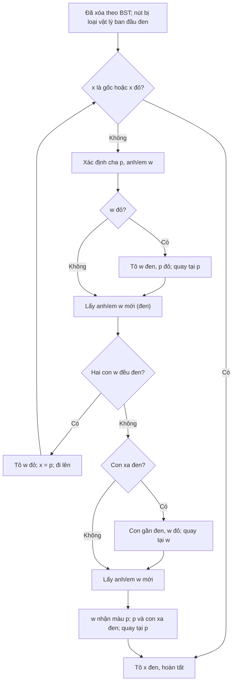

# Các trường hợp khôi phục sau khi xóa trong cây đỏ–đen

## Mục tiêu học tập

Sau bài học này, bạn có thể:

- Phân biệt thao tác **xóa một khóa theo BST** với **sửa các bất biến màu của Red–Black Tree** sau khi xóa.
- Xác định vì sao màu của **nút thật sự bị đưa ra khỏi vị trí trong cây** quan trọng hơn màu của nút ban đầu được yêu cầu xóa.
- Giải thích khái niệm **thiếu đen (black deficit)** hoặc **đen kép (double black)** như một công cụ lập luận, không phải màu thứ ba bắt buộc phải lưu.
- Phân biệt và xử lý bốn nhóm trường hợp dựa trên **màu anh/em**, **màu con gần** và **màu con xa** của anh/em, kể cả các tình huống đối xứng.
- Hiểu vai trò của **sentinel `NIL` đen**, tham chiếu `parent`, `transplant`, phép quay và đổi màu trong thuật toán sửa lỗi sau xóa.
- Đọc và vận dụng ví dụ Python tự chứa có **chèn, xóa, tìm kiếm, duyệt inorder và kiểm chứng các bất biến** của cây đỏ–đen.
- Phân tích thời gian, bộ nhớ và khác biệt giữa khôi phục sau **chèn**, sau **xóa** và tái cân bằng **AVL**.

## 1. Tại sao xóa trong cây đỏ–đen khó hơn chèn?

Trong chương *Cây tìm kiếm cân bằng* của module cấu trúc dữ liệu, ta quan tâm đồng thời đến **thứ tự khóa**, **bất biến**, **thời gian** và **bộ nhớ**. Cây đỏ–đen (*Red–Black Tree*, viết tắt **RB Tree**) là một **cây tìm kiếm nhị phân (BST)** có thêm màu đỏ/đen và quy tắc khống chế chiều cao.

Với khóa phân biệt, BST duy trì:

1. Khóa ở cây con trái nhỏ hơn khóa tại nút.
2. Khóa ở cây con phải lớn hơn khóa tại nút.
3. Quy tắc phải đúng cho **mọi hậu duệ**, không chỉ hai con trực tiếp.

Một lần **chèn** RB Tree thông thường đặt nút mới màu **đỏ**. Chèn đỏ không làm tăng số nút đen trên các đường tới `NIL`, nên nhiệm vụ chủ yếu là sửa **hai nút đỏ liên tiếp**, nếu có.

Ngược lại, một lần **xóa** có thể loại khỏi cây một nút **đen**. Nếu không sửa thêm, một số đường từ tổ tiên đến `NIL` sẽ **ít đi một nút đen**, trong khi các đường khác giữ nguyên. Cây vẫn có thể duyệt inorder đúng nhưng **không còn là RB Tree hợp lệ**.

```text
TRƯỚC, RB Tree hợp lệ:        XÓA 5(B) nhưng chưa sửa:

           10(B)                        10(B)
          /     \                           \
        5(B)    15(B)                       15(B)
        / \      / \                         / \
      NIL NIL   NIL NIL                     NIL NIL

Từ 10 qua trái:  5(B), NIL(B)     Sau xóa: trái chỉ có NIL(B).
Từ 10 qua phải: 15(B), NIL(B)     Nhánh phải vẫn có 2 nút đen.
```

Trong ví dụ, đường đi qua vị trí `5` bị xóa thiếu một nút đen so với đường đi qua `15`. **Chỉ xóa BST là chưa đủ**; ta phải khôi phục black-height bằng đổi màu, quay và đôi khi **đẩy trạng thái thiếu đen lên tổ tiên**.

## 2. Ôn tập các bất biến phải bảo toàn

Cây đỏ–đen là BST thỏa năm quy tắc theo một cách biểu diễn chuẩn:

1. Mỗi nút thật có màu **đỏ (RED)** hoặc **đen (BLACK)**.
2. **Gốc** là đen khi cây không rỗng.
3. Mỗi vị trí thiếu con được xem là một lá rỗng **`NIL` đen**.
4. Nút **đỏ không có con đỏ**: không có cặp cha–con thật đều đỏ.
5. Từ một nút bất kỳ, **mọi đường đi xuống các lá `NIL`** có cùng **số nút đen**, với một quy ước đếm thống nhất.

Các quy tắc màu không thay thế quy tắc **thứ tự BST**. Một cây có đủ màu nhưng đặt khóa lớn ở phía trái vẫn sai. Một cây có inorder tăng nhưng hai nhánh có số nút đen khác nhau cũng sai.

### 2.1. Lá `NIL` đen có vai trò gì?

Để biểu diễn một nút không có con trái hoặc phải, nhiều cài đặt dùng **một đối tượng sentinel `NIL`** dùng chung:

```text
                    20(B)
                   /     \
                10(R)   30(R)
                /  \    /  \
              NIL NIL NIL  NIL

Mỗi chữ NIL là một VỊ TRÍ RỖNG được xem là màu đen.
Có thể dùng cùng một ĐỐI TƯỢNG sentinel cho các vị trí ấy.
```

`NIL` không phải khóa thật và **không** được tính vào số nút dữ liệu `n` hoặc xuất hiện khi duyệt inorder. Tuy nhiên, mỗi đường kết thúc ở một vị trí `NIL` vẫn được tính đúng theo quy ước black-height.

Đặc biệt, sau xóa, **nút thay thế `x` có thể chính là `NIL`**. Thuật toán cần biết **cha và anh/em của vị trí đó** để quyết định phép sửa. Một sentinel dùng chung không thể có một trường `parent` cố định đúng cho mọi vị trí rỗng cùng lúc: khi sửa xóa, ta phải cập nhật cha **theo ngữ cảnh thao tác** hoặc truyền cha riêng vào hàm sửa.

### 2.2. Quy ước chiều cao đen

Đặt `bh(v)` là số **nút đen trên đường từ ngay sau `v` đến một lá `NIL` hậu duệ**, **không tính `v`**, nhưng **có tính `NIL` cuối đường**. Trong cây hợp lệ, kết quả không phụ thuộc đường đi.

Ví dụ:

```text
             20(B)
            /     \
          10(R)   30(R)
          /  \    /  \
         NIL NIL NIL NIL
```

`bh(20)=1` vì từ sau `20`, mỗi đường đi qua một nút đỏ rồi một `NIL` đen. Nếu nhìn cây chỉ có gốc đen `20`, `bh(20)` cũng bằng 1 vì đường đi ngay tới `NIL` đen.

Trong mã Python ở cuối bài, bộ kiểm tra trả về **số nút đen tính từ chính nút đang xét đến `NIL`**, nên `visit(NIL)=1` và nút đen cộng thêm 1. Đối với cây không rỗng có gốc đen, kết quả ở gốc **lớn hơn `bh(root)` đúng một đơn vị**. Hai quy ước tương thích nếu dùng nhất quán.

### 2.3. Vì sao các bất biến cho chiều cao O(log n)?

Quy tắc **không đỏ–đỏ** giới hạn số nút đỏ có thể xen giữa các nút đen. Quy tắc **black-height đồng đều** buộc cây có đủ số nút thật ở các mức. Với `n` nút thật và `h` là chiều cao tính bằng **số cạnh từ gốc tới nút thật sâu nhất**, một giới hạn quen thuộc là:

\[
h \le 2\log_2(n+1).
\]

Chính vì giới hạn logarit này, tìm khóa, tìm successor và đi qua các tổ tiên khi sửa xóa chỉ tốn **O(log n)** trong trường hợp xấu nhất, miễn đầu vào ban đầu là một RB Tree hợp lệ.

## 3. Bước thứ nhất: xóa một nút theo quy tắc BST

Giả sử muốn xóa khóa `k`. Ta tìm nút `z` có khóa đó bằng cách so sánh với gốc rồi đi sang trái/phải. Nếu không tìm thấy, chương trình phải có **chính sách rõ** (ví dụ phát sinh `KeyError` hoặc trả về `False`); ví dụ Python chọn **`KeyError`**.

Có ba hình dạng BST cơ bản.

### 3.1. Nút cần xóa không có con thật

Nếu `z.left` và `z.right` đều là `NIL`, ta thay liên kết tới `z` bằng `NIL`:

```text
TRƯỚC xóa 5:           SAU bỏ liên kết tới 5:

      10                      10
     /  \                       \
    5   15                      15
```

Hình trên **chỉ minh họa bước BST**, chưa khẳng định màu sau xóa hợp lệ. Nếu nút thật bị bỏ màu **đỏ**, black-height thường không đổi; nếu **đen**, có thể phải sửa black-height.

### 3.2. Nút cần xóa có đúng một con thật

Ta nối **con duy nhất** lên vị trí `z`:

```text
TRƯỚC xóa 10:             SAU nối 15 lên:

       20                        20
      /  \                      /  \
    10    30                   15   30
      \
       15
```

Nếu dùng con trỏ `parent`, phải cập nhật `parent` của con mới và liên kết từ cha cũ của `z`. Nếu `z` là gốc, phải cập nhật **`root`**.

Trong một cây đỏ–đen hợp lệ, nếu vị trí bị bỏ là **nút đen chỉ có một con thật**, con duy nhất đó phải là **đỏ** và có các con `NIL` đen; có thể tô con thành **đen** sau khi nối để bù nút đen đã mất. Không được bỏ qua màu chỉ vì BST đã nối đúng tham chiếu.

### 3.3. Nút cần xóa có hai con thật

Khi `z` có cả hai con thật, ta thường lấy **successor** `y`: nút có khóa **nhỏ nhất trong cây con phải**.

```text
TRƯỚC khi xóa khóa 40:

          40(z)
         /     \
       20       60
               /  \
             50    70
            /
           45(y)  <- successor của 40
```

`y` không có con trái thật vì là nút nhỏ nhất trong cây con phải. Một phương pháp chuẩn:

1. Xác định `y=minimum(z.right)`.
2. Ghi lại **màu gốc của `y`** trước khi thay các liên kết.
3. Lấy `x=y.right`, có thể là `NIL`; `x` là cây con sẽ thay vị trí vật lý cũ của `y`.
4. Nếu `y` chưa ở ngay bên phải `z`, đưa `x` lên vị trí cũ của `y` rồi nối `y.right` vào cây con phải cũ của `z`.
5. Chuyển `y` vào vị trí cũ của `z`, nối cây con trái cũ của `z` và **cho `y` nhận màu cũ của `z`**.
6. Nếu màu gốc của **`y` bị loại khỏi vị trí cũ** là đen, sửa black-height bắt đầu tại **`x`**.

Thuật toán chuyển **nút `y` vật lý** thay cho `z` giúp phân biệt rõ danh tính nút và màu gốc. Một cài đặt khác có thể chép khóa/giá trị của successor vào `z` rồi xóa successor ở vị trí cũ, nhưng phải giữ **cặp khóa–giá trị đúng nhau** và vẫn dựa trên **màu của nút thật sự bị loại khỏi vị trí vật lý** để quyết định sửa màu.

### 3.4. Tại sao màu của `z` chưa đủ?

Giả sử `z` được yêu cầu xóa có màu **đỏ**, nhưng successor `y` tại vị trí cũ có màu **đen**. Việc thay `z` bằng `y` rồi chuyển `y` khỏi vị trí cũ đã **làm đường đi tại vị trí cũ thiếu một nút đen**, nên vẫn cần sửa lỗi.

Ngược lại, nếu `z` đen nhưng successor `y` ban đầu đỏ, `y` có thể nhận màu đen của `z` tại vị trí mới trong khi vị trí cũ chỉ mất một nút đỏ: không phát sinh thiếu đen.

Vì thế, trong thuật toán chuyển nút, ta thường thấy biến:

```text
y_original_color = y.color
...
if y_original_color == BLACK:
    fix_delete(x)
```

**`y_original_color` là màu trước khi di chuyển**, không phải màu mới mà `y` được gán tại vị trí của `z`.

## 4. Màu của nút bị loại dẫn tới ba đường xử lý

Đặt `y` là nút bị loại khỏi **vị trí vật lý cũ**, `x` là nút/cây con thay vào vị trí đó.

| Màu gốc `y` | Trạng thái `x` | Cách xử lý |
| --- | --- | --- |
| **Đỏ** | Thường là `NIL` đen khi `y` được xóa vật lý từ RB Tree hợp lệ | Không mất nút đen; thường **không cần fix-up** |
| **Đen** | **`x` đỏ** | Tô `x` thành **đen** để bù phần đen bị mất |
| **Đen** | **`x` đen**, kể cả `NIL` | Có thể thiếu một nút đen trên nhánh `x`; dùng vòng **`fix_delete`** |

Ba đường xử lý là cách nhìn **theo bất biến**, không phải ba trường hợp xóa BST. Ví dụ một nút hai con vẫn cần sửa nếu successor đen, và một nút một con có thể sửa chỉ bằng tô con đỏ thành đen.

### 4.1. Xóa một lá đỏ

```text
TRƯỚC:                    SAU xóa 5(R):

        10(B)                     10(B)
       /     \                       \
      5(R)  15(R)                    15(R)
```

Không còn khóa `5`, nhưng black-height của mọi đường vẫn bằng nhau vì ta chỉ bỏ một nút đỏ. Gốc vẫn đen và không có đỏ–đỏ.

### 4.2. Bỏ nút đen, đưa con đỏ lên và tô đen

```text
TRƯỚC:                         SAU xóa 10(B):

          20(B)                        20(B)
         /     \                      /     \
       10(B)   30(B)                 5(B)  30(B)
       /
      5(R)
```

Chuyển `5(R)` lên vị trí `10(B)` rồi đổi `5` thành **đen**. Số nút đen từ `20` xuống các lá ở hai phía vẫn giống nhau; không cần chạy các trường hợp anh/em phức tạp.

### 4.3. Bỏ nút đen và `x` đen — xuất hiện thiếu đen

Ví dụ đã nêu: xóa `5(B)` trong cây gốc `10(B)` có con phải `15(B)`. `x=NIL(B)` thay vị trí `5`. Nếu chỉ tính màu thật lưu trên `x`, đường bên trái có ít hơn một nút đen.

Ta **tạm xem** `x` đang mang **một đơn vị đen bổ sung** để giữ sổ sách black-height trong quá trình sửa. Trạng thái này thường được gọi là **đen kép (double black)**, nhưng:

- Không nhất thiết có màu lưu `DOUBLE_BLACK` trong `node.color`.
- Nếu `x=NIL` thì sentinel vẫn thật sự có màu **BLACK**.
- Thuật toán sửa chuyển hoặc triệt tiêu **đơn vị đen bổ sung** bằng đổi màu, quay hoặc đưa `x` lên cha.

Đây là một **bất biến tạm của quá trình sửa**, không phải trạng thái RB Tree hợp lệ được để lại cho người dùng sau khi thao tác kết thúc.

## 5. Xác định cha, anh/em, con gần và con xa

Gọi:

- `x`: nút hoặc vị trí `NIL` đang mang tình trạng **thiếu đen**.
- `p=x.parent`: cha của **vị trí** `x`.
- `w`: **anh/em (sibling)** của `x`, là con còn lại của `p`.
- **Con gần (near child)** của `w`: con hướng **về phía `x`**.
- **Con xa (far child)** của `w`: con hướng **ra xa `x`**.

Khi `x` nằm **bên trái** `p`:

```text
                     p
                    / \
                   x   w
                      / \
                  near  far
                  w.left w.right
```

Khi `x` nằm **bên phải** `p`:

```text
                     p
                    / \
                   w   x
                  / \
                far near
              w.left w.right
```

**Con gần/con xa** luôn xét tương đối theo phía của `x`, không phải tên cố định của một con. Đây là nguồn nhầm lẫn lớn khi viết mã đối xứng.

### 5.1. Có thể xem `w=NIL` như một anh/em hợp lệ để đổi màu không?

Trong trạng thái thiếu đen sinh ra từ **phép xóa chuẩn trên một RB Tree hợp lệ**, nếu `x` chưa là gốc và đang mang đơn vị đen bổ sung, anh/em `w` phải là một **nút thật**. Nếu anh/em cũng chỉ là `NIL`, cấu hình trước xóa sẽ không có đủ black-height ở nhánh anh/em để cân với nhánh chứa nút đen vừa bị loại.

Vì vậy, mã `fix_delete` bên dưới **không tô sentinel `NIL` thành đỏ**; có thể kiểm tra điều kiện `w is not nil` để bắt lỗi dữ liệu hoặc cài đặt. Những `NIL` là **con của `w`** vẫn được phép và có màu đen.

## 6. Bốn nhóm trường hợp sửa thiếu đen khi `x` nằm bên trái

Để dễ theo dõi, trước hết giả sử `x` là **con trái của `p`**, nên `w=p.right`. Thuật toán xóa chuẩn kiểm tra theo thứ tự:

1. **Anh/em đỏ?**
2. Nếu anh/em đen: **cả hai con của nó đều đen?**
3. Nếu anh/em đen mà ít nhất một con đỏ: **con xa đen, con gần đỏ?**
4. **Con xa đỏ?** Khi đó kết thúc bằng đổi màu và quay tại cha.

Các hình dưới **không hiển thị hết các cây con `NIL`**, nhưng những chỗ thiếu con đều được coi là đen. Màu `p` ghi `?` nghĩa là có thể đỏ hoặc đen tùy cấu hình.

### Trường hợp 1 — anh/em `w` đỏ

```text
TRƯỚC (x ở trái):                 SAU đổi màu và quay trái tại p:

                p(B)                         w(B)
               /    \                       /    \
              x     w(R)                  p(R)   D(B)
                   /   \                  /   \
                 C(B)  D(B)              x    C(B)
```

Vì `w` đỏ, cha `p` bắt buộc **đen** trong một cây trước xóa hợp lệ (không thể có hai nút đỏ liên tiếp). Hai con thật hoặc `NIL` của `w` đều đen.

Thao tác:

1. Tô `w` **đen**.
2. Tô `p` **đỏ**.
3. **Quay trái tại `p`**.
4. Đặt lại `w = p.right`. Anh/em mới của `x` là cây con `C`, màu **đen**.

**Trường hợp 1 không tự kết thúc sửa lỗi.** Nó **chuyển bài toán về một trong các trường hợp anh/em đen** (2, 3 hoặc 4). Nút `x` vẫn nằm dưới `p` cũ và còn cần xét tiếp.

Thao tác quay vẫn giữ inorder/BST. Đổi màu giữ số nút đen tương ứng trong vùng quay khi tính kèm đơn vị đen tạm của `x`.

#### Ví dụ số cụ thể cho trường hợp 1

```text
RB Tree hợp lệ trước xóa:

             10(B)
            /     \
          5(B)    20(R)
                 /    \
               15(B)  25(B)

Xóa 5(B):
- x = NIL đen ở trái 10, đang thiếu đen.
- w = 20(R), anh/em đỏ.

Đổi màu 20 -> B, 10 -> R; quay trái tại 10:

             20(B)
            /     \
          10(R)   25(B)
              \
              15(B)
```

Anh/em mới `15(B)` của `x` có hai con `NIL` đen, nên tiếp tục **trường hợp 2**: tô `15` đỏ, chuyển `x` lên `10(R)`; sau đó tô `10` đen. Kết quả:

```text
             20(B)
            /     \
          10(B)   25(B)
              \
              15(R)
```

Không chỉ xong vì “đã quay một lần” — cần tiếp tục cho đến khi đơn vị đen thiếu được hấp thụ.

### Trường hợp 2 — `w` đen, cả hai con của `w` đen

```text
TRƯỚC:                           TẠM SAU ĐỔI MÀU:

             p(?)                             p(?)
            /    \                           /    \
           x     w(B)                       x      w(R)
                /    \                            /    \
             a(B)   b(B)                        a(B)   b(B)
```

Anh/em `w` đen, cả `w.left` và `w.right` đều đen, có thể là `NIL`. Ta:

1. **Tô `w` thành đỏ**, làm nhánh anh/em bớt một nút đen.
2. **Đặt `x = p`** để chuyển đơn vị đen bổ sung lên cha và lặp lại nếu cần.

Tại sao hợp lý? Nhánh chứa `x` đang thiếu một nút đen; nhánh `w` vốn có thêm một nút đen ở gốc `w`. Đổi `w` thành đỏ làm hai phía cân nhau **trong cây con `p` khi tính đến thiếu đen được chuyển lên `p`**.

Nếu `p` **đỏ**, vòng lặp sẽ kết thúc ngay khi `x=p` vì `x.color==RED`; tô `p` **đen** ở cuối để hấp thụ thiếu đen.

Nếu `p` **đen** và chưa là gốc, thiếu đen còn có thể **lan lên cao**: phải tiếp tục xét cha và anh/em mới của `p`. Đây là lý do một lần xóa RB Tree có thể đổi màu qua nhiều tổ tiên.

#### Ví dụ đơn giản

```text
TRƯỚC:             XÓA 5(B):           SAU sửa:

       10(B)                10(B)              10(B)
      /     \                   \                  \
    5(B)   15(B)               15(B)              15(R)
```

`x=NIL` bên trái, `w=15(B)` có hai con `NIL(B)`. Tô `15` đỏ và chuyển `x=10`. Vì `10` là gốc, vòng lặp dừng. Các đường từ `10` tới `NIL` lại có cùng số nút đen; không cần quay.

### Trường hợp 3 — `w` đen, con gần đỏ, con xa đen

Với `x` ở trái, **con gần = `w.left`**, **con xa = `w.right`**.

```text
TRƯỚC:                              SAU đổi màu và quay phải tại w:

             p(?)                               p(?)
            /     \                            /     \
           x      w(B)                        x      near(B)
                 /     \                             /    \
            near(R)  far(B)                         A      w(R)
             /   \                                        /  \
            A     B                                      B  far(B)
```

Thao tác:

1. Tô **con gần `w.left` thành đen**.
2. Tô `w` **đỏ**.
3. **Quay phải tại `w`**.
4. Đặt lại `w = p.right`: anh/em mới là nút gần trước đó (đã đen) và hiện có **con xa đỏ**.

Trường hợp 3 là bước **chuyển hình dạng**, chưa triệt tiêu thiếu đen. Nó phải **đi tiếp ngay sang trường hợp 4**.

#### Ví dụ số cụ thể

```text
RB Tree trước xóa:

           10(B)
          /     \
        5(B)    20(B)
               /
             15(R)

Xóa 5(B): x=NIL trái của 10.
w=20(B), near=15(R), far=NIL(B).
```

Đổi `15` đen, `20` đỏ rồi quay phải tại `20`:

```text
           10(B)
               \
               15(B)
                   \
                   20(R)
```

Giờ anh/em mới `15(B)` có con xa `20(R)` đỏ, nên áp dụng **trường hợp 4**.

### Trường hợp 4 — `w` đen, con xa đỏ

Nếu `x` ở trái, **con xa = `w.right`**. Trường hợp này sửa xong thiếu đen ngay tại cụm đang xét.

```text
TRƯỚC:                          SAU đổi màu và quay trái tại p:

          p(?)                            w(? cũ của p)
         /    \                          /     \
        x     w(B)                      p(B)  far(B)
             /    \                    /    \
            A     far(R)               x     A
```

Trình tự chính xác:

1. **`w.color = p.color`** — anh/em nhận màu cũ của cha.
2. **`p.color = BLACK`**.
3. **`w.right.color = BLACK`** — tô con xa đen.
4. **Quay trái tại `p`**.
5. Đặt `x = root` (hoặc đánh dấu đã sửa xong) để thoát vòng lặp; tô `x` đen ở cuối.

Khác với trường hợp 2, **không đẩy thiếu đen lên cha**. Kết quả có black-height phù hợp tại vùng này, và các đường từ tổ tiên đi qua vùng được sửa cũng giữ số nút đen cần thiết.

#### Ví dụ số cụ thể

```text
RB Tree hợp lệ trước xóa:

             10(B)
            /     \
          5(B)    20(B)
                       \
                       25(R)

Xóa 5(B): x=NIL trái, w=20(B), far=25(R).
```

Tô `20` theo màu `10` (đen), `10` đen, `25` đen; quay trái tại `10`:

```text
             20(B)
            /     \
          10(B)   25(B)
```

Tất cả các khóa còn lại vẫn đúng thứ tự `10,20,25`, và mọi đường tới `NIL` có cùng số nút đen.

### 6.1. Tổng hợp bảng cho phía trái

| Trạng thái `w` (anh/em bên phải `x`) | Thao tác chính | Diễn biến tiếp |
| --- | --- | --- |
| **`w` đỏ** | `w` đen, `p` đỏ; **quay trái `p`** | Xét lại `w` mới (đen) |
| **`w` đen, hai con đen** | `w` đỏ; `x=p` | Thiếu đen **đi lên**, hoặc được cha đỏ hấp thụ |
| **`w` đen, gần đỏ, xa đen** | Gần đen, `w` đỏ; **quay phải `w`** | Chuyển sang trường hợp con xa đỏ |
| **`w` đen, xa đỏ** | `w` nhận màu `p`, `p` đen, xa đen; **quay trái `p`** | **Kết thúc** sửa thiếu đen |

Các hình thức trên chính là lõi của thuật toán sửa xóa Red–Black Tree theo phong cách **CLRS**. Chúng không dùng **hệ số cân bằng chiều cao AVL**.

## 7. Bốn trường hợp đối xứng khi `x` nằm bên phải

Nếu `x=p.right`, anh/em là `w=p.left`. Khi đó **đổi trái ↔ phải**, **quay trái ↔ quay phải** và **con gần ↔ con xa theo vị trí**:

```text
                     p
                    / \
                   w   x
                  / \
                far near
```

| Trường hợp | Điều kiện với `x` bên phải | Thao tác tương ứng |
| --- | --- | --- |
| **1. Anh/em đỏ** | `w=p.left` đỏ | Tô `w` đen, `p` đỏ, **quay phải `p`**, xét lại `w` |
| **2. Anh/em đen, cả hai con đen** | `w.left` và `w.right` đen | Tô `w` đỏ, đặt `x=p`, tiếp tục lên |
| **3. Con gần đỏ, con xa đen** | `w.right` đỏ, `w.left` đen | Tô gần đen, `w` đỏ, **quay trái `w`** |
| **4. Con xa đỏ** | `w.left` đỏ | `w` nhận màu `p`; `p` và xa đen; **quay phải `p`**, kết thúc |

### 7.1. Ví dụ đối xứng cho trường hợp 4

```text
TRƯỚC xóa 25(B):

            20(B)
           /     \
         10(B)   25(B)
        /
      5(R)

Xóa 25(B): x=NIL phải của 20, w=10(B).
Con xa w.left=5(R), con gần w.right=NIL(B).
```

Tô `5` đen và **quay phải tại `20`**, kết quả:

```text
             10(B)
            /     \
          5(B)    20(B)
```

Nếu chỉ nhớ “con xa là con phải” sẽ xử lý sai trường hợp đối xứng này. Con xa luôn là con **xa vị trí `x`**, chứ không phải con phải cố định.

### 7.2. Tại sao cần trình tự xét trường hợp?

Một số tình huống **không loại trừ nhau** trước khi đổi màu/quay nếu chỉ nhìn một phần điều kiện. Thuật toán chuẩn dùng trình tự:

1. Nếu `w` đỏ, **biến đổi** để có anh/em đen và xét lại.
2. Khi `w` đen, nếu **cả hai con đen**, chuyển thiếu đen lên cha.
3. Nếu còn lại mà **con xa đen**, thì con gần phải đỏ; quay tại `w` để tạo con xa đỏ.
4. Khi **con xa đỏ**, đổi màu và quay tại `p` để giải quyết.

Nhờ áp dụng đúng thứ tự, ta không chọn nhầm một phép quay làm vi phạm black-height hoặc quy tắc đỏ–đỏ.

## 8. Bản đồ quyết định và bất biến của vòng sửa



**Hướng quay** của hai nhánh trên phụ thuộc `x` nằm trái hay phải:

- `x` bên trái: trường hợp 1 và 4 quay **trái tại `p`**, trường hợp 3 quay **phải tại `w`**.
- `x` bên phải: trường hợp 1 và 4 quay **phải tại `p`**, trường hợp 3 quay **trái tại `w`**.

### 8.1. Bất biến tạm khi vòng lặp đang chạy

Ta có thể phát biểu một **bất biến vòng sửa (loop invariant)**:

> Trừ việc có **một đơn vị đen bổ sung đang được theo dõi tại vị trí `x`**, các quan hệ thứ tự BST và những ràng buộc màu/black-height đã sửa trước đó vẫn được duy trì. Khi xem đơn vị đen bổ sung là phần của đường chứa `x`, số nút đen của các đường cần so sánh được cân theo sổ sách tạm thời.

Mỗi trường hợp bảo toàn hoặc chuyển một cách có kiểm soát đơn vị đen ấy:

- **Trường hợp 1:** đổi hình dạng để anh/em trở thành đen; `x` vẫn là vị trí thiếu đen.
- **Trường hợp 2:** tô anh/em đỏ rồi **chuyển thiếu đen lên `p`**.
- **Trường hợp 3:** chuyển con gần đỏ thành **con xa đỏ** bằng đổi màu/quay tại `w`.
- **Trường hợp 4:** dùng con xa đỏ, màu cha và phép quay để **triệt tiêu thiếu đen** tại cụm hiện tại.

### 8.2. Điều kiện kết thúc

Vòng lặp kết thúc khi:

1. `x` là **gốc**, nghĩa là thiếu đen đã được đưa lên đến cấp cao nhất; hoặc
2. `x` đang **đỏ**, có thể tô đen để bù; hoặc
3. Trường hợp 4 đã hoàn tất và thuật toán đặt `x=root` (hoặc đánh dấu hoàn tất).

Cuối cùng, đặt `x.color=BLACK`. Nếu `x` là sentinel thì nó vẫn đen; nếu `x` đỏ thì đổi thành đen để hấp thụ thiếu đen. Gốc mới vẫn phải là đen.

### 8.3. Tại sao thuật toán kết thúc?

Ở trường hợp 2, vị trí `x` **di chuyển lên cha**, làm độ sâu giảm. Trường hợp 1 và 3 chỉ là các bước biến đổi **cục bộ** để chuyển tới tình huống khác; sau trường hợp 3 phải vào trường hợp 4. Trường hợp 4 kết thúc trực tiếp.

Vì chiều cao cây ban đầu là O(log n), số mức tổ tiên có thể phải đi lên cũng là O(log n). Không thể có một chuỗi vô hạn các bước trường hợp 1 hoặc 3 tại cùng mức vì trình tự xét biến chúng thành cấu hình anh/em đen hoặc con xa đỏ.

## 9. Chuẩn bị cài đặt: `transplant`, successor và sentinel

Khi cài RB Tree có `parent`, những phép toán sau phải bảo đảm **liên kết cả hai chiều**:

### 9.1. `transplant(u, v)`

Thay cây con gốc `u` bằng cây con gốc `v` trong **liên kết của cha `u`**:

```text
Nếu u là gốc:       root = v
Nếu u là con trái:   u.parent.left = v
Nếu u là con phải:  u.parent.right = v

Trong mọi trường hợp: v.parent = u.parent
```

Trường `v.parent` được cập nhật **ngay cả khi `v` là sentinel `NIL`**. Đây không phải tuyên bố sentinel có một cha cố định cho tất cả vị trí rỗng; ta chỉ cung cấp **cha của vị trí đang xử lý xóa**, để `fix_delete` có thể xét đúng anh/em.

### 9.2. Nút nhỏ nhất trong một cây con

`minimum(node)` đi liên tiếp theo `left` cho tới khi `node.left` là `NIL`. Vì successor của một nút có hai con nằm trong cây con phải, việc tìm successor tốn O(h), với `h=O(log n)` ở RB Tree.

```python
# Phác thảo, nil là sentinel dùng chung.
def minimum(node, nil):
    while node.left is not nil:
        node = node.left
    return node
```

### 9.3. Hai vị trí đặc biệt khi dùng successor

Nếu `y = minimum(z.right)`:

- Nếu `y.parent is z`, successor là **con phải trực tiếp**. Sau khi chuyển `y` vào vị trí `z`, cần bảo đảm **`x.parent=y`** kể cả khi `x=y.right=NIL`.
- Nếu `y.parent is not z`, trước hết **`transplant(y, y.right)`** làm `x.parent` trỏ tới **cha cũ của `y`**. Sau đó mới chuyển `y` lên vị trí `z`, nối lại các cây con.

Sự phân biệt này rất quan trọng. Nếu gán `x.parent=y` **trong cả hai trường hợp**, khi successor nằm sâu, `fix_delete` có thể lấy sai anh/em và quay tại **sai cha**.

### 9.4. Sentinel dùng chung sau nhiều phép xóa

Trong triển khai chuẩn:

- `nil.color` luôn **BLACK**.
- `nil.left` và `nil.right` vẫn là `nil`.
- `nil.parent` **được phép thay đổi theo vị trí đang xử lý** trong quá trình xóa.
- Khi quay có cây con giữa rỗng, **không cập nhật `nil.parent`** chỉ vì cây con rỗng ấy di chuyển: giá trị đang cần cho vị trí `x` có thể bị ghi đè bởi một vị trí rỗng khác.

Đối với **chèn**, ta không cần đọc cha của `NIL` để sửa lỗi. Đối với **xóa**, phải cẩn thận vì `x` có thể là chính sentinel.

## 10. Ví dụ Python đầy đủ: RB Map có chèn, xóa và sửa black-height

Ví dụ dưới sử dụng:

- **Khóa số nguyên** để minh họa một quan hệ thứ tự toàn phần; `bool` bị từ chối để tránh `True == 1` gây nhầm khóa.
- Một `NIL` **đen dùng chung**.
- Cặp `key, value` ở mỗi nút thật; thêm khóa trùng **thay giá trị**.
- `parent` để sửa liên kết và đi ngược lên tổ tiên.
- `insert`, `delete`, `get`, `items` và `validate`.
- Bộ đếm `fix_counts` chỉ để **theo dõi 8 nhánh sửa xóa** trong bài thực hành. Có thể bỏ trong thư viện sản xuất.

**Cách sử dụng mã:** ghép các khối Python từ mục **10.1 đến 10.5 theo đúng thứ tự**, giữ mức thụt lề của các phương thức trong cùng lớp `RBMap`, rồi chạy các bài kiểm tra ở mục 11. Những khối phương thức thụt vào bốn khoảng trắng **không chạy độc lập ngoài lớp**.

### 10.1. Nút, sentinel, tìm kiếm và quay

```python
RED = "RED"
BLACK = "BLACK"


class RBNode:
    def __init__(self, key=None, value=None, color=RED):
        self.key = key
        self.value = value
        self.color = color
        self.left = None
        self.right = None
        self.parent = None


class RBMap:
    def __init__(self):
        self.nil = RBNode(color=BLACK)
        self.nil.left = self.nil
        self.nil.right = self.nil
        self.nil.parent = self.nil
        self.root = self.nil
        self.size = 0
        self.fix_counts = {
            f"{side}{case}": 0
            for side in ("L", "R")
            for case in (1, 2, 3, 4)
        }

    def _check_key(self, key):
        if type(key) is not int:
            raise TypeError("Khóa trong ví dụ phải là int")

    def _find_node(self, key):
        current = self.root
        while current is not self.nil:
            if key == current.key:
                return current
            current = (
                current.left if key < current.key else current.right
            )
        return self.nil

    def get(self, key):
        self._check_key(key)
        node = self._find_node(key)
        return None if node is self.nil else node.value

    def contains(self, key):
        self._check_key(key)
        return self._find_node(key) is not self.nil

    def _rotate_left(self, x):
        y = x.right
        if y is self.nil:
            raise ValueError("Quay trái cần con phải thật")

        x.right = y.left
        if y.left is not self.nil:
            y.left.parent = x

        y.parent = x.parent
        if x.parent is self.nil:
            self.root = y
        elif x is x.parent.left:
            x.parent.left = y
        else:
            x.parent.right = y

        y.left = x
        x.parent = y

    def _rotate_right(self, y):
        x = y.left
        if x is self.nil:
            raise ValueError("Quay phải cần con trái thật")

        y.left = x.right
        if x.right is not self.nil:
            x.right.parent = y

        x.parent = y.parent
        if y.parent is self.nil:
            self.root = x
        elif y is y.parent.left:
            y.parent.left = x
        else:
            y.parent.right = x

        x.right = y
        y.parent = x
```

Phần quay chỉ đổi một số lượng **cố định** tham chiếu. Các phép quay **không tự đổi màu**. Cây con giữa phải được giữ đúng phía để không phá thứ tự BST.

### 10.2. Chèn để tạo cây đỏ–đen hợp lệ

Trong bài này, thuật toán xóa **giả sử cây đầu vào đã là RB Tree hợp lệ**. Vì vậy ta cần thao tác chèn đúng để xây cây thử nghiệm.

```python
    def insert(self, key, value):
        self._check_key(key)
        parent = self.nil
        current = self.root

        while current is not self.nil:
            parent = current
            if key == current.key:
                current.value = value
                return False
            current = (
                current.left if key < current.key else current.right
            )

        z = RBNode(key, value, RED)
        z.left = self.nil
        z.right = self.nil
        z.parent = parent

        if parent is self.nil:
            self.root = z
        elif key < parent.key:
            parent.left = z
        else:
            parent.right = z

        self.size += 1
        self._fix_insert(z)
        return True

    def _fix_insert(self, z):
        while z.parent.color == RED:
            grandparent = z.parent.parent

            if z.parent is grandparent.left:
                uncle = grandparent.right
                if uncle.color == RED:
                    z.parent.color = BLACK
                    uncle.color = BLACK
                    grandparent.color = RED
                    z = grandparent
                else:
                    if z is z.parent.right:
                        z = z.parent
                        self._rotate_left(z)
                    z.parent.color = BLACK
                    z.parent.parent.color = RED
                    self._rotate_right(z.parent.parent)
            else:
                uncle = grandparent.left
                if uncle.color == RED:
                    z.parent.color = BLACK
                    uncle.color = BLACK
                    grandparent.color = RED
                    z = grandparent
                else:
                    if z is z.parent.left:
                        z = z.parent
                        self._rotate_right(z)
                    z.parent.color = BLACK
                    z.parent.parent.color = RED
                    self._rotate_left(z.parent.parent)

        self.root.color = BLACK
        self.root.parent = self.nil
```

Ở phần chèn, **cha đỏ – chú đỏ** gây đổi màu và có thể đi lên; **cha đỏ – chú đen** gây quay đơn/kép với đổi màu. `self.nil.parent` không cần thay đổi khi chèn.

### 10.3. `transplant`, successor và thao tác xóa

```python
    def _transplant(self, u, v):
        """Thay cây con u bằng v, cập nhật cả cha của NIL nếu v=NIL."""
        if u.parent is self.nil:
            self.root = v
        elif u is u.parent.left:
            u.parent.left = v
        else:
            u.parent.right = v

        v.parent = u.parent

    def _minimum(self, node):
        current = node
        while current.left is not self.nil:
            current = current.left
        return current

    def delete(self, key):
        """Xóa khóa, trả giá trị cũ; KeyError nếu khóa không tồn tại."""
        self._check_key(key)
        z = self._find_node(key)
        if z is self.nil:
            raise KeyError(key)

        removed_value = z.value
        y = z
        y_original_color = y.color

        if z.left is self.nil:
            # Không có con trái thật: nối cây phải lên.
            x = z.right
            self._transplant(z, z.right)

        elif z.right is self.nil:
            # Không có con phải thật: nối cây trái lên.
            x = z.left
            self._transplant(z, z.left)

        else:
            # Hai con thật: chuyển successor y thay vị trí z.
            y = self._minimum(z.right)
            y_original_color = y.color
            x = y.right

            if y.parent is z:
                # Nếu x=NIL, phải biết vị trí NIL này có cha y.
                x.parent = y
            else:
                # x thay vị trí cũ của y ở sâu trong cây phải.
                self._transplant(y, y.right)
                y.right = z.right
                y.right.parent = y

            self._transplant(z, y)
            y.left = z.left
            y.left.parent = y
            y.color = z.color

        # Phải xét màu GỐC của nút rời khỏi vị trí vật lý.
        if y_original_color == BLACK:
            self._fix_delete(x)

        self.size -= 1
        if self.root is not self.nil:
            self.root.parent = self.nil
        return removed_value
```

**Điểm cần quan sát:** các nhánh `z.left is NIL` và `z.right is NIL` không **tự gọi `_fix_delete` vô điều kiện**. Chỉ khi `y_original_color == BLACK` mới cần pha sửa; nếu `x` đỏ thì pha sửa sẽ nhanh chóng tô `x` đen và kết thúc.

Ở nhánh hai con, `y.color = z.color` **không thay thế** việc ghi `y_original_color` từ trước. Sau khi chuyển successor, vị trí cũ của `y` mới là nơi có thể phát sinh thiếu đen.

### 10.4. Sửa thiếu đen sau xóa: bốn trường hợp và đối xứng

Đây là phần cốt lõi của bài. `x` có thể là nút thật hoặc **sentinel `NIL`**. Khi `x=NIL`, `x.parent` đã được cập nhật theo vị trí xóa ở `_transplant` hoặc nhánh successor trực tiếp.

```python
    def _fix_delete(self, x):
        # Theo dõi một đơn vị đen bổ sung tại vị trí x.
        while x is not self.root and x.color == BLACK:
            if x is x.parent.left:
                # x ở trái, anh/em w ở phải.
                w = x.parent.right
                assert w is not self.nil, "Anh/em NIL: cây đầu vào sai"

                if w.color == RED:             # L1
                    self.fix_counts["L1"] += 1
                    w.color = BLACK
                    x.parent.color = RED
                    self._rotate_left(x.parent)
                    w = x.parent.right

                # Lúc này w đen.
                if (w.left.color == BLACK and
                        w.right.color == BLACK):  # L2
                    self.fix_counts["L2"] += 1
                    w.color = RED
                    x = x.parent
                else:
                    if w.right.color == BLACK: # L3
                        self.fix_counts["L3"] += 1
                        w.left.color = BLACK
                        w.color = RED
                        self._rotate_right(w)
                        w = x.parent.right

                    # Con xa w.right đỏ: L4.
                    self.fix_counts["L4"] += 1
                    w.color = x.parent.color
                    x.parent.color = BLACK
                    w.right.color = BLACK
                    self._rotate_left(x.parent)
                    x = self.root

            else:
                # x ở phải, anh/em w ở trái: đối xứng.
                w = x.parent.left
                assert w is not self.nil, "Anh/em NIL: cây đầu vào sai"

                if w.color == RED:             # R1
                    self.fix_counts["R1"] += 1
                    w.color = BLACK
                    x.parent.color = RED
                    self._rotate_right(x.parent)
                    w = x.parent.left

                if (w.right.color == BLACK and
                        w.left.color == BLACK): # R2
                    self.fix_counts["R2"] += 1
                    w.color = RED
                    x = x.parent
                else:
                    if w.left.color == BLACK:  # R3
                        self.fix_counts["R3"] += 1
                        w.right.color = BLACK
                        w.color = RED
                        self._rotate_left(w)
                        w = x.parent.left

                    # Con xa w.left đỏ: R4.
                    self.fix_counts["R4"] += 1
                    w.color = x.parent.color
                    x.parent.color = BLACK
                    w.left.color = BLACK
                    self._rotate_right(x.parent)
                    x = self.root

        # Nếu x đỏ thì tô đen để bù; nếu NIL thì vẫn đen.
        x.color = BLACK
```

**Tại sao không có dòng `w.color = RED` khi `w=NIL`?** Trong RB Tree hợp lệ, vị trí `x` mang thiếu đen mà chưa là gốc phải có anh/em thật. Kiểm tra `assert` làm lộ lỗi logic thay vì vô tình tô đỏ sentinel chung. Để chẩn đoán triển khai, nên có bộ validator trước/sau thử nghiệm.

**Tại sao trường hợp 1 và 3 không dùng `continue`?** Chúng là các bước **chuyển hình dạng ở cùng mức**. Trường hợp 1 thay `w` bằng anh/em đen mới rồi đi tiếp xét trường hợp 2–4; trường hợp 3 tạo con xa đỏ rồi đi thẳng đến trường hợp 4.

**Tại sao `x=self.root` sau trường hợp 4?** Đây là cách đơn giản để ép vòng lặp thoát sau khi đơn vị đen thiếu được xử lý. Cuối vòng, `x.color=BLACK` bảo đảm gốc đen. `self.root` có thể đã thay đổi vì phép quay.

**Đừng dùng `_fix_insert` thay `_fix_delete`:** hai thuật toán có **bất biến tạm và điều kiện rẽ nhánh khác nhau**.

### 10.5. Duyệt inorder và kiểm chứng tất cả bất biến

Phần kiểm chứng không được tin chỉ mỗi dãy khóa đã sắp. Nó phải phát hiện **màu sai, black-height sai, đứt liên kết cha–con, trùng nút và sai số lượng**.

```python
    def items(self):
        """Duyệt inorder; không xuất sentinel NIL."""
        stack = []
        current = self.root
        while stack or current is not self.nil:
            while current is not self.nil:
                stack.append(current)
                current = current.left
            current = stack.pop()
            yield current.key, current.value
            current = current.right

    def validate(self):
        """Trả (số nút thật, số đen gồm gốc+NIL, chiều cao nút thật)."""
        nil = self.nil
        assert nil.color == BLACK, "Sentinel phải đen"
        assert nil.left is nil and nil.right is nil

        # nil.parent được phép thay đổi theo lần xóa gần nhất.
        if self.root is nil:
            assert self.size == 0
            return (0, 1, 0)

        assert self.root.parent is nil, "Cha của gốc phải là NIL"
        assert self.root.color == BLACK, "Gốc phải đen"
        visited = set()

        def visit(node, expected_parent, lower, upper):
            if node is nil:
                return (0, 1, 0)

            marker = id(node)
            assert marker not in visited, "Chu trình hoặc nút bị lặp"
            visited.add(marker)
            assert node.parent is expected_parent, "Sai parent"
            assert node.left is not None and node.right is not None
            assert node.color in (RED, BLACK), "Màu không hợp lệ"

            if lower is not None:
                assert lower < node.key, "Sai cận dưới BST"
            if upper is not None:
                assert node.key < upper, "Sai cận trên BST"

            if node.color == RED:
                assert node.left.color == BLACK, "Đỏ–đỏ bên trái"
                assert node.right.color == BLACK, "Đỏ–đỏ bên phải"

            left_n, left_b, left_h = visit(
                node.left, node, lower, node.key
            )
            right_n, right_b, right_h = visit(
                node.right, node, node.key, upper
            )
            assert left_b == right_b, "Black-height không nhất quán"

            black_here = 1 if node.color == BLACK else 0
            return (
                1 + left_n + right_n,
                left_b + black_here,
                1 + max(left_h, right_h),
            )

        result = visit(self.root, nil, None, None)
        assert result[0] == self.size, "Sai số lượng nút thật"
        return result
```

Hàm `validate` trả **số nút**, **số nút đen tính cả gốc và `NIL`**, cùng **chiều cao tính bằng số nút thật**. Với một cây chỉ có gốc đen, nó trả `(1,2,1)`.

Hàm kiểm chứng **duyệt toàn cây O(n)**, phù hợp cho bài tập và kiểm thử. Nó **không phải bước bắt buộc** của phép xóa vận hành; thuật toán `delete` cốt lõi chỉ đi qua một số đường và các phép quay/đổi màu cần thiết.

## 11. Thực hành: kích hoạt từng trường hợp sửa xóa

Khi tự viết cây đỏ–đen, kiểm thử các dãy chèn ngẫu nhiên rồi xóa ngẫu nhiên là hữu ích, nhưng **không bảo đảm** từng nhánh trường hợp 1–4 sẽ được chạy. Để kiểm tra đúng thuật toán, ta có thể dựng **những cây có màu và hình dạng đã biết hợp lệ**, sau đó xóa đúng một nút để kích hoạt trường hợp cần học.

### 11.1. Bộ trợ giúp chỉ dành cho kiểm thử

Đoạn mã này dùng lớp `RBMap` và `RBNode` đã ghép đầy đủ ở mục 10. Mỗi dòng mô tả một nút có dạng **`(key, color, parent_key, side)`**; `parent_key=None` đánh dấu gốc, `side` là `"L"` hoặc `"R"`.

```python
def make_example_tree(rows):
    """Dựng cây màu tường minh; CHỈ dùng để kiểm thử."""
    tree = RBMap()
    nodes = {}

    for key, color, parent_key, side in rows:
        if key in nodes:
            raise ValueError("Trùng khóa ví dụ")
        node = RBNode(key, f"lesson-{key}", color)
        node.left = tree.nil
        node.right = tree.nil
        node.parent = tree.nil
        nodes[key] = node

    for key, color, parent_key, side in rows:
        node = nodes[key]
        if parent_key is None:
            if tree.root is not tree.nil:
                raise ValueError("Có nhiều gốc")
            tree.root = node
        else:
            parent = nodes[parent_key]
            node.parent = parent
            if side == "L":
                parent.left = node
            elif side == "R":
                parent.right = node
            else:
                raise ValueError("Phía con không hợp lệ")

    tree.size = len(nodes)
    tree.validate()  # Chỉ nhận cây đã là RB Tree hợp lệ.
    return tree
```

Không sử dụng cách dựng nút thủ công này làm giao diện cập nhật của sản phẩm: dữ liệu đầu vào sai màu hoặc sai liên kết có thể phá bất biến. Mục đích duy nhất là tạo **điểm xuất phát đúng** cho kiểm thử các nhánh xử lý sau xóa.

### 11.2. Bốn trường hợp khi `x` nằm bên trái

```python
left_examples = [
    # Tên, các nút (key, color, parent, side), xóa, nhánh mong đợi.
    (
        "L1 rồi L2",
        [
            (10, BLACK, None, None),
            (5, BLACK, 10, "L"),
            (20, RED, 10, "R"),
            (15, BLACK, 20, "L"),
            (25, BLACK, 20, "R"),
        ],
        5, ("L1", "L2"),
    ),
    (
        "L2, anh em đen hai con đen",
        [
            (10, BLACK, None, None),
            (5, BLACK, 10, "L"),
            (15, BLACK, 10, "R"),
        ],
        5, ("L2",),
    ),
    (
        "L3 rồi L4, con gần đỏ",
        [
            (10, BLACK, None, None),
            (5, BLACK, 10, "L"),
            (20, BLACK, 10, "R"),
            (15, RED, 20, "L"),
        ],
        5, ("L3", "L4"),
    ),
    (
        "L4, con xa đỏ",
        [
            (10, BLACK, None, None),
            (5, BLACK, 10, "L"),
            (20, BLACK, 10, "R"),
            (25, RED, 20, "R"),
        ],
        5, ("L4",),
    ),
]

for name, rows, removed, required_cases in left_examples:
    tree = make_example_tree(rows)
    before_keys = [key for key, _ in tree.items()]

    assert tree.delete(removed) == f"lesson-{removed}", name
    after_keys = [key for key, _ in tree.items()]
    assert after_keys == [key for key in before_keys
                          if key != removed], name
    assert tree.size == len(after_keys), name
    tree.validate()

    for case in required_cases:
        assert tree.fix_counts[case] >= 1, (name, case)
```

Các ví dụ này có màu và hình dạng **chủ động** chứ không phụ thuộc vào một chuỗi chèn nào sẽ tạo ra đúng hình vẽ. Ví dụ thứ ba buộc chương trình xử lý **L3 rồi ngay L4**; ví dụ đầu tiên buộc **L1 rồi L2**.

### 11.3. Bốn trường hợp đối xứng khi `x` nằm bên phải

```python
right_examples = [
    (
        "R1 rồi R2",
        [
            (10, BLACK, None, None),
            (20, BLACK, 10, "R"),
            (5, RED, 10, "L"),
            (2, BLACK, 5, "L"),
            (7, BLACK, 5, "R"),
        ],
        20, ("R1", "R2"),
    ),
    (
        "R2, anh em đen hai con đen",
        [
            (10, BLACK, None, None),
            (5, BLACK, 10, "L"),
            (15, BLACK, 10, "R"),
        ],
        15, ("R2",),
    ),
    (
        "R3 rồi R4, con gần đỏ",
        [
            (10, BLACK, None, None),
            (5, BLACK, 10, "L"),
            (15, BLACK, 10, "R"),
            (7, RED, 5, "R"),
        ],
        15, ("R3", "R4"),
    ),
    (
        "R4, con xa đỏ",
        [
            (10, BLACK, None, None),
            (5, BLACK, 10, "L"),
            (15, BLACK, 10, "R"),
            (2, RED, 5, "L"),
        ],
        15, ("R4",),
    ),
]

for name, rows, removed, required_cases in right_examples:
    tree = make_example_tree(rows)
    original_keys = [key for key, _ in tree.items()]
    tree.delete(removed)
    assert [key for key, _ in tree.items()] == [
        key for key in original_keys if key != removed
    ], name
    tree.validate()

    for case in required_cases:
        assert tree.fix_counts[case] >= 1, (name, case)
```

Đối chiếu hai bộ thử là cách tốt để phát hiện lỗi **đảo chiều con gần/con xa** hoặc **quay nhầm hướng** khi viết nhánh `else` đối xứng.

### 11.4. Trường hợp cha đỏ hấp thụ thiếu đen

Một tình huống trường hợp 2 quan trọng: cha `p` **đỏ**. Sau khi tô anh/em đen thành đỏ và đưa `x` lên `p`, vòng lặp dừng vì `x.color=RED`; cuối cùng tô `p` thành đen.

```python
tree = make_example_tree([
    (20, BLACK, None, None),
    (10, RED, 20, "L"),
    (30, BLACK, 20, "R"),
    (5, BLACK, 10, "L"),
    (15, BLACK, 10, "R"),
])

tree.delete(5)
assert tree.fix_counts["L2"] >= 1
assert tree.root.left.key == 10
assert tree.root.left.color == BLACK
assert tree.validate()[0] == 4
```

Trường hợp này phân biệt **“thiếu đen được hấp thụ bởi một nút đỏ”** với **“thiếu đen tiếp tục lan qua một nút đen”**.

### 11.5. Thiếu đen lan qua nhiều tổ tiên

Để thấy nhiều lần áp dụng trường hợp 2, có thể bắt đầu từ một cây **toàn nút đen** với các lá thật cùng độ sâu:

```text
                 40(B)
               /       \
           20(B)       60(B)
           /   \       /   \
       10(B) 30(B)  50(B) 70(B)
```

Xóa `10(B)`:

1. `x=NIL` ở trái `20`; anh/em `30(B)` có hai con `NIL` đen → **L2**, tô `30` đỏ, đưa `x` lên `20(B)`.
2. `x=20(B)` ở trái `40`; anh/em `60(B)` có hai con thật `50(B)`, `70(B)` → cũng **L2**, tô `60` đỏ, đưa `x` lên `40(B)`.
3. `x` là gốc nên kết thúc; tô gốc đen (vốn đã đen).

```python
tree = make_example_tree([
    (40, BLACK, None, None),
    (20, BLACK, 40, "L"),
    (60, BLACK, 40, "R"),
    (10, BLACK, 20, "L"),
    (30, BLACK, 20, "R"),
    (50, BLACK, 60, "L"),
    (70, BLACK, 60, "R"),
])

tree.delete(10)
assert tree.fix_counts["L2"] == 2
assert tree.validate()[0] == 6
```

Ví dụ này giải thích tại sao **xóa RB Tree không luôn kết thúc sau một phép đổi màu cục bộ**. Tình trạng thiếu đen có thể đi lên nhiều tầng, nhưng tối đa O(log n) tầng.

### 11.6. Nút một con, nút hai con, xóa gốc và xóa đến cây rỗng

Ngoài tám nhánh sửa lỗi, bộ thử phải xem **đúng tập khóa và giá trị** sau nhiều thao tác:

```python
tree = RBMap()
keys = [
    40, 20, 60, 10, 30, 50, 70,
    5, 15, 25, 35, 45, 55, 65, 75,
]
expected = {}

for key in keys:
    assert tree.insert(key, f"lesson-{key}")
    expected[key] = f"lesson-{key}"
    tree.validate()

assert [key for key, _ in tree.items()] == sorted(expected)
assert tree.size == len(expected)

# Xóa một nút lá, một nút bên trong và khóa gốc ban đầu.
for key in [5, 30, 40, 65, 20]:
    old_value = expected.pop(key)
    assert tree.delete(key) == old_value
    assert not tree.contains(key)
    assert list(tree.items()) == sorted(expected.items())
    tree.validate()

# Xóa khóa không tồn tại không thay đổi cây theo hợp đồng.
before = list(tree.items())
try:
    tree.delete(999)
except KeyError:
    pass
else:
    raise AssertionError("Phải thông báo khóa không tồn tại")
assert list(tree.items()) == before
tree.validate()

# Xóa hết các khóa còn lại.
for key in list(sorted(expected)):
    assert tree.delete(key) == expected.pop(key)
    assert list(tree.items()) == sorted(expected.items())
    tree.validate()

assert tree.root is tree.nil
assert tree.size == 0
assert tree.validate() == (0, 1, 0)

# Sau khi xóa hết, vẫn có thể chèn lại vào cùng đối tượng cây.
assert tree.insert(8, "new")
assert tree.contains(8)
assert tree.delete(8) == "new"
assert tree.validate() == (0, 1, 0)
```

Ở mã thử nghiệm, `validate` được gọi **sau mỗi thao tác** để phát hiện bất biến sai ngay lập tức. Điều đó giúp học tập và kiểm thử, nhưng làm tăng **chi phí của chương trình thử**, không phải chi phí bản chất của thao tác xóa RB Tree.

## 12. Độ phức tạp: xóa không trở thành O(n) vì sửa màu

Với `n` nút thật và chiều cao `h=O(log n)`:

| Công việc | Thời gian | Bộ nhớ phụ | Ghi chú |
| --- | --- | --- | --- |
| Tìm khóa cần xóa | **O(h)** | **O(1)** với bản lặp | Một đường tìm BST |
| Tìm successor ở cây con phải | **O(h)** xấu nhất | **O(1)** với bản lặp | Đi liên tiếp sang trái |
| `transplant` một cây con | **O(1)** | **O(1)** | Sửa vài liên kết |
| Một phép quay trái/phải | **O(1)** | **O(1)** | Số liên kết cố định |
| Xử lý một nhóm trường hợp của `fix_delete` | **O(1)** | **O(1)** | Đổi màu/quay tại cụm nút |
| Đưa thiếu đen lên tổ tiên | **O(h)** tổng cộng | **O(1)** với vòng lặp | Mỗi lần trường hợp 2 đi lên một mức |
| **`delete` hoàn chỉnh** | **O(log n) xấu nhất** | **O(1)** phụ ngoài các nút có sẵn với bản lặp | Tìm, di chuyển nút, sửa màu |
| `items()` duyệt toàn cây | **O(n)** | **O(h)** cho stack | Phải thăm mọi nút |
| `validate()` kiểm tra toàn cây | **O(n)** | **O(h)** đệ quy | Chỉ dùng trong bộ thử |

**Số phép quay khi sửa xóa** trong thuật toán kiểu CLRS được chặn bởi một hằng số trong một lần xóa; trong mã theo bốn trường hợp, trước trường hợp 4 có thể có trường hợp 1 và 3, mỗi trường hợp quay một lần, rồi trường hợp 4 quay thêm một lần. Trong khi đó, **số lần đổi màu hoặc chuyển thiếu đen lên cha** có thể đạt O(log n). Không được kết luận toàn bộ xóa O(1) chỉ từ chi phí quay.

### 12.1. Bộ nhớ

Mỗi nút dữ liệu lưu `key`, `value`, `color`, `left`, `right`, `parent`: **O(1)** trường mỗi nút, tổng **O(n)** cho cây. Sentinel dùng chung tốn O(1).

Mã `delete`, `_fix_delete` và `_minimum` dùng vòng lặp, nên **không tạo ngăn xếp đệ quy theo chiều cao**; bộ nhớ phụ của riêng các thao tác lõi là O(1), chưa tính chi phí biểu diễn đối tượng hoặc bộ đếm thử nghiệm.

Các hàm `items` và `validate` lại cần O(h) bộ nhớ stack/đệ quy. Không nên dùng chi phí ngăn xếp của **công cụ kiểm thử** để kết luận thao tác xóa lõi cũng dùng O(log n) bộ nhớ phụ.

### 12.2. Điều kiện ẩn sau Big O

Phân tích `O(log n)` giả định một phép so sánh khóa là O(1). Với khóa chuỗi dài hoặc khóa tổng hợp nhiều trường, chi phí so sánh có thể tăng theo độ dài/độ phức tạp khóa. Cũng cần tính chi phí của bộ cấp phát và khả năng tận dụng cache nếu đánh giá hiệu năng thực tế.

Hơn nữa, **bất biến BST** yêu cầu so sánh **bắc cầu và ổn định**. Nếu trường tham gia vào khóa thay đổi khi nút đang ở cây, hoặc khóa là giá trị không có thứ tự phù hợp (như `NaN` chưa có chính sách xử lý), thì màu/black-height có đúng cũng không làm phép tìm kiếm đúng.

## 13. So sánh với xóa AVL và sửa sau chèn RB Tree

| Tiêu chí | **Xóa AVL** | **Chèn RB Tree** | **Xóa RB Tree** |
| --- | --- | --- | --- |
| Bất biến phụ | `|h(left)-h(right)|≤1` | Không đỏ–đỏ, black-height | Không đỏ–đỏ, black-height |
| Thay đổi ban đầu | Một cây con có thể **giảm chiều cao** | Nút mới **đỏ** | Nút đen có thể bị loại |
| Tình trạng sửa | BF ±2 | Cặp đỏ–đỏ; chú đỏ/đen | **Thiếu đen**; anh/em và con gần/xa |
| Dữ liệu cần theo dõi | Chiều cao/BF nút và con | Cha, ông, chú, màu | Nút thay thế `x`, cha, anh/em, màu các con |
| Thao tác sửa | Quay và cập nhật chiều cao | Đổi màu và quay | Đổi màu, quay, đẩy thiếu đen lên |
| Có thể đi lên nhiều tổ tiên? | **Có** | Có, qua các lần chú đỏ | **Có**, qua trường hợp 2 |
| Thời gian xấu nhất | **O(log n)** | **O(log n)** | **O(log n)** |

**Điểm giống nhau:** cả ba cần giữ **thứ tự BST**, nối lại **gốc cây con** sau quay và bảo vệ metadata tương ứng. **Điểm khác nhau:** AVL xét chiều cao; RB Tree xét màu và số nút đen. Không thể dùng `BF` thay cho các nhóm trường hợp anh/em, hoặc dùng `_fix_insert` để thay `_fix_delete`.

## 14. Ứng dụng: xóa bài trong chỉ mục có thứ tự

Một nền tảng cấu trúc dữ liệu có thể có các cấu trúc:

- `by_id`: bảng băm `lesson_id → Lesson` để mở bài theo ID.
- `by_duration`: RB Tree theo khóa `(minutes, lesson_id)` để duyệt bài theo thời lượng.
- `prerequisites`: đồ thị biểu diễn quan hệ tiên quyết giữa các ID bài.

Khi xóa bài `ds-stack`:

1. Xác định **ID và thời lượng hiện tại** để biết chính xác khóa thứ tự cần xóa.
2. Xóa `(minutes, "ds-stack")` khỏi chỉ mục có thứ tự; quá trình có thể kích hoạt những bước sửa **thiếu đen**.
3. Xóa bản ghi chính khỏi `by_id`.
4. Kiểm tra các cạnh tiên quyết tham chiếu `ds-stack`; lựa chọn **từ chối xóa**, **xóa cạnh** hoặc **thay thế quan hệ** theo quy tắc nghiệp vụ.
5. Bảo vệ tính nhất quán của những thao tác liên quan bằng cơ chế giao dịch hoặc đồng bộ phù hợp khi cần.

Một thao tác `delete` RB Tree đúng chỉ bảo đảm **bất biến của cây riêng nó**. Nó không tự tạo **giao dịch nguyên tử** giữa cây, bảng băm, đồ thị và cơ sở dữ liệu. Việc xóa sai thứ tự hoặc lỗi giữa chừng có thể tạo **khóa mồ côi** và tham chiếu không hợp lệ ngay cả khi cây vẫn có màu đúng.

### 14.1. Khi nào nên dùng RB Tree?

| Nhu cầu | Cấu trúc đáng cân nhắc | Lý do |
| --- | --- | --- |
| Chỉ tra theo ID chính xác | Bảng băm | O(1) kỳ vọng, đơn giản hơn nếu không cần thứ tự |
| Duy trì thứ tự khóa với nhiều thêm/xóa | **RB Tree** hoặc AVL | Tìm/thêm/xóa O(log n) xấu nhất |
| Dữ liệu gần như tĩnh, tìm kiếm thường xuyên | Mảng đã sắp | Tìm nhị phân O(log n), cập nhật giữa dãy O(n) |
| Chủ yếu lấy phần tử ưu tiên nhỏ nhất | Heap | Lấy cực trị thuận tiện, không hỗ trợ tìm khóa tùy ý tốt bằng cây tìm kiếm |
| Chỉ mục theo trang lưu trữ | B-tree/B+ tree | Nhiều khóa trên mỗi trang, giảm số mức I/O |

RB Tree là một cách cài **ordered Map/Set**, không phải thay thế mặc định cho mọi cấu trúc. Cần cân nhắc **độ phức tạp triển khai xóa**, tính đúng đắn của thư viện, kích thước khóa, bộ nhớ và tỷ lệ đọc/ghi.

## 15. Các sai lầm thường gặp khi khôi phục sau xóa

- **“Xóa theo BST là xong.”** Sai. Xóa nút đen có thể khiến black-height không đồng đều dù khóa inorder vẫn tăng.
- **“Chỉ màu của nút `z` được yêu cầu xóa mới quan trọng.”** Sai. Với hai con, phải lưu **màu gốc của successor `y`** khi nó rời vị trí vật lý cũ.
- **“Xóa nút đen luôn cần bốn trường hợp anh/em.”** Không hẳn. Nếu cây con thay thế `x` là **đỏ**, chỉ cần **tô đen `x`**.
- **“Đen kép là một màu thứ ba của sentinel.”** Sai. Đây là cách ghi nhận **một đơn vị đen thiếu** trong lập luận; sentinel thật vẫn đen.
- **“Sentinel có thể dùng một `parent` cố định cho mọi lá rỗng.”** Sai. Trong xóa với sentinel chung, phải cập nhật cha **cho vị trí đang được xử lý**.
- **“Anh/em đỏ có thể kết thúc sau khi quay.”** Sai. Trường hợp 1 chỉ biến sang cấu hình **anh/em đen** và phải xét tiếp.
- **“Anh/em đen có hai con đen thì quay tại cha.”** Không cần trong trường hợp 2. Thường **tô anh/em đỏ và đưa thiếu đen lên cha**.
- **“Con gần đỏ, con xa đen có thể xử lý như con xa đỏ.”** Sai. Trước tiên phải **quay tại anh/em** để chuyển trường hợp 3 thành trường hợp 4.
- **“Con xa luôn là con phải.”** Sai. Con xa **bên phải** khi `x` là con trái, nhưng **bên trái** khi `x` là con phải.
- **“Sau trường hợp 4 vẫn phải đi lên từng cha.”** Trong thuật toán chuẩn, trường hợp 4 **triệt tiêu thiếu đen** tại cụm đang xét và kết thúc sửa lỗi.
- **“Một lần xóa chỉ thay đổi màu ở một mức.”** Sai. Trường hợp 2 có thể lặp trên nhiều tổ tiên.
- **“`x=NIL` thì không thể biết cha của nó.”** Có thể biết, nhưng phải **truyền cha hoặc duy trì `nil.parent` theo ngữ cảnh**; không thể suy ra từ một sentinel dùng chung mà không thiết kế.
- **“Cứ tô `w` đỏ dù `w=NIL`.”** Sai. Tô đỏ sentinel chung làm mọi vị trí rỗng bị coi là đỏ; trong cấu hình thiếu đen hợp lệ đang xử lý, anh/em phải là nút thật.
- **“Quay làm thay đổi thứ tự khóa.”** Sai nếu cài đúng: quay đổi hình dạng, giữ các cây con giữa đúng khoảng khóa nên giữ inorder.
- **“Xóa nút hai con chỉ cần thay `key` mà không thay `value`.”** Sai với Map: dễ làm khóa mới gắn với giá trị của khóa cũ.
- **“Bộ thử có `validate()` O(n), vậy xóa RB Tree là O(n).”** Sai. `validate` là bước kiểm chứng thêm; `delete` lõi chỉ xử lý đường cao O(log n).
- **“Có thể dùng `_fix_insert` cho `_fix_delete`.”** Sai: chèn sửa **đỏ–đỏ**, còn xóa đen có thể sửa **thiếu đen** với điều kiện anh/em và con gần/xa khác.

### 15.1. Quy trình kiểm tra khi một hàm xóa chạy sai

1. **Khóa còn lại có đúng không?** So sánh inorder với danh sách khóa chuẩn trước xóa trừ khóa bị loại.
2. **Khóa và giá trị có còn tương ứng?** Với successor, kiểm tra giá trị tra được sau thay thế.
3. **Gốc và liên kết cha–con đúng chưa?** Đặc biệt khi quay tại gốc và khi `transplant` đưa nút mới lên.
4. **`nil.color` còn đen không?** Không tô sentinel đỏ.
5. **`nil.parent` có đúng vị trí `x=NIL` đang sửa không?** Nhất là khi successor nằm sâu trong cây con phải.
6. **Đã ghi `y_original_color` trước khi chuyển nút chưa?**
7. **Trường hợp nào được chạy?** Dùng bộ đếm 8 nhánh hoặc ghi log trong môi trường phát triển.
8. **Tại mọi nút, black-height hai nhánh bằng nhau chưa?** Dùng validator tính lại từ lá lên.
9. **Có đỏ–đỏ nào còn lại không?** Đừng chỉ kiểm tra gốc đen.
10. **Sau nhiều lần xóa liên tiếp có còn đúng không?** Lỗi `parent` hoặc sentinel thường chỉ lộ ra ở thao tác tiếp theo.

## 16. Bài tập vận dụng

### Bài 1 — Phân loại màu của nút bị loại

Trong RB Tree, hãy mô tả sự khác nhau giữa xóa **một lá đỏ**, xóa **một nút đen có con thay thế đỏ** và xóa **một nút đen có con thay thế `NIL` đen**.

*Gợi ý:* Lá đỏ không làm mất nút đen; con đỏ có thể được tô đen; con đen/NIL cần xử lý **thiếu đen**.

### Bài 2 — Successor và màu gốc

Một nút `z` có hai con, successor `y` nằm sâu trong cây con phải. Vì sao phải ghi `y_original_color` **trước** khi gán `y.color=z.color`? Nếu `z` đỏ và `y` ban đầu đen, có thể phải sửa black-height không?

*Gợi ý:* Có, vì vị trí vật lý cũ của `y` mất một nút đen dù nút có khóa yêu cầu xóa ban đầu đỏ.

### Bài 3 — Xác định con gần và con xa

Cho `x` là con trái của `p` và `w=p.right`. Con nào của `w` là **gần**, con nào là **xa**? Lặp lại khi `x` nằm bên phải `p`.

*Gợi ý:* Khi `x` trái, gần là `w.left`, xa là `w.right`; khi `x` phải, hai hướng đổi chỗ.

### Bài 4 — Trường hợp anh/em đỏ

Từ cây gốc `10(B)` có con trái `5(B)`, con phải `20(R)` với hai con `15(B)` và `25(B)`, xóa `5`. Hãy viết **toàn bộ** trình tự đổi màu và quay cho đến khi kết thúc.

*Gợi ý:* Trường hợp 1: `20` đen, `10` đỏ, quay trái tại `10`; sau đó trường hợp 2 tại anh/em mới `15(B)` và tô lại `10` đen.

### Bài 5 — Trường hợp anh/em đen, hai con đen

Cho gốc `10(B)` với hai con `5(B)` và `15(B)`. Xóa `5`. Vì sao **không cần phép quay** và màu `15` sau sửa là gì?

*Gợi ý:* Anh/em có hai con `NIL` đen; tô `15` đỏ rồi đưa thiếu đen lên gốc, kết thúc.

### Bài 6 — Cha đỏ hấp thụ thiếu đen

Một nút `p` đỏ có hai con thật đen `a`, `b`. Xóa nút đen `a`, `x=NIL` và `w=b` có hai con `NIL`. Hãy giải thích tại sao sau khi tô `b` đỏ rồi `p` đen, nhánh đã cân bằng.

*Gợi ý:* Trường hợp 2 đưa thiếu đen lên `p`; vì `p` đang đỏ, việc tô đen hấp thụ đúng một nút đen thiếu.

### Bài 7 — Trường hợp con gần đỏ

Cho cây gốc `10(B)` có con trái `5(B)`, con phải `20(B)`, và `20.left=15(R)`. Xóa `5`. Phải quay ở đâu trước, ở đâu sau? Gốc cuối là khóa nào?

*Gợi ý:* Quay phải tại `20` (trường hợp 3), rồi quay trái tại `10` (trường hợp 4); gốc cuối `15(B)`.

### Bài 8 — Trường hợp con xa đỏ

Cho `10(B)` có con trái `5(B)`, con phải `20(B)` và `20.right=25(R)`. Xóa `5`. Nêu các phép đổi màu, quay và dãy inorder cuối.

*Gợi ý:* Trường hợp 4: tô `25` đen, quay trái tại `10`; inorder `10,20,25`.

### Bài 9 — Đối xứng bên phải

Cho cây `20(B)` có con trái `10(B)`, con phải `25(B)`, và `10.left=5(R)`. Xóa `25`. Con nào của anh/em là **xa**, và hướng quay là gì?

*Gợi ý:* `w.left=5(R)` là con xa vì `x` bên phải; quay **phải** tại `20`.

### Bài 10 — Thiếu đen lan nhiều tầng

Vẽ cây `40(B)` có hai con `20(B)`, `60(B)`, và bốn lá thật `10(B),30(B),50(B),70(B)`. Xóa `10`; ghi các lần đi vào trường hợp 2 và màu cuối của `30,60`.

*Gợi ý:* Hai lần L2; `30` và `60` thành đỏ, gốc `40` vẫn đen.

### Bài 11 — Sentinel dùng chung

Tại sao không thể thiết lập `nil.parent` một lần rồi dùng cho mọi vị trí rỗng? Hãy mô tả hai cách quản lý cha của `x=NIL` khi xóa.

*Gợi ý:* Có thể **cập nhật `nil.parent` theo vị trí xóa đang sửa** hoặc **truyền tham chiếu cha tường minh**. Không tô đỏ sentinel.

### Bài 12 — So sánh hai vị trí successor

Khi `y=minimum(z.right)`, phân biệt `y.parent is z` với `y.parent is not z`. Trong mỗi tình huống, `x=y.right` cần có cha nào để `fix_delete` xét đúng anh/em?

*Gợi ý:* Nếu successor trực tiếp, `x.parent=y`; nếu successor nằm sâu, `transplant(y,x)` đặt cha của `x` thành **cha cũ của `y`**.

### Bài 13 — Phép quay và inorder

Chứng minh quay trái tại `p` có con phải `w` và các cây con `A,B,C` giữ thứ tự:

```text
Trước: in(A), p, in(B), w, in(C)
Sau:   in(A), p, in(B), w, in(C)
```

*Gợi ý:* Cây con `B` có khóa nằm giữa `p` và `w`, nên sau quay phải trở thành `p.right`.

### Bài 14 — Phân biệt chi phí

Một bạn cho rằng “xóa RB Tree là O(1) vì trường hợp 4 chỉ có một quay”. Bạn khác nói “xóa là O(n) vì kiểm tra black-height toàn cây”. Chỉ ra phần thiếu trong hai lập luận.

*Gợi ý:* Cần tìm khóa, successor và có thể chuyển thiếu đen lên O(log n) tổ tiên; kiểm chứng O(n) là công cụ thử nghiệm, không phải pha xóa chuẩn.

### Bài 15 — Thiết kế kiểm thử theo nhánh

Với 8 bộ đếm `L1..L4`, `R1..R4` trong mã, thiết kế ít nhất tám cấu hình cây hợp lệ trước xóa để kích hoạt từng nhánh. Tại sao chỉ thử các chuỗi chèn ngẫu nhiên chưa chắc đủ?

*Gợi ý:* Một trình tự chèn thường tạo hình dạng và màu không dự đoán được; có thể dựng các cây **đã được validator xác minh** rồi xóa đúng khóa. Sau thao tác phải kiểm tra cả tập khóa và các bất biến.

### Bài 16 — Nghiệp vụ xóa bài học

Một danh mục có bảng băm theo ID, cây RB theo `(minutes,id)` và đồ thị tiên quyết. Khi xóa một bài còn được bài khác tham chiếu, nêu ít nhất bốn bất biến cần giữ và một chính sách xử lý phù hợp.

*Gợi ý:* Khóa phải được gỡ đúng khỏi các chỉ mục, cạnh tiên quyết không được mồ côi, dữ liệu chính phải nhất quán và RB Tree phải hợp lệ. Có thể **từ chối xóa** nếu còn phụ thuộc hoặc **cập nhật đồng bộ quan hệ** theo giao dịch.

## Tổng kết

**Xóa trong cây đỏ–đen** là một quy trình gồm **xóa BST** và **khôi phục bất biến màu/black-height**. Khi một nút có hai con, cần chú ý **màu gốc của successor bị chuyển khỏi vị trí vật lý**, không chỉ màu của khóa được yêu cầu xóa. Nếu nút bị loại ban đầu **đỏ**, thường không cần sửa; nếu nút bị loại **đen** và con thay thế **đỏ**, có thể tô con thành đen; còn nếu con thay thế **đen hoặc `NIL`**, phải sửa **thiếu đen**.

Bốn nhóm trường hợp phụ thuộc **màu anh/em và màu con gần/xa**: **anh/em đỏ** → đổi màu/quay để chuyển về anh/em đen; **anh/em đen có hai con đen** → tô anh/em đỏ và đưa thiếu đen lên; **con gần đỏ, xa đen** → quay tại anh/em để chuyển sang trường hợp cuối; **con xa đỏ** → đổi màu/quay tại cha để kết thúc. Khi `x` nằm bên phải, mọi hướng được xử lý **đối xứng**.

Với sentinel `NIL` dùng chung, quản lý **cha của vị trí đang sửa** là một phần bắt buộc của tính đúng đắn. Phép quay giữ **thứ tự BST**, còn quy tắc đổi màu khôi phục **black-height** và tránh đỏ–đỏ. Nhờ chiều cao O(log n), toàn bộ tìm, xóa vật lý và sửa lỗi có **O(log n) thời gian xấu nhất**; bộ nhớ cho toàn cây là O(n). Hiểu các trường hợp này giúp lựa chọn và kiểm chứng cấu trúc **ordered Map/Set** phù hợp với yêu cầu thao tác, bộ nhớ và độ phức tạp triển khai.
