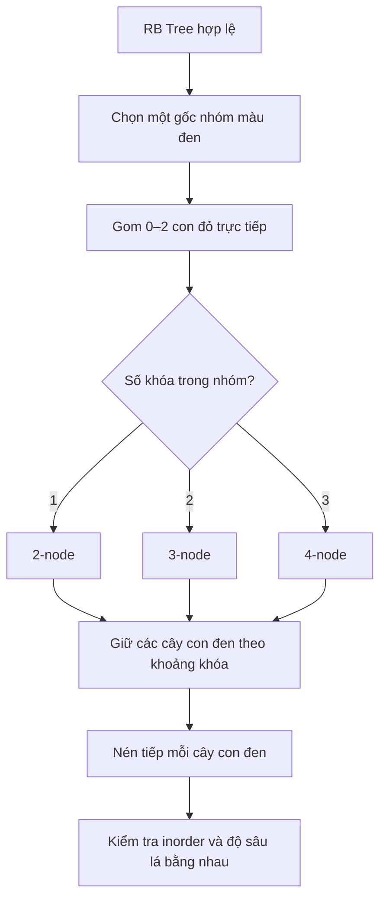

# Quan hệ giữa cây đỏ–đen và cây 2–3–4

## Mục tiêu học tập

Sau bài này, bạn có thể:

- Định nghĩa **cây 2–3–4** và phân biệt **2-node, 3-node, 4-node** theo **số khóa và số nhánh con**, không nhầm với số mức của cây.
- Ghép **một nút đen với các con đỏ trực tiếp** trong cây đỏ–đen thành một nút đa khóa tương ứng ở cây 2–3–4.
- Chuyển cả hai chiều giữa **biểu diễn đỏ–đen** và **nhóm khóa 2–3–4** trên các ví dụ hợp lệ, nhận diện lý do 3-node có nhiều cách biểu diễn nhị phân.
- Giải thích mối liên hệ giữa **black-height**, độ sâu bằng nhau của các lá cây 2–3–4 và giới hạn chiều cao **O(log n)**.
- Liên hệ thao tác **tách 4-node, đưa khóa giữa lên cha** với **đổi màu**, và vai trò của **phép quay** trong sửa bất biến sau chèn.
- Hiểu sự tương đồng giữa **vay/ghép khóa khi xóa 2–3–4** và **khôi phục thiếu đen sau xóa đỏ–đen**, đồng thời nêu các giới hạn của phép đối chiếu từng bước.
- Đọc ví dụ Python tự chứa minh họa **chèn Red–Black Tree, nén thành cây 2–3–4 và kiểm chứng các bất biến**.

## 1. Hai cách nhìn cùng một cấu trúc tìm kiếm cân bằng

Giả sử nền tảng học tập lưu bài theo khóa `lesson_id` hoặc cặp `(duration_minutes, lesson_id)`. Một **cây tìm kiếm nhị phân (BST)** cho phép đi sang trái hoặc phải khi so sánh khóa, nhưng cây thường có thể bị lệch thành một đường dài sau những lần chèn bất lợi.

Hai cấu trúc cân bằng có cùng mục tiêu nhưng mô tả khác nhau:

- **Cây đỏ–đen (Red–Black Tree, RB Tree):** mỗi nút chứa **một khóa**, hai tham chiếu con và **một màu đỏ/đen**. Các bất biến màu và **black-height** giữ chiều cao O(log n).
- **Cây 2–3–4 (2–3–4 tree):** mỗi nút có thể chứa **một, hai hoặc ba khóa đã sắp xếp**, với tối đa **bốn nhánh con**. Các lá dữ liệu ở **cùng một mức**, nên chiều cao cũng là O(log n).

Mối liên hệ trung tâm của bài:

> Một **nút đen** của RB Tree cùng **0, 1 hoặc 2 con đỏ trực tiếp** có thể được xem là **một nút 2-, 3- hoặc 4-node** trong cây 2–3–4.

Các liên kết **đỏ** biểu diễn việc nhiều khóa cùng nằm trong một nút đa khóa. Các liên kết đi tới **nút đen tiếp theo** biểu diễn **cạnh giữa hai nút 2–3–4**.

Hai mô hình không phải hai danh sách quy tắc độc lập: cách nhóm theo màu giúp hiểu bản chất các phép đổi màu và quay trong RB Tree.

## 2. Cây 2–3–4 là gì?

Cây 2–3–4 là một loại **cây tìm kiếm đa nhánh cân bằng**. Một nút lưu từ **1 đến 3 khóa phân biệt, sắp tăng dần**. Với nút **bên trong**, số con bằng số khóa cộng một.

| Tên nút | Số khóa | Số nhánh con nếu là nút trong | Dạng khóa |
| --- | ---: | ---: | --- |
| **2-node** | 1 | 2 | `[k]` |
| **3-node** | 2 | 3 | `[a\|b]` với `a<b` |
| **4-node** | 3 | 4 | `[a\|b\|c]` với `a<b<c` |

Nút **lá** không có con thật, dù về mặt logic có các vị trí con rỗng. Không được hiểu “2-node” là “nút có hai khóa”: **tên gọi đếm số nhánh con tối đa của nút trong**.

### 2.1. Bất biến tìm kiếm của nút đa khóa

Với nút 4-node `[a|b|c]`:

```text
                     [ a | b | c ]
                    /    |   |    \
                   A     B   C     D

Mọi khóa của A < a
a < mọi khóa của B < b
b < mọi khóa của C < c
c < mọi khóa của D
```

Đối với 3-node `[a|b]`, ba vùng khóa là `(-∞,a)`, `(a,b)`, `(b,+∞)` theo cận do các tổ tiên quy định. Đối với 2-node `[k]`, ta có hai vùng `<k` và `>k`.

Tìm kiếm trong một nút chỉ cần xét tối đa **ba khóa**, rồi đi đúng một nhánh con. Số phép so sánh cụ thể phụ thuộc cách viết điều kiện (chẳng hạn tách phép `>` và `==`), nhưng luôn là **O(1) tại một nút** nếu mỗi phép so sánh khóa có chi phí O(1).

### 2.2. Bất biến cân bằng: lá cùng độ sâu

Trong một cây 2–3–4 hợp lệ, **mọi nút lá chứa khóa nằm ở cùng độ sâu** (số cạnh tính từ gốc). Nút bên trong phải có đúng `m+1` con thật nếu chứa `m` khóa; một nút không thể có một nhánh rỗng ở bên cạnh các nhánh con thật.

```text
Ví dụ cây 2–3–4 hợp lệ, hai mức nút chứa khóa:

                 [20 | 40]
                /     |       \
             [10]    [30]   [50 | 60 | 70]

Lá [10], [30] và [50|60|70] đều ở độ sâu 1.
```

Số khóa mỗi lá **có thể khác nhau**: điều kiện là **độ sâu nút lá bằng nhau**, không phải mọi lá có cùng số khóa.

### 2.3. Tại sao cây 2–3–4 có chiều cao logarit?

Gọi `H` là **số mức nút chứa khóa** trên một đường gốc–lá, với cây một nút có `H=1`; `n` là tổng số khóa trong toàn cây.

Mỗi nút chứa ít nhất **1 khóa** và mỗi nút trong có ít nhất **2 con**. Do đó, trong cây không rỗng:

\[
2^H-1\le n.
\]

Mặt khác, mỗi nút chứa tối đa **3 khóa** và có tối đa **4 con**, nên:

\[
n\le 3(1+4+\cdots+4^{H-1})=4^H-1.
\]

Suy ra:

\[
\log_4(n+1)\le H\le\log_2(n+1),
\qquad H=\Theta(\log n)\ \text{khi }n\text{ đủ lớn}.
\]

Chiều cao tính bằng số cạnh là `H-1`. Tìm/chèn/xóa sau khi cân bằng đều có thể thực hiện trong O(H)=**O(log n)** thời gian với thuật toán đúng.

> Việc chứa nhiều khóa trong một nút không làm mất thứ tự tìm kiếm: nó chỉ **gộp một vài bước so sánh và phân nhánh** thành một nút đa khóa.

## 3. Đổi một nút đen và các con đỏ thành nút đa khóa

Cho một nút **đen** `b` trong RB Tree. Theo bất biến không đỏ–đỏ, một **con đỏ của `b` không thể có con đỏ**. Vì thế, nếu ta gộp `b` với các con đỏ trực tiếp, các cây con phía ngoài của nhóm sẽ bắt đầu tại **nút đen hoặc `NIL` đen**.

Đó chính là ranh giới giữa các **nút 2–3–4** sau khi nén.

### 3.1. Không có con đỏ: 2-node

```text
Biểu diễn RB:                   Cây 2–3–4:

          b(B)                       [ b ]
         /    \                     /     \
        A      C                    A     C

A và C là gốc cây con đen hoặc NIL.
```

Chỉ có một khóa `b` trong nhóm, tạo **2-node**. Hai cây con bên ngoài vẫn nằm ở hai phía khóa.

### 3.2. Có đúng một con đỏ: 3-node

Có **hai cách mã hóa** cùng một 3-node `[a|b]` trong RB Tree.

**Cách 1: liên kết đỏ nghiêng trái** (con đỏ chứa khóa nhỏ):

```text
RB:                                2–3–4:

           b(B)                        [ a | b ]
          /    \                      /    |    \
        a(R)    C                    A     B     C
       /   \
      A     B
```

Trong RB, các nhánh tương ứng là `A=a.left`, `B=a.right`, `C=b.right`.

**Cách 2: liên kết đỏ nghiêng phải** (con đỏ chứa khóa lớn):

```text
RB:                                2–3–4:

           a(B)                        [ a | b ]
          /    \                      /    |    \
         A     b(R)                  A     B     C
              /   \
             B     C
```

Hai dạng nhị phân có thể **khác hình**, nhưng cùng **nhóm khóa `[a|b]`** và cùng ba khoảng khóa `A,B,C`. Đây là lý do phép chuyển từ cây 2–3–4 sang RB Tree **không nhất thiết duy nhất** nếu không yêu cầu quy tắc nghiêng liên kết đỏ.

### 3.3. Có hai con đỏ: 4-node

```text
RB:                                      2–3–4:

             b(B)                         [ a | b | c ]
            /    \                       /    |   |    \
          a(R)   c(R)                    A     B   C     D
         /   \   /  \
        A     B C    D
```

Nút đen `b` mang khóa giữa; hai con đỏ `a`, `c` mang hai khóa còn lại. Cả bốn cây con `A,B,C,D` nối theo đúng khoảng khóa:

\[
A<a<B<b<C<c<D.
\]

Trong ký hiệu trên, `A<a` nghĩa là **mọi khóa của cây con A nhỏ hơn a**, tương tự với các cây con khác.

**Chỉ hai con đỏ** thì nhóm đạt 4-node; RB Tree không cho phép một chuỗi **đỏ–đỏ**, nên một nút nhóm không thể có thêm khóa thứ tư. Chính điều đó tương ứng với giới hạn **tối đa ba khóa** của một nút 2–3–4.

### 3.4. Bảng chuyển đổi hai chiều

| Cấu hình ở gốc nhóm RB | Nhóm 2–3–4 | Các cây con nằm bên ngoài nhóm |
| --- | --- | --- |
| `b(B)`, không có con đỏ | `[b]`, 2-node | Hai nhánh `b.left`, `b.right` |
| `b(B)` với con trái `a(R)` | `[a|b]`, 3-node | `a.left`, `a.right`, `b.right` |
| `a(B)` với con phải `b(R)` | `[a|b]`, 3-node | `a.left`, `b.left`, `b.right` |
| `b(B)` với hai con `a(R),c(R)` | `[a|b|c]`, 4-node | `a.left`, `a.right`, `c.left`, `c.right` |

**Không** ghép một nút đen với **cháu đỏ** hay ghép hai nút đen thành một nhóm chỉ vì chúng gần nhau. Quy tắc là **nút đen cộng các con đỏ trực tiếp**, đúng một mức liên kết đỏ.

## 4. Chuyển cả cây: từ RB Tree thành cây 2–3–4

Quy trình chuyển đổi:

1. Bắt đầu từ **nút đen gốc** của RB Tree hợp lệ.
2. Gom khóa của nút đen đó với khóa của **các con đỏ trực tiếp**; sắp tăng dần thành một nút đa khóa.
3. Giữ các nhánh ở ngoài nhóm theo **đúng thứ tự các khoảng khóa**.
4. Lặp đệ quy ở **các gốc cây con đen** nằm bên ngoài nhóm.
5. Gặp `NIL` thì dừng, vì đó chỉ là **vị trí rỗng**, không phải một nút có khóa trong cây 2–3–4.

### 4.1. Ví dụ hai mức, có cả 3-node và 4-node

```text
RB Tree hợp lệ:

                  40(B)
                 /     \
              20(R)    60(B)
             /    \    /    \
           10(B) 30(B) 50(R) 70(R)
```

- Nhóm `40(B)` với con trái `20(R)` → nút `[20|40]`.
- Ba cây con của nhóm là nút đen `10(B)`, `30(B)` và `60(B)`.
- `10(B)` không có con đỏ → `[10]`.
- `30(B)` không có con đỏ → `[30]`.
- `60(B)` có **hai con đỏ** `50(R),70(R)` → `[50|60|70]`.

Kết quả:

```text
                  [20 | 40]
                 /    |      \
              [10]   [30]   [50 | 60 | 70]
```

**Duyệt inorder của cả hai cách biểu diễn** đều cho:

```text
10, 20, 30, 40, 50, 60, 70
```

Và ba lá 2–3–4 có **độ sâu bằng nhau**. Ví dụ này cho thấy các nhóm 2-node, 3-node, 4-node có thể cùng xuất hiện trong một cây hợp lệ.

### 4.2. Liên kết đỏ là “nằm trong cùng nút”, không phải cạnh đa nhánh

Trong hình RB:

```text
        b(B)
       /
     a(R)
```

liên kết `b→a` màu đỏ được **co lại** bên trong nút `[a|b]`. Nhưng một liên kết từ `b(B)` tới một **con đen `c(B)`** vẫn là **cạnh giữa các nút đa khóa**.

Vì vậy, khi nhìn RB Tree, có thể tạm:

1. Đánh dấu tất cả các nút đỏ.
2. Nối từng nút đỏ với **cha đen trực tiếp** của nó.
3. Co các liên kết ấy thành từng nhóm đa khóa.

Đây là trực giác hình học của quan hệ giữa hai cấu trúc.

## 5. Black-height tương ứng với các mức của cây 2–3–4

Khác biệt nhìn thấy rõ nhất: RB Tree **cho phép các đường gốc–lá có số nút thật khác nhau**, vì có thể đi qua số nút **đỏ** khác nhau. Cây 2–3–4 lại yêu cầu **mọi lá dữ liệu cùng độ sâu**.

Hai phát biểu tưởng như khác nhau nhưng thực chất tương ứng.

### 5.1. Mỗi nhóm đa khóa chứa đúng một nút đen

Khi nén RB Tree:

- Một 2-node tương ứng **một nút đen**.
- Một 3-node tương ứng **một nút đen và một nút đỏ**.
- Một 4-node tương ứng **một nút đen và hai nút đỏ**.

Do đó, trên mỗi đường từ gốc tới lá:

> **Số nhóm đa khóa đi qua** bằng **số nút đen thật đi qua** trên đường tương ứng trong RB Tree.

Các nút đỏ **không tạo mức riêng** trong cây 2–3–4. Chúng chỉ tăng **số khóa nằm trong một mức**.

### 5.2. Cách đối chiếu với `NIL`

Theo quy ước của bài:

\[
bh(x)=\text{số nút đen sau }x\text{ đến }NIL,
\]

trong đó **không tính `x`, nhưng có tính `NIL` đen**.

Với **gốc đen** và cây không rỗng, đặt `H` là số mức **nút chứa khóa** của cây 2–3–4 nhận được sau nén. Khi đó:

\[
\boxed{H=bh(root)}.
\]

Giải thích: đường RB có `H` nút đen **thật** (mỗi nút ứng với một nhóm 2–3–4). Nếu **bỏ nút đen gốc** khi tính `bh(root)` nhưng **cộng lá `NIL` đen** ở cuối, tổng vẫn đúng `H`.

Ví dụ:

| RB Tree | `bh(root)` | Cây 2–3–4 | `H` |
| --- | ---: | --- | ---: |
| Một gốc đen, hai con `NIL` | 1 | Một nút `[k]` | 1 |
| Gốc đen, một con đỏ, các con ngoài đều `NIL` | 1 | Một 3-node | 1 |
| Gốc đen, hai con đỏ, tất cả lá `NIL` | 1 | Một 4-node | 1 |
| Gốc đen, hai con thật đen đều là lá | 2 | Gốc và một mức lá | 2 |
| Ví dụ `40(B)` ở mục 4.1 | 2 | Hai mức nút đa khóa | 2 |

**Cẩn thận:** nếu dùng quy ước black-height **không đếm `NIL`**, hoặc **có tính nút gốc**, công thức ở bảng phải được điều chỉnh. Đừng chuyển công thức giữa hai tài liệu có quy ước đếm khác nhau mà không kiểm tra.

### 5.3. Vì sao RB Tree không thể quá cao?

RB Tree **cấm hai nút đỏ liên tiếp**, nên trên một đường có tối đa một nút đỏ xen giữa các nút đen. Nếu cây 2–3–4 có `H` mức nút đa khóa, đường tương ứng ở RB Tree có chiều dài tối đa xấp xỉ **gấp đôi** theo số nút thật.

Kết hợp `H≤log₂(n+1)` với giới hạn số nút đỏ:

\[
h_{\mathrm{RB}}\le 2H\le 2\log_2(n+1),
\]

với `h_{\mathrm{RB}}` tính theo **số cạnh tới nút thật sâu nhất**. Cận có thể không chặt trong các trường hợp nhỏ nhưng đúng để chứng minh **O(log n)**.

Đây là ý nghĩa của **black-height**: nó là **số mức logic sau khi co các liên kết đỏ**, không phải một đại lượng ngẫu nhiên được thêm vào BST.

## 6. Chèn cây 2–3–4: tách 4-node tương ứng với đổi màu

Cây 2–3–4 có thể chèn theo cách **từ trên xuống** (*top-down splitting*):

1. Tìm nhánh dẫn tới khóa cần thêm, giữ thứ tự bên trong mỗi nút.
2. Nếu gặp **4-node `[a|b|c]`** trên đường đi, tách thành hai nút `[a]` và `[c]`, **đưa khóa giữa `b` lên cha**.
3. Tiếp tục đi xuống sau khi đã xử lý nút đầy.
4. Đến lá chưa đầy, đưa khóa mới vào đúng vị trí đã sắp.
5. Nếu phải tách 4-node ở **gốc**, tạo một **gốc mới**; độ cao cây tăng một mức.

### 6.1. Hình ảnh một phép tách

```text
TRƯỚC tách:

               [ a | b | c ]
                /   |   |  \
               A    B   C   D

SAU tách, khóa b được đưa lên:

                     [ b ]
                    /     \
                  [ a ]   [ c ]
                 /   \    /   \
                A     B  C     D
```

Nếu nút đầy có cha, khóa `b` được **chèn vào cha**, và hai nhóm `[a]`, `[c]` trở thành **hai nhánh liên tiếp** ở đúng vị trí. Nếu cha cũng đầy, có thể tách cha theo chiến lược từ trên xuống hoặc xử lý lan lên theo chiến lược từ dưới lên.

### 6.2. Trong RB Tree: tách 4-node bằng đổi màu

Nhóm 4-node `[a|b|c]` thường được biểu diễn bằng:

```text
TRƯỚC:

             b(B)
            /    \
          a(R)   c(R)
```

Một phép **đổi màu** có thể:

```text
SAU đổi màu:

             b(R)
            /    \
          a(B)   c(B)
```

- Hai nút `a,c` nay **đen**, tương ứng hai nhóm riêng `[a]` và `[c]`.
- Nút `b` trở thành **đỏ**, nghĩa là khóa `b` có thể **ghép vào nhóm của cha đen** — đúng ý tưởng **đưa khóa giữa lên cha**.
- Nếu `b` đang ở gốc, phải tô lại `b` **đen**, tương ứng tạo **gốc 2–3–4 mới** khi tách gốc.
- Nếu cha của `b` cũng đỏ, RB Tree tạm vi phạm **không đỏ–đỏ** và cần **quay/đổi màu tiếp**.

Phép đổi màu là hình ảnh nhị phân của việc **tách một 4-node**. Tuy nhiên, trong một thuật toán chèn RB Tree cụ thể, màu và hình dạng ở **các trạng thái trung gian** có thể chưa phải một RB Tree hợp lệ để nén ngay lập tức.

### 6.3. Vậy phép quay đóng vai trò gì?

Khi một nút mới đỏ có **cha đỏ**, thuật toán RB Tree thông thường xét **màu chú**:

- **Chú đỏ:** đổi màu cha và chú thành đen, ông thành đỏ. Đây là trạng thái **tách 4-node** chứa ông và hai con đỏ; lỗi có thể **được đẩy lên ông**.
- **Chú đen, hình dạng thẳng LL/RR:** **quay tại ông** và đổi màu để sửa **đỏ–đỏ** trong cấu trúc nhị phân.
- **Chú đen, hình dạng gấp LR/RL:** quay tại cha trước để thành dạng thẳng, rồi quay tại ông và đổi màu.

**Quay không phải là một phép tách 4-node đơn lẻ.** Nó là thao tác **thay cấu trúc liên kết nhị phân mà vẫn giữ inorder**, giúp mã hóa các nhóm đa khóa theo những hình dạng hợp lệ.

### 6.4. Ví dụ chèn 10, 20, 30, 40

Nhìn theo cây 2–3–4:

```text
Chèn 10:       Chèn 20:           Chèn 30:

   [10]         [10|20]         [10|20|30]

Chèn 40 (tách 4-node ở gốc trước khi đi tiếp):

             [20]
            /    \
          [10]   [30|40]
```

Một triển khai RB Tree chuẩn theo cách chèn đỏ và sửa từ dưới lên có thể cho:

```text
Sau 10,20,30:                  Sau khi chèn 40:

        20(B)                           20(B)
        /   \                           /    \
      10(R) 30(R)                    10(B)   30(B)
                                             \
                                             40(R)
```

- Trước chèn `40`, `20(B)` với hai con đỏ là **4-node `[10|20|30]`**.
- Chèn `40(R)` dưới `30(R)` làm xuất hiện **đỏ–đỏ**.
- Chú `10(R)` cũng đỏ, nên đổi `10,30` thành đen, `20` thành đỏ, rồi tô lại `20` đen do là gốc.
- Sau khi nén, ta thu được **`[20]`**, với hai con **`[10]`** và **`[30|40]`**.

Hai cách diễn giải cho cùng **tập khóa và kết quả tìm kiếm đúng**, dù **trình tự xử lý nội bộ** không nhất thiết giống hệt nhau.

## 7. Xóa: vay/ghép khóa trong 2–3–4 và sửa thiếu đen trong RB Tree

Trong cây 2–3–4, xóa khóa không chỉ là bỏ một giá trị khỏi một nút:

- Nếu khóa nằm ở **lá** có hai hoặc ba khóa, ta thường có thể bỏ khóa mà nút vẫn hợp lệ.
- Nếu khóa nằm ở **nút bên trong**, ta có thể thay khóa bằng **successor hoặc predecessor**, sau đó xóa khóa tương ứng ở nút lá.
- Nếu nút lá chỉ có **một khóa** (2-node), việc xóa có thể làm nó **rỗng**, không còn là nút hợp lệ. Phải điều chỉnh cấu trúc bằng **vay khóa** hoặc **ghép nút**.

Đó là hình ảnh đa nhánh của vấn đề **thiếu đen** sau xóa RB Tree.

### 7.1. Vay khóa từ anh/em đủ khóa

Giả sử một nút 2-node `[a]` mất khóa và trở thành vị trí thiếu khóa, trong khi anh/em cạnh nó chứa **ít nhất hai khóa**.

Ta có thể:

1. Đưa một **khóa phân cách từ cha** xuống vị trí thiếu.
2. Đưa khóa **gần vị trí thiếu** từ anh/em lên cha.
3. Nếu là nút trong, chuyển **cây con kề phù hợp** cùng khóa để giữ thứ tự.

Ví dụ đơn giản ở tầng lá:

```text
TRƯỚC xóa 10:

             [20]
            /    \
          [10]  [30|40]

SAU xóa 10, vay từ anh/em bên phải:

             [30]
            /    \
          [20]   [40]
```

Khóa `20` từ cha đi xuống bên trái, khóa `30` từ anh/em lên cha. Mọi khóa vẫn được sắp đúng. **Không có nút rỗng còn lại**, và mọi lá vẫn cùng độ sâu.

Trong RB Tree, tác dụng tương ứng có thể đòi **đổi màu kết hợp quay**. Không nên đồng nhất “một lần vay khóa” với “chính xác một phép quay” trong mọi cài đặt: những cách mã hóa 3-node khác nhau có thể dẫn tới chuỗi thao tác nhị phân khác nhau.

### 7.2. Ghép khi anh/em cũng là 2-node

Nếu anh/em chỉ có một khóa, nó không đủ khóa để cho vay mà vẫn giữ quy tắc tối thiểu. Khi ấy có thể **ghép**:

- Nút thiếu khóa.
- Một **khóa phân cách của cha**.
- Anh/em là một 2-node.

Kết quả là một **3-node**; cha mất một khóa. Nếu cha cũng chỉ có một khóa, sự thiếu hụt có thể **lan lên tổ tiên**, tương tự tình huống thiếu đen đi lên trong RB Tree.

```text
TRƯỚC xóa 10:

             [20]
            /    \
          [10]   [30]

SAU xóa 10 và ghép:

             [20 | 30]
```

Ở đây cha cũ `[20]` không còn vai trò một nút riêng; nhóm `[20|30]` trở thành gốc mới. **Số mức chứa khóa giảm từ hai xuống một** — trường hợp đặc biệt khi **gốc co lại** sau xóa.

### 7.3. Thiếu đen là cách biểu diễn nhị phân của thiếu một mức khóa

Trong RB Tree, nếu nút **đen** bị loại khỏi vị trí thật và nút thay thế cũng **đen hoặc `NIL`**, nhánh ấy có thể giảm số nút đen so với nhánh anh/em.

Thuật toán sửa thiếu đen thường xét:

| Trường hợp RB Tree khi xóa | Trực giác ở cây 2–3–4 |
| --- | --- |
| Anh/em **đỏ** | Biến đổi hình dạng nhị phân để làm lộ một anh/em đen, thuận tiện xử lý các nhóm khóa |
| Anh/em **đen**, hai con đen | Nhóm anh/em không có “khóa đỏ dự trữ”; đổi màu và đưa thiếu hụt lên cha, tương tự **ghép và lan thiếu khóa** |
| Anh/em **đen**, con gần đỏ, con xa đen | Quay tại anh/em để đưa khóa dự trữ đến vị trí thuận lợi, chuẩn bị **vay/chuyển khóa** |
| Anh/em **đen**, con xa đỏ | Quay tại cha và đổi màu để **bù thiếu đen** ngay tại vùng này, tương tự hoàn tất một lần vay |

Bảng này mô tả **quan hệ cấu trúc**, không phải một phép biến đổi một-một giữa **từng lệnh** của hai thuật toán. Những trạng thái **tạm thời** khi sửa xóa RB Tree có thể chứa một đơn vị đen bổ sung (*double black*), **chưa phải cây đỏ–đen hợp lệ** để nén ra một cây 2–3–4 chuẩn.

### 7.4. Top-down deletion và bottom-up deletion

Có hai phong cách cài đặt phổ biến:

- **Từ trên xuống (top-down) ở 2–3–4:** trước khi đi vào một nút có nguy cơ thiếu khóa, ưu tiên **vay/ghép** để bảo đảm đường xuống có thể xóa an toàn.
- **Từ dưới lên (bottom-up) ở RB Tree:** xóa vị trí vật lý theo BST rồi nếu đã mất một nút đen, **sửa thiếu đen** bằng cách xét màu anh/em và các con, có thể đi lên nhiều tổ tiên.

Chúng cùng duy trì một tập điều kiện cân bằng nhưng **không nhất thiết tạo cùng một hình dạng cây cuối**. Cần so sánh bằng **tập khóa, thứ tự, bất biến và độ phức tạp**, thay vì đòi một chuỗi quay khớp chính xác một chuỗi vay/ghép.

## 8. Chuyển từ cây 2–3–4 sang RB Tree có phải duy nhất?

**Không**, nếu chỉ yêu cầu RB Tree chuẩn với năm bất biến.

Một nút 3-node `[a|b]` có hai cách mã hóa:

```text
Cách nghiêng trái:            Cách nghiêng phải:

       b(B)                          a(B)
      /                                  \
     a(R)                                 b(R)

Cả hai nén thành [a|b].
```

Sau khi gắn đúng các cây con `A,B,C` ở những khoảng khóa, **cả hai** cách có thể hợp lệ. Vì vậy:

- Một cây RB Tree hợp lệ có thể **nén theo quy tắc nhóm** thành một cây 2–3–4 tương ứng.
- Một cây 2–3–4 có thể có **nhiều cách mở rộng** thành RB Tree hợp lệ.
- Hai cây RB Tree khác hình dạng cũng có thể nén thành **cùng một cây 2–3–4**.
- Những thuật toán chèn/xóa khác nhau có thể tạo **các nhóm khóa 2–3–4 khác nhau**, dù chứa cùng tập khóa và đều hợp lệ.

### 8.1. Left-leaning Red–Black Tree (LLRB)

Một biến thể gọi là **cây đỏ–đen nghiêng trái (Left-Leaning Red–Black Tree, LLRB)** bổ sung quy tắc ưu tiên liên kết đỏ ở **bên trái** để có cách mã hóa 3-node nhất quán hơn.

Trong LLRB:

- **3-node `[a|b]`** thường dùng **`b(B)` với `a(R)` bên trái**.
- Một số biến thể LLRB hướng tới mô hình **2–3 tree**, với quy tắc mạnh hơn về liên kết đỏ; các biến thể khác mô phỏng **2–3–4 tree** và cho phép nhóm 4-node.
- Chi tiết **khi nào tách 4-node, quay và đổi màu** phải phù hợp với **biến thể thuật toán cụ thể**.

Không nên suy rằng **mọi Red–Black Tree đều là LLRB**, hoặc lấy mã xóa của một biến thể LLRB rồi áp trực tiếp cho mọi cấu trúc đỏ–đen khác.

### 8.2. RB Tree thường không lưu ba khóa trong cùng một đối tượng

**Nhìn theo 2–3–4** là một cách *diễn giải*. Một cài đặt RB Tree thông thường vẫn lưu **mỗi nút đúng một khóa** và hai liên kết con:

```text
RB node:     (key, value, color, left, right, parent?)
2-3-4 node:  ([key1, key2?, key3?], children[2..4])
```

Nén chỉ giúp ta hiểu **cấu trúc và bất biến**; không tự động thay đổi định dạng dữ liệu trong bộ nhớ. Muốn dùng thật một cây 2–3–4, phải thiết kế đối tượng nút đa khóa và thao tác tìm/chèn/xóa tương ứng.

## 9. Hướng dẫn tự nén một cây đỏ–đen trên giấy

Khi gặp hình RB phức tạp, hãy làm theo quy trình có thể kiểm tra bằng tay:

1. **Xác minh đầu vào:** gốc đen, `NIL` đen, không có hai nút đỏ liền nhau, black-height các đường bằng nhau, thứ tự BST đúng.
2. **Đánh dấu từng nút đen**. Đây là tâm của từng nhóm đa khóa.
3. **Gom các con đỏ trực tiếp** vào nhóm của nút đen cha, theo **thứ tự khóa**.
4. **Không gom con đen** vào nhóm đang xét; đó là gốc của nhóm 2–3–4 ở mức tiếp theo.
5. **Gắn các cây con đen** theo đúng khoảng khóa giữa các khóa của nhóm.
6. **Đếm số nhóm trên từng đường gốc–lá**; chúng phải có cùng số mức `H`.
7. **Duyệt inorder** ở hai biểu diễn; kết quả phải là cùng dãy khóa tăng dần.



**Không nén một trạng thái RB đang sửa dở** với cha đỏ–con đỏ hoặc thiếu đen rồi kết luận cây 2–3–4 sai. Phép đối chiếu được đảm bảo cho **trạng thái cuối hợp lệ** của cấu trúc.

## 10. Mối liên hệ giữa bất biến và độ phức tạp

| Tiêu chí | Red–Black Tree | Cây 2–3–4 |
| --- | --- | --- |
| Khóa/nút thật | 1 khóa | 1, 2 hoặc 3 khóa |
| Phân nhánh | Nhị phân, hai con | 2–4 con ở nút trong |
| Bất biến thứ tự | Trái nhỏ hơn nút, phải lớn hơn nút | Khóa trong nút tăng, nhánh con theo các khoảng khóa |
| Bất biến cân bằng | Không đỏ–đỏ, black-height đồng đều, gốc/NIL đen | Mọi nút lá chứa khóa cùng độ sâu |
| Ý nghĩa liên kết đỏ | Nối các khóa cùng một nhóm logic | Các khóa nằm chung trong nút đa khóa |
| Khi đầy | Cụm đen + hai con đỏ là 4-node | Nút đã có ba khóa |
| Tách nhóm | Đổi màu và đôi khi quay | Đưa khóa giữa lên cha, chia thành hai nút |
| Xử lý xóa thiếu | Sửa thiếu đen bằng màu anh/em, con gần/xa và quay | Vay khóa hoặc ghép nút, có thể lan lên |
| Tìm/chèn/xóa | **O(log n)** xấu nhất | **O(log n)** xấu nhất |
| Duyệt toàn bộ | **O(n)** | **O(n)** |
| Bộ nhớ cho `n` khóa | **O(n)** | **O(n)** |

### 10.1. Chi phí bổ sung của phép chuyển đổi

Nếu **thực sự xây dựng** một bản sao cây 2–3–4 từ một cây RB, chứ không chỉ diễn giải trên giấy:

- Mỗi nút RB thật được xét không quá một số lần hằng số.
- Mỗi nhóm chứa từ một đến ba khóa.
- Số nhóm tối đa `n`, tối thiểu xấp xỉ `n/3`.
- Công việc tạo bản sao và gắn các nhánh là **O(n) thời gian**.
- Bộ nhớ cho cây 2–3–4 mới là **O(n)**, bên cạnh cây RB gốc nếu giữ cả hai.
- Ngăn xếp đệ quy khi nén có chiều sâu O(H)=**O(log n)** trên cây hợp lệ.

Phép nén là thao tác **đổi biểu diễn cả cây**; không phải bước bắt buộc của `search` hoặc `insert` trong RB Tree. Không được cộng O(n) của hàm minh họa nén vào thời gian O(log n) của thao tác chèn RB Tree chuẩn.

### 10.2. So sánh với bảng băm, AVL và B-tree

Nếu ứng dụng chỉ cần tra `lesson_id` chính xác, bảng băm thường đơn giản và có tra cứu **O(1) kỳ vọng**, nhưng không tự duy trì thứ tự khóa. AVL cũng là BST cân bằng với **O(log n) trường hợp xấu nhất**, nhưng dùng bất biến **chênh chiều cao hai cây con ≤1**, không phải màu hay nhóm 2–3–4.

Cây 2–3–4 là một trường hợp đặc biệt của họ **B-tree**, có thể chứa nhiều khóa trên một nút và phân nhánh từ hai đến bốn. B-tree/B+ tree cho hệ thống lưu trữ theo trang thường có **bậc lớn hơn**, nhờ đó giảm số lần truy cập trang đĩa. RB Tree biểu diễn mỗi khóa trong một nút nhị phân, phù hợp với các API **ordered Map/Set** trên bộ nhớ chính.

Không nên khẳng định cấu trúc này **luôn nhanh hơn** cấu trúc kia trong mọi trường hợp. Hãy xét tỷ lệ đọc/ghi, kích thước khóa, bộ nhớ, bố trí dữ liệu, cache, thư viện sẵn có và yêu cầu độ trễ.

## 11. Ví dụ Python: chèn RB Tree rồi nén thành cây 2–3–4

Ví dụ sau gồm một **RB Map tối giản có chèn**, sau đó chuyển **trạng thái RB hợp lệ** thành một cây đa khóa để học phép ánh xạ. Nó cố ý **không cài xóa**, vì thuật toán sửa thiếu đen là một bài toán riêng; phần 7 đã phân tích ý tưởng tương ứng.

Hợp đồng:

- Dùng **khóa số nguyên phân biệt** cho dễ minh họa; chèn trùng khóa **cập nhật giá trị**, không thêm nút.
- `NIL` là một sentinel **đen** dùng chung, không có khóa thật.
- `root` luôn đen sau mỗi lần `insert`.
- Mã lưu tham chiếu `parent` để phép quay có thể đổi gốc cây con.
- Phép chuyển thành cây 2–3–4 tạo **bản sao mới**; cây RB gốc không bị sửa.

### 11.1. Nút đỏ–đen và thuật toán chèn

Đây là một khối Python **độc lập** có thể ghép tiếp với các khối mục 11.2–11.4. Các phương thức bên dưới đã được viết trọn trong lớp `RBIndex`.

```python
RED = "RED"
BLACK = "BLACK"


class RBNode:
    def __init__(self, key=None, value=None, color=RED):
        self.key = key
        self.value = value
        self.color = color
        self.left = None
        self.right = None
        self.parent = None


class RBIndex:
    def __init__(self):
        self.nil = RBNode(color=BLACK)
        self.nil.left = self.nil
        self.nil.right = self.nil
        self.nil.parent = self.nil
        self.root = self.nil
        self.size = 0

    def _rotate_left(self, x):
        y = x.right
        assert y is not self.nil

        # B là cây con nằm giữa x và y.
        x.right = y.left
        if y.left is not self.nil:
            y.left.parent = x

        y.parent = x.parent
        if x.parent is self.nil:
            self.root = y
        elif x is x.parent.left:
            x.parent.left = y
        else:
            x.parent.right = y

        y.left = x
        x.parent = y

    def _rotate_right(self, y):
        x = y.left
        assert x is not self.nil

        y.left = x.right
        if x.right is not self.nil:
            x.right.parent = y

        x.parent = y.parent
        if y.parent is self.nil:
            self.root = x
        elif y is y.parent.left:
            y.parent.left = x
        else:
            y.parent.right = x

        x.right = y
        y.parent = x

    def insert(self, key, value):
        if type(key) is not int:
            raise TypeError("Ví dụ yêu cầu khóa kiểu int")

        parent = self.nil
        node = self.root
        while node is not self.nil:
            parent = node
            if key == node.key:
                node.value = value
                return False  # Cập nhật, không sinh nút trùng.
            node = node.left if key < node.key else node.right

        z = RBNode(key, value, RED)
        z.left = self.nil
        z.right = self.nil
        z.parent = parent
        if parent is self.nil:
            self.root = z
        elif key < parent.key:
            parent.left = z
        else:
            parent.right = z

        self.size += 1
        self._fix_insert(z)
        return True

    def _fix_insert(self, z):
        # Nếu cha đen, đã không có vi phạm đỏ-đỏ.
        while z.parent.color == RED:
            g = z.parent.parent

            if z.parent is g.left:
                uncle = g.right
                if uncle.color == RED:
                    # Nhóm 4-node: tách bằng đổi màu.
                    z.parent.color = BLACK
                    uncle.color = BLACK
                    g.color = RED
                    z = g
                else:
                    if z is z.parent.right:
                        # LR: chuyển sang LL.
                        z = z.parent
                        self._rotate_left(z)
                    z.parent.color = BLACK
                    z.parent.parent.color = RED
                    self._rotate_right(z.parent.parent)
            else:
                uncle = g.left
                if uncle.color == RED:
                    z.parent.color = BLACK
                    uncle.color = BLACK
                    g.color = RED
                    z = g
                else:
                    if z is z.parent.left:
                        # RL: chuyển sang RR.
                        z = z.parent
                        self._rotate_right(z)
                    z.parent.color = BLACK
                    z.parent.parent.color = RED
                    self._rotate_left(z.parent.parent)

        self.root.color = BLACK
        self.root.parent = self.nil

    def get(self, key):
        if type(key) is not int:
            raise TypeError("Ví dụ yêu cầu khóa kiểu int")
        node = self.root
        while node is not self.nil:
            if key == node.key:
                return node.value
            node = node.left if key < node.key else node.right
        return None

    def items(self):
        def walk(node):
            if node is not self.nil:
                yield from walk(node.left)
                yield (node.key, node.value)
                yield from walk(node.right)
        return walk(self.root)

    def validate(self):
        """Trả (số nút thật, black count gồm gốc+NIL, chiều cao nút).

        Đếm black count TỪ chính nút hiện tại để thuận đệ quy.
        """
        nil = self.nil
        assert nil.color == BLACK
        assert nil.left is nil and nil.right is nil

        if self.root is nil:
            assert self.size == 0
            return (0, 1, 0)

        assert self.root.color == BLACK
        assert self.root.parent is nil
        seen = set()

        def visit(node, expected_parent, lower, upper):
            if node is nil:
                return (0, 1, 0)

            marker = id(node)
            assert marker not in seen, "Lặp nút hoặc chu trình"
            seen.add(marker)
            assert node.parent is expected_parent, "Sai parent"
            assert node.color in (RED, BLACK), "Màu không hợp lệ"
            assert node.left is not None and node.right is not None

            if lower is not None:
                assert lower < node.key, "Sai cận dưới BST"
            if upper is not None:
                assert node.key < upper, "Sai cận trên BST"
            if node.color == RED:
                assert node.left.color == BLACK
                assert node.right.color == BLACK

            ln, lb, lh = visit(node.left, node, lower, node.key)
            rn, rb, rh = visit(node.right, node, node.key, upper)
            assert lb == rb, "Black-height hai nhánh không bằng nhau"

            return (
                1 + ln + rn,
                lb + (1 if node.color == BLACK else 0),
                1 + max(lh, rh),
            )

        result = visit(self.root, nil, None, None)
        assert result[0] == self.size
        return result
```

**Giải thích độ phức tạp:** `insert` tìm vị trí theo một đường BST và sửa các tổ tiên bằng đổi màu/quay, mất **O(log n)** thời gian xấu nhất. `items` và `validate` thăm tất cả nút, mất **O(n)**; đây là những thao tác riêng, không bắt buộc phải chạy sau mỗi lần chèn trong sản phẩm.

### 11.2. Nút đa khóa và phép nén từ RB Tree

Mỗi `MultiNode` giữ `entries` là một danh sách **1–3 cặp `(key,value)`**. Nếu là nút trong, `children` có đúng `len(entries)+1` phần tử; nếu là lá, `children=[]`.

```python
class MultiNode:
    def __init__(self, entries, children):
        self.entries = entries
        self.children = children


def to_234(index):
    """Nén cây RB đã hợp lệ; tạo cây 2-3-4 mới, không đổi index."""
    nil = index.nil

    def pack(black_node):
        if black_node is nil:
            return None

        assert black_node.color == BLACK
        left = black_node.left
        right = black_node.right
        left_red = left is not nil and left.color == RED
        right_red = right is not nil and right.color == RED

        entries = []
        child_roots = []

        # Thêm khóa nhỏ và hai cây con quanh nó nếu trái đỏ.
        if left_red:
            entries.append((left.key, left.value))
            child_roots.extend([left.left, left.right])
        else:
            child_roots.append(left)

        # Nút đen mang khóa trung tâm của nhóm.
        entries.append((black_node.key, black_node.value))

        # Thêm khóa lớn và hai cây con quanh nó nếu phải đỏ.
        if right_red:
            entries.append((right.key, right.value))
            child_roots.extend([right.left, right.right])
        else:
            child_roots.append(right)

        # Các gốc con ngoài nhóm phải đen hoặc NIL.
        assert all(
            child is nil or child.color == BLACK
            for child in child_roots
        )

        if all(child is nil for child in child_roots):
            return MultiNode(entries, [])  # Lá đa khóa.

        assert all(child is not nil for child in child_roots)
        children = [pack(child) for child in child_roots]
        return MultiNode(entries, children)

    return pack(index.root)
```

**Đọc từ dưới lên:** hàm `pack` tìm một nút đen, kiểm tra hai con của nó có đỏ không, tạo **1–3 cặp khóa–giá trị** của nhóm, sau đó chọn **2–4 cây con ngoài nhóm** theo đúng thứ tự.

Nút đỏ **không được gọi `pack` riêng**. Nó đã được chứa trong nhóm của cha đen, nên không thể bị xuất hai lần.

### 11.3. Kiểm chứng cây 2–3–4 và duyệt có thứ tự

```python
def validate_234(node, lower=None, upper=None):
    """Trả (số mức nút đa khóa, số khóa thật)."""
    if node is None:
        return (0, 0)

    keys = [key for key, value in node.entries]
    assert 1 <= len(keys) <= 3, "Nút cần 1-3 khóa"
    assert all(keys[i] < keys[i + 1]
               for i in range(len(keys) - 1))

    if lower is not None:
        assert lower < keys[0], "Sai cận dưới"
    if upper is not None:
        assert keys[-1] < upper, "Sai cận trên"

    if not node.children:
        return (1, len(keys))  # Lá chứa khóa.

    assert len(node.children) == len(keys) + 1
    bounds = [lower] + keys + [upper]
    child_info = [
        validate_234(child, bounds[i], bounds[i + 1])
        for i, child in enumerate(node.children)
    ]

    assert all(child is not None for child in node.children)
    levels = [level for level, count in child_info]
    assert len(set(levels)) == 1, "Các lá khác độ sâu"

    return (
        1 + levels[0],
        len(keys) + sum(count for level, count in child_info),
    )


def items_234(node):
    """Duyệt inorder các cặp (key, value) ở nút đa khóa."""
    if node is None:
        return

    if not node.children:
        yield from node.entries
        return

    for i, entry in enumerate(node.entries):
        yield from items_234(node.children[i])
        yield entry
    yield from items_234(node.children[-1])


def search_234(node, key):
    """Tìm khóa, xét tối đa 3 khóa tại mỗi nút đa khóa."""
    while node is not None:
        i = 0
        while i < len(node.entries) and key > node.entries[i][0]:
            i += 1
        if i < len(node.entries) and key == node.entries[i][0]:
            return node.entries[i][1]
        if not node.children:
            return None
        node = node.children[i]
    return None
```

Hàm `validate_234` kiểm tra:

1. Mỗi nút chứa **1–3 khóa theo thứ tự tăng**.
2. Các khóa nằm trong **cận dưới và cận trên do tổ tiên quy định**.
3. Mỗi nút trong có đúng **số con bằng số khóa cộng một**.
4. Các cây con có **cùng số mức**; nhờ đó mọi lá chứa khóa cùng độ sâu.
5. Số khóa toàn cây đúng với dữ liệu gốc sau khi nén.

Ở đây không có trường `color`: màu của RB Tree đã được **hấp thụ vào cách gom khóa**.

### 11.4. Bộ ví dụ đối chiếu từng lần chèn

Chạy sau khi định nghĩa các lớp và hàm ở trên:

```python
# Kiểm tra quy ước cho cây rỗng.
index = RBIndex()
assert index.validate() == (0, 1, 0)
assert to_234(index) is None
assert validate_234(to_234(index)) == (0, 0)

# Dãy minh họa tách nhóm 4-node sau khi chèn 40.
index = RBIndex()
for key in [10, 20, 30, 40]:
    assert index.insert(key, f"lesson-{key}")
    count, black_count, height_nodes = index.validate()

    multi = to_234(index)
    levels, multi_count = validate_234(multi)
    assert multi_count == count
    assert levels == black_count - 1  # bh(root) = H.
    assert list(index.items()) == list(items_234(multi))

assert [k for k, v in multi.entries] == [20]
assert [
    [k for k, v in child.entries]
    for child in multi.children
] == [[10], [30, 40]]

# Các dãy khác: đường thẳng, gấp, đổi màu ở nhiều mức.
scenarios = [
    [30, 20, 10],                 # LL
    [10, 20, 30],                 # RR
    [30, 10, 20],                 # LR
    [10, 30, 20],                 # RL
    [41, 38, 31, 12, 19, 8],     # Nhiều lần đổi màu/quay
    [50, 20, 80, 10, 30, 70, 90,
     5, 15, 25, 35, 60, 75],     # Nhiều mức
]

for keys in scenarios:
    tree = RBIndex()
    for key in keys:
        assert tree.insert(key, f"lesson-{key}")
        count, black_count, height_nodes = tree.validate()

        grouped = to_234(tree)
        levels, multi_count = validate_234(grouped)
        assert levels == black_count - 1
        assert count == multi_count
        assert list(tree.items()) == list(items_234(grouped))

    for key in keys:
        assert tree.get(key) == search_234(grouped, key)
    assert search_234(grouped, 999) is None

    # Thay giá trị của khóa cũ không làm đổi cấu trúc hoặc số nhóm.
    old_count = tree.size
    assert not tree.insert(keys[0], "updated")
    assert tree.size == old_count
    tree.validate()
    updated = to_234(tree)
    assert search_234(updated, keys[0]) == "updated"
    assert list(tree.items()) == list(items_234(updated))
```

**Ý nghĩa của phép kiểm tra `levels == black_count - 1`:** bộ kiểm chứng RB đang tính cả **gốc đen và `NIL` đen**, còn mức `H` của 2–3–4 chỉ đếm các **nút chứa khóa**. Trừ một vì ở RB gốc đen đã được tính nhưng ở black-height theo quy ước mục 5 ta loại trừ chính gốc và vẫn tính `NIL`.

**Giới hạn:** đây là ví dụ **minh họa phép chuyển đổi từ một RB Tree đã hợp lệ**. Nó không chứng minh mọi biến thể cài đặt khác đều tự chuyển đổi được nếu thiếu quy tắc xử lý liên kết đỏ hoặc dùng một quy ước màu/NIL khác. Không dùng việc gọi `to_234` O(n) sau mỗi lần chèn trong bộ thử để suy rằng **chèn RB Tree chuẩn** cũng tốn O(n).

## 12. Trường hợp biên và lỗi thường gặp

### 12.1. Những lỗi về cách đếm và biểu diễn

- **“2-node là nút có hai khóa.”** Sai: 2-node có **một khóa**, tối đa hai nhánh; 3-node hai khóa; 4-node ba khóa.
- **“Một 4-node có bốn khóa.”** Sai: 4-node chứa **ba khóa**, bốn khoảng khóa/nhánh.
- **“Một nút đỏ là một nút 2–3–4 riêng.”** Sai: nó thuộc **nhóm của cha đen trực tiếp**.
- **“Mọi cạnh RB phải trở thành một cạnh của cây 2–3–4.”** Sai: cạnh nối **cha đen với con đỏ** bị **co lại trong cùng một nút đa khóa**.
- **“Có thể gom bất kỳ hai nút đen liền kề để tạo 3-node.”** Sai: quy tắc nhóm chỉ gom **nút đen với con đỏ trực tiếp**.
- **“3-node chỉ có một cách mã hóa đỏ–đen.”** Sai trong RB Tree chuẩn: có dạng **đỏ nghiêng trái** hoặc **đỏ nghiêng phải**.
- **“Hai nút đỏ ở hai phía nút đen là sai.”** Không đúng: một nút đen có **cả hai con đỏ** là một cấu hình **4-node hợp lệ**, miễn các bất biến khác đúng.
- **“Mọi lá rỗng NIL là một khóa trong cây 2–3–4.”** Sai: `NIL` là **mốc kết thúc**, không được mang vào mảng khóa của nút đa khóa.
- **“Cứ dùng chiều cao RB là chiều cao 2–3–4.”** Sai: các nút đỏ **không tạo thêm mức đa khóa**. Phải xét black-height và quy ước đếm.
- **“Black-height luôn tính cả gốc.”** Phụ thuộc quy ước. Bài này định nghĩa `bh(root)` **không tính gốc nhưng tính `NIL`**, nên `H=bh(root)` cho cây không rỗng.

### 12.2. Những lỗi về thao tác

- **“Tách 4-node chỉ cần quay trái.”** Sai: trực giác tách nhóm là **đổi màu** và đưa khóa giữa lên; quay xử lý việc **mã hóa nhóm bằng liên kết nhị phân**.
- **“Đổi màu là hoán đổi hai khóa.”** Sai: đổi màu giữ khóa, giá trị và liên kết nguyên trạng; thao tác có ý nghĩa **tách/gộp nhóm logic**.
- **“Sau một bước đổi màu trong RB Tree luôn có thể nén ngay.”** Không chắc: khi lỗi đỏ–đỏ còn tồn tại, đó mới là **trạng thái trung gian**, chưa thỏa tiền điều kiện của phép chuyển chuẩn.
- **“Một lần tách 4-node luôn tương ứng đúng một phép quay.”** Sai: các cài đặt cụ thể có thể chọn quy trình khác nhau; đừng đồng nhất từng lệnh máy.
- **“Xóa RB Tree chỉ là xóa BST rồi đổi màu ngẫu nhiên.”** Sai: thiếu đen đòi theo dõi màu anh/em và con gần/xa; trong 2–3–4 tương ứng logic vay/ghép khóa.
- **“Từ mã LLRB nào cũng suy ra đúng quy tắc của RB Tree chuẩn.”** Sai: LLRB bổ sung **bất biến nghiêng đỏ** và có nhiều biến thể 2–3 hoặc 2–3–4 khác nhau.
- **“Chuyển đổi O(n) thì tìm kiếm RB cũng O(n).”** Sai: chỉ việc **dựng bản sao toàn cây** cần O(n); tìm trên cây cân bằng chỉ đi theo một đường O(log n).
- **“Khóa có thể đổi tại chỗ sau khi vào cây.”** Sai: thay khóa mà không tái chỉ mục có thể phá **bất biến thứ tự BST** ở cả hai biểu diễn.
- **“Duyệt inorder đúng nghĩa là đã cân bằng.”** Không đủ: inorder kiểm tra tập khóa và thứ tự, nhưng chưa kiểm tra **màu, black-height hoặc độ sâu lá**.

### 12.3. Kiểm tra độc lập hai bộ bất biến

| Đầu vào | Có nên nén thành cây 2–3–4 chuẩn? | Lý do |
| --- | --- | --- |
| RB Tree hợp lệ, gốc đen, các đường black-height bằng nhau | **Có** | Nhóm đen + con đỏ tạo 1–3 khóa, lá đều cùng mức |
| RB Tree có cha đỏ–con đỏ | **Chưa** | Có thể tạo nhóm chứa quá ba khóa, hoặc làm mất tính phân nhóm chuẩn |
| RB Tree có hai đường black-height khác nhau | **Chưa** | Các nhánh 2–3–4 nhận được có thể khác độ sâu |
| BST đúng thứ tự nhưng chưa tô màu | **Chưa** | Không có dữ liệu màu để xác định liên kết trong nhóm |
| Cây 2–3–4 hợp lệ, lá cùng độ sâu | **Có thể mở rộng** thành RB | Chọn biểu diễn cho mỗi 2-/3-/4-node, giữ đúng các nhánh |
| Cây 2–3–4 có nút trong thiếu một nhánh | **Không hợp lệ** | Số con không bằng số khóa cộng một |

## 13. Bài tập vận dụng

### Bài 1 — Đếm khóa và nhánh

Cho ba nút `[20]`, `[10|20]` và `[10|20|30]`. Mỗi nút là loại mấy, có bao nhiêu khóa và cần bao nhiêu con nếu nằm bên trong cây?

*Gợi ý:* Lần lượt 2-node có 1 khóa/2 con; 3-node có 2 khóa/3 con; 4-node có 3 khóa/4 con.

### Bài 2 — Vẽ các khoảng khóa của 4-node

Một nút `[15|30|45]` có bốn cây con `A,B,C,D`. Hãy viết bất đẳng thức cho mọi khóa ở từng cây con và cho biết khi tìm `37` phải đi vào nhánh nào.

*Gợi ý:* `30<37<45` nên đi vào nhánh thứ ba `C`.

### Bài 3 — Nén 2-node

Vẽ nút đen `20(B)` không có con đỏ, hai con đen `10(B),30(B)`. Nén thành cây 2–3–4 và xác định `H`.

*Gợi ý:* Gốc `[20]` có hai lá `[10]` và `[30]`, `H=2`.

### Bài 4 — Hai mã hóa của 3-node

Cho 3-node `[10|20]` với các cây con `A,B,C`. Vẽ **cả hai** cách biểu diễn nhị phân đỏ–đen, chỉ rõ màu, gốc và vị trí các cây con.

*Gợi ý:* Cách nghiêng trái dùng `20(B)` với con trái `10(R)`; cách nghiêng phải dùng `10(B)` với con phải `20(R)`.

### Bài 5 — Nén 4-node

Cho nút đen `20(B)` có hai con đỏ `10(R)` và `30(R)`, bốn cây con ngoài nhóm đều `NIL`. Nút đa khóa thu được chứa những khóa nào? `H` bằng bao nhiêu?

*Gợi ý:* `[10|20|30]`, là một 4-node ở mức duy nhất nên `H=1`.

### Bài 6 — Nén cả cây

Nén cây sau:

```text
              40(B)
             /     \
          20(R)    60(B)
         /    \    /    \
       10(B) 30(B) 50(R) 70(R)
```

Hãy viết gốc và ba nút con của cây 2–3–4, rồi duyệt inorder của cả hai.

*Gợi ý:* Gốc `[20|40]`; ba con `[10]`, `[30]`, `[50|60|70]`. Inorder là `10,20,30,40,50,60,70`.

### Bài 7 — Black-height và số mức

Cây RB chỉ gồm gốc `10(B)` có hai `NIL`. Tính `bh(root)` theo quy ước bài này. Sau đó thêm `20(R)` làm con phải và tính lại. Số mức của cây 2–3–4 có thay đổi không?

*Gợi ý:* Trong cả hai trường hợp `bh(root)=1`; một nút 2–3–4 chuyển từ `[10]` thành `[10|20]` nhưng vẫn chỉ một mức.

### Bài 8 — Chứng minh giới hạn chiều cao

Với cây 2–3–4 có `H` mức và `n` khóa, chứng minh `2^H−1≤n≤4^H−1`, rồi suy ra `H=O(log n)`. Giải thích vì sao điều này cũng hỗ trợ giới hạn chiều cao của RB Tree.

*Gợi ý:* Mỗi nút trong có ít nhất 2, nhiều nhất 4 con; mỗi nút có 1–3 khóa. RB Tree chỉ thêm tối đa một nút đỏ xen giữa các mức đen liên tiếp.

### Bài 9 — Tách 4-node

Trong cây 2–3–4, tách `[10|20|30]` trước khi thêm `40`. Ghi lại gốc mới và các nhóm con. Liên hệ với phép đổi màu của cụm `20(B)` có hai con `10(R),30(R)`.

*Gợi ý:* Đưa `20` lên, tạo con `[10]` và `[30]`, thêm `40` thành `[30|40]`. Trong RB, đổi `10,30` thành đen và tạm đổi `20` thành đỏ; cuối cùng tô gốc đen.

### Bài 10 — Tại sao cần quay?

Một cây RB sau chèn có `30(B)`, con trái `10(R)` và cháu phải `20(R)`, chú `NIL(B)`. Hãy xác định hai phép quay và những lần đổi màu cần thiết. Sau sửa, nén thành nút đa khóa nào?

*Gợi ý:* LR: quay trái tại `10` rồi quay phải tại `30`, tô `20` đen và `30` đỏ theo quy tắc sửa; kết quả `20(B)` với hai con đỏ, nén thành `[10|20|30]`.

### Bài 11 — Vay khóa sau xóa

Cho gốc `[20]` với hai lá `[10]` và `[30|40]`. Xóa `10` rồi vay một khóa từ anh/em. Hãy vẽ cây cuối và kiểm tra inorder.

*Gợi ý:* Gốc `[30]`, con `[20]` và `[40]`; inorder `20,30,40`.

### Bài 12 — Ghép và co gốc

Cho gốc `[20]` với hai lá `[10]` và `[30]`. Xóa `10`. Vì sao cần ghép và vì sao số mức của cây giảm?

*Gợi ý:* Anh/em `[30]` chỉ có một khóa nên không thể cho vay; ghép khóa `20` của cha với `30` thành gốc `[20|30]`.

### Bài 13 — Phát hiện cây không hợp lệ

Cho BST có `20(B)` với con trái `10(B)` và con phải `30(R)`, tất cả các con thiếu là `NIL(B)`. Có thể nén theo quy tắc và tuyên bố cây 2–3–4 hợp lệ không? Vì sao?

*Gợi ý:* Đường trái có hai nút đen sau/qua nhánh, đường phải ít hơn; RB vi phạm black-height. Việc gộp `20` với `30(R)` tạo nhóm có cây con bên trái sâu hơn.

### Bài 14 — LLRB và tính duy nhất

Tại sao cùng 3-node `[a|b]` có thể được biểu diễn bằng hai RB Tree khác nhau? Nếu quy định **liên kết đỏ chỉ nghiêng trái**, cách biểu diễn 3-node được chọn thế nào?

*Gợi ý:* RB Tree chuẩn không cấm một con đỏ nghiêng phải. LLRB chọn nút đen mang khóa lớn `b`, con đỏ bên trái mang khóa nhỏ `a`.

### Bài 15 — Đọc mã chuyển đổi

Trong `to_234`, tại sao khi `black_node.left` đỏ ta phải thêm cả `left.left` và `left.right` vào danh sách gốc con, nhưng khi `black_node.left` đen thì chỉ thêm chính `black_node.left`?

*Gợi ý:* Con đỏ đã bị **gộp vào nhóm**; hai con của nó trở thành hai nhánh ngoài nhóm. Con đen thì **không gộp**, nó là gốc nhóm của mức kế tiếp.

### Bài 16 — Tự mở rộng bộ thử

Hãy thử nhiều thứ tự chèn khóa phân biệt; sau mỗi lần chèn, kiểm tra:

1. `RBIndex.validate()` không phát hiện đỏ–đỏ, black-height sai hoặc parent sai.
2. `validate_234(to_234(index))` kiểm tra số mức lá và khóa mỗi nhóm.
3. Kết quả `items()` và `items_234()` giống nhau.
4. Số mức 2–3–4 bằng `black_count - 1` khi cây không rỗng.

*Gợi ý:* Dùng bộ khóa chuẩn dạng `set` để đối chiếu tổng số; không đưa thời gian kiểm chứng toàn cây vào phép đo hiệu năng lõi của chèn RB Tree.

### Bài 17 — Chọn cấu trúc cho dữ liệu học tập

Một dịch vụ cần tìm bài học theo ID, truy vấn bài theo **khoảng thời lượng** và thường xuyên chỉnh sửa thời lượng. Hãy đề xuất cách kết hợp `dict` theo ID với một chỉ mục có thứ tự kiểu RB/AVL, và lý giải chi phí cập nhật khi thay `duration_minutes`.

*Gợi ý:* Có thể dùng `dict` cho ID và khóa ghép `(duration_minutes, lesson_id)` trong chỉ mục có thứ tự; khi sửa thời lượng phải **xóa khóa cũ và thêm khóa mới**, không đổi khóa đang nằm trong cây tại chỗ.

## 14. Tổng kết

Cây đỏ–đen và cây 2–3–4 là **hai cách biểu diễn liên quan chặt chẽ** của cây tìm kiếm cân bằng. Một **nút đen** cùng **0, 1 hoặc 2 con đỏ trực tiếp** tương ứng với **2-node (1 khóa), 3-node (2 khóa) hoặc 4-node (3 khóa)**. Khi nén các liên kết đỏ, **black-height đồng đều** của RB Tree trở thành **độ sâu bằng nhau của các lá** trong cây 2–3–4. Với quy ước không đếm nút gốc nhưng có đếm `NIL`, số mức `H` của cây 2–3–4 đúng bằng `bh(root)` khi cây không rỗng.

Khi **chèn**, việc **tách 4-node và đưa khóa giữa lên cha** được phản ánh qua **đổi màu**, trong khi **phép quay** sắp lại liên kết nhị phân để sửa những hình dạng đỏ–đỏ không hợp lệ. Khi **xóa**, **vay/ghép khóa** của cây 2–3–4 liên hệ với quá trình **sửa thiếu đen** trong RB Tree, nhưng không cần có một ánh xạ một-một giữa từng thao tác cục bộ. Một 3-node có thể có **nhiều cách mã hóa** đỏ–đen; LLRB bổ sung quy tắc nghiêng để chọn cách biểu diễn nhất quán hơn.

Điều quan trọng khi chọn cấu trúc không chỉ là hình dạng sơ đồ mà còn là **bất biến thứ tự, độ cao, số khóa, chi phí quay/đổi màu, bộ nhớ và khả năng bảo trì**. Cả hai mô hình bảo đảm tìm, chèn và xóa **O(log n) thời gian xấu nhất** với cài đặt đúng; phép chuyển đổi **toàn cây** là O(n) và chỉ cần thực hiện khi thật sự muốn đổi biểu diễn hoặc phục vụ học tập, kiểm chứng.
