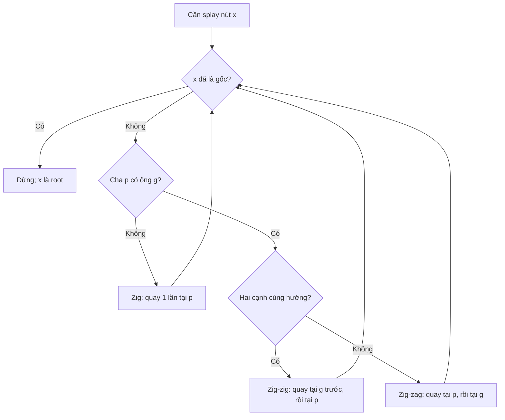

# Cây splay và thao tác đưa nút vừa truy cập lên gốc

## Mục tiêu học tập

Sau bài học, bạn có thể:

- Giải thích **splay tree (cây splay)** là một **cây tìm kiếm nhị phân tự điều chỉnh**, không lưu bất biến chiều cao chặt như AVL hay màu đen/đỏ như Red–Black Tree.
- Nhận diện ba kiểu biến đổi cơ bản **zig**, **zig–zig** và **zig–zag**, gồm các trường hợp trái/phải đối xứng; biết thứ tự quay đúng và vì sao các phép quay giữ nguyên thứ tự BST.
- Mô phỏng quá trình **đưa nút vừa truy cập lên gốc** khi tìm khóa thành công; nêu chính sách hợp lý khi **tìm không thấy** và khi cập nhật khóa trùng.
- Hiểu cách chèn, xóa, **tách (split)** và **nối (join)** dựa trên thao tác splay, cùng các điều kiện để không làm mất nút hoặc phá thứ tự khóa.
- Phân biệt **O(n) xấu nhất cho một thao tác riêng lẻ** với **O(log n) khấu hao (amortized)** trên một chuỗi thao tác; trình bày trực giác **phương pháp hàm thế (potential method)**.
- Nhận diện lợi ích của **tính cục bộ truy cập (locality)**, đồng thời đánh giá chi phí xoay cây và những hạn chế của một cấu trúc **thay đổi hình dạng ngay cả khi tìm kiếm**.
- Đọc và vận dụng cài đặt Python tự chứa có tìm, chèn, xóa, splay, duyệt inorder và hàm kiểm chứng bất biến BST/cha–con.
- So sánh splay tree với BST thường, AVL, Red–Black Tree và bảng băm theo yêu cầu độ trễ, thao tác, bộ nhớ và tính đúng đắn.

## 1. Vì sao cần một cây tìm kiếm tự điều chỉnh?

Trong một nền tảng học về cấu trúc dữ liệu, người học có thể thường xuyên mở một vài bài cụ thể — chẳng hạn bài về **stack**, **queue** hoặc **bảng băm** — trong khi hàng nghìn bài khác ít được truy cập. Ta muốn vừa:

1. Tìm bài theo một **khóa có thứ tự**.
2. Thêm và xóa bài khi thay đổi danh mục.
3. Duyệt danh sách theo thứ tự, tìm phần tử trước/sau hoặc truy vấn khoảng.
4. Có khả năng **tận dụng mẫu truy cập lặp lại**, thay vì giả sử mọi khóa được sử dụng đều nhau.

**BST thường** lưu mỗi khóa trong một nút, với mọi khóa ở cây con trái nhỏ hơn khóa hiện tại và mọi khóa cây con phải lớn hơn khóa hiện tại. Nhưng nếu chèn `10, 20, 30, 40` theo thứ tự tăng mà không điều chỉnh, ta có thể nhận cây lệch:

```text
10
  \
   20
     \
      30
        \
         40
```

Tìm `40` mất bốn lượt ghé nút; tổng quát chiều cao có thể là **Θ(n)**.

**AVL** duy trì chênh lệch chiều cao hai cây con không quá 1 tại mọi nút; **Red–Black Tree** duy trì màu, không đỏ–đỏ và black-height đồng đều. Hai họ này bảo đảm **chiều cao O(log n) tại mọi thời điểm** sau mỗi cập nhật hoàn chỉnh.

**Splay tree** tiếp cận khác:

> Mỗi lần truy cập một nút, cây sử dụng các phép quay để **đưa nút đó lên gốc**; những khóa được truy cập lại có thể trở nên gần gốc hơn, mà không cần lưu chiều cao hay màu nút để cân bằng.

Tên *splay* chỉ chuỗi phép quay đặc biệt này. Cây **không nhất thiết cân bằng về hình dạng ngay sau từng thao tác**, nhưng có bảo đảm **hiệu quả khấu hao** trên cả chuỗi thao tác.

### 1.1. Điều gì được giữ và điều gì thay đổi?

| Thuộc tính | Sau một phép splay hợp lệ |
| --- | --- |
| Tập khóa | **Không đổi** |
| Khóa và giá trị gắn với nhau | **Không đổi** |
| Thứ tự inorder | **Không đổi** |
| Các liên kết trái/phải và cha | **Có thể thay đổi nhiều lần** |
| Nút được splay | Trở thành **gốc** |
| Chiều cao của cây | Có thể tăng hoặc giảm |
| Metadata cân bằng bắt buộc | Không cần màu/BF/chiều cao |

Splay là **thao tác cấu trúc**; không được nhầm với việc **hoán đổi khóa** hoặc di chuyển bản ghi bằng sao chép giá trị.

## 2. Bất biến duy nhất cần bảo vệ: thứ tự BST

Mỗi nút chứa `key`, có thể có `value` và tham chiếu `left`, `right`, `parent`. Với khóa phân biệt:

\[
\forall v:\quad
\text{mọi khóa trong }v.left < v.key
< \text{mọi khóa trong }v.right.
\]

Bất biến phải đúng cho **mọi hậu duệ**, không chỉ hai con trực tiếp. Mã ví dụ dùng **khóa số nguyên** để dễ quan sát; một chỉ mục bài học thực tế có thể dùng `(duration_minutes, lesson_id)` nếu muốn lưu nhiều bài có cùng thời lượng.

Không có quy tắc kiểu:

- `|height(left)-height(right)| \le 1` như AVL.
- Không đỏ–đỏ hay black-height như Red–Black Tree.
- “Gốc phải luôn là trung vị các khóa”.

Vì vậy, một splay tree có thể có đường tìm dài **Θ(n)** tại một thời điểm **mà vẫn hoàn toàn hợp lệ**.

### 2.1. Phép quay trái

Nếu `x` có con phải thật `y`:

```text
TRƯỚC:                         SAU quay trái tại x:

       x                                  y
      / \                                / \
     A   y                              x   C
        / \                            / \
       B   C                          A   B
```

Giả sử các cây con tuân thủ:

\[
\operatorname{keys}(A)<x<
\operatorname{keys}(B)<y<
\operatorname{keys}(C).
\]

Sau quay trái, cây con **`B` chuyển thành con phải của `x`**. Dãy inorder vẫn là `A,x,B,y,C`, nên phép quay **bảo toàn BST**.

### 2.2. Phép quay phải

Phép quay phải là đối xứng:

```text
TRƯỚC:                         SAU quay phải tại y:

        y                                 x
       / \                               / \
      x   C                             A   y
     / \                                   / \
    A   B                                 B   C
```

Với cài đặt có `parent`, một phép quay phải cập nhật:

1. Liên kết giữa `y` và cha cũ của nó, hoặc `root` nếu `y` đang là gốc.
2. Tham chiếu `y.left` sang cây con giữa `B`.
3. `parent` của `B` nếu `B` không rỗng.
4. `x.right=y` và `y.parent=x`.

Một phép quay đơn thay **số lượng liên kết cố định**, nên tốn **O(1)** thời gian. Nhưng một thao tác splay có thể cần **nhiều phép quay**.

## 3. Ba trường hợp splay: zig, zig–zig, zig–zag

Ký hiệu:

- `x`: nút muốn đưa lên gốc.
- `p=x.parent`: cha của `x`.
- `g=p.parent`: ông của `x`, nếu có.

Ta lặp cho đến khi `x.parent is None`. Một điểm rất quan trọng: **thứ tự các phép quay phụ thuộc hình dạng của hai cạnh từ ông xuống nút**.

### 3.1. Zig — nút có cha nhưng không có ông

Khi `p` là **gốc**, `x` chỉ cách gốc một cạnh:

- `x` là con trái `p`: **quay phải tại `p`**.
- `x` là con phải `p`: **quay trái tại `p`**.

```text
TRƯỚC zig-phải:           SAU:

       p                      x
      / \                    / \
     x   C                  A   p
    / \                        / \
   A   B                      B   C
```

Đây là trường hợp **một phép quay đơn** và kết thúc vì `x` thành gốc.

**Không thực hiện zig ở mọi bước trên đường lên.** Nếu cứ quay `x` lên từng mức bằng một phép zig đơn giản, ta đang dùng một chiến lược *move-to-root*, **không phải thuật toán splay chuẩn** có quy tắc zig–zig/zig–zag và bảo đảm khấu hao tương ứng.

### 3.2. Zig–zig — hai cạnh cùng hướng

Có hai kiểu đối xứng:

- **Trái–trái (LL):** `x` là con trái `p` và `p` là con trái `g`.
- **Phải–phải (RR):** `x` là con phải `p` và `p` là con phải `g`.

**LL: quay phải tại ông trước, rồi quay phải tại cha cũ.**

```text
TRƯỚC (LL):                      SAU quay phải tại g,
                                    rồi quay phải tại p:

          g                                   x
         / \                                 / \
        p   D                               A   p
       / \                                     / \
      x   C                                   B   g
     / \                                         / \
    A   B                                       C   D
```

Thứ tự quan trọng:

1. **Quay phải tại `g`**.
2. **Quay phải tại `p`**.

Nếu `g` vốn có cha bên trên, sau hai quay `x` thay `g` làm gốc cây con, nhưng **chưa chắc là gốc toàn cây**; thuật toán tiếp tục lặp nếu cần.

**RR** đối xứng: **quay trái tại `g`**, rồi **quay trái tại `p`**.

```text
TRƯỚC (RR):                       SAU hai quay trái:

        g                                   x
       / \                                 / \
      A   p                               p   D
         / \                             / \
        B   x                           g   C
           / \                         / \
          C   D                       A   B
```

**Điểm dễ nhầm:** trong AVL, LL thường gợi nhớ một phép quay phải tại ông, nhưng trong **splay LL** phải có **hai phép quay** theo đúng thứ tự **ông trước, cha sau**.

### 3.3. Zig–zag — hai cạnh ngược hướng

Hai kiểu đối xứng:

- **Trái–phải (LR):** `p` là con trái `g`, `x` là con phải `p`.
- **Phải–trái (RL):** `p` là con phải `g`, `x` là con trái `p`.

**LR: quay trái tại cha rồi quay phải tại ông.**

```text
TRƯỚC (LR):                       SAU:

         g                                x
        / \                              / \
       p   D                            p   g
      / \                              / \ / \
     A   x                            A  B C  D
        / \
       B   C
```

Quy trình:

1. Quay **trái tại `p`**. `x` trở thành con trái của `g`.
2. Quay **phải tại `g`**. `x` trở thành gốc cây con.

**RL** đối xứng: **quay phải tại `p`**, rồi **quay trái tại `g`**.

```text
TRƯỚC (RL):                       SAU:

        g                                 x
       / \                               / \
      A   p                             g   p
         / \                           / \ / \
        x   D                         A  B C  D
       / \
      B   C
```

### 3.4. Bảng quyết định có thể dùng ngay khi đọc mã

| Quan hệ của `x` với `p` và `g` | Tên | Phép quay theo thứ tự |
| --- | --- | --- |
| `p` là gốc, `x=p.left` | Zig trái | Quay phải tại `p` |
| `p` là gốc, `x=p.right` | Zig phải | Quay trái tại `p` |
| `x=p.left` và `p=g.left` | Zig–zig LL | Quay phải tại `g`, rồi tại `p` |
| `x=p.right` và `p=g.right` | Zig–zig RR | Quay trái tại `g`, rồi tại `p` |
| `x=p.right` và `p=g.left` | Zig–zag LR | Quay trái tại `p`, quay phải tại `g` |
| `x=p.left` và `p=g.right` | Zig–zag RL | Quay phải tại `p`, quay trái tại `g` |



Một vòng zig–zig hoặc zig–zag làm `x` **đi lên hai mức** trong cây hiện tại; vòng zig cuối nếu có làm đi lên một mức. Tổng số phép quay một lần splay được chặn bởi **O(h)** với `h` là độ sâu ban đầu của `x` (tối đa `O(n)`).

## 4. Truy vết một lần truy cập: điều quan trọng là nút cuối lên gốc

Xét cây BST hợp lệ nhưng không cân bằng:

```text
                   100
                  /
                 80
                /
               60
              /
             40
            /
           20
```

Ta tìm `20`. Đường tìm đi qua `100 → 80 → 60 → 40 → 20`. Sau khi tìm được `20`, thực hiện splay:

**Bước 1 — Zig–zig LL tại `g=60, p=40, x=20`:**

```text
             100
            /
           80
          /
         20
           \
            40
              \
               60
```

**Bước 2 — Zig–zig LL tại `g=100, p=80, x=20`:**

```text
          20
            \
             80
            /  \
           40  100
             \
              60
```

Sau hai cặp quay, `20` thành **gốc**. Kiểm tra inorder ở cả ba hình vẫn là:

```text
20, 40, 60, 80, 100
```

Cây **không trở thành cân bằng hoàn hảo**; cũng không cần như vậy. Điều được ưu tiên là **khóa vừa truy cập `20` chuyển lên gốc**, nên lần tìm `20` ngay tiếp theo có thể chỉ ghé **một nút thật**.

### 4.1. Truy cập nhiều lần và tính cục bộ

Nếu một khóa thường được dùng lại, sau lần truy cập đầu nó **ở gốc**. Những truy cập tới khóa khác có thể đẩy nó xuống, nhưng splay vẫn có xu hướng khai thác những chuỗi truy cập có **tính cục bộ thời gian** hoặc **tính cục bộ theo thứ tự khóa**.

Ví dụ:

```text
Dãy truy cập: stack, queue, stack, stack, tree, stack, ...
```

Nếu các mã này nằm trong một chỉ mục có thứ tự, việc splay các khóa được dùng gần đây có thể tiết kiệm các bước tìm **trên một dãy truy cập cụ thể**. Không thể khẳng định **mọi** lần tìm sau đó đều O(1): truy cập vào một khóa khác có thể làm thay đổi gốc và đường đi.

## 5. Tìm thành công và tìm thất bại: hai hợp đồng cần nói rõ

### 5.1. Tìm thấy khóa

Thuật toán chuẩn:

1. Đi như tìm kiếm BST từ gốc.
2. Khi gặp khóa `k`, lưu giá trị đang gắn với nút đó.
3. **Splay nút vừa tìm lên gốc**.
4. Trả giá trị hoặc tham chiếu theo hợp đồng API.

```text
Trước tìm 30:                Sau tìm 30 và splay:

       40                              30
      /  \                            /  \
    20    60                        20    40
      \                                     \
      30                                     60

Inorder hai bên đều 20,30,40,60.
```

### 5.2. Tìm không thấy khóa

Khi tìm `k` nhưng cây không chứa `k`, sẽ đến một tham chiếu rỗng. **Không có nút chứa `k` để đưa lên gốc**.

Một quy ước thường dùng là:

> **Splay nút thật cuối cùng đã ghé trên đường tìm thất bại lên gốc.**

Ví dụ tìm `35` trong cây có `20,30,40`: sau khi đi tới một nhánh rỗng, splay **nút cuối được so sánh** lên gốc rồi trả về “không tồn tại”.

Chính sách này giữ đặc tính **tự điều chỉnh cả sau một lượt tìm thất bại**. Một số giao diện/thư viện có thể chọn khác; cần phát biểu và kiểm thử rõ.

### 5.3. Trả về `None` có thể không đủ để biểu diễn “không tìm thấy”

Nếu một Map cho phép giá trị thực tế là `None`, hàm `get(key)` trả `None` không phân biệt được:

- Không có khóa.
- Có khóa nhưng giá trị được lưu là `None`.

Có thể thêm `contains(key)`, dùng một sentinel giá trị trả về, hoặc phát sinh `KeyError`. Bài này cung cấp cả **`get` với tham số `default`** và **`contains`**, đều nêu rõ việc tìm kiếm có thể thay đổi gốc.

### 5.4. Tìm kiếm không còn là thao tác cấu trúc chỉ đọc

Trong AVL/RB Tree truyền thống, tìm kiếm thường **không quay cây**. Nhưng trong splay tree, ngay cả `get` hoặc `contains` cũng có thể:

- Sửa liên kết `left/right/parent` và `root`.
- Ghi nhiều vị trí bộ nhớ.
- Làm thay đổi hình dạng mà một iterator đang dựa vào.
- Đòi hỏi đồng bộ khi có nhiều luồng đọc cùng cây.

Đây là một đánh đổi lớn: **tự điều chỉnh theo truy cập** có thể hữu ích trong tải tuần tự có tính cục bộ, nhưng không miễn phí đối với **đồng thời, iterator, snapshot hoặc cấu trúc persistent**.

## 6. Chèn: tìm theo BST rồi splay nút mới

Với khóa mới `k`:

1. Đi theo quy tắc BST tới vị trí rỗng đúng thứ tự.
2. Tạo một nút chứa `(k,value)` và nối vào vị trí ấy.
3. **Splay nút mới lên gốc**.

Nếu `k` đã tồn tại, với hợp đồng **Map** có thể cập nhật `value` rồi **splay nút cũ lên gốc**; **không tạo nút thứ hai có cùng khóa**.

```text
Ví dụ chèn 10, 20, 30 bằng "BST insert rồi splay":

Sau 10:         Sau 20:           Sau 30:

  10              20                 30
                 /                  /
                10                 20
                                  /
                                 10
```

Cây cuối **lệch trái ba nút** nhưng vẫn là splay tree hợp lệ. Vì thế, nếu một ứng dụng cần **giới hạn chiều cao sau từng lần cập nhật**, splay tree không cung cấp điều đó theo cách AVL hay RB Tree cung cấp.

### 6.1. Tách (split) bằng splay

Một cách hiện thực thao tác chèn hoặc chia chỉ mục là dùng **split**:

- Cho khóa `k`, tách cây thành `L` chứa mọi khóa `< k` và `R` chứa mọi khóa `> k`, cùng chính sách riêng nếu `k` đã có.
- Thường **splay nút tìm được hoặc nút cuối tìm** rồi tách một cạnh tại gốc theo quan hệ với `k`.
- Sau khi tách, mỗi cây phải có **`root.parent=None`** và giữ đúng BST.

Ý nghĩa: splay giúp đưa ranh giới tách lên gần **gốc**, sau đó việc tháo một vài liên kết là O(1) **ngoài chi phí tìm/splay**.

### 6.2. Tại sao không được đổi khóa của một nút ngay tại chỗ?

Nếu một bài đang nằm trong chỉ mục thời lượng theo `(minutes,lesson_id)` và thời lượng đổi từ 30 sang 40, việc sửa `node.key` trực tiếp có thể phá các khoảng khóa BST.

Thay vì vậy, ứng dụng thường phải:

1. Xóa khóa thứ tự cũ.
2. Chèn khóa mới.
3. Bảo đảm bản ghi chính và các chỉ mục liên quan nhất quán.

Splay chỉ giúp **tái cấu trúc liên kết theo thứ tự đã đúng**; nó không tự sửa một hệ thống khóa không nhất quán.

## 7. Xóa: splay khóa cần xóa rồi nối hai cây con

Đây là một cách triển khai xóa điển hình:

1. **Tìm khóa `k`**. Nếu có, splay nút chứa `k` lên gốc.
2. Ghi lại giá trị cần trả về. Sau splay, gốc có khóa `k`, mọi khóa cây trái đều nhỏ hơn `k`, mọi khóa cây phải đều lớn hơn `k`.
3. Tách `L=root.left` và `R=root.right`, bỏ liên kết của nút gốc cũ.
4. Nếu `L` rỗng, cây mới là `R`.
5. Nếu `L` không rỗng, đặt `L` thành cây tạm, tìm **nút lớn nhất của `L`**, **splay nó lên gốc**.
6. Vì nó đã là khóa lớn nhất trong `L`, **con phải của gốc mới đang rỗng**. Nối `R` vào `root.right`.

```text
SAU splay khóa k cần xóa:

             k
            / \
           L   R

Điều kiện: mọi khóa trong L < k < mọi khóa trong R.

Xóa k, splay max(L) = m:

             m
            / \
        L_còn  R

Vì m=max(L), m.right trước khi nối là rỗng.
Mọi khóa của L_còn < m < mọi khóa của R.
```

**Lý do dùng `max(L)`:** splay `max(L)` lên gốc bảo đảm **không có cây con phải còn sót trong `L`**, nên có thể gắn cả `R` vào đúng vị trí mà không phá BST.

Một cách đối xứng là splay **`min(R)`** lên gốc rồi gắn toàn bộ `L` bên trái.

### 7.1. Khi xóa không tìm thấy

Có hai kiểu hợp đồng phổ biến:

- Trả về trạng thái “không tồn tại” và **có thể splay nút cuối đường tìm**.
- Phát sinh `KeyError` để báo khóa thiếu; việc tìm trước khi phát sinh lỗi vẫn có thể **làm thay đổi hình dạng cây**.

Ví dụ Python bên dưới chọn **phát sinh `KeyError`**, đồng thời giữ **chính sách splay nút cuối** nếu tìm không thấy.

### 7.2. Một nút và cây rỗng

- Nếu cây **rỗng** và xóa khóa, không có nút nào để splay; có thể phát sinh `KeyError` ngay.
- Nếu cây có **một nút** và xóa đúng nút ấy, hai cây `L,R` đều rỗng; gốc mới là `None` và số nút trở về 0.
- Nếu cây con trái rỗng, nối cây phải lên gốc và đặt `parent=None`.
- Nếu cây con phải rỗng, thao tác nối bằng `max(L)` vẫn đúng và kết quả là cây trái được splay lại.

## 8. Độ phức tạp: phân biệt xấu nhất một lần và khấu hao

Đây là phần quan trọng nhất khi so sánh splay tree với AVL và Red–Black Tree.

| Thao tác | Splay tree: **một lần riêng lẻ** | Splay tree: **khấu hao** |
| --- | --- | --- |
| Tìm chính xác / thất bại | O(n) xấu nhất | O(log n) |
| Splay một nút đến gốc | O(n) xấu nhất | O(log n) theo phân tích splay |
| Chèn một khóa | O(n) xấu nhất | O(log n) |
| Xóa một khóa | O(n) xấu nhất | O(log n) |
| Lấy min/max và splay cực trị | O(n) xấu nhất | O(log n) |
| Một phép quay đơn | O(1) | O(1) |
| Duyệt inorder toàn bộ | O(n) | O(n) cho lần duyệt toàn bộ |

Trong bảng, `n` là số nút thật đang có. “Khấu hao O(log n)” nghĩa là **chi phí trung bình được bảo đảm qua một chuỗi thao tác theo phân tích khấu hao**, **không** phải “từng lần tìm đều ≤ một hằng số nhân log n”.

### 8.1. Một lần tìm có thể tốn O(n)

Sau khi chèn các khóa tăng dần và luôn splay nút mới, ta có thể nhận một cây lệch trái:

```text
             50
            /
           40
          /
         30
        /
       20
      /
     10
```

Truy cập `10` lúc này phải đi qua năm nút. Với `n` khóa, đường đầu tiên có thể dài `n`, nên thời gian xấu nhất là **O(n)**. Lần truy cập ấy sẽ **đưa `10` lên gốc**, thay đổi chi phí của những lần sau.

Không nên ghi **“tìm Splay Tree O(log n) worst-case”**. Đó là tính chất của AVL/RB, không phải của splay tree chuẩn.

### 8.2. Khấu hao không phải kỳ vọng ngẫu nhiên

- **Phân tích kỳ vọng (expected):** lấy trung bình theo một phân phối xác suất xác định.
- **Phân tích khấu hao (amortized):** tính tổng chi phí trên **một chuỗi thao tác bất kỳ** (với các giả định của định lý), không cần đầu vào ngẫu nhiên.
- **Phân tích worst-case mỗi thao tác:** giới hạn riêng chi phí của **từng thao tác**, bất kể các thao tác trước.

Splay tree đưa ra một bảo đảm **khấu hao**, chứ không dựa vào giả định “người học sẽ truy cập ngẫu nhiên”.

### 8.3. Trực giác của phương pháp hàm thế

Đặt `s(v)` là **số nút thật trong cây con có gốc `v`**, và `r(v)=\log_2 s(v)` là “hạng” của nút đó. Chọn hàm thế:

\[
\Phi(T)=\sum_{v\in T}\log_2 s(v).
\]

Hàm thế là thước đo **cấu hình hiện tại** của toàn cây, không phải một trường bắt buộc lưu trong `SplayNode`.

Chi phí khấu hao của một thao tác được định nghĩa:

\[
\hat{c}_i=c_i+\Phi(T_i)-\Phi(T_{i-1}),
\]

trong đó `c_i` là chi phí thực tế, `T_{i-1}` là cây trước, `T_i` là cây sau thao tác.

Nếu một splay mất nhiều phép quay, cấu hình cây thường thay đổi theo cách giúp **giảm hoặc phân phối lại hàm thế**; phần thế được giải phóng có thể “trả” cho chi phí quay đắt. Đây là trực giác **trả trước và hoàn lại** trong phân tích khấu hao.

### 8.4. Bổ đề truy cập (Access Lemma)

Một phát biểu kinh điển của phân tích splay: với cây kích thước cố định trong một lần splay và `x` là nút được splay,

\[
\text{chi phí khấu hao splay}(x)
\ \le\ 3\bigl(r(root)-r(x)\bigr)+1
\ \le\ 3\log_2 n+1,
\]

theo một quy ước chi phí đếm bước quay và hạng nút nhất quán. Hằng số có thể khác khi đếm thêm các lượt ghé nút trên đường tìm hoặc thay định nghĩa một đơn vị chi phí; **bậc quan trọng là O(log n)**.

Các bước cơ sở của chứng minh:

1. Với **zig**, chỉ một phép quay, chi phí khấu hao có thể khống chế bằng chênh lệch hạng.
2. Với **zig–zig**, hai phép quay **ông trước, cha sau** tạo thay đổi hình dạng giúp tổng thế bù cho chi phí của bước sâu.
3. Với **zig–zag**, hai phép quay quanh nút `x` cũng cho một bất đẳng thức tương tự.
4. **Cộng (telescoping)** các chênh lệch hạng qua những vòng sửa: các số hạng giữa triệt tiêu, còn lại chủ yếu là `r(root)-r(x)`.

Không cần ghi trực tiếp `s(v)` ở mọi nút để thực hiện splay chuẩn; `s(v)` chỉ được dùng để **chứng minh**. Nếu một ứng dụng muốn hỗ trợ `rank/select`, nó mới cần **lưu và cập nhật `subtree_size`** độc lập.

### 8.5. Bảo đảm cho chuỗi thao tác

Với `m` thao tác tìm/chèn/xóa hợp lệ **bắt đầu từ cây rỗng**, splay tree cho tổng chi phí **O(m log(m+1))** theo cách phát biểu thông dụng cho tập khóa có kích thước không vượt quá `m`. Nếu kích thước được giới hạn bởi `n` trong chuỗi, người ta nói gọn **O(log n) khấu hao cho mỗi thao tác**.

Nếu bắt đầu từ **một cây tùy ý đã có `n` nút**, khi viết cận tổng phải chú ý **thế ban đầu** của cấu hình; không được vô điều kiện thay mọi định lý khấu hao thành “m thao tác bất kỳ luôn ≤ C·m log n” mà bỏ qua điều kiện ban đầu.

Với hệ thống yêu cầu **mỗi lần truy cập riêng lẻ luôn nằm trong một ngân sách trễ chặt**, AVL/RB có giới hạn O(log n) trường hợp xấu nhất **phù hợp hơn về bảo đảm lý thuyết**.

## 9. Splay có lợi trong những mẫu truy cập nào?

### 9.1. Tính cục bộ theo thời gian (temporal locality)

Một số khóa được tra lại rất thường xuyên trong một khoảng thời gian. Splay có thể giúp các khóa **vừa được truy cập** ở gần gốc hơn, nhất là nếu cùng một khóa được gọi lặp lại liên tiếp.

```text
Dãy truy cập:

30, 30, 30, 30, 60, 30
     ^ nhiều lượt gọi lại khóa vừa dùng
```

Ngay sau một lần tìm thành công `30`, nó trở thành **gốc**. Những lần tìm `30` liên tiếp sau đó chỉ ghé một nút, **nếu không có thao tác khác xen vào làm đổi gốc**.

### 9.2. Tính cục bộ theo thứ tự khóa (spatial locality)

Một dãy truy cập vào các khóa có thứ tự **gần nhau** có thể hưởng lợi từ cách splay dịch chuyển những vùng cây liên quan. Ví dụ:

```text
20, 21, 22, 23, 24, ...
```

Splay tree có những kết quả phân tích sâu hơn về **working-set** và **dynamic finger**, diễn đạt việc truy cập lại khóa gần đây hoặc một khóa gần khóa vừa dùng có thể hiệu quả trên chuỗi truy cập. Đây là **các định lý khấu hao trên chuỗi**, không phải cam kết rằng một lần tìm cạnh khóa cũ luôn O(1).

### 9.3. Khi nào tính tự điều chỉnh lại bất lợi?

- **Đọc đồng thời:** hai thao tác `get` trên cùng đối tượng có thể cùng muốn quay và sửa `root`. Chúng không phải hai lượt đọc bất biến.
- **Iterator đang hoạt động:** một lượt tìm giữa quá trình duyệt có thể đổi hình dạng cây; iterator dựa vào liên kết và stack cũ cần hợp đồng rõ ràng.
- **Snapshot/persistent structures:** splay thường **sửa nhiều liên kết tại chỗ**; sao chép phiên bản hoặc duy trì bất biến bất biến-đối-tượng cần giải pháp riêng.
- **Độ trễ thời gian thực:** một thao tác có thể là O(n), dù trung bình khấu hao tốt.
- **Đoạn mã phải đơn giản để kiểm chứng:** quay và `parent` thay đổi khi tìm thành công/thất bại tăng rủi ro nếu chỉ kiểm tra giá trị trả về.

Do đó, tính cục bộ là **một lý do để thử splay**, không phải bảo đảm nó tối ưu hơn AVL/RB cho mọi mô hình tải.

## 10. Ví dụ Python tự chứa: Splay Map

Ví dụ triển khai một **Map khóa số nguyên** với các thao tác:

- `put(key, value)`: thêm khóa mới hoặc cập nhật giá trị cũ, **splay nút tương ứng**.
- `get(key, default=None)`: tra giá trị; **splay nút được tìm hoặc nút cuối đường tìm thất bại**.
- `contains(key)`: kiểm tra khóa tồn tại, cũng splay khi cây không rỗng.
- `peek(key, default=None)`: đối chiếu với cách tìm **không splay**, chỉ để hiểu sự khác biệt.
- `lower_bound(key)`: tìm cặp khóa–giá trị có khóa nhỏ nhất `≥ key`; splay ứng viên hoặc nút cuối khi không tồn tại ứng viên.
- `delete(key)`: splay khóa cần xóa, bỏ gốc, nối bằng `max(L)`; phát sinh `KeyError` nếu thiếu.
- `items()`: duyệt inorder mà **không tự splay mỗi nút**.
- `validate()`: kiểm tra thứ tự BST toàn cây, `parent`, không lặp nút, số nút thật và chiều cao hiện tại.

**Hợp đồng về khóa:** ví dụ chấp nhận đúng kiểu `int` (không nhận `bool` dù `True == 1` trong Python), không cho nút trùng khóa. Một chỉ mục thực tế có thể dùng khóa ghép nếu so sánh tuân thứ tự toàn phần, bắc cầu và ổn định.

**Cách chạy:** ghép nguyên các khối mã trong các mục **10.1–10.5 theo thứ tự**, giữ các phương thức có thụt lề bốn khoảng trắng **nằm trong cùng lớp `SplayMap`**. Sau đó chạy bộ thử mục 11. Các khối tách ra để giải thích, **không phải các chương trình riêng biệt**.

### 10.1. Nút, thông tin trạng thái và phép quay

```python
class SplayNode:
    def __init__(self, key, value):
        self.key = key
        self.value = value
        self.left = None
        self.right = None
        self.parent = None


class SplayMap:
    def __init__(self):
        self.root = None
        self.size = 0
        self.rotations = 0     # Số phép quay đơn thực hiện.
        self.splay_calls = 0   # Số lần gọi splay, kể cả ở gốc.
        self.node_visits = 0   # Số lượt ghé nút lúc tìm theo khóa.

    @staticmethod
    def _check_key(key):
        if type(key) is not int:
            raise TypeError("Khóa của ví dụ phải là int")

    def _rotate_left(self, x):
        """Quay trái tại x: con phải y đi lên."""
        y = x.right
        if y is None:
            raise ValueError("Quay trái cần con phải thật")

        # Giữ cây con giữa, nằm giữa khóa x và y.
        x.right = y.left
        if y.left is not None:
            y.left.parent = x

        # y thay x ở liên kết từ cha cũ của x.
        y.parent = x.parent
        if x.parent is None:
            self.root = y
        elif x is x.parent.left:
            x.parent.left = y
        else:
            x.parent.right = y

        y.left = x
        x.parent = y
        self.rotations += 1

    def _rotate_right(self, y):
        """Quay phải tại y: con trái x đi lên."""
        x = y.left
        if x is None:
            raise ValueError("Quay phải cần con trái thật")

        y.left = x.right
        if x.right is not None:
            x.right.parent = y

        x.parent = y.parent
        if y.parent is None:
            self.root = x
        elif y is y.parent.left:
            y.parent.left = x
        else:
            y.parent.right = x

        x.right = y
        y.parent = x
        self.rotations += 1
```

Các phép quay **không hoán đổi khóa hay giá trị**. Chúng chỉ đổi liên kết, giữ nguyên **inorder** và cập nhật `root` nếu phép quay thực hiện tại gốc.

Mọi phép quay phải bảo toàn cả liên kết **con trỏ từ cha xuống con** và **`parent` từ con lên cha**. Chỉ thay `left/right` mà quên `parent` sẽ làm quá trình splay tiếp theo đi sai.

### 10.2. Chuỗi quay zig, zig–zig và zig–zag

Bổ sung phương thức sau vào `SplayMap`:

```python
    def _splay(self, x):
        """Đưa một nút thật đang thuộc cây lên gốc."""
        if x is None:
            return

        self.splay_calls += 1

        while x.parent is not None:
            p = x.parent
            g = p.parent

            if g is None:
                # ZIG: x chỉ cách gốc một cạnh.
                if x is p.left:
                    self._rotate_right(p)
                else:
                    self._rotate_left(p)

            elif x is p.left and p is g.left:
                # ZIG-ZIG LL: ông trước, cha sau.
                self._rotate_right(g)
                self._rotate_right(p)

            elif x is p.right and p is g.right:
                # ZIG-ZIG RR: ông trước, cha sau.
                self._rotate_left(g)
                self._rotate_left(p)

            elif x is p.right and p is g.left:
                # ZIG-ZAG LR: cha trước, ông sau.
                self._rotate_left(p)
                self._rotate_right(g)

            else:
                # ZIG-ZAG RL.
                assert x is p.left and p is g.right
                self._rotate_right(p)
                self._rotate_left(g)

        assert self.root is x
        assert self.root.parent is None
```

Hai dòng `assert` cuối là **kiểm tra hợp đồng**, có ích khi học. Trong mã sản xuất, có thể dùng ngoại lệ rõ ràng hoặc kiểm thử độc lập thay vì chỉ dựa vào `assert` (vì chế độ tối ưu Python có thể bỏ assert).

### 10.3. Truy cập khóa: tìm thấy hoặc splay nút cuối

```python
    def _access(self, key):
        """Trả nút nếu tìm thấy, ngược lại None.

        Cả thành công và thất bại trên cây không rỗng
        đều splay một nút thật lên gốc.
        """
        node = self.root
        last = None

        while node is not None:
            self.node_visits += 1
            last = node
            if key == node.key:
                self._splay(node)
                return node
            node = node.left if key < node.key else node.right

        if last is not None:
            self._splay(last)
        return None

    def get(self, key, default=None):
        self._check_key(key)
        node = self._access(key)
        return default if node is None else node.value

    def contains(self, key):
        self._check_key(key)
        return self._access(key) is not None

    def peek(self, key, default=None):
        """Đối chiếu: tra không làm đổi hình dạng cây."""
        self._check_key(key)
        node = self.root
        while node is not None:
            self.node_visits += 1
            if key == node.key:
                return node.value
            node = node.left if key < node.key else node.right
        return default

    def lower_bound(self, key):
        """Trả (key, value) nhỏ nhất có key >= đầu vào, hoặc None."""
        self._check_key(key)
        node = self.root
        candidate = None
        last = None

        while node is not None:
            self.node_visits += 1
            last = node
            if node.key >= key:
                candidate = node
                node = node.left
            else:
                node = node.right

        if candidate is not None:
            self._splay(candidate)
            return candidate.key, candidate.value
        if last is not None:
            self._splay(last)
        return None
```

**Phân biệt rõ các hợp đồng:**

- `get` và `contains` **có thể làm thay đổi `root`** ngay cả khi không tìm thấy, vì splay nút cuối.
- `peek` **không splay**; nó được thêm để đối chiếu ý nghĩa, không phải thao tác cốt lõi mang lại bảo đảm khấu hao đặc trưng của các truy cập splay. Nếu một ứng dụng chủ yếu dùng `peek`, không nên tự động áp các kết quả khấu hao của **chuỗi truy cập có splay** vào chuỗi ấy.
- `lower_bound` splay nút ứng viên thật nhỏ nhất `≥ key`, nếu không có ứng viên thì splay nút cuối; nó thay đổi cây ngay cả khi chỉ hỏi về cận.

### 10.4. Chèn và cập nhật khóa trùng

```python
    def put(self, key, value):
        """Trả True khi tạo khóa mới; False khi cập nhật khóa cũ."""
        self._check_key(key)

        if self.root is None:
            self.root = SplayNode(key, value)
            self.size = 1
            self._splay(self.root)
            return True

        parent = None
        node = self.root

        while node is not None:
            self.node_visits += 1
            parent = node
            if key == node.key:
                node.value = value
                self._splay(node)
                return False
            node = node.left if key < node.key else node.right

        # parent là nút cuối trên đường tìm vị trí chèn.
        fresh = SplayNode(key, value)
        fresh.parent = parent
        if key < parent.key:
            parent.left = fresh
        else:
            parent.right = fresh

        self.size += 1
        self._splay(fresh)
        return True
```

Mỗi nút mới được nối đúng **khoảng khóa BST**, sau đó các phép quay bảo toàn inorder. Khi khóa đã có, `value` được cập nhật ở **chính nút đó**, nên không tạo khóa trùng và không làm tăng `size`.

### 10.5. Xóa bằng splay khóa rồi nối `max(L)` với `R`

```python
    def delete(self, key):
        """Trả giá trị cũ; KeyError nếu khóa không tồn tại."""
        self._check_key(key)
        node = self._access(key)
        if node is None:
            raise KeyError(key)

        # _access đã đưa node lên gốc.
        assert self.root is node
        removed_value = node.value
        left = node.left
        right = node.right

        if left is not None:
            left.parent = None
        if right is not None:
            right.parent = None

        # Tách nút vừa xóa khỏi hai cây con.
        node.left = None
        node.right = None
        node.parent = None

        if left is None:
            # Gốc mới là cây phải, có thể là None.
            self.root = right
        else:
            # Dùng cây trái làm cây tạm.
            self.root = left

            # Tìm khóa lớn nhất trong L.
            maximum = left
            while maximum.right is not None:
                self.node_visits += 1
                maximum = maximum.right
            self.node_visits += 1

            # Sau splay max(L), gốc chưa có con phải.
            self._splay(maximum)
            assert self.root.right is None
            self.root.right = right
            if right is not None:
                right.parent = self.root

        self.size -= 1
        if self.root is not None:
            self.root.parent = None
        return removed_value
```

Việc **cắt liên kết gốc cũ** trước khi nối giúp tránh hai cây con vô tình vẫn trỏ về nút đã xóa. Quan hệ khóa được giữ:

\[
\operatorname{keys}(L)<k<
\operatorname{keys}(R),\qquad
m=\max(L)\Rightarrow\operatorname{keys}(L\setminus\{m\})<m<\operatorname{keys}(R).
\]

Hàm `delete` giữ `size` đúng và trả giá trị trước khi xóa. Nếu không tìm thấy, `_access` vẫn có thể splay nút cuối nhưng **không đổi tập khóa và `size`**, sau đó `KeyError` được ném ra.

### 10.6. Duyệt inorder và kiểm chứng bất biến

Splay tree **không duy trì chiều cao O(log n) tại mọi thời điểm**. Vì vậy một hàm validator dùng đệ quy có thể chạm giới hạn độ sâu của Python nếu cây tạm thời là một chuỗi rất dài. Ví dụ dưới sử dụng **ngăn xếp tường minh** để kiểm tra mà không phụ thuộc giới hạn đệ quy.

```python
    def items(self):
        """Duyệt inorder; không splay mỗi nút."""
        stack = []
        node = self.root
        while stack or node is not None:
            while node is not None:
                stack.append(node)
                node = node.left
            node = stack.pop()
            yield node.key, node.value
            node = node.right

    def validate(self):
        """Trả (số nút thật, chiều cao theo số nút).

        Độc lập tính lại cận BST, liên kết parent và số nút.
        """
        if self.root is None:
            assert self.size == 0
            return (0, 0)

        assert self.root.parent is None, "Gốc không có cha"
        seen = set()
        count = 0
        max_depth = 0
        # (node, parent, lower, upper, depth)
        stack = [(self.root, None, None, None, 1)]

        while stack:
            node, parent, lower, upper, depth = stack.pop()
            marker = id(node)
            assert marker not in seen, "Chu trình hoặc nút bị lặp"
            seen.add(marker)

            assert node.parent is parent, "Sai liên kết cha"
            assert type(node.key) is int, "Kiểu khóa không hợp lệ"
            if lower is not None:
                assert lower < node.key, "Sai cận dưới BST"
            if upper is not None:
                assert node.key < upper, "Sai cận trên BST"

            count += 1
            max_depth = max(max_depth, depth)

            if node.right is not None:
                stack.append((
                    node.right, node, node.key, upper, depth + 1
                ))
            if node.left is not None:
                stack.append((
                    node.left, node, lower, node.key, depth + 1
                ))

        assert count == self.size, "Sai số nút thật"
        return count, max_depth
```

**Ý nghĩa kết quả:** `validate()` trả `(n,h_nodes)`, trong đó `h_nodes` là số **nút thật trên đường sâu nhất**; cây một nút có chiều cao theo số nút bằng 1, cây rỗng bằng 0. Nếu muốn chiều cao theo **số cạnh**, trừ một khi cây không rỗng.

**Hàm này không kiểm tra màu hay BF** vì splay tree không có những bất biến ấy. Nó kiểm tra đúng **dữ liệu thật phải giữ**: thứ tự BST, cha–con, không lặp, không chu trình, số nút và gốc.

## 11. Bộ kiểm thử các phép quay và thao tác

Để kiểm tra từng kiểu splay, ta nên dùng **cây có hình dạng đã biết** thay vì chỉ suy đoán rằng một chuỗi chèn bất kỳ tạo ra đúng Zig/Zig–zig/Zig–zag.

### 11.1. Tạo cây thử bằng liên kết tường minh

Hàm dưới đây dành **riêng cho kiểm thử**. Nó nhận các bộ `(key, parent_key, side)` rồi kiểm tra đầu vào có đúng BST và liên kết cha–con hay không.

```python
def make_shape(rows):
    """rows: [(key, parent_key, 'L'/'R'), ...].

    parent_key=None dành cho gốc, side=None tại gốc.
    """
    tree = SplayMap()
    nodes = {
        key: SplayNode(key, f"lesson-{key}")
        for key, parent_key, side in rows
    }
    assert len(nodes) == len(rows), "Có khóa bị lặp"

    for key, parent_key, side in rows:
        node = nodes[key]
        if parent_key is None:
            assert tree.root is None, "Phải có một gốc duy nhất"
            tree.root = node
        else:
            parent = nodes[parent_key]
            assert node.parent is None
            node.parent = parent
            if side == "L":
                assert parent.left is None
                parent.left = node
            elif side == "R":
                assert parent.right is None
                parent.right = node
            else:
                raise ValueError("side phải là L hoặc R")

    tree.size = len(nodes)
    tree.validate()  # Đầu vào phải là BST hợp lệ.
    return tree
```

Hàm dựng cây **không gọi `put`**, vì `put` sẽ tự splay và làm thay đổi hình dạng mà ta định dùng để kiểm tra từng nhánh. Không dùng hàm dựng tay để thay giao diện cập nhật của sản phẩm.

### 11.2. Kiểm tra Zig, Zig–zig và Zig–zag

```python
patterns = [
    (
        "zig-trai",
        [(20, None, None), (10, 20, "L")],
        10, 1,
    ),
    (
        "zig-zig-LL",
        [(30, None, None), (20, 30, "L"), (10, 20, "L")],
        10, 2,
    ),
    (
        "zig-zig-RR",
        [(10, None, None), (20, 10, "R"), (30, 20, "R")],
        30, 2,
    ),
    (
        "zig-zag-LR",
        [(30, None, None), (10, 30, "L"), (20, 10, "R")],
        20, 2,
    ),
    (
        "zig-zag-RL",
        [(10, None, None), (30, 10, "R"), (20, 30, "L")],
        20, 2,
    ),
]

for name, rows, accessed_key, expected_rotations in patterns:
    tree = make_shape(rows)
    original_items = list(tree.items())
    before_rotations = tree.rotations

    assert tree.get(accessed_key) == f"lesson-{accessed_key}"
    assert tree.root.key == accessed_key, name
    assert tree.rotations - before_rotations == expected_rotations
    assert list(tree.items()) == original_items, name
    tree.validate()
```

**Điều được chứng minh bằng bộ thử này:**

- Zig chỉ quay **một** lần.
- Zig–zig phải quay **ông rồi cha** theo đúng thứ tự.
- Zig–zag phải quay **cha rồi ông**.
- Trong mọi trường hợp, nút vừa truy cập trở thành **gốc** và **dãy khóa/giá trị không mất, không đảo thứ tự**.

### 11.3. Truy vết cây năm nút ở mục 4

```python
tree = make_shape([
    (100, None, None),
    (80, 100, "L"),
    (60, 80, "L"),
    (40, 60, "L"),
    (20, 40, "L"),
])

assert tree.validate() == (5, 5)
assert list(tree.items()) == [
    (20, "lesson-20"),
    (40, "lesson-40"),
    (60, "lesson-60"),
    (80, "lesson-80"),
    (100, "lesson-100"),
]

assert tree.get(20) == "lesson-20"
assert tree.root.key == 20
assert tree.rotations == 4  # Hai vòng zig-zig LL.
assert tree.validate() == (5, 4)
assert list(tree.items()) == [
    (20, "lesson-20"),
    (40, "lesson-40"),
    (60, "lesson-60"),
    (80, "lesson-80"),
    (100, "lesson-100"),
]
```

Sau hai lần zig–zig, cây mới còn một nhánh dài nhất `20 → 80 → 40 → 60`, chiều cao theo số nút là **4**. Gốc đúng là `20`, nhưng điều đó không yêu cầu tất cả các nhánh có chiều cao bằng nhau.

### 11.4. Tìm không thấy, lower bound và truy cập không splay

```python
tree = SplayMap()
for key in [40, 20, 60, 10, 30, 50, 70]:
    assert tree.put(key, f"lesson-{key}")
    tree.validate()

expected = [(k, f"lesson-{k}") for k in
            (10, 20, 30, 40, 50, 60, 70)]
assert list(tree.items()) == expected

# Thành công: khóa được đưa lên gốc.
assert tree.get(30) == "lesson-30"
assert tree.root.key == 30
tree.validate()

# Không thành công: splay nút cuối đường tìm; tập khóa giữ nguyên.
assert tree.get(35, "missing") == "missing"
assert list(tree.items()) == expected
tree.validate()

# lower_bound tìm khóa nhỏ nhất >= 35, rồi splay ứng viên.
assert tree.lower_bound(35) == (40, "lesson-40")
assert tree.root.key == 40
assert tree.lower_bound(999) is None
assert list(tree.items()) == expected

# peek không splay, nên gốc không thay đổi.
root_before = tree.root
assert tree.peek(50) == "lesson-50"
assert tree.root is root_before

# Khóa trùng chỉ cập nhật value, không tạo nút trùng.
assert not tree.put(30, "updated")
assert tree.size == 7
assert tree.root.key == 30
assert tree.get(30) == "updated"
tree.validate()

# Có thể lưu None: contains mới phân biệt được khóa tồn tại.
assert tree.put(99, None)
assert tree.get(99) is None
assert tree.contains(99)
assert not tree.contains(1000)
tree.validate()
```

Ở ví dụ này, `lower_bound(999)` không có ứng viên; nó vẫn có thể splay **nút cuối**. Vì vậy không nên viết bộ thử đòi gốc giữ nguyên sau một lượt truy vấn cận thất bại.

### 11.5. Xóa nút giữa, xóa gốc, khóa thiếu và xóa sạch cây

```python
tree = SplayMap()
expected = {}
for key in [40, 20, 60, 10, 30, 50, 70, 5, 15, 25, 35]:
    value = f"lesson-{key}"
    assert tree.put(key, value)
    expected[key] = value
    assert tree.validate()[0] == len(expected)

for key in [40, 5, 30, 20, 60]:
    assert tree.delete(key) == expected.pop(key)
    assert list(tree.items()) == sorted(expected.items())
    tree.validate()

# Xóa khóa thiếu: báo lỗi, không đổi tập khóa.
before = list(tree.items())
before_size = tree.size
try:
    tree.delete(999)
except KeyError:
    pass
else:
    raise AssertionError("Phải có KeyError khi khóa không tồn tại")

assert tree.size == before_size
assert list(tree.items()) == before
tree.validate()

# Xóa đến rỗng, thử tái sử dụng đối tượng.
for key in list(sorted(expected)):
    assert tree.delete(key) == expected.pop(key)
    assert list(tree.items()) == sorted(expected.items())
    tree.validate()

assert tree.root is None
assert tree.size == 0
assert tree.validate() == (0, 0)
assert tree.put(42, "new")
assert tree.root.key == 42
assert tree.delete(42) == "new"
assert tree.validate() == (0, 0)
```

**Không cần có hàm xóa sửa màu/chiều cao** như AVL/RB: việc splay khóa và nối các cây con bảo đảm BST, còn hiệu quả về tổng chi phí được phân tích bằng hàm thế trên chuỗi thao tác.

### 11.6. Một truy cập sâu có thể nhiều quay

```python
tree = SplayMap()
for key in range(1, 33):
    tree.put(key, str(key))

assert tree.root.key == 32
assert tree.validate() == (32, 32)  # Dãy tăng -> cây lệch trái.

before = tree.rotations
assert tree.get(1) == "1"
assert tree.root.key == 1
assert tree.rotations - before == 31
assert tree.validate()[0] == 32
assert [key for key, value in tree.items()] == list(range(1, 33))

# Sau lần splay 1 lên gốc, truy cập lại ngay không cần quay.
before = tree.rotations
assert tree.get(1) == "1"
assert tree.rotations == before
```

Đoạn thử chứng minh **một lượt truy cập riêng lẻ có thể thực hiện Θ(n) phép quay**, đồng thời cho thấy lợi ích khi **truy cập lặp lại cùng khóa**. Nó không chứng minh rằng tất cả các truy cập trong tương lai đều O(1).

## 12. So sánh splay tree với AVL và cây đỏ–đen

Ba cấu trúc đều giữ **bất biến thứ tự BST**, nhưng đưa ra ba kiểu đánh đổi khác nhau.

| Đặc điểm | **AVL** | **Red–Black Tree** | **Splay tree** |
| --- | --- | --- | --- |
| Quy tắc cân bằng | `|height(left)-height(right)|≤1` | Màu, không đỏ–đỏ, black-height đồng đều | **Không có bất biến chiều cao chặt** |
| Metadata để duy trì cân bằng | `height` hoặc `BF` | `color` | **Không cần màu/BF/height** |
| Có thể lưu `parent`? | Có, tùy chọn | Có, tùy chọn | Có, tùy chọn; ví dụ dùng `parent` |
| Tìm thành công | **O(log n) xấu nhất** | **O(log n) xấu nhất** | **O(log n) khấu hao**, O(n) xấu nhất một lần |
| Tìm thất bại | **O(log n) xấu nhất** | **O(log n) xấu nhất** | **O(log n) khấu hao**, O(n) xấu nhất một lần |
| Chèn | **O(log n) xấu nhất** | **O(log n) xấu nhất** | **O(log n) khấu hao**, O(n) xấu nhất một lần |
| Xóa | **O(log n) xấu nhất** | **O(log n) xấu nhất** | **O(log n) khấu hao**, O(n) xấu nhất một lần |
| Hình dạng thay đổi sau một lần tìm? | Thường **không** | Thường **không** | **Có thể thay đổi**, cả khi không tìm thấy |
| Sửa sau chèn/xóa | Quay, cập nhật chiều cao | Quay và đổi màu | Splay, tách/nối các cây |
| Giới hạn số quay trong một thao tác | Chèn tối đa hai quay đơn; xóa có thể O(log n) | Chèn tối đa hai, xóa kiểu chuẩn tối đa ba | **Có thể O(n)** trong một lần |
| Tổng bộ nhớ cho `n` nút | O(n) | O(n) | O(n) |
| Thế mạnh cần đánh giá | Chiều cao cân bằng chặt | Giới hạn quay cập nhật thuận lợi | Khai thác mẫu truy cập, không lưu metadata cân bằng |
| Hạn chế cần đánh giá | Cập nhật chiều cao và có thể nhiều quay khi xóa | Bộ luật màu và sentinel/xóa phức tạp | Truy cập làm đổi cấu trúc, trễ một lần có thể tuyến tính |

**Kết luận phải có điều kiện:** splay tree không phải “AVL nhưng cân bằng tốt hơn nhờ truy cập”. Nó **bỏ bảo đảm về chiều cao tức thời** để đổi lấy **khả năng tự điều chỉnh** và các kết quả **khấu hao**.

### 12.1. Khi splay tree đáng cân nhắc

- Một **tập khóa có thứ tự** cần thêm/xóa/tìm và có **tính cục bộ truy cập rõ**.
- Có nhiều truy cập lại một số khóa trong một phiên làm việc.
- Hệ thống xử lý **tuần tự hoặc được đồng bộ thích hợp**, không kỳ vọng truy vấn “chỉ đọc” là không thay đổi cây.
- Yêu cầu hiệu năng cho **một chuỗi thao tác** quan trọng hơn hạn mức xấu nhất **từng thao tác**.
- Có thể kiểm tra/điều chỉnh cách xử lý `parent`, iterator và thay đổi hình dạng cây.

### 12.2. Khi AVL hoặc Red–Black thường thích hợp hơn

- Cần **giới hạn độ trễ mỗi lần tìm/chèn/xóa** theo số nút là O(log n) xấu nhất.
- Có nhiều luồng **đọc song song** và muốn đường tìm không làm thay đổi cấu trúc.
- Cần duy trì **iterator ổn định** hoặc dùng một thư viện ordered Map đã được kiểm chứng.
- Tải không có tính cục bộ đáng kể, hoặc chi phí quay khi tìm làm phát sinh nhiều ghi bộ nhớ.
- Hệ thống không muốn sử dụng một cấu trúc có thể **lệch n nút** ở trạng thái hợp lệ.

Trong thực tế, lựa chọn thư viện đáng tin cậy, API ổn định và các yêu cầu về đồng thời có thể quan trọng hơn khác biệt số phép quay.

### 12.3. Bảng băm, heap và mảng đã sắp không giải cùng một việc

Nếu chỉ cần tìm `lesson_id` chính xác, bảng băm thường có **O(1) kỳ vọng** nhưng không cho duyệt khóa tăng dần. **Heap** tối ưu chọn phần tử ưu tiên cực trị, không hỗ trợ tìm khóa bất kỳ theo thứ tự như BST. **Mảng đã sắp** cho tìm nhị phân O(log n), duyệt tuần tự thuận cache nhưng chèn/xóa giữa thường O(n).

Splay tree hữu ích khi cần **ordered Set/Map có cập nhật** và sẵn sàng chấp nhận **bảo đảm khấu hao thay vì xấu nhất từng lần**.

## 13. Chi phí bộ nhớ và thiết kế metadata

Một `SplayNode` cơ bản chứa:

```text
key        khóa BST
value      bản ghi gắn với khóa
left       con trái hoặc None
right      con phải hoặc None
parent?    cha hoặc None (tùy cách cài)
```

**Không bắt buộc** lưu:

- `height` hoặc `BF` như AVL.
- `color` hoặc black-height như Red–Black.
- Số lượt truy cập, thời điểm dùng gần nhất hay trọng số khóa để triển khai splay chuẩn.

Cây có `n` nút dùng **O(n)** bộ nhớ cho nút và liên kết. Với cài đặt lặp có `parent` ở mục 10, các phép quay và splay dùng **O(1) bộ nhớ phụ** ngoài nút đã có. Hàm `validate` và iterator `items` dùng ngăn xếp **O(h)**, có thể lên tới O(n) khi cây lệch.

### 13.1. Có thể không lưu `parent` không?

Có. Một splay tree **top-down** có thể splay với một dạng **tách/gom các chuỗi con** trên đường tìm, không nhất thiết cần `parent` trong từng nút. Một triển khai **bottom-up** như ví dụ ở mục 10 dùng `parent` để nhận diện nhanh các trường hợp zig/zig–zig/zig–zag.

Không lưu `parent` có thể giảm trường tham chiếu nhưng làm thuật toán khác đi; không nên tự bỏ `parent` khỏi mã bottom-up ở mục 10 mà không thiết kế lại cơ chế tìm tổ tiên.

### 13.2. Tăng cường `subtree_size` cho rank/select

Nếu muốn tìm phần tử thứ `i` hoặc đếm số khóa nhỏ hơn một cận, có thể lưu:

\[
\operatorname{size}(v)=1+
\operatorname{size}(v.left)+
\operatorname{size}(v.right).
\]

Nhưng mỗi phép quay phải cập nhật `size` ở các nút có cây con thay đổi. Trong quay trái tại `x` với con phải `y`, sau khi gắn lại liên kết, thường tính `size(x)` **trước** rồi `size(y)`. Nếu quên cập nhật, splay vẫn có thể cho inorder đúng trong khi `rank/select` trả kết quả sai.

**Đừng nhầm `subtree_size` với chi phí splay khấu hao:** `s(v)` trong chứng minh hàm thế có thể là đại lượng **chỉ tồn tại để phân tích**, không cần lưu trong cài đặt chuẩn.

### 13.3. Giá trị `None` và tập khóa trùng

Với Map, mỗi khóa đại diện một bản ghi. Nếu bài học có cùng thời lượng, không dùng riêng số phút làm khóa duy nhất cho tất cả:

```text
(30, "ds-stack")
(30, "ds-queue")
```

Hai khóa ghép này vẫn phân biệt nếu `lesson_id` khác nhau và có một quy tắc so sánh nhất quán. Khi một giá trị bản ghi bằng `None`, nên dùng `contains` để phân biệt “có khóa với giá trị None” và “không có khóa”.

**Không thay đổi trực tiếp khóa đã nằm trong cây.** Phải xóa khóa cũ và thêm khóa mới hoặc dùng cơ chế tái chỉ mục tương đương.

## 14. Cách đo hiệu quả của splay tree công bằng

### 14.1. Định nghĩa đại lượng đo

| Đại lượng | Ý nghĩa | Lưu ý |
| --- | --- | --- |
| `node_visits` | Số lần ghé nút thật trên đường tìm | Không phải số toán tử so sánh khóa |
| `rotations` | Số phép quay đơn thực hiện | Zig = 1; zig–zig/zig–zag = 2 |
| `splay_calls` | Số lần gọi splay | Một lần gọi có thể không cần quay nếu nút đã ở gốc |
| `height` | Đường gốc–lá sâu nhất ở trạng thái hiện tại | Có thể bằng `n` dù cây hợp lệ |
| Tổng thời gian | Đo tại môi trường thực tế | Cần tách chuẩn bị dữ liệu, kiểm chứng, in log |
| Bộ nhớ | Đo theo runtime và số nút | Cần xét `parent`, allocator, object overhead |

### 14.2. Các dãy thao tác đáng thử

1. **Chèn khóa tăng dần**, truy cập khóa nhỏ nhất một lần rồi truy cập lại nhiều lần.
2. **Chèn khóa giảm dần**, truy cập khóa lớn nhất và so với trường hợp đối xứng.
3. **Xáo trộn khóa bằng seed cố định** để tái lập.
4. **Tập khóa nóng**: một số ít khóa được truy cập lặp lại nhiều lần.
5. **Quét tuần tự theo thứ tự khóa**.
6. **Đọc–ghi hỗn hợp**: tìm, chèn, cập nhật khóa trùng, xóa.
7. **Tìm thất bại** thường xuyên để quan sát tác động của chính sách splay nút cuối.

### 14.3. So sánh với AVL/RB đúng cách

- Cùng **tập khóa, thứ tự thêm/xóa và phân phối lượt tìm**.
- Cùng cách xử lý khóa trùng, giá trị `None` và khóa không tồn tại.
- Đếm **quay đơn** cùng định nghĩa nếu so sánh số quay.
- Ghi số lượt truy cập **thành công và thất bại** riêng.
- Tách `validate` O(n) khỏi thời gian của thao tác lõi.
- Đo cả **trung bình/percentile** và **lượt chậm nhất** nếu có yêu cầu độ trễ.
- Không kết luận từ một lần chạy hoặc từ bộ mã Python có mức tối ưu khác nhau.

**Ví dụ diễn giải hợp lệ:** “Trong dãy truy cập lại liên tiếp cùng khóa của bộ thử này, từ sau lần đầu, splay tree không phải quay cho khóa đó.” **Không hợp lệ:** “Vì vậy mọi lần tìm splay tree đều O(1)”.

## 15. Những sai lầm thường gặp

- **“Splay tree luôn có chiều cao O(log n).”** Sai: có thể hợp lệ dù cao Θ(n).
- **“Tìm kiếm Splay Tree có O(log n) xấu nhất mỗi lần.”** Sai: giới hạn O(log n) là **khấu hao**, một lần có thể O(n).
- **“Khấu hao nghĩa là đầu vào ngẫu nhiên.”** Sai: phân tích khấu hao không cần giả định phân phối ngẫu nhiên.
- **“Mọi phép splay chỉ cần một phép quay.”** Sai: zig–zig và zig–zag thường cần hai quay mỗi vòng; tổng một lần có thể O(n).
- **“Zig–zig quay tại cha trước.”** Sai: zig–zig phải **quay tại ông trước**, rồi tại cha; zig–zag mới quay tại cha trước.
- **“Zig–zag LR giống zig–zig LL.”** Sai: hai cạnh khác hướng cần quay **hai hướng khác nhau**.
- **“Dùng zig đơn liên tục sẽ tự động có toàn bộ định lý khấu hao của splay chuẩn.”** Không được mặc định: đó là một chiến lược khác với bước zig–zig/zig–zag.
- **“Chỉ cần đổi khóa hai nút thay cho phép quay.”** Sai: làm thay đổi dữ liệu gắn khóa, có thể phá hợp đồng tham chiếu và thứ tự.
- **“Sau splay, nút truy cập có thể vẫn không phải gốc.”** Sai nếu thuật toán hoàn thành: `root` phải là nút đã splay.
- **“Tìm thất bại không thể thay đổi cây.”** Sai theo chính sách của bài: splay **nút thật cuối cùng đã ghé**.
- **“Chỉ thao tác chèn và xóa mới cần đồng bộ.”** Sai: `get` trong splay có thể sửa cấu trúc.
- **“Chèn khóa trùng tạo nút mới giống như một multiset.”** Sai với hợp đồng Map của ví dụ: cập nhật giá trị và splay nút cũ.
- **“Xóa gốc rồi gắn R vào con phải của nút bất kỳ trong L.”** Sai: phải dùng **`max(L)`** ở gốc, để không còn con phải và giữ đúng khoảng khóa.
- **“Nút lớn nhất L sau splay vẫn có thể có con phải chứa khóa lớn hơn.”** Không đúng: nếu đó thật là `max(L)`, trong **L** không có khóa lớn hơn nó.
- **“Không cần sửa `parent` khi quay.”** Sai với bottom-up splay dùng `parent`.
- **“Có thể lưu chiều cao để ép Splay Tree thành AVL nhưng vẫn gọi đó là splay chuẩn.”** Khi bắt buộc thêm bất biến cân bằng, thuật toán và phân tích sẽ khác; không được tự suy tính chất của hai cấu trúc vẫn giữ nguyên.
- **“Validator chỉ cần kiểm tra dãy inorder đã sắp.”** Chưa đủ: còn phải kiểm tra **cận BST toàn cây, `parent`, nút lặp và số nút**.
- **“Mỗi lần splay phải đo lại `subtree_size` toàn cây.”** Không cần nếu chỉ dùng splay chuẩn; nếu tăng cường metadata, cần cập nhật **cục bộ đúng sau quay**.
- **“Splay tree luôn ít bộ nhớ hơn Red–Black.”** Không bảo đảm: `parent`, bố trí nút và cấp phát có thể tốn nhiều hơn một bit màu về mặt lý thuyết.
- **“Một lượt tìm rất nhanh chứng minh cấu trúc tối ưu.”** Không đủ: cần xét cả chuỗi thao tác, độ trễ xấu nhất và yêu cầu đồng thời.

## 16. Bài tập vận dụng

### Bài 1 — Nhận diện một cây splay hợp lệ

Cho cây:

```text
       40
      /
     30
    /
   20
  /
 10
```

Cây có hợp lệ theo bất biến của splay tree không? Chiều cao theo **số nút** là bao nhiêu? Nếu tìm `10` ở trạng thái này, một thao tác có thể phải ghé bao nhiêu nút?

*Gợi ý:* Hợp lệ vì đúng BST; cao 4 nút, tìm `10` ban đầu đi qua cả 4 nút.

### Bài 2 — Zig đơn

Cho gốc `20` với con trái `10` và không có nút khác. Sau khi tìm `10` và splay, đâu là gốc mới? Phép quay nào được dùng?

*Gợi ý:* Zig: quay phải tại `20`, gốc mới `10`.

### Bài 3 — Zig–zig LL

Cho `30` là gốc, `20` con trái, `10` con trái của `20`. Hãy vẽ cây sau **quay phải tại `30`**, rồi sau **quay phải tại `20`**. Vì sao không nên đảo thứ tự?

*Gợi ý:* Zig–zig quay ông trước, cha sau; kết quả có gốc `10` với nhánh phải `20→30`.

### Bài 4 — Zig–zig RR

Cho `10` là gốc, `20` con phải và `30` con phải của `20`. Sau splay `30`, liệt kê hai phép quay và kết quả inorder.

*Gợi ý:* Quay trái tại `10`, rồi tại `20`; inorder vẫn `10,20,30`.

### Bài 5 — Zig–zag LR

Cho `30` là gốc, `10` con trái, `20` con phải của `10`. Splay `20` bằng những quay nào? Gốc mới và hai con của nó là gì?

*Gợi ý:* Quay trái tại `10`, quay phải tại `30`; gốc `20`, trái `10`, phải `30`.

### Bài 6 — Zig–zag RL

Cho `10` là gốc, `30` con phải và `20` con trái của `30`. Hãy mô phỏng splay `20` và so sánh thứ tự quay với LR.

*Gợi ý:* Quay phải tại `30`, quay trái tại `10`; kết quả cũng gốc `20`.

### Bài 7 — Quay giữ thứ tự BST

Vẽ quay trái tại `x` có con phải `y`, với bốn vùng `A,B,C` như mục 2. Vì sao cây con `B` phải chuyển thành `x.right`?

*Gợi ý:* Mọi khóa của `B` thỏa `x < B < y`; nếu đặt sai phía sẽ phá thứ tự.

### Bài 8 — Splay trên đường sâu

Cho chuỗi trái `100→80→60→40→20`. Hãy thực hiện splay `20`, ghi lại **hai lần zig–zig**, số phép quay và chiều cao cuối tính bằng số nút.

*Gợi ý:* Bốn phép quay; gốc `20`, chiều cao cuối là 4.

### Bài 9 — Tìm thất bại

Một cây có các khóa `10,20,30`. Khi tìm `25` nhưng không thấy, nút nào được splay theo chính sách của bài? Vì sao không thể splay một “nút 25” chưa tồn tại?

*Gợi ý:* Splay **nút thật cuối cùng trên đường so sánh**; kết quả cụ thể phụ thuộc hình dạng BST hiện tại.

### Bài 10 — Truy cập lại liên tiếp

Giả sử tìm thành công khóa `k` và không có thao tác xen vào. Lần tìm `k` tiếp theo cần ghé mấy nút? Điều này có chứng minh rằng **mọi** lần tìm splay tree đều O(1) không?

*Gợi ý:* Một nút vì `k` đang là gốc; không suy ra được cho khóa khác hoặc chuỗi thay đổi gốc.

### Bài 11 — Chèn tăng dần

Chèn lần lượt `10,20,30,40` vào cây rỗng theo “BST insert rồi splay nút mới”. Vẽ cây cuối, xác định chiều cao và lý giải vì sao cây lệch vẫn hợp lệ.

*Gợi ý:* Gốc `40` với chuỗi trái `30→20→10`; không có quy tắc height/BF.

### Bài 12 — Cập nhật khóa trùng

Map đang có `(20,"A")`. Gọi `put(20,"B")`. Số nút có thay đổi không? Giá trị tìm được là gì? Nút nào thành gốc?

*Gợi ý:* Không thêm nút; thay `value` và splay nút `20`.

### Bài 13 — Xóa có hai cây con

Sau splay khóa `40`, giả sử gốc `40` có cây trái chứa `10,20,30` và cây phải chứa `50,60`. Hãy xóa `40` theo cách **splay `max(L)` rồi nối `R`**. Vì sao có thể nối `R` vào con phải của `max(L)`?

*Gợi ý:* `max(L)=30` không có khóa nào lớn hơn trong `L`, nên sau splay nó không có con phải.

### Bài 14 — Xóa gốc của cây một nút

Map chỉ có khóa `10`. Sau `delete(10)`, giá trị `root` và `size` phải là gì? Việc gọi `delete(10)` lần nữa nên có hợp đồng nào?

*Gợi ý:* `root=None`, `size=0`; ví dụ chọn phát sinh `KeyError` cho khóa thiếu.

### Bài 15 — Khấu hao so với xấu nhất

Một splay tree có 1.000 nút và chiều cao 1.000. Một lượt tìm sâu có thể tốn bao nhiêu theo bậc O? Tại sao vẫn có thể phát biểu O(log n) **khấu hao**?

*Gợi ý:* Lượt riêng lẻ O(n). Phân tích hàm thế phân phối chi phí trên cả dãy thao tác, không bảo đảm từng lượt.

### Bài 16 — Hàm thế và hạng nút

Cho `s(v)` là số nút trong cây con tại `v`. Viết `r(v)` và `Φ(T)` dùng trong phân tích khấu hao; giải thích vì sao hai đại lượng này **không nhất thiết được lưu trong từng nút** của triển khai splay cơ bản.

*Gợi ý:* `r(v)=log₂s(v)`, `Φ(T)=Σ_v r(v)`; đây là công cụ chứng minh.

### Bài 17 — Lựa chọn AVL, RB hay splay

Một hệ thống yêu cầu **mỗi lần tìm luôn đạt giới hạn O(log n) xấu nhất**, đồng thời có nhiều luồng chỉ đọc. Có nên mặc định dùng splay tree không? Giải thích hai lý do.

*Gợi ý:* Không nên mặc định: một lượt splay có thể O(n), và tìm có thể sửa cấu trúc nên cần đồng bộ.

### Bài 18 — Iterator và tìm kiếm

Một iterator inorder đang giữ ngăn xếp đường đi trong splay tree. Một luồng khác gọi `get` và splay một nút. Điều gì có thể xảy ra với ngăn xếp của iterator, và API nên có chính sách nào?

*Gợi ý:* Cấu trúc cha–con thay đổi; cần khóa/snapshot/iterator phát hiện sửa đổi hoặc quy tắc không thay đổi cây khi duyệt.

### Bài 19 — Kiểm thử Python không chỉ bằng inorder

Vì sao bộ kiểm tra chỉ so sánh danh sách khóa tăng dần vẫn có thể bỏ lọt lỗi sau splay? Hãy liệt kê tối thiểu bốn điều validator của mục 10.6 kiểm tra.

*Gợi ý:* Cận BST toàn cây, liên kết `parent`, không chu trình/nút lặp, số nút, gốc không có cha.

### Bài 20 — Số quay và số lượt ghé nút

Giả sử một bộ thử splay báo 100 lượt quay và 160 lượt ghé nút. Có thể kết luận thời gian chạy bằng 260 đơn vị hay khẳng định nó chậm hơn AVL không?

*Gợi ý:* Không: hai bộ đếm có ý nghĩa khác, mỗi phép quay/so sánh có chi phí hệ thống riêng; cần đo thời gian thực tế, cùng mẫu đầu vào.

### Bài 21 — Chọn khóa cho danh mục bài học

Hai bài đều có thời lượng 30 phút và ID khác nhau. Nếu cần chỉ mục có thứ tự, hãy đề xuất khóa ghép và giải thích vì sao không được chỉ dùng `30` làm khóa Map.

*Gợi ý:* `(30,lesson_id)`; khóa ghép giữ cả hai bài và xác định thứ tự khi thời lượng bằng nhau.

### Bài 22 — Mở rộng thành order-statistic splay tree

Nếu thêm trường `subtree_size` vào mỗi nút để hỗ trợ `rank/select`, những thao tác nào phải cập nhật trường này? Vì sao không thể chỉ cập nhật khi chèn/xóa mà bỏ qua các phép quay?

*Gợi ý:* Phải cập nhật sau quay và các thao tác nối/tách; quan hệ cây con thay đổi ngay cả trong `get`.

## 17. Áp dụng vào chỉ mục bài học của nền tảng cấu trúc dữ liệu

Một dịch vụ có thể duy trì ba loại chỉ mục:

- **`by_id`** là bảng băm `lesson_id → Lesson` để tìm nhanh theo ID.
- **`by_duration`** là cây có thứ tự với khóa ghép `(duration_minutes,lesson_id)` để tìm cận, duyệt khoảng và cập nhật.
- **`prerequisites`** là đồ thị giữ các quan hệ bài học tiên quyết.

Splay tree có thể được cân nhắc cho `by_duration` nếu các yêu cầu chính gồm **ordered lookup**, cập nhật và **mẫu truy cập gần đây lặp lại**. Tuy nhiên:

1. **Truy vấn cận** có thể làm thay đổi gốc, nên phải xác định chính sách đồng thời với thao tác đọc khác.
2. **Thay thời lượng** phải gỡ khóa cũ, thêm khóa mới; không đổi trường khóa trong nút tại chỗ.
3. **Xóa bài** cần cập nhật `by_id` và cạnh trong `prerequisites` theo quy tắc nghiệp vụ; cân bằng BST không tự bảo đảm giao dịch đa chỉ mục.
4. **Truy vấn khoảng** có thể tìm cận bằng splay rồi duyệt inorder có chọn lọc. Nếu dùng iterator dựa trên liên kết, không nên cho phép thao tác splay khác thay đổi cây trong lúc iterator đang duyệt mà thiếu cơ chế đồng bộ.
5. Nếu dịch vụ cần **giới hạn trễ O(log n) xấu nhất cho từng yêu cầu**, nên ưu tiên cân nhắc AVL/Red–Black hoặc cấu trúc có bảo đảm phù hợp hơn.

### 17.1. Trường hợp splay đáng thử

Một công cụ học tập cá nhân có một cây thứ tự và người dùng thường thao tác lặp lại cùng một số khóa thời lượng/ID. Việc đưa khóa truy cập gần đây lên gốc có thể làm giảm số bước tìm trên **chuỗi truy cập thực tế**. Nếu không có nhiều luồng cùng sửa và không yêu cầu trễ từng thao tác chặt, splay là ứng viên để đo.

### 17.2. Trường hợp không nên chọn splay chỉ vì “tự tối ưu”

Một dịch vụ API phục vụ nhiều yêu cầu đồng thời, có giới hạn độ trễ nghiêm ngặt cho từng truy vấn và các iterator sống lâu. Ở đây việc `get` **phải quay cây** có thể tăng nhu cầu đồng bộ và làm thao tác tìm thất bại cũng thay đổi trạng thái. AVL hoặc Red–Black là những lựa chọn có bảo đảm chiều cao tức thời rõ ràng hơn.

### 17.3. Quy tắc ra quyết định

Trước khi chọn, hãy hỏi:

- Có thật cần **thứ tự khóa**, tìm cận và truy vấn khoảng không?
- Tải thực tế có **tập khóa nóng** và tính cục bộ rõ không?
- Có yêu cầu **worst-case latency của mỗi thao tác** không?
- Có nhiều **truy cập đồng thời** và iterator/snapshot hoạt động không?
- Có thể kiểm chứng các phép quay, liên kết cha–con và quy trình nối/xóa không?
- Có một thư viện chuẩn **đã được kiểm chứng** phù hợp hơn việc tự cài không?

Không có cấu trúc nào tối ưu mọi mục tiêu. Splay tree là một công cụ học quan trọng vì nó cho thấy **hiệu năng tốt không nhất thiết phải đến từ việc giữ cây cân bằng chặt ở từng thời điểm**.

## Tổng kết

**Splay tree** là BST **tự điều chỉnh**: mỗi lượt truy cập có thể đưa nút tìm được hoặc nút cuối của tìm thất bại **lên gốc**. Ba trường hợp thực hiện là **zig** (một quay khi cha là gốc), **zig–zig** (hai cạnh cùng hướng: quay ở ông rồi ở cha) và **zig–zag** (hai cạnh ngược hướng: quay ở cha rồi ở ông). Các phép quay giữ **thứ tự BST** và cặp khóa–giá trị, nhưng làm thay đổi hình dạng cây.

Chèn có thể thực hiện bằng cách tạo nút mới theo BST rồi splay nó; xóa có thể splay nút cần loại lên gốc, tách hai cây con và **splay `max(L)`** để nối cây phải. **Không có bất biến chiều cao/màu bắt buộc** như AVL/RB. Một lần tìm/chèn/xóa riêng lẻ có thể **O(n)**; điểm mạnh lý thuyết là **O(log n) khấu hao** qua chuỗi thao tác, được giải thích bằng **hàm thế** dựa trên kích thước cây con.

Splay có thể tận dụng **truy cập lặp lại hoặc gần nhau**, nhưng **tìm kiếm cũng sửa cấu trúc** và không bảo đảm trễ từng thao tác O(log n). Vì vậy, hãy chọn theo **mẫu đọc/ghi, yêu cầu thứ tự, giới hạn độ trễ, đồng thời, bộ nhớ và độ phức tạp triển khai**. Quan trọng nhất là kiểm tra đồng thời **BST, root, cha–con, số nút và giá trị trả về**, không chỉ nhìn cây có vẻ cân đối hay một lần tìm chạy nhanh.
