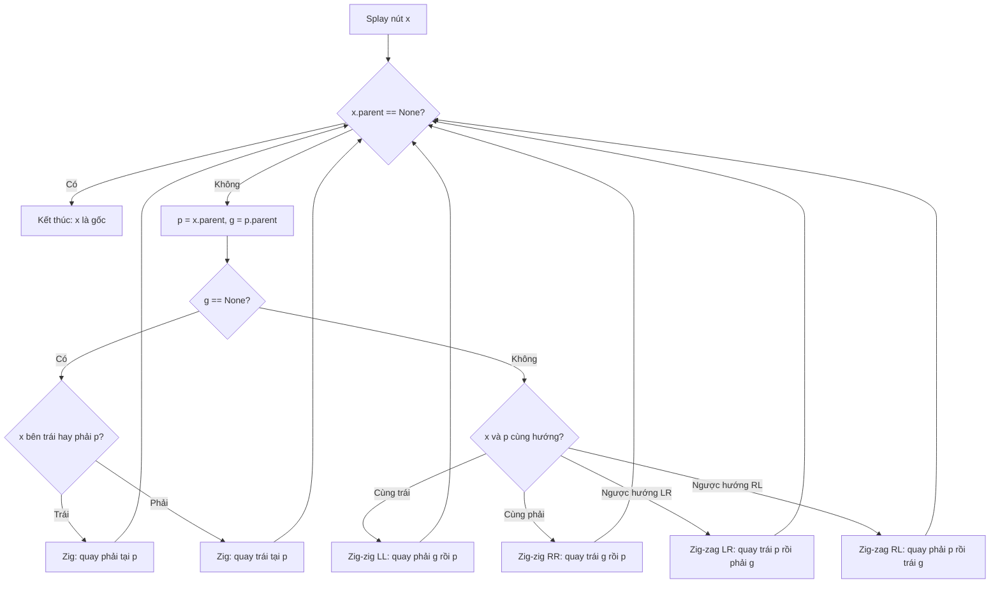

# Các bước zig, zig-zig và zig-zag

## Mục tiêu học tập

Sau bài học, bạn có thể:

- Xác định **nút đang được splay `x`**, **cha `p`** và **ông `g`** để lựa chọn chính xác **zig**, **zig-zig** hoặc **zig-zag**.
- Phân biệt sáu cấu hình: **zig trái/phải**, **zig-zig LL/RR**, **zig-zag LR/RL**, kể cả thứ tự quay khác nhau giữa zig-zig và zig-zag.
- Vẽ được hình dạng trước/sau, kiểm tra vị trí các **cây con ở giữa**, và giải thích vì sao các phép quay vẫn giữ thứ tự khóa **BST**.
- Cài đặt phép quay trái/phải có cập nhật `root` và liên kết `parent`, sau đó viết vòng lặp splay **bottom-up** cho mọi trường hợp.
- Dự đoán số phép quay khi một nút đang ở độ sâu `d` được đưa lên gốc; kiểm chứng rằng **một lượt splay có thể tốn Θ(n)** dù chi phí **khấu hao** của splay tree là O(log n).
- Sử dụng splay trong tìm kiếm thành công/thất bại, chèn và xóa; biết việc tìm kiếm cũng có thể **làm thay đổi cấu trúc**.
- Đọc ví dụ Python tự chứa, chạy bằng tay các tình huống biên và kiểm chứng thứ tự BST, liên kết cha–con, gốc, kích thước và các bộ đếm phép quay.

## 1. Ngữ cảnh: thao tác đưa nút lên gốc có ích gì?

Trong module `COMPUTER_SCIENCE_DATA_STRUCTURES`, ta học cách lựa chọn cấu trúc dựa trên **bất biến, thao tác và chi phí thời gian/bộ nhớ**. Cây splay (*splay tree*) là một **cây tìm kiếm nhị phân tự điều chỉnh**, dùng các phép quay để đưa nút vừa được truy cập lên **gốc**.

Giả sử một danh mục bài học được đánh chỉ mục theo khóa có thứ tự, chẳng hạn `(duration_minutes, lesson_id)`. Nếu người học thường xuyên mở lại những khóa gần đây, việc đưa một nút vừa tìm lên gốc có thể giúp **lần truy cập lại ngay tiếp theo** ngắn hơn.

Tuy nhiên, splay tree có một đánh đổi quan trọng:

- **Cây AVL** duy trì hệ số cân bằng dựa vào chiều cao, **Red–Black Tree** duy trì màu và black-height; cả hai bảo đảm chiều cao **O(log n)** sau mỗi cập nhật hoàn chỉnh.
- **Splay tree** chỉ cần giữ **thứ tự BST**, có thể cao **Θ(n)** ở một thời điểm, nhưng cho giới hạn **O(log n) khấu hao** qua một chuỗi thao tác.

Trọng tâm bài này không phải việc cân bằng cây đến một hình dạng cố định, mà là **chọn và thực hiện đúng những bước quay đưa nút `x` lên gốc**.

### 1.1. Ôn nhanh quy tắc BST

Cho một nút `v`:

\[
\forall a\in v.left:\ a.key<v.key,\qquad
\forall b\in v.right:\ v.key<b.key.
\]

Điều kiện áp dụng cho **mọi hậu duệ** ở từng cây con, không chỉ cho hai con trực tiếp. Các khóa được giả định là **phân biệt** và có phép so sánh ổn định, bắc cầu, nhất quán.

```text
              40
             /  \
           20    60
          / \    / \
        10  30  50  70

Inorder: 10, 20, 30, 40, 50, 60, 70.
```

Sau bất kỳ phép splay hợp lệ nào, dãy inorder **phải giữ nguyên**. Splay **không** làm hoán đổi nội dung `key/value` của các nút và **không** thêm/xóa khóa.

### 1.2. Ba nút định hướng thuật toán

Trong mỗi vòng sửa:

- `x`: nút muốn đưa lên gốc, là **cùng một đối tượng nút** xuyên suốt một lần splay.
- `p=x.parent`: cha trực tiếp của `x`, nếu có.
- `g=p.parent`: ông của `x`, nếu có.

```text
                   g (ông)
                  /
                p (cha)
               /
              x (nút mục tiêu)
```

Mỗi vòng chỉ cần nhìn quan hệ **`x–p–g` hiện tại** để chọn trường hợp. Sau khi quay, phải đọc lại `x.parent` và `p.parent` ở **vòng tiếp theo**, vì liên kết đã đổi.

Nếu `x.parent is None`, `x` đã là **gốc** và thuật toán dừng; nếu `x.parent` có nhưng `g` không tồn tại, chỉ còn **một bước zig**.

## 2. Hai phép quay cơ sở

Không có zig-zig hay zig-zag nếu chưa hiểu **quay trái** và **quay phải**. Hai phép quay đều có thời gian **O(1)** nếu có đủ tham chiếu.

### 2.1. Quay trái tại `a`

Tiền điều kiện: `b=a.right` là **nút thật**.

```text
     TRƯỚC                          SAU

           a                              b
          / \                            / \
         A   b                          a   C
            / \                        / \
           B   C                      A   B
```

Quan hệ thứ tự:

\[
\operatorname{keys}(A)<a<
\operatorname{keys}(B)<b<
\operatorname{keys}(C).
\]

Sau quay, **`B` chuyển thành con phải của `a`**. Vì mọi khóa của `B` vẫn nằm giữa `a` và `b`, kết quả inorder không đổi:

```text
Trước: A, a, B, b, C
Sau:   A, a, B, b, C
```

Nếu `a` đang là gốc, phải đặt `root=b`. Nếu `a` có cha phía trên, `b` phải thay vị trí của `a` trong liên kết từ cha cũ đó.

### 2.2. Quay phải tại `b`

Tiền điều kiện: `a=b.left` là nút thật.

```text
     TRƯỚC                          SAU

           b                              a
          / \                            / \
         a   C                          A   b
        / \                                / \
       A   B                              B   C
```

Lần này **`B` chuyển thành con trái của `b`**. Mỗi khóa vẫn ở đúng khoảng thứ tự; dãy inorder giữ nguyên.

### 2.3. Bốn liên kết cần kiểm tra sau mỗi phép quay

Khi quay tại một nút `u` có cha `q`, mã dùng `parent` phải kiểm tra:

1. **Liên kết từ `q` xuống gốc cây con**: nếu `q=None`, cập nhật `root`; nếu không, thay đúng con trái/phải.
2. **`parent` của nút được đưa lên**: trở thành `q`.
3. **Cây con giữa `B`**: chuyển sang phía thích hợp, đồng thời cập nhật `B.parent` nếu `B` không rỗng.
4. **Liên kết mới giữa hai nút được quay**: nút đi xuống phải trỏ cha đúng; nút đi lên phải trỏ con đúng.

| Phép quay | Nút đi lên | Cây con giữa `B` mới thuộc | Cặp liên kết mới |
| --- | --- | --- | --- |
| Trái tại `a` | `b=a.right` | `a.right` | `b.left=a`, `a.parent=b` |
| Phải tại `b` | `a=b.left` | `b.left` | `a.right=b`, `b.parent=a` |

Một phép quay có thể được dùng trong AVL, Red–Black hoặc splay tree. **Khác biệt nằm ở điều kiện chọn quay và trình tự quay**, không phải bản chất phép quay đơn.

## 3. Zig — khi `x` có cha nhưng không có ông

`p` là gốc, `g=None`. Ta chỉ cần **một phép quay** để `x` thành gốc.

### 3.1. Zig trái: `x=p.left`

```text
    TRƯỚC                         SAU quay PHẢI tại p

          p                               x
         / \                             / \
        x   C                           A   p
       / \                                 / \
      A   B                               B   C
```

**Trình tự:** quay phải tại `p`. Nút mục tiêu `x` đi lên một mức và trở thành gốc.

Ví dụ khóa:

```text
    20                10
   /      ---->         \
  10                     20
```

Gốc mới là `10`; dãy inorder vẫn là `10,20`.

### 3.2. Zig phải: `x=p.right`

```text
    TRƯỚC                         SAU quay TRÁI tại p

          p                              x
         / \                            / \
        A   x                          p   C
           / \                        / \
          B   C                      A   B
```

Ví dụ:

```text
  10                       20
    \        ---->        /
     20                  10
```

**Lưu ý về tên:** “zig trái” ở đây có nghĩa **`x` đang ở bên trái**, không phải “quay trái”. Vì vậy **zig trái → quay phải**, **zig phải → quay trái**. Khi đọc tài liệu gọi “left zig” theo **hướng quay**, hãy nhìn hình thay vì suy từ tên.

### 3.3. Zig là bước cuối cùng trong splay bottom-up

Nếu `x` ban đầu cách gốc một số mức **lẻ**, sau các vòng quay kép sẽ có thể còn một cạnh cuối cùng. Lúc đó dùng zig.

Nếu `x` đã là gốc từ đầu, **không quay**; không có zig giả nào được thực hiện.

## 4. Zig-zig — hai cạnh liên tiếp cùng hướng

Zig-zig xảy ra khi `x`, `p`, `g` nằm trên một đường **trái–trái (LL)** hoặc **phải–phải (RR)**.

Điểm dễ sai nhất:

> **Zig-zig quay tại ông `g` trước, rồi quay tại cha `p`.**

Không thay thế bằng “quay tại cha rồi ông”, bởi thứ tự đó tạo hình dạng trung gian và phân bố cây con khác; cũng không chỉ quay một lần như trường hợp AVL LL/RR.

### 4.1. Zig-zig LL: `x=p.left`, `p=g.left`

Hình tổng quát với bốn cây con ngoài:

```text
TRƯỚC                              SAU 2 quay phải

                g                           x
               / \                         / \
              p   D                       A   p
             / \                             / \
            x   C                           B   g
           / \                                 / \
          A   B                               C   D
```

**Bước 1 — quay phải tại `g`:**

```text
                p
               / \
              x   g
             / \ / \
            A  B C  D
```

**Bước 2 — quay phải tại `p`:**

```text
                x
               / \
              A   p
                 / \
                B   g
                   / \
                  C   D
```

Thứ tự inorder trước/sau luôn là:

\[
A,\ x,\ B,\ p,\ C,\ g,\ D.
\]

Gốc của **cây con đang sửa** trở thành `x`. Nếu `g` vốn có cha ngoài bộ ba, `x` **chưa chắc** là gốc toàn cây: thuật toán tiếp tục splay.

### 4.2. Zig-zig RR: `x=p.right`, `p=g.right`

Đây là hình đối xứng của LL.

```text
TRƯỚC                              SAU 2 quay trái

           g                                   x
          / \                                 / \
         A   p                               p   D
            / \                             / \
           B   x                           g   C
              / \                         / \
             C   D                       A   B
```

**Thứ tự:**

1. Quay **trái tại `g`**.
2. Quay **trái tại `p`**.

Dãy inorder:

\[
A,\ g,\ B,\ p,\ C,\ x,\ D.
\]

### 4.3. Vì sao không dùng hai zig đơn theo cùng hướng?

Nếu chỉ quay `x` lên một cạnh bằng cách quay tại `p`, rồi tiếp tục quay tại `g`, ta thực hiện phương án **đưa nút lên gốc bằng các zig đơn liên tiếp** (*move-to-root*). Nó có thể đưa `x` lên gốc và giữ inorder, nhưng **không phải bước zig-zig chuẩn** của splay tree.

Ví dụ LL chỉ có ba khóa:

```text
      g=30
       /
     p=20
      /
    x=10
```

Zig-zig chuẩn (quay `30` rồi `20`):

```text
      10
        \
         20
           \
            30
```

Hai zig đơn (quay `20` rồi `30`) lại tạo:

```text
        10
          \
           30
          /
         20
```

Cả hai vẫn là BST, nhưng **khác hình dạng**. Các chứng minh khấu hao đặc trưng của splay tree chuẩn phụ thuộc **cách tổ chức zig-zig/zig-zag**, không được tự động gán cho thuật toán chỉ dùng zig đơn.

## 5. Zig-zag — hai cạnh liên tiếp ngược hướng

Zig-zag xảy ra khi `x` là **con phải của cha trái (LR)** hoặc **con trái của cha phải (RL)**.

Điểm cốt lõi:

> **Zig-zag quay tại cha `p` trước, rồi tại ông `g`, bằng hai hướng quay ngược nhau.**

### 5.1. Zig-zag LR: `p=g.left` và `x=p.right`

```text
TRƯỚC                              SAU

              g                             x
             / \                           / \
            p   D                         p   g
           / \                           / \ / \
          A   x                         A  B C  D
             / \
            B   C
```

**Bước 1 — quay trái tại `p`:**

```text
              g
             / \
            x   D
           / \
          p   C
         / \
        A   B
```

**Bước 2 — quay phải tại `g`:**

```text
              x
             / \
            p   g
           / \ / \
          A  B C  D
```

Thứ tự inorder được giữ:

\[
A,\ p,\ B,\ x,\ C,\ g,\ D.
\]

### 5.2. Zig-zag RL: `p=g.right` và `x=p.left`

```text
TRƯỚC                              SAU

          g                                  x
         / \                                / \
        A   p                              g   p
           / \                            / \ / \
          x   D                          A  B C  D
         / \
        B   C
```

**Bước 1 — quay phải tại `p`.** **Bước 2 — quay trái tại `g`.**

Dãy inorder:

\[
A,\ g,\ B,\ x,\ C,\ p,\ D.
\]

### 5.3. So với phép quay kép trong AVL

LR/RL của zig-zag có hình ảnh quay giống một **phép quay kép** trong AVL. Nhưng:

- **AVL** chọn quay vì mất bất biến `|BF|\le 1`.
- **Splay** chọn quay chỉ dựa vào vị trí **`x` so với `p` và `g`**, kể cả khi cây không hề mất một bất biến chiều cao nào.
- Sau quay kép AVL, có thể không tiếp tục quay nếu cây đã cân bằng; sau zig-zag, splay **tiếp tục đến khi `x` lên gốc toàn cây**.

Không nên dùng hệ số cân bằng AVL để quyết định bước tiếp theo trong thuật toán splay.

## 6. Bảng quy tắc tổng hợp

| Điều kiện | Tên bước | Lệnh quay 1 | Lệnh quay 2 | Độ sâu `x` giảm |
| --- | --- | --- | --- | --- |
| `p` là gốc, `x=p.left` | Zig trái | `rotate_right(p)` | Không có | 1 |
| `p` là gốc, `x=p.right` | Zig phải | `rotate_left(p)` | Không có | 1 |
| `x=p.left`, `p=g.left` | Zig-zig LL | `rotate_right(g)` | `rotate_right(p)` | 2 |
| `x=p.right`, `p=g.right` | Zig-zig RR | `rotate_left(g)` | `rotate_left(p)` | 2 |
| `x=p.right`, `p=g.left` | Zig-zag LR | `rotate_left(p)` | `rotate_right(g)` | 2 |
| `x=p.left`, `p=g.right` | Zig-zag RL | `rotate_right(p)` | `rotate_left(g)` | 2 |



**Quy tắc ghi nhớ:** zig = một cạnh; zig-zig = cùng hướng, **ông trước**; zig-zag = khác hướng, **cha trước**. Trước mỗi vòng, phải phân loại lại dựa trên các **liên kết hiện tại**.

## 7. Truy vết từng bước với cây nhiều mức

Chỉ đọc tên LL/LR có thể làm người học nhầm vị trí `x` sau quay. Hãy theo dõi hai ví dụ có **nhiều vòng splay**.

### 7.1. Hai vòng zig-zig trên cây lệch trái

```text
BAN ĐẦU (truy cập x=20)

              100
             /
            80
           /
          60
         /
        40
       /
      20
```

Đường tìm: `100 → 80 → 60 → 40 → 20`. Độ sâu ban đầu của `20` là **4 cạnh**.

**Vòng 1 — LL với `x=20`, `p=40`, `g=60`:** quay phải tại `60`, rồi quay phải tại `40`:

```text
              100
             /
            80
           /
          20
            \
             40
               \
                60
```

`x` vẫn chưa là gốc. Đọc lại: `p=80`, `g=100`; cả hai quan hệ từ ông đến `x` đều trái.

**Vòng 2 — LL với `x=20`, `p=80`, `g=100`:** quay phải tại `100`, rồi quay phải tại `80`:

```text
         20
           \
            80
           /  \
          40  100
            \
             60
```

Kết quả:

- Gốc mới: `20`.
- Số vòng zig-zig: **2**.
- Tổng phép quay đơn: **4**.
- Inorder giữ nguyên: `20,40,60,80,100`.
- Chiều cao sau splay (theo số nút) là **4**, không bắt buộc giảm về mức tối thiểu.

### 7.2. Zig-zag rồi zig trên một đường gồm ba cạnh

```text
BAN ĐẦU: tìm x=70

           100
          /
         50
           \
            80
           /
          70
```

**Vòng 1:** `x=70` là **con trái `80`**, trong khi `80` là **con phải `50`** → **zig-zag RL**:

1. Quay **phải tại `80`**.
2. Quay **trái tại `50`**.

```text
           100
          /
         70
        /  \
       50  80
```

**Vòng 2:** `x=70` là con trái của **gốc `100`**, không có ông → **zig trái**, quay **phải tại `100`**:

```text
         70
        /  \
       50  100
           /
          80
```

Kết quả: một bước **zig-zag** (2 quay) và một bước **zig** (1 quay), tổng **3** phép quay; inorder vẫn `50,70,80,100`.

### 7.3. Đếm phép quay dựa trên độ sâu ban đầu

Trong thuật toán **bottom-up splay chuẩn** ở bài này, mỗi zig-zig hoặc zig-zag làm độ sâu của `x` giảm **đúng hai cạnh**; zig làm giảm **một cạnh**. Vì vậy, nếu `x` ban đầu ở độ sâu `d`:

\[
\text{Số vòng quay kép}=\left\lfloor\frac d2\right\rfloor,
\qquad
\text{Số bước zig cuối}=d\bmod 2.
\]

Tổng số **phép quay đơn** trong lần splay ấy:

\[
2\left\lfloor\frac d2\right\rfloor+(d\bmod 2)=d.
\]

Điều này đúng **cho một lần splay đưa một nút thật đã biết từ độ sâu `d` lên gốc**, khi không có thao tác khác chen vào. Nó **không** có nghĩa cả `find` hay `delete` chỉ tốn `d` bước máy, vì còn chi phí tìm khóa, chọn vị trí xóa và cập nhật liên kết.

Khi `d=0`, không có phép quay. Khi `d=1`, chỉ zig; khi `d=2`, một vòng zig-zig hoặc zig-zag.

## 8. Tại sao cả zig-zig và zig-zag đều cần thiết?

Cả hai kiểu quay kép đều đưa `x` lên hai mức, nhưng tạo **hình dạng cây con khác nhau**.

### 8.1. Với zig-zig, nút cha cũ trở thành cầu nối

Trong LL:

```text
Trước:  g
        |
        p
        |
        x

Sau:    x
         \
          p
           \
            g
```

Kết quả sắp xếp lại một chuỗi nghiêng theo thứ tự, tạo sự thay đổi tương ứng về kích thước các cây con của `x`, `p`, `g`.

### 8.2. Với zig-zag, nút mục tiêu ở giữa tách hai phía

Trong LR:

```text
Trước:       g
             /
            p
             \
              x

Sau:        x
           / \
          p   g
```

Vì `p.key < x.key < g.key`, `x` trở thành nút tách trực tiếp hai phía đúng thứ tự.

### 8.3. Không chỉ là “đưa lên gốc bằng mọi cách”

Một phương pháp khác cũng có thể đưa `x` lên gốc bằng **các zig đơn liên tiếp**. Tuy nhiên, bảo đảm **O(log n) khấu hao** nổi tiếng của **splay tree chuẩn** được chứng minh cho cách phối hợp **zig, zig-zig, zig-zag** này.

Trong phân tích hàm thế, hai phép quay của **mỗi bước kép** được xét như một đơn vị; những thay đổi kích thước cây con do thứ tự quay giúp kiểm soát tổng chi phí khấu hao. Chọn thứ tự quay khác có thể giữ BST nhưng **không thể mượn ngay chứng minh ấy**.

## 9. Splay sau thao tác tìm kiếm, chèn và xóa

Các bước zig/zig-zig/zig-zag là **lõi chung**, nhưng trước khi gọi splay phải xác định **nút mục tiêu `x` là ai**.

### 9.1. Tìm thấy khóa

1. Tìm theo BST từ gốc.
2. Khi tìm thấy `k` ở nút `x`, splay **chính `x`** lên gốc.
3. Trả giá trị/đối tượng theo hợp đồng Map.

```text
BST trước khi tìm 25:           Sau khi tìm 25 và splay:

           40                             25
          /  \                           /  \
         20   60                        20   40
           \                                /  \
            30                             30  60
           /
          25
```

Đây là **hình kết quả chính xác**: đầu tiên zig-zag **RL** tại `g=20, p=30, x=25` (quay phải tại `30` rồi quay trái tại `20`), tiếp theo zig trái tại `40`. Dãy inorder trước/sau là `20,25,30,40,60`.

### 9.2. Tìm không thấy khóa

Nếu đi đến một liên kết `None`, không có nút mang khóa cần tìm để quay lên. Một chính sách splay thông dụng:

> **Splay nút thật cuối cùng đã so sánh** trên đường tìm thất bại lên gốc.

Ví dụ cây chỉ có khóa `10,20,30` và ta tìm `25`: nút cuối phụ thuộc **hình dạng cây hiện tại**, không chỉ tập khóa. Sau splay, kết quả tìm vẫn là **không tồn tại**, nhưng hình dạng có thể đã thay đổi.

Vì truy cập thất bại cũng làm đổi cây, `get` hoặc `contains` không hẳn là thao tác “chỉ đọc” như trong nhiều AVL/RB Tree.

### 9.3. Chèn khóa mới hoặc cập nhật khóa trùng

- Nếu khóa **chưa có**, chèn như BST, rồi **splay nút mới** lên gốc.
- Nếu khóa đã có và giao diện là **Map**, cập nhật `value` trên nút hiện tại và **splay nút ấy**, không tạo khóa trùng.

```text
Chèn 10, rồi 20, rồi 30 theo BST-insert + splay:

Sau 10:      Sau 20:         Sau 30:

   10          20              30
              /               /
             10              20
                            /
                           10
```

Cây cuối là một chuỗi nghiêng trái. **Vẫn hợp lệ** vì splay tree không bắt buộc có chiều cao logarit ở mọi thời điểm.

### 9.4. Xóa một khóa bằng tách rồi nối

Một cách cài:

1. Tìm nút chứa `k` và splay nó lên gốc.
2. Tách hai cây con `L=root.left`, `R=root.right`.
3. Bỏ nút gốc `k` khỏi cấu trúc.
4. Nếu `L` rỗng, lấy `R` làm gốc mới.
5. Nếu `L` không rỗng, tìm **nút lớn nhất `m=max(L)`**, splay `m` lên gốc cây `L`.
6. Vì `m` là lớn nhất trong `L`, `m.right=None`; gắn toàn bộ `R` vào `m.right`.

```text
       k                       m = max(L)
      / \                      /        \
     L   R      ---->        L'          R

Mọi khóa ở L' < m < mọi khóa ở R.
```

Phép splay của `max(L)` vẫn dùng đúng bảng zig/zig-zig/zig-zag; việc nối thêm cây con chỉ là phần công việc riêng của `delete`.

## 10. Ví dụ Python: ghi vết chính xác từng bước splay

Mã sau là một **Splay Map tự chứa** với khóa kiểu `int`, chèn/cập nhật, tìm, xóa, duyệt inorder và validator.

**Mục tiêu của mã là làm rõ các bước quay**, nên có thêm:

- `step_counts`: đếm 6 nhóm trường hợp zig/trái-phải, zig-zig LL/RR, zig-zag LR/RL.
- `rotations`: tổng **phép quay đơn**.
- `history`: ghi lại `(case, x.key, p.key, g.key)` **trước** mỗi bước để đối chiếu hình.

Các bộ đếm và lịch sử chỉ dành cho **học tập/kiểm thử**, không phải metadata bắt buộc của splay tree. Nếu giữ `history` vô hạn trong sản phẩm, bộ nhớ tăng theo số thao tác; có thể bỏ hoặc giới hạn log.

### 10.1. Nút và các phép quay với liên kết cha

```python
class SplayNode:
    def __init__(self, key, value):
        self.key = key
        self.value = value
        self.left = None
        self.right = None
        self.parent = None


class SplayMap:
    CASES = (
        "zig_L", "zig_R",
        "zigzig_LL", "zigzig_RR",
        "zigzag_LR", "zigzag_RL",
    )

    def __init__(self):
        self.root = None
        self.size = 0
        self.rotations = 0
        self.node_visits = 0
        self.step_counts = {case: 0 for case in self.CASES}
        self.history = []

    @staticmethod
    def _check_key(key):
        # Loại bool: True == 1 trong Python.
        if type(key) is not int:
            raise TypeError("Ví dụ yêu cầu khóa int")

    def _rotate_left(self, a):
        """Quay trái tại a; cần a.right là nút thật."""
        b = a.right
        if b is None:
            raise ValueError("Không có con phải để quay trái")

        a.right = b.left
        if b.left is not None:
            b.left.parent = a

        b.parent = a.parent
        if a.parent is None:
            self.root = b
        elif a is a.parent.left:
            a.parent.left = b
        else:
            a.parent.right = b

        b.left = a
        a.parent = b
        self.rotations += 1

    def _rotate_right(self, b):
        """Quay phải tại b; cần b.left là nút thật."""
        a = b.left
        if a is None:
            raise ValueError("Không có con trái để quay phải")

        b.left = a.right
        if a.right is not None:
            a.right.parent = b

        a.parent = b.parent
        if b.parent is None:
            self.root = a
        elif b is b.parent.left:
            b.parent.left = a
        else:
            b.parent.right = a

        a.right = b
        b.parent = a
        self.rotations += 1

    def _note(self, case, x, p, g):
        """Lưu một bước splay; chỉ dùng cho giải thích và kiểm thử."""
        self.step_counts[case] += 1
        self.history.append((
            case, x.key, p.key, None if g is None else g.key
        ))
```

Trong quay trái, cập nhật **cây con giữa `b.left` thành `a.right`** trước khi gắn `a` làm con trái của `b`. Quay phải tương tự. Hai phương thức không chỉnh `key` hay `value`.

### 10.2. Vòng lặp splay bottom-up

Thêm phương thức sau vào chính lớp `SplayMap`:

```python
    def _splay(self, x):
        """Đưa nút thật x đang thuộc cây lên gốc."""
        if x is None:
            return

        while x.parent is not None:
            p = x.parent
            g = p.parent

            if g is None:
                # ZIG: một cạnh cuối cùng.
                if x is p.left:
                    self._note("zig_L", x, p, g)
                    self._rotate_right(p)
                else:
                    assert x is p.right
                    self._note("zig_R", x, p, g)
                    self._rotate_left(p)

            elif x is p.left and p is g.left:
                # ZIG-ZIG LL: quay ông, rồi cha.
                self._note("zigzig_LL", x, p, g)
                self._rotate_right(g)
                self._rotate_right(p)

            elif x is p.right and p is g.right:
                # ZIG-ZIG RR: quay ông, rồi cha.
                self._note("zigzig_RR", x, p, g)
                self._rotate_left(g)
                self._rotate_left(p)

            elif x is p.right and p is g.left:
                # ZIG-ZAG LR: quay cha, rồi ông.
                self._note("zigzag_LR", x, p, g)
                self._rotate_left(p)
                self._rotate_right(g)

            else:
                # ZIG-ZAG RL: đối xứng của LR.
                assert x is p.left and p is g.right
                self._note("zigzag_RL", x, p, g)
                self._rotate_right(p)
                self._rotate_left(g)

        assert self.root is x
        assert self.root.parent is None
```

**Hai dòng `assert` cuối** là kiểm tra khi học, không thay cho validator độc lập. Một bản triển khai sản xuất cần cân nhắc việc `assert` bị vô hiệu khi Python chạy với chế độ tối ưu.

Không được đổi `x` thành `p` hoặc `g` sau một vòng kép. **`x` luôn là cùng nút mục tiêu**, chỉ có `x.parent` và các liên kết bao quanh thay đổi.

### 10.3. Tìm kiếm: splay nút thấy hoặc nút cuối đường tìm

```python
    def _locate(self, key):
        """Trả (found, last).

        found là nút có khóa nếu tồn tại, ngược lại None.
        last là nút thật cuối cùng đã ghé trên đường tìm.
        """
        node = self.root
        last = None
        while node is not None:
            last = node
            self.node_visits += 1
            if key == node.key:
                return node, last
            node = node.left if key < node.key else node.right
        return None, last

    def get(self, key, default=None):
        self._check_key(key)
        found, last = self._locate(key)
        if found is not None:
            self._splay(found)
            return found.value
        if last is not None:
            self._splay(last)
        return default

    def contains(self, key):
        self._check_key(key)
        found, last = self._locate(key)
        if found is not None:
            self._splay(found)
            return True
        if last is not None:
            self._splay(last)
        return False

    def peek(self, key, default=None):
        """Tìm không quay; dùng để đối chiếu với get()."""
        self._check_key(key)
        found, last = self._locate(key)
        return default if found is None else found.value
```

Hợp đồng rõ ràng:

- `get` và `contains` là **truy cập có splay**; có thể đổi gốc ngay cả khi **không tìm thấy**.
- `peek` cố ý **không splay**, giúp so sánh; nếu chỉ dùng `peek` cho mọi lượt tìm, không thể tự động áp bảo đảm khấu hao riêng của chuỗi **truy cập có splay**.
- `get` trả `default` khi không thấy. Vì Map có thể lưu giá trị `None`, dùng `contains` hoặc sentinel riêng khi cần phân biệt **khóa thiếu** với **giá trị bằng None**.

### 10.4. Chèn hoặc cập nhật khóa

```python
    def put(self, key, value):
        """Trả True nếu thêm khóa mới; False nếu cập nhật khóa cũ."""
        self._check_key(key)
        found, last = self._locate(key)
        if found is not None:
            found.value = value
            self._splay(found)
            return False

        fresh = SplayNode(key, value)
        fresh.parent = last
        if last is None:
            self.root = fresh
        elif key < last.key:
            last.left = fresh
        else:
            last.right = fresh

        self.size += 1
        self._splay(fresh)
        return True
```

`put` ghi khóa vào vị trí **đúng theo BST** trước khi splay. Một lần chèn có thể gây **zig**, **zig-zig**, **zig-zag**, hoặc không quay nếu cây ban đầu rỗng. Khóa trùng giữ cùng một nút, chỉ thay giá trị và splay nút ấy.

### 10.5. Xóa và nối hai cây con

```python
    def delete(self, key):
        """Trả giá trị cũ; phát sinh KeyError khi thiếu khóa."""
        self._check_key(key)
        found, last = self._locate(key)
        if found is None:
            if last is not None:
                self._splay(last)
            raise KeyError(key)

        self._splay(found)
        assert self.root is found
        removed_value = found.value

        left = found.left
        right = found.right
        if left is not None:
            left.parent = None
        if right is not None:
            right.parent = None

        # Loại nút gốc cũ khỏi các cây con.
        found.left = None
        found.right = None
        found.parent = None

        if left is None:
            self.root = right
        else:
            # Tạm lấy L làm toàn bộ cây để splay max(L).
            self.root = left
            maximum = left
            while maximum.right is not None:
                self.node_visits += 1
                maximum = maximum.right
            self.node_visits += 1

            self._splay(maximum)
            assert self.root.right is None
            self.root.right = right
            if right is not None:
                right.parent = self.root

        self.size -= 1
        if self.root is not None:
            self.root.parent = None
        return removed_value
```

Trong `delete`, phép splay đầu tiên dùng `found`, và có thể có **một phép splay thứ hai** cho `max(L)`. Vì vậy **số phép quay của toàn bộ một lần xóa** không nhất thiết bằng độ sâu ban đầu của nút bị xóa: còn có lượt splay trong bước nối.

Nếu `left` rỗng, chỉ đưa `right` lên gốc. Nếu cả hai rỗng, cây trở thành rỗng. Nếu khóa không tồn tại, `_locate` vẫn tìm nút cuối và splay nó theo chính sách bài này; **tập khóa và `size` không đổi** trước khi phát sinh `KeyError`.

### 10.6. Duyệt inorder và validator không đệ quy

Vì một splay tree hợp lệ có thể cao **Θ(n)**, ta dùng **stack tường minh** để tránh giới hạn đệ quy Python khi duyệt cây rất lệch.

```python
    def items(self):
        stack = []
        node = self.root
        while stack or node is not None:
            while node is not None:
                stack.append(node)
                node = node.left
            node = stack.pop()
            yield node.key, node.value
            node = node.right

    def validate(self):
        """Trả (số nút thật, chiều cao theo số nút)."""
        if self.root is None:
            assert self.size == 0
            return (0, 0)

        assert self.root.parent is None, "Gốc phải không có cha"
        seen = set()
        count = 0
        max_depth = 0
        # (node, expected_parent, lower, upper, depth)
        stack = [(self.root, None, None, None, 1)]

        while stack:
            node, parent, lower, upper, depth = stack.pop()
            marker = id(node)
            assert marker not in seen, "Chu trình hoặc nút lặp"
            seen.add(marker)
            assert node.parent is parent, "Sai parent"
            assert type(node.key) is int, "Sai kiểu khóa"

            if lower is not None:
                assert lower < node.key, "Sai cận dưới BST"
            if upper is not None:
                assert node.key < upper, "Sai cận trên BST"

            count += 1
            max_depth = max(max_depth, depth)
            if node.right is not None:
                stack.append((
                    node.right, node, node.key, upper, depth + 1
                ))
            if node.left is not None:
                stack.append((
                    node.left, node, lower, node.key, depth + 1
                ))

        assert count == self.size, "Sai số nút thật"
        return count, max_depth
```

`validate` kiểm tra **đúng tập bất biến của splay tree**: thứ tự theo **cận của tổ tiên**, không lặp/chùm con trỏ, `parent` nhất quán, gốc không có cha, số nút đúng. Nó **không** đòi màu đỏ–đen hay BF AVL, cũng **không** đòi chiều cao logarit tại từng thời điểm.

Hàm duyệt và validator là **công cụ kiểm thử** có thể tốn O(n). Không tính chúng vào chi phí lõi của một lần `get/put/delete` khi so sánh độ phức tạp.

## 11. Bộ ví dụ kích hoạt đầy đủ sáu trường hợp

Các phép chèn thông thường **tự splay nút mới**, nên không bảo đảm tạo đúng một hình dạng mà ta muốn thử. Để quan sát từng trường hợp riêng, ta có thể dựng **cây BST hợp lệ theo sơ đồ**, sau đó truy cập đúng một khóa.

### 11.1. Hàm dựng cây có hình dạng tường minh

Đoạn mã này được chạy **sau khi hoàn thành lớp `SplayMap`** ở mục 10:

```python
def make_shape(rows):
    """rows là (key, parent_key, side) với side 'L'/'R'.

    Nút gốc dùng parent_key=None, side=None.
    Chỉ dùng để dựng đầu vào kiểm thử, không phải API cập nhật.
    """
    tree = SplayMap()
    nodes = {}

    for key, parent_key, side in rows:
        assert key not in nodes, "Trùng khóa ví dụ"
        nodes[key] = SplayNode(key, f"lesson-{key}")

    for key, parent_key, side in rows:
        node = nodes[key]
        if parent_key is None:
            assert tree.root is None, "Nhiều gốc"
            assert side is None
            tree.root = node
        else:
            parent = nodes[parent_key]
            assert node.parent is None
            node.parent = parent
            if side == "L":
                assert parent.left is None
                parent.left = node
            elif side == "R":
                assert parent.right is None
                parent.right = node
            else:
                raise ValueError("side phải là L hoặc R")

    tree.size = len(nodes)
    tree.validate()  # Chỉ chấp nhận cây ban đầu đúng BST.
    return tree
```

Hàm dựng thử phải kiểm tra đầu vào; không nên dùng nó cho chương trình sản xuất vì sửa con trỏ tùy ý rất dễ phá bất biến.

### 11.2. Một bảng kiểm thử cho sáu trường hợp

```python
cases = [
    (
        "zig_L",
        [(20, None, None), (10, 20, "L")],
        10, 1,
    ),
    (
        "zig_R",
        [(10, None, None), (20, 10, "R")],
        20, 1,
    ),
    (
        "zigzig_LL",
        [(30, None, None), (20, 30, "L"), (10, 20, "L")],
        10, 2,
    ),
    (
        "zigzig_RR",
        [(10, None, None), (20, 10, "R"), (30, 20, "R")],
        30, 2,
    ),
    (
        "zigzag_LR",
        [(30, None, None), (10, 30, "L"), (20, 10, "R")],
        20, 2,
    ),
    (
        "zigzag_RL",
        [(10, None, None), (30, 10, "R"), (20, 30, "L")],
        20, 2,
    ),
]

for case, rows, accessed, expected_rotations in cases:
    tree = make_shape(rows)
    items_before = list(tree.items())

    assert tree.get(accessed) == f"lesson-{accessed}"
    assert tree.root.key == accessed
    assert tree.step_counts[case] == 1, case
    assert sum(tree.step_counts.values()) == 1, case
    assert tree.rotations == expected_rotations, case
    assert tree.history[0][0] == case
    assert list(tree.items()) == items_before
    tree.validate()
```

Các kiểm tra quan trọng:

- **Đúng tên trường hợp** được ghi trong `step_counts`.
- **Đúng số quay đơn** (1 với zig, 2 với một bước zig-zig/zig-zag).
- **Nút mục tiêu** lên gốc.
- **Tập khóa–giá trị** và inorder không thay đổi.
- **Liên kết `parent`** vẫn đúng sau các phép quay.

### 11.3. Bài thử với cây con `A, B, C, D` không rỗng

Các hình ba nút trống dễ làm ta bỏ sót lỗi chuyển **cây con giữa**. Ví dụ **zig-zag LR** với nhiều nhánh:

```text
         50 (g)
        /    \
     20 (p)  80 (D)
     /   \
  10(A)  30(x)
         /  \
       25(B) 35(C)
```

Sau quay trái tại `20`, rồi phải tại `50`, cây phải là:

```text
             30 (x)
            /      \
          20        50
         /  \      /  \
        10  25    35  80
```

```python
tree = make_shape([
    (50, None, None),
    (20, 50, "L"),
    (80, 50, "R"),
    (10, 20, "L"),
    (30, 20, "R"),
    (25, 30, "L"),
    (35, 30, "R"),
])

before = list(tree.items())
assert tree.get(30) == "lesson-30"
assert tree.history == [("zigzag_LR", 30, 20, 50)]
assert tree.rotations == 2
assert tree.root.key == 30
assert tree.root.left.key == 20
assert tree.root.left.right.key == 25
assert tree.root.right.key == 50
assert tree.root.right.left.key == 35
assert list(tree.items()) == before
assert tree.validate() == (7, 3)
```

Nếu quên chuyển `25` sang `20.right` hoặc `35` sang `50.left`, validator sẽ phát hiện sai **cận BST** hoặc **`parent`**.

### 11.4. Hai bước kép liên tiếp và một bước kép rồi một zig

```python
# Ví dụ mục 7.1: hai zig-zig LL liên tiếp.
left_chain = make_shape([
    (100, None, None),
    (80, 100, "L"),
    (60, 80, "L"),
    (40, 60, "L"),
    (20, 40, "L"),
])

assert left_chain.validate() == (5, 5)
assert left_chain.get(20) == "lesson-20"
assert left_chain.root.key == 20
assert left_chain.rotations == 4
assert left_chain.step_counts["zigzig_LL"] == 2
assert left_chain.history == [
    ("zigzig_LL", 20, 40, 60),
    ("zigzig_LL", 20, 80, 100),
]
assert left_chain.validate() == (5, 4)


# Ví dụ mục 7.2: zig-zag RL rồi zig trái.
mixed = make_shape([
    (100, None, None),
    (50, 100, "L"),
    (80, 50, "R"),
    (70, 80, "L"),
])

assert mixed.get(70) == "lesson-70"
assert mixed.history == [
    ("zigzag_RL", 70, 80, 50),
    ("zig_L", 70, 100, None),
]
assert mixed.rotations == 3
assert mixed.root.key == 70
assert list(mixed.items()) == [
    (50, "lesson-50"),
    (70, "lesson-70"),
    (80, "lesson-80"),
    (100, "lesson-100"),
]
mixed.validate()
```

### 11.5. Tìm thất bại và truy cập lặp lại

```python
tree = make_shape([
    (40, None, None),
    (20, 40, "L"),
    (60, 40, "R"),
    (30, 20, "R"),
    (25, 30, "L"),
])
expected = list(tree.items())

# Tìm 27 không có: đường 40 -> 20 -> 30 -> 25.
# Splay nút cuối là 25, nhưng kết quả vẫn "không có".
assert tree.get(27, "missing") == "missing"
assert tree.root.key == 25
assert list(tree.items()) == expected
tree.validate()

# Sau lần tìm thành công, nút vừa tìm thành gốc.
assert tree.get(30) == "lesson-30"
assert tree.root.key == 30
before = tree.rotations
assert tree.get(30) == "lesson-30"
assert tree.rotations == before  # Đã là gốc.

# Peek là thao tác đối chiếu KHÔNG splay.
root_before = tree.root
assert tree.peek(60) == "lesson-60"
assert tree.root is root_before
assert list(tree.items()) == expected
tree.validate()
```

### 11.6. Chèn, khóa trùng và xóa liên tiếp

```python
tree = SplayMap()
expected = {}

for key in [40, 20, 60, 10, 30, 50, 70, 5, 15, 25, 35]:
    value = f"lesson-{key}"
    assert tree.put(key, value)
    expected[key] = value
    assert tree.root.key == key
    assert tree.validate()[0] == len(expected)

assert list(tree.items()) == sorted(expected.items())

# Cập nhật khóa cũ: vẫn 11 nút.
assert not tree.put(30, "updated")
expected[30] = "updated"
assert tree.root.key == 30
assert tree.size == len(expected)
assert list(tree.items()) == sorted(expected.items())

# Xóa khóa có cây con và xóa xen kẽ nhiều vị trí.
for key in [40, 5, 30, 20, 60]:
    assert tree.delete(key) == expected.pop(key)
    assert list(tree.items()) == sorted(expected.items())
    assert tree.validate()[0] == len(expected)

# Xóa khóa thiếu: vẫn giữ tập khóa.
before = list(tree.items())
try:
    tree.delete(999)
except KeyError:
    pass
else:
    raise AssertionError("delete phải báo KeyError")
assert list(tree.items()) == before
tree.validate()

# Xóa hết, rồi chèn lại vào cùng đối tượng.
for key in list(sorted(expected)):
    assert tree.delete(key) == expected.pop(key)
    assert list(tree.items()) == sorted(expected.items())
    tree.validate()

assert tree.root is None
assert tree.size == 0
assert tree.put(8, None)
assert tree.get(8) is None
assert tree.contains(8)
assert tree.delete(8) is None
assert tree.validate() == (0, 0)
```

### 11.7. Splay sâu và công thức đếm phép quay

```python
tree = SplayMap()
for key in range(1, 33):
    tree.put(key, str(key))

# Chèn tăng dần, nút mới luôn được splay lên gốc:
# 32 -> 31 -> ... -> 1 là một chuỗi con trái.
assert tree.root.key == 32
assert tree.validate() == (32, 32)

before = tree.rotations
assert tree.get(1) == "1"
assert tree.root.key == 1
assert tree.rotations - before == 31
assert tree.validate()[0] == 32
assert [key for key, _ in tree.items()] == list(range(1, 33))

before = tree.rotations
assert tree.get(1) == "1"
assert tree.rotations == before  # Lần lặp ngay sau đó.
```

Đoạn kiểm tra trên nhấn mạnh sự khác biệt: một lần splay có thể tốn **Θ(n) phép quay** khi đường đi ban đầu sâu `n-1`, dù truy cập **cùng khóa ngay lần sau** không cần quay. Chi phí trên **chuỗi** mới là thứ được phân tích khấu hao.

## 12. Vì sao splay vẫn được gọi là cấu trúc có hiệu quả khấu hao?

### 12.1. Đừng nhầm số phép quay với chiều cao luôn logarit

Một splay tree hợp lệ có thể tạo:

```text
                 50
                /
               40
              /
             30
            /
           20
          /
         10
```

Nút `10` ở độ sâu 4 nên riêng lần splay ấy cần **4 quay**, và tổng lượt ghé nút khi tìm có thể là 5. Với `n` khóa trên một đường lệch, một lần tìm có thể tốn **Θ(n)**.

Vì vậy:

- **Không đúng:** “Splay tìm kiếm O(log n) trong trường hợp xấu nhất của từng lượt”.
- **Đúng:** “Splay có tìm/chèn/xóa O(log n) **khấu hao** trên chuỗi thao tác, với các điều kiện của phân tích chuẩn”.

Splay khác AVL/Red–Black ở chính chỗ này: hai cấu trúc kia có giới hạn **O(log n) xấu nhất cho mỗi thao tác**, còn splay ưu tiên tính tự điều chỉnh qua cả dãy truy cập.

### 12.2. Hàm thế (potential function)

Đặt `s(v)` là **số nút thật trong cây con gốc `v`**, `r(v)=\log_2 s(v)` là hạng của nút và:

\[
\Phi(T)=\sum_{v\in T}r(v)
=\sum_{v\in T}\log_2 s(v).
\]

Ta đo chi phí khấu hao của thao tác thứ `i` theo:

\[
\widehat c_i=c_i+\Phi(T_i)-\Phi(T_{i-1}),
\]

với `c_i` là chi phí thực tế và `T_{i-1},T_i` là cây trước/sau thao tác.

**Trực giác:** Một lượt splay đắt có thể thay đổi phân bố kích thước cây con đáng kể, giúp **giảm hàm thế**. Phần thế giảm được xem như “tín dụng” bù chi phí thực tế; ngược lại, một bước rẻ có thể làm tăng thế một ít để dành cho các thao tác sau.

Trong mã `SplayMap`, **không cần lưu `s(v)`, `r(v)` hay `Φ`** để thực hiện zig/zig-zig/zig-zag. Đây là các đại lượng **phục vụ chứng minh**, không phải metadata cân bằng bắt buộc.

### 12.3. Bổ đề truy cập (Access Lemma): vì sao bước kép quan trọng?

Với một lần splay nút `x` trong cây có `n` nút, dùng chi phí `1 + số phép quay` và hàm thế ở trên, một phát biểu quen thuộc của **Access Lemma** là:

\[
\widehat c_{\text{splay}(x)}
\le 3\bigl(r(root)-r(x)\bigr)+1
\le 3\log_2 n+1,
\]

trong đó `root` và `r(x)` ở vế phải được hiểu **trước khi splay**. Hệ số cụ thể phụ thuộc quy ước tính đơn vị công việc; kết luận quan trọng là **O(log n) khấu hao**.

Chứng minh chia theo ba loại bước:

1. **Zig:** một quay ở cuối. Bất đẳng thức chi phí khấu hao bị chặn bởi chênh lệch hạng của `x` trước/sau bước cộng một hằng số.
2. **Zig-zig:** hai quay **tại ông rồi tại cha**. Khi dùng tính chất lõm của logarit với kích thước các cây con trước/sau, tổng **hai quay + biến thiên thế** được chặn bởi chênh lệch hạng của `x` nhân một hằng số.
3. **Zig-zag:** hai quay **tại cha rồi tại ông**. Có thể lập bất đẳng thức tương tự, vì `x` trở thành gốc của hai phía cây con được tách theo khóa.
4. **Cộng các bước:** các chênh lệch hạng trung gian của `x` **triệt tiêu (telescoping)**, để lại chênh lệch giữa hạng của nút mục tiêu ban đầu và hạng của gốc trước splay.

Đây là lý do thuật toán splay chuẩn **phân biệt hai cách quay kép**. Một thuật toán luôn dùng zig đơn liên tiếp không được tự động dùng bổ đề trên nếu chưa có chứng minh thích hợp.

### 12.4. Tổng chi phí của một chuỗi thao tác

Đối với một chuỗi `m` thao tác trên cây **ban đầu rỗng**, kích thước không vượt quá `m`. Theo phân tích khấu hao chuẩn, tổng chi phí cho tìm/chèn/xóa splay có thể được chặn bởi **O(m log(m+1))**, tương ứng **O(log(m+1)) khấu hao mỗi thao tác**.

Nếu xét một cây **khởi đầu đã chứa `n` nút với hình dạng tùy ý**, khi chuyển cận khấu hao thành cận tổng cần tính **hàm thế ban đầu**. Đừng bỏ qua chi phí tiềm ẩn của cấu hình đầu vào rồi khẳng định mọi dãy `m` thao tác trên mọi cây đều có cùng cận tổng mà không nêu điều kiện.

Phân tích khấu hao **không cần đầu vào ngẫu nhiên**. Nó khác với chi phí **kỳ vọng** theo một phân phối xác suất.

### 12.5. Splay và mẫu truy cập gần đây

Một phần động lực dùng splay là **tính cục bộ truy cập**:

- Truy cập nhiều lần **liên tiếp cùng một khóa**: sau lần đầu, nút là gốc nên lần tiếp theo (khi không có thao tác xen vào) không cần quay.
- Truy cập những khóa **gần nhau theo thứ tự**: các biến thể phân tích *dynamic finger* mô tả lợi ích theo khoảng thứ hạng trên chuỗi.
- Truy cập các khóa **vừa dùng gần đây**: các kết quả dạng *working set* cho thấy vai trò của tính gần theo thời gian ở mức khấu hao.

Những nhận định này là **tính chất trên chuỗi** và dưới giả định tương ứng; chúng không có nghĩa một lượt truy cập bất kỳ tới khóa lân cận sẽ **luôn** O(1).

## 13. So sánh zig/zig-zig/zig-zag với quay trong AVL và Red–Black

| Tiêu chí | Splay tree | AVL | Red–Black Tree |
| --- | --- | --- | --- |
| Vì sao quay? | Đưa **nút vừa truy cập** lên gốc | Sửa `BF` mất cân bằng | Sửa quy tắc màu/black-height |
| Có quay khi tìm thấy khóa? | **Có thể**, thường splay tới gốc | Thường **không** | Thường **không** |
| Tiền điều kiện quay | Quan hệ `x,p,g` | `BF` của nút và cây con | Màu cha/chú/anh em/con |
| Cặp trường hợp quay kép | Zig-zig **cùng hướng**, zig-zag **khác hướng** | LL/RR quay đơn, LR/RL quay kép | Các nhánh màu xác định quay đơn/kép |
| Sau bước kép có dừng không? | Chỉ dừng khi `x` đã là **gốc toàn cây** | Có thể dừng nếu đã sửa tại nút mất cân bằng | Theo điều kiện sửa màu/thiếu đen |
| Metadata cân bằng bắt buộc | **Không có** | Chiều cao hoặc BF | Màu RED/BLACK |
| Một lần tìm xấu nhất | **O(n)** | **O(log n)** | **O(log n)** |
| Một lần cập nhật xấu nhất | **O(n)** | **O(log n)** | **O(log n)** |
| Chi phí khấu hao chuẩn | **O(log n)** cho các thao tác hỗ trợ | Không cần dựa vào khấu hao để có cận logarit | Không cần dựa vào khấu hao để có cận logarit |

Phép quay đơn **đều giữ inorder**. Khác biệt đến từ **khi nào quay, quay theo thứ tự nào và có tiếp tục sau khi đã sửa một cụm hay không**.

### 13.1. Khi nào nên cân nhắc dùng splay?

- Chỉ mục có thứ tự, truy cập **lặp lại vào một nhóm khóa nóng**.
- Hoạt động chủ yếu tuần tự, cho phép thao tác tìm kiếm **sửa cấu trúc**.
- Có thể chấp nhận độ trễ cao ở **một số lượt riêng lẻ** đổi lấy hiệu quả qua dãy.
- Không muốn duy trì màu/chiều cao nhưng sẵn sàng cài đúng bộ luật splay và liên kết cha.

### 13.2. Khi nào nên ưu tiên cấu trúc khác?

- Hệ thống cần **độ trễ O(log n) xấu nhất mỗi lượt**.
- Có nhiều luồng **đọc đồng thời** và cần truy vấn không sửa cây.
- Phải giữ iterator/snapshot có yêu cầu ổn định trong lúc truy cập.
- Đã có thư viện ordered Set/Map đáng tin cậy phù hợp với AVL/RB.
- Chỉ cần tra ID chính xác: **bảng băm** có thể đơn giản hơn và có O(1) kỳ vọng, nhưng không cung cấp thứ tự.

Một lựa chọn không chỉ căn cứ trên Big O; còn phải xét **bộ nhớ, cache, đồng thời, cách cấp phát nút và độ phức tạp kiểm chứng**.

## 14. Bộ nhớ và chi phí thực tế

Mỗi nút `SplayNode` trong ví dụ chứa `key, value, left, right, parent`. Trường `parent` giúp cài đặt **bottom-up**, nhưng có thể dùng thuật toán **top-down splay** khác không lưu con trỏ cha.

Splay tree không bắt buộc lưu `height`/`BF` như AVL hoặc `color` như Red–Black, nhưng không có bảo đảm rằng một nút Python `SplayNode` luôn ít byte hơn một nút AVL/RB: cần xét cách đóng gói, căn lề, con trỏ cha và overhead đối tượng.

| Thành phần | Bộ nhớ |
| --- | --- |
| Các nút và liên kết của `n` khóa | **O(n)** |
| Một phép quay đơn dùng biến tạm | **O(1)** |
| Vòng `_splay` bottom-up có `parent` | **O(1)** phụ, không tính log học tập |
| Duyệt inorder bằng stack | **O(h)**, có thể **O(n)** khi cây lệch |
| Validator lặp dùng stack và `seen` | **O(n)** trong trường hợp xấu nhất |
| `history` không giới hạn ở ví dụ | Tăng theo số **bước splay được ghi**, không phải metadata bắt buộc |

Nếu muốn hỗ trợ thêm **`rank/select`**, có thể lưu `subtree_size` trong từng nút:

\[
size(v)=1+size(v.left)+size(v.right).
\]

Khi đó mỗi phép quay phải cập nhật kích thước các cây con liên quan. Đừng nhầm `subtree_size` được lưu để phục vụ truy vấn với `s(v)` chỉ dùng trong **chứng minh hàm thế**.

## 15. Lỗi thường gặp và cách phát hiện

### 15.1. Sai lựa chọn trường hợp

- **“`x` nằm trái nên quay trái.”** Sai: zig khi `x` là con trái phải **quay phải tại cha**.
- **“Có ông thì luôn quay zig-zig.”** Sai: phải phân biệt **cùng hướng** và **ngược hướng**.
- **“Zig-zig LL quay cha trước.”** Sai: quay **ông trước, cha sau**.
- **“Zig-zag LR quay ông trước.”** Sai: quay **cha trước, ông sau**.
- **“Zig-zig LL và zig-zag LR khác tên nhưng cùng thứ tự quay.”** Sai: một bên hai quay cùng hướng, một bên hai quay ngược hướng và khác thứ tự.
- **“Đã quay kép thì chắc chắn kết thúc.”** Sai nếu `x` chưa là **gốc toàn cây**; phải tiếp tục.
- **“Sau quay, `x` đổi thành nút cha cũ.”** Sai: `x` là mục tiêu cố định; quan hệ cha/ông phải được lấy lại theo cấu trúc mới.
- **“Mỗi lần splay chỉ cần một quay.”** Sai: số quay bằng **độ sâu ban đầu `d`** trong bottom-up chuẩn, có thể lớn đến `n-1`.

### 15.2. Sai liên kết và bất biến BST

- **Quên cập nhật `root`** khi quay tại gốc: có thể tạo một cây con bị mất truy cập.
- **Quên cập nhật `parent` của cây con giữa `B`**: một lượt splay sau dễ đi sai cha.
- **Nối lại `g` với cha cũ sai phía**: cây đúng bên trong cụm nhưng bị đặt sai khoảng khóa ở mức cao hơn.
- **Hoán đổi khóa–giá trị thay vì quay**: có thể phá tham chiếu tới bản ghi hoặc làm sai ý nghĩa API.
- **Quên làm `root.parent=None` sau xóa/nối**: validator phát hiện.
- **Dùng `max(L)` nhưng vẫn giữ con phải cũ**: trái với điều kiện `max(L)`; có thể ghi đè và mất nút.
- **Chỉ kiểm tra inorder**: có thể bỏ lọt `parent` sai, nút lặp hoặc chu trình nếu duyệt thử tình cờ không ghé phần hỏng.

### 15.3. Sai kết luận về hiệu năng

- **“Splay tự cân bằng nên chiều cao luôn O(log n).”** Sai: cây có thể lệch.
- **“O(log n) khấu hao là O(log n) xấu nhất từng lượt.”** Sai.
- **“Lượt tìm thất bại không thay đổi cây.”** Sai theo chính sách splay nút cuối.
- **“Mọi lần truy cập khóa vừa dùng đều O(1).”** Chỉ có thể nói vậy nếu khóa ấy **vẫn đang ở gốc**; các truy cập khác có thể thay đổi cấu trúc.
- **“Không có metadata màu nên luôn ít RAM hơn RB.”** Không có kết luận như vậy nếu chưa đo cài đặt cụ thể.
- **“Tìm kiếm chỉ đọc nên không cần đồng bộ.”** Sai với splay có quay cây.
- **“Bộ đếm quay là thời gian chạy.”** Không đủ: tìm khóa, cấp phát, cache, điều kiện rẽ nhánh và ghi log cũng tiêu tốn thời gian.

### 15.4. Checklist kiểm tra một bước splay

1. `x` có thật đang thuộc cây và `x.parent` có đúng không?
2. `p` có là gốc không? Nếu có, dùng **zig**.
3. Nếu có `g`, hai cạnh có cùng hướng không?
4. Với **zig-zig**, đã quay tại **`g` trước `p`** chưa?
5. Với **zig-zag**, đã quay tại **`p` trước `g`** chưa?
6. Có giữ đầy đủ các cây con `A,B,C,D` theo đúng khoảng khóa không?
7. Sau mỗi quay, `root` và `parent` của các nút liên quan có hợp lệ không?
8. Sau toàn bộ splay, `root is x` và `root.parent is None` không?
9. Danh sách inorder và số nút có giữ nguyên khi chỉ splay không?
10. Khi kiểm tra hiệu năng, có tách thời gian của `validate` và ghi log ra khỏi thao tác lõi không?

## 16. Bài tập vận dụng

### Bài 1 — Nhận diện điều kiện zig

Cho gốc `40` có con trái `20` và con phải `60`. Khi tìm `20`, `p` và `g` là những nút nào? Cần phép quay gì và gốc mới là khóa nào?

*Gợi ý:* `p=40` là gốc, `g=None`; zig trái quay phải tại `40`. `20` lên gốc.

### Bài 2 — Zig phải đối xứng

Cho gốc `10`, con phải `20` và con trái `5`. Sau splay `20`, hãy vẽ lại cây và chỉ ra vị trí `5`.

*Gợi ý:* Zig phải quay trái tại `10`; `20` thành gốc, `10` là con trái và `5` vẫn là con trái `10`.

### Bài 3 — Zig-zig LL có bốn cây con

Cho `g=70`, `p=40` là con trái `g`, `x=20` là con trái `p`; các cây con `A,B,C,D` ở bốn khoảng khóa đều không rỗng. Vẽ hai bước quay và vị trí cuối của `B,C`.

*Gợi ý:* Quay phải tại `70`, rồi quay phải tại `40`. `B` thành con trái của `40`, `C` thành con trái của `70`.

### Bài 4 — Zig-zig RR

Cho `g=10`, `p=20` là con phải, `x=30` là con phải `20`. Mô phỏng thứ tự hai phép quay. Nếu `g` có cây con trái `A`, sau quay `A` nằm dưới nút nào?

*Gợi ý:* Quay trái tại `10` rồi `20`; `A` vẫn là cây con trái của `10`.

### Bài 5 — Zig-zag LR

Cho `g=50`, `p=20` nằm trái `g`, `x=30` nằm phải `p`. Xác định hai phép quay. Vì sao không thể đặt cây con `x.left` vào `g.right`?

*Gợi ý:* Quay trái tại `20` rồi phải tại `50`. `x.left` chứa khóa nằm giữa `20` và `30`, nên phải nằm trong cây con phải của `20`.

### Bài 6 — Zig-zag RL

Cho `g=10`, `p=30` là con phải `g`, `x=20` là con trái `p`. Sau hai quay, gốc cụm là khóa nào? `g` và `p` nằm ở hai phía nào?

*Gợi ý:* Quay phải tại `30` rồi trái tại `10`; gốc cụm là `20`, trái `10`, phải `30`.

### Bài 7 — Điền bảng phân loại

Cho bốn tình huống `(x,p,g)` có quan hệ: LL, RR, LR, RL. Với mỗi tình huống, điền **tên**, **quay 1** và **quay 2**. Tại sao tên của hướng `x` không luôn trùng hướng phép quay?

*Gợi ý:* `x` nằm trái thường cần quay phải để lên; tên LL/RR mô tả **quan hệ con**, không phải hướng quay.

### Bài 8 — Phân biệt zig-zig với hai zig đơn

Từ cây `30→trái 20→trái 10`, vẽ kết quả của:

1. Zig-zig LL chuẩn.
2. Quay phải tại `20` trước rồi quay phải tại `30`.

Hai kết quả có cùng dãy inorder không? Có cùng hình dạng không?

*Gợi ý:* Đều có inorder `10,20,30`, nhưng cây thứ nhất có chuỗi `10→phải 20→phải 30`; cây thứ hai có `10→phải 30→trái 20`.

### Bài 9 — Phép quay khi cây con giữa không rỗng

Cho phép quay trái tại `a=20` với `b=40`, `B` chứa hai khóa `25,30` và `C` chứa khóa `60`. Sau quay, cây con `B` phải nằm ở đâu?

*Gợi ý:* `B` trở thành `20.right`; cả hai khóa đều nằm giữa `20` và `40`.

### Bài 10 — Hai bước zig-zig liên tiếp

Truy cập `20` trong chuỗi trái `100→80→60→40→20`. Viết **hai bản ghi lịch sử** dạng `(case,x,p,g)` và số phép quay tổng.

*Gợi ý:* `("zigzig_LL",20,40,60)` và `("zigzig_LL",20,80,100)`, bốn phép quay.

### Bài 11 — Zig-zag rồi zig

Cho `100.left=50`, `50.right=80`, `80.left=70`. Nêu đúng **hai tên bước** khi splay `70`, hướng quay của mỗi bước và gốc cuối.

*Gợi ý:* `zigzag_RL` rồi `zig_L`; tổng ba quay, gốc `70`.

### Bài 12 — Công thức đếm quay theo độ sâu

Nếu nút `x` ở độ sâu `d=9` cạnh, một lần splay bottom-up chuẩn của nút này gồm bao nhiêu vòng kép, bao nhiêu zig cuối và bao nhiêu **phép quay đơn**?

*Gợi ý:* `floor(9/2)=4` vòng kép, một zig cuối, tổng 9 quay.

### Bài 13 — Kiểm tra nút đã là gốc

Một nút `x` đang là gốc của cây. `_splay(x)` có cần quay không? Bộ đếm `step_counts` và `rotations` có thay đổi trong một lần gọi như vậy không?

*Gợi ý:* Không có cha nên vòng lặp bỏ qua; cả hai bộ đếm không tăng.

### Bài 14 — Tìm không thấy

Cho cây `40` có con trái `20`; `20.right=30` và `30.left=25`. Khi tìm `27`, khóa nào là **nút thật cuối cùng trên đường tìm**? Nút nào lên gốc theo chính sách bài này?

*Gợi ý:* Đường `40→20→30→25` rồi rẽ phải tới `None`; splay `25`.

### Bài 15 — Truy cập lặp lại cùng khóa

Sau khi `get(30)` thành công, nếu ngay lập tức gọi `get(30)` một lần nữa mà không có thay đổi xen vào, cần bao nhiêu phép quay ở lần hai? Có thể suy ra mọi lần tìm `30` đều O(1) về sau không?

*Gợi ý:* Lần hai không quay vì `30` đang là gốc. Những thao tác khác có thể đổi gốc, nên không suy ra cho mọi thời điểm.

### Bài 16 — Cập nhật khóa trùng

Một `SplayMap` chứa `(20,"old")`. Khi `put(20,"new")`, giá trị trả về là gì, số nút có tăng không, và nút nào được splay?

*Gợi ý:* Trả `False` vì cập nhật, không thêm nút; splay chính nút khóa `20`.

### Bài 17 — Xóa và nối cây con

Giả sử sau splay khóa `40`, cây trái `L` có khóa `10,20,30` và cây phải `R` có `50,60`. Hãy mô tả xóa `40` và tìm gốc mới của cây đã nối.

*Gợi ý:* Dùng `max(L)=30`, splay nó lên gốc `L`, rồi gắn `R` vào `30.right`.

### Bài 18 — Tình huống cây rỗng

Nêu kết quả của `get(10,"missing")`, `put(10,"A")` và `delete(10)` khi bắt đầu từ một cây rỗng. Sau ba thao tác, `root` và `size` là gì?

*Gợi ý:* Tìm trả `"missing"`, chèn tạo một gốc `10`, xóa trả `"A"`; cuối cùng `root=None` và `size=0`.

### Bài 19 — Đọc ghi vết từ mã Python

Mỗi dòng `history` của lớp `SplayMap` ghi `(case,x,p,g)` **trước** bước quay. Tại sao sau một bước kép phải lấy lại `p,g` từ liên kết của `x` thay vì dùng bộ `p,g` cũ?

*Gợi ý:* Bộ ba cũ đã được nối lại; `x` lên hai mức và có thể đang dưới một ông/cha hoàn toàn khác.

### Bài 20 — Tại sao chỉ kiểm tra inorder là chưa đủ?

Một phép quay quên cập nhật `B.parent` nhưng giữ đúng `left/right`. Duyệt inorder có thể vẫn đúng không? Những phép kiểm tra nào trong `validate()` phát hiện lỗi?

*Gợi ý:* Inorder có thể đúng nhưng `parent` sai. Validator kiểm tra `parent` dự kiến, gốc không có cha, cận BST, nút lặp và số nút.

### Bài 21 — Chi phí riêng lẻ so với khấu hao

Một cây splay có 1.000 nút ở dạng một chuỗi. Truy cập phần tử sâu nhất có thể tốn bao nhiêu theo Big O? Vì sao vẫn có thể phát biểu O(log n) **khấu hao**?

*Gợi ý:* Một lượt O(n). Phân tích hàm thế theo **chuỗi thao tác**, không có nghĩa từng lượt đều ≤ O(log n).

### Bài 22 — Vai trò của hàm thế

Viết công thức `s(v)`, `r(v)`, `Φ(T)` và `ĉ_i` trong phân tích khấu hao. Vì sao **không bắt buộc lưu `subtree_size`** trong `SplayNode` để thuật toán chuẩn đạt bảo đảm của nó?

*Gợi ý:* `s(v)` là số nút cây con, `r(v)=log₂ s(v)`, `Φ=Σ r(v)`, `ĉ_i=c_i+ΔΦ`; đây là công cụ chứng minh.

### Bài 23 — Khi nào không nên dùng splay?

Một API yêu cầu **mỗi lượt đọc có độ trễ O(log n) xấu nhất** và phục vụ nhiều luồng đọc đồng thời. Hãy nêu ít nhất hai lý do khiến splay tree chuẩn không nên là lựa chọn mặc định.

*Gợi ý:* Một lần splay có thể O(n); thao tác `get` có thể sửa liên kết nên đòi đồng bộ và ảnh hưởng iterator.

### Bài 24 — Bổ sung metadata rank/select

Nếu thêm `subtree_size` để hỗ trợ `rank(k)` và `select(i)`, những phép quay nào cần cập nhật metadata? Trong quay trái tại `a` và đưa `b` lên, nên cập nhật `size(a)` hay `size(b)` trước?

*Gợi ý:* Cả hai hướng quay cần cập nhật cây con liên quan; tính `size(a)` của nút đi xuống trước `size(b)` của nút đi lên.

### Bài 25 — Thiết kế chỉ mục học tập

Một nền tảng giữ `by_id` là bảng băm và `by_duration` là cây có thứ tự. Hai bài có cùng thời lượng 30 phút. Hãy đề xuất khóa đủ phân biệt và nêu quy tắc cập nhật khi thời lượng của một bài thay đổi.

*Gợi ý:* Dùng `(minutes,lesson_id)`. Khi thời lượng đổi, **xóa khóa thứ tự cũ và chèn khóa mới**, đồng thời giữ chỉ mục chính nhất quán.

## 17. Ứng dụng thực tế và tiêu chí lựa chọn

### 17.1. Nơi có thể tận dụng truy cập thường xuyên

Trong danh mục bài học, những nội dung được người học mở gần đây có thể được truy vấn lặp lại. Nếu splay được dùng làm **ordered Map**, các nút vừa truy cập sẽ ở gần gốc ngay sau thao tác:

```text
Truy cập: ds-stack, ds-queue, ds-stack, ds-stack, ds-tree, ...
```

Đặc tính này đáng kiểm tra trên dãy truy cập thực tế. Không kết luận rằng splay **luôn thắng** AVL/RB: splay phải **sửa cây ngay cả khi tìm**, có thể gây nhiều ghi bộ nhớ và yêu cầu đồng bộ.

### 17.2. Mẫu truy vấn khoảng

Để tìm mọi bài có thời lượng trong `[20,45]` phút, có thể dùng **khóa ghép `(minutes,lesson_id)`**, tìm cận dưới rồi duyệt theo thứ tự. Splay vẫn là BST nên có khả năng duyệt inorder đúng.

Tuy nhiên, nếu trong lúc duyệt có một thao tác `get` khác splay một nút, những tham chiếu cha–con đang được iterator giữ có thể không còn phản ánh hình dạng cũ. Cần thiết kế **khóa, snapshot, iterator phát hiện sửa đổi** hoặc quy tắc truy cập thích hợp.

### 17.3. Đánh đổi quyết định

| Yêu cầu | Cấu trúc đáng cân nhắc | Vì sao |
| --- | --- | --- |
| Truy cập nhiều lần cùng khóa, chạy tuần tự, chấp nhận trễ khấu hao | **Splay tree** | Nút được truy cập lên gốc; O(log n) khấu hao |
| Mỗi tìm/chèn/xóa phải O(log n) xấu nhất | **AVL hoặc Red–Black** | Bảo đảm chiều cao logarit sau mỗi cập nhật |
| Chỉ cần tra ID chính xác | **Bảng băm** | O(1) kỳ vọng, không giữ thứ tự |
| Cần thứ tự nhưng tập khóa gần như tĩnh | **Mảng đã sắp** | Tìm nhị phân và duyệt liên tiếp tốt; chèn giữa O(n) |
| Dữ liệu trên nhiều trang lưu trữ | **B-tree/B+ tree** | Phân nhánh lớn phù hợp giảm lần truy cập trang |

Khi đo hiệu năng, nên dùng cùng tập khóa, thứ tự cập nhật, tỉ lệ tìm thành công/thất bại và phân phối các khóa nóng. Ghi rõ **số quay, số nút ghé, kích thước, thời gian và phân vị độ trễ**; không lấy bộ đếm quay làm đại diện tuyệt đối cho thời gian.

## Tổng kết

**Zig, zig-zig và zig-zag** là ba nhóm bước quay giúp cây splay đưa một **nút `x`** lên **gốc** mà vẫn giữ thứ tự BST. Khi `x` chỉ có cha là gốc, dùng **zig** với một quay đơn. Khi `x` và cha nằm **cùng hướng** so với ông, dùng **zig-zig** và **quay tại ông trước, cha sau**. Khi hai cạnh **ngược hướng**, dùng **zig-zag** và **quay tại cha trước, ông sau**. Những cấu hình LL/RR và LR/RL luôn có bản **đối xứng trái–phải**.

Với bottom-up splay chuẩn, nút ở độ sâu `d` cần đúng **`d` phép quay đơn** để lên gốc, nhưng một cây có thể cao **Θ(n)** nên một thao tác riêng lẻ vẫn có thể O(n). Giá trị lý thuyết của splay nằm ở bảo đảm **O(log n) khấu hao trên chuỗi thao tác**, không phải cân bằng chiều cao tức thời. Khi cài đặt, phải bảo vệ **các cây con giữa, `root`, `parent`, khóa–giá trị, số nút và inorder**, đồng thời kiểm tra cả trường hợp **tìm thất bại, cây rỗng, cây con không rỗng và nhiều vòng quay liên tiếp**.

Hiểu đúng **điều kiện chọn bước và thứ tự quay** là cơ sở để học splay tree sâu hơn, phân tích tính cục bộ truy cập và lựa chọn cấu trúc tìm kiếm cân bằng phù hợp với yêu cầu thao tác, bộ nhớ, độ trễ và độ phức tạp triển khai.
