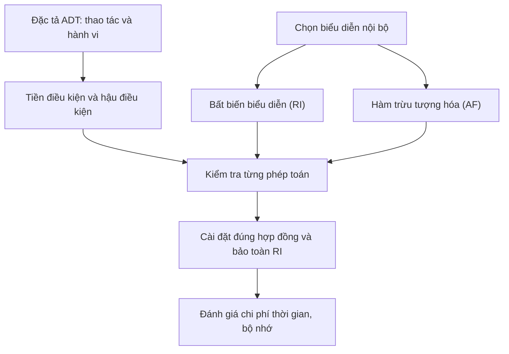

# Tiền điều kiện, hậu điều kiện và bất biến biểu diễn

> **Chương:** Đặc tả và chi phí · **Bài học:** Tiền điều kiện, hậu điều kiện và bất biến biểu diễn

Một phép toán `pop()` trên stack có thể trả về đúng phần tử đỉnh nhưng vẫn làm hỏng cấu trúc dữ liệu: ví dụ, nó quên giảm bộ đếm kích thước hoặc để lại liên kết tới nút đã xóa. Ngược lại, một cấu trúc có bộ đếm và con trỏ hoàn toàn hợp lệ vẫn có thể trả về sai phần tử. Để phân biệt hai loại lỗi này, ta cần ba công cụ: **tiền điều kiện** xác định khi nào thao tác được gọi hợp lệ, **hậu điều kiện** xác định kết quả đúng của thao tác, và **bất biến biểu diễn** xác định trạng thái nội bộ nào được chấp nhận.

Trong mô-đun **Cấu trúc dữ liệu** (`COMPUTER_SCIENCE_DATA_STRUCTURES`), ba khái niệm này giúp ta triển khai và đánh giá mảng, danh sách liên kết, stack, queue, bảng băm, cây, heap và đồ thị. Chúng nối kết đặc tả thao tác với tính đúng đắn của cài đặt, rồi tạo cơ sở để phân tích thời gian và bộ nhớ.

## 1. Mục tiêu học tập

Sau bài học, bạn có thể:

1. Phân biệt tiền điều kiện, hậu điều kiện, bất biến của đối tượng và **bất biến biểu diễn**.
2. Viết hợp đồng cho thao tác dựa trên trạng thái **trước** và **sau** khi gọi.
3. Mô hình hóa trạng thái nội bộ, chỉ ra bất biến cần duy trì và phát hiện trạng thái không hợp lệ.
4. Chứng minh ở mức cơ bản rằng thao tác khởi tạo, cập nhật và truy vấn bảo toàn bất biến.
5. Kiểm tra hợp đồng bằng ví dụ, kiểm thử thuộc tính và trường hợp biên.
6. Hiểu chi phí kiểm tra bất biến và tác động của nó tới độ phức tạp.

## 2. Ba khái niệm và vai trò của từng khái niệm

| Khái niệm | Trả lời câu hỏi | Ai chịu trách nhiệm chính? | Ví dụ |
| --- | --- | --- | --- |
| **Tiền điều kiện (precondition)** | Cần đúng điều gì **trước** khi thao tác thực hiện thành công? | Bên gọi, với hợp đồng yêu cầu điều kiện đó | `pop` thành công đòi hỏi stack không rỗng |
| **Hậu điều kiện (postcondition)** | Sau một thao tác hợp lệ, kết quả và trạng thái phải thế nào? | Bên cài đặt thao tác | `pop` trả về đỉnh cũ, giảm số phần tử đúng 1 |
| **Bất biến biểu diễn (representation invariant, RI)** | Các trường dữ liệu nội bộ phải thỏa điều kiện gì để biểu diễn đối tượng hợp lệ? | Bên cài đặt cấu trúc dữ liệu | Với stack mảng: `0 ≤ size ≤ len(buffer)` |

**Tiền điều kiện không phải là bước kiểm tra cụ thể trong mã.** Nó là phát biểu về điều kiện sử dụng. Một API có thể kiểm tra điều kiện và ném ngoại lệ; một API khác trả về `Option` hoặc một mã lỗi. Cần nêu rõ quy ước trong hợp đồng.

**Hậu điều kiện không chỉ mô tả giá trị trả về.** Nó còn ràng buộc việc cập nhật trạng thái và những gì phải giữ nguyên. Chẳng hạn, `peek` phải trả về phần tử đỉnh **và không thay đổi stack**.

**Bất biến biểu diễn không phải là quy tắc bất biến của mọi ADT.** Nó phụ thuộc cách cài đặt. Stack dựa trên mảng có quan hệ giữa bộ đếm và sức chứa; stack dựa trên danh sách liên kết lại có quy tắc về các con trỏ.

### 2.1. Trạng thái trước và trạng thái sau

Ký hiệu `S_before` là trạng thái trừu tượng ngay trước thao tác, `S_after` là trạng thái ngay sau. Với stack không rỗng:

```text
Pre(pop):  size(S_before) > 0

Post(pop):
  returned_value = top(S_before)
  S_after        = S_before bỏ đi phần tử cuối
  size(S_after)  = size(S_before) - 1
```

Cụm “sau phép toán” chỉ áp dụng cho nhánh thực hiện thành công, trừ khi đặc tả nói thêm về nhánh lỗi. Việc phân biệt hai nhánh giúp người triển khai kiểm tra đúng hậu điều kiện.

### 2.2. Ký hiệu hợp đồng Hoare

Trong phương pháp hình thức, có thể viết:

```text
{ P } operation { Q }
```

Trong đó `P` là tiền điều kiện, `Q` là hậu điều kiện. Với tính đúng đắn từng phần (*partial correctness*), cách viết này diễn đạt: **nếu** `P` đúng trước khi chạy và phép toán kết thúc bình thường, **thì** `Q` đúng sau đó. Muốn khẳng định phép toán chắc chắn kết thúc còn cần chứng minh tính dừng.

Đối với phương thức cập nhật cấu trúc dữ liệu, ta thường kiểm tra thêm việc bảo toàn bất biến:

```text
{ P ∧ RI } operation { Q ∧ RI }
```

`RI` ở đây là quy tắc nội bộ mà đối tượng đã thỏa trước lúc gọi và phải thỏa khi phương thức công khai trả quyền điều khiển lại cho người gọi. Người sử dụng cấu trúc dữ liệu thường không biết và cũng không phải tự duy trì `RI`.

## 3. Viết hợp đồng thao tác ở mức trừu tượng

Xét ADT **Stack<T>**. Ta mô hình hóa một stack bằng dãy `S = [x₁, x₂, …, xₙ]`, với `n ≥ 0` và **phần tử cuối là đỉnh**. Ký hiệu `S ++ [x]` là nối `x` vào cuối dãy. Chưa cần quyết định sẽ dùng mảng hay danh sách liên kết.

| Phép toán | Tiền điều kiện thành công | Hậu điều kiện thành công | Nhánh lỗi được chọn |
| --- | --- | --- | --- |
| `push(x)` | `x` thuộc kiểu `T` | `S_after = S_before ++ [x]`; không thay đổi các phần tử trước đó | Không có lỗi dung lượng theo ADT stack không giới hạn |
| `peek()` | `size(S_before) > 0` | Trả đỉnh cũ; `S_after = S_before` | Rỗng: báo `EmptyStack`, giữ nguyên |
| `pop()` | `size(S_before) > 0` | Trả đỉnh cũ; bỏ đúng một đỉnh, giữ thứ tự phần còn lại | Rỗng: báo `EmptyStack`, giữ nguyên |
| `size()` | Stack hợp lệ | Trả `n`; `S_after = S_before` | Không có lỗi đặc biệt |
| `isEmpty()` | Stack hợp lệ | Trả `true` khi và chỉ khi `n = 0`; không thay đổi stack | Không có lỗi đặc biệt |

Trong bảng, hợp đồng dành cho `pop`/`peek` quy định tường minh hành vi khi rỗng. Một API khác có thể chọn `pop() -> Option<T>` cho cả trường hợp rỗng và không rỗng. **Hai lựa chọn đều có thể hợp lệ**, miễn là định nghĩa nhất quán và người gọi biết điều gì xảy ra.

### 3.1. Hậu điều kiện cần ràng buộc những gì?

Có thể xem một hậu điều kiện hoàn chỉnh có ba phần:

- **Giá trị trả về:** `pop` trả chính xác phần tử đỉnh trước đó.
- **Thay đổi trạng thái:** kích thước giảm một, đỉnh bị loại khỏi stack.
- **Thuộc tính được giữ nguyên:** các phần tử còn lại giữ nguyên giá trị và thứ tự.

Phần thứ ba đôi khi được gọi là **điều kiện bảo toàn** hoặc *frame condition*. Nếu chỉ ghi “`size` giảm một”, cài đặt xóa nhầm phần tử đáy vẫn thỏa phát biểu đó nhưng vi phạm hợp đồng LIFO.

### 3.2. Tiền điều kiện khác kiểm tra lỗi thế nào?

Giả sử API chọn ném `EmptyStack` trên stack rỗng. Ta có thể ghi:

```text
pop():
  requires for success: size_before > 0
  ensures on success:
    result = last(S_before)
    S_after = all_but_last(S_before)
  on empty:
    raise EmptyStack
    S_after = S_before
```

Nếu chương trình không kiểm tra trạng thái rỗng mà tiếp tục truy cập chỉ số âm hoặc con trỏ `null`, đó là lỗi triển khai. Nếu một API có hợp đồng chỉ định hành vi lỗi như trên, **khi được gọi không hợp lệ, nó vẫn phải xử lý đúng nhánh lỗi đã cam kết**.

## 4. Bất biến biểu diễn: quy tắc của trạng thái nội bộ

Một ADT là mô hình hành vi bên ngoài; để chạy trên máy tính, ta lựa chọn cách **biểu diễn** trạng thái đó.

Với stack triển khai bằng mảng có vùng đệm, có thể giữ hai trường:

```text
buffer: mảng chứa các ô đã cấp phát
size:   số ô đầu tiên đang chứa phần tử stack

Trạng thái minh họa:
buffer = ["A", "B", None, None]
size   = 2
         └─ 2 ô đầu là phần dữ liệu có hiệu lực

Stack trừu tượng tương ứng = ["A", "B"]
```

`None` chỉ minh họa các ô không sử dụng. Nếu stack cho phép lưu chính giá trị `None`, ta vẫn phân biệt ô đang sử dụng bằng `size`, không dựa vào kiểm tra ô có phải `None` hay không.

Một tập bất biến biểu diễn đơn giản là:

```text
RI(buffer, size):
  size là số nguyên
  0 <= size <= len(buffer)
  các ô buffer[0:size] là các phần tử stack hiện hành
```

Điều kiện cuối gắn các ô đang hoạt động với kiểu dữ liệu mà stack nhận. Các ô nằm ngoài đoạn `[0, size)` **không thuộc** trạng thái trừu tượng, nên chúng có thể chưa được dùng hoặc còn giá trị cũ nếu cài đặt cho phép.

Nếu `size = 5` trong khi `len(buffer) = 4`, trạng thái nội bộ không hợp lệ. Một thao tác như `peek()` có thể cố đọc ngoài vùng nhớ. Bất biến giúp phát hiện lỗi này trước khi nó lan ra các thao tác khác.

### 4.1. Bất biến biểu diễn và hàm trừu tượng hóa

Ta có thể viết một **hàm trừu tượng hóa** (*abstraction function*, AF) ánh xạ biểu diễn hợp lệ sang trạng thái ADT:

```text
AF(buffer, size) = buffer[0:size]
```

Trong ví dụ trên:

```text
AF(["A", "B", None, None], 2) = ["A", "B"]
```

`RI` cho biết **khi nào** trạng thái nội bộ hợp lệ. `AF` cho biết trạng thái nội bộ đó **có nghĩa gì** ở mức ADT. Nhiều biểu diễn khác nhau có thể ánh xạ đến cùng một trạng thái trừu tượng:

```text
AF(["A", "B"], 2)             = ["A", "B"]
AF(["A", "B", None, None], 2) = ["A", "B"]
```

Nhờ đó, hai cài đặt có sức chứa khác nhau vẫn có cùng ý nghĩa và phải đáp ứng cùng hợp đồng.

### 4.2. Bất biến khác hậu điều kiện ở đâu?

Giả sử trước khi gọi `pop`, stack có `["A", "B"]`. Sau khi gọi, cài đặt chuyển sang `buffer=["A", None]`, `size=1`.

- **Hậu điều kiện** kiểm tra phần tử trả về có phải `"B"` và trạng thái trừu tượng sau thao tác có phải `["A"]` hay không.
- **Bất biến biểu diễn** kiểm tra `size` có còn nằm trong giới hạn vùng đệm và các trường nội bộ có mô tả một trạng thái hợp lệ hay không.

Một cài đặt có thể thỏa RI nhưng sai hậu điều kiện. Ví dụ, nó đặt `size=1` mà vẫn giữ `buffer=["B", "A"]`: bộ đếm hợp lệ, nhưng trạng thái trừu tượng trở thành `["B"]` thay vì `["A"]`. Vì thế, **duy trì RI là cần thiết nhưng chưa đủ để chứng minh đúng ADT**.

## 5. Ví dụ cài đặt: stack bằng mảng có vùng đệm

Đoạn Python sau chủ động tự quản lý `_buffer` và `_size` để nhìn rõ cách duy trì RI. Dấu gạch dưới thể hiện quy ước trường nội bộ; trong Python, đây là quy ước sử dụng chứ không phải cơ chế ngăn truy cập tuyệt đối.

```python
class ArrayStack:
    def __init__(self):
        self._buffer = []
        self._size = 0
        self._check_rep()

    def _check_rep(self):
        # Kiểm tra bất biến biểu diễn tại ranh giới thao tác.
        assert isinstance(self._size, int)
        assert 0 <= self._size <= len(self._buffer)

    def size(self):
        return self._size

    def is_empty(self):
        return self._size == 0

    def push(self, value):
        if self._size == len(self._buffer):
            new_capacity = max(1, 2 * len(self._buffer))
            new_buffer = [None] * new_capacity

            for i in range(self._size):
                new_buffer[i] = self._buffer[i]

            self._buffer = new_buffer

        self._buffer[self._size] = value
        self._size += 1
        self._check_rep()

    def peek(self):
        if self._size == 0:
            raise IndexError("EmptyStack")
        return self._buffer[self._size - 1]

    def pop(self):
        if self._size == 0:
            raise IndexError("EmptyStack")

        last_index = self._size - 1
        value = self._buffer[last_index]
        self._buffer[last_index] = None
        self._size = last_index
        self._check_rep()
        return value
```

Trong ví dụ, `IndexError("EmptyStack")` hiện thực quy ước báo lỗi khi rỗng; chương trình thực tế có thể định nghĩa ngoại lệ riêng. Những dòng `assert` là kiểm tra dành cho người phát triển, **không thay thế kiểm tra đầu vào trong API**: trình chạy Python có thể bỏ qua `assert` khi chạy chế độ tối ưu hóa.

### 5.1. Vì sao `push` giữ được RI?

Giả sử trước khi gọi:

```text
0 <= old_size <= old_capacity
```

Có hai trường hợp:

1. **Chưa đầy:** `old_size < old_capacity`. Ghi vào `buffer[old_size]` rồi tăng `size` một đơn vị thì `new_size ≤ old_capacity`.
2. **Đã đầy:** `old_size = old_capacity`. Ta cấp phát vùng mới có ít nhất `old_size + 1` ô, sao chép các phần tử cũ, ghi phần tử mới rồi tăng `size`. Khi trả về, `new_size ≤ new_capacity`.

Trong cả hai trường hợp, `size` vẫn là số nguyên không âm và không vượt chiều dài `buffer`. Đồng thời, mảng con đang hoạt động sau thao tác đúng bằng trạng thái cũ nối thêm phần tử mới: hậu điều kiện `push` được bảo toàn.

### 5.2. Vì sao `pop` giữ được RI?

Điều kiện thành công là `old_size > 0`. Do RI trước đó, ta biết `old_size ≤ len(buffer)`, nên chỉ số `old_size - 1` nằm trong phần hoạt động và hợp lệ. Khi giảm kích thước một đơn vị:

```text
new_size = old_size - 1
0 <= new_size < old_size <= len(buffer)
```

Giá trị trả về lấy từ đỉnh cũ; tiền tố trước đỉnh không đổi. Vì vậy, cả RI và hậu điều kiện của `pop` đều đúng. Việc gán `None` vào ô cũ giúp giải phóng tham chiếu tới đối tượng khi không còn sử dụng; việc này không phải điều kiện của LIFO.

Nếu stack rỗng, phương thức ném lỗi **trước khi sửa** `_buffer` hoặc `_size`, đáp ứng hậu điều kiện của nhánh lỗi là giữ nguyên trạng thái.

### 5.3. Trạng thái có thể tạm thời thay đổi trong khi cập nhật

Trong một phương thức nội bộ, đôi khi nhiều trường phải được cập nhật lần lượt. Điểm quan trọng là các đối tượng **không được để lộ trạng thái vi phạm RI tại ranh giới công khai**. Nếu có callback, luồng khác, hoặc ngoại lệ phát sinh khi đối tượng đang ở trạng thái trung gian, cần thiết kế cẩn thận hơn vì mã bên ngoài có thể quan sát được trạng thái chưa nhất quán.

Ví dụ `push` ở trên chuẩn bị vùng mới trong biến `new_buffer` trước khi gán trở lại trường `_buffer`. Cách này giảm thời gian đối tượng giữ trạng thái đang chuyển đổi. Nó chưa tự giải quyết mọi vấn đề đồng thời hoặc ngoại lệ đối với các cài đặt phức tạp hơn.

## 6. Bất biến biểu diễn khác nhau theo cách triển khai

Cùng một ADT Queue (hàng đợi FIFO) có thể dùng mảng vòng hoặc danh sách liên kết. Hợp đồng **enqueue thêm cuối, dequeue lấy đầu** giữ nguyên; RI thay đổi theo thiết kế.

### 6.1. Queue dùng mảng vòng (circular array)

Giả sử có:

- `buffer`: mảng với `capacity = len(buffer) ≥ 1`.
- `head`: chỉ số ô đang chứa phần tử đầu hàng đợi, khi có phần tử.
- `size`: số phần tử hiện có.

Một RI phù hợp là:

```text
capacity >= 1
0 <= head < capacity
0 <= size <= capacity
```

Hàm trừu tượng hóa đọc `size` phần tử liên tiếp, tính chỉ số theo phép chia lấy dư:

```text
AF(buffer, head, size)
  = [ buffer[(head + i) % capacity] cho i từ 0 đến size - 1 ]
```

Chỉ số **chèn vào cuối** khi còn chỗ là:

```text
tail_insert = (head + size) % capacity
```

Ví dụ có `capacity=5`, `head=3`, `size=3`:

| Chỉ số vật lý | 0 | 1 | 2 | 3 | 4 |
| --- | --- | --- | --- | --- | --- |
| `buffer` | `C` | trống | trống | `A` | `B` |

Theo công thức trừu tượng hóa, hàng đợi là `[A, B, C]` vì các vị trí logic `0, 1, 2` lần lượt nằm ở chỉ số vật lý `3, 4, 0`. Khi `enqueue(D)`, vị trí chèn là `(3+3) % 5 = 1`, trở thành `[A, B, C, D]`.

Khi `dequeue()`, cần lấy `buffer[head]`, tăng `head = (head + 1) % capacity`, giảm `size` một đơn vị. Trong ví dụ, phần tử lấy ra là `A`, `head` mới bằng `4`, và hàng đợi trừu tượng còn `[B, C, D]`.

Nếu cài đặt quên lấy modulo và để `head` tăng thành `5`, nó vi phạm RI ngay cả khi còn dữ liệu hợp lệ trong mảng. Nếu cài đặt quên giảm `size` thì vừa có thể vi phạm hậu điều kiện, vừa có nguy cơ vượt giới hạn sức chứa sau các thao tác tiếp theo.

**Lưu ý khi hàng đợi rỗng:** `size=0`, nhưng `head` không nhất thiết phải bằng 0. Ta không được tự thêm điều kiện `head=0 khi rỗng vào RI trừ khi mọi phương thức đều chủ động duy trì điều kiện đó.

### 6.2. Queue dùng danh sách liên kết

Một queue liên kết đơn có các trường `head`, `tail` và `size`. Các bất biến cần thiết thường là:

1. `size ≥ 0` và là số nút thực sự đi từ `head` theo các liên kết `next`.
2. `size = 0` khi và chỉ khi `head = None` và `tail = None`.
3. Nếu `size > 0`, cả `head` và `tail` đều khác `None`, `tail` là nút cuối cùng có thể đến từ `head` và `tail.next = None`.
4. Dãy liên kết không có chu trình; mỗi nút thuộc hàng đợi chỉ xuất hiện một lần khi duyệt từ `head`.

Đặc biệt, khi hàng đợi chỉ còn một nút và gọi `dequeue()`, phải cập nhật **cả** `head` lẫn `tail` thành `None`. Nếu chỉ đặt `head = None` mà giữ `tail` trỏ vào nút cũ, RI bị phá vỡ. Một lần `enqueue` tiếp theo có thể nối dữ liệu vào nút không còn thuộc hàng đợi, làm mất phần tử hoặc tạo liên kết sai.

So với mảng vòng, cấu trúc liên kết có RI phức tạp hơn vì phải xem xét khả năng đi tới các nút, chu trình và tính nhất quán giữa hai đầu danh sách.

## 7. Bất biến trừu tượng, bất biến biểu diễn và bất biến vòng lặp

Ba khái niệm này thường bị lẫn:

| Loại | Phạm vi áp dụng | Ví dụ |
| --- | --- | --- |
| **Bất biến trừu tượng** | Quy tắc của trạng thái ADT hợp lệ, không ràng buộc cách lưu | Stack có kích thước không âm; phần tử còn lại giữ thứ tự LIFO |
| **Bất biến biểu diễn (RI)** | Quy tắc của trường/ô nhớ/cấu trúc liên kết nội bộ | `0 ≤ size ≤ len(buffer)` hoặc `tail.next = None` |
| **Bất biến vòng lặp** | Mệnh đề luôn đúng ở mỗi lần bắt đầu một vòng lặp | Khi sao chép `i` phần tử, `new_buffer[0:i] = old_buffer[0:i]` |

Ví dụ trong vòng sao chép của `push`, bất biến vòng lặp giúp chứng minh từng ô đã sao chép đúng. Khi vòng lặp hoàn thành, hậu điều kiện của phần sao chép góp phần chứng minh hậu điều kiện `push`. Bất biến vòng lặp là công cụ chứng minh **cách thực thi**, trong khi RI là công cụ chứng minh **trạng thái đối tượng**.

## 8. Quy trình chứng minh một cấu trúc dữ liệu đúng

Một cách kiểm tra có hệ thống là đi từ cấu trúc trừu tượng tới từng phương thức cụ thể.

**Bước 1: Viết hợp đồng công khai.** Định nghĩa tiền điều kiện, kết quả, trạng thái sau thao tác và hành vi lỗi. Đối với `pop`, cần nêu cả việc lấy đúng đỉnh và bảo toàn thứ tự phần còn lại.

**Bước 2: Chọn cách biểu diễn và viết RI.** Với mảng vòng, phải có giới hạn kích thước, chỉ số đầu hợp lệ và công thức xác định vị trí logic. Với danh sách liên kết, phải bảo đảm không có chu trình và đầu/cuối nhất quán.

**Bước 3: Viết hàm trừu tượng hóa.** Chỉ rõ cách chuyển trạng thái nội bộ sang trạng thái ADT. Đây là cầu nối giữa cài đặt và hợp đồng công khai.

**Bước 4: Chứng minh khởi tạo tạo trạng thái hợp lệ.** Constructor phải tạo đối tượng thỏa RI và tương ứng với trạng thái ADT ban đầu (thường là rỗng).

**Bước 5: Xét mọi nhánh thao tác cập nhật.** Giả sử RI đúng trước lời gọi; chứng minh mỗi nhánh trả về bình thường đều duy trì RI, đáp ứng hậu điều kiện; kiểm tra riêng nhánh lỗi và phần trạng thái cần giữ nguyên.

**Bước 6: Xét trường hợp biên.** Chuyển rỗng → một phần tử, một → rỗng, đầy → mở rộng, chỉ số vòng quay về 0, khóa trùng trong Map, hoặc xóa nút gốc trong cây.

Với cấu trúc phức tạp, mỗi bước có thể cần lập luận hình thức. Trong thực tế, ngay cả một lập luận ngắn theo từng trường hợp cũng phát hiện nhiều lỗi mà kiểm thử ngẫu nhiên dễ bỏ qua.

### Mối quan hệ giữa hợp đồng và tính đúng đắn



## 9. Dùng kiểm thử để phát hiện vi phạm hợp đồng

Lập luận đúng đắn và kiểm thử hỗ trợ nhau. Kiểm thử không chứng minh được mọi trường hợp, nhưng giúp phát hiện nhanh lỗi tại ranh giới và trong chuỗi thao tác dài.

### 9.1. Kiểm thử chức năng và trường hợp rỗng

Đoạn mã sau kiểm tra trực tiếp cài đặt `ArrayStack` phía trên:

```python
stack = ArrayStack()

assert stack.is_empty()
assert stack.size() == 0

stack.push("A")
stack.push("B")
assert stack.peek() == "B"
assert stack.size() == 2

assert stack.pop() == "B"
assert stack.pop() == "A"
assert stack.is_empty()

try:
    stack.pop()
    raise AssertionError("Phải báo lỗi khi pop trên stack rỗng")
except IndexError as exc:
    assert str(exc) == "EmptyStack"

assert stack.size() == 0
stack._check_rep()  # Chỉ minh họa kiểm tra nội bộ trong bài học
```

Việc gọi `_check_rep()` trực tiếp ở kiểm thử chỉ nhằm minh họa; người dùng API thông thường không nên phụ thuộc vào trường nội bộ.

### 9.2. Kiểm thử thuộc tính với chuỗi thao tác

Một phép kiểm thử tốt có thể duy trì một **mô hình tham chiếu** đơn giản (ví dụ danh sách Python) và so sánh kết quả sau mỗi bước. Với stack:

```python
def compare_with_model(operations):
    stack = ArrayStack()
    model = []

    for operation, value in operations:
        if operation == "push":
            stack.push(value)
            model.append(value)
        elif operation == "pop" and model:
            assert stack.pop() == model.pop()
        elif operation == "peek" and model:
            assert stack.peek() == model[-1]

        assert stack.size() == len(model)
        assert stack.is_empty() == (len(model) == 0)
        stack._check_rep()

    # Mỗi chuỗi thao tác là một thí nghiệm độc lập.
```

Hàm thử này chỉ so sánh các lời gọi `pop`/`peek` hợp lệ. Nên bổ sung kiểm thử riêng cho lỗi stack rỗng và xác nhận trạng thái không đổi sau ngoại lệ. Với Queue, mô hình tham chiếu có thể là `collections.deque`; với Map, có thể là `dict` nếu các quy tắc khóa và cập nhật trùng khớp.

### 9.3. Các tình huống dễ gây lỗi

| Tình huống | Lỗi có thể xảy ra | Mệnh đề cần kiểm tra |
| --- | --- | --- |
| Thêm vào stack đầy vùng đệm | Chưa mở rộng trước khi ghi | `size ≤ capacity` và tất cả phần tử cũ còn đúng thứ tự |
| Lấy phần tử cuối của queue liên kết | `tail` còn trỏ vào nút cũ | Khi `size=0`, `head=tail=None` |
| Xoay vòng chỉ số mảng queue | `head` vượt giới hạn | `0 ≤ head < capacity` |
| Xóa phần tử ở stack | Xóa nhầm phần tử đáy | `AF_after = AF_before` bỏ phần tử cuối |
| Truy vấn `peek` | Truy vấn làm thay đổi dữ liệu | `AF_after = AF_before` |
| Gọi thao tác trên trạng thái rỗng | Truy cập sai chỉ số/con trỏ | Báo lỗi theo hợp đồng và giữ nguyên trạng thái nếu đã cam kết |
| Chèn khóa trùng vào Map | Đếm khóa thừa | `size` chỉ đếm khóa khác nhau; `put` ghi đè đúng giá trị |

## 10. Chi phí của việc kiểm tra và duy trì bất biến

Một bất biến có thể **dễ phát biểu nhưng tốn thời gian để kiểm tra đầy đủ**. Chẳng hạn:

- Với stack bằng mảng, `0 ≤ size ≤ len(buffer)` kiểm tra trong **O(1)**.
- Với queue liên kết, muốn chứng minh bằng cách duyệt rằng `size` đúng bằng số nút có thể tới từ `head` cần **O(n)**.
- Với cây nhị phân tìm kiếm, kiểm tra toàn bộ ràng buộc thứ tự và tính liên kết có thể cần **O(n)**; nếu là cây AVL, kiểm tra thêm chiều cao và cân bằng cũng có thể tốn **O(n)**.
- Với heap nhị phân lưu bằng mảng, kiểm tra mọi quan hệ cha–con trên toàn bộ phần tử cần **O(n)**, dù thao tác sửa một đường từ nút tới gốc chỉ mất **O(log n)**.

Điều này **không có nghĩa** mọi thao tác phải duyệt lại toàn bộ cấu trúc để kiểm tra RI. Một cài đặt đúng thường **duy trì bất biến cục bộ bằng thiết kế**, dựa trên RI đã đúng trước thao tác và chỉ cập nhật những phần liên quan. Kiểm tra toàn phần rất hữu ích trong môi trường phát triển, kiểm thử hoặc chẩn đoán lỗi, nhưng có thể làm mất lợi thế về độ phức tạp nếu chạy sau mọi thao tác trong hệ thống sản xuất.

### 10.1. Chi phí của ArrayStack minh họa

| Phép toán | Thời gian | Ghi chú |
| --- | --- | --- |
| `size`, `is_empty`, `peek` | O(1) | Chỉ đọc bộ đếm hoặc một ô |
| `pop` | O(1) | Giảm bộ đếm; không co vùng đệm |
| `push` khi còn chỗ | O(1) | Ghi một ô và tăng kích thước |
| `push` khi phải mở rộng | O(n) | Sao chép `n` phần tử đang có |
| `push` trên chuỗi nhiều lần với tăng gấp đôi | O(1) **khấu hao** | Một lần đắt được phân bổ cho nhiều lần rẻ |

Bộ nhớ cấp phát của cài đặt có thể giữ theo **số phần tử lớn nhất từng chứa**, vì ví dụ không thu nhỏ `buffer` khi `pop`. Khi stack hiện rỗng, vùng đệm vẫn có thể lớn. Đây là quyết định về **chi phí không gian của cài đặt**, không phải bất biến hay yêu cầu của ADT Stack.

### 10.2. Bất biến “mạnh hơn” có luôn tốt hơn?

Không nhất thiết. Ví dụ, có thể muốn thêm điều kiện “mọi ô bên ngoài `[0,size)` đều là `None`”. Điều kiện này giúp suy luận rằng không giữ tham chiếu thừa, nhưng yêu cầu mọi thao tác xóa và chuyển vùng đệm phải đảm bảo nó. Nếu cài đặt không cần điều kiện đó để đúng hợp đồng, ta có thể không đưa nó vào RI, hoặc chọn duy trì nó vì mục tiêu giải phóng bộ nhớ.

Nên viết **những điều kiện đủ để biểu diễn hợp lệ và để chứng minh các thao tác**, rồi thêm ràng buộc mạnh hơn khi có lý do cụ thể. Nếu quá nhiều điều kiện dư thừa phải được giữ đồng thời, công việc triển khai và nguy cơ lỗi có thể tăng lên.

## 11. Các nhầm lẫn phổ biến

### Nhầm lẫn 1 — “Bất biến là trạng thái không bao giờ thay đổi.”
Bất biến là **mệnh đề luôn đúng** ở các thời điểm cần bảo đảm. `size` được phép tăng giảm, miễn `0 ≤ size ≤ capacity` vẫn đúng. Bất biến không có nghĩa mọi trường giữ nguyên giá trị.

### Nhầm lẫn 2 — “Tiền điều kiện là điều luôn được kiểm tra bằng `assert`.”
`assert` thường dành để xác minh giả định nội bộ và có thể bị vô hiệu hóa. Lỗi đầu vào phải được xử lý theo hợp đồng API bằng kiểm tra thích hợp.

### Nhầm lẫn 3 — “Chỉ cần RI đúng là thuật toán đúng.”
RI bảo đảm trạng thái được biểu diễn hợp lệ, chưa bảo đảm `pop` trả về phần tử đúng hoặc `dequeue` tuân FIFO. Phải kiểm tra thêm hậu điều kiện trên trạng thái trừu tượng.

### Nhầm lẫn 4 — “RI là thuộc tính mà người gọi phải biết.”
Thông thường, người gọi cần biết hợp đồng công khai; chi tiết `buffer`, `head`, `tail` thuộc trách nhiệm của người triển khai và có thể thay đổi mà không ảnh hưởng API.

### Nhầm lẫn 5 — “Chỉ cần kiểm tra khi kết thúc thành công.”
Nếu phương thức có nhánh lỗi, cần làm rõ điều gì xảy ra với trạng thái. Việc cập nhật một nửa rồi ném ngoại lệ có thể làm đối tượng hỏng, nhất là với cấu trúc có nhiều con trỏ.

### Nhầm lẫn 6 — “Bất biến phải được kiểm tra toàn bộ sau mỗi thao tác.”
Duyệt toàn bộ cấu trúc sau mọi cập nhật có thể biến thao tác O(1) thành O(n). Trong sản phẩm, thường chứng minh và duy trì RI bằng các cập nhật cục bộ; chạy kiểm tra sâu khi kiểm thử hoặc gỡ lỗi.

## 12. Bài tập vận dụng có gợi ý

### Bài 1 — Tìm lỗi trong bộ đếm stack

Xét trạng thái `buffer=["A", "B", None]`, `size=2` và mã `pop` sai:

```python
def broken_pop(self):
    value = self._buffer[self._size - 1]
    self._buffer[self._size - 1] = None
    return value
```

**Câu hỏi:** Mã sai điều gì? Có vi phạm RI `0 ≤ size ≤ len(buffer)` ngay lập tức không?

**Gợi ý đáp án:** Quên giảm `size`. Kết quả trả về ban đầu vẫn là `B`, nhưng trạng thái trừu tượng sau khi gọi thành `["A", None]`, thay vì `["A"]`. RI về **giới hạn bộ đếm** vẫn đúng: `0 ≤ 2 ≤ 3`. Sai sót thể hiện qua hậu điều kiện và quan hệ với AF. Đây là minh họa vì sao RI đơn giản chưa đủ bảo đảm hành vi đúng.

### Bài 2 — Chứng minh vòng mảng

Queue mảng vòng có `capacity=4`, `head=3`, `size=3`. Hãy tìm chỉ số vật lý của ba phần tử trong queue, chỉ số để thêm phần tử tiếp theo, và trạng thái `head, size` sau một lần `dequeue` thành công.

**Gợi ý đáp án:** Ba phần tử nằm ở chỉ số `3, 0, 1`. Chỉ số thêm tiếp là `(3+3)%4 = 2`. Sau một `dequeue`, `head=(3+1)%4=0` và `size=2`. Không cần dồn các ô vật lý về đầu mảng.

### Bài 3 — Bất biến của danh sách liên kết đơn

Cho `LinkedQueue` với `size=1`, `head=tail=nodeA`, `nodeA.next=None`. Một thao tác `dequeue` đặt `head=None` và `size=0` nhưng quên đặt `tail=None`.

**Câu hỏi:** Điều kiện RI nào bị vi phạm, và vấn đề có thể xuất hiện ở phép `enqueue` kế tiếp?

**Gợi ý đáp án:** Với `size=0`, bất biến yêu cầu cả `head` và `tail` bằng `None`. Việc giữ `tail` cũ làm đối tượng không nhất quán; mã `enqueue` dựa vào `tail` có thể móc nút mới vào một chuỗi không còn được nối từ `head`.

### Bài 4 — Viết hợp đồng cho `remove(k)` của Map

Giả sử Map dùng tập khóa duy nhất, `remove(k)` loại khóa nếu tồn tại và không báo lỗi nếu khóa vắng mặt. Viết tiền điều kiện/hậu điều kiện bằng lời.

**Gợi ý đáp án:** Tiền điều kiện: Map là trạng thái hợp lệ, `k` thuộc miền kiểu khóa được chấp nhận. Hậu điều kiện: không còn ánh xạ của `k`; mọi ánh xạ ở khóa khác được giữ nguyên; `size` giảm một nếu `k` đã tồn tại, nếu không thì không đổi. Đây là hợp đồng trừu tượng; RI cụ thể sẽ tùy cài đặt bằng bảng băm hay cây.

### Bài 5 — Đổi RI, giữ nguyên ADT

Một stack dùng danh sách liên kết với con trỏ `top` và bộ đếm `size`. Hãy đề xuất RI và AF, rồi giải thích vì sao hợp đồng `push` và `pop` vẫn giống stack mảng.

**Gợi ý đáp án:** RI có thể yêu cầu `size ≥ 0`, `size=0 ⇔ top=None`, chuỗi liên kết từ `top` không có chu trình và có đúng `size` nút. AF chuyển chuỗi từ `top` tới cuối thành dãy stack theo thứ tự **đảo lại** (đáy trước, đỉnh cuối). Cài đặt thay đổi biểu diễn, nhưng `push` vẫn đưa phần tử lên đỉnh và `pop` vẫn lấy phần tử được đưa vào gần nhất.

## 13. Mẫu kiểm tra trước khi hoàn thành một thao tác

Khi thiết kế hoặc đọc mã cấu trúc dữ liệu, hãy tự hỏi:

1. **Đầu vào:** Trạng thái và đối số nào được phép? Lời gọi không hợp lệ có hành vi lỗi gì?
2. **Kết quả:** Phần tử/giá trị trả về phải bằng gì trong trạng thái trước thao tác?
3. **Tác động:** Những trường hoặc phần tử nào phải thay đổi? Những phần nào phải giữ nguyên?
4. **Biểu diễn:** Dữ liệu nội bộ cần tuân theo các quan hệ nào (giới hạn chỉ số, số nút, con trỏ đầu/cuối, thứ tự cây)?
5. **Khởi tạo và cập nhật:** Mọi nhánh, nhất là rỗng, đầy và xóa phần tử cuối, có duy trì RI không?
6. **Chi phí:** Việc cập nhật và kiểm tra RI ảnh hưởng thời gian và bộ nhớ như thế nào?

Khi trả lời được cả sáu câu hỏi, bạn có một cơ sở rõ ràng để đánh giá **tính đúng đắn** và **chi phí** của mảng, danh sách liên kết, stack, queue, bảng băm, cây, heap hoặc đồ thị. Tiền điều kiện nói khi nào lời gọi thành công là hợp lệ; hậu điều kiện nói thành công có nghĩa gì; bất biến biểu diễn bảo đảm trạng thái nội bộ tiếp tục có ý nghĩa để phục vụ lời gọi tiếp theo.
