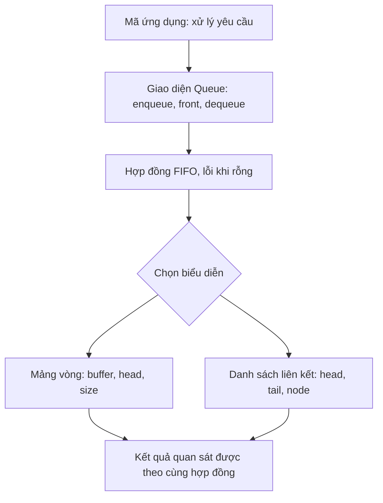

# Phân biệt giao diện sử dụng với chi tiết lưu trữ

> **Chương:** Đặc tả và chi phí · **Bài học:** Phân biệt giao diện sử dụng với chi tiết lưu trữ

Một hệ thống quản lý yêu cầu hỗ trợ có thể cần một hàng đợi: thêm yêu cầu mới vào cuối và xử lý yêu cầu đến sớm nhất. Người viết chức năng xử lý chỉ cần biết **gọi phép toán nào và nhận kết quả gì**. Họ không cần biết các yêu cầu được lưu trong mảng vòng, danh sách liên kết hay một cấu trúc khác.

Sự phân tách này là một nền tảng của thiết kế cấu trúc dữ liệu. **Giao diện sử dụng** mô tả khả năng mà cấu trúc cung cấp cho chương trình; **chi tiết lưu trữ** là những quyết định bên trong để thực hiện khả năng đó. Khi phân biệt rõ hai phía, ta có thể thay cách triển khai để cải thiện tốc độ, bộ nhớ hoặc khả năng bảo trì mà vẫn giữ hành vi mà chương trình đang dựa vào.

Trong mô-đun **Cấu trúc dữ liệu** (`COMPUTER_SCIENCE_DATA_STRUCTURES`), cách tư duy này áp dụng cho mảng, danh sách liên kết, stack, queue, bảng băm, cây, heap và đồ thị. Bài học thuộc chương **Đặc tả và chi phí**, vì lựa chọn cách lưu trữ chỉ có ý nghĩa sau khi đã xác định thao tác và yêu cầu sử dụng.

## 1. Mục tiêu học tập

Sau bài này, bạn có thể:

1. Phân biệt kiểu dữ liệu trừu tượng (ADT), giao diện công khai (API/interface), hợp đồng hành vi và cấu trúc dữ liệu triển khai.
2. Chỉ ra thông tin nào người gọi được phép phụ thuộc và thông tin nào là chi tiết nội bộ.
3. Viết hai cài đặt có cùng giao diện nhưng biểu diễn dữ liệu khác nhau, rồi kiểm tra chúng cho kết quả tương đương.
4. Giải thích tại sao trả về một tham chiếu đến cấu trúc nội bộ có thể phá vỡ tính đóng gói.
5. Đánh giá tác động của lựa chọn lưu trữ đối với thời gian, bộ nhớ và độ ổn định của giao diện.

## 2. Bốn lớp cần phân biệt

Các thuật ngữ thường xuất hiện cùng nhau nhưng không đồng nghĩa:

| Lớp | Câu hỏi được trả lời | Ví dụ với Queue |
| --- | --- | --- |
| **ADT (kiểu dữ liệu trừu tượng)** | Đối tượng có ý nghĩa gì và những thao tác nào hợp lệ? | Hàng đợi hoạt động theo FIFO |
| **Giao diện công khai (API/interface)** | Chương trình gọi thao tác bằng tên, tham số, kiểu trả về nào? | `enqueue(x)`, `dequeue()`, `front()`, `is_empty()` |
| **Hợp đồng hành vi** | Mỗi thao tác phải làm gì, xử lý lỗi ra sao? | `dequeue()` trả phần tử đến sớm nhất chưa bị lấy; rỗng thì báo lỗi |
| **Cài đặt/biểu diễn nội bộ** | Các giá trị được lưu ở đâu và cập nhật như thế nào? | Mảng vòng gồm `buffer, head, size` hoặc danh sách nút `head, tail` |

ADT và hợp đồng hành vi giải thích ý nghĩa của thao tác. Giao diện định hình cách gọi cụ thể trong một ngôn ngữ lập trình. Cài đặt sử dụng mảng, con trỏ và thuật toán để hiện thực hợp đồng ấy.

**Chữ ký của một phương thức chưa phải toàn bộ hợp đồng.** Hai lớp đều có `dequeue() -> T`, nhưng nếu một lớp lấy phần tử cũ nhất còn lớp khác lấy phần tử mới nhất, chúng có chữ ký giống nhau mà hành vi khác nhau. Lớp thứ hai không hiện thực đúng Queue FIFO.

### 2.1. Ranh giới giữa người dùng và người cài đặt



Người dùng Queue có thể viết:

```python
requests.enqueue("Yêu cầu A")
requests.enqueue("Yêu cầu B")
next_request = requests.dequeue()  # "Yêu cầu A"
```

Đoạn mã chỉ yêu cầu ba điều: có phép `enqueue`, có phép `dequeue` và tuân thủ FIFO. Những tên trường như `_buffer`, `_head`, `_tail` là chi tiết của nhà triển khai.

## 3. Thông tin nào thuộc giao diện sử dụng?

Để giao diện đủ rõ, hãy mô tả các điểm mà người gọi có thể quan sát hoặc cần dựa vào:

- **Tập phép toán:** những phương thức được phép gọi và mục đích của chúng.
- **Chữ ký:** tên, tham số, kiểu đầu vào/đầu ra; có thể bao gồm tham số kiểu như `T`.
- **Ngữ nghĩa:** thứ tự lấy phần tử, xử lý phần tử trùng, cách định nghĩa khóa bằng nhau.
- **Tiền điều kiện và lỗi:** trạng thái nào cho phép thao tác thành công; gọi sai thì lỗi hay trả kết quả đặc biệt.
- **Tác dụng phụ:** thao tác có làm thay đổi cấu trúc hay chỉ trả một giá trị?
- **Các đảm bảo quan sát khác:** thứ tự duyệt, hành vi của iterator, quy tắc chia sẻ đối tượng, và giới hạn hiệu năng nếu đã cam kết.

Ví dụ về một giao diện Queue có thể đặc tả như sau:

| Phép toán | Ý nghĩa công khai | Trường hợp biên |
| --- | --- | --- |
| `enqueue(x)` | Thêm `x` vào cuối hàng đợi | Cho phép các giá trị trùng và `None` trong ví dụ Python |
| `front() -> T` | Trả phần tử đầu nhưng không xóa | Queue rỗng: ném `IndexError("empty queue")` |
| `dequeue() -> T` | Trả và xóa phần tử đầu | Queue rỗng: ném `IndexError("empty queue")` |
| `is_empty() -> bool` | Trả `True` khi không có phần tử | Không thay đổi trạng thái |
| `len(queue) -> int` | Số phần tử hiện tại | Không thay đổi trạng thái |

Với trạng thái trừu tượng `Q = [a, b, c]` (phần tử đầu nằm bên trái):

```text
enqueue(Q, d)  -> [a, b, c, d]
front(Q)       -> a, Q không đổi
dequeue(Q)     -> trả a; Q trở thành [b, c]
```

Đó là hành vi người dùng có quyền kỳ vọng dù lớp sử dụng mảng, liên kết hay vùng nhớ khác.

### 3.1. Điều gì thuộc chi tiết lưu trữ?

Những quyết định sau thuộc tầng cài đặt nếu API không công khai chúng:

| Chi tiết bên trong | Vì sao không nên trở thành yêu cầu sử dụng |
| --- | --- |
| Sức chứa hiện tại của `buffer` và quy tắc mở rộng | Một Queue khác có thể dùng các nút và không có sức chứa mảng |
| Chỉ số `head` hoặc `tail` trong mảng vòng | Người dùng chỉ cần biết phần tử đầu và cuối theo nghĩa FIFO |
| Nút `next` trong danh sách liên kết | Mảng vòng không có liên kết này |
| Kích thước bucket, hàm băm và xử lý va chạm của bảng băm | Giao diện Map cần ánh xạ đúng khóa–giá trị, bất kể bucket |
| Chiều cao hoặc cách quay nút của cây cân bằng | Người dùng Map không cần biết cây quay trái hay quay phải |
| Vị trí vật lý của phần tử trong heap | Priority Queue chỉ cần trả phần tử có độ ưu tiên đúng |
| Dùng ma trận hay danh sách kề của đồ thị | Các phép toán đồ thị phải phản ánh đúng đỉnh/cạnh theo hợp đồng |

Dù vậy, một chi tiết có thể trở thành **yêu cầu giao diện** nếu người thiết kế cố ý đưa nó vào hợp đồng. Ví dụ, một `FixedCapacityQueue` có thể công khai `capacity()` và `is_full()`; lúc đó sức chứa tối đa không còn là chi tiết hoàn toàn ẩn. Không nên mặc định rằng mọi thuộc tính nội bộ đều không thể được công khai.

## 4. Hai cài đặt Queue với cùng một giao diện

Ta sẽ triển khai cùng một Queue FIFO theo hai cách: **mảng vòng tự mở rộng** và **danh sách liên kết đơn**. Các ví dụ Python sau có thể chạy độc lập khi đặt liên tiếp trong cùng một tệp.

### 4.1. Cách 1: Queue bằng mảng vòng

Mảng vòng lưu phần tử trong `_buffer`; `_head` là chỉ số phần tử đầu, `_size` là số phần tử đang có. Chỉ số vật lý của phần tử thứ `i` trong Queue bằng:

\[
\operatorname{index}(i)=(\_head+i)\bmod \operatorname{len}(\_buffer)
\]

```python
class CircularQueue:
    def __init__(self):
        self._buffer = [None] * 4
        self._head = 0
        self._size = 0

    def __len__(self):
        return self._size

    def is_empty(self):
        return self._size == 0

    def _grow(self):
        new_buffer = [None] * (2 * len(self._buffer))
        for i in range(self._size):
            old_index = (self._head + i) % len(self._buffer)
            new_buffer[i] = self._buffer[old_index]
        self._buffer = new_buffer
        self._head = 0

    def enqueue(self, value):
        if self._size == len(self._buffer):
            self._grow()
        index = (self._head + self._size) % len(self._buffer)
        self._buffer[index] = value
        self._size += 1

    def front(self):
        if self.is_empty():
            raise IndexError("empty queue")
        return self._buffer[self._head]

    def dequeue(self):
        if self.is_empty():
            raise IndexError("empty queue")
        value = self._buffer[self._head]
        self._buffer[self._head] = None
        self._head = (self._head + 1) % len(self._buffer)
        self._size -= 1
        return value
```

Cài đặt này chỉ di chuyển chỉ số đầu và chỉ số chèn. Nó **không phải dồn các phần tử về đầu mảng** sau mỗi lần lấy ra. Khi mảng đầy, `_grow` sao chép các phần tử theo thứ tự logic sang mảng có sức chứa lớn gấp đôi.

Bất biến biểu diễn cơ bản là `len(_buffer) ≥ 1`, `0 ≤ _head < len(_buffer)` và `0 ≤ _size ≤ len(_buffer)`. Các ô có hiệu lực nằm ở những chỉ số vòng theo công thức bên trên.

### 4.2. Cách 2: Queue bằng danh sách liên kết

Mỗi nút giữ một giá trị và tham chiếu tới nút kế tiếp. `_head` trỏ tới phần tử đầu, `_tail` trỏ tới phần tử cuối.

```python
class _Node:
    def __init__(self, value):
        self.value = value
        self.next = None


class LinkedQueue:
    def __init__(self):
        self._head = None
        self._tail = None
        self._size = 0

    def __len__(self):
        return self._size

    def is_empty(self):
        return self._size == 0

    def enqueue(self, value):
        node = _Node(value)
        if self._tail is None:
            self._head = node
        else:
            self._tail.next = node
        self._tail = node
        self._size += 1

    def front(self):
        if self.is_empty():
            raise IndexError("empty queue")
        return self._head.value

    def dequeue(self):
        if self.is_empty():
            raise IndexError("empty queue")
        value = self._head.value
        self._head = self._head.next
        self._size -= 1
        if self._head is None:
            self._tail = None
        return value
```

Để giữ biểu diễn nhất quán, khi Queue trở thành rỗng, cả `_head` và `_tail` đều phải bằng `None`. Cài đặt liên kết không có phép tính modulo hoặc mở rộng mảng; đổi lại, mỗi phần tử cần một đối tượng nút và một liên kết.

### 4.3. Một bộ kiểm thử chung cho cả hai

Giao diện của hai lớp có cùng tên phương thức và cùng hợp đồng. Vì vậy ta có thể viết **một** bộ kiểm thử hành vi và chạy lại trên từng cài đặt:

```python
def check_queue_contract(queue_class):
    q = queue_class()
    assert q.is_empty()
    assert len(q) == 0

    q.enqueue("A")
    q.enqueue(None)  # None cũng là một phần tử hợp lệ
    q.enqueue("B")
    assert len(q) == 3
    assert q.front() == "A"
    assert len(q) == 3  # front không làm mất dữ liệu

    assert q.dequeue() == "A"
    assert q.dequeue() is None
    assert q.dequeue() == "B"
    assert q.is_empty()

    try:
        q.dequeue()
    except IndexError as error:
        assert str(error) == "empty queue"
    else:
        raise AssertionError("Queue rỗng phải báo lỗi")

    assert q.is_empty()
    assert len(q) == 0


check_queue_contract(CircularQueue)
check_queue_contract(LinkedQueue)
```

Nếu thay `CircularQueue` bằng `LinkedQueue` trong phần còn lại của ứng dụng, các đoạn mã chỉ dựa vào giao diện này **không cần biết cách lưu trữ đã thay đổi**. Bộ kiểm thử chung đóng vai trò kiểm tra tính tương thích hành vi; với hệ thống thật, cần bổ sung kiểm thử nhiều thao tác liên tiếp, kích thước lớn và trường hợp biên.

### 4.4. Cùng kết quả nhưng không cùng chi phí

Giả sử Queue đang lưu `n` phần tử.

| Tiêu chí | Mảng vòng tự mở rộng | Danh sách liên kết có đầu/đuôi |
| --- | --- | --- |
| `front`, `dequeue` | O(1) | O(1) |
| `enqueue` thông thường | O(1) | O(1) khi cấp phát nút có chi phí hằng số |
| Trường hợp `enqueue` phải mở rộng | O(n) vì cần sao chép | Không cần mở rộng toàn bộ chuỗi nút |
| `enqueue` trên chuỗi dài | O(1) khấu hao nhờ tăng gấp đôi | O(1) mỗi lần theo giả định cấp phát thông thường |
| Bộ nhớ | O(n) theo kích thước lớn nhất đã cấp phát, nếu không thu nhỏ | O(n) theo số phần tử hiện có, cộng chi phí từng nút |
| Truy cập bộ nhớ | Thường có tính cục bộ tốt do vùng đệm liên tiếp | Các nút có thể nằm rải rác trong bộ nhớ |

Lưu ý: bảng dùng các ước lượng theo mô hình thông thường, trong đó cấp phát bộ nhớ cho nút có chi phí O(1) và `n` là số phần tử tại thời điểm xét. Mảng vòng **không thu nhỏ** trong ví dụ nên sau khi xóa gần hết phần tử, bộ nhớ giữ lại còn phụ thuộc số phần tử lớn nhất từng chứa. Kết luận về hiệu năng thực tế còn chịu tác động của bộ cấp phát, cache và đặc tính tải.

**Ý nghĩa quan trọng:** Tính đúng của Queue do hợp đồng FIFO quyết định. Chi phí thời gian/bộ nhớ do cách triển khai quyết định. Nếu ứng dụng đặt thêm mục tiêu độ trễ tối đa hay giới hạn bộ nhớ, yêu cầu phi chức năng ấy cần được xét riêng cùng hợp đồng hành vi.

## 5. Đóng gói: bảo vệ ranh giới giao diện

Nếu lớp công khai dữ liệu nội bộ để mã bên ngoài tùy ý sửa, những giả định của cài đặt dễ bị phá vỡ.

### 5.1. Ví dụ làm lộ dữ liệu nội bộ

Xét một stack lưu các phần tử trong danh sách Python:

```python
class UnsafeStack:
    def __init__(self):
        self._items = []

    def push(self, item):
        self._items.append(item)

    def items(self):
        return self._items  # Trả về chính danh sách nội bộ


stack = UnsafeStack()
stack.push("A")
shared_list = stack.items()
shared_list.clear()  # Sửa dữ liệu stack mà không gọi thao tác stack
```

Ở đây, `items()` trả về **cùng một đối tượng danh sách**, không phải bản sao. Mã bên ngoài có thể xóa, chèn hoặc đảo ngược phần tử. Nếu stack có thêm bộ đếm `size` riêng, việc sửa trực tiếp còn có thể khiến bộ đếm không khớp dữ liệu.

Tình huống này thể hiện vấn đề **aliasing**: hai tham chiếu cùng trỏ tới một đối tượng có thể thay đổi. Việc đặt tên trường `_items` theo quy ước “nội bộ” của Python chưa bảo vệ dữ liệu nếu API tự trả tham chiếu đó ra ngoài.

### 5.2. Công khai ảnh chụp có kiểm soát

Nếu người dùng chỉ cần xem trạng thái hiện tại, có thể cung cấp một phép `snapshot()` trả về bản chụp bất biến của cấu trúc phần tử:

```python
class Stack:
    def __init__(self):
        self._items = []

    def push(self, item):
        self._items.append(item)

    def pop(self):
        if not self._items:
            raise IndexError("empty stack")
        return self._items.pop()

    def snapshot(self):
        return tuple(self._items)


stack = Stack()
stack.push("A")
view = stack.snapshot()  # ("A",)
stack.push("B")
assert view == ("A",)
```

`snapshot()` tạo tuple nên người gọi không thể thêm hoặc xóa phần tử trong **container trả về**; đồng thời giá trị đã chụp không thay đổi khi stack tiếp tục nhận phần tử mới. Đây chỉ là **sao chép nông**: nếu phần tử trong stack là đối tượng có thể thay đổi (ví dụ một danh sách), cả stack và ảnh chụp vẫn có thể cùng tham chiếu tới phần tử đó. Muốn bảo đảm bất biến sâu thì phải định nghĩa và triển khai chính sách sao chép sâu hoặc sử dụng phần tử bất biến.

Đổi lại, việc tạo snapshot mất O(n) thời gian và O(n) bộ nhớ phụ. Nếu yêu cầu chỉ cần xem đỉnh, `peek` O(1) phù hợp hơn. Giao diện cần chọn đúng khả năng cần thiết để tránh vô tình buộc mọi người dùng trả chi phí quá lớn.

### 5.3. Thay đổi chi tiết nội bộ có an toàn đến đâu?

Một thay đổi cài đặt được coi là **tương thích theo hợp đồng** khi mã chỉ dùng giao diện công khai tiếp tục nhận cùng hành vi đã cam kết.

Có thể thay đổi:

- Mảng vòng thành danh sách liên kết cho Queue FIFO.
- Danh sách phần tử thành heap để hiện thực hàng đợi ưu tiên, nếu quy tắc lấy phần tử vẫn đúng.
- Bảng băm thành cây cân bằng cho Map, nếu kiểu khóa, giá trị, kết quả truy vấn và những đảm bảo công khai khác vẫn được giữ.

Cần xem xét kỹ nếu thay đổi:

- Thứ tự duyệt mà API đã cam kết, ví dụ chuyển từ Map có sắp xếp khóa sang bảng băm không bảo đảm thứ tự.
- Quy tắc phân biệt phần tử hoặc khóa bằng nhau.
- Kiểu ngoại lệ và hành vi khi cấu trúc rỗng.
- Việc trả bản sao thành trả tham chiếu sống tới dữ liệu nội bộ.
- Đặc tính hiệu năng đã ghi trong hợp đồng dịch vụ, ví dụ thời gian tối đa trên kích thước dữ liệu định trước.

Đóng gói tốt khiến số lượng giả định của mã bên ngoài ít hơn. Nó cũng làm phạm vi kiểm thử khi thay cách cài đặt rõ ràng hơn.

## 6. Đừng biến chi tiết lưu trữ thành giao diện một cách vô tình

Một API có thể “lộ” cài đặt mà không trả trực tiếp mảng hoặc con trỏ. Cách đặt tên, thứ tự duyệt, quyền truy cập chỉ số và khả năng chỉnh sửa cũng có thể khiến người dùng dựa vào đặc điểm của biểu diễn hiện tại.

### 6.1. Ví dụ: yêu cầu truy cập theo chỉ số

Nếu ADT chỉ cần `push`, `pop` và `peek`, mảng động lẫn danh sách liên kết đều có thể hiện thực Stack hiệu quả.

Nhưng nếu giao diện thêm `get(i)` để truy cập phần tử thứ `i` tính từ đáy, lựa chọn cấu trúc dữ liệu thay đổi:

| Phép toán | Stack bằng mảng động | Stack bằng danh sách liên kết đơn từ đỉnh |
| --- | --- | --- |
| `push` | O(1) khấu hao | O(1) |
| `pop` | O(1) | O(1) |
| `peek` | O(1) | O(1) |
| `get(i)` với chỉ số từ đáy | O(1) | O(n) ở trường hợp xấu |

`get(i)` không nhất thiết là một API sai. Tuy nhiên, nó bổ sung khả năng mới và ảnh hưởng đến cấu trúc dữ liệu phù hợp. Người thiết kế phải xác định đây có thật sự là thao tác mà người dùng cần hay không.

### 6.2. Ví dụ: thứ tự duyệt của Map

Một **Map** trừu tượng gán mỗi khóa duy nhất tới một giá trị. Nếu chỉ công khai `put(k,v)`, `get(k)` và `remove(k)`, việc duy trì thứ tự khóa có thể không cần thiết.

Nếu giao diện cung cấp `keys_in_order()` trả về các khóa theo thứ tự tăng dần, đây đã là **cam kết hành vi công khai**. Một cây tìm kiếm cân bằng thích hợp cho phép duyệt theo thứ tự trong O(n); bảng băm có thể cần lấy các khóa ra và sắp xếp, thường O(n log n) so sánh.

**Không được mặc nhiên dựa vào thứ tự duyệt ngẫu nhiên của một cài đặt** nếu hợp đồng Map không quy định thứ tự ấy. Ngược lại, nếu một thư viện có cam kết thứ tự chèn hoặc thứ tự tăng dần, thay cài đặt phải duy trì đúng cam kết.

### 6.3. Ví dụ: đồ thị có thể đổi biểu diễn

Một giao diện Graph có thể cung cấp:

```text
add_vertex(v)
add_edge(u, v)
has_edge(u, v) -> bool
neighbors(v) -> iterable<Vertex>
```

Giả sử đồ thị có `V` đỉnh và `E` cạnh. Một đồ thị có hướng, không trọng số và không cho cạnh trùng có thể dùng:

| Biểu diễn | Bộ nhớ | `has_edge(u,v)` | Duyệt các láng giềng của `u` |
| --- | --- | --- | --- |
| Ma trận kề | O(V²) | O(1) | O(V) nếu quét cả hàng |
| Danh sách kề bằng danh sách không sắp xếp | O(V + E) | O(deg(u)) | O(deg(u)) |
| Danh sách kề bằng tập băm | O(V + E) kỳ vọng | O(1) trung bình/kỳ vọng | O(deg(u)) |

Ở bảng này, `deg(u)` là số cạnh đi ra từ `u`; ta giả sử định danh đỉnh đã ánh xạ được tới ô mảng hoặc mục tra cứu cần thiết, và không tính chi phí xuất ra từng phần tử đối với truy vấn chỉ hỏi có cạnh. Dùng tập băm phụ thuộc chất lượng băm và không mặc định có thứ tự duyệt.

Với đồ thị thưa, danh sách kề thường tiết kiệm bộ nhớ. Với đồ thị dày đặc hoặc truy vấn tồn tại cạnh nhiều, ma trận kề có thể phù hợp. Hai cách biểu diễn vẫn có thể cung cấp **cùng các phép toán đồ thị**. Nếu API yêu cầu thứ tự của `neighbors(v)`, từng cài đặt phải bổ sung logic bảo đảm thứ tự đó.

## 7. ADT, cấu trúc dữ liệu và mẫu lựa chọn phổ biến

Những cặp sau thường đi cùng nhau nhưng không được đồng nhất:

| Mục tiêu giao diện/ADT | Những cấu trúc cài đặt thường gặp | Điều cần phân biệt |
| --- | --- | --- |
| **Stack**: vào sau, ra trước (LIFO) | Mảng động; danh sách liên kết | LIFO là hành vi; chỉ số đỉnh hoặc con trỏ là biểu diễn |
| **Queue**: vào trước, ra trước (FIFO) | Mảng vòng; danh sách liên kết đầu/đuôi | FIFO không bắt buộc phải lưu phần tử liên tiếp |
| **Deque**: thêm/lấy hai đầu | Mảng vòng; danh sách liên kết đôi | Tập phép toán nhiều hơn Queue thông thường |
| **Map**: khóa → giá trị | Bảng băm; cây tìm kiếm cân bằng | Một cây có thứ tự, bảng băm tra cứu trung bình nhanh; phải xét hợp đồng duyệt |
| **Set**: tập phần tử không trùng | Bảng băm; cây tìm kiếm | Giao diện dựa trên thuộc/không thuộc, không buộc một kiểu lưu trữ |
| **Priority Queue**: lấy phần tử ưu tiên nhất | Heap nhị phân; cây cân bằng | Thứ tự ưu tiên là hợp đồng; vị trí trong heap chỉ là kỹ thuật |
| **Graph**: đỉnh, cạnh, láng giềng | Ma trận kề; danh sách/tập kề | Quan hệ cạnh là mô hình; cấu trúc kề là cách biểu diễn |

Một lưu ý quan trọng: **mảng và danh sách liên kết cũng có thể được trình bày như kiểu dữ liệu có giao diện riêng**, chẳng hạn một `List` công khai truy cập vị trí và chèn/xóa. Vì vậy, việc một tên gọi đại diện cho ADT hay một cách lưu trữ còn tùy bối cảnh. Trong bài này, ta phân biệt theo **hợp đồng người gọi thấy được** và **cách hiện thực bên trong**.

### 7.1. Ví dụ: Priority Queue khác Heap

`PriorityQueue` có thể công khai `insert(item, priority)` và `extract_min()`. Ý nghĩa của `extract_min` là lấy phần tử có độ ưu tiên nhỏ nhất hiện có, không phải lấy phần tử được chèn trước nhất.

Một heap nhị phân là **biểu diễn** cho phép thực hiện `insert` và `extract_min` trong O(log n) trường hợp xấu khi dùng thuật toán chuẩn, còn `peek_min` trong O(1). Heap không tự quyết định cách xử lý hai phần tử có cùng ưu tiên: nếu giao diện cam kết ổn định theo thứ tự chèn, cài đặt cần thêm thông tin phụ như số thứ tự chèn để phân xử.

### 7.2. Ví dụ: kết quả đúng có thể đi kèm chi phí tệ

Một Queue FIFO lưu trong mảng Python thông thường có thể dùng:

```python
class SlowQueue:
    def __init__(self):
        self._items = []

    def enqueue(self, x):
        self._items.append(x)

    def dequeue(self):
        if not self._items:
            raise IndexError("empty queue")
        return self._items.pop(0)
```

Về hành vi, `enqueue` thêm cuối và `dequeue` lấy đầu nên lớp vẫn có thể đúng FIFO. Tuy nhiên, `pop(0)` khiến các phần tử còn lại dịch về trước, thường mất O(n). Mảng vòng hoặc danh sách liên kết có thể đáp ứng cùng hợp đồng với `dequeue` O(1). Đây là lý do cần phân tích **chi phí phép toán**, không chỉ xác minh đầu ra.

## 8. Tương thích giao diện: tên hàm giống nhau chưa đủ

Giả sử có hai lớp đều định nghĩa:

```python
def remove(self):
    ...
```

Nếu một lớp xóa **phần tử đầu**, lớp khác xóa **phần tử cuối**, chúng không tương thích ở mức hợp đồng dù có cùng chữ ký. Tính tương thích khi thay một cài đặt bằng cài đặt khác cần xét:

1. **Đầu vào được chấp nhận:** lớp mới không bất ngờ từ chối đầu vào mà hợp đồng cũ cho phép.
2. **Kết quả và tác dụng phụ:** giá trị trả về, thứ tự phần tử và thay đổi trạng thái phù hợp hợp đồng.
3. **Xử lý lỗi:** mã lỗi hoặc ngoại lệ có ý nghĩa nhất quán theo giao diện.
4. **Ràng buộc quan sát khác:** thứ tự duyệt, cách chụp/duy trì tham chiếu, quy tắc so sánh và quyền sửa đổi dữ liệu.
5. **Yêu cầu chi phí nếu đã cam kết:** không để một thay đổi nội bộ phá vỡ tiêu chí độ trễ hoặc bộ nhớ mà hệ thống phụ thuộc.

Ví dụ, thay `front()` thành thao tác lấy và xóa phần tử đầu là thay đổi hành vi, kể cả giá trị trả về trong lần gọi đầu tiên giống nhau. Sau khi thay, `len(queue)` sẽ giảm, và mã ứng dụng có thể xử lý sai.

### 8.1. Interface trong ngôn ngữ lập trình

Trong Java hay TypeScript, `interface` thường quy định tên và kiểu phương thức. Trong Python, một `Protocol` có thể dùng để khai báo hình dạng giao diện, nhưng chỉ kiểm tra cấu trúc phương thức thì không tự chứng minh FIFO.

Ví dụ mô tả giao diện bằng Python typing:

```python
from typing import Protocol, TypeVar

T = TypeVar("T", covariant=False)


class QueueLike(Protocol[T]):
    def enqueue(self, value: T) -> None: ...
    def dequeue(self) -> T: ...
    def front(self) -> T: ...
    def is_empty(self) -> bool: ...
    def __len__(self) -> int: ...
```

Khai báo này giúp trình kiểm tra kiểu xác định một đối tượng có những phương thức cần thiết. Nhưng nó **không diễn đạt** quy luật FIFO, điều kiện khi rỗng hoặc bảo đảm phức tạp. Những nội dung đó vẫn phải được ghi bằng tài liệu/hợp đồng và xác minh bằng kiểm thử.

Trong Python, các lớp minh họa ở phần trước không khai báo `QueueLike` vẫn có thể đáp ứng giao diện về mặt cấu trúc. Chúng cần được đánh giá thêm về hành vi và trường hợp biên.

## 9. Quy trình thiết kế hướng từ giao diện đến lưu trữ

Khi đứng trước một bài toán, có thể làm theo các bước sau.

### Bước 1: Phát biểu nhu cầu bằng thao tác

Ví dụ hệ thống xử lý công việc cần:

```text
enqueue(job)
dequeue() -> job
is_empty() -> bool
```

Nếu công việc có mức ưu tiên, hãy cân nhắc từ đầu việc cần `extract_min`/`extract_max` thay vì FIFO. Nếu người dùng cần truy cập ngẫu nhiên theo vị trí, đây lại là một kiểu giao diện khác.

### Bước 2: Định nghĩa hợp đồng và trường hợp biên

Quyết định rõ:

- Có cho phép phần tử trùng hoặc `None` không?
- Khi rỗng, `dequeue()` sẽ báo lỗi, trả `Option` hay chờ có phần tử?
- `front()` có giữ nguyên cấu trúc không?
- Có yêu cầu ổn định thứ tự khi các phần tử bằng nhau không?
- Giao diện có được gọi đồng thời từ nhiều luồng không? Nếu có, cần cam kết mức an toàn luồng hoặc đồng bộ rõ ràng.

Đừng thêm yêu cầu chưa tồn tại, chẳng hạn tự mặc định Queue phải hỗ trợ xem mọi phần tử theo chỉ số.

### Bước 3: Xác định đặc điểm tải và mục tiêu hiệu năng

Ước lượng số phần tử, tỷ lệ thêm/lấy, khả năng bùng nổ kích thước, giới hạn bộ nhớ, nhu cầu duyệt và truy cập ngẫu nhiên. Ví dụ một Queue có tần suất rất cao có thể ưu tiên mảng vòng để tận dụng tính cục bộ bộ nhớ; một Queue thường xuyên tăng giảm với kích thước khó đoán có thể cân nhắc biểu diễn liên kết.

### Bước 4: Chọn cài đặt và viết bất biến biểu diễn

Với mảng vòng: quan hệ giữa `_head`, `_size` và `_buffer` phải luôn hợp lệ. Với danh sách liên kết: `_tail` phải là nút cuối và trạng thái rỗng phải nhất quán. Các bất biến này dành cho người triển khai, không cần công khai trong API.

### Bước 5: Kiểm thử hành vi độc lập với cài đặt

Chạy cùng một bộ kiểm thử đối với các lựa chọn triển khai, bao gồm:

- Chuỗi thêm/lấy nhiều phần tử và giá trị trùng.
- Chuyển trạng thái rỗng → một phần tử → rỗng.
- Trường hợp mảng vòng quay chỉ số về đầu và mở rộng sức chứa.
- Quy tắc lỗi khi thao tác trên cấu trúc rỗng.
- Truy vấn không làm thay đổi cấu trúc.

### Bước 6: Đo và so sánh chi phí

Phân biệt phân tích Big-O với số đo thực tế. Với `enqueue` và `dequeue`, cả mảng vòng và danh sách liên kết đều có thể đạt hiệu năng tiệm cận O(1) phù hợp, nhưng độ trễ thực tế và bộ nhớ phụ thuộc kích thước phần tử, cách cấp phát và mô hình truy cập. Đo trên tải đủ đại diện rồi quyết định.

## 10. Những sai lầm thường gặp

| Sai lầm | Hệ quả | Cách khắc phục |
| --- | --- | --- |
| Nghĩ “Queue là danh sách liên kết” | Bỏ qua lựa chọn mảng vòng dù có thể phù hợp hơn | Viết FIFO dưới dạng hợp đồng trước khi chọn biểu diễn |
| Nghĩ “Map là hash table” | Bỏ qua cây cân bằng khi cần thứ tự hoặc bảo đảm thời gian xấu | Tách thao tác Map khỏi thuật toán lưu khóa |
| Gọi `get(0)` để lấy “đầu” Queue nhưng API không có `get` | Mã ứng dụng phụ thuộc biểu diễn cụ thể | Sử dụng `front` và `dequeue` theo hợp đồng |
| Trả trực tiếp `_items` để người dùng “xem nhanh” | Mã bên ngoài sửa dữ liệu nội bộ, tạo lỗi khó theo dõi | Cung cấp phép truy vấn, iterator hoặc snapshot có ngữ nghĩa rõ |
| Chỉ kiểm tra tên và kiểu phương thức | Bỏ sót lỗi LIFO/FIFO hoặc trạng thái sau phép toán | Kiểm thử hợp đồng bằng chuỗi thao tác |
| Mặc định thứ tự duyệt từ bảng băm là thứ tự tăng dần | Thay triển khai có thể làm sai kết quả | Quy định rõ thứ tự nếu là yêu cầu công khai |
| Đưa Big-O của một cài đặt vào định nghĩa ADT | Gắn chặt ý nghĩa kiểu dữ liệu với một thuật toán cụ thể | Phân tích chi phí theo từng lựa chọn triển khai |
| Chỉ tối ưu tốc độ mà bỏ qua bộ nhớ | Ứng dụng vượt giới hạn hoặc giữ dung lượng dư quá lớn | So sánh cả thời gian, bộ nhớ và đặc điểm tải |

## 11. Bài tập vận dụng kèm gợi ý

### Bài 1: Một giao diện, hai cách lưu

Bạn cần hỗ trợ `push(x)`, `pop()` và `peek()` theo LIFO. Hãy chọn hai cấu trúc có thể triển khai Stack, xác định đâu là chi tiết nội bộ và đâu là hợp đồng bắt buộc.

**Gợi ý:** Mảng động có `buffer` và chỉ số cuối; danh sách liên kết đơn có con trỏ `top`. Cả hai phải bảo đảm `pop` trả về phần tử được `push` gần nhất chưa bị lấy. Bất biến chỉ số hoặc con trỏ là nội bộ.

### Bài 2: Sửa giao diện làm rò rỉ dữ liệu

Một lớp `Bag` có phương thức `get_internal_list()` trả về chính danh sách đang dùng để lưu phần tử. Người gọi sử dụng `bag.get_internal_list().sort()` và thay đổi thứ tự bên trong.

**Câu hỏi:** Tại sao đây là phụ thuộc vào biểu diễn? Có những lựa chọn API nào nếu người gọi chỉ muốn đọc phần tử theo thứ tự?

**Gợi ý:** Người gọi có quyền sửa container nội bộ mà không qua phép toán có hợp đồng. Có thể cung cấp `sorted_snapshot()` trả về bản sao được sắp xếp, hoặc iterator có quy tắc thứ tự rõ. Việc cung cấp snapshot có chi phí O(n) để sao chép và thêm O(n log n) nếu cần sắp xếp bằng thuật toán so sánh thông thường.

### Bài 3: Đổi cài đặt Map

Một Map ban đầu dùng cây cân bằng và công khai `keys_sorted()` trả khóa tăng dần. Bạn muốn chuyển sang bảng băm.

**Câu hỏi:** Có thể thay không? Nếu có thì phải làm gì để giữ hợp đồng?

**Gợi ý:** Có thể thay biểu diễn nhưng vẫn phải trả khóa đã sắp xếp. Với bảng băm không duy trì thứ tự, `keys_sorted()` có thể cần lấy toàn bộ khóa rồi sắp xếp; chi phí có thể tăng tới O(n log n). Nếu yêu cầu hiệu năng cố định, phải xem xét cả mục tiêu đó.

### Bài 4: Chọn biểu diễn cho đồ thị

Đồ thị có hàng chục nghìn đỉnh, rất ít cạnh so với `V²`, và chức năng thường xuyên duyệt các láng giềng của một đỉnh.

**Câu hỏi:** Nên cân nhắc biểu diễn nào trước và tại sao?

**Gợi ý:** Danh sách kề hoặc tập kề thường dùng O(V+E) bộ nhớ và cho phép duyệt các láng giềng thực có của một đỉnh trong O(deg(v)). Ma trận kề dùng O(V²) bộ nhớ và cần quét O(V) ô để liệt kê láng giềng của một đỉnh.

### Bài 5: Phát hiện cài đặt đúng chữ ký nhưng sai hợp đồng

Một lớp có `enqueue(x)`, `dequeue()`, `front()`. Hàm `dequeue()` được cài đặt bằng `list.pop()` trên mảng mà `enqueue` dùng `append`.

**Câu hỏi:** Đây là Queue hợp lệ không?

**Gợi ý:** Không theo hợp đồng FIFO: `pop()` lấy phần tử cuối cùng được thêm, tức LIFO. Có đủ tên phương thức nhưng không đúng thứ tự. Sửa bằng cấu trúc phù hợp cho lấy đầu hiệu quả, như mảng vòng hoặc `collections.deque`.

### Bài 6: Trường hợp `None`

Một Queue cho phép thêm `None`. Một triển khai chọn trả `None` khi hàng đợi rỗng thay vì ném lỗi.

**Câu hỏi:** Điều gì mơ hồ? Cách nào tránh được?

**Gợi ý:** Người gọi không thể biết `None` là một phần tử hợp lệ vừa lấy hay dấu hiệu Queue rỗng. Có thể giữ ngoại lệ như hợp đồng của bài, hoặc dùng kiểu kết quả phân biệt rõ `Some(None)` và `None` (không có phần tử).

## 12. Tự kiểm tra kiến thức

Hãy tự trả lời trước khi chuyển sang bài tiếp theo:

1. **Thế nào là giao diện sử dụng?** Là tập phép toán và những đảm bảo có thể quan sát mà người gọi dựa vào, gồm chữ ký, hành vi và lỗi được quy định.
2. **Thế nào là chi tiết lưu trữ?** Là cách cài đặt tổ chức dữ liệu, trường nội bộ, vùng nhớ và thuật toán để hiện thực giao diện.
3. **Tại sao một interface đủ kiểu phương thức vẫn có thể sai?** Vì kiểu không tự chứng minh các quy tắc như FIFO, LIFO hoặc thứ tự duyệt.
4. **Tại sao đổi mảng sang danh sách liên kết có thể không ảnh hưởng người dùng?** Vì cả hai có thể cung cấp cùng API và hợp đồng, mặc dù cách quản lý bộ nhớ và chi phí khác nhau.
5. **Khi nào chi tiết lưu trữ trở thành yêu cầu công khai?** Khi API cố ý cam kết thuộc tính liên quan, ví dụ dung lượng cố định, truy cập chỉ số O(1) hoặc thứ tự duyệt được xác định.
6. **Vì sao cần kiểm thử chung cho các cài đặt?** Để xác minh người dùng quan sát cùng kết quả trong những tình huống hợp lệ và biên.

Một thiết kế cấu trúc dữ liệu tốt cho phép mã ứng dụng phụ thuộc vào **những khả năng được cam kết**, còn người triển khai có quyền thay cách lưu trữ khi chứng minh được hành vi vẫn đúng và chi phí phù hợp yêu cầu. Đó là cơ sở để chọn mảng, danh sách liên kết, bảng băm, cây, heap hoặc biểu diễn đồ thị theo đặc điểm bài toán thay vì theo thói quen.
