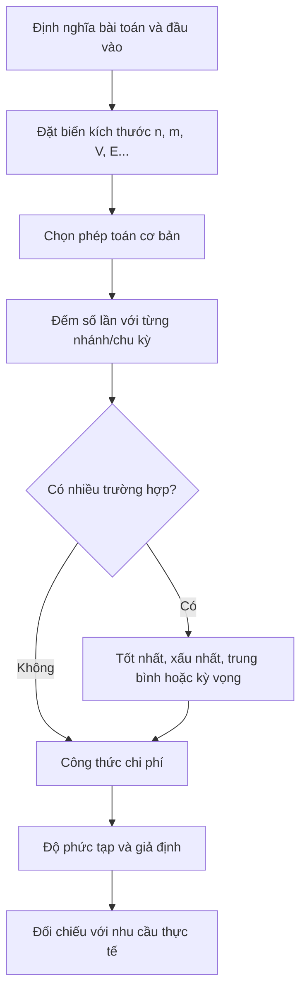

# Đo kích thước dữ liệu và xác định phép toán cơ bản

> **Chương:** Đặc tả và chi phí · **Bài học:** Đo kích thước dữ liệu và xác định phép toán cơ bản

Cùng một phép tìm kiếm có thể thực hiện rất nhanh trên vài phần tử nhưng trở nên chậm khi dữ liệu tăng lên hàng triệu phần tử. Để phân tích nguyên nhân, ta cần trả lời hai câu hỏi **trước khi** viết ký hiệu O lớn (Big-O):

1. **Kích thước đầu vào được đo bằng gì?** Là số phần tử, số đỉnh và cạnh, tổng độ dài các chuỗi, hay số truy vấn?
2. **Ta đang đếm thao tác nào?** Là số lần so sánh khóa, đọc ô mảng, đi qua liên kết, duyệt cạnh hay cấp phát/copy dữ liệu?

Nếu hai câu hỏi này chưa rõ, khẳng định “thuật toán chạy O(n)” có thể mơ hồ hoặc gây hiểu lầm.

Trong mô-đun **Cấu trúc dữ liệu** (`COMPUTER_SCIENCE_DATA_STRUCTURES`), cách đo kích thước và xác định phép toán cơ bản là nền tảng để đánh giá mảng, danh sách liên kết, stack, queue, bảng băm, cây, heap và đồ thị. Mục tiêu là hiểu **thao tác**, **bất biến**, **chi phí thời gian và bộ nhớ** để chọn cấu trúc phù hợp với bài toán.

## 1. Kết quả học tập

Sau bài này, bạn có thể:

- Định nghĩa rõ các tham số kích thước đầu vào như `n`, `m`, `V`, `E`, `k`, `q` và nói chúng đại diện cho dữ liệu gì.
- Chọn phép toán cơ bản phản ánh phần việc chủ yếu của một thuật toán, đồng thời nhận biết khi nào phải đếm nhiều loại thao tác.
- Tính số lần thực hiện thao tác trong các vòng lặp đơn, vòng lặp lồng nhau, tìm kiếm nhị phân và các thao tác cấu trúc dữ liệu.
- Phân biệt phân tích trường hợp tốt nhất, xấu nhất, trung bình, kỳ vọng và khấu hao.
- Phân biệt kích thước dữ liệu logic với số byte thực tế và bộ nhớ phụ của thuật toán.
- Lập mô hình chi phí cho một luồng công việc trước khi chọn cấu trúc lưu trữ.

## 2. Kích thước dữ liệu: định nghĩa theo đầu vào của bài toán

Kích thước đầu vào là đại lượng mô tả lượng công việc thuật toán phải xử lý. Ta thường ký hiệu nó bằng `n`, nhưng **`n` không có một ý nghĩa cố định cho mọi bài toán**.

Ví dụ: trong một bài tìm kiếm trên danh sách, `n` có thể là số phần tử; trong một bài xử lý đồ thị, chỉ một `n` thường không đủ để phân biệt số đỉnh với số cạnh; trong một bài so sánh chuỗi, độ dài ký tự cũng có thể quyết định chi phí.

| Bài toán | Tham số kích thước phù hợp | Vì sao |
| --- | --- | --- |
| Duyệt mảng | `n` = số phần tử | Mỗi phần tử có thể cần được xem một lần |
| Tìm khóa trong danh sách liên kết | `n` = số nút | Có thể phải đi qua nhiều liên kết để tới một nút |
| Xử lý ma trận | `r` = số hàng, `c` = số cột | Duyệt toàn bộ thường cần `r × c` ô |
| Trộn hai dãy đã sắp xếp | `n`, `m` = độ dài từng dãy | Kết quả có thể gồm `n + m` phần tử |
| Tìm kiếm cây | `n` = số nút; `h` = chiều cao | Số bước trên một đường đi phụ thuộc `h` |
| Tra khóa chuỗi trong bảng băm | `n` = số khóa; `k` = độ dài khóa | Tính hash và so sánh khóa có thể phụ thuộc `k` |
| Thao tác trên heap | `n` = số phần tử | Chiều cao heap nhị phân là O(log n) |
| Duyệt đồ thị | `V` = số đỉnh, `E` = số cạnh | Công việc thường phụ thuộc cả hai |
| Xử lý nhiều truy vấn | `n` = lượng dữ liệu, `q` = số truy vấn | Xây dựng cấu trúc và trả lời truy vấn là hai chi phí khác nhau |

**Nguyên tắc:** mỗi khi viết một công thức như `T(n)` hay `O(V + E)`, hãy định nghĩa các biến ngay tại chỗ. Người đọc cần biết đó là kích thước dữ liệu đầu vào, độ dài thao tác hay số phần tử đang có trong cấu trúc.

### 2.1. Số phần tử logic khác số byte thực tế

Một mảng có 10.000 số nguyên và một mảng có 10.000 chuỗi dài không nhất thiết chiếm cùng bộ nhớ hoặc có cùng chi phí so sánh phần tử.

Ví dụ:

```text
A = [7, 5, 9, 1]                 # n = 4 phần tử
B = ["a", "hello", "data", "x"]    # n = 4 phần tử, tổng 11 ký tự
```

Cả hai có `n = 4`. Tuy vậy, nếu thao tác cần so sánh đầy đủ các chuỗi, chi phí một lần so sánh còn phụ thuộc độ dài chuỗi và vị trí ký tự khác nhau. Trong một mô hình chi tiết, ta có thể dùng `L` là **tổng số ký tự** hoặc `k` là **độ dài tối đa của một khóa**.

Trong phân tích cấu trúc dữ liệu cơ bản, ta thường giả định thao tác trên một khóa có kích thước vừa trong một *từ máy* (machine word) mất O(1). Giả định này cần được nói rõ khi khóa là chuỗi dài, số nguyên rất lớn hay đối tượng có phép so sánh tốn kém.

### 2.2. Số chiều của dữ liệu không phải lúc nào cũng một

Xét hàm so sánh từng phần tử của hai mảng:

```python
def count_equal_pairs(a, b):
    count = 0
    for x in a:
        for y in b:
            if x == y:
                count += 1
    return count
```

Gọi `n = len(a)` và `m = len(b)`. Phép so sánh `x == y` được thực hiện **`n × m` lần**. Với `n, m ≥ 1`, thao tác này chi phối thời gian, vì vậy:

\[
T(n,m)=\Theta(nm)
\]

Nếu `m = 0`, số so sánh là 0 nhưng vòng lặp ngoài vẫn duyệt `n` phần tử, nên thời gian là Θ(n + 1). Công thức thời gian tổng quát, kể cả đầu vào rỗng, là Θ(1 + n + nm) trong mô hình này. Nếu tùy tiện gọi cả hai kích thước là `n`, ta chỉ có thể viết O(n²) trong trường hợp **đã giả định** hai dãy cùng độ dài. Việc giữ hai biến giúp phân tích đúng cả trường hợp một dãy rất ngắn còn dãy kia rất dài.

## 3. Phép toán cơ bản là gì?

*Phép toán cơ bản* (basic operation) là thao tác ta chọn để đếm, nhằm mô tả phần công việc chi phối thời gian chạy theo mô hình chi phí.

Một số phép toán thường được chọn:

| Bài toán/thuật toán | Phép toán cơ bản nên đếm | Ghi chú |
| --- | --- | --- |
| Tìm kiếm tuyến tính | So sánh phần tử với giá trị cần tìm | Số so sánh phụ thuộc vị trí kết quả |
| Tìm kiếm nhị phân | Lần khảo sát phần tử giữa hoặc so sánh khóa | Mỗi lần làm giảm khoảng tìm kiếm |
| Chèn vào mảng ở vị trí đầu | Di chuyển một phần tử sang phải | Có thể phải dịch nhiều phần tử |
| Duyệt danh sách liên kết | Đi theo liên kết `next` | Số nút cần vượt qua quyết định chi phí |
| `push` vào stack dùng mảng động | Ghi phần tử và sao chép khi mở rộng | Lần mở rộng cần tính riêng |
| `enqueue` vào queue liên kết | Cập nhật các tham chiếu đầu/cuối | O(1) dưới giả định cấp phát thông thường |
| Tra khóa trong bảng băm | Tính hash, truy cập bucket, so sánh khóa | Va chạm và chi phí hash ảnh hưởng kết quả |
| Tìm kiếm trong cây | So sánh khóa tại một nút | Số nút đi qua phụ thuộc chiều cao |
| `extract_min` từ heap | So sánh/hoán đổi dọc đường điều chỉnh | Độ dài đường đi tối đa O(log n) |
| Duyệt đồ thị | Xét một đỉnh hoặc một cạnh | Thường cần đếm cả `V` lẫn `E` |

Không có quy tắc rằng **mọi thuật toán chỉ được đếm đúng một loại thao tác**. Nếu đọc/ghi bộ nhớ, cấp phát và so sánh có chi phí đáng kể khác nhau, hãy dùng mô hình nhiều thành phần.

Ví dụ:

\[
T(n)\approx c_1\cdot C(n)+c_2\cdot M(n)+c_3\cdot A(n)
\]

Trong đó:

- `C(n)`: số phép so sánh khóa.
- `M(n)`: số lần di chuyển hoặc sao chép phần tử.
- `A(n)`: số lần cấp phát.
- `c₁, c₂, c₃`: chi phí giả định tương ứng trong môi trường xét.

Khi mô hình chi phí coi các thao tác này là O(1), ta có thể dùng tổng số lần để suy ra giới hạn tiệm cận. Trong đo thời gian thực tế, các hằng số chi phí có thể rất khác nhau.

### 3.1. Phân biệt thao tác của ADT với bước máy cơ bản

Phép `pop()` là một **phép toán công khai của Stack**. Nhưng một lần gọi `pop()` có thể cần nhiều bước nội bộ: đọc phần tử, cập nhật chỉ số, xóa tham chiếu, điều chỉnh kích thước.

Vì vậy, có hai tầng đo:

1. **Tầng sử dụng:** ứng dụng đã gọi `push`/`pop` bao nhiêu lần?
2. **Tầng triển khai:** mỗi lần gọi cần bao nhiêu bước so sánh, ghi, cấp phát hoặc sao chép?

Ví dụ, 1.000 lời gọi `push` không mặc nhiên có nghĩa đúng 1.000 bước máy. Với mảng động, một số lời gọi có thể phải mở rộng vùng đệm.

### 3.2. Mô hình RAM và giới hạn giả định O(1)

Phân tích Big-O cơ bản thường dựa trên mô hình RAM (*Random Access Machine*):

- Đọc/ghi một ô mảng theo chỉ số hợp lệ mất O(1).
- So sánh hai khóa có kích thước vừa một từ máy mất O(1).
- Cộng/trừ chỉ số và cập nhật tham chiếu mất O(1).
- Không tính số chu kỳ CPU, bộ nhớ đệm hay hoạt động của hệ điều hành ở mức chi tiết.

Mô hình này rất hữu ích để so sánh thuật toán. Tuy vậy, nó **không khẳng định** truy xuất mọi bộ nhớ đều có thời gian thực bằng nhau, hoặc so sánh hai chuỗi rất dài luôn O(1). Khi dữ liệu có kích thước biến thiên, chi phí từng thao tác phải được điều chỉnh.

## 4. Quy trình xác định kích thước và đếm thao tác

Với một đoạn mã, ta có thể thực hiện tuần tự:

1. **Xác định đầu vào:** dữ liệu nào thay đổi khi bài toán lớn hơn?
2. **Đặt biến:** chẳng hạn `n = len(values)`, `q = số lần truy vấn`.
3. **Chọn thao tác cần đếm:** ví dụ so sánh `values[i] == target`.
4. **Xác định số lần thao tác diễn ra:** đọc vòng lặp, nhánh điều kiện và trạng thái dừng.
5. **Xét các trường hợp:** thành công sớm, thất bại, dữ liệu bất lợi hay đầu vào thông thường.
6. **Viết công thức:** số lần chính xác khi có thể, sau đó mới rút ra Θ hoặc O.
7. **Ghi các giả định:** đã sắp xếp chưa, khóa có kích thước cố định không, dữ liệu có biến đổi sau mỗi truy vấn không.

Sơ đồ dưới đây cho thấy cách phân tích một thao tác:



Điểm mấu chốt là **công thức và điều kiện dừng phải xuất phát từ mã hoặc hợp đồng**, không bắt đầu bằng phỏng đoán “vòng lặp này có vẻ O(n)”.

## 5. Ví dụ chi tiết: tìm kiếm tuyến tính

Giả sử ta tìm `target` trong một dãy chưa sắp xếp:

```python
def linear_search(values, target):
    for i, value in enumerate(values):
        if value == target:
            return i
    return -1
```

Chọn:

- `n = len(values)`.
- Phép toán cơ bản: **so sánh** `value == target`.
- Giả định mỗi phép so sánh khóa có chi phí O(1).

### 5.1. Đếm chính xác số phép so sánh

| Tình huống | Số phép so sánh | Độ phức tạp thời gian |
| --- | --- | --- |
| `n = 0` | 0 | O(1) cho lời gọi rỗng |
| `target` ở phần tử đầu, `n ≥ 1` | 1 | Θ(1) |
| `target` ở vị trí `i`, đánh số từ 0 | `i + 1` | Θ(i + 1) |
| `target` ở cuối, `n ≥ 1` | `n` | Θ(n) |
| Không tìm thấy | `n` | Θ(n) |

Trong trường hợp xấu nhất, số phép so sánh là `C_worst(n) = n`. Đó là nguồn gốc của kết luận tìm kiếm tuyến tính mất **Θ(n)** trong trường hợp xấu nhất.

Độ phức tạp **tốt nhất** là Θ(1) khi phần tử đầu tiên trùng với mục tiêu (với `n ≥ 1`). Trường hợp xấu nhất là Θ(n), còn trung bình phụ thuộc phân bố đầu vào và xác suất tìm thấy.

### 5.2. Trung bình dưới một giả định cụ thể

Giả sử **biết trước mục tiêu có trong mảng và vị trí xuất hiện đầu tiên được phân bố đều trên `n` vị trí**. Khi đó:

\[
C_{\text{avg}}(n)
=\frac{1+2+\cdots+n}{n}
=\frac{n+1}{2}
\]

Do đó số phép so sánh trung bình vẫn tăng tuyến tính: **Θ(n)**.

Nếu `p` là xác suất mục tiêu có mặt và khi có mặt vị trí đầu tiên phân bố đều, thì:

\[
E[C(n)] = p\frac{n+1}{2} + (1-p)n
\]

Kết luận này **không áp dụng tự động** cho mọi tập dữ liệu. Nếu 90% truy vấn tìm phần tử đầu, chi phí trung bình sẽ khác đáng kể. Phải phát biểu rõ giả định thống kê trước khi nói “trung bình”.

### 5.3. Dùng bộ đếm để kiểm chứng

Đoạn mã sau trả về vị trí và số phép so sánh, giúp người học tự đối chiếu với công thức:

```python
def linear_search_counted(values, target):
    comparisons = 0
    for i, value in enumerate(values):
        comparisons += 1
        if value == target:
            return i, comparisons
    return -1, comparisons


values = [2, 4, 6, 8, 10, 12, 14, 16]

assert linear_search_counted(values, 2) == (0, 1)
assert linear_search_counted(values, 12) == (5, 6)
assert linear_search_counted(values, 99) == (-1, 8)
```

Số lần tăng biến đếm là số phép so sánh **logic** được chọn. Nó không phải số chu kỳ CPU và cũng không đếm mọi bước nội bộ của Python.

## 6. Ví dụ đối chiếu: tìm kiếm nhị phân

Với dãy **đã sắp xếp tăng dần**, ta có thể loại một nửa khoảng tìm kiếm sau mỗi lần khảo sát phần tử giữa.

```python
def binary_search_counted(values, target):
    left = 0
    right = len(values) - 1
    probes = 0

    while left <= right:
        mid = (left + right) // 2
        probes += 1
        if values[mid] == target:
            return mid, probes
        if values[mid] < target:
            left = mid + 1
        else:
            right = mid - 1

    return -1, probes


values = [2, 4, 6, 8, 10, 12, 14, 16]
assert binary_search_counted(values, 12) == (5, 2)
```

Ở đây ta đếm số **lần khảo sát vị trí giữa** (`probes`). Trong một lần khảo sát không trùng, mã thực hiện phép `==` và thêm phép `<`, nên số lần khảo sát **khác** tổng số phép so sánh khóa. Cả hai đều chỉ khác nhau tối đa một hệ số hằng trong mã này.

Giả sử khoảng hiện tại có `k` phần tử. Sau một vòng lặp không tìm thấy, số phần tử còn lại không quá khoảng một nửa `k`. Sau `t` vòng:

\[
k_t \leq \frac{n}{2^t}
\]

Để khoảng tìm kiếm giảm xuống kích thước hằng số, `t` cần cỡ `log₂ n`. Vì mỗi vòng lặp thực hiện O(1) phép toán trên khóa có kích thước cố định, tìm kiếm nhị phân có:

- **Tốt nhất:** Θ(1), nếu phần tử giữa đầu tiên bằng mục tiêu.
- **Xấu nhất:** Θ(log n) với `n ≥ 2`; khi `n = 0` không có vòng lặp.
- **Bộ nhớ phụ:** O(1) cho phiên bản lặp ở trên.

Với `n ≥ 1`, số lần khảo sát lớn nhất trong cách triển khai này không vượt `⌊log₂ n⌋ + 1`.

### 6.1. Điều kiện tiên quyết thay đổi kết luận

Tìm kiếm nhị phân chỉ cho kết quả đúng nếu dữ liệu được sắp theo quan hệ so sánh mà thuật toán sử dụng. Nếu đầu vào chưa sắp xếp, ta phải tính cả chi phí chuẩn bị:

\[
T_{\text{total}}(n,q)
= T_{\text{sort}}(n) + q\cdot T_{\text{binary-search}}(n)
\]

Với thuật toán sắp xếp so sánh O(n log n), tổng thời gian cho `q` truy vấn là O(n log n + q log n). Đó là **một phương án**, không phải điều kiện bắt buộc: có thể tìm tuyến tính từng lần với O(qn), hoặc tạo cấu trúc tra cứu khác nếu phù hợp.

**Chọn cấu trúc dữ liệu phải xét toàn bộ quy trình**, gồm tiền xử lý, số truy vấn và chi phí cập nhật, thay vì chỉ nhìn thời gian của một lời gọi.

## 7. Đếm vòng lặp đơn và vòng lặp lồng nhau

### 7.1. Duyệt hết một mảng

```python
def count_positives(values):
    count = 0
    for value in values:
        if value > 0:
            count += 1
    return count
```

Với `n` phần tử, biểu thức `value > 0` được kiểm tra **đúng `n` lần**. Việc cập nhật `count` diễn ra từ 0 tới `n` lần, nhưng mỗi lần là O(1) trong mô hình từ máy. Do đó thời gian là Θ(n), bộ nhớ phụ O(1).

Không nên nhầm số lượng câu lệnh trong phần thân vòng lặp với số lần chạy: nếu `n` tăng gấp đôi, số lần kiểm tra cũng tăng gấp đôi.

### 7.2. Hai vòng lặp độc lập

```python
def visit_two_arrays(a, b):
    for x in a:
        consume(x)
    for y in b:
        consume(y)
```

Giả sử `consume` mất O(1) mỗi lời gọi, với `n = len(a)` và `m = len(b)`, tổng số lời gọi là `n + m`, nên thời gian là Θ(n + m).

Hai vòng lặp **đứng nối tiếp** tạo chi phí cộng, khác với hai vòng lặp **lồng nhau** tạo chi phí nhân.

### 7.3. Hai vòng lặp lồng nhau với giới hạn cố định

```python
def visit_all_pairs(a, b):
    for x in a:
        for y in b:
            consume_pair(x, y)
```

Nếu `consume_pair` mất O(1), số lời gọi chính xác là `n × m`. Với `n, m ≥ 1`, thời gian là Θ(nm); khi cả hai dãy dài `n`, kết quả là Θ(n²). Nếu `m = 0`, vòng ngoài vẫn có chi phí Θ(n + 1) dù `consume_pair` không được gọi. Nếu `m` là hằng số nhỏ, chi phí tăng tuyến tính theo `n`.

### 7.4. Giới hạn vòng trong phụ thuộc vòng ngoài

```python
def count_prior_pairs(n):
    count = 0
    for i in range(n):
        for j in range(i):
            count += 1
    return count
```

Số lần `count += 1` là:

\[
C(n)=\sum_{i=0}^{n-1}i=\frac{n(n-1)}{2}
\]

Với `n = 5`, các vòng trong chạy lần lượt 0, 1, 2, 3, 4 lần, tổng là 10. Bậc tăng trưởng là Θ(n²). Chú ý `n=0` hoặc `n=1` khiến phần thân vòng trong không chạy lần nào; công thức vẫn đúng.

**Đừng mặc định hai vòng lặp lồng nhau luôn là O(n²).** Phải xem giới hạn, số lần cập nhật biến và điều kiện dừng cụ thể.

### 7.5. Vòng lặp giảm kích thước theo tỉ lệ

```python
def halve_until_one(n):
    steps = 0
    while n > 1:
        n //= 2
        steps += 1
    return steps
```

Với `n ≥ 1`, số vòng lặp bằng `⌊log₂ n⌋`. Ví dụ `n=16` cho bốn vòng: 16 → 8 → 4 → 2 → 1. Bậc tăng trưởng là O(log n). Vòng lặp dạng chia đôi thường xuất hiện trong tìm kiếm nhị phân, thao tác cây cân bằng và heap.

## 8. Phân tích chi phí cập nhật: mảng động và khấu hao

Không phải mọi lời gọi cùng tên đều có chi phí giống nhau. Xét stack bằng mảng động:

- Nếu vùng đệm còn chỗ, `push(x)` ghi một phần tử vào cuối: O(1).
- Nếu vùng đệm đầy, `push(x)` phải cấp phát vùng lớn hơn và sao chép dữ liệu cũ: O(n) cho riêng lần đó.

Vì vậy, nói “`push` luôn O(1)” là không chính xác nếu tính cả những lần mở rộng.

### 8.1. Tổng chi phí khi tăng gấp đôi sức chứa

Giả sử bắt đầu với sức chứa 1 và tăng gấp đôi mỗi khi đầy. Khi liên tục đẩy `n` phần tử, các lần mở rộng phải sao chép lần lượt khoảng:

```text
1, 2, 4, 8, 16, ...
```

Nếu `n` phần tử đã được đưa vào thì tổng số phần tử từng bị sao chép trên các lần mở rộng **nhỏ hơn `2n`** (thực tế còn có giới hạn chặt hơn với giả định này). Ngoài ra, có `n` lần ghi phần tử mới. Vì vậy tổng công việc của `n` lần `push` là O(n):

\[
\text{Tổng chi phí của }n\text{ lần push}=O(n)
\]

Suy ra chi phí **khấu hao** (amortized) mỗi lần `push` là O(1). Đây là bảo đảm cho một **chuỗi thao tác**, không nói rằng một lời gọi riêng lẻ không bao giờ tốn O(n).

### 8.2. Khi nào nên báo nhiều con số chi phí?

| Phép toán | Cách biểu diễn | Chi phí một lần xấu nhất | Chi phí khấu hao hoặc kỳ vọng |
| --- | --- | --- | --- |
| Stack `push` | Mảng động tăng gấp đôi | O(n) khi mở rộng | O(1) khấu hao |
| Stack `pop` không thu nhỏ | Mảng động | O(1) | O(1) |
| Queue `enqueue` | Danh sách liên kết đầu/đuôi | O(1) theo giả định cấp phát nút thông thường | O(1) |
| Map `get` | Bảng băm | O(n) khi nhiều khóa va chạm | O(1) kỳ vọng/trung bình dưới giả định băm và hệ số tải phù hợp |
| Map `get` | Cây tìm kiếm cân bằng | O(log n) | O(log n) |

**Trung bình/kỳ vọng** và **khấu hao** là hai cách nhìn khác nhau. Chi phí kỳ vọng phụ thuộc phân bố xác suất (ví dụ hàm băm hoặc đầu vào). Chi phí khấu hao phân bổ những lần đắt trên cả chuỗi thao tác, kể cả khi không giả định đầu vào ngẫu nhiên.

## 9. Đặt tham số và thao tác cơ bản cho từng cấu trúc dữ liệu

Bảng sau giúp nhanh chóng chọn đại lượng cần đo khi gặp một cấu trúc mới. Các mức chi phí là những kết quả thông dụng, chỉ đúng dưới điều kiện ghi kèm.

| Cấu trúc | Tham số kích thước | Phép toán cần quan sát | Chi phí thường gặp |
| --- | --- | --- | --- |
| Mảng | `n` phần tử | Truy cập `a[i]` | O(1) nếu chỉ số hợp lệ và truy cập ngẫu nhiên |
| Mảng | `n` phần tử | Chèn vào đầu, di chuyển phần tử | O(n) trong trường hợp phải dịch `n` phần tử |
| Danh sách liên kết đơn | `n` nút | Theo `next` để tới vị trí `i` | O(i), tối đa O(n) |
| Stack | `n` phần tử | `push`/`pop` ở đỉnh | O(1) thường hoặc khấu hao, tùy biểu diễn |
| Queue | `n` phần tử | `enqueue`/`dequeue` ở hai đầu | O(1) với mảng vòng/đầu-đuôi liên kết được thiết kế đúng |
| Bảng băm | `n` khóa, `k` độ dài khóa | Hash, so sánh, dò bucket | O(1) kỳ vọng khi chi phí hash/so sánh là O(1); có thể O(k) hoặc O(n) trong trường hợp khác |
| Cây tìm kiếm nhị phân | `n` nút, `h` chiều cao | So sánh tại nút trên đường tìm | O(h); cây cân bằng O(log n), cây lệch có thể O(n) |
| Heap nhị phân | `n` phần tử | So sánh/hoán đổi khi `insert` hoặc `extract` | O(log n) trường hợp xấu; đọc đỉnh O(1) |
| Đồ thị | `V` đỉnh, `E` cạnh | Duyệt đỉnh/cạnh | O(V + E) khi duyệt toàn bộ bằng danh sách kề |

### 9.1. Tại sao chiều cao cây phải được định nghĩa?

Trong cây tìm kiếm nhị phân, mỗi bước tìm khóa chọn tối đa một nhánh đi xuống. Nếu mỗi nút trên đường đi tốn O(1) để so sánh, chi phí tìm kiếm là O(h), với `h` là số mức/nút trên một đường từ gốc tới lá theo quy ước đang dùng.

Với cây cân bằng, `h=O(log n)`. Nhưng nếu lần lượt chèn các khóa tăng dần vào cây tìm kiếm thông thường **không cân bằng**, cây có thể thành một chuỗi dài `n` nút và `h=Θ(n)`. Cùng giao diện `find(key)`, hai cài đặt có độ phức tạp khác nhau vì bất biến cân bằng khác nhau.

### 9.2. Độ dài khóa có thể chi phối bảng băm

Giả sử hai bảng băm đều chứa `n` khóa. Trong một bảng, khóa là số nguyên vừa một từ máy; trong bảng kia, khóa là chuỗi rất dài. Nếu hàm băm cần đọc toàn bộ `k` ký tự của khóa mới, tính hash có thể tốn O(k), ngay cả khi chỉ cần truy cập một bucket.

Vì vậy:

\[
T_{\text{lookup}}\approx T_{\text{hash}}(k)+T_{\text{bucket}}(n)
\]

Với khóa có độ dài cố định và phân bố băm phù hợp, ta thường tóm tắt là O(1) kỳ vọng. Với khóa độ dài biến thiên, cần giữ riêng chi phí O(k) cho tính hash/so sánh hoặc trình bày rõ nếu hash đã được lưu và tái sử dụng.

### 9.3. Đồ thị: tại sao phải dùng cả `V` và `E`?

Một đồ thị có 1.000 đỉnh có thể có rất ít cạnh hoặc rất nhiều cạnh. Chỉ ghi “`n=1000`” sẽ không thể hiện khác biệt này.

- **Danh sách kề:** bộ nhớ thường O(V + E), duyệt toàn bộ đồ thị bằng BFS/DFS qua mọi thành phần mất O(V + E).
- **Ma trận kề:** bộ nhớ O(V²). Nếu duyệt láng giềng bằng cách quét các hàng ma trận, duyệt toàn bộ có thể mất O(V²).
- Với đồ thị có hướng đơn giản không có khuyên và cạnh song song, `0 ≤ E ≤ V(V - 1)`; với đồ thị vô hướng đơn giản, `E ≤ V(V - 1)/2`.

Nếu BFS chỉ bắt đầu ở một đỉnh và không duyệt các thành phần khác, chi phí phụ thuộc vào số đỉnh/cạnh **có thể tới được** từ đỉnh nguồn. Khi nói O(V + E), ta đang đưa ra giới hạn theo kích thước toàn bộ đầu vào, hoặc xét phép duyệt tất cả thành phần.

## 10. Kích thước dữ liệu và chi phí bộ nhớ

Ngoài thời gian, cần phân biệt ít nhất ba đại lượng:

1. **Bộ nhớ đầu vào:** không gian đã dùng để lưu dữ liệu nhận vào.
2. **Bộ nhớ phụ (auxiliary space):** bộ nhớ phát sinh riêng trong quá trình chạy, không tính không gian đầu vào và thường không tính phần đầu ra nếu được nêu riêng.
3. **Bộ nhớ đầu ra:** không gian chứa kết quả mà thuật toán tạo ra.

Ví dụ:

```python
def sum_values(values):
    total = 0
    for value in values:
        total += value
    return total


def prefix_sums(values):
    result = []
    running = 0
    for value in values:
        running += value
        result.append(running)
    return result
```

Với số nguyên kích thước cố định:

| Hàm | Thời gian | Bộ nhớ phụ, không tính đầu ra | Bộ nhớ đầu ra |
| --- | --- | --- | --- |
| `sum_values` | Θ(n) | O(1) | O(1) |
| `prefix_sums` | Θ(n) | O(1) ngoài `result` | Θ(n) cho danh sách kết quả |

Nếu một tài liệu định nghĩa **bộ nhớ phụ** là mọi vùng nhớ được thuật toán cấp phát, kể cả vùng chứa kết quả, thì `prefix_sums` được gọi là dùng O(n) bộ nhớ phụ. Hãy công bố quy ước đo để tránh mâu thuẫn do định nghĩa khác nhau.

### 10.1. Chi phí vùng đệm và nút liên kết

- Mảng động chứa `n` phần tử có thể đang cấp phát `capacity > n` ô; với tăng gấp đôi, `capacity` thường nằm trong một hệ số hằng của `n` sau khi chèn và chưa thu nhỏ.
- Danh sách liên kết có `n` nút thường cần thêm ít nhất một tham chiếu `next` trên mỗi nút.
- Mảng có tính cục bộ bộ nhớ tốt hơn trong nhiều tình huống, còn danh sách liên kết cần thêm bộ nhớ cho nút và thường có chi phí cấp phát riêng.

Hai cấu trúc có cùng độ phức tạp không gian O(n) vẫn có thể khác nhau đáng kể về số byte và hiệu năng cache trong một triển khai cụ thể.

### 10.2. Độ sâu đệ quy cũng là bộ nhớ

Duyệt cây bằng đệ quy có thể sử dụng ngăn xếp lời gọi phụ thuộc độ sâu `h`: thường O(h) bộ nhớ cho các khung gọi. Với cây cân bằng, `h=O(log n)`; với cây lệch, `h=O(n)`.

Độ phức tạp bộ nhớ không chỉ là số ô mà ta tự cấp phát qua danh sách hay mảng. Phần trạng thái lưu trong stack gọi hàm cũng phải được tính khi phân tích mức bộ nhớ phụ.

## 11. Đo đạc thực nghiệm: bổ sung cho phân tích lý thuyết

**Phân tích phép toán** giải thích xu hướng tăng trưởng dưới một mô hình. **Đo thời gian chạy** giúp đánh giá tác động của ngôn ngữ, phần cứng, cấp phát bộ nhớ, cache và phân bố dữ liệu.

Hai hình thức này hỗ trợ nhau nhưng không thay thế được nhau.

### 11.1. Bộ đếm thao tác có thể tái lập

Khi muốn kiểm tra thuật toán có đúng số phép so sánh dự kiến hay không, bộ đếm thường minh bạch hơn đo micro giây.

Ví dụ với tìm kiếm tuyến tính:

```python
def comparisons_until_found(values, target):
    comparisons = 0
    for value in values:
        comparisons += 1
        if value == target:
            break
    return comparisons


data = [3, 6, 9, 12]
assert comparisons_until_found(data, 3) == 1
assert comparisons_until_found(data, 12) == 4
assert comparisons_until_found(data, 99) == 4
```

Bộ đếm này phản ánh phép toán đã chọn và không phụ thuộc tải hệ thống. Tuy nhiên, nó cũng không tự đo chi phí cấp phát, truy xuất bộ nhớ hoặc kích thước khóa.

### 11.2. Đo thời gian có kiểm soát

Đo một lần có thể bị nhiễu bởi lịch chạy của hệ điều hành hoặc chi phí khởi tạo. Với Python, có thể dùng `time.perf_counter()` và lặp lại phép đo:

```python
from time import perf_counter


def elapsed_seconds(action, repetitions=10):
    measurements = []
    for _ in range(repetitions):
        start = perf_counter()
        action()
        measurements.append(perf_counter() - start)
    return sorted(measurements)[len(measurements) // 2]
```

Đây là ví dụ minh họa; khi đo phép toán rất ngắn, nên thực hiện **nhiều lời gọi mỗi lần đo**, làm nóng mã và môi trường, tránh tính nhầm chi phí tạo dữ liệu, và so sánh tại nhiều kích thước đầu vào. `timeit` của Python phù hợp hơn cho các phép benchmark nhỏ vì hỗ trợ lặp số lượng lớn có kiểm soát.

Đặc biệt, đừng chọn một phép tìm kiếm tuyến tính gặp phần tử ở đầu và đem so với tìm kiếm nhị phân phải dò nhiều bước rồi kết luận tuyến tính “tốt hơn”. Cần so sánh nhiều trường hợp và nêu rõ bộ dữ liệu, cách chọn truy vấn.

### 11.3. Đọc đồ thị tăng trưởng một cách thận trọng

Nếu tăng kích thước từ `n` lên `2n`:

| Kiểu tăng trưởng lý thuyết | Tỷ lệ thời gian xấp xỉ khi `n` đủ lớn |
| --- | --- |
| Θ(1) | Gần 1 |
| Θ(log n) | Gần 1, tăng chậm |
| Θ(n) | Gần 2 |
| Θ(n log n) | Lớn hơn 2 một chút |
| Θ(n²) | Gần 4 |

Các tỷ lệ trên chỉ là **xu hướng tiệm cận**, không phải bảo đảm về thời gian đo được trên mọi `n`. Hệ số ẩn, cấp phát, cache, thời gian khởi động và bản thân dữ liệu có thể làm kết quả ở kích thước nhỏ lệch đáng kể.

## 12. Chọn cấu trúc theo số lượng thao tác, không chỉ theo `n`

Giả sử có `n` phần tử ban đầu và `q` truy vấn tìm kiếm. Các lựa chọn đơn giản cho dữ liệu **không cập nhật trong quá trình truy vấn**:

| Cách tiếp cận | Chuẩn bị | Mỗi lần tra cứu | Tổng thời gian cho `q` truy vấn |
| --- | --- | --- | --- |
| Mảng chưa sắp, tìm tuyến tính | O(1) nếu mảng đã có | O(n) trường hợp xấu | O(qn) |
| Sắp mảng rồi tìm nhị phân | O(n log n) với sắp xếp so sánh phù hợp | O(log n) | O(n log n + q log n) |
| Xây bảng băm theo khóa | O(n) kỳ vọng, với khóa kích thước hằng và phân bố tốt | O(1) kỳ vọng | O(n + q) kỳ vọng |

Nếu chỉ có một truy vấn, thời gian tiền xử lý có thể lớn hơn lợi ích tìm kiếm nhanh. Nếu có hàng trăm nghìn truy vấn, tiền xử lý thường đáng cân nhắc. Nếu dữ liệu thay đổi liên tục, còn phải cộng chi phí chèn, xóa, tái cấu trúc và duy trì thứ tự.

Cũng cần giữ **ngữ nghĩa**: nếu ứng dụng cần danh sách có thứ tự nguyên bản, thao tác sắp xếp tại chỗ có thể phá vỡ yêu cầu. Có thể tạo bản sao được sắp hoặc dùng một cấu trúc khác, nhưng phải tính bộ nhớ và chi phí phát sinh đó.

## 13. Những lỗi phân tích thường gặp

| Lỗi | Vì sao sai | Cách sửa |
| --- | --- | --- |
| Viết “O(n)” nhưng không định nghĩa `n` | Không biết đang xét số phần tử, cạnh hay ký tự | Ghi rõ biến và đơn vị đo |
| Dùng một biến cho hai dãy độ dài khác nhau | Che mất cấu trúc O(nm) | Dùng `n` và `m` |
| Thấy hai vòng lặp thì kết luận O(n²) | Có thể nối tiếp hoặc vòng trong có giới hạn khác | Đếm số lần thực thi phần thân |
| Đếm mọi phép toán thành một bước bất kể dữ liệu | So sánh chuỗi dài và số nguyên có chi phí khác nhau | Nêu giả định kích thước khóa hoặc dùng thêm `k` |
| Nhầm số lần gọi API với số bước bên trong | `push` có thể kích hoạt sao chép | Phân tích mỗi lời gọi và chuỗi lời gọi |
| Xem O(1) kỳ vọng của bảng băm như bảo đảm xấu nhất | Va chạm nhiều có thể dẫn tới O(n) | Ghi phân bố và trường hợp đang xét |
| Bỏ qua chi phí tạo cấu trúc tra cứu | Sắp xếp hoặc tạo bảng băm không miễn phí | Tính tổng chuẩn bị + truy vấn + cập nhật |
| Chỉ đo thời gian trên một đầu vào | Dữ liệu có thể tình cờ cho trường hợp tốt nhất | Đo nhiều kích thước và phân bố |
| Đồng nhất O(n) bộ nhớ với số byte giống nhau | Hệ số và kiểu phần tử khác | Đánh giá số ô, tham chiếu, vùng đệm và kích thước phần tử |
| Quên trường hợp `n=0` | Công thức/log có thể không áp dụng | Ghi rõ miền kích thước, xử lý trường hợp rỗng |

## 14. Bài tập vận dụng và gợi ý giải

### Bài 1 — Đếm so sánh khi tìm kiếm tuyến tính

Cho mảng `[4, 8, 12, 16, 20, 24]`. Hàm tìm kiếm tuyến tính đi từ trái sang phải và dừng khi gặp mục tiêu. Hãy tính số lần so sánh để tìm `4`, `20` và `99`.

**Gợi ý giải:** `4` cần 1 lần; `20` ở vị trí thứ 5 nên cần 5 lần; `99` vắng mặt nên cần đủ 6 lần. Với `n=6`, trường hợp xấu nhất cần `n` so sánh.

### Bài 2 — Hai kích thước đầu vào

Một chương trình thực hiện:

```python
for record in records:
    for label in labels:
        compare(record, label)
```

Với `n` bản ghi và `m` nhãn, `compare` mất O(1). Hãy biểu diễn số lời gọi và thời gian.

**Gợi ý giải:** Có chính xác `n × m` lời gọi, thời gian Θ(nm). Nếu `n=1.000`, `m=5` thì có 5.000 lời gọi; không nên viết Θ(n²) vì `m` có thể rất khác `n`.

### Bài 3 — Vòng lặp tam giác

Với mã `for i in range(n): for j in range(i): work()`, `work` mất O(1). Hãy tính số lần gọi khi `n=6` rồi viết công thức tổng quát.

**Gợi ý giải:** `0+1+2+3+4+5=15` lần; công thức `n(n−1)/2`, thuộc Θ(n²).

### Bài 4 — Chọn phép toán cơ bản trên danh sách liên kết

Một danh sách liên kết đơn có `n` nút, chỉ giữ con trỏ đầu. Muốn lấy giá trị ở nút cuối, hàm bắt đầu từ `head` và duyệt theo `next`.

**Gợi ý giải:** Có thể đếm số nút đã thăm hoặc số lần theo `next`. Muốn tới cuối phải thăm `n` nút (với danh sách không rỗng) và theo `next` qua khoảng `n−1` liên kết giữa các nút. Thời gian Θ(n) với `n≥1`; việc lấy đầu chỉ O(1).

### Bài 5 — Lời gọi đắt nhưng khấu hao rẻ

Một mảng động tăng gấp đôi sức chứa mỗi khi đầy. Đẩy liên tiếp 16 phần tử vào vùng đệm ban đầu sức chứa 1. Hãy liệt kê những lần phải sao chép toàn bộ phần tử cũ và tổng số phần tử bị sao chép.

**Gợi ý giải:** Mở rộng khi đang có 1, 2, 4, 8 phần tử. Số phần tử sao chép là `1+2+4+8=15`. Ngoài ra có 16 lần ghi phần tử mới. Tổng tăng tuyến tính theo số lần đẩy, dù có thao tác riêng lẻ tốn O(n).

### Bài 6 — Chọn tham số cho đồ thị

Một đồ thị có 10.000 đỉnh, 20.000 cạnh. Hãy so sánh cận bộ nhớ của danh sách kề và ma trận kề theo `V,E`, rồi nêu biểu diễn nên cân nhắc nếu mục tiêu là tiết kiệm bộ nhớ.

**Gợi ý giải:** Danh sách kề O(V+E) theo số nút/cạnh được lưu; ma trận kề O(V²) theo số ô. Với dữ liệu tương đối thưa này, danh sách kề thường tiết kiệm bộ nhớ hơn. Quyết định cuối cùng còn phụ thuộc kiểu cạnh, cách lưu và phép truy vấn.

### Bài 7 — Phân tích chi phí toàn quy trình

Có một tập dữ liệu `n` khóa không thay đổi và `q` truy vấn tồn tại khóa. Hãy so sánh tìm tuyến tính với sắp xếp trước rồi tìm nhị phân.

**Gợi ý giải:** Tìm tuyến tính O(qn) trường hợp xấu. Phương án sắp xếp có O(n log n) để chuẩn bị và O(q log n) để truy vấn; tổng O(n log n + q log n). Cần biết `q` lớn hay nhỏ, dữ liệu có cần giữ thứ tự ban đầu hay không, và chi phí so sánh khóa.

## 15. Mẫu ghi chép khi phân tích một phép toán

Dùng mẫu sau trước khi công bố độ phức tạp:

```text
Tên thao tác / thuật toán:
Dữ liệu đầu vào:
Tham số kích thước (đơn vị):
Giả định mô hình chi phí:
Phép toán cơ bản được đếm:
Số lần thực hiện:
  - Tốt nhất:
  - Xấu nhất:
  - Trung bình / kỳ vọng (nếu có phân bố rõ):
  - Khấu hao (nếu xét một chuỗi thao tác):
Thời gian tổng:
Bộ nhớ đầu vào / phụ / đầu ra:
Trường hợp biên:
Điều kiện để kết luận đúng:
```

Ví dụ, với tìm kiếm tuyến tính:

```text
Tham số: n = số phần tử của mảng.
Giả định: so sánh hai khóa O(1).
Thao tác đếm: so sánh a[i] == target.
Tốt nhất với n >= 1: 1 lần.
Xấu nhất: n lần.
Trung bình nếu mục tiêu chắc chắn có mặt
và vị trí xuất hiện đầu phân bố đều: (n+1)/2 lần.
Thời gian xấu nhất: Theta(n).
Bộ nhớ phụ: O(1).
Trường hợp n=0: không có phép so sánh nào.
```

Khi xác định được **đầu vào lớn lên theo chiều nào**, **thao tác nào thực sự được lặp lại** và **số lần lặp phụ thuộc tham số ra sao**, ta có nền tảng để so sánh cấu trúc dữ liệu một cách có cơ sở. Những kết luận như O(1), O(log n), O(n), O(n log n), O(n²) hay O(V+E) lúc đó trở thành kết quả của lập luận cụ thể về dữ liệu và thao tác, thay vì nhãn ghi nhớ rời rạc.
