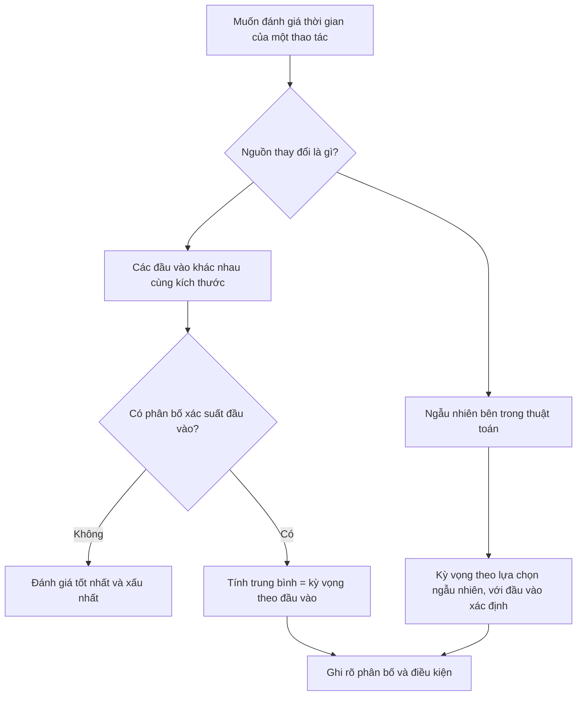

# Trường hợp tốt nhất, xấu nhất, trung bình và chi phí kỳ vọng

> **Chương:** Đặc tả và chi phí · **Bài học:** Trường hợp tốt nhất, xấu nhất, trung bình và chi phí kỳ vọng

Hai chương trình đều thực hiện thao tác “tìm một phần tử” nhưng thời gian chạy có thể khác nhau rất lớn. Nếu phần tử nằm ngay đầu mảng, tìm kiếm tuyến tính chỉ cần một phép so sánh. Nếu phần tử không có trong mảng, thuật toán phải kiểm tra hết các phần tử. Nếu người dùng thường tìm một vài phần tử phổ biến, chi phí quan sát hằng ngày lại khác so với trường hợp chọn vị trí ngẫu nhiên.

Vì thế, phát biểu “thuật toán tìm kiếm tốn O(n)” chưa trả lời trọn vẹn câu hỏi hiệu năng: **trong trường hợp nào, với phân bố đầu vào nào, và xét loại đảm bảo nào?** Bài học này phân biệt **tốt nhất**, **xấu nhất**, **trung bình** và **kỳ vọng**, đồng thời làm rõ chi phí **khấu hao** để tránh nhầm lẫn khi đánh giá mảng, danh sách liên kết, stack, queue, bảng băm, cây, heap và đồ thị.

Trong mô-đun **Cấu trúc dữ liệu** (`COMPUTER_SCIENCE_DATA_STRUCTURES`), ta cần kết hợp tính đúng đắn của thao tác, bất biến biểu diễn và cả độ phức tạp thời gian, bộ nhớ để lựa chọn cấu trúc phù hợp với bài toán. Các cách phân tích dưới đây giúp diễn giải chính xác những đảm bảo hiệu năng đó.

## 1. Kết quả học tập

Sau bài này, bạn có thể:

1. Định nghĩa và tính chi phí tốt nhất, xấu nhất, trung bình của một thuật toán với kích thước đầu vào xác định.
2. Viết công thức **kỳ vọng toán học** theo một phân bố xác suất đã nêu.
3. Phân biệt kỳ vọng theo **đầu vào ngẫu nhiên** với kỳ vọng theo **lựa chọn ngẫu nhiên bên trong thuật toán**.
4. Giải thích vì sao độ phức tạp O(1) kỳ vọng của bảng băm không đồng nghĩa O(1) trong mọi trường hợp.
5. Phân biệt trung bình, kỳ vọng và **khấu hao** của một chuỗi thao tác.
6. So sánh các cấu trúc dữ liệu dựa trên cả hiệu năng điển hình, giới hạn trường hợp xấu nhất và mức độ nhạy với phân bố truy vấn.

## 2. Mô hình hóa chi phí trước khi nói “trường hợp”

Gọi `x` là một đầu vào hợp lệ; `|x| = n` nghĩa là đầu vào có kích thước `n` theo **đơn vị đã định nghĩa**. Gọi `T(x)` là số đơn vị công việc mà thuật toán thực hiện trên `x`.

Ví dụ, khi tìm một khóa trong mảng:

- `n` là số phần tử của mảng.
- `T(x)` có thể là **số phép so sánh với khóa cần tìm**.
- Mô hình chi phí coi mỗi lần so sánh hai khóa có kích thước cố định tốn O(1).
- Hai đầu vào cùng `n` có thể cho `T(x)` rất khác nhau vì vị trí khóa khác nhau.

Để so sánh độ phức tạp, ta thường chọn phép toán cơ bản như so sánh, đi qua nút, đọc/ghi ô hoặc duyệt cạnh. Chi phí theo đơn vị này giúp giải thích tốc độ tăng trưởng; nó không phải số giây chính xác trên mọi máy tính.

Một lưu ý: khi khóa là chuỗi dài `k` ký tự, một phép so sánh hoặc tính hash có thể cần O(k), không được tự xem là O(1).

### 2.1. Kích thước đầu vào phải nhất quán

| Bài toán | Kích thước thường dùng | Đại lượng ảnh hưởng chi phí |
| --- | --- | --- |
| Tìm trong mảng | `n` phần tử | Vị trí trùng khớp hoặc việc khóa vắng mặt |
| Tìm trong cây | `n` nút, `h` chiều cao | Đường đi từ gốc đến vị trí tìm |
| Tìm trong hash map | `n` khóa, `b` bucket, `k` độ dài khóa | Va chạm, hệ số tải, thời gian hash |
| Duyệt đồ thị | `V` đỉnh, `E` cạnh | Số đỉnh/cạnh được chạm tới và biểu diễn đồ thị |
| Thêm phần tử vào mảng động | `n` phần tử, `C` sức chứa | Mảng còn chỗ hay phải mở rộng |
| Nhiều truy vấn | `n` dữ liệu, `q` truy vấn | Phân bố truy vấn và số lần cập nhật |

Không được gộp `V` và `E` thành một `n` rồi mặc định đồ thị nào cũng có số cạnh tương tự. Cũng không được gọi mọi lần `put` trên một hash map là O(1) nếu chi phí băm khóa dài hoặc tái cấp phát chưa được xét.

## 3. Trường hợp tốt nhất và xấu nhất

Với `I_n` là tập đầu vào hợp lệ có kích thước `n`, cho thuật toán xác định, ta định nghĩa:

\[
T_{\mathrm{best}}(n)=\min_{x\in I_n}T(x)
\]

\[
T_{\mathrm{worst}}(n)=\max_{x\in I_n}T(x)
\]

Hai giá trị này xem xét **cùng một kích thước `n`**, nhưng chọn những đầu vào cho lượng công việc nhỏ nhất hoặc lớn nhất. Nếu tập đầu vào vô hạn hoặc không đạt cực trị, có thể dùng infimum/supremum thay cho min/max; trong các ví dụ hữu hạn ở bài này, min/max là đủ.

| Phân tích | Câu hỏi | Giá trị sử dụng |
| --- | --- | --- |
| **Tốt nhất (best case)** | Với `n` cố định, đầu vào thuận lợi nhất làm thuật toán tốn ít bước đến mức nào? | Cho biết khả năng dừng sớm hoặc trường hợp dễ nhất |
| **Xấu nhất (worst case)** | Với `n` cố định, đầu vào bất lợi nhất buộc thuật toán tốn nhiều nhất bao nhiêu? | Đặt giới hạn trên, quan trọng khi cần thời gian đáp ứng ổn định |

**Một chặn trên trường hợp xấu nhất thường là đảm bảo mạnh hơn về rủi ro độ trễ** so với chi phí trung bình. Nhưng nó không có nghĩa mọi đầu vào thực tế đều đạt tới giá trị xấu nhất.

### 3.1. Ví dụ: tìm kiếm tuyến tính

```python
def linear_search(values, target):
    for i, value in enumerate(values):
        if value == target:
            return i
    return -1
```

Gọi `n = len(values)`, đếm phép `value == target`:

| Đầu vào với `n ≥ 1` | Số lần so sánh |
| --- | --- |
| Tìm thấy ngay ở vị trí 0 | 1 |
| Tìm thấy lần đầu tại vị trí `i` (bắt đầu từ 0) | `i + 1` |
| Tìm thấy lần đầu ở cuối | `n` |
| Không tìm thấy | `n` |

Do đó:

\[
C_{\mathrm{best}}(n)=1,\qquad C_{\mathrm{worst}}(n)=n,\quad n\geq 1.
\]

Nếu mỗi lần so sánh có chi phí hằng số, thời gian tốt nhất là Θ(1), xấu nhất Θ(n). Với `n = 0`, không có phép so sánh nào và hàm trả ngay `-1`; trường hợp rỗng được xét riêng.

Phát biểu “tìm kiếm tuyến tính là O(n)” thường nói đến **chặn trên trong trường hợp xấu nhất**, không có nghĩa mọi lần tìm đều phải so sánh đủ `n` phần tử.

### 3.2. Một đầu vào tốt nhất chưa đại diện cho thực tế

Giả sử mảng chứa một triệu bản ghi. Nếu khóa cần tìm luôn ở phần tử đầu tiên, truy vấn cụ thể có thời gian gần hằng số; nhưng không thể dựa vào một lần tìm thuận lợi để thiết kế hệ thống có yêu cầu độ trễ chặt.

Ngược lại, nếu ứng dụng **có cơ sở** để biết 90% truy vấn nhắm đến vài phần tử ở đầu, thống kê đó có thể hữu ích cho phân tích chi phí trung bình. Ta cần mô tả phân bố thay vì chỉ nêu trường hợp tốt nhất.

## 4. Trường hợp trung bình: phải cho biết phân bố đầu vào

“Trung bình” chỉ có ý nghĩa khi biết **lấy trung bình trên những đầu vào nào và với xác suất bao nhiêu**.

Gọi `X` là biến ngẫu nhiên biểu diễn đầu vào có kích thước `n`, với phân bố xác suất `P_n(x)`. Chi phí trung bình là:

\[
T_{\mathrm{avg}}(n)
=\mathbb{E}_{X\sim P_n}[T(X)]
=\sum_{x\in I_n}P_n(x)\,T(x).
\]

Trong đó `P_n(x) ≥ 0` và tổng xác suất trên `I_n` bằng 1. Nếu mọi đầu vào được giả định có xác suất như nhau, ta có trung bình cộng của các chi phí. Tuy nhiên, **đầu vào thực tế hiếm khi được bảo đảm phân bố đều**.

### 4.1. Tìm tuyến tính khi chắc chắn tìm thấy, vị trí phân bố đều

Giả sử:

1. Mảng có `n ≥ 1` phần tử.
2. Khóa cần tìm **chắc chắn tồn tại**, và vị trí xuất hiện đầu tiên được phân bố đều giữa `1,2,\ldots,n`.
3. Mỗi phép so sánh khóa tốn O(1).

Xác suất tìm thấy lần đầu ở vị trí thứ `j` là `1/n`; khi đó cần `j` so sánh. Vậy:

\[
\mathbb{E}[C\mid\text{tìm thấy}]
=\frac{1}{n}\sum_{j=1}^{n}j
=\frac{n+1}{2}.
\]

Với `n=8`, số lần so sánh kỳ vọng là `(8+1)/2 = 4,5`. Chi phí trung bình vẫn là **Θ(n)**, dù nhỏ hơn trường hợp xấu nhất khoảng hai lần khi `n` lớn.

Điều kiện “vị trí xuất hiện đầu tiên phân bố đều” rất quan trọng nếu mảng có **phần tử trùng lặp**. Không thể tự giả định rằng chọn ngẫu nhiên một phần tử trùng sẽ khiến vị trí tìm thấy đầu tiên phân bố đều.

### 4.2. Tìm tuyến tính với xác suất có và không có kết quả

Giả sử `p` là xác suất khóa có mặt. Điều kiện theo nhánh có mặt vẫn là vị trí đầu tiên phân bố đều; khi không có mặt, luôn cần `n` phép so sánh.

Theo công thức kỳ vọng có điều kiện:

\[
\mathbb{E}[C]
=p\frac{n+1}{2}+(1-p)n.
\]

Ví dụ với `n=10` và `p=0,8`:

\[
\mathbb{E}[C]
=0,8\times5,5+0,2\times10
=6,4.
\]

Số `6,4` là **kỳ vọng trung bình theo nhiều truy vấn**, không phải một lời gọi thực hiện 6,4 phép so sánh. Một lần chạy vẫn thực hiện một số nguyên phép so sánh từ 1 đến 10 khi `n≥1`.

Để tính toán này đúng, ta đang giả định rõ xác suất có mặt và phân bố vị trí khi có mặt. Nếu phân bố thay đổi, kết quả cũng thay đổi.

### 4.3. Khi truy vấn không phân bố đều

Giả sử mảng có 5 phần tử; 70% lượt tìm nhắm phần tử đầu, 20% nhắm phần tử thứ hai, 10% tìm khóa không tồn tại:

\[
\mathbb{E}[C]=0,7\times1+0,2\times2+0,1\times5=1,6.
\]

Mặc dù trường hợp xấu nhất vẫn là 5 phép so sánh, số lần so sánh trung bình của **khối lượng công việc cụ thể này** chỉ là 1,6.

Với một tập truy vấn thiên lệch như vậy, có thể bố trí phần tử hay chọn cơ chế cache hợp lý. Tuy nhiên, ứng dụng cần biết liệu phân bố có ổn định theo thời gian hay không, và việc cập nhật thứ tự có phá vỡ yêu cầu nghiệp vụ khác hay không.

## 5. Chi phí kỳ vọng và nguồn ngẫu nhiên

Trong toán học, “trung bình có trọng số theo xác suất” chính là một **kỳ vọng**. Vì vậy, phân tích trường hợp trung bình là một dạng phân tích kỳ vọng khi ta quy định phân bố đầu vào.

Trong tài liệu thuật toán, cụm **expected time** thường được dùng rộng hơn để chỉ kỳ vọng do:

- Đầu vào hoặc truy vấn được lấy từ một **phân bố xác suất**.
- Thuật toán tự dùng **ngẫu nhiên nội bộ**, ví dụ chọn pivot ngẫu nhiên.
- Cả hai nguồn ngẫu nhiên cùng tồn tại.

Không nên coi “trung bình” và “kỳ vọng” là hai đại lượng hoàn toàn tách biệt. Khác biệt quan trọng là **đang lấy kỳ vọng trên cái gì**.

### 5.1. Thuật toán xác định, đầu vào ngẫu nhiên

Tìm tuyến tính ở phần trước là thuật toán **xác định**: cùng đầu vào thì cùng số phép so sánh. Chi phí được xem là ngẫu nhiên vì **truy vấn hoặc vị trí cần tìm** thay đổi theo phân bố.

\[
\mathbb{E}_{X}[T(X)].
\]

Nếu không đưa ra phân bố `X`, không thể xác định một giá trị trung bình duy nhất.

### 5.2. Thuật toán ngẫu nhiên, đầu vào cố định

Giả sử thuật toán dùng một nguồn ngẫu nhiên `R` khi chạy. Với **một đầu vào cố định `x`**, chi phí có thể khác nhau giữa các lần chạy:

\[
\mathbb{E}_{R}[T(x,R)].
\]

Ví dụ, QuickSort chọn pivot ngẫu nhiên có thời gian **kỳ vọng O(n log n)** trên một đầu vào `n` khóa phân biệt cố định, theo giả định pivot được chọn đều trong mỗi đoạn. Vẫn tồn tại những chuỗi pivot không may khiến chi phí O(n²).

Nói “kỳ vọng O(n log n)” **không** có nghĩa mỗi lần chạy chắc chắn O(n log n).

### 5.3. Có cả đầu vào và lựa chọn ngẫu nhiên

Nếu đầu vào cũng là biến ngẫu nhiên `X`, chi phí tổng hợp là:

\[
\mathbb{E}_{X,R}[T(X,R)]
=\mathbb{E}_{X}\bigl[\mathbb{E}_{R}[T(X,R)\mid X]\bigr].
\]

Công thức cho thấy ta cần hiểu phân bố truy vấn và quy tắc ngẫu nhiên trong thuật toán. Một thuật toán có kỳ vọng tốt với mỗi đầu vào cố định thường cho đảm bảo mạnh hơn một thuật toán chỉ có kỳ vọng tốt dưới một phân bố đầu vào thuận lợi, nhưng vẫn phải xem chi phí xấu nhất và yêu cầu thực tế.

### 5.4. Sơ đồ xác định trường hợp phân tích



## 6. Tìm kiếm nhị phân: tốt nhất khác xấu nhất và trung bình

Với mảng **đã sắp xếp**, tìm kiếm nhị phân khảo sát phần tử giữa, rồi loại khoảng không chứa khóa cần tìm.

```python
def binary_search_probes(values, target):
    low, high = 0, len(values) - 1
    probes = 0

    while low <= high:
        mid = (low + high) // 2
        probes += 1

        if values[mid] == target:
            return mid, probes
        if values[mid] < target:
            low = mid + 1
        else:
            high = mid - 1

    return -1, probes
```

Ở đây `probes` là số lần khảo sát phần tử giữa; một lần khảo sát có thể thực hiện một hoặc hai phép so sánh khóa trong mã Python. Hai cách đếm khác nhau một hệ số hằng.

- **Tốt nhất:** khóa trùng phần tử giữa ngay lần đầu, nên chỉ 1 lần khảo sát, Θ(1).
- **Xấu nhất:** khoảng bị chia đôi nhiều lần; tối đa `⌊log₂ n⌋+1` lần khảo sát với `n≥1`, nên Θ(log n) về bậc xấu nhất khi `n` lớn.
- **Trung bình:** phụ thuộc phân bố khóa được tìm và khả năng vắng mặt. Với truy vấn thành công phân bố đều trên các vị trí trong mảng, số lần khảo sát trung bình có bậc Θ(log n), nhưng giá trị cụ thể phụ thuộc `n`.

### 6.1. Ví dụ tính chính xác khi `n = 7`

Mảng là `[1,2,3,4,5,6,7]`. Với thuật toán chọn phần tử giữa:

| Khóa cần tìm | Số lần khảo sát |
| --- | --- |
| 4 | 1 |
| 2, 6 | 2 |
| 1, 3, 5, 7 | 3 |

Nếu bảy khóa có xác suất được tìm bằng nhau:

\[
\mathbb{E}[C\mid\text{tìm thấy}]
=\frac{1\cdot1+2\cdot2+4\cdot3}{7}
=\frac{17}{7}\approx2,43.
\]

Số lần khảo sát xấu nhất trong ví dụ là 3, còn tốt nhất là 1. Chọn một khóa luôn bằng 4 sẽ cho kỳ vọng 1, không phải 17/7. Vì vậy, phải ghi rõ phân bố.

**Điều kiện đúng:** mảng phải được sắp theo quan hệ so sánh phù hợp. Nếu phải sắp từ đầu, chi phí tiền xử lý cũng thuộc tổng chi phí hệ thống, đặc biệt khi chỉ có vài truy vấn.

## 7. Bảng băm: kỳ vọng nhanh nhưng vẫn có trường hợp xấu

Một hash map ánh xạ khóa tới vị trí trong bảng thông qua giá trị băm. Nếu phân bố khóa hợp lý, hệ số tải được kiểm soát, và việc tính hash/so sánh khóa tốn O(1), các thao tác như `get`, `put` và `remove` thường có **chi phí O(1) kỳ vọng**.

Tuy vậy, khi nhiều khóa va chạm, phép tra cứu có thể phải duyệt nhiều khóa ở cùng vị trí hoặc trên một chuỗi dò. Chi phí xấu nhất có thể lên tới O(n), tùy cách xử lý va chạm.

### 7.1. Mô hình chaining đơn giản

Giả sử `n` khóa được phân vào `b` bucket; mỗi bucket giữ danh sách các phần tử va chạm. Hệ số tải:

\[
\alpha=\frac{n}{b}.
\]

Nếu các khóa được phân bố đều theo giả định băm đơn giản, số phần tử cần duyệt trong bucket liên quan có bậc O(1+α) kỳ vọng, chưa tính chi phí tính hash.

- Khi `α` được giữ bằng hằng số nhờ điều chỉnh kích thước bảng, chi phí tra cứu kỳ vọng theo `n` là O(1).
- Nếu tất cả `n` khóa vào một bucket, tra cứu khóa ở cuối hoặc khóa vắng mặt có thể tốn Θ(n).
- Nếu khóa là chuỗi dài `k` ký tự và cần băm toàn bộ, phải tính thêm O(k) cho việc băm, cũng như chi phí so sánh các khóa khi có va chạm.

Một bảng băm có **hiệu năng điển hình tốt** không đồng nghĩa cài đặt bất kỳ có thể hứa thời gian hằng số cho mọi đầu vào, mọi kiểu khóa.

### 7.2. Kỳ vọng phụ thuộc mô hình phân bố hoặc phép băm

Có ít nhất hai cách đưa ra lập luận kỳ vọng:

1. **Khóa đầu vào được giả định phân bố phù hợp** và hàm băm cố định hoạt động tốt trên phân bố đó.
2. **Hàm băm được chọn ngẫu nhiên** từ một họ hàm có đảm bảo nhất định, khiến kỳ vọng theo lựa chọn hàm băm được khống chế cho các khóa đã cố định.

Hai cách đặt xác suất này không giống nhau. Nếu dữ liệu do người dùng bên ngoài chủ động tạo để gây va chạm, việc dựa vào phân bố khóa “thông thường” có thể không đủ. Khi yêu cầu độ trễ xấu nhất chặt chẽ, nên cân nhắc cấu trúc có giới hạn rõ hơn như cây tìm kiếm cân bằng hoặc thiết kế xử lý va chạm có bảo đảm phù hợp.

### 7.3. Đừng bỏ qua lần tái băm

`put` có thể kích hoạt mở rộng bảng và phân bố lại `n` khóa, khiến một lần riêng lẻ mất O(n) công việc. Trên một chuỗi thêm dài, chiến lược mở rộng phù hợp có thể làm chi phí **khấu hao** nhỏ.

Ở đây có hai ý khác nhau:

- Va chạm khóa khiến ta xét đến **kỳ vọng** theo phân bố băm/khóa.
- Mở rộng bảng khiến ta xét đến **khấu hao** trên chuỗi thao tác.

Không nên gộp chúng thành một câu “put luôn O(1)” nếu chưa xác định cả hai điều kiện.

## 8. Trung bình và khấu hao: hai kiểu bình quân khác nhau

**Trung bình theo phân bố** lấy nhiều đầu vào hoặc truy vấn khác nhau, gắn xác suất cho từng trường hợp. **Khấu hao** phân bổ chi phí thực tế của một **chuỗi thao tác**, dù các thao tác không được chọn ngẫu nhiên.

Ví dụ stack bằng mảng động:

- Khi mảng còn chỗ, `push` ghi một phần tử: O(1).
- Khi đầy, `push` cấp phát vùng lớn hơn và sao chép `n` phần tử cũ: O(n) cho lần đó.
- Nếu tăng sức chứa gấp đôi, tổng số phần tử phải sao chép qua `n` lần `push` liên tiếp bị chặn bởi O(n); bình quân khấu hao mỗi `push` là O(1).

### 8.1. Đếm cụ thể với 16 lần `push`

Giả sử sức chứa ban đầu bằng 1 và tăng gấp đôi khi đầy. Khi thêm 16 phần tử, các lần mở rộng sao chép lần lượt:

```text
Lần mở rộng:   1 -> 2    2 -> 4    4 -> 8    8 -> 16
Số ô sao chép:   1          2         4          8
Tổng sao chép: 1 + 2 + 4 + 8 = 15
Ghi phần tử mới:                 16
Tổng các lần ghi/sao chép:       31
```

Một lần thêm vào lúc đầy có thể cần 8 lần sao chép và 1 lần ghi mới; những lần thêm còn chỗ chỉ cần 1 lần ghi. Tổng 31 công việc đơn vị trên 16 lần `push` minh họa vì sao tổng vẫn tăng tuyến tính dù có lần đắt.

Kết quả này **không yêu cầu** xác suất về vị trí chèn. Trong mô hình hoạt động đã nêu, chuỗi thêm được xét có thể hoàn toàn xác định.

### 8.2. Bảng phân biệt ba phát biểu

| Phát biểu | Lấy bình quân hoặc cực trị trên cái gì? | Ví dụ |
| --- | --- | --- |
| `push` có thời gian xấu nhất O(n) | Một lời gọi có thể gặp mảng đầy, phải sao chép `n` phần tử | Một lần mở rộng mảng động |
| `push` có thời gian trung bình theo một phân bố | Các trạng thái và lời gọi được lấy từ phân bố được chỉ định | Xác suất bắt gặp mảng đầy trong một tải cụ thể |
| `push` có thời gian khấu hao O(1) | Tổng chi phí trên một chuỗi `n` lần thêm với chiến lược tăng gấp đôi | Tổng sao chép theo cấp số nhân |

**Không được dùng chi phí khấu hao O(1) để cam kết mọi lời gọi chỉ mất thời gian hằng số.** Khi cần giới hạn độ trễ cho từng thao tác, phải xét cách tránh hoặc trải đều việc mở rộng, hoặc chọn cấu trúc khác.

## 9. Ví dụ bổ sung: chèn vào mảng theo vị trí

Xét mảng `n` phần tử, đã có đủ sức chứa để chèn mà không mở rộng. Nếu thêm một phần tử ở chỉ số `i`, với `0 ≤ i ≤ n`, phải dịch `n-i` phần tử sang phải.

### 9.1. Tốt nhất, xấu nhất, trung bình

| Vị trí chèn | Số phần tử dịch |
| --- | --- |
| Cuối mảng, `i=n` | 0 |
| Giữa mảng, ví dụ `i=⌊n/2⌋` | Xấp xỉ `n/2` |
| Đầu mảng, `i=0` | `n` |

Nếu `i` được chọn **đều** từ `n+1` vị trí `0,1,\ldots,n`, số phần tử phải dịch kỳ vọng là:

\[
\mathbb{E}[\mathrm{shifts}]
=\frac{1}{n+1}\sum_{i=0}^n(n-i)
=\frac{n}{2}.
\]

Từ đó, nếu tính cả phần ghi phần tử mới:

- Thời gian **tốt nhất** cho chèn cuối khi đã có chỗ là Θ(1).
- Thời gian **xấu nhất** cho chèn đầu là Θ(n) với `n` lớn.
- Thời gian **trung bình** khi vị trí chèn phân bố đều là Θ(n).

**Điểm dễ nhầm:** kết quả O(1) khấu hao của `append` vào mảng động chỉ nói về thêm **ở cuối** với chiến lược mở rộng phù hợp. Nó không áp dụng cho thao tác **chèn ở vị trí bất kỳ**, vì nhiều phần tử vẫn phải được dịch.

### 9.2. Mã đếm số phần tử phải dịch

```python
def expected_shifts(n):
    assert n >= 0
    shifts = [n - i for i in range(n + 1)]
    return sum(shifts) / len(shifts)


assert expected_shifts(0) == 0
assert expected_shifts(4) == 2
assert expected_shifts(10) == 5
```

Hàm này tính kỳ vọng theo **phân bố vị trí đều**; nó không đo thời gian thực tế của `list.insert` trong Python. Nếu ứng dụng thường chèn ở cuối hoặc ở đầu, phân bố sẽ khác và phải điều chỉnh công thức.

## 10. QuickSort ngẫu nhiên: kỳ vọng tốt, xấu nhất vẫn bậc hai

Một ví dụ nổi bật về thuật toán có dùng ngẫu nhiên là QuickSort:

1. Chọn một phần tử làm *pivot*.
2. Phân hoạch dữ liệu thành các phần nhỏ hơn và lớn hơn pivot theo quy tắc.
3. Sắp xếp đệ quy các phần đó.

Nếu pivot luôn khiến một phía rỗng và phía còn lại có `n-1` phần tử, số phép so sánh phân hoạch có thể là:

\[
(n-1)+(n-2)+\cdots+1=\frac{n(n-1)}{2}
=\Theta(n^2).
\]

Nếu các lần phân hoạch gần cân bằng, chiều sâu đệ quy cỡ O(log n), còn tổng công việc ở mỗi mức cỡ O(n), nên thời gian O(n log n).

Với cách chọn pivot **đồng đều ngẫu nhiên trong đoạn hiện tại**, QuickSort trên `n` khóa phân biệt có thời gian:

- **Tốt nhất (về bậc):** Θ(n log n) khi phân hoạch liên tiếp gần cân bằng.
- **Xấu nhất:** Θ(n²) đối với những chuỗi lựa chọn pivot rất lệch.
- **Kỳ vọng theo lựa chọn pivot:** Θ(n log n), ngay cả khi thứ tự đầu vào đã được cố định.

Đây là ví dụ rõ ràng cho việc **thời gian kỳ vọng** không bảo đảm thời gian của từng lần chạy. Nếu sử dụng QuickSort với pivot cố định và muốn phát biểu “trung bình Θ(n log n)”, ta phải nêu phân bố thứ tự đầu vào phù hợp.

Chi phí bộ nhớ cũng cần nêu riêng: bản cài đặt phân hoạch tại chỗ có thể dùng O(log n) stack đệ quy trong trường hợp phân hoạch cân bằng nhưng lên tới O(n) trong trường hợp lệch sâu nếu không có tối ưu hóa riêng.

## 11. Tác động đến lựa chọn cấu trúc dữ liệu

Không có cấu trúc dữ liệu nào có một con số độ phức tạp duy nhất cho mọi thao tác. Bảng sau tập trung vào **phép toán cụ thể và điều kiện bảo đảm**.

| Cấu trúc và thao tác | Tốt nhất | Xấu nhất | Trung bình/kỳ vọng có điều kiện |
| --- | --- | --- | --- |
| Mảng chưa sắp, tìm khóa tuyến tính | Θ(1) nếu trùng phần tử đầu | Θ(n) | Θ(n) nếu vị trí trùng đầu tiên đều hoặc thường phải quét nhiều |
| Mảng đã sắp, tìm nhị phân | Θ(1) nếu trùng phần tử giữa đầu tiên | Θ(log n) | Θ(log n) với truy vấn thành công phân bố đều |
| Mảng còn chỗ, chèn vị trí `i` | Θ(1) ở cuối | Θ(n) ở đầu | Θ(n) nếu `i` đều trên các vị trí |
| Danh sách liên kết, tìm giá trị | Θ(1) nếu trùng nút đầu | Θ(n) | Θ(n) khi vị trí trùng đầu tiên phân bố đều |
| Stack mảng động, `push` | O(1) khi còn chỗ | O(n) khi mở rộng | O(1) **khấu hao** với chiến lược tăng gấp đôi |
| Queue mảng vòng, `dequeue` không thu nhỏ | Θ(1) | Θ(1) | Θ(1) |
| Hash Map, tra cứu khóa | Θ(1) khi bucket chỉ cần kiểm tra hằng số khóa | O(n) với va chạm lớn | O(1) kỳ vọng khi hash, so sánh và hệ số tải phù hợp |
| Cây tìm kiếm cân bằng, tìm khóa | O(1) nếu trùng ở gốc | O(log n) | O(log n) do đã có chặn trên; giá trị kỳ vọng cụ thể tùy phân bố |
| Heap nhị phân, `extract_min` | Có thể O(1) bước điều chỉnh khi không phải đẩy xuống | O(log n) | Phụ thuộc dữ liệu; chặn trên O(log n) |
| Đồ thị danh sách kề, BFS từ một đỉnh | O(1) khi thành phần tới được rất nhỏ | O(V+E) | Phụ thuộc thành phần tới được và cấu trúc đồ thị |

Chú ý: một ô ghi O(log n) ở cột tốt nhất là **chặn trên đúng nhưng có thể chưa chặt**; nếu cần phát biểu tốt nhất thật chính xác, ta phải phân tích đầu vào thuận lợi nhất. Đối với cây cân bằng, nếu khóa nằm ngay tại gốc thì tìm kiếm chỉ cần một lần so sánh, tức Θ(1).

### 11.1. Cùng giao diện, khác kiểu đảm bảo

Giả sử cần triển khai Map:

- **Bảng băm:** truy cập khóa thường nhanh theo kỳ vọng; chi phí chèn/xóa và tái băm cần xét thêm. Bộ nhớ cho các bucket có thể lớn hơn số mục hiện tại.
- **Cây tìm kiếm cân bằng:** tìm/chèn/xóa có giới hạn O(log n) trong trường hợp xấu nhất, cho phép duyệt theo thứ tự khóa nếu hợp đồng sử dụng quan hệ so sánh có thứ tự.

Nếu mục tiêu là **thông lượng trung bình cao** và các giả định băm phù hợp, bảng băm có thể rất hiệu quả. Nếu quan trọng **giới hạn thời gian xấu nhất** hoặc truy vấn có thứ tự, cây cân bằng có thể đáng ưu tiên hơn.

### 11.2. Stack, Queue và Heap có mục tiêu khác nhau

Stack và Queue thường tối ưu các thao tác ở đầu hoặc cuối theo **LIFO/FIFO**; Heap tối ưu truy cập theo **độ ưu tiên**. Không nên so sánh một thao tác `pop` của stack với `extract_min` của heap mà quên rằng chúng trả về **những phần tử theo quy tắc khác nhau**.

Ngay cả khi một phương án có chi phí kỳ vọng thấp hơn, nó chỉ là lựa chọn hợp lệ nếu **hành vi của ADT đáp ứng đúng nhu cầu**.

### 11.3. Đồ thị: phân bố đầu vào không chỉ là một con số `V`

BFS trên danh sách kề duyệt thành phần có thể đến được từ đỉnh nguồn, nên số lượng đỉnh/cạnh thực tế là `V_r, E_r` và thời gian lõi có chặn trên O(V_r + E_r).

Nếu ứng dụng thường khởi hành từ các đỉnh thuộc thành phần nhỏ, thời gian truy vấn có thể thấp hơn nhiều so với BFS duyệt toàn bộ đồ thị. Nếu phải duyệt mọi đỉnh và cạnh, thời gian là O(V+E) với danh sách kề; ma trận kề quét cả hàng có thể tốn O(V²).

Để nói “thời gian trung bình của BFS”, phải chỉ ra đồ thị được lấy từ phân bố nào và đỉnh nguồn được chọn thế nào. Không có một công thức kỳ vọng duy nhất chỉ từ hai con số `V` và `E`.

## 12. Từ kỳ vọng đến độ tin cậy của hệ thống

Chi phí kỳ vọng giúp ước lượng **tổng tài nguyên hoặc thông lượng** khi hệ thống xử lý nhiều yêu cầu có phân bố tương tự. Nhưng nó không thay thế phân tích rủi ro độ trễ.

Một dịch vụ có thời gian trả lời trung bình thấp vẫn có thể có một số yêu cầu rất chậm. Trong những tình huống có giới hạn thời gian cứng hoặc trải nghiệm người dùng nhạy với độ trễ cao, cần xem:

- **Chặn trên trong trường hợp xấu nhất**, nếu thuật toán/cấu trúc có bảo đảm phù hợp.
- **Phân vị độ trễ**, chẳng hạn p95 hoặc p99, được đo trên khối lượng truy vấn đại diện; không đồng nhất với kỳ vọng.
- **Chi phí tái cấp phát hoặc bảo trì**, như resize mảng, rehash bảng băm hay cân bằng cây.
- **Sự thay đổi của phân bố dữ liệu**, nhất là truy vấn dồn vào một nhóm khóa hoặc khóa có cấu trúc gây va chạm.

Ví dụ, giả sử 99 truy vấn mất 1 đơn vị thời gian, một truy vấn mất 101 đơn vị. Trung bình là:

\[
\frac{99\cdot1+1\cdot101}{100}=2.
\]

Trung bình 2 không phản ánh đầy đủ việc có một truy vấn tốn 101 đơn vị. Một hệ thống cần thời gian phản hồi ổn định phải quan tâm cả phần đuôi phân bố, ngoài trung bình.

**Điều kiện quan trọng:** thống kê quan sát chỉ phản ánh tải đã đo; không tự chứng minh chặn trên lý thuyết cho mọi dữ liệu trong tương lai.

## 13. Cách kiểm tra bằng bộ đếm và phép đo

Để minh họa chi phí theo đầu vào mà không phụ thuộc tốc độ máy, ta có thể **đếm phép toán**:

```python
def linear_search_counted(values, target):
    comparisons = 0

    for index, value in enumerate(values):
        comparisons += 1
        if value == target:
            return index, comparisons

    return -1, comparisons


data = [10, 20, 30, 40, 50]

assert linear_search_counted(data, 10) == (0, 1)
assert linear_search_counted(data, 30) == (2, 3)
assert linear_search_counted(data, 99) == (-1, 5)
```

Có thể tính kỳ vọng bằng một mô hình rời rạc:

```python
def weighted_expected_cost(outcomes):
    """outcomes gồm các cặp (xác suất, số phép so sánh)."""
    return sum(probability * cost for probability, cost in outcomes)


# 70% tìm ở đầu, 20% ở vị trí thứ hai, 10% không tìm thấy.
model = [(0.7, 1), (0.2, 2), (0.1, 5)]
assert abs(weighted_expected_cost(model) - 1.6) < 1e-12
```

Đây là ví dụ tính **kỳ vọng theo giả định**, không phải đo thời gian thực. Với dữ liệu thực tế, nên thu thập tần suất truy vấn hoặc kết quả đo, xác định liệu mẫu quan sát đại diện hay không, rồi so sánh với mô hình.

### 13.1. Vì sao benchmark một lần dễ gây hiểu lầm?

- Dữ liệu thử có thể vô tình cho trường hợp tốt nhất.
- Việc cấp phát và làm nóng bộ nhớ đệm có thể khác giữa lần đầu và những lần sau.
- Một số thao tác hiếm nhưng đắt không xuất hiện trong mẫu nhỏ.
- Kích thước khóa, dữ liệu trùng hoặc độ phân bố hash có thể khác tải thực tế.

Khi benchmark, nên báo kích thước đầu vào, cách chọn trường hợp thử, số lần lặp, phân bố truy vấn và các chỉ số như trung vị, trung bình, phân vị cao. Big-O vẫn là công cụ để lý giải tốc độ tăng khi kích thước thay đổi.

## 14. Những lỗi suy luận thường gặp

| Nhận định | Vấn đề | Sửa thế nào |
| --- | --- | --- |
| “Độ phức tạp tốt nhất O(1) nghĩa là thuật toán nhanh.” | Chỉ có đầu vào thuận lợi nhất đạt giá trị đó. | Xem thêm trường hợp xấu nhất và phân bố truy vấn. |
| “Trung bình O(n) nghĩa là luôn dùng n bước.” | Kỳ vọng không phải số bước của từng lời gọi. | Tách số bước từng trường hợp và trung bình có trọng số. |
| “Mọi đầu vào đều có xác suất bằng nhau.” | Đây là một giả định, không phải định luật. | Nêu hoặc đo phân bố đầu vào thực tế. |
| “Trung bình khác hoàn toàn kỳ vọng.” | Trung bình theo xác suất chính là một dạng kỳ vọng. | Chỉ rõ nguồn ngẫu nhiên: đầu vào, thuật toán, hay cả hai. |
| “Hash map O(1) là xấu nhất O(1).” | Va chạm và tái băm có thể đắt. | Ghi rõ O(1) kỳ vọng/khấu hao và điều kiện. |
| “Khấu hao O(1) là kỳ vọng O(1).” | Khấu hao phân bổ trên chuỗi thao tác, không yêu cầu ngẫu nhiên. | Phân tích chuỗi và phép toán riêng lẻ tách biệt. |
| “BFS O(V+E) nên mọi truy vấn đều duyệt hết đồ thị.” | Từ một đỉnh có thể chỉ tới được một thành phần nhỏ. | Xét thêm `V_r,E_r` và chi phí khởi tạo dữ liệu. |
| “Kỳ vọng thấp bảo đảm độ trễ xấu nhất thấp.” | Đuôi phân bố có thể có sự kiện hiếm nhưng rất chậm. | Xem giới hạn xấu nhất, phân vị hoặc các điều kiện vận hành. |
| “Quicksort kỳ vọng O(n log n) nên không thể có O(n²).” | Chuỗi pivot không may có thể tạo phân hoạch cực lệch. | Phân biệt kỳ vọng và xấu nhất. |

## 15. Bài tập vận dụng với lời giải gợi ý

### Bài 1 — Tìm kiếm tuyến tính có xác suất vắng mặt

Mảng dài `n=12`. Có 75% khả năng khóa tồn tại và khi có mặt, vị trí đầu tiên phân bố đều; còn 25% truy vấn không tìm thấy. Tính số phép so sánh kỳ vọng.

**Gợi ý giải:** Khi có mặt cần trung bình `(12+1)/2=6,5`; khi vắng mặt cần 12. Vậy kỳ vọng bằng `0,75×6,5+0,25×12=7,875` phép so sánh. Xấu nhất vẫn là 12, tốt nhất là 1.

### Bài 2 — Truy vấn thiên lệch

Mảng có 6 phần tử. Một nửa truy vấn tìm phần tử đầu, 30% tìm phần tử thứ ba, 20% vắng mặt. Tính kỳ vọng số phép so sánh khi duyệt từ đầu.

**Gợi ý giải:** `0,5×1+0,3×3+0,2×6=2,6`. Không được dùng `(6+1)/2=3,5` vì vị trí không phân bố đều.

### Bài 3 — Tìm kiếm nhị phân bảy phần tử

Với mảng đã sắp `[1,2,3,4,5,6,7]` và tìm kiếm nhị phân chọn phần tử giữa, hãy cho biết số lần khảo sát tốt nhất, xấu nhất và trung bình khi bảy khóa được tìm đều nhau.

**Gợi ý giải:** Tốt nhất 1, xấu nhất 3, trung bình `17/7 ≈ 2,43`. Với một đầu vào cụ thể, số lần khảo sát luôn là số nguyên.

### Bài 4 — Chèn tại vị trí ngẫu nhiên

Có mảng `n=8` phần tử, còn đủ sức chứa để chèn. Chỉ số chèn được chọn đều trong `0,1,\ldots,8`. Số phần tử phải dịch trung bình là bao nhiêu? Xấu nhất là bao nhiêu?

**Gợi ý giải:** Trung bình `n/2=4` phần tử; xấu nhất 8 khi chèn đầu. Chèn cuối không phải dịch phần tử nào, nhưng vẫn cần một phép ghi.

### Bài 5 — Tìm lời khẳng định sai

Một lập trình viên khẳng định: “Vì `append` của mảng động O(1) khấu hao, thao tác chèn phần tử vào giữa mảng cũng O(1) trung bình.”

**Gợi ý giải:** Sai. Khấu hao O(1) áp dụng cho việc thêm cuối với quy tắc mở rộng phù hợp. Chèn giữa vẫn có thể phải dịch Θ(n) phần tử, và dưới phân bố vị trí đều cũng có trung bình Θ(n).

### Bài 6 — Chọn Map cho dịch vụ cần độ trễ ổn định

Dịch vụ thực hiện nhiều tra cứu khóa. Có hai cài đặt: hash map O(1) kỳ vọng nhưng có thể O(n) khi va chạm, và cây cân bằng O(log n) trường hợp xấu nhất. Nên chọn gì?

**Gợi ý giải:** Cần ưu tiên theo yêu cầu. Nếu mục tiêu là hiệu năng kỳ vọng và giả định băm vững, hash map có thể phù hợp. Nếu yêu cầu giới hạn rõ cho mỗi truy vấn và thứ tự khóa, cây cân bằng là lựa chọn đáng cân nhắc. Còn cần xét kiểu khóa, bộ nhớ và thực tế triển khai.

### Bài 7 — Kỳ vọng của thuật toán ngẫu nhiên

QuickSort chọn pivot ngẫu nhiên có kỳ vọng Θ(n log n) trên đầu vào `n` khóa phân biệt cố định. Một lần chạy gặp chuỗi pivot rất xấu và tốn Θ(n²). Có mâu thuẫn không?

**Gợi ý giải:** Không. Kỳ vọng lấy trung bình theo các chuỗi lựa chọn ngẫu nhiên; một chuỗi hiếm có thể tạo chi phí rất lớn. Cần phân biệt thời gian kỳ vọng với giới hạn xấu nhất của mỗi lần chạy.

### Bài 8 — Công việc trên đồ thị

Một ứng dụng dùng BFS từ đỉnh được người dùng chọn trong đồ thị có `V` đỉnh, `E` cạnh. Đa số đỉnh nguồn nằm trong thành phần nhỏ. Có thể kết luận thời gian trung bình của BFS là O(1) không?

**Gợi ý giải:** Chưa đủ dữ liệu. Phải biết phân bố đỉnh nguồn và kích thước các thành phần có thể tới được; đồng thời phải tính chi phí chuẩn bị như tạo `visited` nếu có. Cận xấu nhất của BFS trên danh sách kề vẫn là O(V+E).

### Bài 9 — Khấu hao và yêu cầu thời gian thực

Một hệ thống phải hoàn tất mỗi thao tác `push` trong một hạn thời gian rất chặt. Có thể chỉ dựa vào bảo đảm O(1) khấu hao của mảng động tăng gấp đôi không?

**Gợi ý giải:** Không. Một lần resize có thể tốn Θ(n) để sao chép. Cần xét cấp phát trước, giới hạn sức chứa, mở rộng từng phần hoặc cấu trúc/cơ chế khác phù hợp với ràng buộc độ trễ.

## 16. Mẫu phân tích được sử dụng lại

Khi đánh giá một thuật toán hoặc phép toán trên cấu trúc dữ liệu, điền bảng sau:

```text
Bài toán / thao tác:
Đầu vào được đo bằng n, V, E, k...:
Phép toán cơ bản được đếm:
Giả định chi phí một phép toán:

Tốt nhất:
  Đầu vào hoặc trạng thái nào đạt được?
  Số bước / chặn tiệm cận:

Xấu nhất:
  Đầu vào hoặc trạng thái nào đạt được?
  Số bước / chặn tiệm cận:

Trung bình hoặc kỳ vọng:
  Xác suất phát sinh từ đầu vào hay thuật toán?
  Phân bố xác suất và điều kiện:
  Công thức tổng có trọng số / kỳ vọng:
  Chặn tiệm cận:

Khấu hao (nếu xét chuỗi cập nhật):
  Quy tắc mở rộng/tái cấu trúc:
  Số thao tác trong chuỗi:
  Tổng chi phí rồi chia cho số thao tác:

Bộ nhớ:
  Đầu vào / đầu ra / phụ trợ:
  Bộ nhớ đỉnh lúc resize, nếu có:

Quyết định:
  Giới hạn xấu nhất có cần bảo đảm?
  Chi phí kỳ vọng có đại diện tải thực tế?
  Hợp đồng, bất biến, thứ tự dữ liệu có được giữ?
```

Khi viết rõ **cực trị trên đầu vào nào**, **kỳ vọng theo nguồn ngẫu nhiên nào**, và **khấu hao trên chuỗi thao tác nào**, các nhận định hiệu năng trở nên có thể kiểm tra. Nhờ đó, ta chọn được cấu trúc dữ liệu vừa đáp ứng hành vi ứng dụng, vừa phù hợp với mục tiêu thời gian, bộ nhớ và độ ổn định trong điều kiện sử dụng thực tế.
