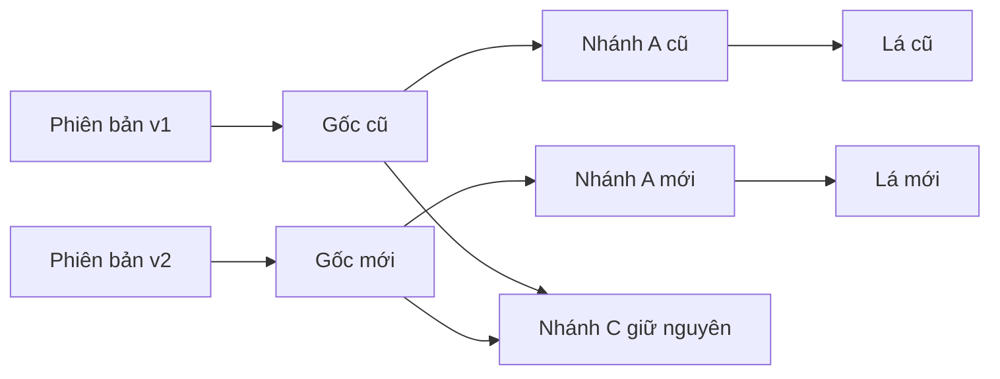

# Trie băm HAMT và ánh xạ bất biến

## 1. Bài toán: cập nhật một ánh xạ mà vẫn giữ được phiên bản cũ

Giả sử ứng dụng lưu điểm của người học bằng một ánh xạ từ mã học viên tới điểm số. Khi sửa một điểm, ta muốn có phiên bản mới để hiển thị, hoàn tác hoặc so sánh, đồng thời giữ nguyên phiên bản đang được nơi khác sử dụng:

```text
v1 = {an: 7, binh: 8, chi: 9}
v2 = v1.set("binh", 10)

v1["binh"] = 8       (không đổi)
v2["binh"] = 10
```

**Ánh xạ bất biến (immutable map)** cung cấp các thao tác như `get(key)`, `set(key, value)` và `delete(key)`. Thao tác ghi **trả về ánh xạ mới**, thay vì sửa ánh xạ đầu vào. Nhờ đó, mỗi phiên bản là một trạng thái nhất quán có thể được tham chiếu lâu dài.

Cách đơn giản là sao chép toàn bộ `Map` trước mỗi lần cập nhật:

```ts
const oldScores = new Map([["an", 7], ["binh", 8], ["chi", 9]]);
const newScores = new Map(oldScores); // sao chép tất cả n mục: O(n)
newScores.set("binh", 10);
```

Với ánh xạ lớn và nhiều phiên bản liên tiếp, chi phí sao chép toàn bộ `O(n)` cho mỗi lần sửa trở nên đáng kể. **HAMT (Hash Array Mapped Trie)** giải quyết bài toán này bằng cách đặt các khóa vào cây dựa trên các phần của mã băm và **chỉ tạo lại các nút trên đường đi bị thay đổi**. Các nhánh khác được dùng chung an toàn vì nội dung của chúng không thay đổi.

Trong học phần về cấu trúc dữ liệu, HAMT kết nối ba ý tưởng: **bảng băm** để phân phối khóa, **trie** để chia đường đi thành các mức và **cấu trúc dữ liệu persistent** để bảo tồn phiên bản bằng chia sẻ cấu trúc.

Sau bài này, bạn cần có thể đọc được cấu trúc của một nút HAMT, giải thích thuật toán tra cứu/thêm/xóa, phân biệt va chạm tiền tố với va chạm mã băm hoàn toàn, và đánh giá khi nào HAMT phù hợp hơn một bảng băm có thể sửa đổi.

## 2. HAMT tổ chức khóa như thế nào?

Trie truyền thống thường đi theo từng ký tự của khóa. **HAMT đi theo các nhóm bit của mã băm của khóa**. Mỗi mức chọn một nhánh theo vài bit kế tiếp.

Ví dụ một HAMT sử dụng mã băm 32 bit, đọc **5 bit mỗi mức**:

```text
hash32(key) gồm 32 bit

Mức 0: bit  0.. 4  -> chỉ số nhánh 0..31
Mức 1: bit  5.. 9  -> chỉ số nhánh 0..31
Mức 2: bit 10..14  -> chỉ số nhánh 0..31
...
Mức 6: bit 30..31  -> chỉ số nhánh 0..3
```

Công thức chọn nhánh tại mức có độ dịch `shift` là:

```ts
const slot = (hash >>> shift) & 0b11111; // lấy 5 bit
// shift lần lượt: 0, 5, 10, 15, 20, 25, 30
```

Hệ số phân nhánh tối đa là `B = 2^5 = 32`. Với 32 bit băm, có nhiều nhất `⌈32/5⌉ = 7` mức lựa chọn nhánh. Hai khóa có thể cùng đi qua vài mức nếu các nhóm bit đầu giống nhau, rồi tách ra ở mức đầu tiên khác nhau. Chúng **không** bắt buộc nằm cạnh nhau theo thứ tự chữ cái hoặc theo thứ tự thêm vào.

Một cách triển khai thông dụng có ba dạng nút:

| Dạng nút | Chức năng |
|---|---|
| **Leaf** (lá) | Lưu một bộ `(hash, key, value)`. So sánh khóa thật khi tìm đúng mục. |
| **BitmapIndexedNode** (nút nhánh có bitmap) | Lưu các nhánh đang tồn tại trong mảng gọn và bitmap đánh dấu vị trí logic 0–31. |
| **CollisionNode** (nút va chạm băm) | Lưu nhiều cặp khóa/giá trị khi **các khóa khác nhau có cùng toàn bộ mã băm**. |

Một số thư viện còn sử dụng nút mảng đủ 32 ô khi nhánh rất dày, và chuyển lại nút bitmap khi thưa. Đây là tối ưu hóa dung lượng/tốc độ; không thay đổi nguyên tắc bất biến.

### Bitmap giúp nút thưa không phải chứa 32 con trỏ

Giả sử một nút chỉ có con tại chỉ số logic `3`, `9` và `31`. Thay vì mảng 32 ô (phần lớn rỗng), nút lưu:

```text
bitmap: bit 3, bit 9 và bit 31 được bật
children: [con_3, con_9, con_31]   // mảng đặc, dài 3

chỉ số logic:    0  1  2  3  4 ... 9 ... 31
                 .  .  .  X  . ... X ...  X
chỉ số mảng:              0      1      2
```

Với `bit = 1 << slot`, trước hết kiểm tra `(bitmap & bit) !== 0` để biết nhánh có mặt hay không. Nếu có, tìm vị trí trong mảng gọn bằng:

```text
index = popcount(bitmap & (bit - 1))
```

Trong đó `popcount(x)` đếm số bit 1 của `x`. Ví dụ với `slot = 9`, chỉ có bit 3 đứng trước bit 9 nên `index = 1`. Cách đánh chỉ số này là điểm đặc trưng của **Hash Array Mapped Trie**: phân nhánh theo hash, nhưng lưu con bằng mảng được ánh xạ qua bitmap.

> **Lưu ý về thao tác bit trong JavaScript:** các toán tử `<<` và `&` làm việc trên số nguyên có dấu 32 bit, nên `1 << 31` có biểu diễn số âm. Điều này vẫn đúng khi dùng như một mẫu bit; hàm `popcount` trong ví dụ mã nguồn phía dưới xử lý đủ 32 bit.

## 3. Vì sao cập nhật vẫn giữ được phiên bản cũ?

Trong một cây có thể thay đổi, `set` thường đi tới lá rồi sửa trực tiếp nút đang dùng chung. Điều đó sẽ làm hỏng phiên bản cũ. HAMT persistent dùng kỹ thuật **path copying**: sao chép nút lá bị thay đổi và các nút tổ tiên dọc đường từ gốc tới lá; mọi nút ngoài đường đó tiếp tục được trỏ đến từ cả hai phiên bản.



Trong hình, **hai con trỏ tới nhánh C là cùng một nút**. Nó không được nhân đôi. Mỗi phiên bản chỉ cần giữ một con trỏ gốc riêng; thao tác đọc trên `v1` tiếp tục nhìn thấy dữ liệu cũ, còn `v2` nhìn thấy dữ liệu mới.

Quy tắc quan trọng:

1. Nút đã xuất hiện trong phiên bản công khai **không được sửa tại chỗ**.
2. Khi thay con trỏ tới một nút con, tạo một nút cha mới với danh sách con mới.
3. Nếu đặt cùng khóa với cùng giá trị, có thể trả lại **chính phiên bản cũ** (kiểm tra no-op).
4. Nhiều phiên bản chỉ an toàn khi giá trị được chia sẻ cũng được đối xử bất biến. Ví dụ, lưu một đối tượng có thể sửa và thay đổi thuộc tính bên trong đối tượng đó vẫn có thể làm các phiên bản cùng quan sát thay đổi.

Đây là **persistent data structure** theo nghĩa cấu trúc giữ được các phiên bản trước, không phải “persistent” theo nghĩa tự động ghi xuống đĩa.

## 4. Các thao tác cốt lõi

### Tra cứu `get(key)`

1. Tính `h = hash(key)`.
2. Bắt đầu tại gốc, lấy nhóm 5 bit theo mức hiện tại để chọn `slot`.
3. Nếu đang ở nút nhánh: kiểm tra bitmap. Nhánh không tồn tại thì trả về “không tìm thấy”; nếu tồn tại, dùng `popcount` xác định vị trí con và đi tiếp.
4. Nếu tới lá: kiểm tra cả **mã băm lẫn khóa thực**; mã băm bằng nhau không đảm bảo khóa bằng nhau.
5. Nếu tới nút va chạm: tìm đúng khóa trong các mục lưu tại nút đó.

`get` không tạo nút mới, nên đọc không làm thay đổi phiên bản.

### Thêm hoặc cập nhật `set(key, value)`

Có bốn trường hợp chính:

- **Chưa có nhánh tại slot:** tạo lá mới rồi tạo nút nhánh mới với bitmap bật thêm bit tương ứng. Các con khác được dùng chung.
- **Đã có lá của cùng khóa:** thay giá trị bằng một lá mới; nếu giá trị không đổi, trả lại nút cũ.
- **Gặp một khóa khác có mã băm khác:** tách hai khóa thành các nhánh ở mức bit đầu tiên mà chúng khác nhau. Nếu những nhóm bit đầu giống nhau, cần tạo thêm một chuỗi nút nhánh đơn.
- **Khóa khác nhưng trùng toàn bộ mã băm:** dùng nút `CollisionNode` để giữ các mục có hash giống nhau, rồi so sánh khóa thực khi thao tác.

Kết quả cuối cùng là một gốc mới. Số mục tăng đúng 1 nếu khóa trước đó chưa tồn tại, và giữ nguyên khi cập nhật khóa cũ.

### Xóa `delete(key)`

Tìm đúng lá hoặc mục trong nút va chạm, rồi tạo lại đường từ vị trí xóa lên gốc. Nếu một nút nhánh không còn con, bỏ nút đó. Nếu sau xóa chỉ còn một lá (hoặc một nút va chạm) ở nhánh, có thể rút gọn nhánh này. **Không được tùy tiện bỏ nút nhánh chỉ còn một nút nhánh con**, vì nút con còn phụ thuộc vào mức bit mà nó đang đọc.

Xóa một khóa không có trong ánh xạ nên trả lại phiên bản cũ; xóa một khóa có thật làm số mục giảm đúng 1.

### Hai kiểu “va chạm” cần phân biệt

| Tình huống | Cách xử lý |
|---|---|
| Hai hash khác nhau nhưng trùng các nhóm 5 bit ở vài mức đầu | Tạo thêm cấp trie đến mức đầu tiên hai nhóm bit khác nhau. |
| Hai khóa khác nhau có **toàn bộ hash 32 bit giống nhau** | Không thể tách bằng các bit còn lại; dùng `CollisionNode`, so sánh khóa thực. |

Một hàm băm tốt làm các slot được phân phối tương đối đều, nhưng **không loại bỏ hoàn toàn khả năng va chạm**. Việc mã băm là 32 bit cũng không có nghĩa có thể lưu tối đa 2³² khóa: nhiều khóa vẫn được phép chia sẻ một mã băm trong nút va chạm.

## 5. Ví dụ TypeScript: HAMT bất biến với khóa chuỗi

Ví dụ dưới đây là bản cài đặt nhỏ phục vụ học tập: khóa kiểu `string`, giá trị kiểu `number`, hash FNV-1a 32 bit, nút bitmap, lá và nút va chạm. Nó hỗ trợ `get`, `set` và `delete`, đồng thời chia sẻ lại các nút không bị thay đổi. Để tiện đọc, ví dụ chưa có các tối ưu thường gặp ở thư viện sản xuất như nút mảng dày, chỉnh sửa tạm thời theo owner token, iterator và serializer.

```ts
type Leaf = Readonly<{
  kind: "leaf";
  hash: number;
  key: string;
  value: number;
}>;

type Collision = Readonly<{
  kind: "collision";
  hash: number;
  entries: readonly Leaf[];
}>;

type Branch = Readonly<{
  kind: "branch";
  bitmap: number;
  children: readonly Node[];
}>;

type Node = Leaf | Collision | Branch;

// FNV-1a: một hàm băm không dùng cho mục đích mật mã.
function hash32(key: string): number {
  let h = 2166136261;
  for (let i = 0; i < key.length; i++) {
    h ^= key.charCodeAt(i);
    h = Math.imul(h, 16777619);
  }
  return h >>> 0;
}

function bitAt(hash: number, shift: number): number {
  return 1 << ((hash >>> shift) & 31);
}

function popcount(x: number): number {
  let n = x >>> 0;
  let count = 0;
  while (n !== 0) {
    n &= n - 1; // bỏ bit 1 thấp nhất
    count++;
  }
  return count;
}

function indexOfBit(bitmap: number, bit: number): number {
  return popcount(bitmap & (bit - 1));
}

function lookup(
  node: Node | undefined,
  key: string,
  hash: number,
  shift: number
): number | undefined {
  if (!node) return undefined;
  if (node.kind === "leaf") {
    return node.hash === hash && node.key === key
      ? node.value : undefined;
  }
  if (node.kind === "collision") {
    return node.hash === hash
      ? node.entries.find(e => e.key === key)?.value
      : undefined;
  }

  const bit = bitAt(hash, shift);
  if ((node.bitmap & bit) === 0) return undefined;
  return lookup(
    node.children[indexOfBit(node.bitmap, bit)],
    key, hash, shift + 5
  );
}

// Hai hash khác nhau chắc chắn có một nhóm bit khác nhau
// trước khi đã đọc hết 32 bit.
function mergeDistinct(
  a: Leaf | Collision,
  b: Leaf,
  shift: number
): Branch {
  const slotA = (a.hash >>> shift) & 31;
  const slotB = (b.hash >>> shift) & 31;
  if (slotA === slotB) {
    return {
      kind: "branch",
      bitmap: 1 << slotA,
      children: [mergeDistinct(a, b, shift + 5)]
    };
  }
  return {
    kind: "branch",
    bitmap: (1 << slotA) | (1 << slotB),
    children: slotA < slotB ? [a, b] : [b, a]
  };
}

type PutResult = { node: Node; added: boolean };

function put(
  node: Node | undefined,
  leaf: Leaf,
  shift: number
): PutResult {
  if (!node) return { node: leaf, added: true };

  if (node.kind === "leaf") {
    if (node.hash === leaf.hash && node.key === leaf.key) {
      return {
        node: Object.is(node.value, leaf.value) ? node : leaf,
        added: false
      };
    }
    if (node.hash === leaf.hash) {
      return {
        node: { kind: "collision", hash: leaf.hash,
                entries: [node, leaf] },
        added: true
      };
    }
    return { node: mergeDistinct(node, leaf, shift), added: true };
  }

  if (node.kind === "collision") {
    if (node.hash !== leaf.hash) {
      return { node: mergeDistinct(node, leaf, shift), added: true };
    }
    const i = node.entries.findIndex(e => e.key === leaf.key);
    if (i < 0) {
      return {
        node: { kind: "collision", hash: node.hash,
                entries: [...node.entries, leaf] },
        added: true
      };
    }
    if (Object.is(node.entries[i].value, leaf.value)) {
      return { node, added: false };
    }
    const entries = node.entries.slice();
    entries[i] = leaf;
    return {
      node: { kind: "collision", hash: node.hash, entries },
      added: false
    };
  }

  const bit = bitAt(leaf.hash, shift);
  const i = indexOfBit(node.bitmap, bit);
  if ((node.bitmap & bit) === 0) {
    const children = node.children.slice();
    children.splice(i, 0, leaf);
    return {
      node: { kind: "branch", bitmap: node.bitmap | bit, children },
      added: true
    };
  }

  const updated = put(node.children[i], leaf, shift + 5);
  if (updated.node === node.children[i]) {
    return { node, added: false };
  }
  const children = node.children.slice();
  children[i] = updated.node;
  return {
    node: { kind: "branch", bitmap: node.bitmap, children },
    added: updated.added
  };
}

type RemoveResult = { node: Node | undefined; removed: boolean };

function remove(
  node: Node | undefined,
  key: string,
  hash: number,
  shift: number
): RemoveResult {
  if (!node) return { node, removed: false };

  if (node.kind === "leaf") {
    const found = node.hash === hash && node.key === key;
    return { node: found ? undefined : node, removed: found };
  }

  if (node.kind === "collision") {
    if (node.hash !== hash) return { node, removed: false };
    const entries = node.entries.filter(e => e.key !== key);
    if (entries.length === node.entries.length) {
      return { node, removed: false };
    }
    return {
      node: entries.length === 1
        ? entries[0]
        : { kind: "collision", hash: node.hash, entries },
      removed: true
    };
  }

  const bit = bitAt(hash, shift);
  if ((node.bitmap & bit) === 0) return { node, removed: false };
  const i = indexOfBit(node.bitmap, bit);
  const result = remove(node.children[i], key, hash, shift + 5);
  if (!result.removed) return { node, removed: false };

  const children = node.children.slice();
  let bitmap = node.bitmap;
  if (result.node) {
    children[i] = result.node;
  } else {
    children.splice(i, 1);
    bitmap &= ~bit;
  }
  if (children.length === 0) {
    return { node: undefined, removed: true };
  }
  // Lá và Collision không cần giữ nguyên độ sâu của nhánh.
  if (children.length === 1 && children[0].kind !== "branch") {
    return { node: children[0], removed: true };
  }
  return {
    node: { kind: "branch", bitmap, children },
    removed: true
  };
}

class HamtMap {
  constructor(
    readonly root: Node | undefined = undefined,
    readonly size: number = 0
  ) {}

  get(key: string): number | undefined {
    return lookup(this.root, key, hash32(key), 0);
  }

  set(key: string, value: number): HamtMap {
    const node: Leaf = { kind: "leaf", hash: hash32(key),
                         key, value };
    const result = put(this.root, node, 0);
    if (result.node === this.root) return this;
    return new HamtMap(result.node, this.size + Number(result.added));
  }

  delete(key: string): HamtMap {
    const result = remove(this.root, key, hash32(key), 0);
    return result.removed
      ? new HamtMap(result.node, this.size - 1)
      : this;
  }
}

const v0 = new HamtMap();
const v1 = v0.set("an", 7).set("binh", 8).set("chi", 9);
const v2 = v1.set("binh", 10);
const v3 = v2.delete("an");

console.log(v1.get("binh"));      // 8, phiên bản cũ nguyên vẹn
console.log(v2.get("binh"));      // 10
console.log(v3.get("an"));        // undefined
console.log(v1.get("an"));        // 7
console.log([v1.size, v2.size, v3.size]); // [3, 3, 2]
console.log(v2.set("binh", 10) === v2); // true: cập nhật no-op
```

**Đọc mã theo các bất biến:**

- `Branch.children` luôn sắp theo thứ tự chỉ số bit bật trong `Branch.bitmap`. Vì vậy `indexOfBit` chọn đúng con.
- Các phép `slice`, `splice` và phép trải `...` chỉ sửa **mảng mới tạo**, không sửa mảng đã được phiên bản cũ tham chiếu.
- Khi cập nhật khóa đã tồn tại, `added = false`; khi thêm khóa mới, `added = true`. Với xóa, `removed` cho biết có cần giảm `size` hay không.
- `mergeDistinct` chỉ được gọi khi **hai mã băm khác nhau**. Nếu hash trùng hoàn toàn, mã dùng `Collision`, tránh đọc quá 32 bit một cách sai nghĩa.
- `Readonly` và `readonly` của TypeScript chủ yếu là ràng buộc **tại thời điểm kiểm tra kiểu**. Chúng không đóng băng đối tượng khi chạy JavaScript. Thư viện thực tế cần che giấu các nút nội bộ và bảo đảm không có đường sửa trực tiếp.

Ở giao diện tổng quát, nếu ánh xạ cho phép lưu `undefined` làm giá trị hợp lệ, `get(key) === undefined` không đủ để phân biệt “không có khóa” với “có khóa mang giá trị undefined”. Cần thêm `has(key)` hoặc trả về một kiểu kết quả phân biệt rõ hai trường hợp. Ví dụ này chỉ lưu số để giữ phần lõi ngắn gọn.

## 6. Chi phí thời gian và bộ nhớ

Gọi `n` là số mục, `B` là hệ số phân nhánh (ở ví dụ, `B = 32`), `d` là số mức đã đi qua và `c` là số khóa trong một nút va chạm hoàn toàn.

| Thao tác | Chi phí khi hash phân phối tốt | Trường hợp cần lưu ý |
|---|---|---|
| `get` | Đi qua khoảng `O(log_B n)` nút trên đường tìm kiếm; thực tế độ sâu nhỏ | Nếu nhiều khóa cùng toàn bộ hash, tìm trong nút va chạm mất `O(c)` với mảng tuyến tính. |
| `set` | Tương tự chiều sâu tra cứu; cấp phát khoảng `O(d)` nút mới (mỗi mảng con tối đa `B` phần tử) | Có thể phải duyệt/sao chép `O(c)` mục trong một nút va chạm. |
| `delete` | Đi theo một đường rồi tái tạo `O(d)` nút và có thể rút gọn nhánh | Nút va chạm lớn vẫn có thể tốn `O(c)`. |
| Lưu nhiều phiên bản | Các phiên bản chia sẻ phần lớn nút; một cập nhật thường chỉ tăng khoảng `O(d)` nút | Giữ rất nhiều gốc cũ sẽ giữ sống các nhánh cũ mà những phiên bản đó còn tham chiếu. |

Với mã băm **có bề rộng cố định** 32 bit, số mức trie không vượt quá 7. Do đó, nếu bỏ qua chi phí xử lý va chạm và giả định hàm băm có chi phí cố định, tra cứu/cập nhật có độ sâu bị chặn bởi một hằng số. Khi phân tích theo `n` trong mô hình hash phân phối tốt, cách diễn đạt trực giác là chiều cao khoảng `log_B n`; **không được suy ra bảo đảm O(1) trong mọi tình huống**, vì nút va chạm có thể tăng theo `n` và bản thân phép băm/so sánh khóa dài cũng tốn thời gian.

Không nên nhầm **bộ nhớ tổng của một ánh xạ** với **bộ nhớ tăng thêm của một phiên bản**. Một HAMT có thể chứa `O(n)` mục và nút; khi cập nhật một khóa, bản mới thường chỉ tạo một số nút tỷ lệ với độ sâu, nhưng nếu giữ cả nghìn gốc phiên bản thì các nút chỉ còn thuộc phiên bản cũ vẫn chưa thể được thu hồi.

## 7. So sánh với những lựa chọn khác

| Cấu trúc | Thêm/sửa/xóa thông thường | Giữ phiên bản trước | Đặc điểm nổi bật |
|---|---|---|---|
| `HashMap`/`Map` có thể sửa | Trung bình `O(1)`, giả định hash phù hợp | Phải sao chép hoặc dùng cơ chế snapshot riêng | Đơn giản, thường rất nhanh khi cập nhật tại chỗ. |
| Sao chép toàn bộ `Map` cho mỗi sửa | `O(n)` để tạo bản mới | Có | Dễ viết nhưng tốn công và bộ nhớ khi nhiều phiên bản lớn. |
| **HAMT bất biến** | Độ sâu nhỏ, sao chép đường đi; cần xử lý va chạm | **Có, bằng chia sẻ cấu trúc** | Phù hợp nhiều phiên bản và truy cập theo khóa; không cung cấp thứ tự khóa mặc định. |
| Cây tìm kiếm cân bằng persistent | `O(log n)` | Có, bằng chia sẻ cấu trúc | Hỗ trợ duyệt có thứ tự và truy vấn khoảng theo khóa. |

HAMT là một lựa chọn tốt cho **cấu hình phiên bản hóa, trạng thái giao diện cần undo/redo, snapshot trạng thái, bảng ánh xạ được chia sẻ giữa nhiều bộ xử lý** hoặc các thuật toán chức năng cần giữ kết quả cũ. Đọc trên các phiên bản bất biến dễ phối hợp hơn giữa các luồng vì không phải lo một luồng khác sửa chính nút đang đọc; tuy nhiên **việc công bố và cập nhật tham chiếu tới phiên bản mới** vẫn cần cơ chế đồng bộ phù hợp nếu có nhiều luồng cùng ghi.

Không nên tự động chọn HAMT cho mọi bài toán. Nếu chỉ tồn tại một phiên bản và cần ghi rất thường xuyên, một bảng băm thay đổi tại chỗ thường có ít cấp phát và chi phí hằng số thấp hơn. Nếu cần thứ tự tăng dần, khóa nhỏ nhất/lớn nhất hoặc truy vấn đoạn, một cây có thứ tự phù hợp hơn. HAMT cũng không tự giải quyết việc lưu bền xuống đĩa hay chống tấn công bằng khóa tạo va chạm; những yêu cầu này cần thiết kế bổ sung.

## 8. Kiểm tra hiểu biết bằng cách lần theo một cập nhật

Cho ánh xạ `v1` có 100.000 khóa được phân phối tương đối đều. Ta thực hiện `v2 = v1.set("k42", 123)`.

1. Tính hash của `"k42"` và lần theo các nhóm 5 bit qua các nút bitmap đến đúng lá.
2. Tạo lá mới với giá trị `123`; nếu giá trị cũ đã là `123`, có thể trả lại `v1` mà không cấp phát nút mới.
3. Nếu giá trị thay đổi, tạo bản mới của **từng nút trên đường đi**, thay đúng con trỏ liên quan; các nhánh còn lại giữ nguyên đối tượng nút.
4. Trả về một gốc mới cho `v2`. Quan sát `v1.get("k42")` vẫn nhận được giá trị cũ.
5. Khi không còn tham chiếu nào tới `v1`, các nút chỉ thuộc `v1` có thể được bộ thu gom rác giải phóng.

Để tự thực hành, hãy thử theo dõi bitmap có các bit `3` và `9` bật, sau đó thêm khóa rơi vào `slot = 5`. Bitmap mới sẽ bật `3, 5, 9`; mảng con mới có thứ tự `[con_3, con_5, con_9]`. Mảng cũ vẫn là `[con_3, con_9]`, vì vậy phiên bản trước không bị ảnh hưởng.

Điểm cần nhớ: **HAMT không bất biến nhờ sao chép cả ánh xạ**. Nó bất biến vì mọi đường ghi tạo một đường nút mới tới gốc, trong khi các nút không đổi được chia sẻ giữa những phiên bản.
