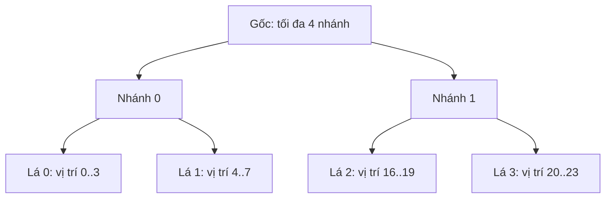
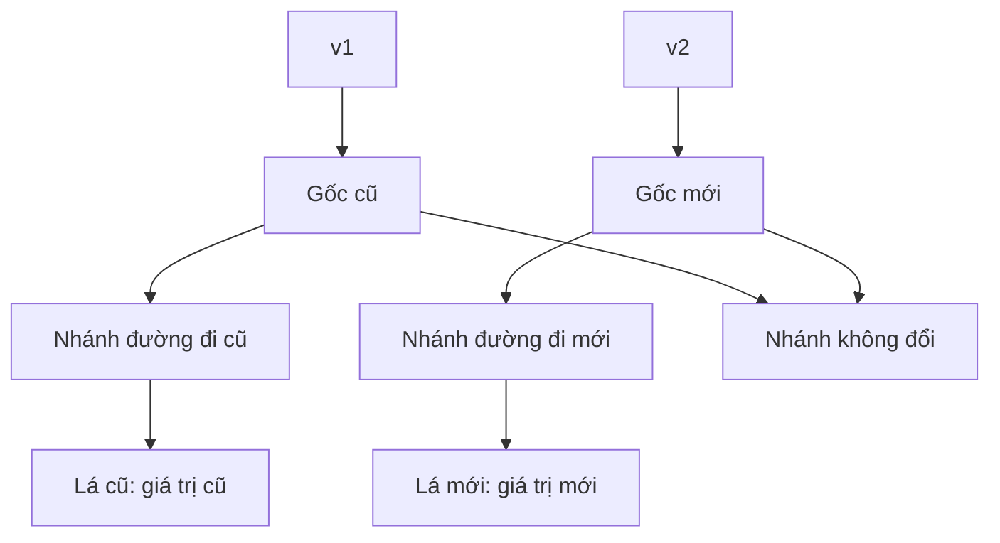

# Vector trie và dãy bất biến có truy cập theo vị trí

## 1. Bài toán: vừa truy cập theo chỉ số, vừa giữ phiên bản cũ

Xét một ứng dụng học tập có dãy điểm `[7, 8, 9, 6]`. Khi người học sửa điểm thứ hai từ `8` thành `10`, ứng dụng muốn tạo trạng thái mới để hiển thị nhưng vẫn lưu trạng thái trước đó phục vụ hoàn tác (*undo*), xem lịch sử hoặc đối chiếu.

```ts
const before = /* dãy bất biến */ [7, 8, 9, 6];
const after = setAt(before, 1, 10);

// before vẫn có phần tử ở chỉ số 1 bằng 8
// after có phần tử ở chỉ số 1 bằng 10
```

Với mảng JavaScript thông thường, `before[1] = 10` sẽ sửa trực tiếp trạng thái cũ. Nếu sao chép toàn bộ mảng bằng `slice()` trước mỗi lần cập nhật, chi phí là `O(n)` thời gian và `O(n)` bộ nhớ cho một dãy có `n` phần tử.

**Vector trie** (thường là *bit-partitioned vector trie*) là cấu trúc dành cho **dãy bất biến có truy cập theo vị trí**. Nó chia dãy thành các khối nhỏ, tổ chức các khối trong cây phân nhánh rộng, rồi áp dụng **chia sẻ cấu trúc** (*structural sharing*) để tái sử dụng những nhánh không thay đổi giữa các phiên bản.

Trong chủ đề **Bất biến và phiên bản** của học phần cấu trúc dữ liệu, vector trie là ví dụ điển hình cho ý tưởng *persistent data structure*: mỗi thao tác tạo trạng thái logic mới mà vẫn có thể sử dụng trạng thái trước. Đồng thời, nó cho thấy cách chọn cấu trúc dữ liệu dựa trên thao tác cần tối ưu: truy cập theo chỉ số, thay phần tử ở vị trí bất kỳ và thêm/bớt ở cuối dãy.

Mục tiêu sau bài học:

- Hiểu vì sao vector trie khác danh sách liên kết, mảng động và hash trie.
- Tính được nhánh cần đi qua từ các chữ số của chỉ số ở cơ số `B`.
- Giải thích cơ chế **path copying**, nút gốc, nút lá và phần đuôi (*tail*).
- Mô tả chính xác `get`, `set`, `push`, `pop`; phân tích độ phức tạp và chi phí lưu nhiều phiên bản.
- Nhận biết những thao tác mà vector trie không tối ưu, đặc biệt là chèn/xóa ở giữa.

## 2. Cấu trúc: chỉ số quyết định đường đi trong trie

Vector trie dùng một cây nhiều nhánh. Mỗi lá chứa một nhóm phần tử liên tiếp, còn mỗi nút trong chứa các con trỏ tới các nhóm nhỏ hơn. Khác với cây tìm kiếm nhị phân, nó **không so sánh khóa** để rẽ trái/phải; đường đi được xác định trực tiếp từ **chỉ số nguyên không âm**.

Giả sử mỗi nút có tối đa `B = 32` nhánh, tương ứng `5` bit, và mỗi lá chứa tối đa `32` phần tử. Ta tách chỉ số `i` thành các nhóm 5 bit. Nhóm thấp nhất chọn vị trí trong lá; các nhóm cao hơn chọn từng cấp nút:

```text
Chỉ số i (biểu diễn cơ số 32):
    ...  [chữ số cấp 2] [chữ số cấp 1] [vị trí trong lá]
             5 bit            5 bit             5 bit

Ví dụ: i = 1123 = 1×32² + 3×32 + 3
        đường đi: nhánh 1 -> nhánh 3 -> phần tử 3
```

Có thể tính các chữ số mà không cần xử lý chuỗi nhị phân:

```ts
const B = 32;
const positionInLeaf = i % B;
const leafSlot = Math.floor(i / B) % B;
const parentSlot = Math.floor(i / (B * B)) % B;
```

Một lá có 32 phần tử; một nút ở cấp ngay trên lá có thể dẫn tới `32 × 32 = 1.024` phần tử; hai cấp nút có thể bao phủ `32³ = 32.768` phần tử. Vì hệ số phân nhánh lớn, cây rất nông ngay cả khi dãy có nhiều phần tử.

Sơ đồ đơn giản với `B = 4` để dễ nhìn:



Sơ đồ chỉ biểu diễn vài nhánh tiêu biểu; trong dãy thực tế, các vị trí tồn tại liên tục từ `0` đến `n - 1`, không có “lỗ” trong dãy. Nút có thể chưa dùng hết số nhánh, đặc biệt ở phần cuối.

**Phân biệt với HAMT:** HAMT chọn nhánh theo **các nhóm bit của mã băm khóa** và dùng bitmap để nén các nhánh thưa. Vector trie chọn nhánh theo **chỉ số phần tử** (không băm), nên giữ thứ tự vị trí và hỗ trợ `get(i)` trực tiếp. Hai cấu trúc cùng dùng trie phân nhánh rộng và chia sẻ cấu trúc nhưng giải quyết hai loại truy cập khác nhau.

## 3. Bất biến bằng chia sẻ cấu trúc

Giả sử `v1` và `v2 = v1.set(70, "mới")`. Vị trí `70` nằm ở một lá cụ thể. Thay vì sao chép mọi lá, thuật toán thực hiện:

1. Đi từ gốc theo các chữ số cơ số `B` của `70`.
2. Tạo **bản sao của lá** chứa phần tử thứ `70` và thay giá trị trong bản sao.
3. Tạo **bản sao của từng nút cha** trên đường ngược về gốc, thay đúng con trỏ dẫn xuống nhánh mới.
4. Giữ nguyên các con trỏ tới những nhánh khác, rồi trả về một gốc mới cho `v2`.



Cùng một nút `S` được cả hai gốc tham chiếu. Điều này an toàn vì các nút đã thuộc phiên bản công khai **không được sửa tại chỗ**. Nếu có nhiều phiên bản, mỗi phiên bản chỉ cần giữ tham chiếu tới gốc của riêng mình.

Giả sử cây có `h` cấp nút trong trước lá, mỗi cấp có tối đa `B` con. Một lần `set` cần tạo khoảng `h` nút trong mới và một lá mới; mảng con được sao chép có độ dài tối đa `B`. Vì `B = 32` là hằng số nhỏ, bộ nhớ tăng thêm theo **độ sâu cây**, thay vì theo tổng số phần tử.

> **Bất biến của container khác với bất biến sâu:** Nếu một phần tử là đối tượng có thể sửa, ví dụ `{score: 8}`, thao tác `v1.get(0).score = 10` có thể làm cả `v1` lẫn `v2` cùng nhìn thấy `score = 10` vì chúng cùng giữ tham chiếu tới đối tượng. Muốn có snapshot sâu, phải dùng các giá trị bất biến hoặc đóng băng/sao chép đối tượng ở cấp cần thiết.

## 4. Tail: tối ưu thao tác ở cuối dãy

Nhiều cách triển khai persistent vector (như các họ vector trong ngôn ngữ hàm) giữ một **mảng đuôi** (*tail*) ngoài cây, chứa từ 1 đến `B` phần tử cuối cùng. Khi dãy rỗng, tail rỗng. Những lá đã đầy đủ `B` phần tử nằm trong cây.

```text
Vector kích thước n = 75; B = 32

Phần cây (64 phần tử):       Tail (11 phần tử):
    Lá 0:  0..31                 64..74
    Lá 1: 32..63

Chỉ số bắt đầu tail = n - tail.length = 75 - 11 = 64
```

### `get(i)` — đọc theo vị trí

Kiểm tra `0 ≤ i < n`. Nếu `i ≥ n - tail.length`, lấy trực tiếp từ tail tại `i - (n - tail.length)`. Nếu không, đi từ gốc qua các nhánh dựa trên chỉ số `i` và lấy phần tử `i % B` trong lá. Đường đi không phụ thuộc giá trị phần tử.

### `set(i, value)` — thay một phần tử

Nếu phần tử nằm trong tail, tạo một **tail mới** bằng cách sao chép tối đa `B` phần tử, rồi thay đúng ô. Nếu nó nằm trong cây, dùng *path copying*. Số phần tử `n` không thay đổi. Nếu giá trị mới được xem là bằng giá trị cũ, triển khai có thể trả lại chính đối tượng vector hiện tại, tránh cấp phát không cần thiết.

### `push(value)` — thêm vào cuối

Nếu tail chưa đầy, chỉ cần sao chép tail và thêm `value` vào cuối; gốc cây được chia sẻ nguyên vẹn.

Khi tail đã có `B` phần tử, biến tail cũ thành một **lá đầy**, thêm lá đó vào cuối cây bằng cách sao chép các nút trên đường chèn, rồi tạo tail mới chỉ chứa `value`. Nếu gốc đã đủ nhánh để chứa số lá đó, tạo một **gốc mới cao hơn một cấp**.

Ví dụ với `B = 4`:

```text
Trước push(8):
    cây: [0..3]       tail: [4,5,6,7]
Sau push(8):
    cây: [0..3] [4..7]    tail: [8]
```

### `pop()` — bỏ phần tử cuối

Nếu tail có hơn một phần tử, tạo tail mới bỏ phần tử cuối. Nếu tail chỉ có một phần tử mà cây còn lá, lấy **lá đầy cuối cùng của cây** làm tail mới; sau đó xóa lá ấy khỏi cây bằng cách sao chép đường đi và thu gọn gốc nếu cần. Nếu vector chỉ có một phần tử, `pop()` trả về vector rỗng. Hợp đồng API nên quy định rõ `pop()` trên vector rỗng sẽ ném lỗi hay trả nguyên vector; ví dụ dưới đây chọn ném `RangeError`.

**Bất biến quan trọng của thiết kế có tail:** Khi `n > 0`, tail có từ `1` tới `B` phần tử; mọi lá trong cây là lá đầy và biểu diễn một đoạn chỉ số liên tiếp **đứng trước tail**. Nhờ đó, mỗi lần thêm/xóa chỉ đụng tới phía cuối của cây.

## 5. Ví dụ TypeScript: persistent vector trie theo chỉ số

Mã dưới đây ưu tiên mô tả thuật toán rõ ràng. Nó dùng `B = 32`, các nút trong chứa con trỏ, lá chứa phần tử và một tail riêng. Các hàm không sửa cấu trúc đầu vào. Phép chia lấy phần nguyên được dùng thay toán tử dịch bit của JavaScript để tránh giới hạn chỉ số ở 32 bit; trong thực tế vẫn cần chú ý số nguyên an toàn của `number` và khả năng cấp phát bộ nhớ.

Đây là **mô hình học tập** với bốn thao tác chính; chưa thêm iterator, `slice`, `concat`, builder dùng tạm vùng nhớ có thể sửa, giới hạn dung lượng và các tối ưu quản lý cấp phát của thư viện thực tế.

```ts
const WIDTH = 32;

type Leaf<T> = Readonly<{
  kind: "leaf";
  items: readonly T[];
}>;

type Branch<T> = Readonly<{
  kind: "branch";
  children: readonly Node<T>[];
}>;

type Node<T> = Leaf<T> | Branch<T>;

// levels = số cấp Branch tính từ một gốc xuống Leaf.
// levels = 1: root -> leaf; levels = 2: root -> branch -> leaf.
function newPath<T>(levels: number, leaf: Leaf<T>): Branch<T> {
  return {
    kind: "branch",
    children: [levels === 1 ? leaf : newPath(levels - 1, leaf)]
  };
}

function appendLeaf<T>(
  root: Branch<T>,
  levels: number,
  leafIndex: number,
  leaf: Leaf<T>
): Branch<T> {
  // Số thứ tự nhánh trong node ở cấp hiện tại.
  const slot =
    Math.floor(leafIndex / WIDTH ** (levels - 1)) % WIDTH;
  const children = root.children.slice();

  if (levels === 1) {
    children[slot] = leaf;
  } else {
    const existing = children[slot] as Branch<T> | undefined;
    children[slot] = existing
      ? appendLeaf(existing, levels - 1, leafIndex, leaf)
      : newPath(levels - 1, leaf);
  }

  return { kind: "branch", children };
}

function findLeaf<T>(
  root: Branch<T>,
  levels: number,
  index: number
): Leaf<T> {
  let node: Node<T> = root;
  for (let level = levels; level >= 1; level--) {
    if (node.kind !== "branch") {
      throw new Error("Cấu trúc trie không hợp lệ");
    }
    const slot = Math.floor(index / WIDTH ** level) % WIDTH;
    node = node.children[slot];
  }
  if (!node || node.kind !== "leaf") {
    throw new Error("Không tìm thấy lá ở chỉ số hợp lệ");
  }
  return node;
}

function updateTree<T>(
  root: Branch<T>,
  levels: number,
  index: number,
  value: T
): Branch<T> {
  const slot = Math.floor(index / WIDTH ** levels) % WIDTH;
  const children = root.children.slice();

  if (levels === 1) {
    const oldLeaf = children[slot] as Leaf<T>;
    const items = oldLeaf.items.slice();
    items[index % WIDTH] = value;
    children[slot] = { kind: "leaf", items };
  } else {
    children[slot] = updateTree(
      children[slot] as Branch<T>,
      levels - 1,
      index,
      value
    );
  }

  return { kind: "branch", children };
}

function rightmostLeaf<T>(root: Branch<T>): Leaf<T> {
  let node: Node<T> = root;
  while (node.kind === "branch") {
    node = node.children[node.children.length - 1];
  }
  return node;
}

function removeRightmostLeaf<T>(
  root: Branch<T>,
  levels: number
): Branch<T> | undefined {
  const children = root.children.slice();
  const last = children.length - 1;

  if (levels === 1) {
    children.pop();
  } else {
    const remaining = removeRightmostLeaf(
      children[last] as Branch<T>,
      levels - 1
    );
    if (remaining) children[last] = remaining;
    else children.pop();
  }

  return children.length === 0
    ? undefined
    : { kind: "branch", children };
}

class PersistentVector<T> {
  private constructor(
    readonly size: number,
    private readonly root: Branch<T> | undefined,
    private readonly levels: number,
    private readonly tail: readonly T[]
  ) {}

  static empty<T>(): PersistentVector<T> {
    return new PersistentVector<T>(0, undefined, 0, []);
  }

  private checkIndex(index: number): void {
    if (!Number.isSafeInteger(index) || index < 0 || index >= this.size) {
      throw new RangeError("Chỉ số ngoài dãy");
    }
  }

  get(index: number): T {
    this.checkIndex(index);
    const tailStart = this.size - this.tail.length;

    if (index >= tailStart) {
      return this.tail[index - tailStart];
    }

    const leaf = findLeaf(this.root!, this.levels, index);
    return leaf.items[index % WIDTH];
  }

  set(index: number, value: T): PersistentVector<T> {
    this.checkIndex(index);
    if (Object.is(this.get(index), value)) return this;

    const tailStart = this.size - this.tail.length;
    if (index >= tailStart) {
      const nextTail = this.tail.slice();
      nextTail[index - tailStart] = value;
      return new PersistentVector(
        this.size, this.root, this.levels, nextTail
      );
    }

    const nextRoot = updateTree(this.root!, this.levels, index, value);
    return new PersistentVector(
      this.size, nextRoot, this.levels, this.tail
    );
  }

  push(value: T): PersistentVector<T> {
    if (!Number.isSafeInteger(this.size + 1)) {
      throw new RangeError("Vector vượt giới hạn số nguyên an toàn");
    }

    if (this.tail.length < WIDTH) {
      return new PersistentVector(
        this.size + 1,
        this.root,
        this.levels,
        [...this.tail, value]
      );
    }

    // Tail cũ đã đầy: chuyển thành lá và đưa vào cây.
    const leaf: Leaf<T> = { kind: "leaf", items: this.tail };
    const leafIndex = (this.size - WIDTH) / WIDTH;
    let nextRoot: Branch<T>;
    let nextLevels = this.levels;

    if (!this.root) {
      nextRoot = newPath(1, leaf);
      nextLevels = 1;
    } else if (leafIndex >= WIDTH ** this.levels) {
      // Cây cũ đã đủ WIDTH^levels lá: tăng chiều cao.
      nextRoot = {
        kind: "branch",
        children: [this.root, newPath(this.levels, leaf)]
      };
      nextLevels++;
    } else {
      nextRoot = appendLeaf(this.root, this.levels, leafIndex, leaf);
    }

    return new PersistentVector(
      this.size + 1, nextRoot, nextLevels, [value]
    );
  }

  pop(): PersistentVector<T> {
    if (this.size === 0) throw new RangeError("Vector rỗng");
    if (this.size === 1) return PersistentVector.empty<T>();

    if (this.tail.length > 1) {
      return new PersistentVector(
        this.size - 1,
        this.root,
        this.levels,
        this.tail.slice(0, -1)
      );
    }

    // Tail chỉ có 1 phần tử, rút lá đầy cuối cây thành tail mới.
    const newTail = rightmostLeaf(this.root!).items;
    let nextRoot = removeRightmostLeaf(this.root!, this.levels);
    let nextLevels = this.levels;

    // Nếu gốc chỉ còn một nhánh xuống Branch, giảm độ cao.
    while (
      nextRoot &&
      nextLevels > 1 &&
      nextRoot.children.length === 1 &&
      nextRoot.children[0].kind === "branch"
    ) {
      nextRoot = nextRoot.children[0] as Branch<T>;
      nextLevels--;
    }

    if (!nextRoot) nextLevels = 0;
    return new PersistentVector(
      this.size - 1, nextRoot, nextLevels, newTail
    );
  }
}

// Minh họa độ sâu vượt quá một tầng Branch.
let v = PersistentVector.empty<number>();
for (let i = 0; i < 1100; i++) v = v.push(i);

const updated = v.set(1024, 9999);
const shortened = updated.pop();

console.log(v.size, v.get(1024));             // 1100, 1024
console.log(updated.size, updated.get(1024)); // 1100, 9999
console.log(shortened.size);                  // 1099
console.log(v.get(1099));                     // 1099
console.log(v.set(1024, 1024) === v);        // true: không đổi

const v33 = Array.from({ length: 33 }, (_, i) => i)
  .reduce((acc, x) => acc.push(x), PersistentVector.empty<number>());
const v32 = v33.pop(); // chuyển lá đầy cuối cây thành tail
console.log(v32.size, v32.get(31)); // 32, 31
console.log(v33.size, v33.get(32)); // 33, 32
```

### Lần theo những điểm quan trọng trong mã

- `findLeaf` dùng `index / WIDTH ** level` để chọn từng nhánh. Nó đọc chỉ số, không băm và không so sánh giá trị.
- `set` chỉ sao chép một tail hoặc các nút từ gốc tới đúng lá; các nhánh không nằm trên đường này được dùng chung.
- `push` chỉ đưa tail vào cây **sau khi tail đầy**. Nếu đang có 32 phần tử, việc thêm phần tử thứ 33 tạo một lá cây chứa 32 phần tử cũ và tail mới chứa phần tử thứ 33.
- `removeRightmostLeaf` chỉ đi theo con cuối cùng. Nhờ bất biến dãy liên tục, lá cần xóa luôn là lá phải nhất.
- Khi số lá vượt khả năng của gốc hiện tại, `push` tăng `levels`. Khi xóa làm gốc chỉ còn một nút nhánh con, `pop` có thể giảm `levels`.
- Các thao tác `slice()` trong mã tạo **mảng mới** rồi sửa mảng mới; chúng không sửa mảng thuộc phiên bản cũ. Các biến `readonly` của TypeScript chỉ ngăn sửa qua giao diện kiểu; chúng không bảo đảm bất biến sâu ở thời gian chạy.

Ví dụ triển khai dùng `get(i)` và `set(i, v)` trả giá trị hoặc tạo vector mới. Một thư viện có thể chọn API khác như `nth`, `assoc`, `conj`, `dropLast` hoặc `update`; điều cần nắm là **hợp đồng bất biến và chi phí thao tác**, không phải tên hàm.

## 6. Độ phức tạp: vì sao truy cập theo vị trí gần với mảng?

Gọi `n` là số phần tử, `B` là hệ số phân nhánh/lá (thông dụng `32`), `h` là chiều cao cây tính theo số cấp nút trong.

| Thao tác | Thời gian (với `B` cố định) | Cấp phát thêm cho phiên bản mới | Giải thích |
|---|---|---|---|
| `get(i)` | `O(1)` khi đọc tail; `O(log_B n)` khi đọc cây | `O(1)` | Lấy các chữ số chỉ số để đi xuống một đường. |
| `set(i, x)` | `O(B)` khi ở tail; `O(B log_B n)` khi ở cây | `O(B)` hoặc `O(B log_B n)` ô tham chiếu | Sao chép tail hoặc các mảng con trên đường đi. |
| `push(x)` | `O(B)` ở tail; tối đa `O(B log_B n)` khi phải đẩy tail vào cây | Tương tự thời gian thao tác | Hầu hết lần thêm chỉ sao chép tail; thỉnh thoảng cập nhật cây. |
| `pop()` | `O(B)` ở tail; tối đa `O(B log_B n)` khi phải rút một lá từ cây | Tương tự | Chỉ cần đường phải nhất và có thể thu gọn gốc. |
| Chèn/xóa tại **giữa** dãy | Thường `O(n)` | Thường `O(n)` | Phải dịch hoặc dựng lại nhiều phần tử, tùy API. |
| Duyệt toàn bộ `n` phần tử | `O(n)` với iterator chuyên dụng | Không cần tạo bản mới | Duyệt theo lá, thay vì gọi `get(i)` từ gốc `n` lần. |

Với `B = 32` được coi là hằng số, người ta thường viết gọn `get/set/push/pop = O(log_B n)` cho trường hợp phải chạm cây, còn sao chép tail là `O(1)` theo `n`. Bảng trên giữ thêm thừa số `B` để thấy rõ chi phí sao chép các mảng con khi thay đổi nút. Do đó, chữ “gần như hằng số” là nhận xét thực dụng về cây nông, **không phải** bảo đảm mọi thao tác có `O(1)` trong mọi mô hình.

Những điểm dễ nhầm:

- **Cập nhật một vị trí không sao chép toàn bộ `n` phần tử.** Nó sao chép nhiều nhất một đường cây, trừ khi API yêu cầu thao tác khác như chèn giữa.
- **Nhiều phiên bản cùng chia sẻ bộ nhớ.** Nếu tạo `v2 = v1.set(i, x)` rồi vẫn giữ `v1`, mỗi phiên bản có gốc riêng nhưng phần lớn nhánh trùng nhau.
- **Giữ nhiều lịch sử vẫn tốn bộ nhớ.** Những nút chỉ thuộc phiên bản cũ sẽ còn sống chừng nào vẫn có tham chiếu đến phiên bản ấy. Khi các phiên bản không còn được sử dụng, bộ gom rác có thể thu hồi nút không còn tham chiếu.
- **Hiệu năng thực tế phụ thuộc cache CPU và cấp phát.** Mảng liên tục thường có tính cục bộ tốt hơn; vector trie có chi phí đi qua con trỏ và tạo nút, đổi lại khả năng giữ phiên bản hiệu quả.

## 7. Chọn cấu trúc cho từng nhu cầu

| Nhu cầu | Mảng động (mutable) | Danh sách liên kết persistent | Vector trie persistent |
|---|---|---|---|
| Đọc phần tử ở chỉ số `i` | `O(1)` | `O(i)` | `O(log_B n)`; thường có độ sâu nhỏ |
| Thay phần tử bất kỳ và giữ phiên bản cũ | Sao chép `O(n)` hoặc dùng cơ chế snapshot khác | Sao chép tiền tố đến vị trí cần sửa | Sao chép đường cây `O(log_B n)` với `B` cố định |
| Thêm vào cuối | `O(1)` khấu hao | Thường `O(n)` cho danh sách đơn chỉ có đầu | Gần tail thường nhanh, tệ nhất `O(log_B n)` |
| Thêm vào đầu | Thường `O(n)` | `O(1)` | Thường `O(n)` |
| Chèn/xóa giữa dãy | `O(n)` | Tìm vị trí `O(n)` | Thường `O(n)` |
| Lưu nhiều phiên bản | Cần sao chép hoặc giải pháp bổ sung | Chia sẻ phần đuôi của danh sách | Chia sẻ phần lớn cây |

Vector trie thường phù hợp với:

- Trạng thái ứng dụng cần undo/redo hoặc mô hình cập nhật theo các phiên bản.
- Dãy bản ghi thường được truy cập theo chỉ số và thay thế một phần tử.
- Hệ thống xử lý chức năng, nơi nhiều nhánh tính toán cùng đọc một trạng thái rồi sinh ra trạng thái mới.
- Snapshot cấu hình, danh sách sự kiện hoặc dãy kết quả mà nhiều tác vụ cần tham chiếu đồng thời.

Cần cân nhắc giải pháp khác khi:

- Chỉ giữ **một phiên bản**, ghi liên tục và cần hiệu năng tối đa: mảng động thông thường có thể nhanh và ít cấp phát hơn.
- Thường xuyên **thêm/xóa ở đầu**: một danh sách liên kết, deque persistent hoặc cấu trúc chuyên dụng có thể phù hợp hơn.
- Muốn **nối/slice các dãy lớn** với chi phí thấp: vector trie cơ bản thường phải xây lại nhiều phần; các biến thể như **RRB-tree** (*relaxed radix balanced tree*) bổ sung thông tin kích thước nhánh để hỗ trợ ghép và cắt linh hoạt hơn.
- Muốn giữ thứ tự ưu tiên, tìm min/max hoặc truy vấn khoảng theo khóa: cây tìm kiếm cân bằng và các cấu trúc chuyên biệt có đặc tính khác; chỉ số vector không tự giải quyết những truy vấn này.

**Điểm khác với trie băm (HAMT):** HAMT phục vụ ánh xạ khóa–giá trị bất biến, chọn đường theo mã băm và xử lý va chạm hash. Vector trie phục vụ dãy đánh số `0..n-1`, chọn đường theo các chữ số chỉ số, không có va chạm hash. Cấu trúc nào phù hợp phụ thuộc bạn cần tìm theo **khóa** hay theo **vị trí**.

## 8. Bài tập tự kiểm tra

**Bài 1 — xác định nhánh.** Với `B = 32` và `i = 1123`, hãy viết ba chữ số cơ số 32 từ cao xuống thấp.

Gợi ý: `1123 = 1 × 32² + 3 × 32 + 3`, nên ta đi qua nhánh `1`, sau đó nhánh `3`, rồi lấy phần tử `3` trong lá. Lưu ý đây là đường đi cho một cây có đủ các cấp tương ứng; không phải mọi vector đều cần độ sâu đó.

**Bài 2 — đếm lần sao chép.** Với vector một triệu phần tử, `v2 = v1.set(100, x)` có cần sao chép một triệu phần tử hay không? Trả lời: Không. Chỉ lá chứa phần tử thứ 100 và các nút trên đường từ gốc tới lá được tạo mới; phần còn lại được chia sẻ. Nếu `x` bằng giá trị cũ theo tiêu chí so sánh, triển khai còn có thể trả ngay `v1`.

**Bài 3 — theo dõi tail.** Với `B = 4`, trước khi thêm phần tử thứ 9, vector có `n = 8`, cây chứa một lá `[0,1,2,3]`, tail là `[4,5,6,7]`. Sau `push(8)`, hãy xác định cây và tail. Đáp án: Cây chứa hai lá `[0,1,2,3]` và `[4,5,6,7]`; tail mới là `[8]`; vector mới có `n = 9`. Vector cũ không thay đổi.

**Bài 4 — bảo toàn phiên bản.** Nếu `v1` chứa một đối tượng `p`, cả `v1` và `v2` đều chia sẻ tham chiếu tới `p`, rồi mã bên ngoài sửa thuộc tính của `p`, liệu hai snapshot có độc lập hoàn toàn? Không. Bất biến của **cấu trúc dãy** chỉ đảm bảo các thay đổi do API vector thực hiện không phá phiên bản cũ; đối tượng phần tử vẫn cần quy tắc bất biến riêng.

**Bài 5 — lựa chọn cấu trúc.** Một trình chỉnh sửa giữ nhiều phiên bản và thường thay một phần tử theo chỉ số, nhưng ít chèn giữa. Vector trie là lựa chọn hợp lý nhờ truy cập theo vị trí và chia sẻ cấu trúc. Nếu thao tác chủ đạo chuyển sang nối hai dãy lớn, nên đánh giá RRB-tree hoặc cấu trúc có phép concat tối ưu.

**Ghi nhớ:** Vector trie kết hợp **chỉ số chia thành các nhóm bit**, **cây phân nhánh rộng**, **tail cho phần cuối** và **sao chép đường đi**. Nhờ vậy, các thao tác theo vị trí giữ được nhiều phiên bản dãy với chi phí tăng thêm theo chiều cao cây, thay vì sao chép nguyên dãy mỗi lần thay đổi.
