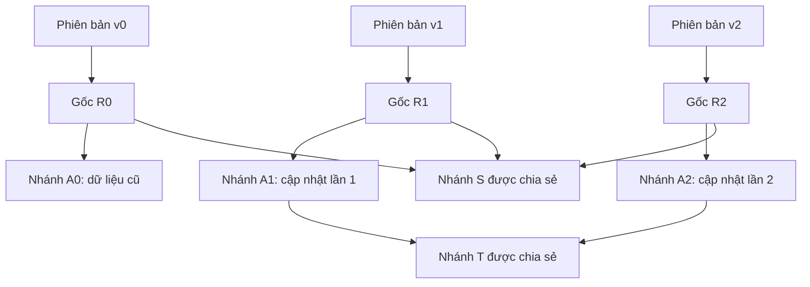
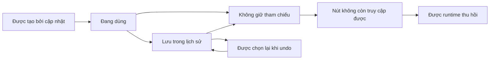
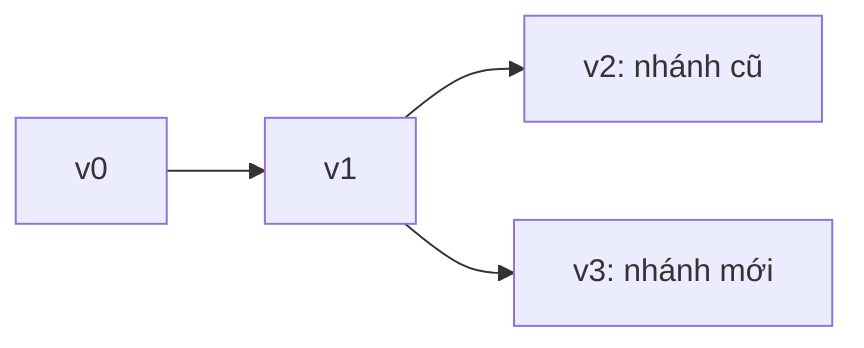

# Quản lý vòng đời các phiên bản và chi phí giữ nút được chia sẻ

## 1. Vì sao dãy và ánh xạ bất biến vẫn có thể tốn nhiều bộ nhớ?

Trong phần **Bất biến và phiên bản** của học phần cấu trúc dữ liệu, một dãy bất biến (*persistent vector*) hoặc ánh xạ bất biến (*persistent map*) thường được triển khai bằng cây có **chia sẻ cấu trúc** (*structural sharing*). Khi thay một phần tử, cấu trúc tạo lại các nút trên đường từ gốc tới vị trí thay đổi; những nhánh khác được dùng chung.

Ví dụ, hệ thống lưu trạng thái bài làm của người học:

```text
v0: [7, 8, 9, 6]
v1 = v0.set(1, 10)
v2 = v1.set(3,  5)
```

Cả ba phiên bản đều có thể đọc độc lập. Người dùng chọn `v0` để hoàn tác vẫn thấy điểm cũ. Đây là lợi ích của dữ liệu bất biến. Nhưng nếu ứng dụng giữ hàng nghìn gốc phiên bản, những nút cũ còn được tham chiếu sẽ **không thể được thu hồi**, dù giao diện chỉ hiển thị trạng thái mới nhất.

Bài này tập trung vào hai câu hỏi thực tế:

1. **Vòng đời phiên bản:** Phiên bản nào được tạo, ai đang giữ tham chiếu tới nó, lúc nào có thể bỏ và điều gì xảy ra khi rẽ nhánh lịch sử?
2. **Chi phí giữ nút được chia sẻ:** Bộ nhớ tăng thêm của từng phiên bản là bao nhiêu, nút nào chỉ còn sống vì lịch sử cũ và làm sao đo/giới hạn chúng?

Đây là kỹ năng quan trọng khi chọn cấu trúc dữ liệu cho các hệ thống cần undo/redo, snapshot, xử lý đồng thời hoặc trạng thái ứng dụng có nhiều phiên bản. Chi phí thời gian `get/set` chỉ là một phần của quyết định thiết kế; chi phí bộ nhớ **tích lũy theo các tham chiếu còn sống** cũng phải được tính đến.

## 2. Gốc phiên bản và đồ thị tham chiếu

### 2.1. Mỗi phiên bản bắt đầu từ một gốc

Một cây bất biến có thể được nhìn như **đồ thị có hướng không chu trình** (*DAG*) gồm các nút dùng chung. Mỗi phiên bản sở hữu một con trỏ gốc. Hai gốc có thể trỏ tới cùng một nút con.



Sơ đồ mang tính minh họa: các đường dẫn có thể chứa nhiều nút trung gian và một nhánh được chia sẻ bởi hai hoặc nhiều phiên bản. Phần quan trọng là **các gốc khác nhau không nhất thiết tương ứng với các bản sao toàn bộ cây**.

Một nút được xem là **còn sống theo nghĩa dữ liệu** nếu vẫn có đường tham chiếu từ một gốc hoặc đối tượng còn được giữ trong chương trình tới nút đó. Cây bất biến không chủ động xóa một nút khi tạo phiên bản mới; việc thu hồi phụ thuộc vào việc còn tham chiếu hay không và vào cơ chế quản lý bộ nhớ của môi trường chạy.

### 2.2. Phân biệt ba số lượng

| Đại lượng | Ý nghĩa |
|---|---|
| **Số phiên bản được giữ** `V` | Có bao nhiêu gốc snapshot/history vẫn được tham chiếu. |
| **Số nút được cấp phát cộng dồn** `A` | Tổng số đối tượng nút đã từng tạo từ đầu tiến trình; có thể lớn dù nhiều nút đã được thu hồi. |
| **Số nút còn truy cập được** `U` | Số nút **khác nhau theo danh tính đối tượng** có thể đi tới từ các gốc và tham chiếu còn sống. |

`V` không bằng `U`. Chẳng hạn, ba phiên bản có thể cùng trỏ tới một nhánh lớn 100.000 nút. Tính số nút bằng cách cộng kích thước từng phiên bản sẽ **đếm trùng** nhánh này ba lần. Ngược lại, nhìn vào riêng phiên bản hiện tại sẽ **bỏ sót** những nhánh cũ chỉ còn sống vì snapshot lịch sử.

Một mô hình tính dung lượng ở mức nút có thể viết:

\[
U = \bigcup_{r \in R} \operatorname{Reachable}(r), \qquad
M_{\text{nodes}} \approx \sum_{u\in U}\operatorname{size}(u)
\]

Trong đó `R` là tập gốc đang được giữ. Ngoài chi phí nút, bộ nhớ thực tế còn bao gồm mảng con trỏ, đối tượng giá trị, metadata quản lý phiên bản và phần phụ trội của bộ cấp phát/bộ gom rác. Hai nút khác nhau có thể cùng trỏ tới một đối tượng giá trị, nên chi phí **payload** cũng phải tránh đếm trùng.

### 2.3. Bộ nhớ được giải phóng lúc nào?

Hãy xét gốc `v0`, `v1` và `v2` cùng tồn tại.

- Nếu bỏ tham chiếu tới `v0`, chỉ các nút **không còn đi tới được từ `v1`, `v2` hoặc nơi khác** mới trở thành ứng viên để thu hồi.
- Nút được dùng chung bởi `v0` và `v2` vẫn sống nhờ `v2`.
- Nếu xóa hết lịch sử, nhưng một callback, cache hoặc tác vụ nền vẫn giữ `v0`, toàn bộ phần cây chỉ còn truy cập qua `v0` vẫn có thể sống.
- Trong hệ thống dùng garbage collector, **mất khả năng truy cập** chưa đồng nghĩa bộ nhớ được trả về hệ điều hành ngay lập tức; GC hoạt động theo lịch của runtime.

Vì vậy, “xóa phiên bản khỏi danh sách lịch sử” là hành động **bỏ một tham chiếu**. Nó không tương đương với “xóa mọi nút thuộc phiên bản đó”, bởi rất nhiều nút có thể đang được chia sẻ.

## 3. Tính chi phí của một loạt cập nhật

### 3.1. Mô hình cây nhỏ có thể đếm bằng tay

Xét một cây nhị phân hoàn chỉnh chứa 8 phần tử ở 8 lá. Bên trên có 7 nút trong, nên tổng cộng **15 nút**. Mỗi lần cập nhật một lá, cơ chế sao chép đường đi tạo 4 nút mới: 1 lá và 3 nút trong trên đường tới gốc.

Giả sử:

```text
v0: [0,1,2,3,4,5,6,7]
v1: thay phần tử chỉ số 2 thành 20
v2: từ v1, thay phần tử chỉ số 3 thành 30
v3: từ v2, thay phần tử chỉ số 4 thành 40
```

Nếu giữ tất cả các gốc, số nút khác nhau còn truy cập được sẽ tăng:

| Gốc còn giữ | Tổng số nút phân biệt | Lý do |
|---|---:|---|
| `v0` | 15 | Cây ban đầu. |
| `v0, v1` | 19 | `v1` tạo thêm 4 nút. |
| `v0, v1, v2` | 23 | `v2` tạo thêm 4 nút. |
| `v0, v1, v2, v3` | 27 | `v3` tạo thêm 4 nút. |

Nếu sau khi tạo `v3`, ta **loại `v0`** và chỉ giữ `v1, v2, v3`, 4 nút trên đường cũ của `v0` không còn được gốc nào dùng và có thể thu hồi. Số nút phân biệt giảm từ **27 xuống 23**. Nếu chỉ giữ `v3` thì số nút phân biệt của cây trở lại **15**.

Các con số trên giả định mỗi phiên bản chỉ thay đúng một lá, không giữ tham chiếu nào từ bên ngoài tới các nút/gốc đã bỏ và tính bằng **số nút**, chưa tính byte thực tế.

Ví dụ cho thấy hai hiện tượng:

- **Tạo phiên bản mới** có chi phí cấp phát, dù phần lớn dữ liệu vẫn chia sẻ.
- **Loại phiên bản cũ** không nhất thiết giải phóng đúng số nút mà phiên bản đó từng tạo ra. Một nút mới của `v1` có thể vẫn đang được `v3` sử dụng; một nút rất cũ của `v0` cũng có thể còn sống vì nhánh đó chưa từng được thay đổi.

### 3.2. Công thức gần đúng cho cấu trúc phân nhánh rộng

Giả sử persistent vector trie hoặc HAMT có hệ số phân nhánh tối đa `B`, độ sâu đường đi `d` và tổng số mục `n`.

Đối với thao tác chỉ thay một khóa/vị trí, chi phí điển hình là:

- **Số nút mới:** `O(d)`, vì chỉ sao chép nút trên một đường từ gốc tới lá; đôi khi cần thêm nút để xử lý mở rộng hoặc va chạm.
- **Số ô tham chiếu cần sao chép:** tối đa `O(Bd)` nếu mỗi nút trên đường giữ một mảng con trỏ kích thước tối đa `B`.
- **Thời gian:** thường `O(Bd)` cho phần sao chép mảng con trỏ, cộng thời gian băm/so sánh khóa, xử lý va chạm hoặc xử lý payload nếu có.
- **Dữ liệu nguyên vẹn ngoài đường thay đổi:** được chia sẻ, không cấp phát lại.

Với vector trie phân nhánh 32, `d` nhỏ và `B` cố định; với cây cân bằng tổng quát, `d = O(\log_B n)`. Trường hợp đặc biệt như **nút va chạm lớn của HAMT** hoặc thao tác **chèn nhiều phần tử vào giữa dãy** có thể tạo chi phí lớn hơn hẳn cập nhật một lá.

Nếu bắt đầu từ cây có `N` nút và giữ **toàn bộ** `k` phiên bản mới được tạo qua các lần cập nhật một đường, số nút từng được cấp phát và có thể còn sống có cận trên gần `N + O(kd)`. Tuy nhiên, đừng áp dụng công thức này một cách máy móc khi:

- Các phiên bản là snapshot **cách quãng sau hàng nghìn thay đổi**, không phải các trạng thái liên tiếp.
- Một phiên bản được tạo bằng tái cấu trúc, sao chép tập lớn, chuyển định dạng hoặc nạp lại dữ liệu.
- Có nhiều nhánh lịch sử phát triển độc lập, mỗi nhánh giữ các vùng khác nhau.
- Phần tử chứa đối tượng lớn hoặc cấu trúc con có vòng đời riêng.

Cách tính đúng trong các trường hợp này là **hợp của các tập nút còn truy cập được**, không chỉ lấy “số phiên bản × số nút trên một đường”.

## 4. Vòng đời của một phiên bản

Một phiên bản có thể đi qua các trạng thái vận hành sau:



Mũi tên từ `DROP` tới `UNREACH` chỉ áp dụng cho các nút **không còn tham chiếu từ bất kỳ nơi nào**. Thời điểm runtime thu hồi có thể đến sau đó. Trạng thái “đã lưu ra đĩa” là một cơ chế khác: một bản snapshot bền vững có thể còn tồn tại trên đĩa ngay cả khi toàn bộ các nút trong RAM đã được giải phóng.

### 4.1. Tạo và công bố phiên bản

Trong cấu trúc persistent, `set` thường tạo gốc mới rồi trả về cho người gọi:

```ts
// Pseudocode: ánh xạ bất biến chỉ minh họa hợp đồng API
const previous = currentMap;
const next = previous.set("course:42", { progress: 80 });

// previous vẫn là phiên bản cũ;
// ứng dụng quyết định lúc nào công bố next thành trạng thái hiện tại.
currentMap = next;
```

Bởi cấu trúc đã bất biến, một luồng đọc giữ `previous` vẫn có thể đọc nhất quán. Nhưng trong ứng dụng có **nhiều luồng ghi**, thao tác công bố tham chiếu `currentMap` cần đồng bộ thích hợp (ví dụ khóa hoặc so sánh và hoán đổi); nếu hai luồng cùng tính kết quả từ một gốc cũ rồi ghi đè nhau, có thể mất cập nhật.

### 4.2. Undo/redo và rẽ nhánh lịch sử

Hai mô hình lịch sử phổ biến:

1. **Lịch sử tuyến tính:** `v0 → v1 → v2`. Undo chuyển con trỏ hiện tại về `v1`, redo trở lại `v2`. Nếu đang ở `v1` mà tạo `v3`, thường **loại phần redo `v2`**.
2. **Lịch sử dạng nhánh:** `v1` có thể có cả `v2` và `v3` là con. Công cụ quản lý lịch sử phải lưu quan hệ cha/con và quyết định cách chọn nhánh, thay vì dùng một danh sách đơn thuần.



Điểm dễ nhầm là **quan hệ kế thừa giữa phiên bản** (ai được sửa từ ai) và **quan hệ con trỏ trong cấu trúc dữ liệu** (gốc phiên bản trỏ tới nút nào) là hai đồ thị khác nhau. Giữ metadata `parentId = v1` trong một danh sách không nhất thiết giữ được gốc của `v1`, nếu không có tham chiếu mạnh tới gốc; ngược lại, một closure chứa gốc `v1` có thể giữ bộ nhớ dù metadata đã bị xóa.

### 4.3. Giữ, loại bỏ và tái tạo

Một ứng dụng cần xác định rõ chính sách vòng đời:

| Chính sách | Cách hoạt động | Điều cần đánh đổi |
|---|---|---|
| Chỉ giữ bản mới nhất | Thay tham chiếu gốc hiện tại sau mỗi cập nhật | Ít lịch sử trong RAM, không undo trực tiếp bằng root cũ. |
| Lịch sử vòng `K` phiên bản | Giữ tối đa `K` gốc gần nhất | Undo giới hạn; tương đối dễ khống chế bộ nhớ khi các phiên bản liên tiếp và thay đổi nhỏ. |
| Giữ các mốc quan trọng | Lưu gốc khi người dùng bấm “checkpoint” | Ít gốc hơn nhưng hai mốc cách xa có thể giữ hai cây khác nhau đáng kể. |
| Giới hạn theo dung lượng | Đo hoặc ước lượng bộ nhớ giữ lại rồi loại bản cũ | Khó hơn vì nút dùng chung không được cộng trùng. |
| Snapshot trên đĩa + replay thay đổi | Dọn gốc trong RAM; phục hồi từ checkpoint và nhật ký thay đổi | Giảm RAM, đổi lấy chi phí I/O, serialize và thời gian dựng lại trạng thái. |

Giới hạn `K` chỉ là giới hạn **số gốc**. Nó không tự đảm bảo lượng RAM cố định: kích thước từng snapshot, lượng thay đổi giữa các mốc và tham chiếu bên ngoài đều ảnh hưởng đến bộ nhớ.

## 5. Ví dụ TypeScript: lịch sử có giới hạn và đếm nút còn được giữ

Để thấy rõ vòng đời, ta dùng **cây nhị phân bất biến** chứa một dãy số. Cây này đơn giản hơn vector trie phân nhánh 32 hoặc HAMT, nhưng dùng đúng cơ chế **sao chép đường đi và chia sẻ các nhánh không đổi**. Ví dụ minh họa vòng đời phiên bản, nên chọn số nguyên ở các lá để tránh các vấn đề phát sinh từ đối tượng giá trị có thể sửa.

Mỗi `set` tạo gốc mới nếu giá trị thực sự thay đổi. `BoundedHistory` giữ tối đa `maxVersions` phiên bản, hỗ trợ undo/redo tuyến tính và có hàm chẩn đoán đếm nút khác nhau còn truy cập được **từ lịch sử do nó quản lý**.

```ts
type Node =
  | Readonly<{ kind: "leaf"; value: number }>
  | Readonly<{ kind: "branch"; left: Node; right: Node }>;

function leaf(value: number): Node {
  return Object.freeze({ kind: "leaf", value });
}

function branch(left: Node, right: Node): Node {
  return Object.freeze({ kind: "branch", left, right });
}

function build(values: readonly number[], lo: number, hi: number): Node {
  if (hi - lo === 1) return leaf(values[lo]);

  const mid = lo + Math.floor((hi - lo) / 2);
  return branch(
    build(values, lo, mid),
    build(values, mid, hi)
  );
}

function lookup(node: Node, index: number, lo: number, hi: number): number {
  if (node.kind === "leaf") return node.value;

  const mid = lo + Math.floor((hi - lo) / 2);
  return index < mid
    ? lookup(node.left, index, lo, mid)
    : lookup(node.right, index, mid, hi);
}

function update(
  node: Node,
  index: number,
  value: number,
  lo: number,
  hi: number
): Node {
  if (node.kind === "leaf") {
    return Object.is(node.value, value) ? node : leaf(value);
  }

  const mid = lo + Math.floor((hi - lo) / 2);
  if (index < mid) {
    const newLeft = update(node.left, index, value, lo, mid);
    return newLeft === node.left ? node : branch(newLeft, node.right);
  }

  const newRight = update(node.right, index, value, mid, hi);
  return newRight === node.right ? node : branch(node.left, newRight);
}

type Snapshot = Readonly<{ id: number; root: Node }>;

class BoundedHistory {
  private snapshots: Snapshot[];
  private cursor = 0;
  private nextId = 1;
  readonly length: number;

  constructor(values: readonly number[], private readonly maxVersions: number) {
    if (values.length === 0) {
      throw new RangeError("Ví dụ yêu cầu dãy không rỗng");
    }
    if (!Number.isSafeInteger(maxVersions) || maxVersions < 1) {
      throw new RangeError("maxVersions phải là số nguyên dương");
    }

    this.length = values.length;
    this.snapshots = [{
      id: 0,
      root: build(values, 0, values.length)
    }];
  }

  get versionId(): number {
    return this.snapshots[this.cursor].id;
  }

  get retainedVersions(): number {
    return this.snapshots.length;
  }

  private assertIndex(index: number): void {
    if (!Number.isSafeInteger(index) || index < 0 || index >= this.length) {
      throw new RangeError("Chỉ số ngoài dãy");
    }
  }

  get(index: number): number {
    this.assertIndex(index);
    return lookup(this.snapshots[this.cursor].root, index, 0, this.length);
  }

  set(index: number, value: number): number {
    this.assertIndex(index);

    const current = this.snapshots[this.cursor];
    const nextRoot = update(current.root, index, value, 0, this.length);
    if (nextRoot === current.root) return current.id;

    // Nếu đang ở phiên bản cũ rồi sửa, bỏ nhánh redo.
    this.snapshots.splice(this.cursor + 1);
    this.snapshots.push({ id: this.nextId++, root: nextRoot });

    // Chỉ giữ số lượng gốc gần nhất.
    if (this.snapshots.length > this.maxVersions) {
      const excess = this.snapshots.length - this.maxVersions;
      this.snapshots.splice(0, excess);
    }

    this.cursor = this.snapshots.length - 1;
    return this.versionId;
  }

  undo(): boolean {
    if (this.cursor === 0) return false;
    this.cursor--;
    return true;
  }

  redo(): boolean {
    if (this.cursor + 1 === this.snapshots.length) return false;
    this.cursor++;
    return true;
  }

  // Chỉ còn giữ gốc hiện tại, không xóa dữ liệu trong gốc đó.
  clearHistory(): void {
    this.snapshots = [this.snapshots[this.cursor]];
    this.cursor = 0;
  }

  // Hàm chẩn đoán O(U), không nên gọi trên mọi lần cập nhật.
  reachableNodeCount(): number {
    const seen = new Set<Node>();

    const visit = (node: Node): void => {
      if (seen.has(node)) return;
      seen.add(node);

      if (node.kind === "branch") {
        visit(node.left);
        visit(node.right);
      }
    };

    for (const snapshot of this.snapshots) {
      visit(snapshot.root);
    }
    return seen.size;
  }
}

const history = new BoundedHistory([0, 1, 2, 3, 4, 5, 6, 7], 3);

console.log(history.reachableNodeCount()); // 15
history.set(2, 20);                        // tạo v1
console.log(history.reachableNodeCount()); // 19
history.set(3, 30);                        // tạo v2
console.log(history.reachableNodeCount()); // 23
history.set(4, 40);                        // tạo v3, loại v0
console.log(history.retainedVersions);     // 3
console.log(history.reachableNodeCount()); // 23

history.undo();
console.log(history.get(4));               // 4: quay về v2
history.redo();
console.log(history.get(4));               // 40: trở lại v3

history.clearHistory();                    // chỉ giữ v3
console.log(history.retainedVersions);     // 1
console.log(history.reachableNodeCount()); // 15
```

### Vì sao hàm đếm nút dùng `Set`?

Nếu đếm mọi nút khi duyệt từng gốc rồi cộng lại, nhánh dùng chung sẽ bị tính nhiều lần. `Set<Node>` ghi nhận **danh tính đối tượng**, nên mỗi nút chỉ được duyệt một lần. Với `U` nút phân biệt có thể đi tới từ các gốc do `BoundedHistory` giữ, hàm `reachableNodeCount()` tốn `O(U)` thời gian và `O(U)` bộ nhớ phụ.

Kết quả đếm mô tả **đồ thị mà đối tượng `history` giữ**, không phải toàn bộ heap của chương trình. Nếu một biến ngoài giữ lại gốc đã loại, hoặc một cache đang giữ đối tượng giá trị mà phiên bản cũ trỏ tới, bộ nhớ thực tế có thể lớn hơn. Trong mã minh họa, root không được công bố ra ngoài nên các con số khớp với đồ thị trong `history`.

### Vì sao cần tách đếm nút và đo byte?

Một lá với số nguyên và một lá với chuỗi dài không nhất thiết có dung lượng bằng nhau. Một nhánh 32 con trỏ có thể tốn nhiều bộ nhớ hơn nhánh 2 con trỏ. Runtime còn có header đối tượng, căn chỉnh bộ nhớ và quản lý GC. Khi dùng vector trie thực tế, hãy đo ít nhất:

- Số snapshot/root còn được giữ; số lần tạo và loại snapshot.
- Tổng lượng heap và tốc độ cấp phát (allocation rate).
- Số nút hoặc tổng byte **còn truy cập được** từ các gốc, nếu thư viện cho phép quan sát.
- Phần bộ nhớ của **payload**, buffer và mảng con được dùng chung hay tạo mới.

Không nên suy dung lượng byte từ con số `15` hoặc `23` trong ví dụ nếu chưa biết biểu diễn đối tượng của môi trường thực thi.

## 6. Những nơi có thể vô tình giữ phiên bản cũ

Trong một ứng dụng thực tế, bộ quản lý lịch sử chỉ là **một** trong nhiều nơi có thể giữ root. Những tình huống thường gặp gồm:

| Nguồn giữ tham chiếu | Ví dụ | Cách xử lý |
|---|---|---|
| Cache không có giới hạn | `Map<id, snapshot>` lưu mọi phiên bản từng xem | Định rõ TTL, LRU hoặc giới hạn dung lượng; xóa entry không còn cần. |
| Closure hoặc listener | Callback đăng ký lâu dài đóng trên biến `oldRoot` | Gỡ đăng ký khi màn hình/tác vụ kết thúc; tránh capture snapshot không cần thiết. |
| Tác vụ bất đồng bộ | Promise/coroutine giữ trạng thái cũ trong lúc xử lý | Giới hạn số công việc đồng thời và vòng đời tác vụ; loại tham chiếu sau khi hoàn tất. |
| Stack undo/redo | Mỗi lần thao tác `push(oldRoot)` nhưng không loại phần tử cũ | Giới hạn độ sâu, xác định hành vi khi tạo nhánh mới. |
| Lịch sử debug/test | Trình ghi trace giữ các object snapshot để kiểm tra | Dùng log nhẹ, lấy mẫu hoặc ID; tắt cơ chế giữ gốc khi không cần. |
| Đối tượng giá trị lớn | Lá còn sống giữ ảnh, buffer hoặc object graph | Quản lý payload, không chỉ bộ khung trie; cân nhắc lưu mã định danh/tài nguyên bên ngoài. |

**Về `WeakRef` và `WeakMap`:** tham chiếu yếu có thể phù hợp cho cache không bắt buộc tồn tại, nhưng không nên dùng làm nơi giữ duy nhất của undo/redo. Garbage collector có quyền thu hồi đối tượng được giữ yếu bất kỳ khi nào điều kiện cho phép; nếu lịch sử cần hoạt động chắc chắn, phải có tham chiếu mạnh tới các gốc còn trong chính sách lưu.

**Về bộ nhớ được quản lý thủ công:** trong C++ hoặc Rust, việc chia sẻ nút thường dùng con trỏ sở hữu chung/reference counting, ví dụ `shared_ptr` hoặc `Arc`. Khi số chủ sở hữu giảm về 0, nút có thể được giải phóng. Một nút chia sẻ có thể có nhiều tham chiếu từ các gốc/nhánh, nên bỏ một gốc chưa chắc làm số đếm về 0. Các vấn đề đồng bộ khi cập nhật số đếm và việc tránh vòng tham chiếu vẫn cần xử lý theo quy tắc của runtime và kiểu dữ liệu.

## 7. Chính sách vận hành để kiểm soát bộ nhớ

### 7.1. Giữ lịch sử theo mục tiêu sản phẩm

Trước khi chọn giới hạn lịch sử, xác định điều người dùng thực sự cần:

- Một trình soạn thảo có thể cần 50–200 bước undo gần nhất, nhưng các thao tác nhập liên tiếp có thể được gom thành một bước theo thời gian hoặc hành động.
- Một dịch vụ cấu hình có thể chỉ cần phiên bản đã công bố, bản đang chuẩn bị và vài mốc triển khai.
- Một hệ thống phân tích dữ liệu có thể giữ snapshot theo lô hoặc theo checkpoint, thay vì sau từng phép sửa nhỏ.

Các con số là **ví dụ thiết kế**, không phải mức khuyến nghị áp dụng chung. Ngân sách RAM, kích thước payload, tần suất cập nhật và yêu cầu khôi phục mới quyết định ngưỡng thích hợp.

Nếu giữ `K` phiên bản **liên tiếp**, mỗi bước chỉ sửa một đường trong một cấu trúc có kích thước ổn định, đồ thị còn sống thường gần với cây mới nhất cộng các đường cũ được `K - 1` snapshot trước cần giữ. Với các snapshot **cách nhau nhiều cập nhật** hoặc những phép biến đổi lớn, phải đo lại: chỉ giữ hai mốc cũng có thể giữ hai phần lớn cây gần như độc lập.

### 7.2. Tạo checkpoint và tái dựng khi cần

Khi cần lịch sử rất dài, có thể lưu một checkpoint bền vững rồi ghi nhật ký thay đổi:

```text
Checkpoint tại sự kiện 10.000
  +
Các thay đổi 10.001 ... 10.120
  =
Trạng thái tại sự kiện 10.120
```

Cách này giảm số gốc phải giữ thường trực trong RAM nhưng làm phát sinh chi phí ghi/đọc, replay và khả năng cần kiểm tra tính toàn vẹn của nhật ký. Checkpoint định kỳ rút ngắn thời gian phục hồi; ngược lại, nhiều checkpoint lớn cũng chiếm dung lượng lưu trữ.

**Lưu ý khi serialize:** việc duyệt từng snapshot rồi ghi toàn bộ cây ra JSON có thể làm mất lợi ích chia sẻ cấu trúc trên đĩa, vì các nhánh trùng nhau bị ghi lặp. Để lưu nhiều snapshot lớn mà vẫn chia sẻ, định dạng có thể gán ID cho nút và tham chiếu lại nút đã lưu, hoặc lưu checkpoint cộng các thay đổi.

### 7.3. Đo bằng số liệu thay vì suy từ số snapshot

Một quy trình quan sát hợp lý:

1. Đo heap lúc bắt đầu, số nút hoặc đối tượng giá trị của phiên bản hiện tại và lượng lịch sử đang giữ.
2. Thực hiện chuỗi thao tác tương tự thực tế: cập nhật nhỏ, cập nhật lớn, undo/redo và tạo nhánh.
3. Đếm nút phân biệt còn truy cập được nếu có API thích hợp; theo dõi allocation rate, heap sau GC và thời gian GC.
4. Loại các phiên bản theo chính sách, bảo đảm các tác vụ/cache cũ cũng thả tham chiếu, rồi kiểm tra bộ nhớ có **đủ điều kiện được thu hồi** hay không.
5. Đánh giá cả độ trễ thao tác, bởi giữ ít lịch sử hơn có thể buộc ứng dụng dựng lại phiên bản từ log.

Không dùng một lần đo `process.memoryUsage()` hoặc tổng heap làm bằng chứng chính xác số byte do trie chiếm: số đó còn bao gồm nhiều đối tượng khác, thời điểm GC và bộ nhớ mà runtime giữ lại để tái sử dụng.

## 8. Phân biệt các quyết định thiết kế dễ nhầm

| Nhận định | Đánh giá đúng |
|---|---|
| “Persistent nghĩa là dữ liệu đã được ghi xuống đĩa.” | Sai. Ở đây, persistent nghĩa là còn có thể truy cập phiên bản cũ; muốn bền vững qua khởi động lại phải lưu trữ riêng. |
| “Chỉ có một gốc hiện tại nên không thể rò bộ nhớ phiên bản.” | Chưa chắc. Cache, closure, listener, tác vụ chưa hoàn tất hoặc giá trị chia sẻ có thể giữ gốc/nút cũ. |
| “Xóa một snapshot sẽ giải phóng toàn bộ cây của snapshot.” | Sai. Các nhánh còn được snapshot khác dùng chung vẫn sống. |
| “Giữ 10 phiên bản tốn đúng 10 lần RAM.” | Sai. Chia sẻ cấu trúc có thể giảm rất nhiều, nhưng mức chia sẻ tùy các thay đổi và nhánh lịch sử. |
| “Giữ tối đa `K` gốc luôn bảo đảm bộ nhớ `O(K \log n)`.” | Sai. Phải cộng cả cây hiện tại, payload và những vùng cây khác nhau giữa các mốc; công thức này không đúng cho snapshot bất kỳ. |
| “Garbage collector sẽ thu hồi bản cũ ngay khi xóa khỏi history.” | Sai. Nút cần hết mọi tham chiếu mạnh và còn phụ thuộc lịch chạy GC. |
| “Có thể dùng giá trị `WeakRef` để bảo đảm undo.” | Không. Tham chiếu yếu không hứa đối tượng còn tồn tại tới lúc cần undo. |
| “Cây bất biến tự giải quyết xung đột ghi đồng thời.” | Không. Bản thân node không bị sửa, nhưng việc công bố root mới và hòa giải các cập nhật cạnh tranh vẫn phải thiết kế. |

## 9. Bài tập tình huống

### Bài 1 — Đếm nút

Cây nhị phân hoàn chỉnh chứa 8 lá, tổng cộng 15 nút. Mỗi lần sửa một lá tạo 4 nút mới. Sau hai cập nhật liên tiếp, nếu giữ cả `v0`, `v1` và `v2`, số nút phân biệt còn truy cập được là bao nhiêu?

**Đáp án:** `15 + 4 + 4 = 23` nút. Cách cộng này đúng vì ta giữ toàn bộ gốc các phiên bản và mỗi cập nhật tạo 4 đối tượng nút mới; những nút cũ vẫn đi tới được qua ít nhất một gốc đang giữ.

### Bài 2 — Thu hồi sau khi xóa lịch sử

Giả sử `v1` và `v2` cùng tham chiếu nhánh `S` có 1.000 nút. Nếu xóa `v1` khỏi lịch sử nhưng `v2` vẫn dùng `S`, có thể giải phóng 1.000 nút của `S` không?

**Đáp án:** Không. Cả 1.000 nút vẫn còn đường đi từ gốc `v2`. Chỉ các nút không còn được phiên bản nào hoặc nơi nào khác tham chiếu mới đủ điều kiện giải phóng.

### Bài 3 — Undo và nhánh mới

Ứng dụng có lịch sử tuyến tính `v0 → v1 → v2`. Người dùng undo về `v1` rồi sửa một giá trị, tạo `v3`. Nếu chính sách là lịch sử tuyến tính tiêu chuẩn, điều gì xảy ra với `v2`?

**Đáp án:** Lịch sử redo từ `v1` tới `v2` bị bỏ khi `v3` được thêm. Các nút chỉ còn sống nhờ root `v2` có thể được giải phóng nếu không nơi khác giữ chúng; các nút `v2` chia sẻ với `v1` hoặc `v3` vẫn sống.

### Bài 4 — Chọn chính sách phù hợp

Một hệ thống tạo hàng trăm nghìn trạng thái mỗi giờ và chỉ yêu cầu phục hồi tới các checkpoint mỗi 15 phút. Giữ mọi gốc trong RAM có cần thiết không?

**Gợi ý:** Không. Có thể lưu checkpoint ở mức yêu cầu và một nhật ký thay đổi cần thiết để phục hồi; giữ một số phiên bản gần nhất trong RAM cho tác vụ đang chạy, còn lịch sử dài hơn có thể tái tạo khi cần. Phải đo thêm chi phí replay và dung lượng lưu bền.

### Bài 5 — Tìm nguyên nhân bộ nhớ không giảm

Ứng dụng giảm lịch sử từ 500 xuống 20 snapshot nhưng heap không giảm sau một thời gian. Hãy nêu ít nhất ba nguyên nhân có thể kiểm tra.

**Gợi ý:** Các root cũ vẫn nằm trong cache; callback hoặc promise giữ closure chứa snapshot; một biến debug toàn cục giữ gốc; đối tượng payload vẫn được chia sẻ; GC chưa chạy hoặc heap đã cấp phát được giữ lại để sử dụng sau. Cần đo cả tham chiếu còn sống lẫn hành vi GC trước khi kết luận có rò rỉ.

## 10. Ghi nhớ khi thiết kế hệ thống

**Chia sẻ cấu trúc làm phiên bản mới rẻ hơn sao chép toàn bộ**, nhưng không khiến chi phí lưu lịch sử biến mất. Tổng bộ nhớ phụ thuộc vào **hợp các nút và payload còn truy cập được từ mọi gốc đang được giữ**. Tạo một phiên bản thường thêm nút trên đường cập nhật; loại một phiên bản chỉ giải phóng những nút mà không gốc hay đối tượng nào khác còn dùng.

Một hệ thống sử dụng dãy/ánh xạ bất biến hiệu quả cần đặt ra quy tắc rõ ràng cho **ai giữ root, giữ trong bao lâu, cách xử lý nhánh undo/redo, cách tạo checkpoint và cách đo bộ nhớ thực tế**. Các quyết định đó quan trọng ngang với độ phức tạp thời gian của `get` và `set` khi dữ liệu lớn hoặc có nhiều phiên bản sống đồng thời.
