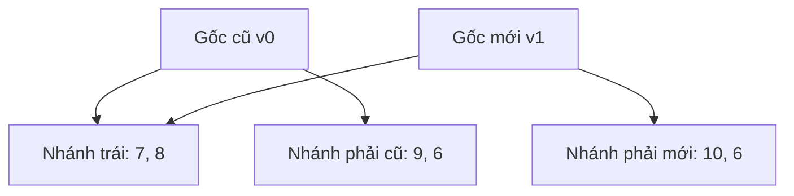

# Lựa chọn giữa bất biến, sao chép khi ghi và sửa trực tiếp

## 1. Vì sao cần phân biệt ba cách quản lý thay đổi?

Một ứng dụng học tập lưu dãy điểm `[7, 8, 9, 6]`. Khi người dùng sửa điểm ở vị trí thứ hai từ `8` thành `10`, chương trình có thể xử lý theo nhiều cách:

- **Sửa trực tiếp (in-place mutation):** thay phần tử ngay trong vùng nhớ hiện có; các tham chiếu tới cùng dãy nhìn thấy thay đổi.
- **Dữ liệu bất biến (immutable data):** tạo trạng thái logic mới và giữ nguyên trạng thái cũ; có thể sao chép toàn bộ hoặc dùng cấu trúc *persistent* với chia sẻ cấu trúc.
- **Sao chép khi ghi (copy-on-write, COW):** nhiều chủ sở hữu có thể cùng tham chiếu một vùng dữ liệu cho đến khi cần ghi; chủ sở hữu sắp ghi phải tách bản sao phần dữ liệu được chia sẻ trước khi sửa.

Ba khái niệm **không hoàn toàn nằm trên cùng một trục**. *Bất biến* mô tả **hợp đồng quan sát từ API**: phiên bản đã cung cấp cho người gọi không đổi. *COW* mô tả **thời điểm và cách sao chép**. Một kiểu dữ liệu dùng COW có thể cho phép mỗi đối tượng được sửa trực tiếp qua API riêng, nhưng vẫn bảo toàn snapshot khác. Ngược lại, một ánh xạ bất biến có thể được triển khai bằng sao chép toàn bộ hoặc bằng sao chép đường đi trên cây.

Trong phần **Bất biến và phiên bản** của học phần cấu trúc dữ liệu, vấn đề là lựa chọn cấu trúc dựa trên **thao tác cần hỗ trợ, mức chia sẻ dữ liệu, số phiên bản, chi phí thời gian và bộ nhớ**. Đây là điều cần cân nhắc bên cạnh cấu trúc như mảng, danh sách liên kết, bảng băm, cây hoặc heap.

Sau bài học, bạn cần giải thích được ngữ nghĩa của từng cách, tính chi phí cập nhật/snapshot, nhận biết rủi ro tham chiếu dùng chung và chọn thiết kế phù hợp với một khối lượng công việc cụ thể.

## 2. Một thay đổi, ba cách quan sát kết quả

### 2.1. Sửa trực tiếp: thay đổi ngay dữ liệu được tham chiếu

```ts
const scores = [7, 8, 9, 6];
const alias = scores;

scores[1] = 10;

console.log(scores[1]); // 10
console.log(alias[1]);  // 10: cùng một mảng
console.log(alias === scores); // true
```

Sửa trực tiếp thường có chi phí thấp cho một phần tử của mảng: truy cập/thay thế tại chỉ số hợp lệ là `O(1)`. Nhưng vì `alias` và `scores` trỏ tới cùng một mảng, không tồn tại phiên bản cũ độc lập. Nếu chương trình cần undo, phải lưu lịch sử theo cách khác: lưu bản sao, log giá trị cũ hoặc cấu trúc phiên bản.

**Điểm quan trọng:** bản thân thao tác sửa không sai; nó chỉ đòi hỏi quy ước rõ ràng về **ai được quyền thay đổi** dữ liệu và **người đọc nào có thể quan sát sự thay đổi**.

### 2.2. API bất biến: mỗi cập nhật trả về một giá trị mới

```ts
function setImmutable<T>(
  source: readonly T[], index: number, value: T
): readonly T[] {
  if (!Number.isSafeInteger(index) || index < 0 || index >= source.length) {
    throw new RangeError("Chỉ số ngoài dãy");
  }
  if (Object.is(source[index], value)) return source;

  const next = source.slice();
  next[index] = value;
  return next;
}

const v0 = [7, 8, 9, 6] as readonly number[];
const v1 = setImmutable(v0, 1, 10);

console.log(v0[1]);      // 8
console.log(v1[1]);      // 10
console.log(v0 === v1);  // false
```

Vì API `setImmutable` không sửa đầu vào, bên gọi có thể giữ `v0` làm phiên bản cũ. Tuy nhiên, ví dụ này **sao chép toàn bộ mảng** nên một lần sửa tốn `O(n)` thời gian/bộ nhớ phụ cho `n` phần tử. Một cấu trúc bất biến chuyên dụng có thể đạt chi phí thấp hơn bằng *structural sharing*.

Trong TypeScript, `readonly` là kiểm tra kiểu tĩnh, **không phải cơ chế đóng băng runtime**. Nếu bên ngoài vẫn có tham chiếu mutable tới cùng mảng, họ vẫn có thể sửa nó; vì vậy API bất biến cần kết hợp với quy tắc sở hữu và đóng gói thích hợp. Các phần tử là đối tượng lồng nhau cũng không được tự động sao chép sâu.

### 2.3. Copy-on-write: chia sẻ trước, tách khi cần ghi

Giả sử `A` và `B` cùng trỏ tới bộ đệm `[7, 8, 9, 6]`. Chúng đọc cùng các phần tử mà không cần sao chép. Khi `B` muốn đổi chỉ số 1, nó phải tách bản sao rồi sửa bản của mình; `A` tiếp tục thấy `8`.

```text
Trước khi ghi:
   A ─┐
      ├──> buffer X = [7, 8, 9, 6]
   B ─┘

B sửa phần tử 1, phải tách:
   A ────> buffer X = [7, 8, 9, 6]
   B ────> buffer Y = [7,10, 9, 6]

B sửa tiếp phần tử 2 khi Y chỉ thuộc B:
   A ────> buffer X = [7, 8, 9, 6]
   B ────> buffer Y = [7,10,11, 6]
```

Việc tạo snapshot lúc đầu có thể tốn `O(1)` vì chỉ sao chép **tham chiếu tới buffer**, nhưng **lần ghi đầu tiên vào buffer đang chia sẻ** có thể cần sao chép toàn bộ `n` phần tử, tốn `O(n)`. Những lần ghi tiếp theo lên bản riêng thường có chi phí `O(1)` cho cập nhật chỉ số, cho tới khi dữ liệu lại được chia sẻ.

COW cũng có thể làm việc ở **độ hạt nhỏ hơn**: sao chép từng trang nhớ (page) hoặc từng nút/khối thay vì cả mảng. Vì thế, phải biết đơn vị bị tách mới đánh giá đúng chi phí.

## 3. Ba trục thiết kế không nên gộp làm một

| Trục | Các lựa chọn | Câu hỏi cần trả lời |
|---|---|---|
| **Ngữ nghĩa API** | Mutable hay immutable | Người gọi có thể sửa đối tượng đã nhận, hay thao tác ghi luôn trả trạng thái mới? |
| **Sở hữu dữ liệu** | Một chủ sở hữu, nhiều chủ sở hữu, chia sẻ chỉ đọc | Khi nào hai tham chiếu được phép cùng trỏ một vùng nhớ có thể ghi? |
| **Cơ chế lưu trữ** | Sửa tại chỗ, sao chép toàn bộ, COW, persistent path copying | Đơn vị nào được cấp phát hoặc sao chép khi thay đổi? |

Các tổ hợp đều có thể xuất hiện:

- **Mảng mutable, một chủ sở hữu:** cập nhật trực tiếp, không có snapshot.
- **Mảng immutable, sao chép toàn bộ:** mỗi lần `set` sinh mảng mới, giữ mảng cũ.
- **Đối tượng mutable dùng COW:** có thể gọi `set` trên từng đối tượng, nhưng đối tượng phải tách bộ đệm khi chia sẻ với snapshot khác.
- **Cấu trúc persistent bất biến:** `set` trả về gốc mới, sao chép các nút trên đường đi và dùng chung những nhánh không đổi.
- **Immutable view của buffer mutable:** chỉ an toàn nếu có cơ chế cấm/chặn mọi đường ghi có thể thay đổi vùng nhớ mà view nhìn thấy.

Nhiều tài liệu cũng gọi thao tác sao chép một nút trước khi thay nó trong cây là “copy-on-write ở mức nút”. Khi so sánh thực tế, nên nói rõ đang xét **COW toàn buffer**, **COW theo page/block** hay **path copying** để tránh dùng một tên cho các chi phí rất khác nhau.

## 4. Ví dụ TypeScript: mô hình COW toàn mảng

Để minh họa chính xác thời điểm tách, ta viết một lớp với bộ đệm riêng, một cờ `shared` và thao tác `snapshot()`. Khi tạo snapshot, hai đối tượng cùng trỏ vào một mảng nhưng đều bị đánh dấu là chia sẻ; trước khi một đối tượng ghi, nó tạo mảng riêng. Ví dụ chỉ dùng số nên không có vấn đề sửa sâu đối tượng phần tử.

```ts
class CowNumbers {
  private constructor(
    private data: number[],
    private shared: boolean
  ) {}

  static from(values: readonly number[]): CowNumbers {
    return new CowNumbers([...values], false);
  }

  get length(): number {
    return this.data.length;
  }

  get(index: number): number {
    this.assertIndex(index);
    return this.data[index];
  }

  snapshot(): CowNumbers {
    this.shared = true;
    // Cùng buffer; cả hai wrapper phải tách trước khi ghi.
    return new CowNumbers(this.data, true);
  }

  set(index: number, value: number): void {
    this.assertIndex(index);
    if (Object.is(this.data[index], value)) return;

    if (this.shared) {
      this.data = this.data.slice(); // tách một lần cho wrapper này
      this.shared = false;
    }
    this.data[index] = value;
  }

  private assertIndex(index: number): void {
    if (
      !Number.isSafeInteger(index) ||
      index < 0 ||
      index >= this.data.length
    ) {
      throw new RangeError("Chỉ số ngoài dãy");
    }
  }
}

const original = CowNumbers.from([7, 8, 9, 6]);
const newer = original.snapshot();  // O(1), chia sẻ cùng buffer

newer.set(1, 10);                   // sao chép buffer rồi sửa
newer.set(2, 11);                   // sửa trong buffer riêng của newer

console.log(original.get(1));       // 8
console.log(newer.get(1));          // 10
console.log(newer.get(2));          // 11

const last = newer.snapshot();      // chia sẻ trở lại
newer.set(0, 99);                   // lại phải tách trước khi sửa
console.log(last.get(0));           // 7
console.log(newer.get(0));          // 99
```

**Đọc đúng hợp đồng:** `snapshot()` không tạo một bản sao mảng ngay lập tức; hai wrapper đọc cùng dữ liệu đến lần ghi đầu tiên. Mỗi wrapper có thể thay đổi trạng thái riêng theo thời gian, nhưng snapshot khác không bị làm hỏng bởi thao tác `set`. Đây là **bất biến tương đối giữa các snapshot**, không phải một lớp immutable thuần túy (vì `set` là phương thức sửa đối tượng gọi nó).

Để mã ngắn, `shared` là cờ **bảo thủ**: sau khi snapshot khác bị loại bỏ, cờ có thể vẫn là `true` dù buffer thực tế chỉ còn một chủ, dẫn tới sao chép thừa nhưng không sai dữ liệu. Triển khai hiệu quả hơn có thể dùng reference counting, unique ownership hoặc cơ chế quản lý vùng nhớ riêng. Khi dùng đa luồng, phải đồng bộ các thay đổi quyền sở hữu và việc công bố snapshot; cờ boolean đơn giản này **không an toàn cho nhiều luồng truy cập đồng thời**.

Giả sử buffer có một triệu phần tử. Tạo 100 snapshot liên tiếp không ghi có thể chỉ tạo 100 wrapper tham chiếu một buffer; khi 100 snapshot cùng giữ các phiên bản sau những lần ghi tách riêng, bộ nhớ có thể tăng đáng kể. Chi phí phụ thuộc **số buffer thực tế phải tách** và **số buffer vẫn được snapshot giữ**, chứ không phụ thuộc số wrapper đơn thuần.

## 5. Dữ liệu bất biến không nhất thiết sao chép cả mảng

Để giảm chi phí cập nhật khi có nhiều phiên bản, một **persistent tree** giữ dữ liệu ở các lá và tạo lại đường đi tới lá thay đổi. Hai phiên bản có thể chia sẻ phần lớn cây vì mọi nút đã được công bố đều không bị sửa.

Ví dụ cây nhị phân cân bằng chứa bốn phần tử:



Hai gốc cùng trỏ tới **cùng nhánh trái**. Chỉ phần đường đi tới phần tử cần thay được cấp phát mới. Bản triển khai dưới đây dùng bốn lá và cho thấy hành vi ấy:

```ts
type Node =
  | Readonly<{ kind: "leaf"; value: number }>
  | Readonly<{ kind: "branch"; left: Node; right: Node }>;

function build(values: readonly number[], lo = 0, hi = values.length): Node {
  if (hi - lo === 1) return { kind: "leaf", value: values[lo] };
  const mid = lo + Math.floor((hi - lo) / 2);
  return {
    kind: "branch",
    left: build(values, lo, mid),
    right: build(values, mid, hi)
  };
}

function getAt(node: Node, i: number, lo: number, hi: number): number {
  if (node.kind === "leaf") return node.value;
  const mid = lo + Math.floor((hi - lo) / 2);
  return i < mid
    ? getAt(node.left, i, lo, mid)
    : getAt(node.right, i, mid, hi);
}

function setAt(
  node: Node, i: number, value: number, lo: number, hi: number
): Node {
  if (!Number.isSafeInteger(i) || i < lo || i >= hi) {
    throw new RangeError("Chỉ số ngoài dãy");
  }
  if (node.kind === "leaf") {
    return Object.is(node.value, value)
      ? node
      : { kind: "leaf", value };
  }

  const mid = lo + Math.floor((hi - lo) / 2);
  if (i < mid) {
    const left = setAt(node.left, i, value, lo, mid);
    return left === node.left ? node : {
      kind: "branch", left, right: node.right
    };
  }
  const right = setAt(node.right, i, value, mid, hi);
  return right === node.right ? node : {
    kind: "branch", left: node.left, right
  };
}

const v0 = build([7, 8, 9, 6]);
const v1 = setAt(v0, 2, 10, 0, 4);

console.log(getAt(v0, 2, 0, 4)); // 9
console.log(getAt(v1, 2, 0, 4)); // 10
console.log(v0 === v1);         // false
if (v0.kind === "branch" && v1.kind === "branch") {
  console.log(v0.left === v1.left); // true: nhánh không đổi
}
```

Đây là cây **minh họa**: nếu áp dụng cho dãy kích thước `n` cân bằng, truy cập và cập nhật cần `O(log n)` cấp; mỗi cập nhật cấp phát khoảng `O(log n)` nút mới. **Vector trie** thực tế thường dùng phân nhánh rộng, ví dụ 32 con/nút, để giảm độ sâu xuống khoảng `O(log₃₂ n)`. **HAMT** làm tương tự đối với ánh xạ, nhưng rẽ nhánh theo mã băm của khóa thay vì chỉ số dãy.

Cây persistent thường thuận lợi khi **cập nhật nhỏ và giữ nhiều phiên bản**. Đổi lại, nó cần các nút, con trỏ và cấp phát nhiều đối tượng; đọc theo chỉ số có thể chậm hơn mảng phẳng do phải đi qua cây và ảnh hưởng bộ đệm CPU.

## 6. So sánh chi phí thời gian và bộ nhớ

Xét thao tác trên dãy `n` phần tử. Bảng sau giả định các phần tử có kích thước cố định, thay một vị trí hợp lệ và không tính chi phí sao chép sâu phần tử. `B` là số nhánh tối đa trong mỗi nút của cây persistent.

| Phương án | Đọc `get(i)` | Tạo snapshot độc lập | Thay một vị trí | Bộ nhớ tăng thêm khi ghi |
|---|---|---|---|---|
| **Sửa tại chỗ**, một mảng chung | `O(1)` | Cần cơ chế khác; sao chép toàn mảng là `O(n)` | `O(1)` | `O(1)`; không giữ bản cũ |
| **Bất biến bằng sao chép toàn mảng** | `O(1)` | Giữ tham chiếu tới một phiên bản đã bất biến: `O(1)` | `O(n)` để tạo phiên bản mới | `O(n)` mỗi lần thay đổi có thật |
| **COW toàn mảng**, tạo wrapper snapshot | `O(1)` | `O(1)` khi chỉ chia sẻ buffer | `O(n)` ở lần ghi đầu lên buffer còn chia sẻ; sau khi tách thì `O(1)` | `O(n)` khi tách buffer; nếu không tách thì `O(1)` |
| **Cây persistent cân bằng** | `O(log_B n)` với `B` cố định | `O(1)`: giữ con trỏ gốc | Khoảng `O(B log_B n)` nếu sao chép mảng con của từng nút | Khoảng `O(B log_B n)` ô tham chiếu/nút trên đường đi |

Với mảng **bất biến đã có sẵn**, hai nơi có thể cùng giữ tham chiếu tới một phiên bản trong `O(1)`. Chi phí `O(n)` phát sinh khi **tạo phiên bản có dữ liệu khác**, nếu dùng sao chép toàn bộ. Vì thế cần tách **snapshot của phiên bản hiện hữu** và **cập nhật để tạo phiên bản mới** khi phân tích độ phức tạp.

Trong cây persistent, `O(B log_B n)` diễn tả phần sao chép mảng con ở mỗi cấp. Với `B` cố định như 32, người ta thường viết gọn `O(log_B n)`. Cây có thể có các trường hợp đặc biệt: HAMT gặp nhiều khóa cùng mã băm, vector trie phải mở rộng chiều cao hoặc thao tác chèn giữa cần dựng lại đoạn dài.

**Không có đáp án luôn nhanh nhất:** cập nhật trực tiếp thường có chi phí hằng số tốt; COW tạo snapshot rẻ nhưng một lần tách có thể tạo độ trễ lớn; cây persistent tạo nhiều đối tượng nhỏ hơn mỗi lần cập nhật nhưng duy trì cấu trúc phức tạp hơn.

## 7. Mô hình chi phí theo cách ứng dụng thực sự sử dụng dữ liệu

Các ký hiệu hữu ích:

- `n`: số phần tử của một phiên bản.
- `W`: số lần cập nhật làm thay đổi dữ liệu.
- `S`: số lần lấy snapshot.
- `D`: số lần phải tách buffer trong một triển khai COW toàn mảng.
- `d`: độ sâu đường tới vị trí thay đổi trong cây persistent.
- `B`: số nhánh tối đa mỗi nút cây.

Bỏ qua chi phí đọc và hằng số, có thể ước lượng:

```text
Sửa tại chỗ, không có lịch sử:
    Thời gian cập nhật ≈ O(W)

Bất biến, sao chép toàn mảng mỗi lần sửa:
    Thời gian cấp phát/sao chép ≈ O(W × n)

COW toàn mảng:
    Chi phí snapshot ≈ O(S)
    Chi phí cập nhật/tách ≈ O(W + D × n)

Cây persistent dùng sao chép đường đi:
    Chi phí snapshot ≈ O(S)
    Chi phí cập nhật ≈ O(W × B × d)
```

`D` phụ thuộc vào **thời điểm chia sẻ và ghi**; không thể tự động thay bằng `S` hay `W`. Có thể `D` gần bằng 0 khi dữ liệu chỉ có một chủ; có thể `D` gần bằng `W` khi mỗi lần sửa đều diễn ra ngay sau khi tạo snapshot. Nếu thay phần tử bằng đúng giá trị cũ và triển khai nhận ra thao tác không đổi, có thể bỏ qua sao chép ở cả COW và cây persistent.

### Hai workload đối lập

**Tình huống A: chỉ đọc, snapshot nhiều, thỉnh thoảng sửa.** Một bộ cấu hình được hàng nghìn tác vụ đọc đồng thời, cứ 30 phút mới thay vài tham số. COW hoặc dữ liệu bất biến persistent thường hiệu quả: phần lớn lần đọc/snapshot chỉ chia sẻ vùng nhớ; tách một lần khi sửa có thể chấp nhận được nếu kích thước cấu hình vừa phải.

**Tình huống B: sửa liên tục và lưu mọi phiên bản.** Một công cụ chỉnh sửa dãy một triệu phần tử, sau mỗi thay đổi nhỏ phải có lịch sử undo. Nếu mỗi lần ghi tách toàn bộ buffer, COW có thể tốn `O(n)` mỗi lần. Cây persistent thường thích hợp hơn vì chỉ sao chép đường tới phần tử đổi; song cần tính thêm chi phí con trỏ, đối tượng và quản lý lịch sử.

**Tình huống C: không cần snapshot, chỉ một chủ ghi.** Một vòng lặp tính toán cập nhật hàng triệu ô tạm và bỏ trạng thái cũ. Sửa trực tiếp mảng/buffer thường có lợi: tránh cả việc sao chép lẫn tạo nhiều phiên bản. Có thể bất biến hóa kết quả **tại ranh giới công bố** nếu bên ngoài cần snapshot an toàn.

### Ví dụ đếm sao chép

Giả sử buffer có `n = 1.000.000` số, mỗi khoảng giữa hai snapshot chứa 100 lần cập nhật vị trí:

- **Sao chép toàn mảng mỗi lần sửa:** sao chép khoảng `100 × 1.000.000` ô cho 100 lần sửa.
- **COW toàn buffer:** nếu lần đầu phải tách rồi 99 lần sau ghi vào buffer riêng, sao chép khoảng `1.000.000` ô trong khoảng đó.
- **Cây persistent:** mỗi cập nhật sao chép một đường ngắn; số nút/ô tham chiếu sao chép phụ thuộc `B` và `d`, không tỷ lệ trực tiếp với một triệu phần tử.

Đây là so sánh **số ô bị sao chép**, không phải phép đo tốc độ thực tế. Trên phần cứng cụ thể, sao chép liên tục một mảng có thể rất nhanh do locality; vì vậy quyết định cuối cùng cần benchmark với workload thật.

## 8. Tham chiếu dùng chung, aliasing và mức bất biến sâu

### 8.1. Sao chép nông không đủ với đối tượng lồng nhau

```ts
const before = [{ score: 8 }, { score: 9 }];
const after = before.slice();

after[0].score = 10;
console.log(before[0].score); // 10: đối tượng phần tử vẫn dùng chung
```

`slice()` tạo mảng mới nhưng các **đối tượng phần tử** vẫn cùng tham chiếu. Điều tương tự xảy ra với COW toàn mảng và cây persistent nếu một lá giữ con trỏ tới đối tượng mutable. Muốn có các snapshot độc lập ở mức nội dung, có thể chọn:

1. Dùng các giá trị bất biến làm payload, và mỗi lần thay tạo một đối tượng mới.
2. Sao chép đúng các đối tượng lồng nhau bị sửa (*copy along the changed path*).
3. Đóng băng dữ liệu ở mức phù hợp và che giấu mọi đường sửa trực tiếp; `Object.freeze` của JavaScript chỉ đóng băng một cấp, không phải đóng băng sâu tự động.

Ví dụ thay đối tượng phần tử một cách bất biến:

```ts
type Result = Readonly<{ score: number; note: string }>;

const old: readonly Result[] = [
  { score: 8, note: "A" },
  { score: 9, note: "B" }
];

const next: readonly Result[] = old.map((item, i) =>
  i === 0 ? { ...item, score: 10 } : item
);

console.log(old[0].score);  // 8
console.log(next[0].score); // 10
```

Nếu payload chứa ảnh, buffer lớn hoặc cấu trúc con phức tạp, chi phí sao chép/sở hữu payload đôi khi còn quan trọng hơn chi phí của chính bảng băm, danh sách hoặc trie.

### 8.2. An toàn khi nhiều người đọc, nhiều người ghi

- **Chỉ đọc dữ liệu không thay đổi:** nhiều luồng/tác vụ có thể cùng đọc mà không tranh chấp ghi vào các nút đã được công bố.
- **Sửa trực tiếp:** người đọc có thể nhìn thấy trạng thái đang thay đổi; cần khóa, cơ chế đồng bộ, bản sao đọc hoặc giới hạn quyền truy cập để giữ tính nhất quán.
- **COW:** việc tách buffer giúp bản sao đang được đọc giữ trạng thái ổn định, nhưng **không tự đồng bộ** bộ đếm chủ sở hữu, hành động tách và thao tác công bố phiên bản mới giữa nhiều luồng.
- **Persistent immutable:** các nút đã công bố không thay đổi, nên đọc phiên bản cũ an toàn hơn. Tuy vậy, hai luồng cùng đọc gốc `v0`, tạo `v1a` và `v1b` rồi lần lượt công bố có thể **làm mất một cập nhật** nếu không có cơ chế phối hợp.

Ví dụ, nếu trạng thái toàn cục là `current`, việc “đọc root → tính root mới → thay current” phải có giao thức đồng bộ phù hợp khi nhiều người ghi. Sự bất biến của nút không thay cho **atomic publication**, **compare-and-swap** hoặc quy tắc hợp nhất xung đột.

## 9. Quy trình chọn cấu trúc dữ liệu cho bài toán thực tế

Thay vì bắt đầu từ tên kỹ thuật, hãy trả lời lần lượt các câu hỏi về hành vi hệ thống:

| Câu hỏi | Nếu câu trả lời là… | Lựa chọn thường phù hợp |
|---|---|---|
| Có cần giữ phiên bản cũ không? | Không; chỉ một chủ sở hữu dữ liệu | Sửa trực tiếp nếu không có yêu cầu đồng bộ/phân quyền khác. |
| Snapshot có nhiều nhưng ghi rất ít không? | Có, và chi phí tách buffer chấp nhận được | COW theo buffer/khối hoặc immutable snapshot. |
| Có rất nhiều cập nhật nhỏ và lưu nhiều phiên bản không? | Có, cần undo/redo hoặc branching | Cây/ánh xạ/dãy persistent với structural sharing. |
| Cần truy cập theo **chỉ số** hay theo **khóa**? | Theo chỉ số | Mảng động, vector trie hoặc cấu trúc dãy chuyên dụng. |
| Cần truy cập theo **khóa**? | Có | Hash map mutable, HAMT immutable hoặc cây ánh xạ có thứ tự. |
| Thường chèn/xóa đầu hay giữa dãy? | Có | Cân nhắc deque, danh sách, rope hoặc cây dãy chuyên dụng; mảng/vector trie cơ bản có thể phải dịch nhiều phần tử. |
| Có nhiều luồng truy cập? | Có | Định rõ quyền sở hữu, công bố phiên bản và chiến lược đồng bộ; kiểm thử hành vi cạnh tranh. |
| Payload có thể sửa sâu? | Có | Quy tắc sao chép sâu/chỉ thay nhánh và API bảo vệ payload. |

Một chiến lược thực dụng thường là **lai ghép**: bên trong thuật toán dùng bộ đệm mutable để tính nhanh; khi tạo snapshot hoặc công bố kết quả, chuyển sang dữ liệu chỉ đọc, COW hoặc persistent. Một số thư viện persistent còn có chế độ **transient/ephemeral builder**: cho phép nhiều lần cập nhật tại chỗ khi có quyền sở hữu độc quyền rồi “đóng” thành phiên bản bất biến. Tối ưu này cần kiểm soát chặt tính độc quyền, nếu không có thể phá các phiên bản đang dùng chung.

### Minh họa quyết định qua bốn hệ thống

| Hệ thống | Mẫu truy cập | Phương án nên thử trước | Cần kiểm chứng |
|---|---|---|---|
| Bộ đệm thuật toán sắp xếp | Sửa liên tục, không cần lịch sử | Mảng mutable | Locality, thời gian CPU, giới hạn bộ nhớ. |
| Cấu hình phục vụ nhiều người đọc | Nhiều đọc, ít thay, cần snapshot nhất quán | COW hoặc cấu hình immutable | Độ trễ lúc công bố/tách, đồng bộ và kích thước payload. |
| Trình soạn thảo có undo sau từng thao tác | Nhiều trạng thái, cập nhật vùng nhỏ | Persistent vector/map hoặc cây dãy | RAM giữ lịch sử, tốc độ chèn/cắt và thu hồi nút cũ. |
| Hệ thống xử lý lô rồi phát hành bản kết quả | Chỉnh sửa nhiều trong một phiên, đọc nhiều sau khi hoàn tất | Mutable builder → snapshot bất biến | Chi phí chuyển pha và tránh để lộ tham chiếu mutable. |

## 10. Lưu nhiều phiên bản và chi phí bộ nhớ tích lũy

Cả COW và persistent đều chỉ tiết kiệm khi có **chia sẻ thực sự**. Nếu mọi lần cập nhật đều thay toàn bộ dữ liệu và giữ mọi phiên bản, bộ nhớ vẫn có thể tăng gần theo số phiên bản nhân kích thước dữ liệu.

Cụ thể:

- **COW toàn buffer:** nhiều snapshot chưa ghi có thể chia sẻ cùng một vùng. Khi các nhánh lần lượt sửa, mỗi vùng dữ liệu được tách có thể vẫn phải sống vì snapshot cũ đang giữ nó.
- **Persistent path copying:** giữ nhiều root tạo thêm các nút đường đi cũ và mới. Nút còn được bất kỳ root nào tham chiếu vẫn phải được giữ; xóa một root chỉ giải phóng nút không còn ai dùng.
- **Mutable + log thao tác:** có thể tiết kiệm hơn giữ nhiều snapshot đầy đủ trong vài workload, nhưng thao tác replay/undo phức tạp và phải bảo đảm log đủ để khôi phục trạng thái.

Không nên tính bộ nhớ bằng “số phiên bản × dung lượng một phiên bản”: cách đó đếm trùng các nút đang chia sẻ. Cũng không nên nghĩ rằng “một phiên bản mới tốn rất ít” đồng nghĩa có thể giữ **vô hạn** lịch sử mà không hết RAM. Cần đặt chính sách giới hạn lịch sử, checkpoint, hoặc loại gốc cũ và đo lượng bộ nhớ còn được giữ.

Ở ngôn ngữ có garbage collector, khi không còn tham chiếu nào tới nút/buffer cũ, nó trở thành ứng viên được thu hồi, nhưng thời điểm GC chạy không xác định. Với cơ chế đếm tham chiếu, nút còn sống khi vẫn có chủ sở hữu. COW cũng cần biết khi nào buffer thực sự độc quyền để tránh sao chép thừa; ví dụ `CowNumbers` dùng cờ bảo thủ nên đôi lúc sao chép dù người giữ snapshot cũ đã biến mất.

## 11. Những lỗi thiết kế thường gặp

**Lỗi 1 — “Đã gọi `slice` nên snapshot bất biến sâu.”** `slice` chỉ sao chép mảng ngoài; các object phần tử còn dùng chung. Phải định nghĩa rõ mức sâu của hợp đồng bất biến.

**Lỗi 2 — “COW luôn có chi phí ghi `O(1)`.”** Lần ghi đầu khi buffer đang chia sẻ có thể phải sao chép `O(n)`; COW theo trang/nút có giới hạn khác tùy độ hạt.

**Lỗi 3 — “Bất biến luôn chậm hơn mutable.”** Nếu thường đọc, dùng nhiều snapshot và mỗi lần sửa chỉ chạm vài nút, persistent có thể hiệu quả hơn sao chép cả mảng; tốc độ thực tế vẫn cần đo.

**Lỗi 4 — “COW và persistent là hai tên cho cùng một thứ.”** COW là kỹ thuật **trì hoãn sao chép cho đến khi ghi**; persistent là đặc tính **giữ được các phiên bản trước**. Có thể phối hợp chúng, nhưng cách chia đơn vị sao chép dẫn tới chi phí khác nhau.

**Lỗi 5 — “Immutable tự giải quyết mọi cạnh tranh đồng thời.”** Đọc các phiên bản bất biến thuận lợi, nhưng việc cập nhật/cong bố tham chiếu chung vẫn cần đồng bộ và xử lý xung đột.

**Lỗi 6 — “Sửa trực tiếp là không thể undo.”** Vẫn có thể undo bằng log hành động nghịch đảo, ghi nhớ giá trị cũ hoặc snapshot. Việc thiết kế lịch sử phải được bổ sung rõ ràng.

**Lỗi 7 — “Giữ ít root chắc chắn dùng ít RAM.”** Một snapshot có thể giữ tham chiếu tới nhánh lớn hoặc payload lớn; cache và closure bên ngoài còn có thể giữ các phiên bản đã loại khỏi danh sách lịch sử.

## 12. Bài tập vận dụng

### Bài 1. Nhận diện aliasing

```ts
const a = [1, 2, 3];
const b = a;
b[1] = 99;
```

Giá trị của `a[1]` là gì? **Đáp án:** `99` vì `a` và `b` là hai tham chiếu đến cùng mảng. Nếu `b = a.slice()` (với `let b`), sửa một phần tử kiểu số trên `b` sẽ không sửa `a`, nhưng phần tử object lồng nhau có thể vẫn dùng chung.

### Bài 2. Đếm số lần tách COW

Một đối tượng COW toàn buffer có một triệu phần tử. Tạo snapshot `B` từ `A`, sau đó `B` sửa 20 vị trí liên tiếp mà không tạo snapshot mới giữa chừng. Giả sử lần sửa đầu làm thay đổi giá trị và buffer của `B` trước đó đang được chia sẻ.

**Đáp án:** Với cơ chế tách một lần theo owner, `B` cần sao chép toàn buffer **một lần** trước khi sửa đầu tiên. Mười chín lần sửa còn lại cập nhật trên buffer riêng, giả sử không có thao tác chia sẻ khác và không có tái phân bổ.

### Bài 3. Tính độ sâu persistent vector

Một vector trie dùng `B = 32`, lá chứa 32 phần tử, mỗi nút trong có tối đa 32 con. Bỏ qua tail, một nút trong ngay trên lá có thể quản lý tối đa bao nhiêu phần tử? Hai cấp nút trong thì sao?

**Đáp án:** Một cấp quản lý tối đa `32 × 32 = 1.024` phần tử. Hai cấp quản lý tối đa `32 × 32 × 32 = 32.768` phần tử. Do đó, cập nhật một vị trí thường chỉ phải sao chép một đường cây rất ngắn.

### Bài 4. Chọn cấu trúc cho hai workload

Một tiến trình có hai giai đoạn: (a) chỉnh sửa 500.000 phần tử hàng chục nghìn lần, không lưu trạng thái trung gian; (b) công bố kết quả cho nhiều tác vụ chỉ đọc.

**Gợi ý:** Ở giai đoạn (a), dùng mảng hoặc builder mutable khi có quyền sở hữu độc quyền. Trước giai đoạn (b), công bố snapshot không bị đường ghi nào tiếp tục làm thay đổi (có thể chuyển quyền sở hữu, tạo bản sao, freeze ở mức cần thiết hoặc dùng COW tùy thiết kế). Không đủ an toàn nếu vẫn công bố **cùng** buffer mutable cho các tác vụ khác đọc trong lúc tiếp tục ghi.

### Bài 5. Lựa chọn khi cập nhật sau mỗi snapshot

Ứng dụng lưu 10.000 phiên bản của một ánh xạ lớn. Mỗi phiên bản chỉ thay một khóa, và mọi phiên bản đều cần truy cập lại. COW theo **toàn bộ bảng** có phải lựa chọn lý tưởng không?

**Gợi ý:** Có thể rất tốn bộ nhớ vì mỗi lần ghi sau snapshot phải sao chép cả bảng. Một persistent hash trie (ví dụ HAMT) thường có lợi thế vì tạo lại đường tới khóa và chia sẻ các nhánh khác. Cần kiểm tra phân phối hash, bộ nhớ của nút và chi phí giữ lâu các phiên bản cũ.

### Bài 6. Phân biệt đảm bảo ngôn ngữ

Trong TypeScript, khai báo `readonly User[]` có bảo đảm người gọi không thể sửa thuộc tính `name` của một đối tượng `User` nằm trong mảng không?

**Đáp án:** Không. `readonly User[]` ngăn thay phần tử thông qua tham chiếu kiểu đó, nhưng không tự làm `User` bất biến, không loại bỏ các tham chiếu mutable khác và không đóng băng dữ liệu lúc chạy. Muốn đảm bảo, cần kiểu/đóng gói và cơ chế bảo vệ payload tương ứng.

## 13. Kết luận

Lựa chọn giữa các cách quản lý thay đổi phải xuất phát từ **ai được phép ghi, có cần giữ phiên bản trước hay không, dữ liệu lớn đến đâu và các thao tác nào xảy ra thường xuyên**.

- Chọn **sửa trực tiếp** khi có quyền sở hữu rõ ràng, cập nhật dày đặc và không cần giữ lịch sử ở mức cấu trúc hiện tại.
- Cân nhắc **COW** khi muốn tạo snapshot rẻ, phần lớn thời gian đọc và có thể chấp nhận chi phí tách ở lần ghi đầu; xác định rõ độ hạt tách là buffer, page hay node.
- Chọn **API bất biến với cấu trúc persistent** khi cần nhiều phiên bản và cập nhật nhỏ thường xuyên; dùng chia sẻ cấu trúc để giảm lượng nút phải sao chép.

**Bất biến là hợp đồng, COW là một kỹ thuật tối ưu, còn sửa trực tiếp là chiến lược thay đổi tại chỗ.** Có thể phối hợp chúng theo từng giai đoạn của cùng một hệ thống; độ phức tạp và tính đúng đắn phụ thuộc vào **quyền sở hữu, mức chia sẻ, chi phí sao chép và vòng đời phiên bản**.
