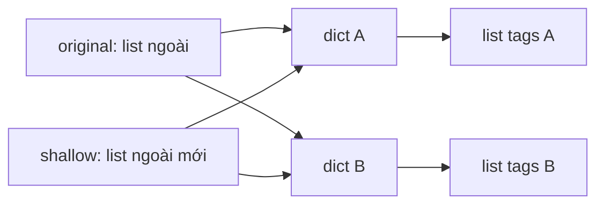

# Sao chép nông, sao chép sâu và phần tử có trạng thái khả biến

## Mục tiêu học tập

Sau bài học này, bạn có thể:

- Phân biệt **gán tham chiếu**, **sao chép nông** (*shallow copy*) và **sao chép sâu** (*deep copy*) khi dữ liệu chứa nhiều đối tượng lồng nhau.
- Giải thích vì sao **đối tượng chứa mới** không đồng nghĩa với **mọi phần tử bên trong đều mới**, đặc biệt khi phần tử có trạng thái khả biến.
- Dự đoán được tác động của một phép cập nhật lên các bản sao bằng sơ đồ tham chiếu và phép kiểm tra `is`, `==`.
- Sử dụng `copy.copy`, `copy.deepcopy`, phép cắt danh sách và `dict.copy()` đúng mục đích; hiểu vai trò của cơ chế ghi nhớ (*memo*) khi sao chép đồ thị đối tượng.
- Đánh giá chi phí thời gian, bộ nhớ, bất biến và rủi ro đồng bộ khi cần lưu snapshot, hoàn tác, chia sẻ dữ liệu hay cập nhật nhiều cấu trúc.

## 1. Bối cảnh: một danh sách có thể chứa các đối tượng thay đổi được

Giả sử nền tảng học tập quản lý danh sách bài học, trong đó mỗi bài là một bản ghi có danh sách thẻ (*tags*):

```python
lessons = [
    {"id": "ds-array", "title": "Mảng", "tags": ["basic"]},
    {"id": "ds-stack", "title": "Stack", "tags": ["linear"]},
]
```

Ba thứ cần phân biệt:

1. **Danh sách bên ngoài** `lessons` là một đối tượng `list` khả biến: có thể thêm, xóa, thay phần tử.
2. **Mỗi phần tử** của danh sách là một đối tượng `dict` khả biến: có thể đổi tiêu đề, thêm trường.
3. **Trường `tags`** của mỗi bản ghi lại là một `list` khả biến: có thể thêm hoặc xóa thẻ.

Đây là **nhiều tầng trạng thái khả biến**. Khi người biên tập chọn “Lưu phiên bản trước khi sửa”, chương trình phải quyết định giữ lại phiên bản cũ theo nghĩa nào. Chỉ tạo một `list` khác chưa chắc đã ngăn được việc sửa phần tử trong cả hai phiên bản.

### 1.1. Đối tượng và tham chiếu

Trong Python, tên biến tham chiếu tới đối tượng; một `list` chứa các **tham chiếu tới phần tử**, không nhúng một bản sao độc lập của mọi đối tượng con.

```text
lessons ───> [ phần tử 0 ──┐, phần tử 1 ──┐ ]
                          |                |
                          v                v
                       {dict A}         {dict B}
                          |                |
                        "tags"           "tags"
                          |                |
                          v                v
                       [basic]          [linear]
```

Sơ đồ thể hiện **quan hệ tham chiếu logic** để suy luận. Vị trí ô nhớ thật, định dạng đối tượng hay chiến lược cấp phát phụ thuộc cách cài Python, không cần giả định rằng các đối tượng `dict` nằm sát nhau.

**Khả biến (mutable)** nghĩa là trạng thái quan sát được của đối tượng có thể thay đổi sau khi tạo; các ví dụ phổ biến là `list`, `dict`, `set`. **Bất biến (immutable)** nghĩa là không thể sửa trạng thái đối tượng theo giao diện thông thường, ví dụ `int`, `str`, `tuple` (bản thân tuple không cho thay các tham chiếu phần tử).

> Từ **bất biến** trong “đối tượng bất biến” (*immutable*) khác với **bất biến biểu diễn** (*invariant*): một bên là quy tắc không sửa đối tượng, một bên là điều kiện cấu trúc/thuật toán phải duy trì.

## 2. Gán biến không phải sao chép

Nếu viết `saved = lessons`, cả hai tên cùng trỏ tới **một** danh sách.

```python
lessons = [{"id": "ds-array", "tags": ["basic"]}]
saved = lessons

assert saved is lessons
assert saved == lessons

lessons.append({"id": "ds-stack", "tags": ["linear"]})
assert len(saved) == 2

saved[0]["tags"].append("core")
assert lessons[0]["tags"] == ["basic", "core"]
```

`saved is lessons` kiểm tra **đồng nhất đối tượng** (*identity*), còn `saved == lessons` so sánh **giá trị bằng nhau** theo quy tắc của kiểu dữ liệu. Hai bản sao có thể `==` nhau dù `is` là `False`.

Hiện tượng nhiều đường tham chiếu cùng dẫn đến một đối tượng gọi là **aliasing (bí danh tham chiếu)**. Aliasing không sai: nó rất hữu ích khi các thành phần chủ động chia sẻ một đối tượng cần cập nhật. Nhưng nó gây lỗi nếu người viết chương trình tưởng mình đã giữ một **snapshot độc lập**.

### 2.1. Phép gán tên mới khác phép gán phần tử

```python
a = ["intro"]
b = a

a = ["arrays"]  # Chuyển tên a sang một list mới.
assert b == ["intro"]

b.append("stack")  # Sửa đối tượng cũ mà b vẫn tham chiếu.
assert b == ["intro", "stack"]
assert a == ["arrays"]
```

Phép `a = ...` trên tên biến không làm thay đổi danh sách cũ. Ngược lại, `b.append(...)` sửa trực tiếp đối tượng mà `b` đang trỏ tới. Khi phân tích một lỗi “bản cũ bị thay đổi”, hãy xác định **đã gán lại một tham chiếu hay đã sửa chính đối tượng dùng chung**.

## 3. Sao chép nông: tạo lớp vỏ mới, chia sẻ phần tử bên trong

**Sao chép nông (shallow copy)** tạo **đối tượng chứa bên ngoài mới** và đưa vào đó các tham chiếu tới **những phần tử cũ**. Nó không đi đệ quy tạo bản sao riêng của toàn bộ phần tử lồng nhau.

Các cách thông dụng với `list` Python:

- `items.copy()`
- `items[:]`
- `list(items)`
- `copy.copy(items)` từ mô-đun `copy`

Với `dict`, `mapping.copy()` tạo một bảng ánh xạ mới nhưng vẫn tham chiếu tới các giá trị cũ nếu các giá trị là đối tượng.

### 3.1. Ví dụ: danh sách ngoài mới, bản ghi vẫn dùng chung

```python
import copy

original = [
    {"id": "ds-array", "title": "Mảng", "tags": ["basic"]},
    {"id": "ds-stack", "title": "Stack", "tags": ["linear"]},
]

shallow = copy.copy(original)

assert shallow == original
assert shallow is not original              # Hai list khác nhau.
assert shallow[0] is original[0]             # Cùng một dict.
assert shallow[0]["tags"] is original[0]["tags"]

shallow.append({"id": "ds-queue", "title": "Queue", "tags": []})
assert len(shallow) == 3
assert len(original) == 2                    # Thêm ở vỏ mới, không ảnh hưởng vỏ cũ.

shallow[0]["title"] = "Mảng động"            # Sửa dict chung.
assert original[0]["title"] == "Mảng động"

original[1]["tags"].append("core")          # Sửa list thẻ chung.
assert shallow[1]["tags"] == ["linear", "core"]
```

Sơ đồ sau khi tạo `shallow = original.copy()`:



Hai list bên ngoài khác nhau nhưng cả hai đều chỉ tới dict A và dict B.

**Chốt ý:** Một cấu trúc đã được sao chép nông có thể tách biệt ở **tầng ngoài** nhưng vẫn chia sẻ trạng thái ở **các tầng trong**.

### 3.2. Ví dụ với bảng băm và bản ghi

```python
by_id = {
    "ds-stack": {"title": "Stack", "progress": {"completed": False}},
}

view = by_id.copy()

assert view is not by_id
assert view["ds-stack"] is by_id["ds-stack"]

view["ds-stack"]["progress"]["completed"] = True
assert by_id["ds-stack"]["progress"]["completed"] is True

view["ds-array"] = {"title": "Mảng"}
assert "ds-array" not in by_id
```

Chỉ có **bảng `dict` ngoài** mới. Việc thêm khóa vào `view` không thêm khóa vào `by_id`; nhưng sửa đối tượng giá trị đã tồn tại có thể ảnh hưởng cả hai.

### 3.3. Khi nào sao chép nông là đủ?

Sao chép nông thường phù hợp nếu:

- Mục đích chỉ là **thay đổi cấu trúc chứa**, ví dụ sắp xếp, thêm/xóa phần tử ở danh sách mới, còn các đối tượng con **được cố ý chia sẻ**.
- Các phần tử được chia sẻ là **bất biến sâu** hoặc có quy ước không sửa chúng.
- Ta muốn tạo một góc nhìn/thứ tự khác trên cùng các đối tượng nghiệp vụ và **không** yêu cầu snapshot độc lập của các thuộc tính bên trong.

Ví dụ với chuỗi bất biến:

```python
before = ["intro", "arrays"]
after = before.copy()
after.append("stack")

assert before == ["intro", "arrays"]
assert after == ["intro", "arrays", "stack"]
```

Đoạn này an toàn cho nhu cầu thay đổi **thành viên của danh sách**, vì bản thân những chuỗi đang dùng không bị sửa tại chỗ. Điều đó không có nghĩa mọi `list.copy()` đều cho một snapshot độc lập của dữ liệu lồng nhau.

## 4. Sao chép sâu: duyệt đồ thị đối tượng và sao chép các phần cần thiết

**Sao chép sâu (deep copy)** tạo một đối tượng ngoài mới rồi **tiếp tục sao chép các đối tượng con có thể sao chép** theo quan hệ tham chiếu, nhằm tách trạng thái bên trong khỏi nguồn. Trong Python, thường dùng `copy.deepcopy(obj)`.

```python
from copy import deepcopy

original = [
    {"id": "ds-array", "tags": ["basic"]},
    {"id": "ds-stack", "tags": ["linear"]},
]

snapshot = deepcopy(original)

assert snapshot == original
assert snapshot is not original
assert snapshot[0] is not original[0]
assert snapshot[0]["tags"] is not original[0]["tags"]

original[0]["tags"].append("updated")
original[1]["id"] = "ds-stack-v2"

assert snapshot[0]["tags"] == ["basic"]
assert snapshot[1]["id"] == "ds-stack"
```

**Không nên hiểu “sâu” là tạo bản sao khác cho mọi đối tượng trong mọi trường hợp.** Đối tượng bất biến có thể được dùng lại; đối tượng tùy biến có thể có quy tắc sao chép riêng; những tài nguyên như file, khóa hệ điều hành hoặc kết nối không nhất thiết sao chép được hay nên sao chép.

### 4.1. Deep copy cần xử lý tham chiếu chia sẻ

Một điểm tinh tế: giả sử hai trường ban đầu cùng tham chiếu tới **một đối tượng con**. Một bản sao sâu chuẩn phải bảo toàn quan hệ cùng tham chiếu **bên trong bản sao**, thay vì vô tình tạo ra hai đối tượng khác nhau không còn đồng nhất.

```python
from copy import deepcopy

shared = ["intro", "arrays"]
source = {"recommended": shared, "required": shared}
clone = deepcopy(source)

assert source["recommended"] is source["required"]
assert clone["recommended"] is clone["required"]  # Vẫn chia sẻ trong clone.
assert clone["recommended"] is not shared         # Không dùng lại list của source.

clone["recommended"].append("stack")
assert clone["required"] == ["intro", "arrays", "stack"]
assert shared == ["intro", "arrays"]
```

Trong Python, `deepcopy` dùng một bảng ghi nhớ **`memo`** để nhận ra đối tượng đã sao chép, nhờ đó duy trì các quan hệ chia sẻ và tránh lặp công việc không cần thiết khi đồ thị đối tượng có nhiều đường dẫn tới cùng một nút.

### 4.2. Deep copy và chu trình tham chiếu

Đối tượng trong bộ nhớ không phải lúc nào cũng tạo thành một cây: nó có thể là **đồ thị có chu trình**. Ví dụ, một `list` tham chiếu tới chính nó:

```python
from copy import deepcopy

cycle = []
cycle.append(cycle)

shallow_cycle = cycle.copy()
deep_cycle = deepcopy(cycle)

assert cycle[0] is cycle
assert shallow_cycle is not cycle
assert shallow_cycle[0] is cycle  # Nông: phần tử vẫn trỏ tới nguồn.

assert deep_cycle is not cycle
assert deep_cycle[0] is deep_cycle  # Sâu: vòng lặp nằm trong bản sao.
```

Nếu sao chép đệ quy mà không theo dõi các đối tượng đã gặp, chương trình có thể lặp vô hạn hoặc làm mất quan hệ chia sẻ. Vì thế, **đồ thị tham chiếu** và **bất biến quan hệ** là phần quan trọng của ngữ nghĩa sao chép, không chỉ số lượng dấu ngoặc lồng nhau trong mã.

## 5. Bốn mức ảnh hưởng khi sửa phần tử có trạng thái khả biến

Hãy dùng cùng một cấu trúc dữ liệu lồng nhau để dự đoán thao tác thay đổi ở đâu:

```python
from copy import deepcopy

source = {
    "chapter": "linear",
    "lessons": [
        {"id": "ds-array", "tags": ["basic"]},
    ],
}

alias = source
shallow = source.copy()
deep = deepcopy(source)

# 1. Thêm một khóa ở tầng ngoài của shallow.
shallow["reviewed"] = True
assert "reviewed" not in source

# 2. Thay một phần tử của list con dùng chung.
shallow["lessons"][0] = {"id": "ds-array", "tags": ["updated"]}
assert source["lessons"][0]["tags"] == ["updated"]

# 3. Sửa sâu hơn trong dict/list dùng chung.
alias["lessons"][0]["tags"].append("core")
assert shallow["lessons"][0]["tags"] == ["updated", "core"]

# 4. Deep copy được tạo trước các lần sửa trên.
assert deep["lessons"][0]["tags"] == ["basic"]
assert deep["lessons"] is not source["lessons"]
```

| Thao tác | Gán tham chiếu `alias = source` | Sao chép nông | Sao chép sâu |
| --- | --- | --- | --- |
| Thêm/xóa khóa **trực tiếp** ở dict ngoài | Cùng một dict, ảnh hưởng nguồn | Dict ngoài khác nhau, không ảnh hưởng nguồn | Dict ngoài khác nhau, không ảnh hưởng nguồn |
| Thêm/xóa phần tử của **list con** | Ảnh hưởng nguồn | Có thể ảnh hưởng nguồn vì cùng list con | Thường không ảnh hưởng nguồn nếu list con được sao chép |
| Sửa trường của **dict con** dùng chung | Ảnh hưởng nguồn | Có thể ảnh hưởng nguồn | Thường tách khỏi nguồn |
| Yêu cầu bộ nhớ mới | Không tạo bản sao cấu trúc | Tạo lớp chứa ngoài và tham chiếu | Sao chép đồ thị đối tượng theo chính sách của kiểu |
| Dùng để giữ snapshot trạng thái lồng nhau | Không | Chỉ khi các phần chia sẻ không bị sửa | Thường phù hợp hơn, nhưng cần xét tài nguyên và quy tắc sao chép |

Điểm mấu chốt là **phải chỉ rõ tầng nào được sửa**. Một thao tác như `shallow["chapter"] = "advanced"` chỉ sửa bảng ngoài mới. Nhưng `shallow["lessons"][0]["tags"].append("core")` đi tới một đối tượng con có thể vẫn được dùng chung.

## 6. Bất biến của cấu trúc dữ liệu khi có nhiều bản sao

Vấn đề không chỉ là “bản sao có thay đổi hay không”, mà còn là **sự nhất quán giữa các tham chiếu bên trong cấu trúc**.

### 6.1. Danh sách liên kết và cây

Một danh sách liên kết giữ `next` nối các nút. Sao chép nông đối tượng bao ngoài có thể vẫn giữ tham chiếu tới **các nút cũ**. Nếu thay `next` của một nút dùng chung để chèn/xóa, nhiều cấu trúc có thể cùng bị thay đổi.

Trong cây, một nút có thể giữ `parent` và danh sách `children`. Nếu cần một cây độc lập, chỉ sao chép danh sách con ở một tầng mà không sửa các liên kết `parent` tương ứng có thể phá vỡ bất biến **cha–con đối xứng**.

**Đừng giả định `deepcopy` tự sửa được mọi lỗi mô hình.** Nó cố sao chép đồ thị đối tượng theo chính sách của kiểu; nếu cấu trúc nguồn đã không nhất quán hoặc một lớp có cách sao chép tùy chỉnh sai, bản sao vẫn có thể sai. Các bất biến cần được kiểm tra độc lập.

### 6.2. Nhiều chỉ mục trỏ tới cùng bản ghi

Giả sử danh sách thứ tự và bảng băm của cùng một danh mục bài học **cố ý chia sẻ bản ghi**:

```python
from copy import deepcopy

lesson = {"id": "ds-stack", "tags": ["linear"]}
catalog = {
    "order": [lesson],
    "by_id": {"ds-stack": lesson},
}

assert catalog["order"][0] is catalog["by_id"]["ds-stack"]

snapshot = deepcopy(catalog)
assert snapshot["order"][0] is snapshot["by_id"]["ds-stack"]
assert snapshot["order"][0] is not lesson

snapshot["order"][0]["tags"].append("reviewed")
assert snapshot["by_id"]["ds-stack"]["tags"] == ["linear", "reviewed"]
assert lesson["tags"] == ["linear"]
```

Một deep copy được thực hiện trên **toàn bộ `catalog` trong một lần gọi** có thể duy trì quy tắc “hai chỉ mục trỏ tới cùng bản ghi” ở bản sao. Nếu sao chép `order` và `by_id` riêng lẻ bằng hai lệnh `deepcopy` độc lập, cùng bản ghi nguồn có thể trở thành **hai bản ghi bản sao khác nhau**, phá vỡ quan hệ chia sẻ mà mô hình mong đợi.

Khi bài toán cần bảo đảm các chỉ mục cùng tham chiếu một đối tượng nghiệp vụ, hãy sao chép **toàn bộ đồ thị liên quan** với cùng `memo` hoặc tự tái tạo chỉ mục từ một nguồn dữ liệu chính. Một số hệ thống tốt hơn nên lưu **ID** trong các chỉ mục phụ, thay vì lặp nhiều bản ghi khả biến.

### 6.3. Đồ thị và quan hệ nhiều–nhiều

Với đồ thị mà đỉnh giữ tham chiếu trực tiếp tới đỉnh khác, deep copy toàn đồ thị có thể tạo một đồ thị mới và bảo toàn các cạnh giữa những đỉnh mới. Sao chép riêng từng đỉnh một cách tùy tiện có thể khiến cạnh của đồ thị mới vẫn trỏ tới đỉnh cũ, hoặc tạo nhiều bản sao của cùng một đỉnh.

Nếu danh sách kề chỉ lưu **ID đỉnh bất biến**, có thể sao chép bảng ánh xạ bên ngoài và các tập/danh sách kề mà không cần tạo thêm bản sao của những đối tượng bản ghi lớn. Tuy nhiên, vẫn phải xác định rõ phiên bản nguồn và phiên bản đích **được phép chia sẻ** những thành phần nào.

## 7. Đánh đổi thời gian và bộ nhớ

Giả sử một cấu trúc ngoài chứa `n` tham chiếu tới phần tử. Tổng số đối tượng có thể đến được theo các tham chiếu bên trong là `N`, và số liên kết giữa chúng là `E`.

| Cách làm | Thời gian điển hình | Bộ nhớ mới | Điều cần lưu ý |
| --- | --- | --- | --- |
| `alias = source` | **O(1)** | **O(1)** cho tham chiếu | Không có snapshot độc lập |
| `source.copy()` với list/dict | **O(n)** để sao chép lớp chứa | **O(n)** cho các tham chiếu/ô chứa mới | Phần tử lồng nhau vẫn có thể dùng chung |
| `copy.copy(source)` | Phụ thuộc kiểu; **O(n)** điển hình với list/dict | Thường theo kích thước lớp ngoài | Có thể được kiểu tùy chỉnh định nghĩa khác |
| `copy.deepcopy(source)` | Thường theo **O(N + E)** khi duyệt đồ thị tham chiếu, cộng chi phí sao chép dữ liệu | Có thể cần **O(N + E)** tham chiếu/nút mới, tùy biểu diễn | Đối tượng bất biến có thể dùng lại; tài nguyên đặc biệt có thể không sao chép |
| Sao chép một đường thay đổi (*copy-on-write*) | Theo số tầng/nút trên đường thay đổi | Chỉ thêm những phần thực sự cần thay | Phải quản lý chặt các phần còn chia sẻ |

**Đây là mô hình chi phí, không phải bảo đảm áp dụng cho mọi lớp Python.** Một kiểu tùy chỉnh có thể có `__deepcopy__` phức tạp; một đối tượng chứa khối dữ liệu lớn cần sao chép nhiều byte; một bộ đệm chứa đối tượng không thể sao chép được có thể phát sinh lỗi. Đồ thị đối tượng cũng có thể có chu trình, vì thế cần theo dõi các đối tượng đã thấy.

### 7.1. Sao chép nhiều lần có thể biến O(n) thành O(n²)

Giả sử chương trình liên tục nối thêm một phần tử vào danh sách rồi tạo **bản sao toàn danh sách** sau mỗi lần thêm. Sau `n` bước, tổng số tham chiếu được sao chép tăng theo:

\[
1 + 2 + 3 + \cdots + n = \frac{n(n+1)}{2} = \Theta(n^2).
\]

Nếu mỗi phần tử lại là một cây con lớn và thực hiện `deepcopy` ở mọi lần cập nhật, chi phí còn có thể cao hơn xét theo kích thước toàn bộ đồ thị đối tượng. Vì vậy không nên mặc định tạo snapshot sâu sau **mỗi thao tác nhỏ** nếu hệ thống có lượng cập nhật lớn.

### 7.2. Bộ nhớ phải tính theo số phiên bản còn sống

Nếu giữ `m` snapshot độc lập, mỗi snapshot chứa lượng dữ liệu cùng bậc `N`, bộ nhớ có thể tiến tới O(`mN`) trong mô hình đơn giản. Sao chép nông hoặc **chia sẻ cấu trúc** có thể tiết kiệm hơn, nhưng mức tiết kiệm phụ thuộc mức độ bất biến và việc các bản sao còn được tham chiếu bao lâu.

Một snapshot không còn được tham chiếu có thể được hệ thống quản lý bộ nhớ thu hồi theo cơ chế của môi trường chạy; tuy vậy, việc có nhiều alias hoặc cache giữ tham chiếu sẽ khiến đối tượng còn sống lâu hơn dự kiến.

## 8. Các chiến lược thay thế việc sao chép sâu toàn bộ

Không phải lúc nào muốn tránh tác dụng phụ cũng nên gọi `deepcopy` toàn bộ trạng thái.

### 8.1. Giữ giá trị bất biến từ đầu

Khi dữ liệu chỉ có trường bất biến và được sử dụng dưới dạng bản ghi bất biến, sao chép nông lớp ngoài thường đủ để thay đổi thành viên danh sách mà không ảnh hưởng nội dung từng phần tử.

```python
from dataclasses import dataclass


@dataclass(frozen=True)
class LessonSnapshot:
    lesson_id: str
    title: str
    tags: tuple[str, ...]


before = [
    LessonSnapshot("ds-array", "Mảng", ("basic",)),
]
after = before.copy()
after.append(LessonSnapshot("ds-stack", "Stack", ("linear",)))

assert len(before) == 1
assert len(after) == 2
assert before[0] is after[0]  # Chủ ý chia sẻ bản ghi bất biến.
```

`@dataclass(frozen=True)` ngăn gán lại trường theo giao diện thông thường nhưng **không tự làm bất biến sâu** các đối tượng lồng nhau. Trong ví dụ dùng `tuple[str, ...]` với phần tử chuỗi bất biến để tránh thẻ bị sửa qua một `list` dùng chung. Nếu thay `tags` bằng `list`, sự bảo vệ sẽ yếu hơn.

### 8.2. Sao chép đúng nhánh cần thay đổi (copy-on-write)

Khi chỉ sửa một bài, có thể giữ các bài còn lại **dùng chung** và tạo bản ghi, danh sách thẻ mới cho bài cần thay:

```python
before = [
    {"id": "ds-array", "tags": ["basic"]},
    {"id": "ds-stack", "tags": ["linear"]},
]

after = before.copy()  # List ngoài mới.
after[0] = {
    **before[0],  # Dict mới, sao chép các trường hiện tại.
    "tags": [*before[0]["tags"], "core"],  # List tags mới.
}

assert before[0]["tags"] == ["basic"]
assert after[0]["tags"] == ["basic", "core"]
assert after[0] is not before[0]
assert after[1] is before[1]  # Bài còn lại vẫn chia sẻ.
```

Cách làm này tránh sao chép sâu toàn bộ các bản ghi, nhưng chỉ an toàn nếu **những đối tượng vẫn chia sẻ không bị sửa theo cách làm hỏng phiên bản cũ**. Nếu `before[1]["tags"].append(...)`, cả hai phiên bản vẫn quan sát được thay đổi ở bài thứ hai.

Các **cấu trúc dữ liệu bền vững (persistent data structures)** dùng ý tưởng giữ phiên bản cũ và chia sẻ những nhánh không đổi một cách có hệ thống, thường kết hợp với nút bất biến. Chúng khác với *persistence* theo nghĩa lưu bền vững xuống ổ đĩa.

### 8.3. Sao chép dữ liệu chọn lọc theo hợp đồng

Nếu chỉ muốn snapshot để hiển thị, đôi khi chỉ cần lưu những trường nghiệp vụ cần thiết:

```python
lesson = {
    "id": "ds-stack",
    "title": "Stack",
    "tags": ["linear"],
    "cache": {"preview": "generated"},
}

snapshot_for_ui = {
    "id": lesson["id"],
    "title": lesson["title"],
    "tags": tuple(lesson["tags"]),
}

lesson["tags"].append("core")
assert snapshot_for_ui["tags"] == ("linear",)
```

Ta không cần sao chép bộ đệm `cache` nếu snapshot chỉ dùng để hiển thị ID, tiêu đề và thẻ tại một thời điểm. **Hợp đồng dữ liệu cần giữ** quyết định phạm vi sao chép; không phải cứ đối tượng nằm trong một bản ghi là nhất thiết phải được nhân bản.

### 8.4. Chỉ đọc không đồng nghĩa với snapshot

Một **góc nhìn chỉ đọc** có thể cấm sửa qua giao diện này nhưng vẫn thấy thay đổi nếu nguồn bên dưới được sửa bởi nơi khác. Ví dụ, `types.MappingProxyType` cung cấp giao diện ánh xạ chỉ đọc đến một dict nguồn, **không phải deep copy** và không bảo vệ sâu các giá trị lồng nhau.

Đừng nhầm “không thể sửa qua tham chiếu này” với “giá trị sẽ đứng yên theo thời gian”. Khi muốn bản ghi lịch sử thật sự không đổi, hãy thiết kế dữ liệu bất biến hoặc sao chép đủ những tầng có thể đổi.

## 9. Những đối tượng không nên sao chép máy móc

Không phải đối tượng nào cũng là dữ liệu thuần:

- **File đang mở, kết nối mạng/cơ sở dữ liệu, khóa đồng bộ, handle hệ điều hành:** thường gắn với tài nguyên ngoài hoặc trạng thái nội bộ không thích hợp để `deepcopy`. Một số loại không hỗ trợ sao chép và có thể phát sinh lỗi.
- **Đối tượng sở hữu cache hoặc bộ đệm lớn:** có thể không nên nhân bản cache, hoặc cache cần tạo lại sau khi sao chép.
- **Đối tượng tùy chỉnh:** có thể định nghĩa `__copy__` hoặc `__deepcopy__(self, memo)` với quy tắc riêng. Cần hiểu rõ quy tắc đó trước khi dùng để tạo snapshot.
- **Đối tượng đang được nhiều luồng cập nhật:** bản sao tạo trong lúc các trường thay đổi có thể không tương ứng với một trạng thái nhất quán. `deepcopy` **không tự tạo giao dịch hay khóa đồng bộ**.

Một ranh giới tốt là tách **trạng thái dữ liệu có thể sao chép** ra khỏi **tài nguyên thực thi**. Ví dụ, thay vì deepcopy cả đối tượng dịch vụ đang giữ kết nối, hãy trích xuất bản ghi dữ liệu cần lưu rồi sao chép hoặc chuyển thành định dạng giá trị bất biến.

## 10. Quy trình chọn đúng cách sao chép

Khi xây dựng chức năng lịch sử, undo, cache hoặc xử lý đa phiên bản, hãy trả lời theo thứ tự:

1. **Cần sao chép hay chỉ cần thêm một tên tham chiếu?** Nếu hai nơi phải thấy cùng cập nhật, aliasing có thể là chủ ý.
2. **Trạng thái nào có thể đổi?** Liệt kê `list`, `dict`, `set`, trường của đối tượng tùy chỉnh và các tầng lồng nhau.
3. **Phiên bản cũ phải độc lập tới mức nào?** Chỉ độc lập thứ tự phần tử hay cả tiêu đề, thẻ, quan hệ tiên quyết?
4. **Đồ thị đối tượng có chia sẻ hoặc chu trình không?** Cần bảo toàn quan hệ tham chiếu nội bộ hay chỉ dữ liệu giá trị?
5. **Có tài nguyên đặc biệt không?** File, lock, kết nối, cache không nên được sao chép tùy tiện.
6. **Tần suất tạo snapshot và quy mô là bao nhiêu?** Tính thời gian, bộ nhớ và số phiên bản phải giữ.
7. **Phương án nào ít rủi ro nhất?** Sao chép nông, sâu, bất biến, copy-on-write hoặc xây lại một chỉ mục phụ từ dữ liệu chính.
8. **Kiểm thử bất biến và tính độc lập** bằng `is`, `==` và các thao tác sửa có chủ đích ở từng tầng.

**Đừng dựa riêng vào `id()` để suy luận**: hàm này trả một số nhận diện đối tượng trong thời gian tồn tại của nó, không phải thước đo dung lượng hay vị trí bộ nhớ ổn định để so sánh giữa các chương trình. Dùng `is` khi muốn kiểm tra hai biến đang trỏ tới đúng cùng đối tượng.

## 11. Những hiểu lầm dễ gặp

- **“`b = a` là sao chép danh sách.”** Sai: đó là hai tên cùng tham chiếu một đối tượng, nếu `a` là danh sách hiện có.
- **“`a.copy()` tạo phiên bản độc lập hoàn toàn.”** Sai với phần tử lồng nhau có trạng thái khả biến. Bản sao nông chia sẻ các phần tử cũ.
- **“`a[:] ` là sao chép sâu.”** Sai: phép cắt toàn bộ của list tạo một list mới nhưng là sao chép nông.
- **“`deepcopy` luôn tạo một đối tượng mới cho mọi giá trị.”** Sai: giá trị bất biến có thể dùng chung, còn tài nguyên đặc biệt có thể không sao chép được.
- **“Deep copy chỉ sao chép cây, không xử lý chu trình.”** Sai trong cơ chế chuẩn của Python: `memo` cho phép xử lý nhiều dạng đồ thị đối tượng có tham chiếu chia sẻ và chu trình.
- **“Hai cấu trúc bằng nhau theo `==` là cùng một đối tượng.”** Sai: `==` là bình đẳng theo giá trị; `is` là đồng nhất đối tượng.
- **“Đóng băng dataclass là đủ để làm mọi phần tử lồng nhau bất biến.”** Sai: trường chứa `list` vẫn có thể bị sửa qua tham chiếu.
- **“Deep copy là phương án tốt nhất cho mọi chức năng undo.”** Không hẳn: có thể rất tốn kém; snapshot theo trường, copy-on-write hoặc cấu trúc bền vững có thể phù hợp hơn.
- **“Sao chép sâu tự bảo đảm thread-safe và nhất quán dữ liệu.”** Sai: phải xử lý cập nhật đồng thời và các bất biến nghiệp vụ riêng.

## 12. Bài tập vận dụng

### Bài 1 — Dự đoán identity

Cho:

```python
source = [{"tags": ["basic"]}]
alias = source
shallow = source.copy()
```

Giá trị của `alias is source`, `shallow is source`, `shallow[0] is source[0]` là gì? Sau `shallow[0]["tags"].append("core")`, nguồn có đổi không?

*Gợi ý:* Lần lượt là `True`, `False`, `True`; trường `tags` thay đổi trong cùng dict/list đang được chia sẻ.

### Bài 2 — Sao chép nông có đủ không?

Hệ thống lưu lịch sử thứ tự bài trong chương dưới dạng `list[str]` và chỉ thay đổi thứ tự bằng cách tạo danh sách mới. Các ID là chuỗi bất biến. Có cần `deepcopy` cả danh sách cho mục tiêu này không?

*Gợi ý:* Nếu chỉ cần bảo toàn **thành viên và thứ tự** của dãy ID, sao chép nông thường đủ. Nếu dữ liệu bài học hoặc quan hệ khác cũng phải là snapshot, cần xét những cấu trúc đó riêng.

### Bài 3 — Sao chép một cây có tham chiếu cha

Mỗi nút cây có `parent` và `children`. Nếu tạo bản sao bằng cách chỉ sao chép mảng `children` ở gốc, những lỗi nào có thể xuất hiện khi sửa cây mới?

*Gợi ý:* Các nút con vẫn có thể là đối tượng cũ; liên kết `parent` của chúng có thể trỏ về nút nguồn, khiến cập nhật phá vỡ quan hệ cha–con trong cả hai phiên bản.

### Bài 4 — Tài nguyên bên ngoài

Một đối tượng chứa danh sách bài học, bộ đệm kết quả và kết nối cơ sở dữ liệu. Có nên dùng `deepcopy` trực tiếp cả đối tượng để phục vụ màn hình “xem lại phiên bản trước” không?

*Gợi ý:* Nên tách trạng thái dữ liệu cần lưu; không tùy tiện sao chép kết nối và cache, đồng thời xác định những trường phải độc lập tại thời điểm snapshot.

### Bài 5 — Phân tích chi phí

Một trạng thái có `n` phần tử và chương trình giữ một snapshot mới sau mỗi lần thêm trong tổng số `n` lần thêm. Vì sao sao chép toàn dãy sau mỗi lần thêm có thể dẫn đến tổng O(n²) lượt sao chép tham chiếu?

*Gợi ý:* Tổng kích thước các dãy được sao chép là `1 + 2 + ... + n`. Cân nhắc bất biến, snapshot theo lô hoặc chia sẻ cấu trúc.

### Bài 6 — Deep copy và alias trong một danh mục

Một bản ghi được tham chiếu cả từ danh sách thứ tự lẫn bảng băm theo ID. Tại sao `deepcopy` **toàn bộ danh mục** thường phù hợp hơn việc `deepcopy` từng chỉ mục riêng biệt nếu bản sao cần giữ đúng quan hệ hai chỉ mục cùng trỏ tới một bản ghi?

*Gợi ý:* Một lần `deepcopy` dùng chung `memo`, giúp bảo toàn liên kết chia sẻ trong đồ thị mới. Hai lời gọi độc lập có thể tạo hai bản ghi sao chép riêng.

### Bài 7 — Thiết kế bản ghi bất biến

Một bản ghi dùng `@dataclass(frozen=True)` nhưng có trường `tags: list[str]`. Liệu các thẻ đã bất biến sâu chưa? Hãy đề xuất một biểu diễn tốt hơn nếu mục tiêu là bảo toàn snapshot.

*Gợi ý:* `frozen=True` không ngăn `tags.append`. Có thể chuyển `tags` sang `tuple[str, ...]` với các phần tử chuỗi bất biến và không chia sẻ đối tượng con khả biến.

## Tổng kết

**Gán tham chiếu** không tạo bản sao; **sao chép nông** tạo cấu trúc chứa bên ngoài mới nhưng tiếp tục tham chiếu các phần tử cũ; **sao chép sâu** duyệt và sao chép đồ thị đối tượng theo chính sách của kiểu, thường tách những tầng dữ liệu khả biến mà ta cần lưu giữ. Khi phần tử có trạng thái khả biến, cần xác định **tầng sửa đổi, quan hệ tham chiếu chia sẻ, chu trình và bất biến** trước khi quyết định sao chép. Trong thiết kế cấu trúc dữ liệu, sao chép sâu không tự động là lựa chọn tốt nhất: hãy cân đối thời gian, bộ nhớ, tính nhất quán, tài nguyên bên ngoài và nhu cầu lịch sử bằng các chiến lược sao chép chọn lọc, bất biến hoặc chia sẻ cấu trúc có kiểm soát.
