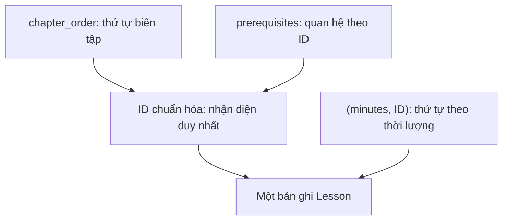

# So sánh bằng nhau, thứ tự toàn phần và tính nhất quán của khóa

## Mục tiêu học tập

Sau bài này, bạn có thể:

- Phân biệt **đồng nhất đối tượng** (identity), **bằng nhau** (equality) và **thứ tự** (ordering) trong dữ liệu và cấu trúc dữ liệu.
- Nêu các tính chất của quan hệ tương đương và **thứ tự toàn phần**, hiểu điều gì xảy ra khi một khóa không thỏa những tính chất này.
- Giải thích hợp đồng giữa `__eq__` và `__hash__` của Python; nhận diện lỗi khi dùng khóa khả biến, giá trị `NaN` hoặc quy tắc chuẩn hóa không nhất quán.
- Phân tích vai trò của quy tắc so sánh trong **Map/Set, bảng băm, mảng đã sắp xếp, cây tìm kiếm và heap**.
- Thiết kế và kiểm tra khóa định danh, khóa sắp xếp và chỉ mục phụ nhất quán, đồng thời đánh giá chi phí thời gian và bộ nhớ của chúng.

## 1. Một bài học có thể được so sánh theo nhiều ý nghĩa

Giả sử hệ thống lưu một bài học:

```python
lesson_a = {"id": "ds-stack", "title": "Stack", "minutes": 25}
lesson_b = {"id": "ds-stack", "title": "Stack", "minutes": 25}
lesson_c = {"id": "ds-stack", "title": "Ngăn xếp", "minutes": 25}

assert lesson_a == lesson_b
assert lesson_a is not lesson_b
assert lesson_a != lesson_c
```

Hãy xét ba câu hỏi:

1. **Hai biến có trỏ tới đúng cùng một đối tượng không?** Đây là **identity**, kiểm tra bằng `is` trong Python.
2. **Hai giá trị có được xem là bằng nhau không?** Đây là **equality**, được quy định bởi kiểu dữ liệu và phép so sánh `==`.
3. **Giá trị nào phải đứng trước khi sắp xếp?** Đây là **ordering**, cần một quy tắc thứ tự rõ ràng.

Ví dụ trên, hai dict đầu **bằng nhau về nội dung** nhưng là **hai đối tượng khác nhau**. Hai dict đầu và cuối có cùng `id` nhưng không bằng nhau theo phép so sánh nội dung toàn bộ của `dict`. Nếu nghiệp vụ coi hai bản ghi có cùng mã `id` là **cùng một thực thể bài học**, đó lại là một quy tắc *định danh nghiệp vụ*, không trùng với cách `dict.__eq__` so sánh toàn bộ cặp khóa–giá trị.

| Khái niệm | Câu hỏi | Quy tắc ví dụ |
| --- | --- | --- |
| **Đồng nhất đối tượng** | Có phải chính đối tượng trong bộ nhớ đó không? | `lesson_a is lesson_b` |
| **Bằng nhau về giá trị** | Hai nội dung có được kiểu dữ liệu xem là bằng nhau không? | `lesson_a == lesson_b` |
| **Cùng định danh nghiệp vụ** | Có phải hai biểu diễn của một bài học không? | `lesson_a["id"] == lesson_c["id"]` |
| **Thứ tự** | Bài nào đứng trước theo tiêu chí đã chọn? | `(minutes, id)` tăng dần |

Sự phân biệt này ảnh hưởng trực tiếp đến **khóa trong bảng băm**, **nút trong cây tìm kiếm**, **tập hợp phần tử đã thăm** và **cách tìm kiếm trên mảng đã sắp xếp**.

## 2. Quan hệ bằng nhau cần những tính chất gì?

Một quy tắc “bằng nhau” dùng để **gom các giá trị tương đương** thường cần thỏa ba tính chất trên miền giá trị hợp lệ:

1. **Phản xạ (reflexive):** với mọi `a`, `a == a`.
2. **Đối xứng (symmetric):** nếu `a == b` thì `b == a`.
3. **Bắc cầu (transitive):** nếu `a == b` và `b == c` thì `a == c`.

Quan hệ thỏa ba tính chất đó được gọi là **quan hệ tương đương (equivalence relation)**. Khi một cấu trúc như Set dựa vào phép so sánh bằng nhau, chương trình thường muốn các giá trị được phân chia thành **những nhóm tương đương rõ ràng**: phần tử bằng nhau là một nhóm; phần tử khác nhau thuộc những nhóm khác.

Ví dụ, với chuỗi mã bài đã chuẩn hóa:

```python
a = "ds-stack"
b = "ds-stack"
c = "ds-stack"

assert a == a
assert (a == b) and (b == a)
assert (a == b) and (b == c) and (a == c)
```

Những tính chất trên dễ thấy với chuỗi, số nguyên hay bản ghi giá trị thuần túy. Tuy nhiên, **không phải mọi phép so sánh trong mọi kiểu dữ liệu đều là quan hệ tương đương lý tưởng**. Số dấu phẩy động có `NaN` là một ví dụ cần đặc biệt chú ý.

### 2.1. `is` không thể thay thế `==`

```python
first = [1, 2]
second = [1, 2]
alias = first

assert first == second
assert first is not second
assert alias is first
```

`is` trả lời “có cùng đối tượng không?”, không trả lời “có cùng giá trị không?”. Không nên sử dụng `is` để so sánh chuỗi hoặc số nguyên theo giá trị; các tối ưu tái sử dụng đối tượng của môi trường chạy không phải hợp đồng để dựa vào.

### 2.2. Bằng nhau “tất cả trường” khác “cùng khóa”

Trong hệ thống học tập, bài `ds-stack` có thể được sửa tiêu đề từ “Stack” thành “Ngăn xếp”. Hai phiên bản khác nhau về thuộc tính, nhưng vẫn thuộc **một bài có cùng khóa định danh**.

```python
before = {"id": "ds-stack", "title": "Stack"}
after = {"id": "ds-stack", "title": "Ngăn xếp"}

assert before != after
assert before["id"] == after["id"]
```

Vì vậy, hãy viết rõ **đơn vị nào đang được so sánh**: bản ghi đầy đủ, mã bài, cặp `(student_id, lesson_id)` hay khóa sắp xếp theo thời lượng. Nếu không làm rõ, một hàm kiểm tra trùng lặp có thể gộp sai hoặc bỏ sót đối tượng.

## 3. Khóa trong Map/Set và hợp đồng của hàm băm

Một **Map** ánh xạ khóa tới giá trị; một **Set** quản lý tập phần tử không trùng theo quy tắc bình đẳng. Bảng băm là cách cài Map/Set phổ biến; trong Python, `dict` và `set` dựa vào **hàm băm** và **phép so sánh bằng nhau**.

### 3.1. Quy tắc quan trọng nhất

Nếu hai khóa được xem là bằng nhau, chúng **bắt buộc** có cùng giá trị băm:

> Nếu `a == b` thì `hash(a) == hash(b)`.

Chiều ngược lại **không bắt buộc đúng**. Hai khóa khác nhau có thể cùng giá trị băm (**va chạm băm**); bảng băm còn cần kiểm tra bình đẳng để phân biệt chúng.

```python
assert 1 == True
assert hash(1) == hash(True)

mapping = {True: "bản ghi A"}
mapping[1] = "bản ghi B"

assert len(mapping) == 1
assert mapping[True] == "bản ghi B"
```

Trong Python, `bool` là kiểu con của `int`; `True` so sánh bằng `1` và có cùng mã băm. Đó là hành vi hợp lệ của ngôn ngữ nhưng có thể làm bất ngờ nếu ứng dụng muốn phân biệt **khóa kiểu boolean** và **khóa kiểu số**.

**Hệ quả thiết kế:** khi cần khóa định danh có một kiểu duy nhất, hãy kiểm tra và chuẩn hóa kiểu khóa ở ranh giới dữ liệu thay vì mặc nhiên tin mọi giá trị truyền vào đều khác nhau.

### 3.2. Ví dụ khóa ghép bất biến

Một lượt đăng ký học được định danh bằng hai trường: mã học viên và mã khóa học.

```python
from dataclasses import dataclass


@dataclass(frozen=True)
class EnrollmentKey:
    student_id: str
    course_id: str


k1 = EnrollmentKey("student-01", "course-ds")
k2 = EnrollmentKey("student-01", "course-ds")
k3 = EnrollmentKey("student-02", "course-ds")

assert k1 is not k2
assert k1 == k2
assert hash(k1) == hash(k2)
assert k1 != k3

completed_courses = {k1}
assert k2 in completed_courses
```

Với các trường chuỗi bất biến trong ví dụ, `@dataclass(frozen=True)` tạo một đối tượng giá trị có cách so sánh bình đẳng và băm tương thích. Tuy nhiên, **`frozen=True` không tự làm bất biến sâu** những đối tượng con. Nếu trường chứa `list` khả biến thì cần thiết kế khác, và khóa tự động có thể không hashable.

### 3.3. Vì sao khóa khả biến nguy hiểm?

Bảng băm tổ chức phần tử dựa trên thông tin băm lúc thêm. Nếu các thuộc tính tham gia vào `__hash__` hoặc `__eq__` thay đổi sau đó, việc tìm lại khóa có thể thất bại hoặc cho kết quả khó dự đoán.

```python
class MutableKey:
    def __init__(self, value):
        self.value = value

    def __hash__(self):
        return hash(self.value)

    def __eq__(self, other):
        return isinstance(other, MutableKey) and self.value == other.value


key = MutableKey("ds-stack")
records = {key: "Stack"}

# Tuyệt đối tránh thay đổi phần tham gia vào hash/equality
# trong khi key vẫn đang được sử dụng làm khóa.
# key.value = "ds-array"  # Có thể làm hỏng khả năng tìm lại.
```

Đoạn mã trên là **mẫu thiết kế không an toàn**, dùng để nhận biết rủi ro, không phải khuyến nghị áp dụng. Để bảo vệ hợp đồng, có thể dùng khóa bất biến như `str`, `tuple` của giá trị hashable, hoặc lớp giá trị được thiết kế bất biến; muốn đổi ID thì xóa khóa cũ và thêm khóa mới bằng thao tác nhất quán.

### 3.4. Tự cài `__eq__` cần thận trọng

Trong Python, nếu một lớp tự định nghĩa `__eq__` mà không cung cấp `__hash__` phù hợp, đối tượng thường trở thành **không hashable**. Đây là biện pháp hữu ích nhằm tránh việc dùng một phép băm nhận dạng cũ trong khi bình đẳng đã được định nghĩa lại theo giá trị.

```python
class NameOnly:
    def __init__(self, name):
        self.name = name

    def __eq__(self, other):
        if not isinstance(other, NameOnly):
            return NotImplemented
        return self.name == other.name


a = NameOnly("ds-stack")
b = NameOnly("ds-stack")
assert a == b

try:
    hash(a)
except TypeError:
    pass  # Chưa có hash phù hợp, đối tượng không dùng làm khóa dict/set.
else:
    raise AssertionError("NameOnly không được tự động hashable")
```

Lớp tự cài so sánh còn phải xem xét **tính đối xứng khi có kiểu con** và cách trả `NotImplemented` để Python cho phép toán hạng bên kia xử lý. Với khóa giá trị thông thường, các kiểu bất biến chuẩn hoặc `dataclass` phù hợp thường đơn giản và ít rủi ro hơn.

## 4. Thứ tự toàn phần (total order) là gì?

Bằng nhau chỉ trả lời “cùng nhóm hay không”. Để **sắp xếp**, **tìm nhị phân**, **duy trì BST** hoặc **lấy cực trị bằng heap**, chương trình cần một quan hệ thứ tự thích hợp.

### 4.1. Định nghĩa với quan hệ “nhỏ hơn hoặc bằng”

Một quan hệ `≤` là **thứ tự toàn phần** trên một miền giá trị nếu thỏa:

1. **Phản xạ:** `a ≤ a`.
2. **Phản đối xứng (antisymmetric):** nếu `a ≤ b` và `b ≤ a` thì `a = b`.
3. **Bắc cầu:** nếu `a ≤ b` và `b ≤ c` thì `a ≤ c`.
4. **Toàn phần / so sánh được:** với bất kỳ `a, b`, có `a ≤ b` hoặc `b ≤ a`.

Đối với quan hệ thứ tự nghiêm ngặt `<`, cách diễn đạt tương ứng thường là: **bất phản xạ**, **bắc cầu**, và với hai giá trị **khác nhau**, đúng một chiều nhỏ hơn phải được xác định. Cần tránh nhầm khái niệm **phản đối xứng** với **đối xứng** của quan hệ bằng nhau.

Ví dụ, số nguyên có thứ tự tăng tự nhiên:

```python
assert 2 < 5
assert 2 <= 2
assert 5 > 2
assert sorted([5, 2, 3]) == [2, 3, 5]
```

**Quan hệ bộ phận (partial order)** không bắt buộc so sánh được mọi cặp phần tử. Quan hệ “là tập con” là ví dụ:

```python
a = {1}
b = {2}

assert not a.issubset(b)
assert not b.issubset(a)
```

Hai tập trên không thuộc quan hệ tập con theo chiều nào. Vì thế, dù có các phép toán quan hệ, **không thể tự coi quan hệ tập con là một thứ tự toàn phần** để sắp xếp các tập như những số nguyên.

### 4.2. Một khóa sắp xếp có thể có giá trị trùng

Giả sử hai bài cùng dài 30 phút. Nếu chỉ so sánh `minutes`, chúng **đồng hạng theo tiêu chí thời lượng**, nhưng không phải cùng bài học.

```python
lessons = [
    {"id": "ds-stack", "minutes": 30},
    {"id": "ds-array", "minutes": 30},
    {"id": "ds-graph", "minutes": 45},
]

by_duration = sorted(lessons, key=lambda x: x["minutes"])
assert [x["id"] for x in by_duration[:2]] == ["ds-stack", "ds-array"]
```

Python sử dụng **sắp xếp ổn định**: khi hai phần tử có khóa sắp xếp bằng nhau, thứ tự tương đối ban đầu của chúng được giữ lại. Nếu hệ thống cần **thứ tự xác định độc lập với thứ tự nhập**, hãy đặt quy tắc phụ:

```python
by_duration_then_id = sorted(
    lessons,
    key=lambda x: (x["minutes"], x["id"]),
)

assert [x["id"] for x in by_duration_then_id] == [
    "ds-array", "ds-stack", "ds-graph"
]
```

Ở đây, cặp `(minutes, id)` được so sánh **từ trái sang phải** theo thứ tự từ điển (*lexicographic order*). Với thời lượng là số nguyên hợp lệ và ID là chuỗi có quy tắc so sánh thống nhất, khóa ghép này xác định được thứ tự giữa các bản ghi có ID phân biệt.

Một thứ tự theo **thời lượng** không phải là thứ tự theo **ID** và cũng không phải **thứ tự biên tập chương**. Hãy đặt tên rõ cho từng quy tắc thay vì dùng từ “đúng thứ tự” mà không nêu tiêu chí.

## 5. Những giá trị làm quy tắc so sánh không còn phù hợp

### 5.1. `NaN` và số dấu phẩy động

Theo ngữ nghĩa dấu phẩy động thông dụng, `NaN` (*not a number*) **không bằng chính nó** và các phép so sánh lớn/bé với nó thường trả `False`:

```python
nan = float("nan")

assert nan != nan
assert not (nan < 10)
assert not (nan > 10)
assert not (nan == 10)
```

Điều này không thỏa giả định rằng mọi khóa đều có thể đặt vào một **thứ tự toàn phần thông thường**. Nếu dùng `NaN` làm khóa của mảng sắp xếp, cây hoặc heap mà không có chính sách rõ ràng, thuật toán có thể không còn đáp ứng đặc tả.

**Chính sách an toàn:** với trường như thời lượng, hãy kiểm tra giá trị đầu vào và từ chối `NaN`, hoặc thiết kế một thứ tự rõ ràng đặt giá trị thiếu/`NaN` vào một nhóm riêng. Không nên dựa vào việc “`sorted` vẫn chạy được” để kết luận dữ liệu đã được sắp đúng.

### 5.2. Giá trị khác kiểu có thể không so sánh được

Trong Python 3, so sánh thứ tự giữa `int` và `str` bằng `<` thường phát sinh `TypeError`:

```python
values = [10, "20"]

try:
    sorted(values)
except TypeError:
    pass  # Cần chuẩn hóa kiểu hoặc quy tắc thứ tự trước khi sắp.
else:
    raise AssertionError("Dữ liệu hỗn hợp không có thứ tự phù hợp")
```

Tương tự, ngày giờ có múi giờ và ngày giờ không có múi giờ cũng cần chính sách so sánh thích hợp. **Kiểu khóa phải nhất quán**, nhất là khi các phần tử được đưa vào chỉ mục ở nhiều thời điểm khác nhau.

### 5.3. “Gần bằng nhau” không phải quan hệ tương đương

Với số thực, `math.isclose` có ích để kiểm tra **sai số tính toán** nhưng không phải quan hệ bằng nhau phù hợp để nhóm khóa trong Set/Map.

```python
import math

a, b, c = 0.0, 0.6, 1.2
options = {"rel_tol": 0.0, "abs_tol": 0.7}

assert math.isclose(a, b, **options)
assert math.isclose(b, c, **options)
assert not math.isclose(a, c, **options)
```

Ở đây **tính bắc cầu thất bại**. Nếu dùng “chênh lệch không quá 0,7” để coi hai khóa là trùng, hệ thống sẽ không có những nhóm tương đương ổn định. Khi muốn gộp số thực, hãy định nghĩa chính sách **lượng tử hóa** hay **phân vùng rõ ràng** (ví dụ chuyển sang đơn vị nguyên phù hợp) rồi so sánh khóa đã chuẩn hóa. Không nên thay thẳng `==` của một khóa bảng băm bằng `isclose`.

## 6. Tính nhất quán của khóa giữa các cấu trúc

Một ứng dụng thường duy trì **nhiều cách nhìn** trên một tập bản ghi. Ví dụ:

- `by_id`: bảng băm ánh xạ mã bài tới bản ghi.
- `by_duration`: danh sách đã sắp xếp theo `(minutes, id)`.
- `prerequisites`: đồ thị tiên quyết với đỉnh được nhận diện bằng mã bài.
- `chapter_order`: danh sách mã bài theo thứ tự biên tập.

Nếu mỗi cấu trúc **hiểu khác nhau thế nào là “cùng khóa”**, chúng có thể cho kết quả mâu thuẫn.

### 6.1. Chuẩn hóa ID ở một nơi

Giả sử sản phẩm quy định mã bài không phân biệt chữ hoa/chữ thường và bỏ khoảng trắng ở hai đầu. Tạo một **hàm chuẩn hóa duy nhất**:

```python
def canonical_lesson_id(raw):
    if not isinstance(raw, str):
        raise TypeError("Mã bài phải là chuỗi")
    value = raw.strip().casefold()
    if not value:
        raise ValueError("Mã bài không được rỗng")
    return value


assert canonical_lesson_id(" DS-STACK ") == "ds-stack"
assert canonical_lesson_id("ds-stack") == "ds-stack"
```

Hàm `casefold()` hữu ích cho so sánh không phân biệt hoa/thường theo Unicode, nhưng **quy tắc này là quyết định nghiệp vụ**, không phải điều mọi hệ thống mã định danh đều phải áp dụng. Với chuỗi Unicode phức tạp, có thể cần quy tắc chuẩn hóa Unicode riêng; không nên thay đổi chính sách sau khi đã tạo chỉ mục mà chưa có kế hoạch di chuyển dữ liệu.

Nếu đã chọn chính sách trên, hai ID `" DS-STACK "` và `"ds-stack"` phải được nhận là **trùng khóa** ở mọi nơi — bảng băm, kiểm tra quan hệ tiên quyết, danh sách thứ tự và API tra cứu. Không được chỉ chuẩn hóa khi đọc mà quên chuẩn hóa khi ghi.

### 6.2. Phân biệt khóa định danh và khóa thứ tự

Khóa định danh `lesson_id` trả lời “đó là bài nào?”; khóa thứ tự `(minutes, lesson_id)` trả lời “bài đó đứng ở đâu trong dãy theo thời lượng?”. Sửa thời lượng **không nên đổi ID**, nhưng phải cập nhật vị trí trong chỉ mục thời lượng. Sửa ID, nếu được phép, lại tác động tới **mọi quan hệ tham chiếu bằng ID**.



Độ phức tạp cập nhật của một hệ thống không chỉ là chi phí thay một trường trong bản ghi; còn gồm **di chuyển khóa trong chỉ mục có thứ tự** và **giữ các quan hệ tham chiếu hợp lệ**.

## 7. Ví dụ tích hợp: bảng băm và chỉ mục có thứ tự dùng chung chính sách khóa

Đoạn mã dưới tạo một danh mục bài học nhỏ, sử dụng:

1. **ID chuẩn hóa** và bản ghi bất biến cho bảng băm.
2. **Khóa ghép `(minutes, lesson_id)`** cho danh sách đã sắp xếp.
3. **Một giao diện cập nhật** để giữ hai biểu diễn nhất quán.

```python
from bisect import bisect_left, insort
from dataclasses import dataclass


def canonical_lesson_id(raw):
    if not isinstance(raw, str):
        raise TypeError("Mã bài phải là chuỗi")
    value = raw.strip().casefold()
    if not value:
        raise ValueError("Mã bài không được rỗng")
    return value


@dataclass(frozen=True)
class Lesson:
    lesson_id: str
    title: str
    minutes: int


class Catalog:
    def __init__(self):
        self._by_id = {}
        self._by_duration = []  # Các cặp (minutes, lesson_id) tăng dần.

    def add(self, lesson_id, title, minutes):
        key = canonical_lesson_id(lesson_id)
        if type(minutes) is not int or minutes < 0:
            raise ValueError("Thời lượng phải là số nguyên không âm")
        if key in self._by_id:
            raise ValueError("Mã bài bị trùng theo chính sách chuẩn hóa")

        lesson = Lesson(key, title, minutes)
        # insort tìm vị trí và chèn vào list; dịch phần tử có thể tốn O(n).
        insort(self._by_duration, (minutes, key))
        self._by_id[key] = lesson

    def find(self, lesson_id):
        return self._by_id.get(canonical_lesson_id(lesson_id))

    def between_minutes(self, low, high):
        if type(low) is not int or type(high) is not int or low < 0 or high < 0:
            raise ValueError("Cận thời lượng phải là số nguyên không âm")
        if low > high:
            return []
        # ID không rỗng, vì vậy (low, "") nằm trước mọi khóa (low, id).
        pos = bisect_left(self._by_duration, (low, ""))
        result = []
        while pos < len(self._by_duration):
            minutes, lesson_id = self._by_duration[pos]
            if minutes > high:
                break
            result.append(self._by_id[lesson_id])
            pos += 1
        return result

    def remove(self, lesson_id):
        key = canonical_lesson_id(lesson_id)
        lesson = self._by_id[key]  # KeyError nếu bài không tồn tại.
        entry = (lesson.minutes, key)
        pos = bisect_left(self._by_duration, entry)
        assert self._by_duration[pos] == entry
        self._by_duration.pop(pos)
        del self._by_id[key]
        return lesson


catalog = Catalog()
catalog.add(" DS-STACK ", "Stack", 30)
catalog.add("ds-array", "Mảng", 20)
catalog.add("ds-queue", "Queue", 30)

assert catalog.find("ds-stack").title == "Stack"
assert [x.lesson_id for x in catalog.between_minutes(20, 30)] == [
    "ds-array", "ds-queue", "ds-stack"
]

try:
    catalog.add("ds-stack", "Trùng mã", 15)
except ValueError:
    pass
else:
    raise AssertionError("Phải từ chối mã trùng")

removed = catalog.remove("Ds-STACK")
assert removed.lesson_id == "ds-stack"
assert catalog.find("ds-stack") is None
assert [x.lesson_id for x in catalog.between_minutes(20, 30)] == [
    "ds-array", "ds-queue"
]
```

Ở đây:

- **Bằng nhau theo ID** được xác định sau khi chuẩn hóa; không dùng tiêu đề hoặc thời lượng để quyết định hai bài có cùng danh tính không.
- **Thứ tự** của các bản ghi trong `_by_duration` là thứ tự từ điển trên `(minutes, lesson_id)`; mọi phần tử đều có cùng kiểu khóa so sánh.
- **Bất biến:** mỗi ID trong `_by_id` xuất hiện đúng một lần trong `_by_duration` với thời lượng hiện tại; mỗi cặp trong `_by_duration` có một bản ghi tương ứng.
- **Bản ghi bất biến:** muốn sửa thời lượng cần tạo bản ghi mới và cập nhật vị trí trong chỉ mục, thay vì thay đổi lặng lẽ một thuộc tính đã được dùng làm khóa thứ tự.

### 7.1. Chi phí thực tế của ví dụ

Giả sử có `n` bài và truy vấn khoảng trả `k` bài:

| Thao tác | Thời gian điển hình | Vì sao? |
| --- | --- | --- |
| `find(id)` | **O(1) kỳ vọng** sau khi chuẩn hóa ID | Tra bảng băm theo khóa |
| Tìm vị trí chèn trong `_by_duration` | **O(log n)** lần so sánh | Tìm nhị phân |
| `add` | **O(n)** trường hợp xấu nhất | `insort` có thể dịch đến n phần tử; còn cập nhật bảng băm |
| `between_minutes(low, high)` | **O(log n + k)** kỳ vọng với so sánh khóa đơn giản | Tìm cận dưới rồi duyệt k kết quả |
| `remove` | **O(n)** trường hợp xấu nhất | `pop(pos)` dịch các phần tử phía sau |
| Bộ nhớ giữ lâu dài | **O(n)** bổ sung cho chỉ mục thứ tự ngoài bảng băm | Mỗi bài có một cặp khóa trong dãy |

Chi phí chuẩn hóa khóa còn phụ thuộc vào độ dài chuỗi; việc nói “tra bảng băm O(1)” thường xem thời gian băm/so sánh **một khóa** là hằng số. Với chuỗi rất dài, hash hoặc so sánh chuỗi có chi phí phụ thuộc số ký tự. Đây là ví dụ về việc phải nêu **giả định của phân tích**.

Đoạn mã minh họa tính nhất quán trong **một tiến trình** và giả sử không có lỗi phát sinh giữa các bước cập nhật. Ứng dụng thực tế cần tính tới lỗi cấp phát, ghi bền vững, thao tác đồng thời và cơ chế giao dịch/khôi phục nếu cập nhật nhiều chỉ mục. Một `assert` nội bộ không thay thế cơ chế xử lý dữ liệu không hợp lệ ở ranh giới dịch vụ.

## 8. Thứ tự toàn phần ảnh hưởng thế nào đến tìm nhị phân, BST và heap?

### 8.1. Tìm nhị phân cần **đúng thứ tự đã dùng để sắp**

Mảng tìm kiếm phải được sắp theo **cùng quy tắc** mà thuật toán tìm nhị phân sử dụng. Nếu dãy sắp không phân biệt chữ hoa/thường nhưng khi tìm lại dùng so sánh phân biệt chữ hoa/thường, tiền điều kiện của tìm nhị phân có thể bị vi phạm.

```python
from bisect import bisect_left

raw_ids = ["ds-Stack", "DS-array", "ds-queue"]
normalized = sorted(x.strip().casefold() for x in raw_ids)

target = " DS-STACK ".strip().casefold()
pos = bisect_left(normalized, target)

assert pos < len(normalized)
assert normalized[pos] == target
```

**Không nên** chỉ gọi `bisect_left` trên một danh sách được sắp theo tiêu chí khác. Lựa chọn an toàn là tạo **khóa chuẩn hóa** và dùng chính khóa đó khi sắp, tìm, chèn và kiểm tra trùng lặp.

### 8.2. Cây tìm kiếm phải nhất quán giữa “nhỏ hơn”, “lớn hơn” và “bằng nhau”

Trong BST, thuật toán thường rẽ trái nếu khóa cần tìm nhỏ hơn khóa tại nút, rẽ phải nếu lớn hơn và xử lý trùng khi hai khóa được xem là bằng nhau. Nếu phép so sánh không bắc cầu hoặc có những cặp không so sánh được, thuật toán có thể **rẽ sai nhánh hoặc bỏ sót khóa**.

Với khóa duy nhất và quan hệ thứ tự phù hợp, bất biến thường viết:

- Mọi khóa trong cây con trái **nhỏ hơn** khóa tại nút.
- Mọi khóa trong cây con phải **lớn hơn** khóa tại nút.
- Khi có khóa trùng, cấu trúc phải có **chính sách rõ ràng**: từ chối, cập nhật giá trị, lưu danh sách giá trị hoặc lưu số lần xuất hiện.

Chiều cao cây thường quyết định chi phí tìm là **O(h)**. BST cân bằng duy trì `h = O(log n)` nên tìm, thêm và xóa thường **O(log n)**; BST không cân bằng có thể suy giảm thành O(n). Nhưng **cân bằng không cứu được một quy tắc so sánh thiếu nhất quán**.

Nếu một kiểu khóa có `a == b` nhưng cả quy tắc “nhỏ hơn” và “lớn hơn” lại xử lý chúng như hai vị trí phân biệt không có chính sách nhất quán, cây có thể giữ khóa trùng hoặc không tìm lại được bản ghi như mong đợi.

### 8.3. Heap và priority queue cần giải quyết hòa điểm

Heap chỉ cần duy trì quan hệ ưu tiên giữa cha và con; nó **không sắp xếp toàn bộ phần tử**. Tuy nhiên, khóa ưu tiên vẫn phải có quy tắc so sánh phù hợp. Khi hai công việc có cùng hạn chót, chương trình cần xác định quy tắc hòa điểm nếu muốn kết quả có thể dự đoán.

```python
import heapq
from itertools import count

sequence = count()
jobs = []

heapq.heappush(jobs, (10, next(sequence), {"id": "a"}))
heapq.heappush(jobs, (5, next(sequence), {"id": "b"}))
heapq.heappush(jobs, (5, next(sequence), {"id": "c"}))

assert heapq.heappop(jobs)[2]["id"] == "b"
assert heapq.heappop(jobs)[2]["id"] == "c"
```

Khóa `(deadline, sequence)` có thứ tự xác định; nhờ số thứ tự duy nhất, Python **không phải so sánh trực tiếp các dict công việc**, vốn không hỗ trợ quan hệ `<`. Hai công việc cùng hạn được lấy theo thứ tự thêm. Nếu dùng `(deadline, job_dict)` mà hai hạn bằng nhau, so sánh dict có thể gây `TypeError`.

### 8.4. Đồ thị cũng cần quy tắc bằng nhau ổn định

Trong BFS/DFS, tập `visited` thường chứa ID đỉnh:

```python
graph = {
    "ds-array": ["ds-stack", "ds-queue"],
    "ds-stack": [],
    "ds-queue": [],
}

visited = set()
visited.add("ds-array")
assert "ds-array" in visited
```

Nếu một đỉnh được nhận diện bằng hai cách viết ID khác nhau (`"DS-ARRAY"` và `"ds-array"`) mà ứng dụng không chuẩn hóa thống nhất, DFS/BFS có thể coi chúng là **hai đỉnh khác nhau**. Từ đó, thuật toán có thể đếm trùng, duyệt lặp hoặc tham chiếu sai. Với cây, đồ thị và Map, khóa định danh ổn định là nền tảng cho **bất biến tham chiếu**.

## 9. Những bất biến cần kiểm tra khi thiết kế khóa

| Thành phần | Bất biến / quy tắc | Lỗi nếu vi phạm |
| --- | --- | --- |
| **Equality** | Có định nghĩa rõ hai giá trị “cùng” theo tiêu chí nào; quan hệ tương đương trên miền hợp lệ | Gộp sai hoặc coi hai bản ghi cùng ID là khác nhau |
| **Hash** | `a == b` kéo theo `hash(a) == hash(b)`; khóa ổn định khi lưu | Tra cứu hoặc kiểm tra thành viên thất bại |
| **Khóa sắp xếp** | Dùng cùng kiểu và một thứ tự có tính bắc cầu, so sánh được | Sắp xếp/tìm nhị phân không đáng tin cậy |
| **BST** | Nhánh trái và phải tuân thủ thứ tự khóa; chính sách khóa trùng rõ ràng | Đi sai nhánh, bỏ sót hoặc lặp khóa |
| **Heap** | Quan hệ ưu tiên cha–con luôn đúng; hòa điểm có chính sách | Chọn sai phần tử hoặc lỗi so sánh |
| **Chỉ mục phụ** | Khóa và vị trí được cập nhật khi dữ liệu chính thay đổi | Kết quả truy vấn khác nhau giữa các chỉ mục |
| **Đồ thị** | Cạnh dùng ID đỉnh hợp lệ theo cùng chính sách chuẩn hóa | Tham chiếu mồ côi, chia tách một đỉnh thành nhiều ID |

### 9.1. Một bộ kiểm tra nhỏ cho hợp đồng

Với kiểu khóa tự định nghĩa, nên thử các phần tử bằng nhau và khác nhau, cả các trường hợp biên. Ví dụ cho khóa đăng ký học:

```python
from dataclasses import dataclass


@dataclass(frozen=True, order=True)
class EnrollmentKey:
    student_id: str
    course_id: str


keys = [
    EnrollmentKey("student-01", "course-a"),
    EnrollmentKey("student-01", "course-a"),
    EnrollmentKey("student-01", "course-b"),
    EnrollmentKey("student-02", "course-a"),
]

for a in keys:
    assert a == a                     # Phản xạ
    for b in keys:
        assert (a == b) == (b == a)   # Đối xứng
        if a == b:
            assert hash(a) == hash(b)  # Hợp đồng băm
        assert (a <= b) or (b <= a)  # So sánh được

for a in keys:
    for b in keys:
        for c in keys:
            if a == b and b == c:
                assert a == c       # Bắc cầu của equality
            if a <= b and b <= c:
                assert a <= c       # Bắc cầu của thứ tự
```

Kiểm tra với bốn khóa không thể chứng minh mọi giá trị đều đúng; nó chỉ là ví dụ về **kiểm thử các tính chất**. Với kiểu khóa phức tạp, nên tạo thêm bộ dữ liệu biên và sử dụng **property-based testing** nếu hệ thống có công cụ phù hợp. Bài học này chỉ trình bày minh họa, không thay cho quy trình kiểm thử chuyên môn.

## 10. Quy trình lựa chọn quan hệ so sánh theo bài toán

1. **Xác định danh tính:** Điều gì làm hai bản ghi được xem là cùng thực thể? `lesson_id`, khóa ghép, hay toàn bộ nội dung?
2. **Xác định miền hợp lệ:** Khóa là chuỗi, số nguyên hay cặp giá trị? Có chấp nhận `None`, `NaN`, khoảng trắng, khác biệt hoa/thường không?
3. **Định nghĩa equality:** Quy tắc có đối xứng, phản xạ, bắc cầu trên miền dữ liệu hợp lệ không? Có cố ý coi nhiều biểu diễn như một khóa không?
4. **Định nghĩa thứ tự riêng biệt nếu cần:** Sắp theo ID, thời lượng, thời điểm tạo hay độ ưu tiên? Xử lý khóa trùng bằng cách nào?
5. **Giữ tính nhất quán:** Hàm chuẩn hóa được dùng cả khi ghi, đọc, kiểm tra trùng và tạo cạnh tham chiếu; phép tìm nhị phân dùng cùng khóa sắp xếp.
6. **Làm khóa ổn định:** Tránh sửa các trường tham gia vào băm hoặc thứ tự mà không cập nhật chỉ mục.
7. **Chọn cấu trúc phù hợp:** Bảng băm cho tra chính xác; mảng đã sắp hoặc cây cân bằng cho thứ tự/khoảng; heap cho cực trị; đồ thị cho quan hệ.
8. **Tính thời gian và bộ nhớ:** Tính cả chi phí chuẩn hóa, so sánh khóa, xây chỉ mục, cập nhật và đồng bộ những cấu trúc liên quan.
9. **Kiểm thử trường hợp biên:** khóa trùng sau chuẩn hóa, `NaN`, khóa hỗn hợp, dữ liệu rỗng, tie-break, cập nhật ID và xóa bản ghi có tham chiếu.

**Ví dụ quyết định:** Nếu ID bài học là chuỗi không phân biệt hoa/thường, ta chuẩn hóa một lần rồi dùng chuỗi chuẩn làm khóa của `dict`, `set` và đỉnh đồ thị. Nếu cần sắp bài theo thời lượng, dùng một khóa riêng `(minutes, canonical_id)`. Điều này cho phép **cùng danh tính bài học** nhưng **nhiều thứ tự hiển thị khác nhau**, không nhầm lẫn hai khái niệm.

## 11. Những hiểu lầm thường gặp

- **“`a is b` và `a == b` tương đương.”** Không đúng: một bên kiểm tra đồng nhất đối tượng, bên kia kiểm tra bình đẳng theo kiểu dữ liệu.
- **“Hai khóa có cùng hash thì phải bằng nhau.”** Không đúng: va chạm băm được phép; chỉ chiều từ bằng nhau sang cùng mã băm là bắt buộc.
- **“Khóa của dict có thể sửa tùy ý sau khi thêm.”** Không an toàn nếu sửa làm thay đổi băm hoặc equality; cấu trúc có thể không tìm lại được khóa.
- **“Mọi phép so sánh đều cho thứ tự toàn phần.”** Không đúng: quan hệ tập con chỉ là thứ tự bộ phận; `NaN` không thỏa phép so sánh số thông thường.
- **“`math.isclose` dùng được làm equality của Set.”** Không đúng: quan hệ “đủ gần” có thể không bắc cầu.
- **“Hai bài có cùng thời lượng thì là cùng một bài.”** Không đúng: cùng khóa sắp xếp không đồng nghĩa cùng khóa định danh.
- **“Dùng `bisect` thì luôn tìm đúng.”** Không đúng: dãy phải được sắp theo **cùng quy tắc** với tìm kiếm.
- **“Cây cân bằng giải quyết được mọi lỗi so sánh.”** Không đúng: cân bằng giải quyết độ cao, không sửa quan hệ thứ tự thiếu nhất quán.
- **“Heap có thể so sánh tùy ý hai dict khi ưu tiên bằng nhau.”** Không đúng: cần tiêu chí phụ so sánh được để tránh `TypeError`.
- **“Chuẩn hóa ở đầu vào là đủ.”** Chưa đủ nếu các đường cập nhật, truy vấn, chỉ mục và tham chiếu vẫn sử dụng nhiều chính sách khác nhau.

## 12. Bài tập vận dụng

### Bài 1 — Equality và identity

Hai dict khác đối tượng cùng chứa `{"id": "ds-stack"}`; dict thứ ba có cùng `id` nhưng khác `title`. Hãy phân biệt ba kết luận: “cùng đối tượng”, “bằng nhau về toàn bộ nội dung” và “cùng bài học theo ID”.

*Gợi ý:* `is` kiểm tra danh tính đối tượng; `dict == dict` so toàn bộ cặp khóa–giá trị; so `record["id"]` mới trả lời theo định danh nghiệp vụ.

### Bài 2 — Hợp đồng băm

Một lớp tự định nghĩa `__eq__` để so sánh hai đối tượng bằng tên không phân biệt hoa/thường, nhưng `__hash__` lại băm tên gốc có phân biệt hoa/thường. Điều gì sai? Hãy nêu hai cách sửa.

*Gợi ý:* Hai khóa được xem bằng nhau có thể có mã băm khác nhau. Hãy chuẩn hóa tên khi tạo khóa và băm/so sánh trên cùng giá trị chuẩn, hoặc dùng một loại khóa bất biến đã được chuẩn hóa trước.

### Bài 3 — `NaN` và thứ tự

Vì sao không nên đưa `float("nan")` vào dãy thời lượng rồi chỉ gọi `sort()` và `bisect_left()`? Hãy đề xuất chính sách cho trường thời lượng.

*Gợi ý:* `NaN` không có quan hệ so sánh lớn/bé thông thường phù hợp với tìm nhị phân. Có thể từ chối giá trị đó hoặc thiết kế nhóm/thứ tự đặc biệt cho giá trị thiếu.

### Bài 4 — Khóa trùng khi sắp xếp

Ba bài có thời lượng `30, 30, 45` phút với ID `c, a, b`. Hãy chọn khóa để sắp tăng theo thời lượng, sau đó tăng theo ID khi hòa; giải thích tại sao chỉ `minutes` không cho thứ tự xác định độc lập với thứ tự nhập.

*Gợi ý:* Sắp theo `(minutes, id)`. Hai bài thời lượng 30 được so tiếp theo ID; sắp chỉ theo thời lượng sẽ giữ thứ tự đầu vào nếu thuật toán sắp ổn định như Python.

### Bài 5 — Bài toán cập nhật nhiều chỉ mục

Danh mục có `by_id` và dãy sắp theo `(minutes, id)`. Khi thời lượng bài `ds-stack` đổi từ 25 sang 50 phút, cần cập nhật những cấu trúc nào? Nếu chỉ thay giá trị trong bản ghi thì sao?

*Gợi ý:* Phải thay bản ghi hoặc trường dữ liệu chính và di chuyển cặp khóa trong chỉ mục đã sắp; nếu bỏ qua, tìm khoảng có thể trả kết quả sai.

### Bài 6 — Quy tắc chuẩn hóa ID

Hệ thống coi `" DS-STACK "` và `"ds-stack"` là cùng bài. Lập danh sách các đường truy cập phải sử dụng cùng hàm chuẩn hóa; cho biết xử lý thế nào khi cả hai dạng được thêm vào.

*Gợi ý:* Ghi, đọc, kiểm tra trùng, xóa, thêm cạnh đồ thị, tra chỉ mục theo mã đều phải dùng ID chuẩn. Lần thêm thứ hai phải bị coi là khóa trùng.

### Bài 7 — Ưu tiên bằng nhau trong heap

Tại sao heap chứa `(deadline, job_dict)` có thể gây lỗi khi hai deadline bằng nhau? Thiết kế khóa để xử lý công việc cùng hạn theo thứ tự đến.

*Gợi ý:* Python có thể phải so sánh `dict` với `dict` bằng `<`; hãy dùng `(deadline, sequence, job_dict)` với `sequence` tăng duy nhất.

### Bài 8 — So sánh các cấu trúc

Một hệ thống cần vừa tra bài theo ID, vừa liệt kê theo khoảng thời lượng và xác định các bài tiên quyết. Chỉ dùng một bảng băm theo ID có đủ không? Đề xuất cấu trúc và nêu ít nhất hai bất biến cần kiểm tra.

*Gợi ý:* Có thể kết hợp Map theo ID, chỉ mục có thứ tự và đồ thị tiên quyết. Phải giữ tất cả ID tham chiếu hợp lệ và bảo đảm chỉ mục thời lượng dùng đúng khóa hiện tại.

## Tổng kết

**Bằng nhau** xác định khi nào hai giá trị thuộc cùng một nhóm tương đương; **thứ tự toàn phần** quy định cách so sánh mọi cặp khóa hợp lệ để sắp xếp và tìm kiếm; **tính nhất quán của khóa** bảo đảm những quy tắc ấy không thay đổi tùy tiện giữa các cấu trúc dữ liệu. Đối với Map/Set, khóa bằng nhau phải có băm bằng nhau và ổn định khi lưu. Đối với mảng đã sắp, BST và heap, phép so sánh phải phù hợp với bất biến thứ tự và có chính sách cho khóa trùng. Trong hệ thống có nhiều chỉ mục hoặc đồ thị, hãy chuẩn hóa ID một cách thống nhất, phân biệt khóa định danh với khóa sắp xếp và tính cả chi phí cập nhật. Đó là cơ sở để chọn cấu trúc dữ liệu vừa **đúng**, vừa có hiệu suất và bộ nhớ phù hợp.
