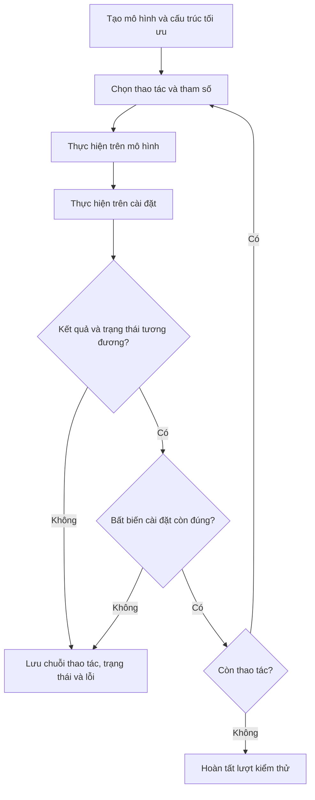

# Đối chiếu với một mô hình tham chiếu đơn giản

Một cấu trúc dữ liệu có thể vượt qua nhiều ca kiểm thử đơn lẻ nhưng vẫn sai khi các thao tác kết hợp với nhau. Chẳng hạn, min-heap trả đúng phần tử nhỏ nhất trong ba lần đầu nhưng sai sau một chuỗi `push`, `pop_min`, `push`; hoặc bảng băm tìm được khóa mới nhưng làm mất khóa cũ sau khi tái băm. Để tìm những lỗi như vậy, ta có thể dựng **mô hình tham chiếu đơn giản** (*reference model*) và thực hiện cùng một chuỗi thao tác trên cả mô hình lẫn cấu trúc cần kiểm thử.

Ý tưởng là ưu tiên **mô hình dễ hiểu, dễ xác minh hành vi** hơn hiệu năng. Với min-heap, mô hình có thể chỉ là một danh sách không sắp xếp và mỗi lần cần phần tử nhỏ nhất thì gọi `min`. Với cấu trúc tính tổng đoạn, mô hình có thể chỉ là mảng và hàm `sum`. Mô hình chạy chậm cũng không sao khi dùng trên bộ dữ liệu nhỏ trong kiểm thử.

Bài học này thuộc phần **Kiểm chứng và thực hành** trong học phần cấu trúc dữ liệu. Kỹ thuật đối chiếu giúp kiểm tra tính đúng đắn của mảng, danh sách, Stack, Queue, bảng băm, cây, heap, đồ thị và các cấu trúc tối ưu khác trước khi đánh giá chi phí thời gian, bộ nhớ.

## 1. Mô hình tham chiếu đóng vai trò gì?

Một **mô hình tham chiếu** biểu diễn trạng thái và phép toán theo cách trực tiếp nhất có thể, dựa trên **đặc tả** của kiểu dữ liệu trừu tượng (ADT). Khi thực hiện phép toán, ta so:

1. **Kết quả:** trả về giá trị gì, hoặc báo lỗi nào?
2. **Trạng thái logic sau phép toán:** cấu trúc còn bao nhiêu phần tử, chứa những phần tử nào, theo thứ tự nào nếu thứ tự là một phần hợp đồng?
3. **Phần không được phép thay đổi:** thao tác trên một khóa không làm đổi giá trị các khóa khác; truy vấn chỉ đọc không làm thay đổi dữ liệu.
4. **Bất biến biểu diễn:** cấu trúc tối ưu vẫn duy trì điều kiện nội bộ như thứ tự heap, chỉ số vòng hợp lệ, hay liên kết cha–con nhất quán.

Trong kiểm thử dựa trên mô hình (*model-based testing*), mô hình là cách tính **kết quả mong đợi** cho chuỗi thao tác. Trong kiểm thử đối chiếu (*differential testing*), ta chạy hai hay nhiều cách thực hiện cùng hợp đồng và tìm chỗ kết quả khác nhau. Hai cách tiếp cận thường kết hợp tốt: một bản đơn giản đóng vai trò mô hình, bản tối ưu là đối tượng cần kiểm tra.

**Điều kiện quan trọng:** mô hình và cấu trúc tối ưu phải thực hiện **cùng một hợp đồng**. Không thể kết luận hai cài đặt sai chỉ vì một bản sắp xếp kết quả còn bản kia không cam kết thứ tự; trước hết cần xác định điều gì là quan sát được và được phép khác nhau.

### Mô hình tốt có những đặc điểm nào?

| Tiêu chí | Ý nghĩa thực hành |
|---|---|
| Đơn giản | Ít nhánh, ít trạng thái phụ; dễ đối chiếu bằng tay |
| Độc lập về thuật toán | Không sao chép cùng công thức hay cùng thủ thuật tối ưu dễ gây lỗi |
| Đúng hợp đồng | Cùng quy tắc về phần tử trùng, giá trị vắng mặt, lỗi và biên chỉ số |
| Có thể quan sát | Cho phép đọc trạng thái logic để so sánh sau từng bước |
| Chạy lặp được | Thao tác xác định, dữ liệu và hạt giống ngẫu nhiên được lưu lại |
| Giới hạn phù hợp | Chạy trên dữ liệu nhỏ nếu thuật toán mô hình có chi phí cao |

Một mô hình đơn giản **không mặc nhiên đúng**. Trước khi dựa vào nó, cần so vài trường hợp bằng tay, viết hợp đồng rõ ràng và tránh dùng lại chính đoạn thuật toán đang cần kiểm tra.

## 2. Đối chiếu trạng thái trừu tượng, không đối chiếu cách lưu trữ

Giả sử hai cài đặt cùng biểu diễn một ADT với trạng thái logic \(S\). Một phép toán `op(x)` biến \(S\) thành trạng thái mới \(S'\), đồng thời trả về kết quả \(r\) hoặc lỗi đã định nghĩa.

Ta có thể ký hiệu:

\[
\operatorname{step}(S, op(x)) = (S', r).
\]

Mô hình và cài đặt tối ưu có thể sử dụng các trạng thái bộ nhớ khác nhau. Nếu gọi \(\alpha\) là cách chuyển trạng thái nội bộ của cài đặt sang trạng thái logic, mục tiêu đối chiếu là:

\[
\alpha(\text{implementation after op})
\equiv
\text{model after op}
\]

và kết quả trả về hai phía tương đương theo hợp đồng.

Ví dụ, một min-heap dạng mảng có thể lưu `[1, 4, 2, 9]`, còn mô hình là danh sách `[9, 2, 4, 1]`. **Hai trạng thái logic bằng nhau** nếu ADT chỉ quan tâm đến tập có tính số lần xuất hiện (multiset) và phép lấy phần tử nhỏ nhất. Không nên so sánh trực tiếp hai mảng theo thứ tự vật lý.

Tương tự:

- **Stack:** dãy logic phải bằng nhau *theo thứ tự LIFO*; không thể chỉ so hai tập giá trị.
- **Queue:** dãy logic phải bằng nhau *theo thứ tự FIFO*.
- **Set:** so tập phần tử; không so thứ tự bucket hay thứ tự duyệt nếu API không cam kết.
- **Map:** so ánh xạ khóa → giá trị; không so vị trí băm.
- **Heap:** so số lần xuất hiện của mỗi giá trị và giá trị đỉnh; không đòi hai heap có cùng hình dạng.
- **Cấu trúc truy vấn đoạn:** so giá trị của truy vấn và trạng thái mảng logic sau mỗi cập nhật; không so từng nút cây đoạn.

Chọn sai phép so sánh dễ tạo **báo lỗi giả** (hai bản đúng nhưng biểu diễn khác nhau) hoặc **bỏ sót lỗi** (chỉ so kích thước dù giá trị hoặc thứ tự đã sai).

## 3. Ví dụ chính: kiểm tra min-heap bằng danh sách thường

Ta chọn ADT **min-priority queue** lưu **số nguyên**, hỗ trợ giá trị âm và trùng nhau; mỗi lần `pop_min()` loại **đúng một lần xuất hiện** của giá trị nhỏ nhất.

| Phép toán | Hợp đồng | Khi rỗng |
|---|---|---|
| `push(x)` | Thêm một giá trị `x` vào tập có tính số lần xuất hiện | Vẫn thêm được |
| `peek_min()` | Trả giá trị nhỏ nhất, không đổi trạng thái | Ném `IndexError`, giữ nguyên trạng thái |
| `pop_min()` | Trả và xóa đúng một lần xuất hiện của giá trị nhỏ nhất | Ném `IndexError`, giữ nguyên trạng thái |
| `len(h)` | Trả tổng số phần tử, kể cả các giá trị trùng | Trả `0` |

Đặc tả **không** cam kết thứ tự giữa các bản ghi có cùng độ ưu tiên vì ví dụ chỉ lưu giá trị nguyên. Nếu mỗi phần tử có thêm `id` và độ ưu tiên, cần quyết định rõ có yêu cầu FIFO khi bằng độ ưu tiên hay không; khi đó mô hình phải thể hiện chính sách hòa (*tie-breaking*) tương ứng.

### 3.1. Mô hình chậm nhưng rõ ràng

Mô hình lưu các phần tử trong một `list` thông thường, không duy trì thứ tự heap:

```python
class ListMinModel:
    def __init__(self):
        self._items: list[int] = []

    def __len__(self):
        return len(self._items)

    def push(self, value: int):
        self._items.append(value)

    def peek_min(self) -> int:
        if not self._items:
            raise IndexError("priority queue rong")
        return min(self._items)

    def pop_min(self) -> int:
        value = self.peek_min()
        self._items.remove(value)  # Xoa dung mot lan xuat hien
        return value

    def snapshot_for_test(self) -> list[int]:
        return sorted(self._items)
```

`push` thường mất `O(1)` khấu hao, nhưng `peek_min` phải quét `O(n)`, còn `pop_min` phải tìm nhỏ nhất rồi xóa một lần xuất hiện, cũng `O(n)`. Điều đó chấp nhận được: đây là mô hình phục vụ kiểm tra, không phải thiết kế cho khối lượng lớn.

Với phần tử trùng, `remove(value)` chỉ xóa **một** lần xuất hiện. Nếu viết `self._items = [x for x in self._items if x != value]`, mô hình sẽ xóa **tất cả** bản sao và không còn đúng hợp đồng.

### 3.2. Cài đặt cần kiểm tra: binary min-heap

Một min-heap dạng mảng lưu phần tử theo thứ tự sao cho khóa của cha không lớn hơn khóa của hai con. Với chỉ số `i > 0`, cha ở `(i - 1) // 2`. Thao tác thêm dùng *sift up*; lấy nhỏ nhất dùng *sift down*.

```python
class BinaryMinHeap:
    def __init__(self):
        self._data: list[int] = []

    def __len__(self):
        return len(self._data)

    def push(self, value: int):
        a = self._data
        a.append(value)
        i = len(a) - 1
        while i > 0:
            parent = (i - 1) // 2
            if a[parent] <= a[i]:
                break
            a[parent], a[i] = a[i], a[parent]
            i = parent

    def peek_min(self) -> int:
        if not self._data:
            raise IndexError("priority queue rong")
        return self._data[0]

    def pop_min(self) -> int:
        a = self._data
        if not a:
            raise IndexError("priority queue rong")
        result = a[0]
        last = a.pop()

        if a:
            a[0] = last
            i = 0
            n = len(a)
            while True:
                left = 2 * i + 1
                if left >= n:
                    break
                right = left + 1
                smallest_child = left
                if right < n and a[right] < a[left]:
                    smallest_child = right
                if a[i] <= a[smallest_child]:
                    break
                a[i], a[smallest_child] = a[smallest_child], a[i]
                i = smallest_child

        return result

    def assert_heap_invariant(self):
        for i in range(1, len(self._data)):
            assert self._data[(i - 1) // 2] <= self._data[i]

    def snapshot_for_test(self) -> list[int]:
        # Anh chup multiset; chi phuc vu kiem thu.
        return sorted(self._data)
```

Các thao tác `push` và `pop_min` của heap mất `O(log n)` thời gian trong trường hợp xấu nhất; `peek_min` là `O(1)`. Mảng heap dùng `O(n)` bộ nhớ. Phương thức `snapshot_for_test` và `assert_heap_invariant` là công cụ chẩn đoán, có thể không tồn tại trong API sản xuất.

Khi heap chỉ có một phần tử, `a.pop()` khiến mảng rỗng, nên nhánh `if a:` tránh ghi lại vào `a[0]`. Đây là ví dụ về lỗi biên mà phép đối chiếu cần bắt.

### 3.3. So trạng thái và kết quả sau mỗi thao tác

Hàm sau kiểm tra các khía cạnh **bổ sung cho nhau**:

- `len`: tổng số phần tử.
- `snapshot_for_test`: giá trị và số lần xuất hiện, bỏ qua thứ tự vật lý.
- `peek_min`: phần tử nhỏ nhất hiện có.
- `assert_heap_invariant`: điều kiện biểu diễn riêng của heap.

```python
def assert_equivalent(heap: BinaryMinHeap, model: ListMinModel):
    heap.assert_heap_invariant()
    assert len(heap) == len(model)
    assert heap.snapshot_for_test() == model.snapshot_for_test()

    if len(model) > 0:
        assert heap.peek_min() == model.peek_min()
    else:
        try:
            heap.peek_min()
        except IndexError:
            pass
        else:
            raise AssertionError("peek_min tren heap rong phai bao loi")
```

Nếu heap bị lỗi khiến phần tử nhỏ nhất nằm sai vị trí, kiểm tra bất biến hoặc `peek_min` có thể phát hiện. Nếu heap vô tình làm mất một bản sao của giá trị trùng nhưng vẫn giữ tính chất heap, ảnh chụp multiset sẽ phát hiện.

Ở cấu trúc không hỗ trợ đọc toàn bộ nội dung, ta có thể thay ảnh chụp bằng bản sao độc lập rồi lần lượt lấy các phần tử ra, hoặc kiểm tra qua một tập truy vấn đủ mạnh. Không nên thêm API lộ cấu trúc nội bộ vào sản phẩm chỉ vì một bài kiểm thử.

## 4. Tạo một bộ thực thi thao tác chung

Thay vì viết kỳ vọng riêng cho từng chuỗi dài, ta xây *test harness* nhận một thao tác rồi thực hiện trên hai bản. Mô hình được gọi để lấy kết quả mong đợi; kết quả và trạng thái của heap được kiểm tra **sau từng bước**.

```python
def apply_and_compare(heap, model, operation, value=None):
    if operation == "push":
        heap.push(value)
        model.push(value)

    elif operation in ("peek_min", "pop_min"):
        if len(model) > 0:
            expected = getattr(model, operation)()
            actual = getattr(heap, operation)()
            assert actual == expected
        else:
            before = heap.snapshot_for_test()

            for target in (heap, model):
                try:
                    getattr(target, operation)()
                except IndexError:
                    pass
                else:
                    raise AssertionError(
                        f"{operation} tren cau truc rong phai bao loi"
                    )

            assert heap.snapshot_for_test() == before

    else:
        raise ValueError(f"Thao tac khong duoc ho tro: {operation}")

    assert_equivalent(heap, model)
```

Hợp đồng dùng ở đây quy định `peek_min` và `pop_min` đều ném `IndexError` khi rỗng; **chuỗi thông báo lỗi không thuộc hợp đồng** nên không cần so nguyên văn. Nếu một API quy định mã lỗi, kiểu kết quả hay thông báo riêng, bộ kiểm thử phải so đúng phần đã cam kết.

Khi thất bại trên cấu trúc rỗng, `apply_and_compare` so trạng thái logic trước và sau lỗi. Kiểm tra này giúp phát hiện việc thay đổi dữ liệu trước khi báo lỗi. Với trạng thái không rỗng, phép đọc `peek_min` được kiểm tra nhờ điều kiện tương đương sau lời gọi: nó không được xóa phần tử nào.

### 4.1. Trước tiên dùng chuỗi ca biên đã biết

```python
heap = BinaryMinHeap()
model = ListMinModel()

steps = [
    ("pop_min", None),   # Loi khi rong
    ("peek_min", None),  # Loi khi rong
    ("push", 5),         # Mot phan tu
    ("peek_min", None),  # Doc khong xoa
    ("pop_min", None),   # Chuyen ve rong
    ("push", 5),
    ("push", 5),         # Gia tri trung
    ("push", -2),        # Gia tri am, nho nhat
    ("push", 0),
    ("pop_min", None),
    ("push", -10),
    ("pop_min", None),
    ("pop_min", None),
    ("pop_min", None),
    ("pop_min", None),
]

for operation, value in steps:
    apply_and_compare(heap, model, operation, value)
```

Chuỗi này kiểm tra rỗng, một phần tử, giá trị trùng, phần tử âm, nhiều lần lấy nhỏ nhất và chuyển trạng thái qua lại. Có thể bổ sung các giá trị như `10**12` và `-10**12` để đảm bảo thuật toán không dựa vào giới hạn nhỏ giả định.

### 4.2. Sinh chuỗi ngẫu nhiên nhưng có thể tái hiện

Mô hình còn giúp thử rất nhiều trình tự cập nhật khác nhau mà không phải tính trước từng kết quả bằng tay. Ví dụ dưới đây sử dụng hạt giống cố định:

```python
from random import Random


def random_model_test(seed=2026, steps=3000):
    rng = Random(seed)
    heap = BinaryMinHeap()
    model = ListMinModel()
    history = []

    for step in range(steps):
        choice = rng.random()
        if choice < 0.45:
            operation = "push"
            value = rng.choice([-10, -2, -1, 0, 0, 0, 2, 2, 10])
        elif choice < 0.80:
            operation, value = "pop_min", None
        else:
            operation, value = "peek_min", None

        history.append((operation, value))
        try:
            apply_and_compare(heap, model, operation, value)
        except Exception as error:
            raise AssertionError(
                f"seed={seed}; step={step}; "
                f"last_operations={history[-20:]!r}"
            ) from error


random_model_test()
```

`Random(seed)` tạo cùng trình tự cho cùng hạt giống trong cùng điều kiện sử dụng. Khi xảy ra lỗi, lưu **hạt giống, vị trí lỗi và toàn bộ chuỗi thao tác** ở hệ thống kiểm thử để có thể phát lại; thông báo ở ví dụ chỉ đưa 20 thao tác cuối để dễ đọc.

Các trọng số `45% push`, `35% pop_min`, `20% peek_min` chỉ là lựa chọn cho ví dụ. Thực tế nên chủ động thay đổi phân phối để tạo nhiều trạng thái rỗng, kích thước lớn, giá trị trùng và các chuỗi liên tiếp toàn thao tác xóa. Ngẫu nhiên **bổ sung** cho ca biên có chủ đích, không thay thế chúng.

Lưu ý: trong môi trường Python chạy với tùy chọn `-O`, các lệnh `assert` có thể bị loại bỏ. Chạy kiểm thử ở chế độ bình thường hoặc dùng phương thức khẳng định của framework như `unittest`; không dựa vào `assert` để kiểm tra đầu vào trong API sản xuất.

## 5. Đọc một phản ví dụ và thu nhỏ chuỗi gây lỗi

Giả sử cài đặt heap có lỗi khi `pop_min`: sau khi đưa phần tử cuối về gốc, thuật toán chỉ so với **con trái**, bỏ qua con phải có khóa nhỏ hơn. Lỗi có thể chưa lộ ra ở heap hai phần tử nhưng xuất hiện khi cả hai con tồn tại.

Khi kiểm thử phát hiện bất đồng, hãy làm theo trình tự:

1. **Tìm bước sai đầu tiên:** so kết quả và trạng thái ngay sau mỗi thao tác, tránh chỉ so ở cuối chuỗi.
2. **Ghi trạng thái trước bước đó:** mảng logic của mô hình, kích thước và thao tác đang thực hiện.
3. **Phát lại đúng chuỗi:** dùng cùng hạt giống hoặc danh sách thao tác đã lưu.
4. **Rút gọn phản ví dụ:** lần lượt bỏ một nhóm thao tác rồi chạy lại. Nếu vẫn sai, giữ phiên bản ngắn hơn; nếu không, khôi phục nhóm vừa bỏ.
5. **Viết ca hồi quy cố định:** đưa chuỗi tối thiểu vào bộ kiểm thử để lỗi không tái xuất hiện sau khi sửa.

Ví dụ một chuỗi giả định ngắn:

```text
push(1)
push(8)
push(3)
push(9)
pop_min()    -> mong doi 1
peek_min()   -> mong doi 3
```

Với cài đặt sai chỉ xét con trái, giá trị đứng ở gốc sau `pop_min` có thể không còn nhỏ nhất, tùy thứ tự lưu trước đó. Vì vậy, khi xác định phản ví dụ thật, hãy lưu luôn trạng thái cụ thể ở bước lỗi; không kết luận từ một chuỗi giả định chưa chạy.

**Bất biến heap** có thể bắt lỗi ngay sau `pop_min`; còn đối chiếu mô hình sẽ phát hiện sai kết quả `peek_min` hoặc `pop_min`. Hai nguồn tín hiệu giúp xác định lỗi thuộc thuật toán duy trì cấu trúc hay phép toán trả kết quả.

## 6. Mở rộng mô hình tham chiếu sang cấu trúc khác

Chọn mô hình sao cho đơn giản hơn về thuật toán và trực tiếp hơn về biểu diễn:

| Cấu trúc cần kiểm tra | Mô hình tham chiếu gợi ý | Những điều cần đối chiếu |
|---|---|---|
| Stack dùng mảng/danh sách liên kết | Một `list` với `append` và `pop` ở cuối | Giá trị lấy ra, LIFO, kích thước, lỗi rỗng |
| Queue vòng | `collections.deque` | Giá trị đầu, FIFO, quấn vòng, kích thước |
| Set dùng hash/tree | `set` hoặc danh sách được chuẩn hóa thành tập | Thành viên, thêm/xóa trùng, kích thước |
| Map dùng bảng băm | `dict` | Ánh xạ khóa–giá trị, ghi đè, khóa vắng, va chạm băm |
| Heap / Priority Queue | Danh sách thường và `min` | Phần tử nhỏ nhất, số lần xuất hiện, thứ tự ưu tiên |
| Fenwick Tree | Mảng thường và `sum` trên đoạn | Giá trị tổng, cập nhật và chỉ số biên |
| Segment Tree | Mảng thường, tính tổng/min/max bằng vòng lặp | Truy vấn đoạn, cập nhật điểm, đoạn rỗng nếu có hỗ trợ |
| DSU (Disjoint Set Union) | Nhãn thành phần hoặc DFS/BFS trên các quan hệ đã nối | Hai đỉnh có cùng thành phần liên thông hay không |
| Trie từ điển | `set[str]` và duyệt tất cả từ để lọc theo tiền tố | Tồn tại từ, xóa từ, tập kết quả của truy vấn tiền tố |
| Đồ thị đường đi ngắn với trọng số không âm | Với đồ thị nhỏ, Floyd–Warshall hoặc thuật toán tham chiếu độc lập | Khoảng cách giữa các cặp đỉnh, trường hợp không tới được |

Một lời giải tham chiếu quá giống cài đặt cần thử có thể chia sẻ **cùng một lỗi**. Ví dụ, dùng một heap khác dựa trên đúng đoạn mã sift-down đã sao chép không giúp kiểm tra độc lập min-heap. Với cây đoạn tính tổng, dùng `sum(values[l:r])` thường dễ tin cậy hơn một cây đoạn thứ hai.

### Ví dụ ngắn: Fenwick Tree đối chiếu với mảng thường

Giả sử API có `set_value(i, x)` cập nhật phần tử tại vị trí `i`, và `range_sum(l, r)` tính tổng trên đoạn nửa mở `[l, r)`. Mô hình đơn giản:

```python
class NaiveRangeSum:
    def __init__(self, values):
        self.values = list(values)

    def set_value(self, index, value):
        if not (0 <= index < len(self.values)):
            raise IndexError("chi so sai")
        self.values[index] = value

    def range_sum(self, left, right):
        n = len(self.values)
        if not (0 <= left <= right <= n):
            raise IndexError("doan truy van sai")
        return sum(self.values[left:right])
```

Đối với Fenwick Tree hỗ trợ cập nhật điểm và tổng tiền tố, có thể lấy tổng đoạn qua hai tổng tiền tố. Sau mỗi `set_value`, gọi hàng loạt `range_sum` trên cả hai bản, đặc biệt các đoạn `[0, 0)`, `[0, n)`, `[i, i + 1)`, và khi `n = 0` chỉ kiểm tra `[0, 0)`. Truy vấn ngoài miền phải báo lỗi theo cùng hợp đồng.

Nếu Fenwick Tree dùng thao tác `add_delta(i, delta)` thay vì `set_value(i, x)`, phải thay đổi mô hình tương ứng: `values[i] += delta`. Hai API có ngữ nghĩa khác nhau, nên không thể đối chiếu trực tiếp mà không chuyển đổi.

## 7. Đối chiếu chính xác khi có lỗi, trùng lặp và giá trị đặc biệt

Những trường hợp khó thường nằm ở chi tiết của hợp đồng:

**Lỗi khi rỗng hoặc ngoài biên.** Nếu đặc tả chọn ngoại lệ, so đúng *loại ngoại lệ* và trạng thái sau ngoại lệ. Nếu chọn kiểu `Option`, so `Some(value)` với `None-option`. Đừng dùng một giá trị như `0` hoặc `None` làm dấu lỗi khi chúng cũng có thể là dữ liệu hợp lệ.

**Giá trị và khóa trùng.** Với Stack/Queue/Heap, phải giữ đủ số lần xuất hiện. Với Set, giá trị trùng không tạo thêm phần tử; với Map, ghi đè khóa thường không tăng số khóa. Khi kiểm thử HashMap, cần tách **khóa bằng nhau** khỏi **hai khóa khác nhau có cùng hash**: chúng phải có hành vi khác nhau.

**Thứ tự không được bảo đảm.** Heap dạng mảng không yêu cầu có cùng thứ tự nội bộ như mô hình. Đồ thị có thể trả `neighbors(u)` với thứ tự tùy cấu trúc lưu trữ; nếu API không cam kết thứ tự, hãy so tập hoặc multiset theo ngữ nghĩa đồ thị thay vì so trực tiếp hai danh sách.

**Độ ưu tiên bằng nhau.** Nếu queue có độ ưu tiên lưu `(priority, id)`, việc lấy phần tử nào khi `priority` bằng nhau phải được quy định. Nếu hợp đồng có tính ổn định theo thứ tự chèn, dùng `(priority, sequence_number)` trong mô hình và so cả `id`. Nếu không, chỉ so thuộc tính mà hợp đồng bảo đảm.

**Giá trị đặc biệt.** Ví dụ min-heap ở trên giới hạn dữ liệu là số nguyên. Khi cho phép `float('nan')`, so sánh thông thường không còn tạo thứ tự toàn phần thích hợp (`nan < x`, `nan > x`, `nan == x` đều không đúng theo cách thông thường), nên phải định nghĩa chính sách riêng trước khi dùng `min` làm mô hình.

**Đối tượng có thể thay đổi.** Nếu cấu trúc lưu tham chiếu tới danh sách hoặc đối tượng, mô hình và cài đặt không được vô tình dùng chung trạng thái có thể thay đổi rồi che khuất lỗi. Hãy quyết định rõ quy tắc sao chép, so sánh sâu/nông và quyền sở hữu dữ liệu.

## 8. Đoạn nào cần kiểm tra sau từng thao tác?

Một chu trình kiểm thử đầy đủ có thể mô tả như sau:



Thứ tự chạy mô hình trước hay cài đặt trước đều được nếu mỗi bản sử dụng **trạng thái độc lập** và không có tác dụng phụ giao thoa. Với mỗi thao tác, nên ghi lại:

- Tên phép toán và tham số, kể cả thao tác truy vấn không thay đổi trạng thái.
- Kết quả trả về hoặc ngoại lệ quan sát được.
- Trạng thái logic sau thao tác, hoặc đủ phép truy vấn để xác định sự tương đương.
- Bất biến nội bộ của cài đặt cần kiểm tra.
- Hạt giống, số bước và chuỗi thao tác dùng để tái hiện khi có bất đồng.

Nếu không có cách quan sát toàn bộ trạng thái, vẫn có thể so qua tập truy vấn đầy đủ đối với cấu trúc nhỏ. Ví dụ, với Map nhỏ, thử `contains`/`get` trên toàn bộ tập khóa đã từng được chèn; với đồ thị nhỏ, so kết quả truy vấn liên thông cho mọi cặp đỉnh. Nhưng tập truy vấn phải đủ khả năng phát hiện khác biệt cần quan tâm; vài truy vấn ngẫu nhiên có thể bỏ sót lỗi.

## 9. Chi phí và giới hạn của kiểm thử đối chiếu

Min-heap mất `O(log n)` cho `push` và `pop_min`, nhưng mô hình danh sách tốn `O(n)` cho lấy nhỏ nhất. Ngoài ra, `snapshot_for_test()` sắp xếp hai phía có thể tốn `O(n log n)` **sau mỗi thao tác**. Vì vậy, một bộ kiểm thử chạy vài nghìn thao tác trên cấu trúc nhỏ có thể chậm hơn rất nhiều so với chương trình thực thi thật. Đó là chủ đích: ta chi thêm thời gian để tăng độ tin cậy.

Hãy phân biệt ba hoạt động:

1. **Kiểm thử tính đúng đắn bằng mô hình:** ưu tiên trạng thái nhỏ, nhiều nhánh, nhiều giá trị trùng và chuỗi thao tác đa dạng.
2. **Kiểm tra bất biến:** xác minh cấu trúc lưu trữ bên trong, ví dụ mọi cha `<=` con của heap; việc này không tự xác nhận giá trị trả về đúng.
3. **Đo hiệu năng:** chạy bộ dữ liệu lớn với kiểm tra bổ sung đã tắt, đo thời gian và bộ nhớ; không dùng kết quả của bản kiểm thử đối chiếu để suy ra độ phức tạp chạy thực tế.

Kỹ thuật này **không phải chứng minh hình thức**. Hai bản có thể cùng sai ở một điểm; bộ sinh có thể không bao giờ tạo ra trường hợp nguy hiểm; bộ so sánh trạng thái có thể bỏ qua một quan sát quan trọng. Do đó, vẫn cần đặc tả rõ, ca biên thủ công, bất biến, kiểm thử thuộc tính và rà soát thuật toán.

## 10. Bài tập thực hành

**Bài 1 — Đối chiếu Stack với danh sách thường.** Viết `Stack` bằng danh sách liên kết và mô hình bằng `list`. Sau mỗi `push(x)`, `pop()`, `peek()`, hãy kiểm tra kích thước, thứ tự và kết quả lỗi khi rỗng. Chú ý trường hợp một phần tử và chuỗi xóa đến rỗng rồi thêm lại.

*Gợi ý:* mô hình thực hiện `append(x)`, `items[-1]` và `pop()`. Khi rỗng, nếu hợp đồng dùng `IndexError`, cả hai phía phải ném `IndexError` và không thay đổi trạng thái.

**Bài 2 — Đối chiếu Map khi có va chạm băm.** Hãy tự cài đặt một HashMap nhỏ, dùng một lớp khóa có thể tạo nhiều khóa khác nhau với cùng hash. Đối chiếu với `dict` sau mỗi `put`, `get`, `remove` (hoặc thao tác tương ứng do API quy định).

*Gợi ý:* xác định riêng quy tắc bằng nhau của khóa. Với hai khóa `k1 != k2` nhưng cùng hash, thêm khóa thứ hai không được ghi đè khóa thứ nhất. Với cùng khóa `k1`, ghi đè giá trị phải giữ nguyên số khóa.

**Bài 3 — Đối chiếu cấu trúc tổng đoạn.** Cho mảng `[3, -1, 4, 0, 2]`. Mô hình dùng `sum(values[l:r])` với đoạn nửa mở. Hãy viết các thao tác cập nhật `set_value(2, 7)` và truy vấn các đoạn `[0, 5)`, `[1, 4)`, `[2, 2)`.

*Đáp án:* trước cập nhật, tổng tương ứng là `8`, `3`, `0`; sau cập nhật là `11`, `6`, `0`. Ca `[2, 2)` kiểm tra đoạn rỗng hợp lệ; truy vấn `[0, 6)` phải bị từ chối theo hợp đồng chỉ số đã chọn.

**Bài 4 — Rút gọn lỗi.** Giả sử chuỗi 500 thao tác ngẫu nhiên khiến heap sai. Hãy mô tả cách tìm phản ví dụ ngắn và biến nó thành kiểm thử hồi quy.

*Gợi ý:* phát lại để tìm bước sai đầu tiên, bỏ mọi thao tác phía sau bước đó, rồi thử xóa từng đoạn của phần tiền tố; giữ lại phép xóa nào vẫn làm lỗi xuất hiện. Cuối cùng lưu chuỗi tối thiểu tương đối cùng kết quả mong đợi, tránh phụ thuộc vào thứ tự mảng heap vật lý.

## 11. Checklist khi xây dựng mô hình tham chiếu

- Đã viết hợp đồng chung cho mọi thao tác, bao gồm trường hợp lỗi và trạng thái sau lỗi?
- Mô hình đã đơn giản và độc lập đủ để giảm nguy cơ lặp lại cùng lỗi?
- Đã xác định **trạng thái logic cần so**, phân biệt nó với cách bố trí bộ nhớ?
- Đã giữ đúng số lần xuất hiện, thứ tự nếu được cam kết, và chính sách khóa trùng?
- Đã so cả kết quả lẫn trạng thái **sau mỗi bước**, không chỉ ở cuối chuỗi?
- Đã có ca biên cố định trước khi bổ sung thao tác ngẫu nhiên?
- Đã lưu thông tin tái hiện và rút gọn chuỗi gây lỗi thành ca hồi quy?
- Đã tách chi phí kiểm tra khỏi phép đo hiệu năng của cấu trúc dữ liệu?

Mô hình tham chiếu là một cách biến **đặc tả trừu tượng** thành bộ kiểm tra có thể thực thi. Nó cho phép ta thay đổi từ cài đặt chậm, dễ hiểu sang cấu trúc tối ưu hơn mà vẫn giữ nguyên hợp đồng quan sát được; nếu hai bản bất đồng, chuỗi thao tác gây lỗi trở thành bằng chứng cụ thể để điều tra và sửa chữa.
