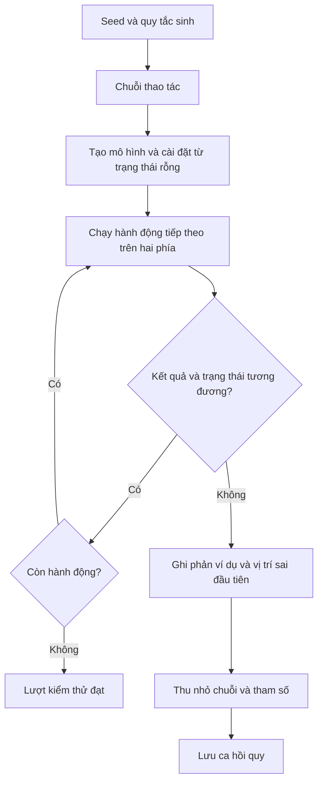

# Sinh ngẫu nhiên chuỗi thao tác và tìm trường hợp tối thiểu gây lỗi

Một cấu trúc dữ liệu thường đúng với những ví dụ được viết tay nhưng hỏng sau một chuỗi cập nhật ít ai nghĩ tới. Queue vòng có thể gặp lỗi khi chỉ số quấn qua đầu mảng; bảng băm có thể mất khóa sau chuỗi xóa rồi chèn lại; cây cân bằng có thể sai sau vài lần quay liên tiếp. Để phát hiện loại lỗi này, ta **sinh nhiều chuỗi thao tác hợp lệ hoặc có lỗi được đặc tả, chạy chúng trên cấu trúc cần kiểm thử và một mô hình tham chiếu**, rồi **thu nhỏ chuỗi gây lỗi** để hiểu nguyên nhân.

Đây là kỹ thuật kiểm thử dựa trên trạng thái (*stateful/model-based testing*), thường kết hợp với kiểm thử sinh dữ liệu (*property-based testing*) và *delta debugging*. Trong chương **Kiểm chứng và thực hành**, kỹ thuật này giúp kiểm tra bất biến, kết quả và độ bền của các cấu trúc dữ liệu trước khi đánh giá thời gian hoặc bộ nhớ.

Mục tiêu của bài là trả lời ba câu hỏi: sinh chuỗi thao tác thế nào để chạm được các tình huống khó; làm sao phát lại chính xác khi phát hiện lỗi; và làm sao biến một lịch sử dài hàng nghìn bước thành một phản ví dụ đủ ngắn để sửa và giữ làm kiểm thử hồi quy.

## 1. Vì sao phải sinh **chuỗi**, không chỉ sinh **đầu vào**?

Kiểm thử một lệnh `insert(x)` với giá trị ngẫu nhiên mới chỉ kiểm tra một điểm của không gian đầu vào. Cấu trúc dữ liệu có **trạng thái**: hành vi của lệnh tiếp theo phụ thuộc vào các lệnh đã thực hiện.

Ví dụ, với Queue vòng dung lượng `2`, chuỗi sau gây ra một trạng thái khác hoàn toàn với việc chỉ thêm hai phần tử:

```text
enqueue("A")    # ["A"]
enqueue("B")    # ["A", "B"] -- đầy
dequeue()       # ["B"]       -- head đã dịch
enqueue("C")    # ["B", "C"]  -- tail phải quấn về đầu mảng
```

Một lỗi tính vị trí `tail` có thể nằm im cho tới bước cuối. Vì vậy, một **ca kiểm thử** có thể được xem là dãy hành động:

\[
T = [a_1, a_2, \ldots, a_m]
\]

Mỗi hành động chứa tên phép toán và tham số, chẳng hạn `("enqueue", "A")` hoặc `("dequeue", None)`. Nếu \(S_0\) là trạng thái ban đầu thì:

\[
S_{i+1} = \operatorname{apply}(S_i, a_{i+1}).
\]

Ta cần kiểm tra **sau từng bước** để xác định lần đầu hai cách thực hiện bất đồng. So sánh duy nhất ở cuối chuỗi có thể bỏ sót lỗi đã bị che khuất bởi các thao tác sau đó.

### Điều gì được coi là lỗi?

Trước khi sinh dữ liệu, viết đặc tả cho kiểu dữ liệu trừu tượng (ADT). Một số tiêu chí kiểm tra:

| Loại sai lệch | Ví dụ với cấu trúc dữ liệu |
|---|---|
| Giá trị trả về | `dequeue()` lấy phần tử mới nhất thay vì phần tử đầu |
| Trạng thái logic | `remove(k)` xóa nhầm khóa khác hoặc làm mất một bản sao |
| Bất biến nội bộ | `size > capacity`, con trỏ liên kết đôi không nhất quán, heap có cha lớn hơn con |
| Hành vi lỗi | `pop()` khi rỗng không báo lỗi theo hợp đồng hoặc sửa trạng thái trước khi báo lỗi |
| Điều kiện khung | `Map.put(k,v)` vô tình thay đổi ánh xạ của khóa khác |
| Tiến triển và kết thúc | Một vòng duyệt danh sách liên kết bị lặp vô hạn vì tạo chu trình |

Ví dụ dưới đây dùng hợp đồng Queue **có giới hạn dung lượng**: thêm khi đầy ném `QueueFull`, lấy khi rỗng ném `QueueEmpty`, và hai đường lỗi đều giữ nguyên trạng thái. Các giá trị như `None` và giá trị trùng nhau được phép lưu. Nếu chọn chính sách khác như tự mở rộng hoặc chặn chờ, cả bộ sinh và bộ đối chiếu phải đổi theo.

## 2. Ba thành phần của bộ kiểm thử trạng thái

Một bộ kiểm thử có thể chia thành ba phần có trách nhiệm rõ ràng.

1. **Bộ sinh hành động (*generator*):** quyết định thao tác, tham số và số bước; nên có cách tập trung vào trạng thái rỗng, đầy, trùng, quấn vòng và nhiều cập nhật liên tiếp.
2. **Bộ dự đoán (*oracle/model*):** tính kết quả đúng theo hợp đồng. Mô hình nên đơn giản và độc lập với thuật toán tối ưu.
3. **Bộ chạy lại và so sánh (*runner*):** tạo trạng thái mới, thực hiện cùng chuỗi trên cả hai phía, so kết quả, trạng thái logic và bất biến sau **mỗi** hành động.



Không nên dùng **chính cài đặt đang kiểm tra** để dự đoán kết quả mong đợi. Ví dụ, dùng một bản sao của thuật toán vòng với cùng công thức `tail` sẽ có nguy cơ hai bên cùng sai. Với Queue, `collections.deque` là mô hình đơn giản và phù hợp để quan sát thứ tự FIFO.

## 3. Ví dụ: lỗi cố ý trong Queue vòng

Để thấy quá trình phát hiện và thu nhỏ lỗi hoạt động ra sao, ta tạo một Queue dùng mảng vòng dung lượng cố định `2`. Mã bên dưới **cố ý sai ở một dòng**; mục đích là dùng nó làm đối tượng kiểm thử.

### 3.1. Mô hình tham chiếu

```python
from collections import deque


class QueueEmpty(Exception):
    pass


class QueueFull(Exception):
    pass


class QueueModel:
    def __init__(self, capacity=2):
        if capacity < 1:
            raise ValueError("capacity phai duong")
        self.capacity = capacity
        self.items = deque()

    def __len__(self):
        return len(self.items)

    def enqueue(self, value):
        if len(self.items) == self.capacity:
            raise QueueFull()
        self.items.append(value)

    def dequeue(self):
        if not self.items:
            raise QueueEmpty()
        return self.items.popleft()

    def front(self):
        if not self.items:
            raise QueueEmpty()
        return self.items[0]

    def snapshot(self):
        return list(self.items)
```

`QueueModel` lưu một dãy logic, không biết tới `head`, `tail` hay modulo. Nhờ đó, nếu thuật toán chỉ số vòng sai, mô hình có cơ hội phát hiện mà không lặp lại lỗi.

### 3.2. Cài đặt có lỗi để thử nghiệm

```python
_EMPTY = object()


class BuggyRingQueue:
    def __init__(self, capacity=2):
        if capacity < 1:
            raise ValueError("capacity phai duong")
        self.cells = [_EMPTY] * capacity
        self.head = 0
        self.size = 0

    def __len__(self):
        return self.size

    def enqueue(self, value):
        capacity = len(self.cells)
        if self.size == capacity:
            raise QueueFull()

        # LOI CO Y: quen head.
        tail = self.size % capacity
        # Dung phai la: (self.head + self.size) % capacity.
        self.cells[tail] = value
        self.size += 1

    def dequeue(self):
        if self.size == 0:
            raise QueueEmpty()
        value = self.cells[self.head]
        self.cells[self.head] = _EMPTY
        self.head = (self.head + 1) % len(self.cells)
        self.size -= 1
        if self.size == 0:
            self.head = 0
        return value

    def front(self):
        if self.size == 0:
            raise QueueEmpty()
        return self.cells[self.head]

    def snapshot(self):
        c = len(self.cells)
        return [self.cells[(self.head + i) % c]
                for i in range(self.size)]

    def representation_ok(self):
        c = len(self.cells)
        if not (c >= 1 and 0 <= self.size <= c
                and 0 <= self.head < c):
            return False
        if self.size == 0 and self.head != 0:
            return False
        for i, value in enumerate(self.cells):
            active = (i - self.head) % c < self.size
            if (value is not _EMPTY) != active:
                return False
        return True
```

Với Queue logic, vị trí tiếp theo phải là:

\[
tail=(head+size)\bmod capacity.
\]

Dòng sai `tail = size % capacity` chỉ tình cờ đúng khi `head = 0`. Khi đã xóa phần tử đầu tiên nhưng Queue còn phần tử, `head` khác `0` và lệnh `enqueue` có thể ghi đè ô đang chứa dữ liệu.

Ví dụ `enqueue(A)`, `enqueue(B)`, `dequeue()`, `enqueue(C)` với dung lượng `2`: sau bước ba, `head = 1`, `size = 1`, ô `1` chứa `B`, còn ô `0` trống. Dòng sai ghi `C` vào ô `1`, làm mất `B`. Mô hình mong đợi `["B", "C"]`; biểu diễn lỗi cho ảnh chụp `[ "C", _EMPTY ]`.

Lưu ý dấu `_EMPTY` là đối tượng sentinel **khác `None`**. Nhờ thế, người dùng vẫn có thể `enqueue(None)` mà bộ kiểm tra không hiểu nhầm nó là ô trống.

## 4. Chạy lại một chuỗi và xác định bước sai đầu tiên

Bộ chạy chuẩn hóa hai loại kết quả: `("ok", value)` khi thành công và `("error", ExceptionName)` khi báo lỗi. Bằng cách này, thao tác lỗi khi rỗng/đầy cũng trở thành một phần của dữ liệu kiểm thử.

```python
class Mismatch(AssertionError):
    def __init__(self, step, operation, kind, expected, actual):
        self.step = step
        self.operation = operation
        self.kind = kind
        self.expected = expected
        self.actual = actual
        super().__init__(
            f"step={step}; op={operation}; kind={kind}; "
            f"expected={expected!r}; actual={actual!r}"
        )

    @property
    def signature(self):
        # Dau hieu loi de bao toan trong qua trinh thu nho.
        return (self.kind, self.operation)


def invoke(target, operation, value):
    try:
        if operation == "enqueue":
            target.enqueue(value)
            return ("ok", None)
        if operation == "dequeue":
            return ("ok", target.dequeue())
        if operation == "front":
            return ("ok", target.front())
        raise ValueError(f"thao tac khong biet: {operation}")
    except Exception as error:
        return ("error", type(error).__name__)


def replay(operations, capacity=2):
    model = QueueModel(capacity)
    actual_queue = BuggyRingQueue(capacity)

    for step, (operation, value) in enumerate(operations, start=1):
        expected = invoke(model, operation, value)
        actual = invoke(actual_queue, operation, value)

        if actual != expected:
            raise Mismatch(step, operation, "result", expected, actual)

        expected_state = model.snapshot()
        actual_state = actual_queue.snapshot()
        if actual_state != expected_state:
            raise Mismatch(
                step, operation, "state",
                expected_state, actual_state
            )

        if not actual_queue.representation_ok():
            raise Mismatch(
                step, operation, "invariant",
                True, False
            )

    return True
```

`replay` **luôn khởi tạo lại** mô hình và cài đặt từ trạng thái ban đầu. Đây là điều kiện bắt buộc khi thu nhỏ: mỗi chuỗi ứng viên phải được chạy trong môi trường sạch, nếu không các lần thử trước sẽ làm sai kết quả lần sau.

Ở đây việc bắt `Exception` được dùng riêng trong **bộ kiểm thử**, để biến cả ngoại lệ không mong đợi thành kết quả quan sát được và so với mô hình. Trong mã sản phẩm, không nên bắt rộng rồi bỏ qua lỗi. Với kiểm thử thực tế, cũng nên tách ngoại lệ nội bộ bất thường thành loại sai lệch riêng để báo cáo rõ hơn.

Thử ngay một phản ví dụ đã biết:

```python
known_failure = [
    ("enqueue", "A"),
    ("enqueue", "B"),
    ("dequeue", None),
    ("enqueue", "C"),
]

try:
    replay(known_failure)
except Mismatch as error:
    print(error)
```

Bất đồng được phát hiện **ngay tại thao tác thứ tư** dưới dạng sai trạng thái logic. Nếu chỉ kiểm tra các giá trị trả về của `enqueue` (đều là `None` khi thành công), lỗi sẽ chưa bị phát hiện. So ảnh chụp và bất biến sau mỗi bước rút ngắn đường tìm nguyên nhân.

Bộ chạy trên chỉ hỗ trợ một số thao tác đã định nghĩa. Trong công cụ thực tế, nên từ chối thao tác không biết **trước khi** thử trên hai phía để lỗi của bộ sinh không bị xem nhầm thành một kết quả lỗi hợp lệ.

## 5. Sinh chuỗi ngẫu nhiên có chủ đích

Bộ sinh hoàn toàn ngẫu nhiên thường dành phần lớn thời gian ở một vài trạng thái phổ biến. Ví dụ, nếu 90% thao tác là `enqueue` trên Queue dung lượng nhỏ, ta sẽ liên tục gặp trường hợp đầy và hầu như không thử quấn vòng. **Sinh có nhận biết trạng thái** giúp đi vào nhánh quan trọng mà vẫn chứa tính ngẫu nhiên.

Cách thực hiện là dùng một **mô hình riêng bên trong bộ sinh** để biết Queue đang rỗng, đầy hay còn chỗ. Sau khi chọn thao tác, cập nhật mô hình đó; bộ kiểm thử chính sẽ khởi tạo trạng thái mới khi phát lại chuỗi.

```python
from random import Random


def generate_trace(seed, steps, capacity=2):
    rng = Random(seed)
    planner = QueueModel(capacity)
    history = []

    for _ in range(steps):
        r = rng.random()

        if len(planner) == 0:
            # Chu yeu them; thinh thoang co tinh thu loi rong.
            operation = "dequeue" if r < 0.15 else "enqueue"
        elif len(planner) == capacity:
            # Thu loi day, doc dau va lay di de tao cho trong.
            if r < 0.15:
                operation = "enqueue"
            elif r < 0.35:
                operation = "front"
            else:
                operation = "dequeue"
        else:
            if r < 0.55:
                operation = "enqueue"
            elif r < 0.85:
                operation = "dequeue"
            else:
                operation = "front"

        value = (
            rng.choice([None, -1, 0, 0, 1, 2])
            if operation == "enqueue"
            else None
        )
        action = (operation, value)
        history.append(action)

        # Cap nhat duy nhat mo hinh lap ke hoach.
        invoke(planner, operation, value)

    return history
```

`Random(seed)` cho phép phát lại cùng chuỗi khi dùng cùng seed và cùng phiên bản bộ sinh. Seed **không đủ** nếu sau này ta thay đổi thuật toán sinh, trọng số, phạm vi giá trị hoặc cách tiêu thụ số ngẫu nhiên. Vì vậy, với lỗi đã xuất hiện, hãy lưu **toàn bộ chuỗi thao tác đã sinh** cùng seed và phiên bản bộ sinh.

Bộ sinh trên cố tình tạo thử `dequeue` khi rỗng và `enqueue` khi đầy. Điều này hợp lệ vì hợp đồng định nghĩa rõ các lỗi `QueueEmpty` và `QueueFull`. Nếu ADT chỉ định **tiền điều kiện bắt buộc** và không quy định hành vi ngoài miền, cần loại hoặc đánh dấu các lời gọi không hợp lệ, tránh xem hành vi không được đặc tả là một lỗi của cài đặt.

Một lượt chạy ngẫu nhiên:

```python
seed = 2026
history = generate_trace(seed=seed, steps=1000, capacity=2)

try:
    replay(history, capacity=2)
    print("Khong tim thay bat dong trong luot thu")
except Mismatch as error:
    print("Seed:", seed)
    print("Buoc sai dau:", error.step)
    print("Dau hieu:", error.signature)
    print("So thao tac da sinh:", len(history))
    print("Tien to gay loi:", history[:error.step])
```

Một lượt 1.000 bước không phát hiện lỗi **không chứng minh** cấu trúc đúng với mọi chuỗi. Hãy thử nhiều seed, thêm các chuỗi cố định cho nhánh khó, và giữ lại mọi chuỗi đã gây lỗi để chạy hồi quy.

### Sinh dữ liệu nào có giá trị cao?

| Cấu trúc | Thao tác nên sinh đan xen | Trạng thái cần chủ động tạo |
|---|---|---|
| Mảng động | `append`, `pop`, `insert`, `remove_at`, `get` | `size = 0, 1, capacity - 1, capacity`; giãn/thu dung lượng |
| Stack / Queue / Deque | Thêm, lấy, xem đầu/đỉnh | Rỗng, một phần tử, trùng, quấn vòng |
| Bảng băm / Map | `put`, `get`, `remove`, `contains` | Khóa trùng, giá trị `None`, va chạm băm, tombstone, rehash |
| BST / cây cân bằng | `insert`, `delete`, `find` | Xóa gốc, xóa nút một/hai con, quay trái/phải |
| Heap | `push`, `peek_min`, `pop_min` | Khóa trùng, phần tử âm, rỗng, giảm kích thước |
| DSU | `union`, `find`, `connected` | Gộp hai tập đã nối, nhiều phép nén đường |
| Đồ thị | Thêm/xóa đỉnh/cạnh, truy vấn láng giềng/liên thông | Đỉnh cô lập, chu trình, cạnh trùng nếu được hỗ trợ |
| Fenwick/Segment Tree | Cập nhật và truy vấn đoạn | Đoạn rỗng, đầu/cuối miền, nhiều cập nhật cùng vị trí |

**Độ phủ thao tác** không đủ để kết luận đã thử đúng nhánh: có thể gọi `enqueue` hàng nghìn lần mà không bao giờ gọi trong trạng thái `head != 0` và chưa đầy. Nên ghi số lần đạt các trạng thái đáng chú ý như `empty`, `full`, `wrapped`, `duplicate` và `resized`, rồi điều chỉnh bộ sinh để đạt chúng.

## 6. Thu nhỏ chuỗi gây lỗi bằng delta debugging

Một lịch sử lỗi dài 1.000 thao tác rất khó đọc. Ta muốn giữ lại một chuỗi **ngắn hơn nhưng vẫn gây cùng kiểu thất bại**. Quy trình này thường gọi là *shrinking* hoặc *test-case reduction*.

Một kỹ thuật cơ bản là **delta debugging**: chia chuỗi thành nhiều đoạn, thử bỏ từng đoạn, rồi chạy lại từ đầu. Nếu bỏ đoạn mà lỗi vẫn còn, ta giữ chuỗi ngắn hơn. Nếu chưa bỏ được, chia nhỏ hơn và thử lại.

Với bài toán Queue, gọi `fails_same_way(T, signature)` là đúng khi `T` gây sai lệch có cùng loại và cùng thao tác phát hiện. Việc giữ **dấu hiệu lỗi** giúp tránh rút gọn về một lỗi hoàn toàn khác không liên quan đến vấn đề đang sửa.

```python
def first_failure(operations):
    try:
        replay(operations)
    except Mismatch as error:
        return error
    return None


def fails_same_way(operations, signature):
    error = first_failure(operations)
    return error is not None and error.signature == signature


def ddmin(operations):
    initial = first_failure(operations)
    if initial is None:
        raise ValueError("chuoi ban dau khong gay sai lech")

    signature = initial.signature
    current = list(operations)
    groups = 2

    while len(current) >= 2:
        block_size = (len(current) + groups - 1) // groups
        reduced = False

        for start in range(0, len(current), block_size):
            candidate = (
                current[:start] + current[start + block_size:]
            )
            if fails_same_way(candidate, signature):
                current = candidate
                groups = max(2, groups - 1)
                reduced = True
                break

        if reduced:
            continue
        if groups >= len(current):
            break
        groups = min(len(current), groups * 2)

    return current
```

Dòng quan trọng là **chạy lại** mỗi `candidate` trên cấu trúc mới. Không được chỉ xóa phần tử khỏi bản ghi rồi tiếp tục dùng trạng thái sau khi đã chạy chuỗi dài hơn.

Thử với chuỗi biết trước:

```python
short_trace = ddmin(known_failure)

print(short_trace)
# [
#   ("enqueue", "A"),
#   ("enqueue", "B"),
#   ("dequeue", None),
#   ("enqueue", "C"),
# ]
```

Trong ví dụ này, nếu bỏ bất kỳ thao tác đơn lẻ nào, ta không còn tái hiện cùng bất đồng ở bước `enqueue`. Dãy bốn bước là phản ví dụ nhỏ, dễ diễn giải: cần có hai phần tử, xóa một để `head` dịch sang ô khác, rồi thêm lại khi còn chỗ.

### “Tối thiểu” có nghĩa chính xác là gì?

Thuật toán trên tìm một chuỗi **không thể tiếp tục giảm bằng các phép xóa nhóm mà nó đã thử**. Khi hoàn tất với kiểm tra từng phần tử, kết quả là *1-minimal* theo tiêu chí xóa: không thể xóa **một** thao tác mà vẫn giữ cùng dấu hiệu lỗi. Nó **không bảo đảm** tìm được chuỗi ngắn nhất trên toàn bộ mọi lịch sử có thể có. Để khẳng định tối ưu toàn cục cần thêm giả thiết hoặc tìm kiếm bao quát hơn.

Số lần chạy lại phụ thuộc cách lỗi tồn tại sau khi xóa và cách tăng số nhóm. Trong trường hợp khó, số phép thử có thể lớn, và mỗi phép thử lại tốn thời gian tỷ lệ với chiều dài chuỗi cùng chi phí cấu trúc. Nên đặt giới hạn số bước hoặc thời gian cho bộ thu nhỏ trong hệ thống kiểm thử quy mô lớn.

## 7. Thu nhỏ cả **giá trị tham số**

Xóa thao tác mới chỉ thu nhỏ một phần phản ví dụ. Một chuỗi như:

```text
enqueue(994102)
enqueue(-71354)
dequeue()
enqueue(680901)
```

có thể được đơn giản hóa thành các giá trị nhỏ hơn nếu vẫn gây cùng lỗi, ví dụ `enqueue(0)`, `enqueue(1)`, `dequeue()`, `enqueue(2)`.

Với Queue vòng ở trên, lỗi **không phụ thuộc giá trị cụ thể**, nên có thể thử các giá trị cơ bản. Một phiên bản minh họa:

```python
def shrink_values(operations):
    initial = first_failure(operations)
    if initial is None:
        raise ValueError("khong co loi de thu nho")

    signature = initial.signature
    current = list(operations)

    for i, (operation, original) in enumerate(current):
        if operation != "enqueue":
            continue

        for replacement in (0, 1, None):
            if replacement == original:
                continue

            candidate = list(current)
            candidate[i] = ("enqueue", replacement)
            if fails_same_way(candidate, signature):
                current = candidate
                break

    return current
```

Đây là một **bộ đơn giản hóa tham số nhỏ**, không phải thuật toán đảm bảo tìm giá trị đơn giản nhất. Khi thử từng tham số, ta luôn chạy lại từ đầu và chỉ nhận sự thay đổi giữ được cùng dấu hiệu lỗi. Với dữ liệu có khóa hoặc cấu trúc liên kết, việc đơn giản hóa còn phải giữ quan hệ quan trọng: hai khóa nào bằng nhau, hai khóa nào va chạm băm, cạnh nào nối tới đỉnh nào.

Một quy trình có thể áp dụng:

```python
failure = first_failure(history)
if failure is not None:
    prefix = history[:failure.step]
    reduced = ddmin(prefix)
    reduced = shrink_values(reduced)
    reduced = ddmin(reduced)
    print("Ca loi rut gon:", reduced)
```

Lấy **tiền tố đến bước sai đầu tiên** trước khi thu nhỏ giúp loại bỏ ngay mọi thao tác xảy ra sau lỗi. Việc chạy nhiều vòng xóa thao tác và đơn giản hóa tham số có thể giảm tiếp nhưng phải luôn đối chiếu bằng cùng điều kiện lỗi.

### Khi nào việc thu nhỏ trở nên khó?

- **Tiền điều kiện:** xóa `insert(k)` trước một `delete(k)` có thể khiến `delete` không còn hợp lệ. Nếu hợp đồng không định nghĩa lỗi này, phải loại chuỗi ứng viên hoặc sửa bộ sinh để đảm bảo hợp lệ.
- **Tính phụ thuộc tham số:** xóa thao tác tạo đỉnh khiến các thao tác thêm cạnh tiếp theo không còn ý nghĩa; cần giảm đồng thời tập đỉnh/cạnh hoặc cập nhật tham chiếu.
- **Lỗi không ổn định:** lỗi do nhiều luồng, thời gian, hệ thống ngoài hoặc ngẫu nhiên không được cố định có thể biến mất ở lần phát lại. Thu nhỏ khi lỗi không ổn định sẽ cho kết quả thiếu tin cậy.
- **Lỗi khác thay thế:** xóa vài bước có thể tạo ra một lỗi mới ở chỗ khác. Dấu hiệu `(loại sai lệch, thao tác)` chỉ là bộ lọc sơ bộ; trong thực tế có thể thêm loại ngoại lệ, invariant bị phá hoặc vị trí lỗi để giữ đúng nguyên nhân.
- **Dữ liệu quá lớn:** mỗi lần phát lại và so toàn bộ trạng thái rất tốn kém. Có thể thử trên quy mô nhỏ, giảm số thao tác đọc và đặt ngân sách cho quá trình thu nhỏ.

## 8. Đảm bảo kiểm thử tái hiện được

Một bộ kiểm thử ngẫu nhiên hữu ích phải cho phép người khác **chạy lại đúng ca đã thất bại**. Ghi rõ những thông tin sau:

| Thông tin cần lưu | Tác dụng |
|---|---|
| Seed và phiên bản bộ sinh | Tái tạo lại chuỗi ban đầu khi mã sinh không thay đổi |
| Toàn bộ chuỗi thao tác | Phát lại độc lập với bộ sinh ở tương lai |
| Tham số cấu trúc | Dung lượng, chế độ so sánh khóa, quy ước chỉ số |
| Bước sai đầu tiên | Khoanh vùng cập nhật vừa phá trạng thái |
| Kết quả kỳ vọng và thực tế | Biết dạng sai lệch, không chỉ thấy “test fail” |
| Chuỗi đã thu nhỏ | Tạo ca hồi quy ngắn, dễ đọc và duy trì |
| Môi trường liên quan | Phiên bản chương trình, hệ điều hành nếu có ảnh hưởng, luồng/ngẫu nhiên phụ |

Một ví dụ lưu ca hồi quy **thành mã kiểm thử**:

```python
def test_wraparound_regression():
    sequence = [
        ("enqueue", "A"),
        ("enqueue", "B"),
        ("dequeue", None),
        ("enqueue", "C"),
    ]
    replay(sequence)
```

Bài kiểm thử này sẽ **thất bại có chủ đích** khi sử dụng `BuggyRingQueue`. Sau khi sửa dòng `tail = (self.head + self.size) % capacity`, nó phải đạt và nên được giữ lại để chống tái phát.

Trong dự án thật, đổi `BuggyRingQueue` trong `replay` thành cấu trúc đang phát triển và chạy kiểm thử hồi quy với **phiên bản đã sửa**. Không phải chỉ kiểm tra “không ném ngoại lệ”: hãy giữ các so sánh trạng thái, kết quả và bất biến.

## 9. Kết hợp ca cố định, sinh ngẫu nhiên và kiểm thử thuộc tính

Ba nguồn kiểm thử có mục đích khác nhau:

| Cách kiểm thử | Điểm mạnh | Giới hạn |
|---|---|---|
| Ca biên viết tay | Nhắm chính xác rỗng, đầy, một phần tử, chỉ số biên | Khó bao quát vô số trình tự |
| Chuỗi ngẫu nhiên có seed | Khám phá nhiều cách đan xen thao tác | Có thể bỏ qua nhánh hiếm; phụ thuộc bộ sinh |
| Thuộc tính và mô hình | Kiểm tra quy tắc tổng quát sau từng bước | Mô hình/thuộc tính có thể thiếu hoặc sai |

Một số **thuộc tính độc lập** nên kiểm tra cùng bộ đối chiếu:

- Stack: sau `push(x)` rồi `pop()`, trạng thái logic trở về như ban đầu; phần tử trả về là `x`.
- Queue: các phần tử lấy ra phải theo thứ tự đưa vào, bỏ qua những lời gọi bị từ chối theo hợp đồng đầy/rỗng.
- Map: `put(k,v)` rồi `get(k)` trả `v`, các khóa khác giữ nguyên; ghi đè không tăng số khóa.
- Heap: mọi cha không lớn hơn con; `pop_min` trả phần tử nhỏ nhất trước khi xóa; phần tử trùng chỉ bị xóa một lần.
- Cây tìm kiếm: duyệt theo thứ tự tăng phải tương đương dữ liệu đã chèn sau khi tính đến chính sách khóa trùng.
- Đồ thị: nếu là vô hướng và biểu diễn hai chiều, thêm cạnh `(u,v)` phải được phản ánh ở cả danh sách kề `u` và `v`.

Các thuộc tính không thay thế mô hình: một heap sau `pop_min` có thể vẫn thỏa thứ tự heap nhưng đã làm mất một phần tử không liên quan. Vì vậy, cần kiểm tra cả **bất biến biểu diễn** lẫn **trạng thái trừu tượng**.

### Kiểm thử hiệu năng là một bước riêng

Bộ kiểm thử mô hình thường sao chép hoặc duyệt toàn bộ dữ liệu sau từng bước, tốn `O(n)` hoặc hơn mỗi lần. Không nên đo hiệu năng cấu trúc dữ liệu trong lúc bật các kiểm tra đó. Một lần `enqueue` trên Queue vòng cố định vốn là `O(1)`, nhưng kiểm tra mọi ô của bộ đệm có thể tốn `O(capacity)`.

Dùng bộ sinh cho tính đúng đắn trên dữ liệu nhỏ và trung bình; khi đo thời gian/bộ nhớ, tắt kiểm tra chẩn đoán, dùng khối lượng thực tế, và phân biệt độ phức tạp trung bình, kỳ vọng, khấu hao và xấu nhất.

## 10. Bài tập tự kiểm tra

**Bài 1 — Thu nhỏ chuỗi Queue.** Với `BuggyRingQueue(2)`, xét:

```text
enqueue(X), dequeue(), enqueue(A), enqueue(B),
front(), dequeue(), enqueue(C), front()
```

Hãy tìm tiền tố đầu tiên gây sai khác rồi dùng nguyên tắc bỏ thao tác để rút ngắn.

*Gợi ý:* hai thao tác đầu đưa Queue về rỗng; sau đó `enqueue(A)`, `enqueue(B)`, `dequeue()`, `enqueue(C)` đủ để thấy lỗi. Do đó một phản ví dụ ngắn có bốn cập nhật. `front()` có thể bỏ nếu đã so trạng thái sau mỗi bước. Khi thu nhỏ, vẫn phải **chạy lại** mỗi ứng viên; việc chỉ nhìn lịch sử chưa thay thế được kiểm chứng.

**Bài 2 — Thiết kế bộ sinh cho HashMap.** Hãy viết danh sách thao tác `put(k,v)`, `get(k)`, `remove(k)`, `contains(k)` với một tập khóa nhỏ để có nhiều khóa trùng, và một nhóm khóa khác nhau nhưng cùng giá trị băm.

*Gợi ý:* ưu tiên chọn lại khóa đã có trong Map ở nhiều bước; chủ động đưa Map tới ngưỡng tái băm; thường xuyên xóa rồi thêm lại. Mô hình là `dict`, nhưng phải xác định cách báo lỗi khi khóa không tồn tại. Không được coi hai khóa có cùng `hash` là cùng một khóa.

**Bài 3 — Thu nhỏ giá trị.** Một cây tìm kiếm bị lỗi với khóa `1007`, `-230`, `18`, `55`. Hãy đề xuất các giá trị nhỏ hơn mà vẫn giữ quan hệ thứ tự giữa các khóa.

*Gợi ý:* sắp xếp các khóa trước, rồi có thể ánh xạ theo thứ hạng thành `0`, `1`, `2`, `3`. Chỉ dùng cách này nếu lỗi không phụ thuộc vào giá trị tuyệt đối, phép băm hoặc giới hạn số nguyên; luôn chạy lại sau mỗi phép biến đổi.

**Bài 4 — Phản ví dụ không ổn định.** Một bài kiểm thử 1.000 thao tác chỉ thất bại 1/20 lần với cùng seed. Có nên chạy `ddmin` ngay không?

*Gợi ý:* trước tiên xác định nguồn không ổn định như truy cập đồng thời, thời điểm, dữ liệu chia sẻ hoặc ngẫu nhiên ngoài bộ sinh. Thu nhỏ chỉ đáng tin khi có tiêu chí tái hiện rõ; với lỗi xác suất, cần kiểm tra lặp và dùng tiêu chí xác suất thay vì một lần chạy duy nhất.

## 11. Quy trình áp dụng vào dự án

1. **Viết hợp đồng** cho từng thao tác, gồm lỗi, trạng thái sau lỗi và quy tắc về phần tử/khóa trùng.
2. **Tạo mô hình đơn giản** với biểu diễn khác cài đặt cần thử; kiểm chứng vài ca bằng tay.
3. **Viết runner khởi tạo sạch** và so kết quả, trạng thái logic cùng bất biến sau từng thao tác.
4. **Thêm ca biên cố định:** rỗng, một phần tử, đầy, quấn vòng, xóa rồi chèn, thay đổi dung lượng.
5. **Sinh nhiều chuỗi có seed**, điều chỉnh trọng số theo trạng thái và đo nhánh đã đi qua.
6. **Khi phát hiện lỗi**, lưu chuỗi, đầu vào, seed, bước sai đầu tiên và kết quả hai phía.
7. **Thu nhỏ phản ví dụ:** bỏ phần hậu tố, áp dụng delta debugging, đơn giản hóa tham số, chạy lại.
8. **Sửa lỗi và lưu ca hồi quy** ngắn bên cạnh bộ kiểm thử ngẫu nhiên.
9. **Chạy kiểm tra hiệu năng riêng** sau khi đã xác nhận đúng đắn ở phạm vi kiểm thử mong muốn.

Kỹ thuật sinh ngẫu nhiên chuỗi thao tác giúp khám phá những trạng thái khó dự đoán; kỹ thuật thu nhỏ giúp giải thích chúng. Một báo cáo lỗi kiểu “sai sau 2.000 thao tác” sẽ hữu ích hơn nhiều khi trở thành **bốn thao tác có thể phát lại, một bất biến bị phá và một dòng cập nhật chỉ số cần sửa**.
