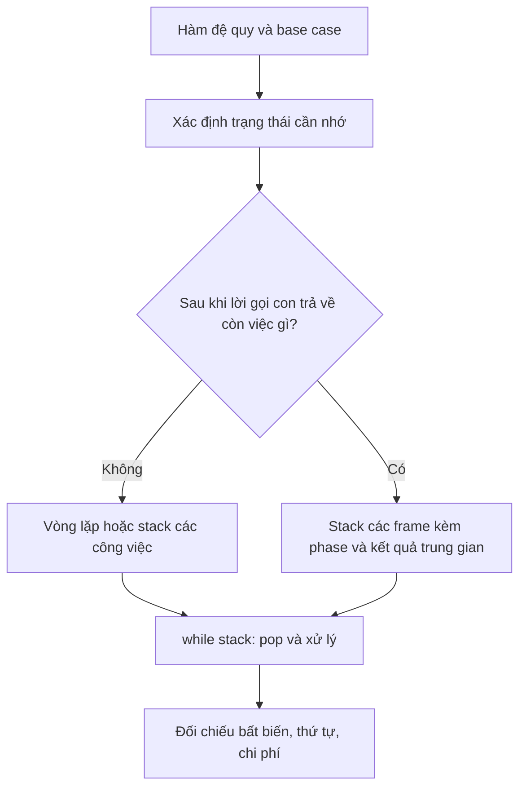

# Đổi đệ quy thành ngăn xếp tường minh

## 1. Vấn đề: đệ quy đang lưu trạng thái ở đâu?

Trong học phần **Cấu trúc dữ liệu**, ngăn xếp (stack) là một **kiểu dữ liệu trừu tượng** tuân theo nguyên tắc **LIFO (Last In, First Out)**: phần tử vào sau cùng được lấy ra trước. Khi thực hiện `push(x)`, ta thêm một phần tử lên đỉnh; khi `pop()`, ta lấy và loại bỏ phần tử đỉnh; `peek()` cho phép xem đỉnh mà không xóa.

**Đệ quy (recursion)** là kỹ thuật hàm gọi lại chính nó hoặc gọi qua một chuỗi hàm rồi trở về nó. Mỗi lời gọi chưa hoàn thành cần ghi nhớ tham số, biến cục bộ, nơi phải tiếp tục chạy và dữ liệu trung gian. Mô hình này thường được giải thích bằng **ngăn xếp lời gọi (call stack)**: lời gọi mới nằm trên cùng, và lời gọi sâu nhất thường kết thúc trước.

**Chuyển đệ quy thành ngăn xếp tường minh (explicit stack)** nghĩa là thay những lời gọi hàm lồng nhau bằng vòng lặp cùng một cấu trúc stack do chương trình tự quản lý. Các trạng thái còn phải xử lý trở thành **phần tử của stack**, thay vì phụ thuộc vào chuỗi khung gọi hàm của runtime.

Ví dụ, khi duyệt một cây nhị phân:

```text
                    A
                   / \
                  B   C
                 / \
                D   E

Đệ quy preorder:    visit(A)
                      visit(B)
                        visit(D)
                        visit(E)
                      visit(C)

Công việc chưa làm khi đang ở D:
    quay lại B để xử lý E
    quay lại A để xử lý C
```

Nếu dùng stack tường minh, ta lưu các nút hoặc công việc chưa làm vào một danh sách. Vì stack LIFO, công việc được thêm sau sẽ được xử lý trước. Việc chọn **phần tử cần lưu, thứ tự thêm và thời điểm đánh dấu đã xử lý** quyết định thuật toán lặp có giữ đúng hành vi đệ quy ban đầu hay không.

Chủ đề này kết nối các kiến thức về **ngăn xếp, cây, đồ thị, bất biến, độ phức tạp thời gian và bộ nhớ**. Mục tiêu không chỉ là viết vòng lặp thay cho hàm đệ quy mà còn hiểu **trạng thái nào đang được call stack lưu hộ** để có thể thay thế một cách chính xác.

## 2. Phân biệt ba kiểu chuyển đổi

Không phải mọi hàm đệ quy đều cần một stack tường minh phức tạp. Hãy phân loại dựa trên công việc còn lại sau lời gọi con.

| Dạng đệ quy | Điều kiện hoặc đặc điểm | Hướng chuyển đổi |
|---|---|---|
| Đệ quy đuôi đơn giản | Lời gọi đệ quy là hành động cuối; sau khi trả về không còn tính toán | Có thể dùng vòng lặp và một số biến trạng thái |
| Duyệt chỉ cần danh sách việc chờ | Mỗi trạng thái xử lý xong trước khi thêm các trạng thái kế tiếp | Dùng stack chứa các **nút/công việc** |
| Đệ quy cần quay lại xử lý tiếp | Sau khi lời gọi con hoàn thành, hàm cha còn việc phải làm hoặc cần kết quả con | Dùng **khung trạng thái (frame)** chứa vị trí tiếp tục và biến trung gian |

Ví dụ:

```python
# Đệ quy đuôi: sau lời gọi con không làm gì thêm.
def countdown(n):
    if n <= 0:
        return
    print(n)
    return countdown(n - 1)


# Cần kết quả từ lời gọi con để tính tiếp.
def factorial(n):
    if n == 0:
        return 1
    return n * factorial(n - 1)
```

Với `countdown`, chỉ cần biến `n` và vòng `while`. Với `factorial`, mỗi lời gọi đang chờ phép nhân `n * ...`; nếu muốn mô phỏng chính xác tiến trình gọi và trả về, ta cần giữ lại `n` và thông tin rằng phép nhân còn chưa thực hiện.

**Quy tắc chung:** trước khi xóa một lời gọi đệ quy, xác định **cái gì còn phải nhớ sau lời gọi đó**. Nếu dữ liệu này chưa được lưu ở đâu, biến đổi thành vòng lặp có nguy cơ làm mất thông tin.

## 3. Quy trình sáu bước để chuyển đổi

1. **Xác định trường hợp cơ sở.** Khi nào thuật toán dừng và trả kết quả trực tiếp? Với cây, đó thường là nút `None`; với giai thừa là `n = 0`.
2. **Liệt kê trạng thái của một lần gọi.** Bao gồm tham số, biến cục bộ cần giữ, công việc còn lại sau lời gọi con và giá trị trả về nếu có.
3. **Thiết kế phần tử của stack.** Chọn lưu một nút đơn giản, một cặp `(node, phase)` hoặc một frame chứa `(tham_số, vị_trí_tiếp_tục, dữ_liệu_trung_gian)`.
4. **Thay lời gọi đệ quy bằng `push`.** Khi xử lý một trạng thái, đặt các công việc con cần làm lên stack theo **thứ tự ngược** với thứ tự muốn chúng được xử lý.
5. **Dùng vòng `while` để `pop` và xử lý.** Tại mỗi vòng lặp, thực hiện đúng một bước logic của hàm gốc; nếu cần quay lại sau lời gọi con, lưu một frame ở trạng thái “tiếp tục”.
6. **Kiểm tra bất biến, kết quả và độ phức tạp.** Đối chiếu thứ tự thăm, kết quả trả về, cách xử lý đầu vào rỗng và các trường hợp cây/đồ thị sâu.

Có thể hình dung sơ đồ biến đổi:



Ở mỗi bước, đừng chỉ nhìn *tên* của hàm đệ quy. Hãy nhìn **luồng điều khiển**: lúc nào đi vào một bài toán con, lúc nào trở về và việc nào phải được thực hiện sau khi trở về.

## 4. Trường hợp đơn giản: đổi đệ quy đuôi thành vòng lặp

Giả sử hàm cần in các số từ `n` về `1`:

```python
def countdown_recursive(n):
    if n <= 0:
        return
    print(n)
    countdown_recursive(n - 1)
```

Hàm này không cần làm thêm việc gì sau khi gọi `countdown_recursive(n - 1)`. Có thể thay bằng:

```python
def countdown_iterative(n):
    while n > 0:
        print(n)
        n -= 1

countdown_iterative(3)
# 3
# 2
# 1
```

Trong mô hình phân tích thông thường, cả hai phiên bản thực hiện `O(n)` bước nếu `n ≥ 0`. Phiên bản đệ quy có tối đa `O(n)` lời gọi hoạt động; phiên bản vòng lặp chỉ cần `O(1)` biến trạng thái phụ.

**Không nhất thiết phải sử dụng stack tường minh** khi có thể giữ toàn bộ trạng thái bằng vài biến mà vẫn bảo toàn kết quả. Đây là một cách tối ưu hóa chuyển đổi, đặc biệt hữu ích khi độ sâu lớn.

Tuy nhiên, việc một lời gọi nằm ở cuối hàm không bảo đảm mọi ngôn ngữ đều tự tối ưu đệ quy đuôi. Với **Python**, không nên giả định đệ quy đuôi tự động dùng bộ nhớ hằng số.

## 5. Stack các nút: đổi duyệt cây preorder

Duyệt cây nhị phân theo thứ tự **preorder** có quy tắc:

1. Xử lý nút hiện tại.
2. Duyệt cây con trái.
3. Duyệt cây con phải.

### Phiên bản đệ quy

```python
class Node:
    def __init__(self, value, left=None, right=None):
        self.value = value
        self.left = left
        self.right = right


def preorder_recursive(root):
    if root is None:
        return []

    return (
        [root.value]
        + preorder_recursive(root.left)
        + preorder_recursive(root.right)
    )


root = Node("A",
            Node("B", Node("D"), Node("E")),
            Node("C"))

print(preorder_recursive(root))  # ['A', 'B', 'D', 'E', 'C']
```

Hàm trên dùng phép nối danh sách để minh họa cú pháp; với cây lớn, việc tạo và nối nhiều danh sách trung gian có thể làm tăng chi phí thời gian và bộ nhớ. Khi chỉ cần thăm mỗi nút một lần, thường nên bổ sung phần tử vào một danh sách kết quả được dùng chung hoặc xử lý ngay tại nút, như phiên bản lặp dưới đây.

### Phiên bản dùng stack tường minh

```python
def preorder_iterative(root):
    if root is None:
        return []

    stack = [root]
    result = []

    while stack:
        node = stack.pop()
        result.append(node.value)

        # LIFO: push phải trước để trái được pop trước.
        if node.right is not None:
            stack.append(node.right)
        if node.left is not None:
            stack.append(node.left)

    return result


print(preorder_iterative(root))  # ['A', 'B', 'D', 'E', 'C']
```

Điểm quan trọng nhất là **thứ tự push ngược thứ tự xử lý**. Nếu thêm nút trái trước rồi mới thêm nút phải, nút phải sẽ nằm ở đỉnh và bị xử lý trước, trái với preorder mong muốn.

Theo dõi ví dụ, quy ước **bên phải là đỉnh stack**:

| Bước | Nút lấy từ stack | Stack sau khi thêm con | Kết quả |
|---:|---|---|---|
| Khởi tạo | — | `[A]` | `[]` |
| 1 | `A` | `[C, B]` | `[A]` |
| 2 | `B` | `[C, E, D]` | `[A, B]` |
| 3 | `D` | `[C, E]` | `[A, B, D]` |
| 4 | `E` | `[C]` | `[A, B, D, E]` |
| 5 | `C` | `[]` | `[A, B, D, E, C]` |

### Bất biến của vòng lặp

Tại đầu mỗi lượt `while`, stack chứa những nút đã phát hiện nhưng **chưa xử lý**, theo thứ tự LIFO. `result` chứa chính xác các nút đã được xử lý. Khi lấy một nút, ta ghi kết quả trước rồi đưa các con vào stack sao cho cây con trái được xử lý trước cây con phải.

Với cây có `N` nút, mỗi nút được thêm và lấy khỏi stack đúng một lần. Do đó thời gian xử lý của bản lặp là **`O(N)`**; stack các nút chờ dùng **`O(h)`** bộ nhớ phụ với cây nhị phân có chiều cao `h`, nếu không tính danh sách kết quả `O(N)`. Về mặt mô hình, một đường đi sâu dài `h` có thể tạo `O(h)` nút chờ là các nhánh chưa xử lý.

**Phân biệt chi phí hai mã mẫu:** `preorder_recursive` bên trên dùng phép nối danh sách mới ở mỗi lời gọi, nên không nên gán trực tiếp cho *chính mã đó* mức thời gian `O(N)` trong mọi hình dạng cây. Một phiên bản đệ quy ghi trực tiếp vào cùng danh sách kết quả mới đạt `O(N)` thời gian khi mỗi nút chỉ được xử lý một lần.

## 6. Khi phải làm việc sau lời gọi con: frame và phase

Preorder vừa rồi chỉ cần biết “nút nào chưa xử lý”. Nhưng với **inorder** (trái → gốc → phải), **postorder** (trái → phải → gốc), tính toán cây từ dưới lên hay quay lui, hàm cha có thể cần **tiếp tục** sau khi một hoặc nhiều hàm con hoàn tất.

Hãy xem hàm đệ quy postorder:

```python
def postorder_recursive(node, result):
    if node is None:
        return
    postorder_recursive(node.left, result)
    postorder_recursive(node.right, result)
    result.append(node.value)
```

Nếu vừa lấy nút `A` khỏi stack rồi ghi `A` ngay, ta đã xử lý gốc quá sớm. Cách giải quyết là lưu **trạng thái “chưa vào” và “đã xử lý con, cần quay lại”** trong stack.

### Mô phỏng postorder bằng hai loại frame

Mỗi frame là một cặp `(node, ready)`:

- `ready = False`: chưa xử lý hai cây con; cần lên lịch cho chúng.
- `ready = True`: hai cây con đã được xử lý; có thể ghi giá trị của nút.

```python
def postorder_iterative(root):
    if root is None:
        return []

    frames = [(root, False)]
    result = []

    while frames:
        node, ready = frames.pop()

        if ready:
            result.append(node.value)
            continue

        # LIFO: frame quay lại nằm dưới hai lời gọi con.
        frames.append((node, True))

        if node.right is not None:
            frames.append((node.right, False))
        if node.left is not None:
            frames.append((node.left, False))

    return result


print(postorder_iterative(root))  # ['D', 'E', 'B', 'C', 'A']
```

Khi lấy ra `(A, False)`, stack nhận `(A, True)` trước, rồi lời gọi cây phải, rồi lời gọi cây trái. Vì LIFO, cây trái xong trước, tiếp đến cây phải, cuối cùng mới đến `(A, True)` để ghi `A`.

```text
Bắt đầu:               [(A, chưa vào)]

Mở A:                  [(A, quay lại), (C, chưa vào), (B, chưa vào)]
Mở B:                  [(A, quay lại), (C, chưa vào),
                        (B, quay lại), (E, chưa vào), (D, chưa vào)]

Xử lý D:               result = [D]
Xử lý E:               result = [D, E]
Quay lại B:            result = [D, E, B]
Xử lý C:               result = [D, E, B, C]
Quay lại A:            result = [D, E, B, C, A]
```

Tư tưởng ở đây gần với **program counter** trong một khung lời gọi: lưu thông tin “chạy tới đoạn nào” để tiếp tục đúng vị trí sau khi việc con hoàn thành.

### Cách khác: inorder với con trỏ `current` và stack tổ tiên

Inorder là **trái → gốc → phải**. Ta có thể giữ một con trỏ tới nút đang đi xuống và stack các tổ tiên chưa được xử lý:

```python
def inorder_iterative(root):
    stack = []
    current = root
    result = []

    while current is not None or stack:
        while current is not None:
            stack.append(current)
            current = current.left

        # Không còn nhánh trái: quay lại tổ tiên gần nhất.
        current = stack.pop()
        result.append(current.value)

        # Sau khi xử lý gốc thì xét nhánh phải.
        current = current.right

    return result


print(inorder_iterative(root))  # ['D', 'B', 'E', 'A', 'C']
```

Ở đây, stack không chứa các nút theo thứ tự xử lý ngay lập tức mà chứa **những tổ tiên đang chờ xử lý sau khi đi hết nhánh trái**. Đỉnh stack là tổ tiên gần nhất sẽ được tiếp tục. Nếu chỉ điều kiện `while stack` mà bỏ `current is not None`, một cây chưa được đẩy vào stack lúc bắt đầu có thể không được xử lý đúng.

Khi dùng cây nhị phân không chu trình, cả inorder và postorder ở trên có thời gian `O(N)`, dùng `O(h)` bộ nhớ phụ cho các trạng thái đang chờ, chưa tính danh sách kết quả.

## 7. Một máy thực thi nhỏ cho preorder, inorder và postorder

Có thể tổng quát hóa việc “gọi hàm” và “ghi giá trị” thành **tác vụ (task)**. Mỗi tác vụ thuộc một trong hai loại:

- `("call", node)`: tương đương bắt đầu hàm duyệt tại `node`.
- `("emit", node)`: ghi giá trị nút vào kết quả.

Khi gặp một tác vụ `call`, ta đặt các tác vụ con vào stack theo thứ tự ngược với thứ tự cần thực hiện. Cách này cho phép cùng một bộ máy biểu diễn ba thứ tự duyệt cây.

```python
def traverse_iterative(root, order="pre"):
    if order not in ("pre", "in", "post"):
        raise ValueError("order phải là pre, in hoặc post")

    tasks = [("call", root)]
    result = []

    while tasks:
        action, node = tasks.pop()

        if action == "emit":
            result.append(node.value)
            continue

        if node is None:
            continue

        visit = ("emit", node)
        left = ("call", node.left)
        right = ("call", node.right)

        if order == "pre":
            actions = [visit, left, right]
        elif order == "in":
            actions = [left, visit, right]
        else:
            actions = [left, right, visit]

        # Stack LIFO: thêm tác vụ theo thứ tự ngược.
        for task in reversed(actions):
            tasks.append(task)

    return result


print(traverse_iterative(root, "pre"))   # ['A', 'B', 'D', 'E', 'C']
print(traverse_iterative(root, "in"))    # ['D', 'B', 'E', 'A', 'C']
print(traverse_iterative(root, "post"))  # ['D', 'E', 'B', 'C', 'A']
```

### Vì sao cách này giữ được thứ tự?

Tưởng tượng lời gọi đệ quy tạo ra một **danh sách các bước** phải thực hiện theo thứ tự từ trái sang phải. Khi thay bằng stack LIFO, cần đưa các bước vào stack từ phải sang trái. Phần tử được thêm sau cùng sẽ ở đỉnh và được thực hiện trước.

| Thứ tự duyệt | Dãy thao tác mong muốn tại mỗi nút | Thứ tự `push` lên stack |
|---|---|---|
| Preorder | Ghi nút, duyệt trái, duyệt phải | Phải, trái, ghi nút |
| Inorder | Duyệt trái, ghi nút, duyệt phải | Phải, ghi nút, trái |
| Postorder | Duyệt trái, duyệt phải, ghi nút | Ghi nút, phải, trái |

Với mỗi nút, thuật toán tạo tối đa ba tác vụ. Bởi mỗi nút hữu hạn được mở đúng một lần và được ghi đúng một lần, tổng thời gian là **`O(N)`**, không tính chi phí xuất kết quả ra nơi khác. Stack tác vụ giữ tối đa số tác vụ tỷ lệ với độ sâu `h` của cây nhị phân, nên không gian phụ là **`O(h)`**; danh sách kết quả chứa `N` phần tử tốn thêm `O(N)`.

Cách “tác vụ” rất phù hợp để dạy và kiểm tra tính đúng đắn. Trong mã sản xuất, phiên bản chỉ dùng stack các nút hoặc con trỏ `current` có thể ít cấp phát tác vụ hơn.

## 8. Giữ kết quả trả về: mô phỏng phép tính giai thừa

Đối với hàm trả về giá trị, việc mô phỏng lời gọi và quay về cần thêm **giá trị của lời gọi con**. Chẳng hạn:

```python
def factorial_recursive(n):
    if n == 0:
        return 1
    return n * factorial_recursive(n - 1)
```

Sau khi gọi `factorial_recursive(n - 1)`, hàm cha còn phải thực hiện phép nhân với `n`. Ta tạo frame `(n, stage)`, trong đó `stage` là `"enter"` hoặc `"resume"`. Một biến `result` mang kết quả được trả về từ lời gọi con vừa hoàn tất.

```python
def factorial_with_frames(n):
    if not isinstance(n, int) or n < 0:
        raise ValueError("n phải là số nguyên không âm")

    frames = [(n, "enter")]
    result = None

    while frames:
        current, stage = frames.pop()

        if stage == "enter":
            if current == 0:
                result = 1
            else:
                # Quay lại current sau khi lời gọi con xong.
                frames.append((current, "resume"))
                frames.append((current - 1, "enter"))
        else:
            # result hiện là factorial(current - 1).
            result = current * result

    return result


print(factorial_with_frames(4))  # 24
```

Truy vết từ lúc đi sâu đến lúc quay về:

| Frame đang xử lý | Việc làm | Stack chờ tiếp (đáy → đỉnh) | `result` |
|---|---|---|---|
| `(3, enter)` | Đặt `(3, resume)` và gọi 2 | `[(3, resume), (2, enter)]` | Chưa có |
| `(2, enter)` | Đặt `(2, resume)` và gọi 1 | `[(3, resume), (2, resume), (1, enter)]` | Chưa có |
| `(1, enter)` | Đặt `(1, resume)` và gọi 0 | `[(3, resume), (2, resume), (1, resume), (0, enter)]` | Chưa có |
| `(0, enter)` | Base case | `[(3, resume), (2, resume), (1, resume)]` | `1` |
| `(1, resume)` | `1 × result` | `[(3, resume), (2, resume)]` | `1` |
| `(2, resume)` | `2 × result` | `[(3, resume)]` | `2` |
| `(3, resume)` | `3 × result` | `[]` | `6` |

Bất biến quan trọng: khi lấy một frame `(k, "resume")`, `result` phải là kết quả `factorial(k - 1)`. Ta thực hiện `k * result` và trả về cho frame cao hơn. Vì mỗi lời gọi chỉ có **một** lời gọi con và tiến trình trở về tuần tự, một biến `result` đủ dùng. Với thuật toán có nhiều lời gọi con, frame thường phải lưu thêm các kết quả con hoặc vị trí còn chờ.

**Chi phí:** với `n` không âm, bản dùng frame thực hiện `O(n)` lần xử lý và có `O(n)` phần tử trên stack tại độ sâu lớn nhất. Với riêng giai thừa, phiên bản vòng lặp giữ một biến tích lũy sử dụng **`O(1)` bộ nhớ phụ** trong mô hình số học cơ bản, nên thông thường phù hợp hơn. Ví dụ dùng frame ở đây nhằm giải thích cách mô phỏng **khung lời gọi có bước quay về**, không phải đề xuất cách tính giai thừa tối ưu nhất.

## 9. Trạng thái phức tạp: tính tổng cây nhị phân sau khi có kết quả hai con

Giả sử cần tính tổng giá trị của tất cả các nút trong cây nhị phân có giá trị số:

```python
def sum_recursive(node):
    if node is None:
        return 0
    left_total = sum_recursive(node.left)
    right_total = sum_recursive(node.right)
    return node.value + left_total + right_total
```

Hàm cha phải chờ **hai** kết quả từ con trái và con phải. Một cách chuyển đổi là dùng:

- **Stack frame** chứa `(node, ready)` để biểu diễn phần việc còn đang chờ.
- **Stack kết quả** chứa tổng của các cây con đã tính xong.

```python
def sum_iterative(root):
    frames = [(root, False)]
    values = []

    while frames:
        node, ready = frames.pop()

        if node is None:
            values.append(0)
            continue

        if not ready:
            # Trở lại node sau khi hai cây con đã được tính.
            frames.append((node, True))
            frames.append((node.right, False))
            frames.append((node.left, False))
        else:
            right_total = values.pop()
            left_total = values.pop()
            values.append(node.value + left_total + right_total)

    return values.pop()


number_tree = Node(5, Node(3, Node(2), Node(1)), Node(4))
print(sum_recursive(number_tree))  # 15
print(sum_iterative(number_tree))  # 15
print(sum_iterative(None))         # 0
```

Khi đẩy frame theo thứ tự **nút quay lại → cây con phải → cây con trái**, cây con trái được tính trước. Kết quả trái được đặt lên `values`, sau đó kết quả phải được đặt lên trên nó. Đến lúc gặp frame `(node, True)`, cần `pop` **kết quả phải trước**, rồi mới `pop` kết quả trái; hai kết quả được kết hợp vào giá trị của nút.

Sau mỗi cây con hoàn tất, stack `values` chứa các giá trị trung gian chưa được gộp vào các nút tổ tiên. Mỗi nút chỉ được xử lý số lần hằng số nên thuật toán có **`O(N)` thời gian**, **`O(h)` không gian phụ** cho các frame và kết quả trung gian trên cây nhị phân không chu trình, với `h` là chiều cao cây. Không tính bộ nhớ để lưu cây đầu vào.

Ví dụ minh họa giả định mỗi `node.value` hỗ trợ phép cộng như số nguyên. Nếu kiểu dữ liệu khác hoặc kết quả vượt khả năng biểu diễn của kiểu số, cần xử lý theo hợp đồng riêng.

## 10. DFS trên đồ thị: khi stack chỉ chứa đỉnh chưa đủ

Với **duyệt đồ thị theo chiều sâu (Depth-First Search, DFS)**, đệ quy thường duyệt từng láng giềng theo đúng thứ tự đã cho. Trước khi gọi đệ quy tới một láng giềng, hàm cha cần ghi nhớ **láng giềng tiếp theo sẽ xét khi quay về**.

### Bản DFS đệ quy

```python
def dfs_recursive(graph, start):
    visited = set()
    order = []

    def visit(vertex):
        visited.add(vertex)
        order.append(vertex)
        for neighbor in graph.get(vertex, []):
            if neighbor not in visited:
                visit(neighbor)

    visit(start)
    return order
```

### Dùng iterator trong frame để giữ vị trí duyệt

Ta mô phỏng mỗi lời gọi `visit(vertex)` bằng một frame chứa **đỉnh và iterator của danh sách kề**. Phần tử trên cùng là hàm đang hoạt động; khi hết láng giềng thì `pop` frame, tương đương hàm trả về.

```python
def dfs_with_frames(graph, start):
    visited = {start}
    order = [start]
    frames = [(start, iter(graph.get(start, [])))]

    while frames:
        vertex, neighbors = frames[-1]  # peek frame đang chạy

        try:
            neighbor = next(neighbors)
        except StopIteration:
            frames.pop()  # Đã duyệt hết, tương đương return
            continue

        if neighbor in visited:
            continue

        visited.add(neighbor)
        order.append(neighbor)
        frames.append((neighbor, iter(graph.get(neighbor, []))))

    return order


graph = {
    "A": ["B", "C"],
    "B": ["C"],
    "C": ["D"],
    "D": [],
}

print(dfs_recursive(graph, "A"))  # ['A', 'B', 'C', 'D']
print(dfs_with_frames(graph, "A"))  # ['A', 'B', 'C', 'D']
```

Khi đang ở `B`, frame `A` vẫn nằm dưới và **iterator của `A` giữ vị trí đang xét**. Khi nhánh dưới `B` kết thúc, vòng lặp quay về frame `A` và tiếp tục láng giềng còn lại. Điều này tương đương logic của vòng `for` trong phiên bản đệ quy.

### Tại sao `push` mọi láng giềng có thể thay đổi cây DFS?

Một bản DFS đơn giản khác thường lấy một đỉnh rồi `push` toàn bộ láng giềng chưa gặp của nó vào stack. Cách này có thể cho thứ tự duyệt tương tự trong những ví dụ nhỏ, nhưng **cây cạnh phát hiện đỉnh** có thể khác cách chạy đệ quy.

Ví dụ `A → [B, C]` và `B → [C]`:

- DFS đệ quy, khi đến `A` sẽ vào `B` trước, từ `B` đi tới `C`. Cạnh phát hiện `C` là **`B → C`**.
- Nếu bản dùng stack `push` cả `C` và `B` từ `A` rồi đánh dấu ngay khi `push`, `C` đã được ghi nhận từ `A`. Khi xử lý `B`, `C` bị coi là đã gặp; cạnh phát hiện có thể thành **`A → C`**.

Vì vậy, nếu bài toán yêu cầu giữ **chính xác trình tự thăm và quan hệ cha-con của DFS đệ quy** (chẳng hạn xác định cạnh cây DFS, thời điểm vào/ra đỉnh), nên dùng frame lưu vị trí láng giềng, hoặc thiết kế một mô phỏng tương đương được chứng minh đúng. Chỉ `push` các đỉnh vào một stack thường đủ cho việc thăm các đỉnh có thể tới, nhưng chưa chắc giữ mọi chi tiết hành vi của lời gọi đệ quy.

Với biểu diễn danh sách kề có `V` đỉnh và `E` cạnh, cả hai bản DFS minh họa chạy **`O(V + E)` thời gian** khi mỗi đỉnh được đánh dấu một lần và mỗi cạnh được xem trong vòng duyệt. Tập `visited` cùng stack frame dùng **`O(V)` bộ nhớ phụ**, chưa tính đồ thị và danh sách kết quả. Nếu đồ thị có chu trình, việc đánh dấu `visited` trước khi đi sâu ngăn việc lặp vô hạn.

## 11. So sánh hiệu quả và giới hạn thực tế

Gọi `N` là số nút cây, `h` là chiều cao cây; với đồ thị gọi `V` là số đỉnh và `E` là số cạnh.

| Bài toán hoặc cách làm | Thời gian | Không gian phụ điển hình | Ghi chú |
|---|---|---|---|
| Đếm xuống từ `n` bằng đệ quy | `O(n)` | `O(n)` khung gọi | Có thể đụng giới hạn độ sâu |
| Đếm xuống bằng vòng lặp | `O(n)` | `O(1)` | Không cần stack tường minh |
| Duyệt preorder cây đệ quy bằng callback hoặc danh sách dùng chung | `O(N)` | `O(h)` call stack | Chưa tính bộ nhớ lưu kết quả |
| Duyệt preorder bằng stack nút | `O(N)` | `O(h)` stack nút | Phải `push` phải trước trái |
| Duyệt inorder/postorder bằng frame | `O(N)` | `O(h)` stack trạng thái | Giữ bước quay về sau các con |
| Tính giai thừa bằng frame | `O(n)` trong mô hình phép nhân cơ bản | `O(n)` | Vòng lặp tích lũy thường tiết kiệm hơn |
| DFS trên đồ thị bằng frame iterator | `O(V + E)` | `O(V)` | Giữ vị trí duyệt từng danh sách kề |

Các phân tích trên theo **mô hình chi phí thao tác cơ bản**. Với số nguyên rất lớn, thời gian nhân không còn là hằng số. Với stack mảng động, thêm phần tử thường đạt **`O(1)` trung bình phân bổ (amortized)**, nhưng một lần mở rộng có thể mất `O(k)` nếu phải sao chép `k` phần tử; các phân tích tổng thể ở bảng giả định một hiện thực stack có tính chất này.

Chuyển sang stack tường minh **không làm biến mất nhu cầu bộ nhớ để lưu việc chưa xong**. Nếu thuật toán cần giữ `h` trạng thái đồng thời, danh sách `frames` vẫn có thể lớn đến `O(h)` phần tử. Ưu điểm thực tế là ứng dụng có thể **quan sát, giới hạn, tạm dừng và quản lý** các trạng thái đó trực tiếp, thay vì phụ thuộc vào giới hạn đệ quy của runtime.

Một stack tường minh vẫn có thể hết bộ nhớ khi lượng công việc quá lớn. Đó là vấn đề tài nguyên, không phải lỗi underflow của lời gọi `pop`.

## 12. Những lỗi thường gặp khi chuyển đổi

1. **Đảo ngược thứ tự xử lý.** Với stack LIFO, muốn làm trái trước phải thì thường phải thêm phải trước trái. Kiểm thử bằng cây có cả hai con là cách phát hiện nhanh.
2. **Mất việc phải làm sau lời gọi con.** Đệ quy postorder và các hàm tính kết quả từ con không thể xử lý đúng nếu chỉ ghi gốc ngay khi pop. Cần frame quay lại hoặc sự kiện `emit`.
3. **Quên base case.** Ở cây, `node is None` phải được bỏ qua hoặc trả kết quả cơ sở đúng chỗ; ở đồ thị, phải ngăn lặp chu trình.
4. **Nhầm kết quả con trái và phải.** Nếu cả hai được đẩy lên stack kết quả theo thứ tự trái rồi phải, sau khi hai con xong thì `pop` sẽ nhận phải trước. Phải đặt tên biến và xử lý đúng thứ tự.
5. **Không giữ vị trí đang duyệt của lời gọi cha.** Trong DFS trên đồ thị, không thể luôn dùng một stack các đỉnh đơn giản mà kỳ vọng giữ chính xác các cạnh phát hiện như đệ quy.
6. **Đánh dấu `visited` ở thời điểm không phù hợp.** Đánh dấu khi đưa vào stack và đánh dấu khi lấy ra có thể làm khác trình tự duyệt hoặc trùng công việc; hãy gắn quy tắc với bất biến đang chứng minh.
7. **Nhầm không gian phụ với không gian của kết quả.** Một thuật toán dùng stack `O(h)` nhưng tạo danh sách trả về `N` phần tử vẫn sử dụng thêm `O(N)` bộ nhớ cho kết quả.
8. **Giữ cả đệ quy và stack tường minh một cách không cần thiết.** Nếu bên trong vòng lặp vẫn gọi lại hàm đệ quy sâu, giới hạn call stack vẫn có thể xảy ra.
9. **Chỉ kiểm tra ví dụ nhỏ.** Một cây lệch sâu, cây rỗng, nút chỉ có con phải hoặc đồ thị có chu trình có thể làm lộ lỗi mà cây cân bằng nhỏ không thấy.
10. **Giả định bản lặp đương nhiên nhanh hơn.** Frame tường minh có thể tốn thêm đối tượng và nhánh điều khiển; hiệu năng thực tế tùy cấu trúc, ngôn ngữ và môi trường.

## 13. Bài tập thực hành có đáp án

### Bài 1. Trạng thái stack của preorder

Cho cây:

```text
       1
      / \
     2   3
      \
       4
```

Sử dụng `preorder_iterative` ở phần 5, hãy viết trạng thái stack (bên phải là đỉnh) ngay sau khi xử lý nút `1`, rồi sau khi xử lý nút `2`.

**Đáp án:** Sau nút `1`, stack là `[3, 2]`. Sau nút `2`, stack là `[3, 4]`. Thứ tự preorder là `1, 2, 4, 3`.

### Bài 2. Vì sao postorder cần “quay lại”?

Giả sử mỗi lần lấy một nút khỏi stack, bạn ghi ngay nút đó vào kết quả rồi đưa hai con vào stack. Phương án này có luôn tạo postorder không?

**Đáp án:** Không. Postorder cần xử lý **cả hai cây con trước khi ghi nút gốc**; ghi ngay khi pop sẽ làm nút gốc xuất hiện quá sớm. Có thể lưu trạng thái `(node, ready)` hoặc chia việc thành sự kiện “call” và “emit”.

### Bài 3. Lấy kết quả theo thứ tự nào?

Trong `sum_iterative`, khi frame `(node, True)` xuất hiện, vì sao cần `right_total = values.pop()` trước `left_total = values.pop()`?

**Đáp án:** Thuật toán tính con trái trước rồi con phải, nên giá trị con phải được đẩy lên stack kết quả **sau cùng** và nằm trên cùng. Lấy kết quả phải trước bảo đảm khớp đúng với hai cây con khi kết hợp.

### Bài 4. Độ sâu và tổng số thao tác

Một cây nhị phân lệch hoàn toàn có `N = 10.000` nút. Nếu dùng `preorder_iterative`, thời gian duyệt và số phần tử chờ trên stack trong trường hợp này là bao nhiêu?

**Đáp án:** Thời gian `O(N)`, vì mỗi nút được xử lý một lần. Với cây chỉ có **một nhánh nối tiếp**, stack nút chờ của phiên bản preorder trên có thể chỉ chứa khoảng một nút tại mỗi lượt, tức **`O(1)` trong chính hình dạng cây này**. Chặn trên theo chiều cao vẫn đúng là `O(h)`, nhưng đây không phải trường hợp đạt chặn trên cho stack nút preorder. Một phiên bản duyệt đệ quy trên cây lệch như vậy có độ sâu khung gọi `O(N)`.

### Bài 5. Cần lưu thêm gì cho DFS?

Trong phiên bản DFS đệ quy, hàm `visit(v)` đang duyệt một danh sách kề có năm láng giềng. Sau khi quay về từ láng giềng thứ hai, điều gì phải được lưu để biết tiếp tục ở đâu?

**Đáp án:** Cần giữ **vị trí đang duyệt hoặc iterator** của danh sách kề, bên cạnh đỉnh `v`. Frame `(v, iterator)` mô phỏng đúng trạng thái vòng `for` của hàm đệ quy.

### Bài 6. Biến đổi giai thừa

So sánh cách tính `factorial(5)` bằng stack các frame với cách dùng vòng lặp tích lũy.

**Đáp án:** Cả hai trả `120`. Bản frame cần lưu các trạng thái `(n, resume)` để nhân sau khi lời gọi con trả về, tốn `O(n)` không gian phụ. Bản vòng lặp có thể nhân `result *= i` từ `2` đến `n` với `O(1)` biến trạng thái phụ (bỏ qua chi phí lưu số nguyên lớn).

## 14. Tổng kết phương pháp

Khi đổi một hàm đệ quy thành ngăn xếp tường minh, hãy xác định:

- **Phần tử stack đại diện cho điều gì?** Một nút chưa xử lý, một tác vụ cần thực hiện, hay một frame có vị trí tiếp tục?
- **Thứ tự `push` có tạo đúng thứ tự xử lý của lời gọi đệ quy không?** Với LIFO, thứ tự thêm thường phải đảo ngược.
- **Khi một công việc con hoàn thành, dữ liệu nào được truyền lại cho công việc cha?** Có thể cần biến kết quả hoặc stack giá trị riêng.
- **Bất biến và điều kiện dừng có còn đúng không?** Xử lý đúng base case, stack rỗng, chu trình đồ thị và điều kiện kết thúc của vòng `while`.

Với đệ quy chỉ mang một số biến và không có công việc sau lời gọi con, **vòng lặp đơn giản** có thể là lựa chọn tốt nhất. Với duyệt cây theo thứ tự khác nhau, **stack các nút hoặc stack tác vụ** thường đủ. Với DFS cần giữ vị trí duyệt, tính toán có nhiều kết quả con hoặc quay lui nhiều giai đoạn, hãy dùng **frame tường minh có trạng thái tiếp tục**. Mọi biến thể đều dựa vào nguyên tắc LIFO, đồng thời cần được đánh giá bằng độ phức tạp thời gian, bộ nhớ và yêu cầu thực tế của bài toán.
