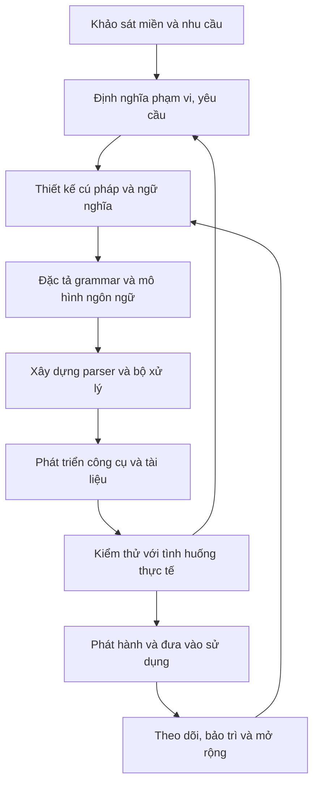
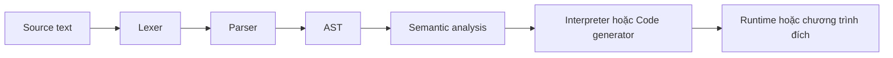

# Vòng đời của một DSL

Một **Domain-Specific Language (DSL)** là ngôn ngữ được thiết kế để mô tả một miền vấn đề cụ thể, chẳng hạn truy vấn dữ liệu, cấu hình hạ tầng, định nghĩa quy trình nghiệp vụ hoặc kiểm thử giao diện. DSL có thể giúp chuyên gia trong miền diễn đạt công việc bằng những khái niệm quen thuộc, đồng thời cho phép phần mềm kiểm tra và xử lý mô tả đó một cách nhất quán.

DSL không kết thúc ở việc thiết kế vài từ khóa hay viết được một parser. Một DSL có vòng đời gồm nhiều hoạt động liên kết: tìm hiểu miền nghiệp vụ, thiết kế ngôn ngữ, xây dựng bộ công cụ, kiểm chứng với người dùng, phát hành và tiếp tục phát triển. Các giai đoạn thường lặp lại; phản hồi từ người dùng có thể khiến nhóm quay lại điều chỉnh cú pháp, mô hình ngữ nghĩa hoặc phạm vi ban đầu.

## 1. Hai phạm vi cần phân biệt

Khi nói về vòng đời của DSL, cần phân biệt hai phạm vi:

- **Vòng đời của ngôn ngữ DSL**: từ lúc nhận ra nhu cầu cho đến khi thiết kế, triển khai, phát hành, bảo trì và ngừng hỗ trợ ngôn ngữ.
- **Vòng đời của một chương trình viết bằng DSL**: từ lúc người dùng viết một mô tả, kiểm tra cú pháp và ngữ nghĩa, đến lúc mô tả được diễn giải, biên dịch hoặc thực thi.

Hai phạm vi liên quan trực tiếp. Chất lượng công cụ xử lý chương trình ảnh hưởng đến trải nghiệm sử dụng DSL; ngược lại, cách người dùng viết và sửa chương trình cung cấp dữ liệu để nhóm cải tiến ngôn ngữ.

## 2. Bức tranh tổng thể

Một vòng đời điển hình có thể được mô tả như sau:



Sơ đồ thể hiện một luồng phổ biến, không phải quy trình tuyến tính bắt buộc. Với DSL nhỏ, một số giai đoạn có thể được thực hiện cùng nhau. Với DSL dùng trong nhiều hệ thống hoặc nhiều nhóm, việc đặc tả, kiểm thử, quản lý phiên bản và hỗ trợ người dùng cần được tổ chức chặt chẽ hơn.

## 3. Khảo sát miền và xác định nhu cầu

Giai đoạn đầu tiên là hiểu công việc mà DSL dự định hỗ trợ. Nhóm phát triển cần trao đổi với người trực tiếp thực hiện công việc, quan sát quy trình hiện tại và thu thập các ví dụ đầu vào, đầu ra, quy tắc cũng như trường hợp ngoại lệ.

Những câu hỏi hữu ích gồm:

- Ai sẽ viết và đọc các mô tả bằng DSL: lập trình viên, chuyên gia nghiệp vụ, quản trị viên hay người dùng cuối?
- Những tác vụ nào được lặp lại hoặc thường xuyên gây lỗi khi thực hiện bằng công cụ hiện tại?
- Miền nghiệp vụ có thuật ngữ, quy tắc và cấu trúc nào ổn định?
- Người dùng cần kiểm soát những quyết định nào, và phần nào nên do hệ thống tự động xử lý?
- DSL sẽ tích hợp với hệ thống, dữ liệu hoặc quy trình nào đang tồn tại?

Nhóm cũng cần xác định liệu DSL có thực sự phù hợp. Nếu nhu cầu chỉ là lưu vài giá trị cấu hình đơn giản, một định dạng cấu hình thông thường có thể đã đủ. DSL có giá trị hơn khi miền vấn đề có khái niệm riêng, quy tắc cần kiểm tra, cấu trúc lặp lại hoặc nhiều thao tác cần được mô tả bằng cùng một cách.

**Đầu ra của giai đoạn này** thường là mô hình miền ở mức khái niệm, danh sách tình huống sử dụng, nhóm người dùng mục tiêu, phạm vi ban đầu và tiêu chí thành công. Ví dụ, tiêu chí có thể là giảm lỗi cấu hình, rút ngắn thời gian tạo quy trình hoặc giúp chuyên gia nghiệp vụ tự chỉnh sửa quy tắc mà không cần sửa mã nguồn ứng dụng.

## 4. Thiết kế ngôn ngữ

Sau khi hiểu miền, nhóm quyết định DSL sẽ biểu đạt các khái niệm của miền như thế nào. Đây là giai đoạn quan trọng vì một cú pháp dễ viết nhưng có ngữ nghĩa mơ hồ sẽ khiến người dùng khó dự đoán kết quả và khiến công cụ khó kiểm tra.

### 4.1. Chọn hình thức DSL

DSL thường có hai hình thức triển khai:

- **External DSL** có cú pháp riêng, được phân tích bởi parser riêng. Ví dụ: ngôn ngữ truy vấn hoặc ngôn ngữ mô tả quy trình có file và grammar độc lập.
- **Internal DSL** tận dụng cú pháp của một ngôn ngữ lập trình có sẵn, thường thông qua API, hàm hoặc cấu trúc biểu thức của ngôn ngữ chủ. Ví dụ: một API dạng fluent trong Java để mô tả quy tắc kiểm thử.

DSL cũng có thể là văn bản hoặc đồ họa. Lựa chọn phụ thuộc vào người dùng, độ phức tạp của miền, khả năng tích hợp và chi phí xây dựng công cụ. External DSL cho phép kiểm soát cú pháp rõ hơn nhưng cần parser và hệ sinh thái công cụ. Internal DSL tái sử dụng compiler và IDE của ngôn ngữ chủ nhưng bị giới hạn bởi cú pháp của ngôn ngữ đó.

### 4.2. Thiết kế cú pháp và ngữ nghĩa

**Cú pháp (syntax)** quy định một mô tả hợp lệ trông như thế nào: từ khóa, tên định danh, literal, dấu phân cách, biểu thức và cách lồng cấu trúc. **Ngữ nghĩa (semantics)** quy định mô tả hợp lệ có ý nghĩa gì và hệ thống phải xử lý nó ra sao.

Ví dụ, trong một DSL định nghĩa quy trình, cú pháp có thể cho phép khai báo các bước và quan hệ phụ thuộc. Ngữ nghĩa cần xác định rõ:

- Tên bước có phải duy nhất trong một quy trình không?
- Một bước có thể phụ thuộc vào bước chưa được khai báo không?
- Có cho phép chu trình phụ thuộc không?
- Khi có nhiều bước sẵn sàng chạy, thứ tự thực thi được quyết định như thế nào?
- Lỗi được phát hiện lúc phân tích, lúc lập kế hoạch hay lúc chạy?

Nhóm nên ưu tiên các cấu trúc phản ánh trực tiếp khái niệm của miền. Từ khóa cần nhất quán, quy tắc nên dễ dự đoán và lỗi cần được diễn đạt bằng ngôn ngữ mà người dùng mục tiêu hiểu được. Tránh thêm tính năng chỉ vì có thể triển khai nếu tính năng đó không giải quyết một nhu cầu thực tế.

### 4.3. Xác định mô hình và ràng buộc

Một DSL thường có mô hình trừu tượng mô tả các thành phần và quan hệ của ngôn ngữ. Mô hình này có thể được biểu diễn bằng abstract syntax tree (AST), metamodel hoặc các kiểu dữ liệu trong chương trình triển khai.

Ví dụ, một quy trình có thể gồm `Pipeline`, `Step` và `Dependency`. Mỗi `Step` có tên, lệnh cần thực hiện và danh sách bước phụ thuộc. Các ràng buộc như tên duy nhất, tham chiếu hợp lệ và không có chu trình là quy tắc ngữ nghĩa của mô hình.

## 5. Đặc tả cú pháp và ngữ nghĩa

Với external DSL, grammar mô tả cách ghép các thành phần cú pháp thành chương trình hợp lệ. Có thể dùng EBNF hoặc một định dạng grammar mà công cụ parser hỗ trợ. Ví dụ, grammar rút gọn cho DSL quy trình:

```ebnf
pipelineDecl = "pipeline", string, "{", { stepDecl }, "}" ;
stepDecl     = "step", identifier, "{",
               "command", string,
               [ "after", identifier ],
               "}" ;
```

Theo grammar này, một chương trình có thể viết như sau:

```text
pipeline "nightly-build" {
    step compile {
        command "gradle build"
    }

    step test {
        command "gradle test"
        after compile
    }
}
```

Grammar chỉ xác định cấu trúc văn bản. Nó chưa đủ để bảo đảm chương trình có ý nghĩa. Chẳng hạn, grammar vẫn có thể chấp nhận `after missingStep`, trong khi `missingStep` không tồn tại. Vì vậy, đặc tả ngôn ngữ cần ghi riêng các quy tắc ngữ nghĩa và cách xử lý từng trường hợp.

Đặc tả tốt nên có ví dụ hợp lệ, ví dụ không hợp lệ, quy tắc ưu tiên biểu thức nếu có, kiểu dữ liệu, phạm vi tên, hành vi mặc định và định nghĩa rõ ràng cho các trường hợp biên. Những nội dung này trở thành căn cứ để triển khai parser, bộ kiểm tra và bộ test.

## 6. Xây dựng bộ xử lý DSL

Với một external DSL dạng văn bản, chương trình thường đi qua các bước sau:



1. **Lexing (phân tích từ vựng)**: chuyển chuỗi ký tự thành các token như từ khóa, định danh, chuỗi và ký hiệu.
2. **Parsing (phân tích cú pháp)**: kiểm tra thứ tự token theo grammar và tạo cấu trúc cú pháp, thường là AST.
3. **Phân tích ngữ nghĩa**: kiểm tra những điều grammar không thể diễn đạt đầy đủ, như tên được tham chiếu có tồn tại, kiểu dữ liệu có tương thích hoặc quan hệ phụ thuộc có hợp lệ.
4. **Diễn giải hoặc sinh mã**: chuyển AST thành hành động thực thi, một kế hoạch trung gian, mã nguồn của ngôn ngữ khác hoặc định dạng mà hệ thống đích hiểu được.
5. **Thực thi**: nếu DSL có hành vi chạy, runtime thực hiện kế hoạch đã tạo và báo cáo kết quả.

Không phải DSL nào cũng cần đủ mọi thành phần. Một DSL chỉ dùng để mô tả dữ liệu có thể được chuyển thành cấu hình hoặc đối tượng miền. DSL biểu đạt quy tắc có thể được diễn giải trực tiếp. DSL dùng để tạo mã có thể cần một code generator. Kiến trúc nên phản ánh cách DSL được sử dụng và yêu cầu tích hợp của nó.

Trong ví dụ quy trình ở trên, parser tạo ra một AST gồm pipeline và hai bước. Bộ phân tích ngữ nghĩa xác nhận `compile` và `test` có tên duy nhất, tham chiếu `after compile` hợp lệ và đồ thị phụ thuộc không có chu trình. Bộ lập kế hoạch có thể sắp xếp các bước theo thứ tự tô-pô, sau đó chuyển kế hoạch thành định dạng mà hệ thống chạy tác vụ hỗ trợ.

Một phần quan trọng của bộ xử lý là chẩn đoán lỗi. Thông báo nên chỉ rõ vị trí lỗi trong file, nguyên nhân và cách sửa có thể thực hiện. Ví dụ, thay vì chỉ báo `Semantic error`, công cụ có thể báo: `Bước 'test' phụ thuộc vào 'compile', nhưng không tìm thấy bước 'compile' trong pipeline này.` Thông tin vị trí dòng và cột giúp người dùng sửa lỗi nhanh hơn.

## 7. Xây dựng công cụ và trải nghiệm phát triển

Một DSL hữu ích cần nhiều hơn parser. Tùy đối tượng người dùng, bộ công cụ có thể gồm:

- Syntax highlighting và tự động thụt lề để nội dung dễ đọc.
- Tự động hoàn thành từ khóa, tên tài nguyên hoặc giá trị hợp lệ.
- Kiểm tra lỗi khi đang soạn thảo và hiển thị vị trí lỗi.
- Formatter để chuẩn hóa cách trình bày.
- Tài liệu tham khảo cú pháp, ví dụ mẫu và hướng dẫn theo tác vụ.
- Công cụ xem AST, sơ đồ phụ thuộc hoặc kế hoạch thực thi khi các cấu trúc đó khó hình dung bằng văn bản.
- Debugger, log hoặc chế độ mô phỏng nếu DSL điều khiển quy trình có nhiều bước.

Không phải DSL nào cũng cần tất cả các công cụ trên ngay từ đầu. Nên ưu tiên những hỗ trợ giúp nhóm người dùng mục tiêu viết, hiểu và sửa chương trình an toàn hơn. Ví dụ, với DSL cấu hình được chỉnh sửa bởi chuyên gia nghiệp vụ, thông báo lỗi dễ hiểu và tài liệu theo tình huống có thể quan trọng hơn debugger.

## 8. Kiểm thử và xác nhận với người dùng

Kiểm thử DSL cần xác nhận cả tính đúng đắn của bộ xử lý lẫn mức độ phù hợp của ngôn ngữ với công việc thực tế.

**Kiểm thử kỹ thuật** có thể bao gồm:

- Kiểm thử lexer và parser với các trường hợp hợp lệ, không hợp lệ và dữ liệu biên.
- Kiểm thử từng quy tắc ngữ nghĩa, bao gồm tham chiếu thiếu, tên trùng, sai kiểu và chu trình phụ thuộc.
- Kiểm thử kết quả diễn giải hoặc mã được sinh ra bằng các đầu vào đã biết kết quả mong đợi.
- Kiểm thử tích hợp với runtime, hệ thống lưu trữ hoặc công cụ đích.
- Kiểm thử hồi quy để bảo đảm thay đổi grammar không làm hỏng các chương trình cũ ngoài dự kiến.
- Kiểm thử hiệu năng và giới hạn tài nguyên nếu DSL xử lý file lớn hoặc đầu vào không đáng tin cậy.

**Kiểm thử với người dùng** giúp phát hiện vấn đề mà test tự động khó nhận ra: từ khóa có tự nhiên không, cấu trúc có dễ nhớ không, lỗi có dễ hiểu không và người dùng có diễn đạt được tác vụ thực tế hay không. Nên thử bằng các tình huống thật, bao gồm cả trường hợp phổ biến và trường hợp ngoại lệ. Nếu người dùng liên tục phải tìm cách lách cú pháp, đó có thể là dấu hiệu mô hình DSL chưa phản ánh đúng miền.

## 9. Phát hành và đưa DSL vào sử dụng

Trước khi phát hành, nhóm cần đóng gói những thành phần cần thiết: parser hoặc thư viện, runtime nếu có, plugin IDE nếu có, tài liệu, ví dụ và hướng dẫn nâng cấp. Cần xác định rõ phiên bản DSL mà mỗi công cụ hỗ trợ, cách khai báo phiên bản trong file và cách xử lý chương trình dùng cú pháp mới hơn.

Việc đưa DSL vào sử dụng thường hiệu quả hơn khi bắt đầu với một nhóm hoặc một quy trình có phạm vi kiểm soát được. Nhóm có thể thu thập phản hồi, quan sát các lỗi thường gặp và hoàn thiện công cụ trước khi mở rộng. Nếu DSL ảnh hưởng đến hệ thống sản xuất, cần có quy trình review, kiểm tra và phân quyền phù hợp với mức độ rủi ro của các mô tả được thực thi.

## 10. Bảo trì, quản lý phiên bản và phát triển DSL

Sau khi phát hành, DSL sẽ thay đổi cùng miền nghiệp vụ và các hệ thống tích hợp. Nhóm cần phân biệt thay đổi tương thích và thay đổi phá vỡ tương thích.

- **Thay đổi tương thích** có thể là thêm một tùy chọn mặc định an toàn hoặc bổ sung một cấu trúc mới mà chương trình cũ vẫn giữ nguyên ý nghĩa.
- **Thay đổi phá vỡ tương thích** có thể là đổi ý nghĩa từ khóa, xóa cú pháp cũ hoặc thay đổi quy tắc khiến chương trình trước đây hợp lệ trở thành không hợp lệ.

Với thay đổi phá vỡ tương thích, nên có phiên bản ngôn ngữ rõ ràng, tài liệu migration, cảnh báo cho cú pháp sắp bị loại bỏ và khoảng thời gian chuyển đổi hợp lý. Công cụ có thể cung cấp lệnh kiểm tra hoặc chuyển đổi tự động nếu việc ánh xạ giữa cú pháp cũ và mới đủ rõ ràng.

Quy trình bảo trì thường gồm tiếp nhận yêu cầu, đánh giá ảnh hưởng lên grammar và ngữ nghĩa, cập nhật đặc tả, triển khai, bổ sung test hồi quy, cập nhật tài liệu rồi phát hành phiên bản mới. Cần lưu ý rằng thay đổi một quy tắc ngữ nghĩa đôi khi ảnh hưởng đến chương trình cũ dù cú pháp không thay đổi.

Khi DSL không còn được sử dụng hoặc đã được thay thế, nhóm cần có kế hoạch ngừng hỗ trợ: thông báo thời hạn, hướng dẫn xuất dữ liệu hoặc chuyển đổi, xác định phiên bản cuối cùng được hỗ trợ và lưu trữ tài liệu cần thiết. Đây cũng là một phần của vòng đời ngôn ngữ.

## 11. Các rủi ro thường gặp trong vòng đời DSL

| Rủi ro | Hệ quả | Cách hạn chế |
|---|---|---|
| Bắt đầu từ grammar trước khi hiểu miền | Cú pháp đẹp nhưng không khớp công việc thật | Khảo sát người dùng và mô hình hóa tác vụ trước |
| Phạm vi quá rộng ngay từ phiên bản đầu | Ngôn ngữ khó học, khó triển khai và khó bảo trì | Bắt đầu từ một nhóm tác vụ có giá trị rõ ràng |
| Cú pháp được định nghĩa nhưng ngữ nghĩa mơ hồ | Các công cụ hoặc người dùng hiểu khác nhau | Đặc tả hành vi, quy tắc và ví dụ biên |
| Chỉ xây dựng parser | Người dùng khó phát hiện và sửa lỗi | Đầu tư vào chẩn đoán, tài liệu và công cụ soạn thảo |
| Kiểm thử bằng ví dụ quá đơn giản | Lỗi xuất hiện khi gặp dữ liệu và quy trình thực tế | Dùng tình huống thật và kiểm thử hồi quy |
| Không quản lý phiên bản | Thay đổi mới có thể làm hỏng chương trình cũ | Định nghĩa chính sách tương thích và migration |
| Không thu thập phản hồi | DSL xa rời nhu cầu sau khi phát hành | Theo dõi vấn đề sử dụng và duy trì kênh góp ý |

## 12. Tiêu chí đánh giá một vòng đời DSL hiệu quả

Có thể đánh giá kết quả qua các khía cạnh sau:

1. **Phù hợp miền**: khái niệm và cấu trúc của DSL phản ánh đúng công việc cần mô tả.
2. **Dễ học và dễ đọc**: người dùng mục tiêu có thể hiểu ví dụ và viết chương trình mà không cần biết toàn bộ chi tiết triển khai.
3. **Ngữ nghĩa nhất quán**: cùng một cấu trúc có hành vi dự đoán được, quy tắc được tài liệu hóa và kiểm tra được.
4. **Chẩn đoán tốt**: lỗi được phát hiện sớm, chỉ ra vị trí và gợi ý hướng khắc phục.
5. **Tích hợp được**: DSL kết nối phù hợp với hệ thống và quy trình hiện có.
6. **Có thể tiến hóa**: phiên bản, tương thích và migration được quản lý để ngôn ngữ có thể phát triển lâu dài.

Vòng đời DSL hoàn chỉnh vì vậy bao gồm cả thiết kế ngôn ngữ, xây dựng công cụ và chăm sóc hệ sinh thái sử dụng nó. Một DSL thành công khi nó giúp người dùng diễn đạt công việc của miền rõ ràng hơn, đồng thời cho phép hệ thống kiểm tra và xử lý các mô tả đó một cách đáng tin cậy.
