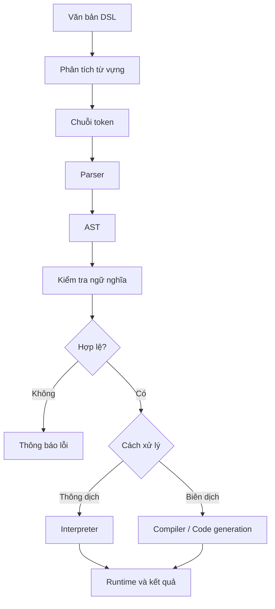

# Thuật ngữ cốt lõi của Domain-Specific Language (DSL)

Domain-Specific Language (DSL), thường dịch là **ngôn ngữ đặc thù miền**, là ngôn ngữ được thiết kế để mô tả một loại vấn đề hoặc công việc trong một lĩnh vực xác định. Thay vì cung cấp thật nhiều cấu trúc để giải quyết mọi loại bài toán, DSL tập trung vào những khái niệm, quy tắc và thao tác mà người làm việc trong lĩnh vực đó thường sử dụng.

Ví dụ quen thuộc gồm SQL để truy vấn dữ liệu, CSS để mô tả cách trình bày giao diện, regular expressions để mô tả mẫu chuỗi và ngôn ngữ truy vấn trong các hệ thống phân tích. Mỗi ngôn ngữ có một phạm vi biểu đạt riêng, một tập từ vựng và quy tắc riêng.

Muốn hiểu DSL, cần nắm được các thuật ngữ mô tả **miền bài toán**, **cách viết**, **ý nghĩa**, **cách xử lý chương trình** và **mối quan hệ giữa DSL với ngôn ngữ lập trình khác**. Những thuật ngữ này liên kết với nhau: miền bài toán quyết định ngôn ngữ cần diễn đạt điều gì; cú pháp quy định cách viết; ngữ nghĩa quy định ý nghĩa; bộ xử lý biến phần mô tả đó thành hành động hoặc kết quả.

## 1. Domain – miền bài toán

**Domain** là lĩnh vực hoặc phạm vi vấn đề mà một DSL hướng tới. Miền có thể là một lĩnh vực nghiệp vụ như ngân hàng, bảo hiểm và logistics; hoặc một hoạt động kỹ thuật như truy vấn cơ sở dữ liệu, định tuyến mạng, cấu hình bản dựng và kiểm thử.

Một miền thường có:

- **Đối tượng:** những thứ được mô tả hoặc xử lý, chẳng hạn đơn hàng, khách hàng, bảng dữ liệu hay tuyến đường.
- **Thuộc tính:** thông tin của đối tượng, chẳng hạn giá trị đơn hàng, trạng thái giao hàng hoặc kiểu dữ liệu của một cột.
- **Quy tắc:** điều kiện và ràng buộc chi phối đối tượng, chẳng hạn chỉ áp dụng giảm giá khi tổng đơn vượt một ngưỡng.
- **Thao tác:** những việc người dùng cần thực hiện, chẳng hạn lọc, sắp xếp, tính toán, định tuyến hoặc triển khai.
- **Khái niệm chuyên môn:** những từ ngữ mà người trong miền sử dụng để trao đổi với nhau.

Phạm vi miền càng rõ thì DSL càng dễ có thiết kế nhất quán. Nếu DSL cố gắng bao phủ quá nhiều loại vấn đề, nó có thể trở nên gần với ngôn ngữ lập trình đa mục đích và mất đi lợi ích về tính chuyên biệt.

### Domain model – mô hình miền

**Domain model** là mô hình khái niệm mô tả các đối tượng quan trọng trong miền, thuộc tính của chúng, mối quan hệ và quy tắc giữa chúng. Đây là nền tảng để quyết định DSL cần có những từ khóa, biểu thức và cấu trúc nào.

Ví dụ, với miền tính giá đơn hàng, mô hình miền có thể gồm:

- `Order`: đơn hàng.
- `Customer`: khách hàng.
- `total`: tổng giá trị đơn hàng.
- `customer.level`: cấp độ khách hàng.
- `discount`: mức giảm giá.
- Quy tắc: khách hàng thành viên được giảm giá nếu đơn hàng đạt ngưỡng nhất định.

Một DSL tốt phản ánh mô hình miền bằng những khái niệm mà người sử dụng hiểu được. Nếu mô hình miền không rõ, ngôn ngữ dễ có những từ khóa trùng nghĩa, quy tắc mâu thuẫn hoặc cấu trúc khó sử dụng.

### Domain expert – chuyên gia miền

**Domain expert** là người hiểu sâu nghiệp vụ hoặc lĩnh vực mà DSL phục vụ. Họ có thể không phải lập trình viên, nhưng biết các thuật ngữ, ngoại lệ, quy tắc và tình huống thực tế.

Người thiết kế DSL cần trao đổi với chuyên gia miền để xác định:

1. Người dùng thường cần diễn đạt điều gì?
2. Những khái niệm nào có ý nghĩa rõ ràng trong lĩnh vực?
3. Quy tắc nào luôn đúng, quy tắc nào phụ thuộc ngữ cảnh?
4. Người dùng cần đọc, viết hay chỉ cấu hình các mô tả?

Sự tham gia của chuyên gia miền giúp DSL diễn đạt đúng vấn đề thực tế thay vì chỉ phản ánh cách tổ chức nội bộ của phần mềm.

## 2. DSL và General-Purpose Language

**General-Purpose Language (GPL)** là ngôn ngữ lập trình đa mục đích, được thiết kế để giải quyết nhiều loại bài toán. Java, Python, C# và JavaScript là những ví dụ phổ biến.

DSL tập trung vào một miền; GPL cung cấp khả năng biểu đạt rộng hơn. Sự khác biệt này nằm ở mục tiêu thiết kế, không chỉ ở độ dài chương trình hay số lượng từ khóa.

| Khía cạnh | DSL | GPL |
|---|---|---|
| Phạm vi | Một miền hoặc nhóm tác vụ hẹp | Nhiều loại bài toán |
| Từ vựng | Gần với khái niệm của miền | Khái niệm lập trình tổng quát |
| Cấu trúc | Tối ưu cho tác vụ cụ thể | Linh hoạt cho nhiều cách giải quyết |
| Người dùng mục tiêu | Có thể gồm chuyên gia miền và lập trình viên | Thường là người phát triển phần mềm |
| Khả năng tái sử dụng | Mạnh trong phạm vi miền | Rộng giữa nhiều miền |
| Đánh đổi | Có giới hạn biểu đạt ngoài miền | Có thể cần nhiều mã hơn để mô tả một tác vụ chuyên biệt |

Ví dụ, câu lệnh SQL:

```sql
SELECT name, price
FROM Product
WHERE price > 100;
```

diễn đạt trực tiếp một truy vấn dữ liệu. Nếu viết cùng thao tác bằng một GPL, lập trình viên có thể phải gọi API, duyệt tập dữ liệu và tự xây dựng điều kiện lọc. SQL ngắn gọn hơn trong miền truy vấn dữ liệu vì cú pháp và ngữ nghĩa của nó được thiết kế cho công việc đó.

DSL không nhất thiết phải đơn giản hoặc chỉ dành cho người không biết lập trình. Một DSL vẫn có thể có kiểu dữ liệu, biểu thức lồng nhau, quy tắc phạm vi và cơ chế mở rộng phức tạp.

### DSL, API và ngôn ngữ cấu hình

Ba khái niệm này có liên quan nhưng không đồng nghĩa:

- **API (Application Programming Interface):** tập hợp giao diện mà chương trình khác có thể gọi. API có thể được trình bày qua các hàm, lớp, phương thức hoặc giao thức.
- **Configuration language – ngôn ngữ cấu hình:** cách khai báo giá trị và lựa chọn để điều chỉnh hành vi của hệ thống. JSON, YAML và TOML thường được dùng cho mục đích này.
- **DSL:** ngôn ngữ có khái niệm và quy tắc được tổ chức quanh một miền cụ thể.

Một tệp cấu hình có thể chỉ chứa các cặp khóa–giá trị. Khi nó có cấu trúc, biểu thức và ngữ nghĩa chuyên biệt để mô tả quy tắc trong một miền, nó có thể đóng vai trò như một DSL. Tương tự, một API có cách gọi được thiết kế thành cú pháp biểu đạt gần ngôn ngữ tự nhiên có thể tạo nên một internal DSL.

## 3. Vocabulary – từ vựng của DSL

**Vocabulary** là tập hợp từ, ký hiệu và tên gọi mà người dùng có thể sử dụng trong DSL. Từ vựng nên phản ánh ngôn ngữ chuyên môn của miền.

Ví dụ, DSL quản lý chính sách giá có thể dùng các từ:

- `product`, `customer`, `order`
- `when`, `otherwise`
- `discount`, `tax`, `shipping`
- `eligible`, `greaterThan`, `between`

Từ vựng có thể gồm:

- **Keyword – từ khóa:** từ có ý nghĩa đặc biệt do ngôn ngữ quy định, chẳng hạn `SELECT`, `FROM`, `WHERE` trong SQL.
- **Identifier – định danh:** tên do người viết đặt cho biến, quy tắc, trường hoặc đối tượng, tùy theo quy định của DSL.
- **Literal – giá trị hằng:** giá trị được viết trực tiếp như số `100`, chuỗi `"active"` hoặc giá trị Boolean `true`.
- **Operator – toán tử:** ký hiệu hoặc từ biểu thị phép toán hay phép so sánh, chẳng hạn `+`, `>=`, `AND`.
- **Delimiter – dấu phân cách:** dấu ngoặc, dấu phẩy, dấu chấm phẩy hoặc dấu ngoặc nhọn dùng để nhóm và phân tách cấu trúc.

Một DSL cần quy ước rõ từ nào là từ khóa, tên nào do người dùng tự đặt và những ký hiệu nào có ý nghĩa đặc biệt. Điều này giúp người viết tránh nhầm lẫn và giúp công cụ xử lý phân tích văn bản nhất quán.

## 4. Syntax – cú pháp

**Syntax** là tập hợp quy tắc xác định một biểu thức hoặc chương trình được viết như thế nào để được xem là hợp lệ về mặt hình thức.

Cú pháp trả lời câu hỏi: *Cấu trúc này có được viết đúng quy tắc của ngôn ngữ không?* Cú pháp không tự trả lời cấu trúc đó có ý nghĩa nghiệp vụ hay cho ra kết quả mong muốn hay không.

Ví dụ:

```sql
SELECT name
FROM Customer
WHERE active = true;
```

là một câu truy vấn có cấu trúc quen thuộc của SQL. Nếu viết `SELECT FROM WHERE name Customer`, các thành phần có thể vẫn là từ hợp lệ, nhưng cách sắp xếp không tuân theo cú pháp.

### Grammar – văn phạm

**Grammar** là mô tả hình thức của các quy tắc cú pháp. Văn phạm xác định những thành phần nào có thể xuất hiện và cách chúng kết hợp với nhau.

Một quy tắc văn phạm đơn giản có thể viết bằng ký pháp EBNF như sau:

```ebnf
query       = select_clause, from_clause, [where_clause] ;
select_clause = "SELECT", column_list ;
from_clause   = "FROM", identifier ;
where_clause  = "WHERE", condition ;
column_list   = identifier, {",", identifier} ;
condition     = identifier, comparison, literal ;
comparison    = "=" | ">" | "<" | ">=" | "<=" ;
```

Đây là văn phạm minh họa được rút gọn, không phải đặc tả đầy đủ của SQL. Nó cho thấy một truy vấn được tạo thành từ mệnh đề chọn, mệnh đề nguồn và mệnh đề điều kiện tùy chọn.

Trong ký pháp văn phạm:

- **Terminal symbol – ký hiệu kết thúc:** ký hiệu hoặc từ xuất hiện trực tiếp trong văn bản, chẳng hạn `SELECT` hay `=`.
- **Non-terminal symbol – ký hiệu không kết thúc:** tên đại diện cho một cấu trúc có thể được triển khai bằng quy tắc khác, chẳng hạn `query` hoặc `condition`.
- **Production rule – luật sinh:** quy tắc mô tả cách một ký hiệu không kết thúc được mở rộng thành các thành phần khác.
- **Optional element – thành phần tùy chọn:** phần có thể xuất hiện hoặc không, thường được ký hiệu bằng dấu ngoặc vuông trong EBNF.
- **Repetition – thành phần lặp:** phần có thể xuất hiện nhiều lần, thường được ký hiệu bằng dấu ngoặc nhọn trong EBNF.

### Lexical syntax và grammatical syntax

Quá trình phân tích thường tách hai mức:

- **Lexical analysis – phân tích từ vựng:** gom các ký tự thành token, ví dụ nhận diện `SELECT` là từ khóa, `Customer` là định danh và `100` là số.
- **Syntactic analysis – phân tích cú pháp:** kiểm tra cách các token kết hợp theo văn phạm, ví dụ một câu truy vấn có mệnh đề `SELECT` và `FROM` theo đúng thứ tự.

Nhờ phân chia này, lỗi như ký tự không hợp lệ có thể được phát hiện ở bước từ vựng; lỗi thiếu mệnh đề hoặc sai thứ tự thành phần có thể được phát hiện ở bước cú pháp.

## 5. Concrete syntax và Abstract syntax

**Concrete syntax – cú pháp cụ thể** mô tả cách người dùng viết chương trình, bao gồm từ khóa, dấu ngoặc, dấu phân cách và cách trình bày.

**Abstract syntax – cú pháp trừu tượng** mô tả cấu trúc có ý nghĩa của chương trình sau khi bỏ qua nhiều chi tiết trình bày. Cấu trúc này thường được biểu diễn bằng cây.

Ví dụ, hai biểu thức sau có thể được trình bày khác nhau nhưng mang cùng cấu trúc:

```text
price >= 100
```

```text
price>=100
```

Nếu khoảng trắng không có ý nghĩa trong DSL đó, cả hai có thể tạo ra cùng một cấu trúc trừu tượng.

### Token

**Token** là đơn vị cú pháp nhỏ mà bộ phân tích từ vựng nhận diện được. Token thường có loại và giá trị văn bản đi kèm.

Với biểu thức `price >= 100`, một chuỗi token minh họa là:

| Văn bản | Loại token |
|---|---|
| `price` | Identifier |
| `>=` | Comparison operator |
| `100` | Numeric literal |

Token là kết quả của phân tích từ vựng; nó chưa cho biết toàn bộ quan hệ giữa các thành phần.

### Parse tree – cây phân tích cú pháp

**Parse tree** là cây thể hiện cách chuỗi token được tạo ra từ các luật văn phạm. Cây này thường giữ lại nhiều chi tiết về cấu trúc cú pháp.

### Abstract Syntax Tree (AST) – cây cú pháp trừu tượng

**AST** là biểu diễn dạng cây của cấu trúc chương trình ở mức khái niệm. Mỗi nút đại diện cho một thành phần như phép so sánh, lời gọi hàm, khai báo hoặc giá trị.

Với `price >= 100`, AST có thể được giản lược thành:

```text
        GreaterThanOrEqual
           /          \
      Identifier     Number
        "price"       100
```

AST thường là đầu vào cho các bước kiểm tra ngữ nghĩa, tối ưu hóa, diễn giải hoặc sinh mã. Nó giúp bộ xử lý làm việc với cấu trúc có ý nghĩa thay vì phải phân tích lại chuỗi ký tự ở mọi bước.

## 6. Semantics – ngữ nghĩa

**Semantics** là ý nghĩa và hành vi được quy định cho một cấu trúc hợp lệ của ngôn ngữ. Nếu cú pháp trả lời “viết như thế nào?”, ngữ nghĩa trả lời “cấu trúc đó có nghĩa gì và hệ thống phải làm gì?”.

Ví dụ, biểu thức:

```text
order.total >= 1000000
```

có thể hợp lệ về cú pháp. Để xác định ngữ nghĩa, DSL còn phải quy định:

- `order` là đối tượng nào và có tồn tại trong ngữ cảnh hiện tại không?
- `total` có phải thuộc tính số của `order` không?
- Phép `>=` so sánh theo đơn vị tiền tệ nào?
- Nếu `order.total` không có giá trị thì điều kiện được xử lý ra sao?

Một cấu trúc có thể đúng cú pháp nhưng sai ngữ nghĩa. Ví dụ, tham chiếu đến trường `unknownField` không tồn tại có thể được phân tích cú pháp thành công nhưng bị từ chối ở bước kiểm tra ngữ nghĩa.

### Static semantics và dynamic semantics

- **Static semantics – ngữ nghĩa tĩnh:** các quy tắc có thể kiểm tra trước khi thực thi, chẳng hạn tên định danh có được khai báo không, kiểu dữ liệu có tương thích không và một hàm có nhận đúng số đối số không.
- **Dynamic semantics – ngữ nghĩa động:** quy định điều xảy ra khi chương trình được thực thi, chẳng hạn cách tính biểu thức, cách áp dụng điều kiện và kết quả trả về.

Sự phân biệt này giúp xác định lỗi nào nên được phát hiện sớm và hành vi nào chỉ có thể biết khi chạy với dữ liệu thực tế.

## 7. Parser, interpreter và compiler

Đây là những thuật ngữ chỉ các thành phần hoặc chương trình xử lý DSL. Chúng có thể được tổ chức khác nhau tùy kiến trúc.

### Parser – bộ phân tích cú pháp

**Parser** nhận đầu vào dạng token và kiểm tra cấu trúc theo văn phạm. Parser thường tạo parse tree hoặc AST. Trong một số hệ thống, bước phân tích từ vựng được tích hợp hoặc phối hợp chặt với parser.

Parser trả lời câu hỏi về cấu trúc. Nó không nhất thiết phải thực thi ý nghĩa của chương trình.

### Interpreter – bộ thông dịch

**Interpreter** trực tiếp diễn giải cấu trúc DSL để thực hiện hành vi đã định nghĩa. Ví dụ, một interpreter có thể duyệt AST của quy tắc giá, đánh giá điều kiện và tính mức giảm giá.

Ưu điểm thường gặp là có thể thực thi mô tả mà không cần tạo ra một tệp chương trình độc lập. Tuy nhiên, hiệu năng, khả năng gỡ lỗi và cách quản lý trạng thái phụ thuộc vào thiết kế interpreter.

### Compiler – trình biên dịch

**Compiler** chuyển chương trình DSL từ dạng nguồn hoặc biểu diễn trung gian sang một dạng khác để thực thi hoặc xử lý tiếp. Đích biên dịch có thể là mã máy, bytecode, mã của một ngôn ngữ khác hoặc một dạng biểu diễn trung gian.

Một compiler thường thực hiện các bước như phân tích cú pháp, kiểm tra ngữ nghĩa, chuyển đổi AST và sinh mã. Không phải compiler nào cũng có cùng số bước hoặc cùng loại đầu ra.

### Code generation – sinh mã

**Code generation** là bước tạo mã đích từ AST hoặc biểu diễn trung gian. Chẳng hạn, một DSL mô tả quy tắc kiểm tra có thể được chuyển thành mã Java, SQL hoặc một định dạng thực thi riêng.

### Runtime – môi trường thực thi

**Runtime** là môi trường cung cấp những dịch vụ cần thiết khi chương trình chạy, ví dụ truy cập dữ liệu, gọi hàm tích hợp, quản lý trạng thái hoặc thực hiện thao tác trong hệ thống đích.

Một DSL có thể cần runtime riêng nếu các câu lệnh của nó phụ thuộc vào dịch vụ miền. DSL khác có thể biên dịch sang nền tảng sẵn có và sử dụng runtime của nền tảng đó.

### Luồng xử lý minh họa



Sơ đồ là một mô hình tổng quát. Một hệ thống thực tế có thể gộp, lặp hoặc thay đổi thứ tự một số bước.

## 8. Type system – hệ thống kiểu

**Type system** là tập hợp quy tắc phân loại giá trị và xác định những phép toán nào được phép thực hiện trên chúng. Hệ thống kiểu giúp ngăn những cách sử dụng dữ liệu không phù hợp.

Ví dụ, nếu `order.total` có kiểu số thì phép so sánh với `1000000` có thể hợp lệ. Nếu `order.total` là một giá trị ngày tháng, phép so sánh đó có thể không có ý nghĩa theo quy tắc của DSL.

Một số thuật ngữ liên quan:

- **Type – kiểu:** phân loại giá trị, chẳng hạn Integer, Decimal, String, Boolean hoặc Date.
- **Type checking – kiểm tra kiểu:** quá trình kiểm tra các phép toán và đối số có phù hợp với kiểu đã quy định không.
- **Type error – lỗi kiểu:** lỗi xảy ra khi sử dụng giá trị không đúng kiểu mong đợi.
- **Type inference – suy luận kiểu:** cơ chế xác định kiểu từ ngữ cảnh mà không yêu cầu người viết khai báo tường minh trong mọi trường hợp.
- **Static typing – định kiểu tĩnh:** kiểm tra kiểu chủ yếu trước khi thực thi.
- **Dynamic typing – định kiểu động:** một số quyết định hoặc kiểm tra kiểu được thực hiện khi chạy.

DSL không bắt buộc phải có hệ thống kiểu phức tạp. Một DSL cấu hình nhỏ có thể chỉ hỗ trợ chuỗi, số và Boolean; một DSL phân tích dữ liệu có thể cần kiểu bảng, cột, tập hợp và thời gian.

## 9. Scope, binding và evaluation

Ba thuật ngữ này giúp giải thích cách tên gọi trong DSL được hiểu và cách biểu thức tạo ra giá trị.

### Scope – phạm vi

**Scope** là vùng trong chương trình mà một tên hoặc khai báo có hiệu lực. Ví dụ, một biến được khai báo bên trong một khối quy tắc có thể chỉ được dùng trong khối đó.

DSL cần quy định phạm vi của biến, bí danh, tham số và các tên được khai báo. Nếu không, cùng một tên có thể gây ra cách hiểu mơ hồ ở các phần khác nhau của chương trình.

### Binding – liên kết tên

**Binding** là việc liên kết một tên với đối tượng mà tên đó đại diện, chẳng hạn biến với giá trị, tên hàm với định nghĩa hàm hoặc tên trường với thuộc tính dữ liệu.

Ví dụ, trong `customer.level`, bộ xử lý cần xác định `customer` trỏ đến đối tượng nào và `level` là thuộc tính nào của đối tượng đó.

### Evaluation – đánh giá biểu thức

**Evaluation** là quá trình tính toán giá trị của biểu thức theo ngữ nghĩa của DSL.

Ví dụ, nếu `order.total = 1200000`, biểu thức `order.total >= 1000000` được đánh giá thành `true`. Nếu DSL hỗ trợ toán tử logic, một biểu thức lớn hơn có thể kết hợp nhiều điều kiện để đưa ra quyết định.

## 10. Embedded DSL và External DSL

Hai cách xây dựng DSL phổ biến là nhúng DSL vào một ngôn ngữ chủ hoặc thiết kế DSL thành ngôn ngữ riêng.

### Embedded DSL (Internal DSL)

**Embedded DSL**, còn gọi là **Internal DSL**, được biểu đạt bằng cú pháp và khả năng của một ngôn ngữ chủ (*host language*). Người thiết kế tận dụng cú pháp, hệ thống kiểu, thư viện và công cụ của ngôn ngữ chủ để tạo ra cách viết gần với ngôn ngữ miền.

Ví dụ, Kotlin DSL có thể dùng lambda với receiver và các hàm mở rộng để tạo cấu trúc khai báo. Gradle Kotlin DSL là ví dụ về cách mô tả cấu hình bản dựng bằng cú pháp Kotlin.

Ưu điểm:

- Tận dụng compiler, IDE, hệ thống kiểu và công cụ có sẵn của ngôn ngữ chủ.
- Dễ kết hợp với mã ứng dụng và thư viện hiện có.
- Có thể giảm chi phí xây dựng parser riêng.

Hạn chế:

- Cú pháp bị giới hạn bởi ngôn ngữ chủ.
- Người dùng thường cần biết ít nhất một phần ngôn ngữ chủ.
- Thông báo lỗi đôi khi phản ánh chi tiết của host language thay vì khái niệm miền.

### External DSL

**External DSL** có cú pháp và quy tắc riêng, được xử lý bởi parser, interpreter hoặc compiler được xây dựng cho ngôn ngữ đó.

SQL và regular expressions là những ví dụ quen thuộc về ngôn ngữ có cú pháp riêng. Một ứng dụng có thể lưu câu SQL hoặc biểu thức chính quy dưới dạng văn bản rồi chuyển cho bộ xử lý tương ứng.

Ưu điểm:

- Có thể thiết kế cú pháp sát với miền và người dùng mục tiêu.
- Có quyền kiểm soát rõ hơn đối với văn phạm, thông báo lỗi và công cụ chuyên biệt.
- Có thể tách ngôn ngữ mô tả khỏi ngôn ngữ triển khai ứng dụng.

Hạn chế:

- Cần xây dựng hoặc tích hợp parser và các công cụ hỗ trợ.
- Cần định nghĩa, tài liệu hóa và duy trì cú pháp cùng ngữ nghĩa.
- Việc tích hợp với mã ứng dụng cần có giao diện rõ ràng.

| Tiêu chí | Embedded DSL | External DSL |
|---|---|---|
| Cú pháp | Dựa trên host language | Có cú pháp riêng |
| Parser | Thường dùng parser của host language | Thường cần parser riêng hoặc công cụ chuyên biệt |
| Tích hợp | Trực tiếp với mã host | Thông qua bộ xử lý hoặc giao diện tích hợp |
| Công cụ | Tận dụng công cụ của host | Có thể cần công cụ riêng |
| Phù hợp khi | Người dùng chấp nhận host language và cần tích hợp sâu | Cần cú pháp độc lập, sát miền hoặc dành cho nhóm người dùng riêng |

## 11. Composition và abstraction

### Composition – kết hợp cấu trúc

**Composition** là khả năng kết hợp các thành phần nhỏ để tạo thành biểu thức hoặc mô tả lớn hơn. Ví dụ, hai điều kiện có thể kết hợp bằng `AND` hoặc `OR`; nhiều quy tắc có thể kết hợp thành một chính sách.

Khả năng kết hợp giúp DSL diễn đạt các tình huống phức tạp mà vẫn tái sử dụng được thành phần cơ bản. Tuy nhiên, ngôn ngữ phải quy định rõ thứ tự ưu tiên toán tử, cách nhóm biểu thức và cách xử lý trường hợp xung đột.

### Abstraction – trừu tượng hóa

**Abstraction** là việc che giấu chi tiết triển khai và cung cấp khái niệm ở mức phù hợp với người sử dụng. Ví dụ, người viết chính sách giá chỉ cần mô tả điều kiện và tỷ lệ giảm giá; họ không cần biết cách hệ thống truy vấn cơ sở dữ liệu hoặc cập nhật giao dịch.

Một DSL có mức trừu tượng hóa tốt cho phép người dùng tập trung vào ý định trong miền. Nếu trừu tượng hóa quá ít, người dùng phải biết nhiều chi tiết kỹ thuật. Nếu quá nhiều, họ có thể không kiểm soát được những trường hợp cần thiết.

## 12. Ví dụ xuyên suốt: DSL mô tả quy tắc giảm giá

Giả sử một hệ thống bán hàng cần cho phép nhân viên nghiệp vụ mô tả quy tắc giảm giá. Ta thiết kế một DSL minh họa:

```text
rule "member-discount" {
    when order.total >= 1000000
    then discount = 10%
}
```

Đây là cú pháp giả định để học thuật ngữ, không phải ngôn ngữ có parser thực tế.

Có thể phân tích ví dụ theo các khái niệm đã học:

1. **Domain:** quản lý chính sách giảm giá cho đơn hàng.
2. **Domain model:** có `Order`, `total` và `discount`.
3. **Vocabulary:** `rule`, `when`, `then`, `order`, `total`, `discount`.
4. **Syntax:** một quy tắc có tên, một điều kiện sau `when` và một hành động sau `then`.
5. **Grammar:** quy định vị trí của tên quy tắc, khối điều kiện và khối hành động.
6. **Tokens:** từ khóa, định danh, số, toán tử so sánh, dấu ngoặc và ký hiệu phần trăm.
7. **AST:** có thể gồm nút `Rule`, nút điều kiện `GreaterThanOrEqual` và nút hành động `AssignDiscount`.
8. **Semantics:** nếu tổng đơn đạt ngưỡng, hệ thống áp dụng mức giảm 10%; nếu không đạt, quy tắc không kích hoạt.
9. **Type checking:** `order.total` phải có kiểu số phù hợp; `discount` phải nhận một giá trị tỷ lệ hợp lệ.
10. **Interpreter:** đọc AST, lấy tổng đơn hàng, đánh giá điều kiện và tạo kết quả áp dụng giảm giá.

Ví dụ này cho thấy DSL biến một quy tắc nghiệp vụ thành mô tả có cấu trúc. Nhờ vậy, người dùng có thể thay đổi ngưỡng hoặc tỷ lệ giảm giá bằng cách sửa mô tả thay vì sửa trực tiếp thuật toán trong ứng dụng. Hệ thống vẫn phải kiểm tra đầu vào và định nghĩa rõ cách xử lý các trường hợp như đơn hàng thiếu tổng tiền hoặc nhiều quy tắc cùng áp dụng.

## 13. Bảng tra cứu nhanh các thuật ngữ

| Thuật ngữ | Ý nghĩa cốt lõi | Câu hỏi cần trả lời |
|---|---|---|
| Domain | Miền vấn đề mà DSL phục vụ | Ngôn ngữ giải quyết loại công việc nào? |
| Domain model | Mô hình khái niệm của miền | Có những đối tượng, thuộc tính và quy tắc nào? |
| Domain expert | Người am hiểu miền | Quy tắc thực tế và thuật ngữ chính xác là gì? |
| Vocabulary | Tập từ và ký hiệu của DSL | Người dùng có thể viết những tên nào? |
| Syntax | Quy tắc hình thức của cách viết | Cấu trúc này có hợp lệ không? |
| Grammar | Đặc tả các quy tắc cú pháp | Các thành phần được kết hợp ra sao? |
| Token | Đơn vị được nhận diện từ văn bản | Chuỗi ký tự này thuộc loại nào? |
| Parse tree | Cây biểu diễn dẫn xuất theo văn phạm | Chuỗi token được tạo theo những luật nào? |
| AST | Cây biểu diễn cấu trúc trừu tượng | Chương trình gồm những thành phần có ý nghĩa nào? |
| Semantics | Ý nghĩa và hành vi của cấu trúc | Cấu trúc hợp lệ này thực hiện điều gì? |
| Type system | Quy tắc phân loại và sử dụng giá trị | Phép toán và dữ liệu có tương thích không? |
| Scope | Phạm vi hiệu lực của tên | Tên này có thể được dùng ở đâu? |
| Binding | Liên kết tên với đối tượng hoặc giá trị | Tên này đại diện cho điều gì? |
| Evaluation | Tính giá trị của biểu thức | Biểu thức cho kết quả nào? |
| Parser | Bộ phân tích cấu trúc | Đầu vào có tuân theo văn phạm không? |
| Interpreter | Bộ diễn giải và thực thi | Cần làm gì theo cấu trúc DSL? |
| Compiler | Bộ chuyển đổi chương trình | Chuyển DSL sang dạng nào? |
| Code generation | Sinh mã đích | Tạo ra mã hoặc biểu diễn nào? |
| Runtime | Môi trường thực thi | Chương trình cần dịch vụ nào khi chạy? |
| Embedded DSL | DSL dựa trên cú pháp host language | Có thể tận dụng ngôn ngữ chủ đến đâu? |
| External DSL | DSL có cú pháp riêng | Cần parser và công cụ chuyên biệt nào? |
| Composition | Kết hợp các thành phần | Các biểu thức nhỏ tạo thành mô tả lớn ra sao? |
| Abstraction | Ẩn chi tiết triển khai | Người dùng cần tập trung vào ý định nào? |

## 14. Những nhầm lẫn thường gặp

**Nhầm cú pháp với ngữ nghĩa.** Một biểu thức có thể được viết đúng quy tắc nhưng vẫn tham chiếu đến trường không tồn tại hoặc tạo ra hành vi không hợp lệ. Cú pháp kiểm tra hình thức; ngữ nghĩa xác định cách hiểu và hành vi.

**Cho rằng DSL luôn là ngôn ngữ đơn giản.** DSL tập trung vào miền hẹp, nhưng miền đó có thể có quy tắc phức tạp. Một DSL có thể cần hệ thống kiểu, phạm vi, kiểm tra lỗi và tối ưu hóa.

**Cho rằng mọi tệp cấu hình đều là DSL.** Tệp cấu hình chỉ là dữ liệu cấu hình nếu nó không có ngôn ngữ và ngữ nghĩa chuyên biệt đáng kể. Một định dạng cấu hình có biểu thức và quy tắc miền có thể phát triển thành DSL.

**Cho rằng DSL phải có compiler riêng.** Một DSL có thể được thông dịch, chuyển thành lời gọi API, biên dịch sang ngôn ngữ khác hoặc xử lý bằng một bộ máy quy tắc. Lựa chọn phụ thuộc mục tiêu và môi trường triển khai.

**Cho rằng Embedded DSL và External DSL chỉ khác nhau ở phần mở rộng tệp.** Điểm khác biệt chính là DSL dựa trên cú pháp của ngôn ngữ chủ hay có cú pháp độc lập. Phần mở rộng tệp không quyết định bản chất đó.

## 15. Cách vận dụng các thuật ngữ khi phân tích một DSL

Khi gặp một DSL mới, có thể phân tích theo trình tự sau:

1. Xác định **domain** và nhóm người dùng mục tiêu.
2. Liệt kê **domain model**: đối tượng, thuộc tính, quan hệ và quy tắc.
3. Thu thập **vocabulary** từ tài liệu và cách nói của chuyên gia miền.
4. Đọc ví dụ để nhận diện **syntax** và suy ra các quy tắc **grammar**.
5. Xác định cách văn bản được chuyển thành **tokens**, parse tree hoặc **AST**.
6. Tìm hiểu **semantics**: mỗi cấu trúc hợp lệ có ý nghĩa và hành vi gì?
7. Kiểm tra hệ thống **type**, **scope** và cơ chế binding nếu DSL có hỗ trợ.
8. Xác định DSL là **embedded** hay **external**.
9. Tìm thành phần xử lý: **parser**, **interpreter**, **compiler**, code generation và **runtime**.
10. Thử một ví dụ hợp lệ, một ví dụ sai cú pháp và một ví dụ đúng cú pháp nhưng sai ngữ nghĩa để hiểu rõ giới hạn của ngôn ngữ.

## 16. Câu hỏi tự kiểm tra

1. Domain của một DSL là gì? Hãy nêu một ví dụ về miền nghiệp vụ và một ví dụ về miền kỹ thuật.
2. Vì sao một DSL cần phản ánh domain model và vocabulary của người sử dụng?
3. Phân biệt syntax và semantics bằng một ví dụ biểu thức đúng cú pháp nhưng sai ngữ nghĩa.
4. Grammar có vai trò gì trong việc xác định cấu trúc hợp lệ?
5. Token, parse tree và AST khác nhau ở điểm nào?
6. Parser, interpreter và compiler đảm nhiệm những công việc gì?
7. Type system có thể phát hiện loại lỗi nào trước khi chương trình chạy?
8. Embedded DSL khác External DSL như thế nào?
9. Vì sao một ngôn ngữ cấu hình có thể được xem là DSL trong một số trường hợp nhưng không phải trong mọi trường hợp?
10. Với ví dụ DSL giảm giá ở trên, hãy chỉ ra domain, vocabulary, điều kiện, hành động và ngữ nghĩa của quy tắc.

Khi trả lời được các câu hỏi này, người học có thể đọc một mô tả DSL và xác định nó nói về miền nào, cấu trúc được viết theo quy tắc gì, cấu trúc mang ý nghĩa gì và hệ thống xử lý nó bằng cách nào.
