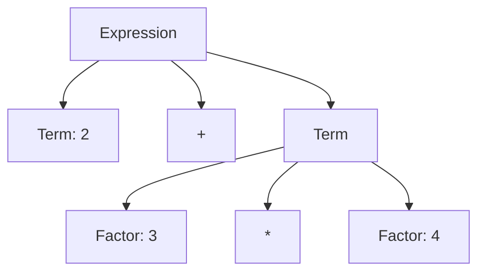

# Luật sản sinh

Trong ngôn ngữ miền chuyên biệt (Domain-Specific Language, DSL), **luật sản sinh (production rule)** là quy tắc mô tả một cấu trúc cú pháp có thể được tạo thành từ những thành phần nhỏ hơn. Tập hợp các luật sản sinh tạo nên ngữ pháp của DSL: chúng quy định chương trình có thể gồm những khai báo nào, biểu thức được kết hợp ra sao, khối lệnh bắt đầu và kết thúc ở đâu, cũng như những chuỗi token nào được xem là hợp lệ.

Luật sản sinh là nền tảng để xây dựng parser và tài liệu cú pháp. Khi ngữ pháp được mô tả rõ, parser có thể chuyển văn bản thành cây phân tích hoặc cây cú pháp trừu tượng (AST), còn người dùng có thể biết một cấu trúc được viết đúng theo quy tắc nào. Luật sản sinh xác định hình thức cú pháp; ý nghĩa nghiệp vụ, kiểu dữ liệu và các điều kiện phụ thuộc vào mô hình miền thường được kiểm tra ở bước phân tích ngữ nghĩa tiếp theo.

## 1. Ngữ pháp hình thức và luật sản sinh

Một ngữ pháp hình thức (formal grammar) có thể được mô tả bằng bộ bốn:

\[
G = (N, \Sigma, P, S)
\]

Trong đó:

- \(N\) là tập các ký hiệu không kết thúc (nonterminals), dùng để đặt tên cho những cấu trúc cú pháp.
- \(\Sigma\) là tập ký hiệu kết thúc (terminals), thường tương ứng với token mà lexer tạo ra.
- \(P\) là tập luật sản sinh (productions), mô tả cách một ký hiệu không kết thúc có thể được thay thế.
- \(S\) là ký hiệu bắt đầu (start symbol), đại diện cho cấu trúc cao nhất mà parser cần nhận diện.

Một luật sản sinh thường có dạng:

\[
A \rightarrow \alpha
\]

Ở đây, \(A\) là một ký hiệu không kết thúc và \(\alpha\) là một chuỗi gồm các ký hiệu kết thúc hoặc không kết thúc. Dấu mũi tên có nghĩa là cấu trúc bên trái có thể được triển khai thành chuỗi thành phần bên phải.

Ví dụ:

```text
Assignment -> Identifier "=" Expression
```

Luật này nói rằng một phép gán gồm tên định danh, dấu bằng và một biểu thức. `Assignment` và `Expression` là ký hiệu không kết thúc; `Identifier` có thể là một loại token; `"="` là token kết thúc cụ thể.

Một ngữ pháp có thể có nhiều luật cho cùng một ký hiệu bên trái. Mỗi luật mô tả một dạng hợp lệ khác nhau. Parser dùng các luật đó để xác định cấu trúc đầu vào.

## 2. Ký hiệu kết thúc và không kết thúc

### 2.1. Ký hiệu kết thúc

Ký hiệu kết thúc là những đơn vị không được tiếp tục thay thế bằng luật sản sinh trong quá trình phân tích. Trong DSL, chúng thường là token như:

- Từ khóa: `service`, `rule`, `when`, `then`.
- Toán tử: `=`, `+`, `>=`, `and`.
- Dấu phân cách: `{`, `}`, `(`, `)`, `,`.
- Token dữ liệu: `IDENTIFIER`, `STRING`, `INTEGER`.

Một token `STRING` có thể đại diện cho nhiều lexeme khác nhau như `"catalog"` hoặc `"payment"`. Ngữ pháp thường chỉ cần nhắc đến loại token, còn lexer chịu trách nhiệm nhận diện nội dung chuỗi.

### 2.2. Ký hiệu không kết thúc

Ký hiệu không kết thúc đặt tên cho cấu trúc có thể gồm nhiều thành phần. Ví dụ:

- `Program`: toàn bộ chương trình.
- `Declaration`: một khai báo.
- `ServiceDeclaration`: khai báo dịch vụ.
- `Property`: một thuộc tính cấu hình.
- `Expression`: biểu thức.
- `FunctionCall`: lời gọi hàm.

Ký hiệu không kết thúc giúp ngữ pháp có cấu trúc phân cấp. Thay vì liệt kê mọi chuỗi token có thể có, người thiết kế mô tả cách các cấu trúc nhỏ kết hợp thành cấu trúc lớn.

### 2.3. Phân biệt token với ký hiệu ngữ pháp

Tên như `Identifier` có thể được xem là một token do lexer tạo ra, trong khi `Expression` là một cấu trúc cú pháp do parser xây dựng từ nhiều token. Một đặc tả cần thống nhất cách viết: ví dụ dùng chữ hoa cho tên token và tên cấu trúc, còn từ khóa thật đặt trong dấu nháy kép.

## 3. Ví dụ ngữ pháp cho một DSL khai báo dịch vụ

Giả sử DSL cho phép mô tả một dịch vụ với số bản sao và cổng mạng:

```text
service "catalog" {
    replicas = 3
    port = 8080
}
```

Có thể mô tả ngữ pháp bằng EBNF như sau:

```ebnf
Program             = { ServiceDeclaration } ;
ServiceDeclaration  = "service", STRING, "{",
                      { Property }, "}" ;
Property            = ReplicasProperty | PortProperty ;
ReplicasProperty    = "replicas", "=", INTEGER ;
PortProperty        = "port", "=", INTEGER ;
```

Cách đọc:

- `Program` gồm không hoặc nhiều khai báo dịch vụ.
- `ServiceDeclaration` bắt đầu bằng từ khóa `service`, theo sau là chuỗi tên và một khối cấu hình.
- Khối có thể chứa không hoặc nhiều `Property`.
- `Property` có thể là thuộc tính số bản sao hoặc thuộc tính cổng.
- `ReplicasProperty` và `PortProperty` đều cần một token số nguyên sau dấu `=`.

Ngữ pháp này mô tả cấu trúc cú pháp. Nó chưa quy định `replicas` phải lớn hơn 0, `port` phải nằm trong khoảng 1 đến 65535, hoặc tên dịch vụ có bị trùng không. Những điều kiện đó thuộc xác thực ngữ nghĩa hoặc quy tắc miền.

## 4. Cách đọc và viết luật sản sinh

Có nhiều ký pháp để biểu diễn luật sản sinh. Hai dạng thường gặp là BNF và EBNF.

### 4.1. BNF

BNF (Backus–Naur Form) dùng các luật thay thế. Một ví dụ đơn giản:

```text
<expression> ::= <term> | <expression> "+" <term>
<term>       ::= <number> | "(" <expression> ")"
<number>     ::= <digit> | <digit> <number>
<digit>      ::= "0" | "1" | "2" | "3" | "4"
               | "5" | "6" | "7" | "8" | "9"
```

Ký hiệu `::=` thường được đọc là “được định nghĩa là”. Dấu `|` biểu thị lựa chọn: vế trái có thể được thay bằng một trong các phương án ở bên phải.

### 4.2. EBNF

EBNF (Extended BNF) bổ sung ký hiệu rút gọn để mô tả lựa chọn, phần tùy chọn và lặp dễ đọc hơn. Một quy ước phổ biến là:

| Ký hiệu | Ý nghĩa | Ví dụ |
|---|---|---|
| `=` hoặc `::=` | Định nghĩa một luật | `Expr = Term ;` |
| `\|` | Chọn một trong nhiều phương án | `Sign = "+" \| "-" ;` |
| `[ ... ]` | Phần tùy chọn, có thể xuất hiện không hoặc một lần | `[ "." Fraction ]` |
| `{ ... }` | Phần lặp, có thể xuất hiện không hoặc nhiều lần | `{ "," Identifier }` |
| `( ... )` | Nhóm thành phần | `("+" \| "-")` |
| `;` | Kết thúc luật trong nhiều biến thể EBNF | `Number = Digit ;` |

Ký pháp EBNF có nhiều biến thể giữa các tài liệu và công cụ. Đặc tả DSL nên nêu rõ quy ước đang sử dụng để người đọc không hiểu nhầm dấu ngoặc vuông hoặc ngoặc nhọn là token thực sự của ngôn ngữ.

Ví dụ, một danh sách tham số có thể được viết:

```ebnf
ParameterList = Parameter, { ",", Parameter } ;
```

Luật này yêu cầu có ít nhất một `Parameter`, sau đó có thể có thêm nhiều tham số, mỗi tham số đứng sau dấu phẩy. Nếu danh sách được phép rỗng, cần viết:

```ebnf
ParameterList = [ Parameter, { ",", Parameter } ] ;
```

Sự khác nhau giữa hai luật là quan trọng: luật thứ nhất không chấp nhận danh sách rỗng; luật thứ hai chấp nhận.

## 5. Lựa chọn và lặp trong luật sản sinh

Một cấu trúc thường có nhiều biến thể. Luật sản sinh cho phép mô tả chúng bằng lựa chọn và lặp.

### 5.1. Lựa chọn

Ví dụ, kiểu khai báo có thể là dịch vụ hoặc tác vụ:

```ebnf
Declaration = ServiceDeclaration | TaskDeclaration ;
```

Parser sẽ nhận diện một trong hai dạng theo token mở đầu hoặc cấu trúc tiếp theo.

### 5.2. Phần tùy chọn

Một dịch vụ có thể có nhãn môi trường tùy chọn:

```ebnf
ServiceDeclaration = "service", STRING,
                     [ "environment", STRING ],
                     "{", { Property }, "}" ;
```

Nếu phần `environment` vắng mặt, khai báo vẫn hợp lệ theo luật này.

### 5.3. Phần lặp

Một khối có thể chứa nhiều thuộc tính:

```ebnf
ServiceBody = "{", { Property }, "}" ;
```

Dấu `{ Property }` trong ký pháp EBNF có nghĩa là phần `Property` lặp lại không hoặc nhiều lần. Nó khác với dấu ngoặc nhọn `{` và `}` là token thật của DSL, dù cùng hình dạng ký tự. Khi viết tài liệu, cần giải thích sự khác biệt này.

## 6. Đệ quy trong luật sản sinh

Đệ quy cho phép một cấu trúc chứa chính nó, trực tiếp hoặc gián tiếp. Đây là cơ chế quan trọng để mô tả biểu thức lồng nhau, khối lệnh lồng nhau và danh sách có độ dài tùy ý.

### 6.1. Đệ quy trực tiếp

Một luật có đệ quy trực tiếp khi ký hiệu bên trái xuất hiện ngay trong vế phải:

```text
List -> Item
List -> Item "," List
```

Luật này mô tả danh sách có một hoặc nhiều phần tử. Một dạng EBNF tương đương, dễ đọc hơn, là:

```ebnf
List = Item, { ",", Item } ;
```

### 6.2. Đệ quy gián tiếp

Đệ quy gián tiếp xảy ra khi một ký hiệu dẫn đến một chuỗi luật quay lại chính nó:

```text
A -> B
B -> C
C -> A | "x"
```

Ở đây, `A` dẫn đến `B`, `B` dẫn đến `C`, và `C` có thể dẫn trở lại `A`.

### 6.3. Đệ quy cho biểu thức

Ngữ pháp biểu thức có thể dùng đệ quy để biểu diễn phép toán lồng nhau:

```text
Expression -> Expression "+" Term | Term
Term       -> Term "*" Factor | Factor
Factor     -> NUMBER | "(" Expression ")"
```

Cấu trúc này đặt phép nhân ở tầng `Term` và phép cộng ở tầng `Expression`, qua đó thể hiện độ ưu tiên. Tuy nhiên, hai luật đầu có đệ quy trái trực tiếp, điều cần chú ý khi dùng parser recursive descent hoặc parser LL.

## 7. Đệ quy trái và cách chuyển đổi

Đệ quy trái (left recursion) xuất hiện khi một ký hiệu có thể dẫn xuất thành một chuỗi bắt đầu bằng chính nó, ví dụ:

```text
Expression -> Expression "+" Term | Term
```

Với parser recursive descent viết trực tiếp theo luật này, hàm phân tích `Expression` có thể gọi lại chính nó ngay lập tức mà không tiêu thụ token, dẫn đến đệ quy vô hạn.

Một cách chuyển đổi phổ biến là tách phần lặp ra thành ký hiệu đuôi:

```ebnf
Expression      = Term, ExpressionTail ;
ExpressionTail  = ("+" | "-"), Term, ExpressionTail | ε ;
Term            = Factor, TermTail ;
TermTail        = ("*" | "/"), Factor, TermTail | ε ;
Factor          = NUMBER | "(", Expression, ")" ;
```

Ở đây, `ε` (epsilon) biểu thị chuỗi rỗng, tức là phần đuôi có thể không xuất hiện. Một biến thể EBNF có thể viết phần đuôi bằng `{ ... }`:

```ebnf
Expression = Term, { ("+" | "-"), Term } ;
Term       = Factor, { ("*" | "/"), Factor } ;
Factor     = NUMBER | "(", Expression, ")" ;
```

Khi triển khai parser, vòng lặp có thể tạo ra biểu thức kết hợp trái. Chỉ thay đổi hình thức ngữ pháp mà không xây dựng AST đúng cách có thể làm thay đổi tính kết hợp; parser cần gộp từng toán hạng theo thứ tự để giữ ngữ nghĩa mong muốn.

Không phải parser nào cũng yêu cầu loại bỏ đệ quy trái. Một số parser LR xử lý đệ quy trái tự nhiên và thường dùng nó để mô tả chuỗi toán tử kết hợp trái. Việc chuyển đổi phụ thuộc vào thuật toán parser được chọn.

## 8. Luật sản sinh và độ ưu tiên toán tử

Luật sản sinh có thể mã hóa độ ưu tiên bằng cách phân chia biểu thức thành nhiều tầng. Ví dụ:

```ebnf
Expression  = OrExpression ;
OrExpression = AndExpression, { "or", AndExpression } ;
AndExpression = CompareExpression, { "and", CompareExpression } ;
CompareExpression = AddExpression,
                    [ CompareOperator, AddExpression ] ;
AddExpression = MultiplyExpression,
                { ("+" | "-"), MultiplyExpression } ;
MultiplyExpression = Primary,
                     { ("*" | "/"), Primary } ;
Primary = NUMBER | IDENTIFIER | "(", Expression, ")" ;
CompareOperator = "==" | "!=" | "<" | "<=" | ">" | ">=" ;
```

Các tầng thấp hơn trong cây gọi những tầng cao hơn. Vì `MultiplyExpression` nằm bên dưới `AddExpression`, phép nhân và chia được nhóm trước phép cộng và trừ. `AndExpression` nằm bên dưới `OrExpression`, nên `and` được nhóm trước `or`.

Luật `CompareExpression` ở ví dụ chỉ cho phép tối đa một phép so sánh trong chuỗi. Vì vậy, biểu thức `a < b < c` không được chấp nhận theo luật này. Nếu DSL muốn hỗ trợ so sánh chuỗi, cần định nghĩa ngữ nghĩa rõ ràng và sửa ngữ pháp tương ứng.

Độ ưu tiên không tự động xác định tính kết hợp cho mọi toán tử. Với các toán tử cùng mức, cấu trúc lặp và cách xây dựng AST cần thống nhất việc kết hợp trái hay phải. Nếu toán tử không kết hợp, ngữ pháp nên giới hạn số lần xuất hiện hoặc semantic analysis cần từ chối chuỗi không hợp lệ.

## 9. Từ luật sản sinh đến dẫn xuất

Dẫn xuất (derivation) là quá trình áp dụng luật sản sinh để thay một ký hiệu không kết thúc bằng vế phải của một luật phù hợp. Một chuỗi cuối cùng chỉ gồm ký hiệu kết thúc được gọi là chuỗi được sinh ra từ ngữ pháp.

Xét ngữ pháp đơn giản:

```text
Assignment -> Identifier "=" Number
Number     -> Digit | Digit Number
Digit      -> "0" | "1" | "2" | ... | "9"
```

Ta có thể dẫn xuất chuỗi:

```text
count = 42
```

Một chuỗi bước dẫn xuất minh họa:

```text
Assignment
=> Identifier "=" Number
=> "count" "=" Number
=> "count" "=" Digit Number
=> "count" "=" "4" Number
=> "count" "=" "4" Digit
=> "count" "=" "4" "2"
```

Ở mỗi bước, một ký hiệu không kết thúc được thay bằng vế phải của một luật. Khi không còn ký hiệu không kết thúc, ta thu được chuỗi token hoàn chỉnh.

### 9.1. Dẫn xuất trái nhất và phải nhất

- **Dẫn xuất trái nhất (leftmost derivation):** ở mỗi bước thay ký hiệu không kết thúc nằm ngoài cùng bên trái.
- **Dẫn xuất phải nhất (rightmost derivation):** ở mỗi bước thay ký hiệu không kết thúc nằm ngoài cùng bên phải.

Hai cách có thể tạo ra cùng chuỗi cuối nếu ngữ pháp không mơ hồ, nhưng thứ tự áp dụng luật khác nhau. Khái niệm này hữu ích khi tìm hiểu parser top-down và bottom-up.

### 9.2. Ngôn ngữ được sinh bởi ngữ pháp

Ngôn ngữ của ngữ pháp \(G\), ký hiệu \(L(G)\), là tập hợp tất cả chuỗi chỉ gồm ký hiệu kết thúc có thể được dẫn xuất từ ký hiệu bắt đầu \(S\). Nói cách khác, luật sản sinh xác định tập chương trình hợp lệ về mặt cú pháp.

Một DSL cần chọn ký hiệu bắt đầu phù hợp, thường là `Program`, để parser biết điểm khởi đầu và cấu trúc cấp cao nhất mà nó phải nhận diện.

## 10. Cây phân tích và AST

Một chuỗi có thể được dẫn xuất theo các luật và tạo thành cây phân tích (parse tree). Mỗi nút trong cây tương ứng với một ký hiệu ngữ pháp; các nút con phản ánh vế phải được dùng trong luật sản sinh.

Ví dụ với biểu thức `2 + 3 * 4`, cây phân tích có cấu trúc:



AST thường lược bỏ các nút phụ trợ như dấu ngoặc hoặc ký hiệu trung gian không cần cho các bước sau, giữ lại cấu trúc có ý nghĩa như phép cộng và phép nhân. Ví dụ, AST có thể là nút `Add` với hai con: số `2` và nút `Multiply` chứa `3` và `4`.

Parser tạo parse tree hoặc AST tùy kiến trúc. Semantic analysis tiếp tục kiểm tra kiểu, tên, phạm vi và quy tắc miền trên cấu trúc này. Backend có thể dùng AST đã kiểm tra hoặc một biểu diễn trung gian khác để thực thi hay sinh mã.

## 11. Luật sản sinh cho danh sách và cấu trúc lồng nhau

Danh sách và khối lồng nhau là thành phần phổ biến trong DSL. Luật sản sinh cần thể hiện rõ danh sách có thể rỗng hay không, phần tử được phân cách bằng gì và có cho phép dấu phân cách cuối hay không.

Ví dụ danh sách thuộc tính:

```ebnf
PropertyList = [ Property, { ";", Property } ] ;
```

Luật này cho phép danh sách rỗng và dùng dấu chấm phẩy để phân cách các thuộc tính. Nếu DSL không cho phép rỗng, bỏ cặp ngoặc vuông:

```ebnf
PropertyList = Property, { ";", Property } ;
```

Một khối có thể lồng nhau bằng cách để `Block` chứa `Statement`, trong đó một `Statement` có thể là `Block`:

```ebnf
Block      = "{", { Statement }, "}" ;
Statement  = Assignment | IfStatement | Block ;
Assignment = IDENTIFIER, "=", Expression, ";" ;
IfStatement = "if", Expression, Block, [ "else", Block ] ;
```

Cấu trúc đệ quy này cho phép một khối chứa khối khác ở nhiều cấp. Parser cần xử lý dấu mở và đóng tương ứng để xác định phạm vi của mỗi khối.

## 12. Luật sản sinh không thay thế kiểm tra ngữ nghĩa

Ngữ pháp có thể xác nhận một thuộc tính được viết theo dạng `replicas = INTEGER`, nhưng không nhất thiết xác định số nguyên đó có hợp lệ cho miền hay không. Một chương trình có thể đúng cú pháp nhưng vẫn sai về ngữ nghĩa.

| Quy tắc | Lớp xử lý phù hợp | Ví dụ |
|---|---|---|
| Một khai báo bắt đầu bằng `service` | Cú pháp | Nhận diện cấu trúc dịch vụ |
| Thuộc tính có dạng tên, dấu `=`, giá trị | Cú pháp | `replicas = 3` |
| Giá trị `replicas` phải lớn hơn 0 | Ngữ nghĩa/miền | Không chấp nhận `replicas = 0` nếu chính sách yêu cầu số dương |
| Tên dịch vụ phải duy nhất | Ngữ nghĩa | Không khai báo hai dịch vụ cùng tên |
| Tham chiếu phải trỏ đến dịch vụ tồn tại | Ngữ nghĩa | `depends_on = "missing"` |
| Người dùng có quyền triển khai dịch vụ | Runtime/chính sách | Kiểm tra quyền tại thời điểm thực thi |

Có thể đưa một số giới hạn đơn giản vào token hoặc luật sản sinh, nhưng cố gắng mã hóa mọi ràng buộc dữ liệu vào ngữ pháp thường làm grammar phức tạp và khó bảo trì. Nên để ngữ pháp mô tả cấu trúc, còn semantic analysis xác nhận tính hợp lệ theo mô hình miền.

## 13. Luật sản sinh và lựa chọn parser

Cùng một ngôn ngữ có thể được phân tích bằng các chiến lược parser khác nhau. Hình thức ngữ pháp và thuật toán parser cần tương thích.

### 13.1. Parser top-down

Parser top-down bắt đầu từ ký hiệu bắt đầu và tìm cách mở rộng các ký hiệu không kết thúc để khớp token đầu vào. Recursive descent là một cách triển khai phổ biến. Ngữ pháp thường được tổ chức để parser có thể quyết định luật cần dùng dựa trên một số token nhìn trước.

Ngữ pháp LL thường cần tránh đệ quy trái trực tiếp và có thể cần left factoring nếu nhiều phương án bắt đầu bằng cùng một chuỗi token.

### 13.2. Parser bottom-up

Parser bottom-up bắt đầu từ token đầu vào và dần kết hợp chúng thành các cấu trúc lớn hơn cho đến ký hiệu bắt đầu. Parser LR là ví dụ phổ biến. Nhiều ngữ pháp có đệ quy trái có thể được xử lý tự nhiên bởi parser LR.

### 13.3. Xung đột trong parser

Parser generator có thể báo xung đột shift/reduce hoặc reduce/reduce. Xung đột có thể xuất phát từ ngữ pháp mơ hồ, nhưng cũng có thể do ngữ pháp không phù hợp với lớp parser hoặc thiếu thông tin lookahead. Người thiết kế cần xem xét nguyên nhân thay vì chỉ thêm một quy tắc ưu tiên để làm mất cảnh báo.

Nếu công cụ hỗ trợ khai báo precedence và associativity, các thiết lập đó cần phản ánh đặc tả DSL và được kiểm thử bằng những biểu thức có thể gây nhầm lẫn.

## 14. Left factoring và khả năng dự đoán luật

Left factoring là kỹ thuật biến đổi ngữ pháp để tách phần tiền tố chung của nhiều luật. Kỹ thuật này hữu ích cho parser top-down khi các lựa chọn bắt đầu bằng cùng token.

Ví dụ ngữ pháp ban đầu:

```text
Statement -> "identifier" "=" Expression
           | "identifier" "(" ArgumentList ")"
```

Hai nhánh cùng bắt đầu bằng `identifier`. Có thể tách phần chung:

```text
Statement -> "identifier" StatementTail
StatementTail -> "=" Expression
               | "(" ArgumentList ")"
```

Sau khi nhận `identifier`, parser đọc token kế tiếp để quyết định đó là phép gán hay lời gọi. Việc tách tiền tố giúp ngữ pháp phù hợp hơn với parser dự đoán và giảm việc phải quay lui.

Left factoring không thay đổi ngôn ngữ được sinh ra nếu biến đổi được thực hiện đúng, nhưng có thể thay đổi hình dạng cây phân tích. Nếu AST cần cấu trúc riêng cho assignment và function call, parser hoặc bước chuyển AST cần tạo lại các nút tương ứng.

## 15. Cách thiết kế tập luật sản sinh cho DSL

Có thể xây dựng ngữ pháp theo từng tầng từ cấu trúc lớn đến chi tiết:

1. **Chọn ký hiệu bắt đầu:** thường là `Program`, `Document` hoặc `Module`.
2. **Liệt kê cấu trúc cấp cao:** khai báo, định nghĩa, quy tắc, khối hoặc câu lệnh.
3. **Xác định token:** từ khóa, tên, số, chuỗi, toán tử và dấu phân cách.
4. **Viết luật cho từng cấu trúc:** dùng các ký hiệu không kết thúc có tên rõ nghĩa.
5. **Mô tả lựa chọn và lặp:** quyết định danh sách rỗng, phần tùy chọn và số lượng phần tử.
6. **Thiết kế biểu thức theo tầng:** quy định precedence, associativity và dấu ngoặc.
7. **Xem xét đệ quy:** kiểm tra đệ quy trái, đệ quy gián tiếp và khả năng dự đoán theo parser.
8. **Tách kiểm tra ngữ nghĩa:** không đưa các quy tắc phụ thuộc dữ liệu runtime vào grammar nếu không cần thiết.
9. **Tạo ví dụ dẫn xuất:** cho thấy một chương trình được sinh ra từ những luật nào.
10. **Kiểm thử các trường hợp biên:** cấu trúc lồng nhau, danh sách rỗng, lựa chọn trùng tiền tố và đầu vào sai.

Tên ký hiệu nên phản ánh khái niệm mà chúng mô tả. `ServiceDeclaration` dễ hiểu hơn `Rule7`, còn `ExpressionTail` cho biết vai trò của phần đuôi trong một biểu thức. Tên tốt giúp đặc tả và mã parser có thể được đọc cùng nhau.

## 16. Kiểm thử ngữ pháp và luật sản sinh

Một ngữ pháp cần có bộ ví dụ kiểm thử bao gồm cả chương trình hợp lệ và không hợp lệ.

### 16.1. Kiểm thử chấp nhận và từ chối

Với mỗi luật, tạo ít nhất một ví dụ hợp lệ. Đồng thời tạo ví dụ sai như thiếu token bắt buộc, dùng sai dấu phân cách, đặt khối sai vị trí hoặc thiếu thành phần trong biểu thức.

Ví dụ:

```text
service "catalog" {
    replicas = 3
}
```

là hợp lệ theo ngữ pháp minh họa; còn:

```text
service "catalog" {
    replicas 3
}
```

không hợp lệ vì thiếu token `=` theo luật `ReplicasProperty`.

### 16.2. Kiểm thử cấu trúc AST

Không chỉ xác nhận parser chấp nhận đầu vào, cần kiểm tra cây tạo ra có đúng cấu trúc dự kiến. Với biểu thức `2 + 3 * 4`, AST cần có phép nhân là nhánh con của phép cộng theo quy tắc precedence.

### 16.3. Kiểm thử đệ quy và kích thước đầu vào

Các cấu trúc lồng sâu hoặc danh sách dài có thể làm parser sử dụng nhiều bộ nhớ hoặc ngăn xếp. Nên kiểm thử độ sâu, kích thước đầu vào và thông báo lỗi khi vượt giới hạn được hỗ trợ.

### 16.4. Kiểm thử hồi quy

Khi thêm luật mới, cần chạy lại các ví dụ cũ để phát hiện trường hợp một chuỗi trước đây có một cách phân tích nhưng giờ bị hiểu theo cấu trúc khác. Thay đổi ngữ pháp có thể là thay đổi tương thích ngay cả khi chương trình vẫn biên dịch.

## 17. Quản lý thay đổi ngữ pháp

Luật sản sinh là một phần của hợp đồng ngôn ngữ. Khi thêm hoặc sửa luật, cần xem xét ảnh hưởng đến chương trình hiện có, parser, formatter, syntax highlighting, tài liệu và các công cụ sinh mã.

Một thay đổi có thể:

- Cho phép một dạng cú pháp mới.
- Làm một chuỗi cũ không còn hợp lệ.
- Thay đổi độ ưu tiên hoặc cách kết hợp biểu thức.
- Tạo xung đột mới trong parser generator.
- Khiến một từ khóa trước đây là tên định danh trở thành từ khóa dành riêng.

Vì vậy, DSL có thể cần phiên bản ngữ pháp hoặc chính sách tương thích. Khi thay đổi có ảnh hưởng lớn, nên cung cấp cảnh báo, công cụ chuyển đổi hoặc tài liệu migration. Một bộ test grammar chuẩn giúp xác nhận hành vi giữa các phiên bản.

## 18. Ví dụ tổng hợp: ngữ pháp cho DSL quy trình

Giả sử DSL mô tả một quy trình gồm các bước, mỗi bước có thể phụ thuộc vào bước khác:

```text
workflow "release" {
    task "compile" {}
    task "test" {
        depends_on = ["compile"]
    }
    task "publish" {
        depends_on = ["test"]
    }
}
```

Một ngữ pháp EBNF giản lược:

```ebnf
Program          = WorkflowDeclaration ;
WorkflowDeclaration = "workflow", STRING,
                      "{", { TaskDeclaration }, "}" ;
TaskDeclaration  = "task", STRING,
                   "{", [ DependsOn ], "}" ;
DependsOn        = "depends_on", "=", "[",
                   STRING, { ",", STRING }, "]" ;
```

Ngữ pháp này yêu cầu mỗi task có một khối; khối có thể rỗng hoặc chứa `DependsOn`. Theo luật hiện tại, nếu có `DependsOn`, danh sách phải có ít nhất một chuỗi. Nếu DSL muốn cho phép danh sách rỗng, cần sửa luật tương ứng.

Parser có thể tạo AST gồm `WorkflowDeclaration` chứa danh sách `TaskDeclaration`; mỗi task có tên và danh sách phụ thuộc. Sau đó, semantic analysis kiểm tra tên task có duy nhất không, các tên trong `depends_on` có tồn tại không và đồ thị phụ thuộc có chu trình không. Những kiểm tra đó không được giải quyết chỉ bằng luật sản sinh.

Ví dụ cho thấy vai trò của từng lớp: luật sản sinh xác định hình thức của workflow; parser xây dựng cấu trúc; phân tích ngữ nghĩa kiểm tra tính hợp lệ của các quan hệ trong miền; runtime hoặc backend thực hiện các bước theo thứ tự phụ thuộc.

Luật sản sinh là công cụ mô tả chính xác cách một DSL được cấu thành. Bằng cách xác định ký hiệu kết thúc, ký hiệu không kết thúc, lựa chọn, lặp, đệ quy và ký hiệu bắt đầu, người thiết kế tạo ra một ngữ pháp có thể được parser xử lý và người dùng học theo. Khi kết hợp luật sản sinh với quy tắc ưu tiên, cấu trúc AST, kiểm tra ngữ nghĩa và bộ kiểm thử, DSL có thể mở rộng mà vẫn giữ cú pháp rõ ràng và nhất quán.
