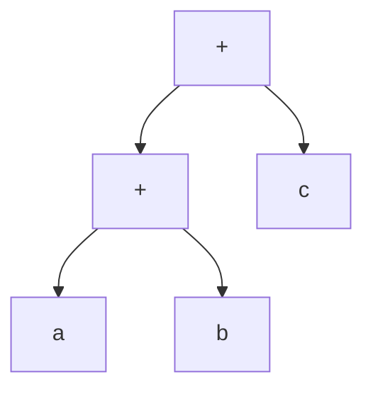

# Đệ quy và lặp

Trong thiết kế ngữ pháp cho một **Domain-Specific Language (DSL)**, đệ quy và lặp là hai cách mô tả những cấu trúc có thể xuất hiện nhiều lần hoặc lồng nhau. Đệ quy cho phép một quy tắc ngữ pháp sử dụng lại chính nó, trực tiếp hoặc thông qua quy tắc khác. Lặp cho phép một thành phần xuất hiện không lần nào, một lần hoặc nhiều lần theo giới hạn được xác định. Hai kỹ thuật này giúp ngữ pháp mô tả được danh sách, chuỗi câu lệnh, biểu thức lồng nhau, khối lồng nhau và nhiều cấu trúc thường gặp trong ngôn ngữ lập trình.

Ví dụ, một DSL cấu hình có thể cho phép một dịch vụ chứa nhiều thuộc tính, một pipeline chứa nhiều bước, và một biểu thức điều kiện chứa các biểu thức con. Nếu ngữ pháp chỉ mô tả một thuộc tính hoặc một bước duy nhất, ngôn ngữ sẽ rất hạn chế. Nếu ngữ pháp không mô tả đúng cách lồng nhau, parser có thể không phân tích được những cấu trúc tự nhiên như ngoặc biểu thức hoặc khối điều kiện bên trong khối khác.

## 1. Vì sao ngữ pháp cần đệ quy và lặp?

Ngôn ngữ thường có các cấu trúc lặp lại hoặc có độ sâu không cố định:

- Một file có thể chứa nhiều khai báo.
- Một khối có thể chứa nhiều câu lệnh.
- Một danh sách có thể có số lượng phần tử bất kỳ.
- Một biểu thức có thể gồm nhiều toán hạng và toán tử.
- Một biểu thức có thể chứa biểu thức con trong dấu ngoặc.
- Một khối có thể chứa khối khác, tạo ra nhiều cấp lồng nhau.

Ngữ pháp cần mô tả được những cấu trúc đó mà không phải viết một quy tắc riêng cho từng số lượng phần tử hoặc từng độ sâu. Đệ quy và lặp cung cấp cách mô tả tổng quát.

Ví dụ, một quy tắc chỉ cho phép một câu lệnh:

```ebnf
block = "{", statement, "}" ;
```

không thể mô tả khối rỗng hoặc khối có nhiều câu lệnh. Có thể dùng lặp:

```ebnf
block = "{", { statement }, "}" ;
```

Hoặc mô tả danh sách câu lệnh bằng đệ quy:

```ebnf
block = "{", statementList, "}" ;
statementList = statement, [ statementList ] ;
```

Hai cách biểu diễn có thể mô tả cùng một họ cấu trúc, nhưng cách viết, cây phân tích và độ thuận tiện khi triển khai parser có thể khác nhau.

## 2. Đệ quy trong ngữ pháp là gì?

Một quy tắc ngữ pháp có tính **đệ quy (recursion)** khi quá trình khai triển quy tắc có thể quay lại chính quy tắc đó. Có hai hình thức cơ bản:

- **Đệ quy trực tiếp (direct recursion)**: quy tắc xuất hiện lại ngay trong vế phải của chính nó.
- **Đệ quy gián tiếp (indirect recursion)**: quy tắc dẫn tới một hoặc nhiều quy tắc khác, rồi các quy tắc đó quay lại quy tắc ban đầu.

Ví dụ đệ quy trực tiếp:

```ebnf
expression = "(", expression, ")"
           | number ;
```

Một `expression` có thể là một số hoặc một biểu thức khác được đặt trong ngoặc. Quy tắc cho phép biểu thức lồng nhau ở độ sâu tùy ý, miễn là cuối cùng có một trường hợp cơ sở là `number`.

Ví dụ đệ quy gián tiếp:

```ebnf
expression = term
           | term, "+", expression ;

term = number
     | "(", expression, ")" ;
```

`expression` có thể dẫn đến `term`, còn `term` có thể chứa lại `expression`. Vì vậy, `expression` quay lại chính nó thông qua `term`.

### 2.1. Trường hợp cơ sở và bước đệ quy

Một quy tắc đệ quy hữu ích thường có hai thành phần:

1. **Trường hợp cơ sở (base case)**: một dạng cấu trúc có thể kết thúc mà không cần khai triển đệ quy thêm.
2. **Bước đệ quy (recursive case)**: một dạng cấu trúc chứa lại thành phần đang được định nghĩa, thường làm cấu trúc lớn hơn hoặc sâu hơn.

Ví dụ:

```ebnf
expression = number
           | "(", expression, ")" ;
```

`number` là trường hợp cơ sở. Nhánh `"(", expression, ")"` là bước đệ quy. Khi phân tích `(42)`, parser có thể đi từ `expression` đến nhánh ngoặc, rồi phân tích `42` bằng trường hợp cơ sở.

Nếu không có trường hợp cơ sở phù hợp, quy tắc có thể khai triển vô hạn hoặc parser không bao giờ tìm được cách kết thúc. Ví dụ:

```ebnf
expression = "(", expression, ")" ;
```

Quy tắc này luôn yêu cầu một `expression` khác bên trong ngoặc nhưng không định nghĩa cách tạo ra biểu thức đơn giản. Nó không sinh ra được chuỗi hữu hạn hợp lệ.

## 3. Đệ quy trái và đệ quy phải

Vị trí xuất hiện của quy tắc đệ quy trong vế phải ảnh hưởng đến cách parser xử lý.

### 3.1. Đệ quy trái

Một quy tắc có **đệ quy trái (left recursion)** nếu nó có thể khai triển thành chính nó ở vị trí đầu tiên của vế phải.

Đệ quy trái trực tiếp:

```ebnf
expression = expression, "+", term
           | term ;
```

Quy tắc này mô tả một biểu thức gồm một biểu thức trước đó, dấu `+` và một `term`, hoặc chỉ một `term`. Cách viết này tự nhiên khi muốn biểu diễn phép cộng kết hợp trái: `a + b + c` được nhóm thành `(a + b) + c`.

Tuy nhiên, parser đệ quy xuống (recursive descent) dạng đơn giản có thể gặp vấn đề. Khi gọi hàm `parseExpression()`, nhánh đầu tiên lại gọi ngay `parseExpression()` trước khi tiêu thụ token nào. Điều đó tạo ra lời gọi lặp vô hạn và có thể dẫn đến tràn ngăn xếp.

### 3.2. Đệ quy phải

Một quy tắc có **đệ quy phải (right recursion)** khi thành phần đệ quy xuất hiện ở cuối vế phải.

```ebnf
expression = term, [ "+", expression ] ;
```

Quy tắc này có thể phân tích chuỗi `a + b + c` bằng cách đọc `a`, sau đó đọc `+` và tiếp tục phân tích phần còn lại. Với parser đệ quy xuống, lời gọi đệ quy xảy ra sau khi parser đã tiêu thụ một phần đầu vào, vì vậy tránh được vòng gọi tức thời của đệ quy trái.

Đệ quy phải thường thuận tiện cho parser đệ quy xuống, nhưng nó có thể tạo cây phân tích khác với đệ quy trái. Nếu cấu trúc cần kết hợp trái, parser có thể phải xây dựng lại cây AST bằng vòng lặp hoặc phép gấp trái (left fold).

### 3.3. So sánh

| Đặc điểm | Đệ quy trái | Đệ quy phải |
|---|---|---|
| Vị trí quy tắc tự gọi | Đầu vế phải | Cuối vế phải |
| Parser đệ quy xuống đơn giản | Có thể gây gọi vô hạn | Thường xử lý thuận tiện hơn |
| Cách nhóm chuỗi toán tử | Thường biểu đạt kết hợp trái tự nhiên | Thường tạo cấu trúc lồng phải nếu giữ nguyên cây phân tích |
| Xử lý trong LL parser | Thường cần loại bỏ hoặc biến đổi | Có thể phù hợp nếu grammar đáp ứng điều kiện LL |
| Xử lý trong LR parser | Có thể được hỗ trợ tự nhiên | Cũng có thể được hỗ trợ |

Đệ quy trái không phải là sai trong mọi ngữ pháp. Nhiều parser kiểu LR xử lý đệ quy trái hiệu quả và quy tắc này có thể giúp grammar biểu đạt toán tử kết hợp trái tự nhiên. Cần lựa chọn cách viết dựa trên loại parser và cấu trúc AST mong muốn.

## 4. Lặp trong ngữ pháp

Lặp (repetition) mô tả một thành phần có thể xuất hiện nhiều lần. Trong EBNF, các dấu ngoặc nhọn thường biểu thị lặp không hoặc nhiều lần; cú pháp cụ thể có thể thay đổi theo công cụ grammar.

Các dạng lặp phổ biến:

| Ký hiệu EBNF | Ý nghĩa | Ký hiệu tương đương thường gặp |
|---|---|---|
| `{ item }` | Không hoặc nhiều lần | `item*` |
| `item, { item }` | Ít nhất một lần | `item+` |
| `[ item ]` | Không hoặc một lần | `item?` |

Ví dụ, một file có thể chứa không hoặc nhiều khai báo:

```ebnf
program = { declaration } ;
```

Một danh sách cần ít nhất một phần tử:

```ebnf
nonEmptyList = item, { ",", item } ;
```

Một khai báo có thể có chú thích tùy chọn:

```ebnf
declaration = "let", identifier, "=", expression,
              [ "#", string ] ;
```

### 4.1. Lặp không hoặc nhiều lần

Lặp không hoặc nhiều lần cho phép thành phần không xuất hiện. Ví dụ:

```ebnf
arguments = "(", [ expression, { ",", expression } ], ")" ;
```

Quy tắc này cho phép lời gọi không có tham số như `run()` và lời gọi có nhiều tham số như `run(a, b, c)`. Phần trong ngoặc vuông là tùy chọn; nếu có biểu thức đầu tiên thì các biểu thức tiếp theo có thể được lặp lại sau dấu phẩy.

### 4.2. Lặp ít nhất một lần

Nếu cấu trúc bắt buộc phải có ít nhất một phần tử, cần đặt một phần tử ở ngoài nhóm lặp:

```ebnf
items = item, { ",", item } ;
```

Nhờ đó, `items` không thể rỗng. Nếu dùng `{ item }`, parser sẽ chấp nhận chuỗi rỗng và có thể khiến các quy tắc ngữ nghĩa phải xử lý thêm trường hợp không mong muốn.

### 4.3. Lặp có dấu phân cách

Danh sách thường có dấu phân cách như dấu phẩy hoặc dấu chấm phẩy. Một lỗi phổ biến là đặt dấu phân cách bên trong nhóm lặp theo cách khiến dấu phân cách xuất hiện sau phần tử cuối, dù ngôn ngữ không cho phép dấu phân cách cuối.

Danh sách không cho phép dấu phẩy cuối:

```ebnf
argumentList = expression, { ",", expression } ;
```

Danh sách cho phép dấu phẩy cuối:

```ebnf
argumentList = expression, { ",", expression }, [ "," ] ;
```

Ví dụ hợp lệ với quy tắc thứ nhất là `f(a, b, c)`. Với quy tắc thứ hai, `f(a, b, c,)` cũng hợp lệ. Chính sách này nên được lựa chọn có chủ đích và áp dụng nhất quán cho các danh sách trong DSL.

## 5. Quan hệ giữa đệ quy và lặp

Đệ quy và lặp có thể biểu diễn nhiều cấu trúc tương đương. Ví dụ, một danh sách có thể được mô tả bằng lặp:

```ebnf
identifierList = identifier, { ",", identifier } ;
```

Hoặc bằng đệ quy:

```ebnf
identifierList = identifier
               | identifier, ",", identifierList ;
```

Cả hai mô tả một hoặc nhiều định danh được ngăn cách bằng dấu phẩy. Dạng lặp thường dễ đọc và dễ triển khai hơn trong nhiều grammar thực tế. Dạng đệ quy thể hiện trực tiếp cấu trúc danh sách như một phần tử cộng với phần danh sách còn lại.

Có thể chuyển một dạng đệ quy phải đơn giản thành vòng lặp trong parser. Ngược lại, một nhóm lặp trong EBNF có thể được mở rộng thành quy tắc đệ quy. Việc chọn dạng nào phụ thuộc công cụ parser, cách biểu diễn AST và mức độ dễ hiểu của grammar đối với người bảo trì.

Không nên nhầm lẫn lặp trong grammar với vòng lặp khi chương trình DSL chạy. Lặp trong grammar quy định một cấu trúc văn bản có thể xuất hiện nhiều lần, ví dụ nhiều câu lệnh trong khối. Vòng lặp trong chương trình DSL là một cấu trúc ngôn ngữ có thể khiến runtime thực hiện một hành động nhiều lần, ví dụ `for each item in items`. Hai khái niệm có thể cùng xuất hiện nhưng thuộc hai giai đoạn khác nhau.

## 6. Dùng đệ quy để mô tả cấu trúc lồng nhau

Một trong những ứng dụng quan trọng nhất của đệ quy là mô tả cấu trúc có thể lồng nhau ở độ sâu không cố định.

Ví dụ, DSL biểu diễn biểu thức số học có thể định nghĩa:

```ebnf
expression = number
           | identifier
           | "(", expression, ")"
           | expression, "+", expression
           | expression, "*", expression ;
```

Quy tắc trên minh họa ý tưởng nhưng chưa đủ để quy định độ ưu tiên và tính kết hợp của toán tử. Nó có thể cho phép nhiều cách phân tích đối với một chuỗi như `a + b * c`. Cần phân tầng grammar để xác định rõ phép nhân được xử lý trước phép cộng.

Một cách viết rõ ràng hơn:

```ebnf
expression = additive ;

additive = multiplicative,
           { ( "+" | "-" ), multiplicative } ;

multiplicative = primary,
                 { ( "*" | "/" ), primary } ;

primary = number
        | identifier
        | "(", expression, ")" ;
```

Trong grammar này:

- `primary` mô tả một số, định danh hoặc biểu thức trong ngoặc.
- `multiplicative` mô tả một `primary` theo sau bởi không hoặc nhiều phép nhân/chia.
- `additive` mô tả một `multiplicative` theo sau bởi không hoặc nhiều phép cộng/trừ.
- `expression` là điểm vào của hệ thống biểu thức.

Do `additive` chứa `multiplicative`, còn `multiplicative` chứa `primary`, phép nhân và chia được nhóm ở tầng sâu hơn phép cộng và trừ. Vì vậy, `a + b * c` được hiểu là `a + (b * c)`.

### 6.1. Biểu thức trong ngoặc

Quy tắc `primary` có nhánh `"(", expression, ")"`. Nhánh này cho phép một biểu thức đầy đủ xuất hiện bên trong ngoặc. Vì `expression` lại có thể chứa `primary`, cấu trúc ngoặc có thể lồng nhau:

```text
(a + b)
((a + b) * c)
(a * (b + (c - d)))
```

Không cần quy định trước độ sâu tối đa trong grammar. Tuy nhiên, parser và runtime vẫn có thể đặt giới hạn độ sâu để bảo vệ tài nguyên khi xử lý đầu vào quá lớn hoặc bất thường.

### 6.2. Khối lồng nhau

Đệ quy cũng thường dùng để mô tả khối chứa câu lệnh, trong đó một câu lệnh có thể là một khối khác:

```ebnf
block = "{", { statement }, "}" ;

statement = assignment
          | ifStatement
          | block ;

ifStatement = "if", "(", expression, ")", block,
              [ "else", block ] ;
```

Vì `statement` có thể là `block`, còn `block` chứa nhiều `statement`, grammar cho phép lồng khối ở nhiều cấp. Ví dụ:

```text
if (user.isActive) {
    if (user.isAdmin) {
        grant "manage-users"
    }
}
```

Parser cần theo dõi đúng dấu mở và đóng khối để không nhầm phạm vi của câu lệnh bên trong và bên ngoài.

## 7. Đệ quy và lặp trong parser đệ quy xuống

Parser đệ quy xuống (recursive descent parser) thường ánh xạ mỗi quy tắc ngữ pháp thành một hàm. Hàm phân tích một quy tắc có thể gọi hàm khác; nếu grammar có đệ quy thì các hàm có thể gọi lại chính chúng hoặc gọi qua nhau.

Ví dụ cho grammar biểu thức không có đệ quy trái:

```ebnf
expression = term, { ( "+" | "-" ), term } ;
term = number | identifier ;
```

Mã giả:

```text
parseExpression():
    node = parseTerm()

    while nextToken is "+" or "-":
        operator = consume()
        right = parseTerm()
        node = BinaryExpression(node, operator, right)

    return node

parseTerm():
    if nextToken is NUMBER:
        return NumberLiteral(consume())

    if nextToken is IDENTIFIER:
        return NameReference(consume())

    error("Expected a number or identifier")
```

Đoạn mã dùng vòng `while` để xử lý phần lặp của `expression`. Mỗi lần đọc một toán tử và một `term`, parser tạo một node mới với node trước đó làm vế trái. Với `a - b - c`, AST được tạo theo hướng `(a - b) - c`, đúng với tính kết hợp trái thông thường của phép trừ.

### 7.1. Vì sao đệ quy trái gây vấn đề với recursive descent?

Giả sử grammar:

```ebnf
expression = expression, "+", term
           | term ;
```

Một hàm được sinh trực tiếp từ nhánh đầu có thể hoạt động như sau:

```text
parseExpression():
    left = parseExpression()
    consume("+")
    right = parseTerm()
    return BinaryExpression(left, "+", right)
```

Hàm gọi `parseExpression()` ngay lập tức trước khi đọc token. Lời gọi tiếp theo lại làm điều tương tự, dẫn đến đệ quy vô hạn. Trong thực tế, parser có thể tràn stack trước khi báo lỗi hữu ích.

### 7.2. Loại bỏ đệ quy trái trực tiếp

Một quy tắc dạng:

```ebnf
A = A, alpha | beta ;
```

có thể được chuyển thành:

```ebnf
A = beta, { alpha } ;
```

Đây là phép biến đổi phổ biến để loại bỏ đệ quy trái trực tiếp trong những trường hợp phù hợp. Với ví dụ phép cộng:

```ebnf
expression = term, { "+", term } ;
```

Parser đọc một `term` trước, rồi lặp qua các cặp dấu cộng và `term`. Khi xây AST, cần dùng vòng lặp để gấp trái như ví dụ trước nếu toán tử kết hợp trái.

Biến đổi này không phải lúc nào cũng có thể áp dụng máy móc. Với đệ quy trái gián tiếp hoặc grammar có nhiều nhánh, cần phân tích tập FIRST/FOLLOW và thứ tự khai triển. Một số parser generator hỗ trợ xử lý đệ quy trái; khi đó có thể giữ grammar tự nhiên nếu công cụ và cấu hình cho phép.

## 8. Đệ quy gián tiếp và chu trình quy tắc

Đệ quy gián tiếp xuất hiện khi một quy tắc quay lại chính nó qua một chuỗi quy tắc khác. Ví dụ:

```ebnf
statement = declaration | expressionStatement ;
expressionStatement = expression, ";" ;
expression = primary | "(", statement, ")" ;
```

`statement` có thể dẫn đến `expressionStatement`, rồi `expression`, rồi quay lại `statement` thông qua nhánh ngoặc. Đây là chu trình giữa các quy tắc.

Không phải chu trình nào cũng sai. Chu trình có thể là cách hợp lệ để mô tả cấu trúc lồng nhau. Điều cần xem xét là liệu quá trình khai triển có tiêu thụ token trước khi quay lại cùng trạng thái hay không, và parser được chọn có hỗ trợ dạng đệ quy đó hay không.

### 8.1. Đệ quy trái gián tiếp

Một chu trình gián tiếp có thể tạo ra đệ quy trái ngay cả khi không có quy tắc nào tự gọi ở ký hiệu đầu một cách hiển nhiên:

```ebnf
A = B, "x" | "a" ;
B = A, "y" | "b" ;
```

`A` dẫn đến `B`, còn `B` có nhánh bắt đầu bằng `A`. Tùy cách khai triển, parser có thể quay lại `A` mà chưa tiêu thụ token. Với parser LL hoặc recursive descent, cần phát hiện và biến đổi chu trình này nếu công cụ không hỗ trợ left recursion.

### 8.2. Quy tắc nullable và nguy cơ vòng lặp

Một quy tắc được gọi là **nullable** nếu nó có thể sinh ra chuỗi rỗng. Ví dụ:

```ebnf
optionalLabel = [ identifier ] ;
```

Quy tắc nullable có thể hữu ích, nhưng khi kết hợp với đệ quy hoặc lặp, cần tránh một vòng khai triển không tiêu thụ token. Ví dụ:

```ebnf
items = { optionalLabel } ;
```

Nếu `optionalLabel` có thể rỗng, nhóm lặp có thể lặp lại mà không tiêu thụ đầu vào. Parser sinh từ grammar cần có cơ chế tránh vòng lặp này, và người thiết kế nên sửa grammar để mỗi vòng lặp tiêu thụ một cấu trúc thực sự.

## 9. Cây phân tích và AST khi có đệ quy/lặp

Đệ quy và lặp không chỉ ảnh hưởng đến việc parser có nhận diện được chuỗi hay không; chúng còn ảnh hưởng đến hình dạng cây phân tích.

Ví dụ, danh sách:

```text
alpha, beta, gamma
```

có thể được biểu diễn bằng cây danh sách với một node chứa ba phần tử, hoặc bằng cấu trúc đệ quy gồm phần tử đầu và phần danh sách còn lại. Với AST dùng cho các bước sau, dạng danh sách thường thuận tiện hơn vì có thể duyệt bằng vòng lặp.

Biểu thức:

```text
a + b + c
```

nếu được phân tích theo kết hợp trái có cây:



Nếu được nhóm phải, cây sẽ có node `+` ở gốc, `a` ở nhánh trái và một node `+` khác ở nhánh phải. Hai cây có thể cho kết quả khác nhau đối với phép toán không có tính kết hợp như phép trừ hoặc phép chia. Vì vậy, grammar và AST phải thống nhất với ngữ nghĩa toán tử.

Với lặp, parser thường có thể lưu các phần tử trong một danh sách hoặc collection. Với đệ quy, parser có thể tạo node lồng nhau. Cách biểu diễn nào phù hợp phụ thuộc vào cấu trúc miền và cách các giai đoạn semantic analysis, interpreter hoặc code generator sẽ sử dụng AST.

## 10. Phân biệt lặp cú pháp với cấu trúc lặp khi thực thi

Đây là điểm dễ nhầm khi đọc grammar DSL. Có hai loại lặp khác nhau:

**Lặp trong grammar** quy định số lần một thành phần văn bản có thể xuất hiện. Ví dụ:

```ebnf
program = { declaration } ;
```

Quy tắc này cho phép file chứa nhiều khai báo.

**Cấu trúc lặp trong DSL** là cú pháp mà người dùng viết để yêu cầu chương trình thực hiện một thao tác nhiều lần. Ví dụ:

```text
for each item in order.items {
    print item.name
}
```

Grammar có thể mô tả cấu trúc `for each` như sau:

```ebnf
forStatement = "for", "each", identifier,
               "in", expression, block ;
```

Ở đây, grammar chỉ nói rằng một `forStatement` gồm từ khóa, biến lặp, biểu thức nguồn và khối lệnh. Số lần vòng lặp thực sự chạy phụ thuộc dữ liệu và ngữ nghĩa runtime, không được quyết định bởi `{ ... }` trong EBNF.

Tương tự, đệ quy trong grammar không đồng nghĩa với việc chương trình DSL phải gọi hàm đệ quy khi chạy. Grammar có thể dùng đệ quy để mô tả khối lồng nhau, trong khi runtime xử lý các khối đó bằng stack, hàng đợi hoặc một cấu trúc dữ liệu khác.

## 11. Lựa chọn giữa EBNF lặp và quy tắc đệ quy

Trong tài liệu grammar, EBNF thường giúp diễn đạt các cấu trúc lặp ngắn gọn. Ví dụ:

```ebnf
parameterList = identifier, { ",", identifier } ;
```

thường dễ đọc hơn một quy tắc đệ quy:

```ebnf
parameterList = identifier
              | identifier, ",", parameterList ;
```

Tuy nhiên, không nên coi một dạng luôn tốt hơn dạng kia. Một số công cụ parser dùng grammar theo kiểu BNF thuần, không hỗ trợ dấu ngoặc nhọn hoặc ngoặc vuông của EBNF. Khi đó, nhóm lặp cần được mở rộng thành quy tắc đệ quy. Một số grammar cũng cần thể hiện cấu trúc cây cụ thể, khi đó đệ quy có thể trực quan hơn.

| Tình huống | Cách biểu diễn thường thuận tiện |
|---|---|
| Danh sách có dấu phân cách | EBNF lặp hoặc quy tắc list riêng |
| Biểu thức có ngoặc lồng nhau | Đệ quy |
| Khối chứa câu lệnh và khối con | Đệ quy kết hợp lặp |
| File chứa nhiều khai báo | Lặp không hoặc nhiều lần |
| Parser LL đơn giản | Tránh đệ quy trái; dùng lặp hoặc đệ quy phải phù hợp |
| Parser LR | Có thể giữ đệ quy trái nếu grammar và generator hỗ trợ |

## 12. Những lỗi thường gặp khi thiết kế đệ quy và lặp

| Lỗi | Hệ quả | Cách xử lý |
|---|---|---|
| Quy tắc đệ quy không có trường hợp cơ sở | Không tạo được chuỗi hữu hạn hoặc parser không kết thúc | Bổ sung nhánh cơ sở rõ ràng |
| Đệ quy trái trong recursive descent đơn giản | Gọi hàm parser vô hạn trước khi tiêu thụ token | Loại bỏ đệ quy trái hoặc dùng parser hỗ trợ nó |
| Lặp chứa thành phần có thể rỗng | Vòng lặp parser có thể không tiêu thụ đầu vào | Bảo đảm mỗi lần lặp tiêu thụ token hoặc cấu trúc |
| Dùng `{ item }` cho danh sách bắt buộc có phần tử | Parser chấp nhận danh sách rỗng ngoài ý muốn | Dùng `item, { separator, item }` |
| Không quy định dấu phân cách cuối | Các parser hoặc công cụ hiểu khác nhau | Đặc tả rõ trailing separator có hợp lệ không |
| Không phân tầng độ ưu tiên toán tử | Biểu thức có nhiều cách phân tích | Dùng các tầng grammar riêng hoặc quy tắc precedence rõ |
| Chọn đệ quy phải nhưng không dựng lại AST đúng kết hợp | Kết quả tính toán có thể sai với toán tử không kết hợp | Dùng phép gấp trái hoặc xây AST theo ngữ nghĩa |
| Cho phép lồng nhau không giới hạn mà không có bảo vệ | Đầu vào sâu có thể làm tràn stack hoặc tiêu tốn tài nguyên | Giới hạn độ sâu và xử lý lỗi có kiểm soát |
| Nhầm lặp trong grammar với vòng lặp runtime | Đặc tả và triển khai sai trách nhiệm | Tách rõ cú pháp, ngữ nghĩa và thực thi |

## 13. Quy trình thiết kế quy tắc đệ quy và lặp

Khi cần mô tả một cấu trúc có thể lặp hoặc lồng nhau, có thể thực hiện theo trình tự sau:

1. **Thu thập ví dụ thực tế**: viết một chuỗi có một phần tử, nhiều phần tử, trường hợp rỗng và trường hợp lồng nhau nếu có.
2. **Xác định số lượng hợp lệ**: thành phần có thể xuất hiện không lần nào, ít nhất một lần, tối đa một lần hay theo giới hạn cụ thể?
3. **Xác định trường hợp cơ sở**: cấu trúc đơn giản nhất tạo thành một thành phần hợp lệ là gì?
4. **Xác định bước mở rộng**: một cấu trúc lớn hơn được tạo bằng cách thêm phần tử, dấu phân cách hoặc thành phần lồng nào?
5. **Chọn cách biểu diễn**: dùng EBNF repetition, đệ quy trực tiếp hay quy tắc kết hợp nhiều tầng.
6. **Xem xét loại parser**: grammar có đệ quy trái, đệ quy gián tiếp hoặc chu trình nullable không?
7. **Xác định hình dạng AST**: danh sách sẽ thành collection hay node đệ quy; toán tử sẽ kết hợp trái hay phải?
8. **Kiểm tra đầu vào biên**: chuỗi rỗng, một phần tử, nhiều phần tử, dấu phân cách cuối, ngoặc thiếu và độ sâu lớn.
9. **Kiểm thử parser**: xác nhận chuỗi hợp lệ được chấp nhận, chuỗi không hợp lệ bị từ chối và diagnostics chỉ ra đúng vị trí.

Ví dụ với danh sách tham số, bộ trường hợp nên bao gồm:

```text
run()
run(a)
run(a, b)
run(a, b, c)
run(a,)
```

Nếu grammar cho phép danh sách rỗng và không cho phép dấu phẩy cuối, bốn trường hợp đầu hợp lệ, còn `run(a,)` không hợp lệ. Các ví dụ này giúp xác nhận chính xác ý nghĩa của dấu ngoặc vuông và ngoặc nhọn trong EBNF.

## 14. Đệ quy và lặp trong vòng đời phát triển DSL

Khi DSL phát triển, grammar có thể bổ sung cấu trúc lặp, cho phép khối lồng nhau hoặc mở rộng biểu thức. Những thay đổi này ảnh hưởng đến parser, AST, semantic validator, formatter, syntax highlighting và tài liệu.

Một thay đổi từ danh sách bắt buộc sang danh sách tùy chọn có thể khiến các chương trình trước đây không hợp lệ được chấp nhận. Ngược lại, thay đổi từ lặp không giới hạn sang giới hạn số lượng có thể làm chương trình cũ không còn hợp lệ. Vì vậy, cần xem xét tương thích ngữ nghĩa chứ không chỉ tương thích cú pháp.

Nên duy trì các bộ ví dụ grammar và test parser theo từng phiên bản. Khi thêm nhánh đệ quy hoặc thay đổi độ ưu tiên, cần kiểm tra xem chuỗi đã hợp lệ có còn tạo ra cùng AST và cùng hành vi hay không. Nếu thay đổi làm khác ý nghĩa, cần ghi rõ phiên bản ngôn ngữ hoặc cung cấp hướng dẫn chuyển đổi.

## 15. Tiêu chí của một grammar có đệ quy và lặp tốt

Một grammar sử dụng đệ quy và lặp hiệu quả cần mô tả được cả cấu trúc đơn giản lẫn cấu trúc phức tạp, đồng thời cho parser một cách xử lý kết thúc rõ ràng. Các quy tắc cần có trường hợp cơ sở, quy tắc lặp cần xác định số lượng tối thiểu và dấu phân cách, còn những cấu trúc biểu thức phải thể hiện đúng độ ưu tiên và tính kết hợp.

Người bảo trì nên có thể nhìn vào grammar và nhận ra ngay: thành phần nào có thể lặp, thành phần nào có thể lồng, trường hợp nào kết thúc và parser cần tiêu thụ token ở đâu. Khi các quy tắc này rõ ràng, DSL có thể hỗ trợ danh sách, biểu thức và khối lồng nhau ở nhiều cấp mà vẫn giữ được khả năng phân tích và chẩn đoán lỗi đáng tin cậy.
