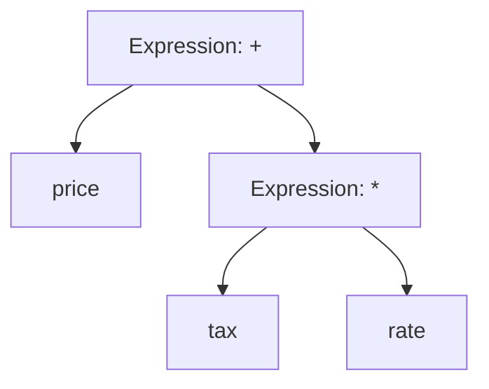
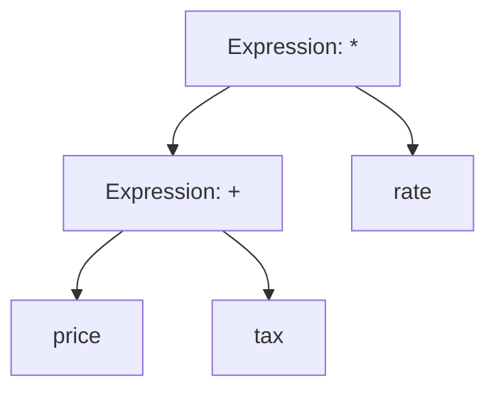

# Mơ hồ ngữ pháp

Trong thiết kế ngôn ngữ miền chuyên biệt (Domain-Specific Language, DSL), ngữ pháp quy định cách các token được kết hợp thành khai báo, câu lệnh và biểu thức. **Mơ hồ ngữ pháp (grammar ambiguity)** xảy ra khi một ngữ pháp cho phép ít nhất một chuỗi đầu vào hợp lệ có nhiều cây phân tích cú pháp khác nhau. Khi đó, cùng một chương trình có thể được cấu trúc theo nhiều cách, dẫn đến nhiều cách hiểu hoặc nhiều kết quả thực thi.

Mơ hồ ngữ pháp là vấn đề ở đặc tả cấu trúc của ngôn ngữ. Parser có thể chọn một cách phân tích theo quy tắc ưu tiên, nhưng việc parser vẫn chạy không tự chứng minh ngữ pháp ban đầu đã rõ ràng. Với DSL, người thiết kế cần quyết định cấu trúc nào người dùng muốn diễn đạt, sau đó làm cho ngữ pháp hoặc chính sách phân tích thể hiện quyết định đó một cách công khai và nhất quán.

## 1. Định nghĩa mơ hồ ngữ pháp

Một ngữ pháp hình thức được gọi là mơ hồ nếu tồn tại ít nhất một chuỗi thuộc ngôn ngữ của nó có nhiều hơn một cây phân tích (parse tree). Tương đương, tồn tại một chuỗi có nhiều hơn một dẫn xuất trái nhất (leftmost derivation) hoặc nhiều hơn một dẫn xuất phải nhất (rightmost derivation).

Cần phân biệt hai điều:

- Một chuỗi có thể có nhiều trình tự dẫn xuất do ta chọn thay thế các ký hiệu không kết thúc độc lập theo thứ tự khác nhau. Điều này chưa đủ để kết luận ngữ pháp mơ hồ nếu các trình tự đó tạo cùng một cây phân tích.
- Nếu cùng chuỗi có hai cây phân tích khác nhau, cấu trúc cú pháp thực sự không duy nhất và ngữ pháp là mơ hồ.

Ví dụ, xét ngữ pháp biểu thức:

```text
Expression -> Expression "+" Expression
            | Expression "*" Expression
            | "(" Expression ")"
            | IDENTIFIER
```

Chuỗi sau có thể được phân tích theo hai cách:

```text
price + tax * rate
```

Cây thứ nhất nhóm phép nhân trước:



Cây thứ hai nhóm phép cộng trước:



Cây thứ nhất biểu diễn `price + (tax * rate)`, còn cây thứ hai biểu diễn `(price + tax) * rate`. Hai cấu trúc có thể cho kết quả khác nhau. Nếu DSL không định nghĩa độ ưu tiên hoặc quy tắc nhóm, người viết không thể biết chắc ý nghĩa của biểu thức.

## 2. Phân biệt mơ hồ ngữ pháp với các vấn đề liên quan

### 2.1. Mơ hồ ngữ pháp và mơ hồ từ vựng

Mơ hồ từ vựng xảy ra khi lexer có nhiều cách chia một chuỗi ký tự thành token. Ví dụ, DSL có toán tử `>` và `>=`; lexer cần nhận `>=` là một token, thường bằng quy tắc khớp dài nhất.

Mơ hồ ngữ pháp xảy ra sau khi token đã được tạo. Nếu lexer đã tạo đúng chuỗi token `IDENTIFIER`, `+`, `IDENTIFIER`, `*`, `IDENTIFIER` nhưng grammar cho phép hai cây phân tích, đó là mơ hồ ngữ pháp.

Quy tắc longest match có thể giải quyết một số vấn đề token hóa, nhưng không giải quyết độ ưu tiên giữa phép cộng và phép nhân. Hai lớp cần được thiết kế riêng.

### 2.2. Mơ hồ ngữ pháp và mơ hồ ngữ nghĩa

Mơ hồ ngữ nghĩa xảy ra khi cấu trúc cú pháp đã duy nhất nhưng ý nghĩa nghiệp vụ vẫn chưa được xác định rõ. Ví dụ:

```text
apply discount 10
```

Parser có thể nhận diện đây là một lệnh áp dụng chiết khấu, nhưng con số `10` có thể là 10 phần trăm hoặc 10 đơn vị tiền tệ nếu DSL không định nghĩa kiểu và đơn vị. Đây là vấn đề ngữ nghĩa miền.

Một chương trình có thể vừa có mơ hồ cú pháp vừa có mơ hồ ngữ nghĩa. Tuy nhiên, sửa grammar không thay thế việc định nghĩa kiểu, đơn vị, quy tắc nghiệp vụ và thời điểm áp dụng.

### 2.3. Ngữ pháp mơ hồ và parser có xung đột

Parser generator có thể báo xung đột shift/reduce hoặc reduce/reduce. Xung đột là tín hiệu cần điều tra, nhưng không phải lúc nào cũng chứng minh grammar mơ hồ. Một grammar không mơ hồ vẫn có thể không thuộc lớp mà một parser cụ thể xử lý được với lượng lookahead hoặc cấu hình hiện tại.

Ngược lại, parser có thể dùng precedence hoặc một quy tắc mặc định để chọn một cách phân tích trong grammar mơ hồ. Khi đó chương trình có kết quả xác định theo parser, nhưng đặc tả grammar vẫn cho phép nhiều cấu trúc.

## 3. Các nguồn mơ hồ thường gặp

### 3.1. Toán tử không có độ ưu tiên rõ ràng

Grammar sau là mơ hồ:

```text
Expr -> Expr "+" Expr
      | Expr "*" Expr
      | NUMBER
```

Với `2 + 3 * 4`, grammar không cho biết phép nhân hay phép cộng phải được nhóm trước. Tương tự, các toán tử logic `and` và `or` cũng cần thứ tự ưu tiên rõ ràng.

### 3.2. Toán tử cùng mức không có tính kết hợp xác định

Với grammar:

```text
Expr -> Expr "-" Expr | NUMBER
```

chuỗi `10 - 3 - 2` có thể được nhóm thành:

```text
(10 - 3) - 2
10 - (3 - 2)
```

Nếu DSL muốn phép trừ kết hợp trái, phải quy định và mã hóa điều đó trong grammar hoặc chính sách parser. Với một số toán tử như so sánh, DSL có thể cấm kết hợp liên tiếp để tránh cách hiểu không rõ ràng.

### 3.3. Dangling else

Một ví dụ kinh điển là câu lệnh `if` lồng nhau:

```text
if conditionA then
    if conditionB then approve
else reject
```

Từ khóa `else` có thể được ghép với `if conditionB` bên trong hoặc `if conditionA` bên ngoài. Nếu grammar không quy định, chuỗi có hai cách phân tích.

### 3.4. Các nhánh có tiền tố chung

Một grammar có thể có các lựa chọn bắt đầu bằng cùng token:

```text
Statement -> IDENTIFIER "=" Expression
           | IDENTIFIER "(" ArgumentList ")"
```

Chỉ nhìn token đầu tiên, parser chưa thể biết đó là phép gán hay lời gọi hàm. Tiền tố chung tự nó chưa nhất thiết làm grammar mơ hồ; token tiếp theo có thể phân biệt hai nhánh. Tuy nhiên, nếu các nhánh chồng lấn hoặc có phần kết thúc tương thích, chúng có thể tạo ra nhiều cách phân tích. Left factoring giúp tổ chức lại grammar để parser dự đoán dễ hơn.

### 3.5. Cấu trúc tùy chọn và ranh giới khối

Các thành phần tùy chọn như `else`, dấu phân cách, dấu chấm phẩy hoặc khối lồng nhau có thể khiến một token được gắn vào nhiều cấu trúc. Việc dùng dấu đóng khối không nhất quán hoặc cho phép bỏ dấu phân cách ở nhiều vị trí làm tăng khả năng mơ hồ.

Ví dụ, một DSL có thể cho phép khai báo thuộc tính cả bên trong và bên ngoài khối mà không có dấu kết thúc rõ ràng. Khi hai khai báo liền nhau, parser có thể không biết thuộc tính nào kết thúc khối hiện tại.

## 4. Phân tích ví dụ biểu thức bằng dẫn xuất

Xét lại grammar:

```text
Expr -> Expr "+" Expr
      | Expr "*" Expr
      | IDENTIFIER
```

Với chuỗi `a + b * c`, một dẫn xuất trái nhất có thể tạo cây phép cộng ở gốc:

```text
Expr
=> Expr + Expr
=> a + Expr
=> a + Expr * Expr
=> a + b * c
```

Một dẫn xuất trái nhất khác có thể tạo cây phép nhân ở gốc:

```text
Expr
=> Expr * Expr
=> Expr + Expr * Expr
=> a + b * c
```

Trong dẫn xuất thứ hai, ký hiệu `Expr` bên trái của phép nhân được mở rộng thành phép cộng. Hai dẫn xuất trái nhất tạo hai cây khác nhau cho cùng chuỗi, vì vậy grammar mơ hồ.

Đây là cách chứng minh mơ hồ cho một grammar cụ thể: chỉ cần đưa ra một chuỗi và hai cây phân tích khác nhau. Để chứng minh grammar không mơ hồ, cần lập luận cho mọi chuỗi mà grammar có thể sinh ra, việc này khó hơn nhiều.

## 5. Loại bỏ mơ hồ bằng cách phân tầng độ ưu tiên

Một cách phổ biến là chia biểu thức thành nhiều ký hiệu không kết thúc theo độ ưu tiên. Ví dụ, phép nhân có độ ưu tiên cao hơn phép cộng:

```ebnf
Expression = Expression, "+", Term | Term ;
Term       = Term, "*", Factor | Factor ;
Factor     = "(", Expression, ")" | IDENTIFIER | NUMBER ;
```

Trong grammar này:

- `Expression` xử lý phép cộng.
- `Term` xử lý phép nhân.
- `Factor` xử lý giá trị cơ bản và biểu thức trong ngoặc.

Vì `Expression` dùng `Term`, còn `Term` dùng `Factor`, phép nhân được nhóm bên trong trước khi phép cộng kết hợp các `Term`.

Một dạng EBNF không dùng đệ quy trái trực tiếp:

```ebnf
Expression = Term, { "+", Term } ;
Term       = Factor, { "*", Factor } ;
Factor     = "(", Expression, ")" | IDENTIFIER | NUMBER ;
```

Với parser recursive descent, các vòng lặp có thể lần lượt đọc các toán hạng và xây AST kết hợp trái. Chẳng hạn, khi đọc `a - b - c`, parser bắt đầu bằng `a`, sau đó lần lượt tạo `Subtract(a, b)` rồi `Subtract(Subtract(a, b), c)`.

Cần lưu ý: việc viết grammar thành các tầng ưu tiên giải quyết cách nhóm toán tử, nhưng cách xây AST vẫn phải phản ánh tính kết hợp đã định. Không nên chỉ dựa vào thứ tự token rồi tạo cây theo cách tùy ý.

## 6. Quy định tính kết hợp và toán tử không kết hợp

Độ ưu tiên quyết định nhóm toán tử khác mức; tính kết hợp (associativity) quyết định nhóm toán tử cùng mức.

| Kiểu kết hợp | Cách nhóm | Ví dụ |
|---|---|---|
| Trái | Từ trái sang phải | `(a - b) - c` |
| Phải | Từ phải sang trái | `a = (b = c)` |
| Không kết hợp | Không cho phép chuỗi nối trực tiếp | `a < b < c` bị từ chối |

Với phép trừ, kết hợp trái thường phù hợp. Với phép gán, kết hợp phải thường được dùng nếu biểu thức gán trả về giá trị. Với phép so sánh, DSL có thể yêu cầu viết `a < b and b < c` thay vì cho phép `a < b < c`.

Nếu parser generator hỗ trợ khai báo precedence và associativity, các khai báo này phải được xem là một phần của đặc tả ngôn ngữ. Tài liệu, parser, formatter và IDE phải dùng cùng quy tắc.

## 7. Giải quyết dangling else

Có nhiều cách để loại bỏ mơ hồ của `else`.

### 7.1. Ghép với if gần nhất

Quy ước phổ biến là ghép `else` với `if` gần nhất chưa có `else`. Theo quy ước này:

```text
if a then
    if b then approve
    else reject
```

được hiểu là `else` thuộc `if b`.

Quy tắc này dễ áp dụng, nhưng cần được ghi rõ trong tài liệu DSL.

### 7.2. Dùng dấu kết thúc khối

DSL có thể yêu cầu `end` cho từng khối:

```text
if a then
    if b then
        approve
    else
        reject
    end
end
```

Mỗi `end` đóng một cấu trúc `if`, nên ranh giới không phụ thuộc vào quy tắc ghép ngầm.

### 7.3. Dùng ngoặc nhọn

Một cách khác là dùng `{}`:

```text
if a {
    if b {
        approve
    } else {
        reject
    }
}
```

Dấu đóng khối giúp parser và người đọc xác định rõ phạm vi. Nếu DSL dùng thụt lề, cần quy định chính xác cách tab, dấu cách và dòng trống ảnh hưởng đến cấu trúc.

### 7.4. Tách matched và unmatched statements

Về mặt ngữ pháp, có thể chia câu lệnh `if` thành dạng đã ghép đủ `else` và dạng còn thiếu `else`:

```text
Statement  -> Matched | Unmatched
Matched    -> IF Expr THEN Matched ELSE Matched | Other
Unmatched  -> IF Expr THEN Statement
            | IF Expr THEN Matched ELSE Unmatched
```

Cách phân chia này làm grammar không mơ hồ theo quy ước `else` ghép với `if` gần nhất. Tuy nhiên, nó làm grammar dài và khó đọc hơn. Với DSL nhỏ, dấu kết thúc khối hoặc ngoặc nhọn thường dễ hiểu hơn.

## 8. Sửa grammar và dùng chỉ thị parser

Có hai cách tiếp cận thường gặp để xử lý mơ hồ: thay đổi grammar hoặc giữ grammar rồi bổ sung quy tắc cho parser.

### 8.1. Viết lại grammar

Viết lại grammar là cách thể hiện cấu trúc mong muốn ngay trong đặc tả. Phân tầng biểu thức, tách `matched`/`unmatched`, thêm dấu phân cách hoặc left factoring đều thuộc nhóm này.

Ưu điểm là cấu trúc được giải thích ngay trong ngữ pháp và có thể dùng chung cho nhiều parser hoặc công cụ. Nhược điểm là grammar có thể dài hơn, đôi khi cây phân tích cần bước chuyển đổi để tạo AST thuận tiện.

### 8.2. Khai báo precedence trong parser generator

Một số công cụ parser cho phép khai báo mức ưu tiên và tính kết hợp cho token. Ví dụ, grammar vẫn có thể viết:

```text
Expr -> Expr "+" Expr
      | Expr "*" Expr
      | IDENTIFIER
```

sau đó cấu hình `*` có ưu tiên cao hơn `+`, và cả hai kết hợp trái. Parser generator dùng thông tin đó để giải quyết một số xung đột shift/reduce.

Cách này ngắn gọn và phổ biến trong grammar biểu thức. Tuy nhiên, chỉ thị precedence là chính sách của parser generator; người bảo trì cần ghi rõ nó trong tài liệu và kiểm thử để các công cụ khác không áp dụng cách hiểu khác.

### 8.3. Semantic predicates và thông tin ngữ cảnh

Một số DSL cần dùng bảng ký hiệu hoặc kiểu dữ liệu để chọn cách phân tích. Ví dụ, một tên có thể được hiểu là tên kiểu hoặc tên biến tùy theo khai báo trước đó. Parser có thể dùng semantic predicate hoặc bước phân tích ngữ nghĩa để quyết định.

Cách này hữu ích khi cú pháp thực sự phụ thuộc vào ngữ cảnh, nhưng làm parser gắn chặt hơn với trạng thái chương trình. Nên dùng có kiểm soát và tách phần xác thực ngữ nghĩa khỏi grammar khi có thể.

## 9. Parser tổng quát và biểu diễn nhiều cách phân tích

Không phải hệ thống nào cũng cần loại bỏ mọi mơ hồ ngay ở giai đoạn parse. Một số parser tổng quát có thể giữ nhiều cách phân tích trong một cấu trúc chung, thường gọi là parse forest hoặc shared packed parse forest.

Các thuật toán như Earley hoặc GLR có thể xử lý nhiều lớp grammar và giữ lại các lựa chọn phân tích thay vì lập tức chọn một nhánh. Hệ thống phía sau có thể dùng ngữ nghĩa, kiểu hoặc ngữ cảnh để loại bỏ những cách không hợp lệ.

Cách tiếp cận này có ích khi ngữ pháp lớn, cú pháp có nhiều cấu trúc chồng lấn hoặc cần hỗ trợ ngôn ngữ tự nhiên có nhiều cách phân tích. Tuy nhiên, nó làm tăng độ phức tạp: số cách phân tích có thể tăng nhanh, thông báo lỗi khó hơn và bước phân giải cần quy tắc rõ.

Đối với DSL cấu hình hoặc DSL nghiệp vụ, thường nên thiết kế cú pháp để người dùng có một cách hiểu duy nhất. Chỉ giữ nhiều cách phân tích khi đó là yêu cầu có chủ đích và có cơ chế phân giải đáng tin cậy.

## 10. PEG và lựa chọn có thứ tự

Parsing Expression Grammar (PEG) dùng lựa chọn có thứ tự (ordered choice). Nếu grammar viết `A / B`, parser thử `A` trước; nếu `A` thành công, `B` không được chọn theo quy tắc đó. Vì vậy, thứ tự các nhánh ảnh hưởng cách phân tích.

PEG không có khái niệm mơ hồ nhiều cây phân tích giống CFG truyền thống theo cùng cách, bởi lựa chọn có thứ tự đã định nghĩa một cách thử cụ thể. Tuy nhiên, thứ tự nhánh có thể làm một nhánh rộng che mất nhánh cụ thể, khiến đầu vào được nhận diện theo cách người thiết kế không mong muốn.

Ví dụ, nếu một nhánh nhận mọi chuỗi bắt đầu bằng `IDENTIFIER`, đặt nó trước một nhánh cụ thể hơn có thể khiến nhánh cụ thể không bao giờ được chọn. Do đó, PEG vẫn cần được thiết kế và kiểm thử cẩn thận; ordered choice là ngữ nghĩa lựa chọn, không phải bằng chứng rằng cách diễn đạt của DSL tự nhiên hoặc dễ hiểu.

## 11. Mơ hồ của grammar và mơ hồ vốn có của ngôn ngữ

Cần phân biệt:

- **Grammar mơ hồ:** một tập luật cụ thể tạo ra ít nhất một chuỗi có nhiều cây phân tích.
- **Ngôn ngữ vốn có mơ hồ (inherently ambiguous language):** ngôn ngữ hình thức đó không thể được mô tả bằng bất kỳ grammar không mơ hồ nào trong cùng lớp grammar đang xét.

Một grammar mơ hồ không đồng nghĩa với việc ngôn ngữ mà nó sinh ra vốn có mơ hồ. Ví dụ grammar biểu thức `Expr -> Expr + Expr | Expr * Expr | IDENTIFIER` là mơ hồ, nhưng có thể viết lại thành grammar phân tầng theo độ ưu tiên để loại bỏ mơ hồ.

Trong lý thuyết ngôn ngữ hình thức, có những ngôn ngữ phi ngữ cảnh vốn có mơ hồ. Điều này có nghĩa không thể tìm một grammar phi ngữ cảnh không mơ hồ cho chúng. Với DSL thực tế, trường hợp này ít gặp hơn; phần lớn vấn đề đến từ cách thiết kế grammar và có thể được xử lý bằng cách làm rõ cú pháp hoặc giới hạn cấu trúc.

## 12. Có thể tự động chứng minh một grammar không mơ hồ không?

Đối với một grammar phi ngữ cảnh bất kỳ, bài toán quyết định xem grammar đó có mơ hồ hay không là không khả quyết (undecidable). Vì vậy, không tồn tại một thuật toán tổng quát luôn kết thúc và trả lời chính xác có/không cho mọi grammar phi ngữ cảnh.

Điều đó không có nghĩa nhóm phát triển không thể kiểm soát mơ hồ. Có thể:

- Chứng minh một grammar cụ thể không mơ hồ bằng cách phân tích cấu trúc hoặc quy nạp theo cây phân tích.
- Chọn một lớp grammar có đặc tính phân tích xác định, chẳng hạn grammar LR phù hợp với parser LR.
- Dùng công cụ phân tích grammar để phát hiện xung đột trong lớp parser được hỗ trợ.
- Viết kiểm thử cho các chuỗi dễ gây nhầm lẫn và xác nhận AST mong đợi.
- Giới hạn cú pháp để loại bỏ các trường hợp có nhiều cách hiểu.

Kiểm thử nhiều ví dụ hữu ích nhưng không chứng minh grammar không mơ hồ cho mọi đầu vào. Nó chỉ xác nhận những trường hợp đã kiểm tra. Với DSL quan trọng, nên kết hợp đặc tả, lập luận về grammar và kiểm thử tự động.

## 13. Quy trình xử lý mơ hồ trong một DSL

Khi phát hiện parser có nhiều cách phân tích hoặc người dùng hiểu khác nhau, có thể tiến hành theo các bước:

1. **Thu thập chuỗi gây mơ hồ:** lưu một ví dụ nhỏ nhất thể hiện vấn đề.
2. **Xem token:** xác nhận lexer đã tạo đúng chuỗi token; nếu sai, xử lý ở tầng từ vựng.
3. **Tạo các cây phân tích:** xác định các cách cấu trúc khác nhau mà grammar cho phép.
4. **Xác định ý nghĩa mong muốn:** trao đổi với người dùng miền để quyết định cách hiểu đúng.
5. **Chọn cách giải quyết:** sửa grammar, thêm dấu phân cách, quy định precedence/associativity, hoặc dùng quy tắc parser có chủ đích.
6. **Kiểm tra tác động:** xem chương trình cũ có thay đổi cây hoặc mất tính hợp lệ không.
7. **Cập nhật đặc tả và công cụ:** đồng bộ parser, formatter, IDE, tài liệu và thông báo lỗi.
8. **Thêm kiểm thử hồi quy:** giữ chuỗi gây mơ hồ và các biến thể liên quan trong bộ test.

Nên ưu tiên cách giải quyết mà người viết DSL có thể nhìn thấy trong mã. Nếu parser âm thầm chọn một nhánh dựa trên chi tiết nội bộ, người dùng sẽ khó dự đoán kết quả.

## 14. Kiểm thử mơ hồ và tính nhất quán của parser

Bộ kiểm thử grammar cần có các nhóm trường hợp sau:

- **Biểu thức hỗn hợp:** nhiều toán tử khác mức và cùng mức, có và không có ngoặc.
- **Câu lệnh lồng nhau:** `if`, `else`, khối lồng nhau và các dấu kết thúc.
- **Tiền tố chung:** lời gọi hàm, phép gán và khai báo có phần đầu giống nhau.
- **Danh sách và phần tùy chọn:** danh sách rỗng, một phần tử, nhiều phần tử, dấu phẩy cuối.
- **Tên và từ khóa:** tên trùng từ khóa, tên có escape và từ khóa ngữ cảnh.
- **Đầu vào không hợp lệ:** xác nhận parser từ chối và chỉ đúng vị trí lỗi.

Với mỗi chuỗi quan trọng, nên kiểm tra cây phân tích hoặc AST, không chỉ kiểm tra parser có chấp nhận đầu vào hay không. Hai cách phân tích có thể được parser rút gọn thành cùng một kết quả ở một trường hợp cụ thể, nhưng cấu trúc ngữ pháp vẫn cần được hiểu đúng.

Nếu hệ thống dùng parser tổng quát, có thể kiểm tra số lượng cây phân tích hoặc cấu trúc parse forest cho các ví dụ được chọn. Nếu dùng parser xác định, cần xác nhận các chỉ thị precedence hoặc quy tắc ưu tiên được áp dụng như dự kiến.

## 15. Tác động của mơ hồ đến công cụ DSL

Mơ hồ không chỉ ảnh hưởng đến runtime. Nó còn tác động đến:

- **Formatter:** có thể đặt ngoặc hoặc xuống dòng theo một cấu trúc khác với ý định người viết.
- **Syntax highlighting:** có thể tô màu một từ theo vai trò từ khóa trong khi nó thực tế là tên định danh.
- **IDE và autocomplete:** gợi ý khác nhau tùy cách parser phân tích phần mã chưa hoàn chỉnh.
- **Refactoring:** đổi tên hoặc di chuyển cấu trúc có thể tác động sai nút AST nếu cách hiểu không duy nhất.
- **Thông báo lỗi:** parser có thể chỉ ra lỗi ở vị trí xa nguyên nhân vì đã chọn nhánh phân tích không phù hợp.
- **Sinh mã và tối ưu:** hai cây khác nhau có thể tạo hành vi hoặc mã đầu ra khác nhau.

Vì vậy, các công cụ cần dùng chung đặc tả grammar và cùng chính sách phân tích. Không nên để formatter hoặc IDE tự diễn giải một tập cú pháp riêng với runtime.

## 16. Ví dụ tổng hợp: DSL điều kiện phê duyệt

Giả sử DSL cho phép viết:

```text
rule "approve-order" {
    when customer.isVerified
         and order.total >= 1000000
         or customer.isPremium
    then approve order
}
```

Nếu `and` và `or` không có độ ưu tiên, điều kiện có thể được hiểu theo hai cách:

```text
(customer.isVerified and order.total >= 1000000)
or customer.isPremium
```

hoặc:

```text
customer.isVerified
and (order.total >= 1000000 or customer.isPremium)
```

Hai cách hiểu có thể dẫn đến quyết định phê duyệt khác nhau. Có hai lựa chọn thiết kế:

1. Quy định `and` có độ ưu tiên cao hơn `or` và ghi rõ trong đặc tả.
2. Yêu cầu người viết đặt ngoặc để biểu thị nhóm điều kiện.

Nếu chính sách yêu cầu khách hàng phải được xác minh và đồng thời có tổng đơn đủ lớn hoặc là khách hàng Premium, cách viết rõ ràng là:

```text
when customer.isVerified
     and (order.total >= 1000000 or customer.isPremium)
```

Parser tạo AST với `and` ở gốc và một nút `or` ở nhánh phải. Semantic analysis sau đó kiểm tra `isVerified` và `isPremium` là boolean, `order.total` có kiểu tiền tệ phù hợp và `approve` là hành động hợp lệ trong ngữ cảnh quy tắc. Như vậy, grammar xác định cách nhóm biểu thức còn phân tích ngữ nghĩa xác nhận kiểu và quy tắc miền.

## 17. Nguyên tắc thiết kế để hạn chế mơ hồ

Một DSL dễ hiểu nên tuân theo các nguyên tắc:

- **Công bố độ ưu tiên và tính kết hợp:** không để người dùng tự suy đoán cách nhóm toán tử.
- **Dùng dấu phân cách khối nhất quán:** chọn ngoặc nhọn, từ khóa kết thúc hoặc thụt lề có quy tắc rõ.
- **Giới hạn cấu trúc chồng lấn:** tránh để cùng một chuỗi token mở đầu nhiều dạng câu lệnh mà không có cách phân biệt ổn định.
- **Tách cú pháp và ngữ nghĩa:** để grammar mô tả hình thức, semantic analysis kiểm tra tên, kiểu và quy tắc miền.
- **Đặt tên ký hiệu rõ ràng:** grammar và AST nên phản ánh khái niệm của DSL.
- **Công khai chính sách parser:** precedence, ordered choice, semantic predicates và cách xử lý xung đột cần được ghi nhận.
- **Giữ công cụ đồng nhất:** parser, formatter, IDE và runtime phải dựa trên cùng ngữ nghĩa cú pháp.
- **Kiểm thử các trường hợp dễ gây nhầm:** giữ ví dụ làm regression test khi grammar thay đổi.

Mơ hồ ngữ pháp xuất hiện khi một chuỗi có thể tạo ra nhiều cây phân tích khác nhau. Để kiểm soát vấn đề, người thiết kế cần xác định cách hiểu mong muốn, thể hiện nó bằng luật sản sinh hoặc chính sách parser rõ ràng, rồi kiểm tra AST và hành vi bằng các ví dụ cụ thể. Một DSL có grammar dễ dự đoán giúp người dùng viết chương trình với ý nghĩa ổn định, đồng thời giúp parser và các công cụ phát triển phối hợp nhất quán khi ngôn ngữ mở rộng.
