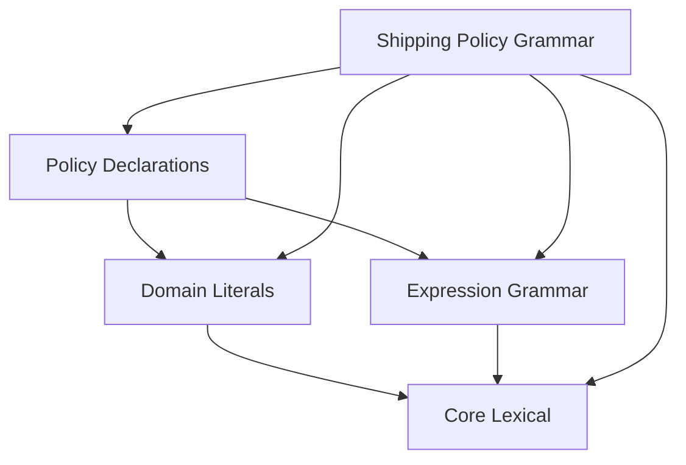

# Ngữ pháp mô-đun

Khi một ngôn ngữ chuyên biệt miền (Domain-Specific Language, DSL) phát triển, số lượng cấu trúc cú pháp thường tăng theo số khái niệm và nhiệm vụ mà ngôn ngữ cần biểu đạt. Một ngữ pháp ban đầu chỉ có vài quy tắc có thể dần chứa khai báo, biểu thức, kiểu dữ liệu, câu lệnh, quy tắc, truy vấn, khối cấu hình và cú pháp mở rộng. Nếu tất cả được đặt trong một đặc tả duy nhất, việc đọc, thay đổi, kiểm thử và tái sử dụng ngữ pháp sẽ ngày càng khó.

**Ngữ pháp mô-đun (modular grammar)** là cách tổ chức ngữ pháp thành những phần có ranh giới và trách nhiệm rõ ràng, sau đó kết hợp các phần đó thành ngữ pháp hoàn chỉnh cho parser. Mỗi mô-đun có thể định nghĩa một nhóm cấu trúc cú pháp, sử dụng các quy tắc chung và công bố những điểm mà mô-đun khác được phép tham chiếu hoặc mở rộng.

Trong thiết kế DSL, cách tổ chức này giúp tách cú pháp theo khái niệm miền hoặc nhóm chức năng, chẳng hạn mô-đun khai báo, biểu thức, điều kiện, truy vấn và quy tắc nghiệp vụ. Nhờ đó, nhóm có thể phát triển một phần ngôn ngữ mà không phải hiểu hoặc sửa toàn bộ ngữ pháp. Tuy nhiên, mô-đun chỉ hữu ích khi các ranh giới, phụ thuộc, tên quy tắc, điểm mở rộng và cách giải quyết xung đột được định nghĩa nhất quán.

## 1. Ngữ pháp mô-đun là gì?

Ngữ pháp mô tả cách các token hoặc ký hiệu kết hợp thành những cấu trúc cú pháp hợp lệ. Với một DSL văn bản, ngữ pháp có thể được viết bằng EBNF, PEG, ANTLR grammar hoặc một hình thức tương đương. **Ngữ pháp mô-đun** chia đặc tả đó thành nhiều phần nhỏ có thể quản lý và kết hợp.

Ví dụ, một DSL cấu hình hạ tầng có thể gồm:

- Mô-đun từ vựng định nghĩa identifier, string, number, comment và keyword.
- Mô-đun biểu thức định nghĩa literal, phép toán và truy cập thuộc tính.
- Mô-đun khai báo định nghĩa cấu trúc `resource`, `variable` và `output`.
- Mô-đun điều kiện định nghĩa `if`, `else` và biểu thức Boolean.
- Mô-đun tham chiếu định nghĩa cú pháp gọi module hoặc tham chiếu tài nguyên.

Các phần này được kết hợp để tạo parser hoàn chỉnh. Mô-đun biểu thức có thể được tái sử dụng trong điều kiện, giá trị thuộc tính và khai báo output, thay vì phải định nghĩa phép toán riêng trong từng nơi.

### 1.1. Mô-đun ngữ pháp không đồng nghĩa với mô-đun chương trình DSL

Hai khái niệm thường dễ bị nhầm:

| Khái niệm | Ý nghĩa |
|---|---|
| Mô-đun ngữ pháp | Phần đặc tả cú pháp được dùng để xây dựng parser |
| Mô-đun chương trình DSL | Đơn vị tổ chức mã DSL mà người dùng viết, có thể có import, export và phạm vi tên riêng |

Ví dụ, `ExpressionGrammar` có thể là một mô-đun trong mã nguồn parser. Trong khi đó, tệp `shipping-policy.dsl` có thể là một mô-đun chương trình do người dùng viết. Hai mô-đun phục vụ hai tầng khác nhau.

Một DSL có cú pháp import module vẫn cần ngữ pháp để phân tích câu lệnh import. Ngược lại, parser có thể được chia thành nhiều mô-đun ngữ pháp dù ngôn ngữ mà nó phân tích không có khái niệm module.

### 1.2. Mục tiêu của mô-đun hóa

Tổ chức ngữ pháp theo mô-đun thường hướng đến các mục tiêu:

- **Tách trách nhiệm:** Mỗi phần tập trung vào một nhóm cấu trúc cú pháp.
- **Tái sử dụng:** Một quy tắc cú pháp có thể được dùng ở nhiều vị trí.
- **Mở rộng có kiểm soát:** Có thể thêm cú pháp miền mà không làm rối phần lõi.
- **Dễ kiểm thử:** Mỗi mô-đun có thể có tập ví dụ hợp lệ và không hợp lệ riêng.
- **Dễ cộng tác:** Các thành viên có thể làm việc trên những phần ít phụ thuộc nhau.
- **Dễ bảo trì:** Thay đổi có phạm vi nhỏ và có thể truy vết ảnh hưởng.
- **Quản lý biến thể:** Có thể ghép các phần khác nhau để tạo cấu hình ngôn ngữ phù hợp.

Mô-đun hóa không tự động làm ngữ pháp tốt hơn. Nếu chia quá nhỏ, phụ thuộc vòng hoặc điểm mở rộng không rõ, hệ thống còn khó hiểu hơn một ngữ pháp đơn giản được tổ chức tốt.

## 2. Thành phần của một mô-đun ngữ pháp

Một mô-đun ngữ pháp thường có một số thành phần sau. Tên và hình thức khai báo cụ thể phụ thuộc công cụ parser được sử dụng.

### 2.1. Tên và định danh mô-đun

Mỗi mô-đun nên có tên ổn định và duy nhất trong phạm vi dự án hoặc namespace. Tên nên phản ánh trách nhiệm, ví dụ `CoreLexical`, `ExpressionGrammar`, `PolicyDeclarations` hoặc `QuerySyntax`.

Tên mô-đun ổn định giúp import, tài liệu, log lỗi và hệ thống build tham chiếu đúng phần ngữ pháp. Tránh đặt tên quá chung như `Common2`, `NewGrammar` hoặc `Misc` vì chúng không cho biết trách nhiệm.

### 2.2. Các quy tắc cú pháp được định nghĩa

Mô-đun định nghĩa một hoặc nhiều production rule. Ví dụ:

```ebnf
Expression = AdditiveExpression ;

AdditiveExpression =
    MultiplicativeExpression,
    { ( "+" | "-" ), MultiplicativeExpression } ;
```

Các quy tắc mô tả cấu trúc biểu thức cộng và trừ. Mô-đun có thể định nghĩa quy tắc nội bộ để hỗ trợ một quy tắc công khai.

### 2.3. Quy tắc công khai và quy tắc nội bộ

Không phải mọi production đều cần được mô-đun khác tham chiếu. Có thể phân biệt:

- **Quy tắc công khai (public/exported):** Điểm vào hoặc cấu trúc mà mô-đun khác được phép sử dụng.
- **Quy tắc nội bộ (private/internal):** Chi tiết triển khai chỉ dùng bên trong mô-đun.

Ví dụ, `Expression` có thể được export, trong khi `AdditiveExpression`, `MultiplicativeExpression` và `PrimaryExpression` chỉ là các quy tắc nội bộ. Nếu mọi quy tắc đều trở thành API công khai, việc thay đổi cấu trúc bên trong sẽ rất khó.

### 2.4. Phụ thuộc và import

Một mô-đun có thể sử dụng token hoặc production từ mô-đun khác. Phụ thuộc cần được khai báo tường minh để công cụ build và parser biết thứ tự kết hợp.

Ví dụ giả định:

```text
module PolicyGrammar
imports CoreLexical
imports ExpressionGrammar
```

Mô-đun chính sách dùng identifier và literal từ mô-đun từ vựng, đồng thời dùng `Expression` từ mô-đun biểu thức.

### 2.5. Điểm vào và cấu hình parser

Một mô-đun có thể công bố một hoặc nhiều điểm vào (entry point). Ví dụ `ExpressionGrammar` có điểm vào `Expression`, còn `PolicyGrammar` có điểm vào `PolicyFile`.

Điểm vào cho biết parser bắt đầu phân tích từ quy tắc nào. Nó cũng hữu ích khi muốn phân tích riêng một đoạn biểu thức trong trình soạn thảo hoặc kiểm thử một phần ngữ pháp.

### 2.6. Metadata và phiên bản

Mô-đun có thể mang metadata như phiên bản, mô tả, tác giả, khả năng tương thích và tập mô-đun phụ thuộc. Với ngữ pháp được phân phối độc lập hoặc do nhiều nhóm phát triển, metadata giúp kiểm soát việc ghép phiên bản.

## 3. Cách phân chia ngữ pháp thành mô-đun

Không có một cách chia duy nhất phù hợp cho mọi DSL. Ranh giới tốt thường phản ánh một nhóm khái niệm cú pháp có tính liên quan cao và thay đổi tương đối độc lập.

### 3.1. Chia theo tầng cú pháp

Một cách phổ biến là chia theo tầng xử lý:

1. **Lexical grammar:** Quy tắc token như identifier, string, number, comment và keyword.
2. **Expression grammar:** Literal, biến, truy cập thuộc tính, lời gọi hàm và toán tử.
3. **Statement grammar:** Câu lệnh, khối lệnh, điều kiện và cấu trúc lặp.
4. **Declaration grammar:** Khai báo tài nguyên, kiểu, module hoặc quy tắc.
5. **Document grammar:** Cấu trúc tệp, thứ tự khai báo và điểm vào của chương trình.

Ưu điểm là ranh giới tương đối tự nhiên đối với kiến trúc parser. Mô-đun biểu thức có thể được dùng trong nhiều loại câu lệnh. Mô-đun tài liệu kết hợp các khai báo thành chương trình hoàn chỉnh.

### 3.2. Chia theo khái niệm miền

Với DSL có nhiều miền con, có thể chia theo nhóm khái niệm nghiệp vụ:

- `SchedulingGrammar`: cú pháp lịch, thời điểm, thời lượng và lịch lặp.
- `PricingGrammar`: cú pháp bảng giá, mức phí, chiết khấu và thuế.
- `AccessPolicyGrammar`: cú pháp vai trò, quyền và điều kiện truy cập.
- `WorkflowGrammar`: cú pháp bước, chuyển trạng thái và điều kiện luồng công việc.

Cách chia này giúp nhóm chuyên gia miền làm việc trên phần ngôn ngữ liên quan đến họ. Tuy nhiên, các mô-đun miền thường dùng chung biểu thức, kiểu dữ liệu và token lõi nên vẫn cần một tầng cơ sở chung.

### 3.3. Chia theo khả năng tùy chọn

Một số DSL có phần cú pháp cơ bản và phần mở rộng tùy chọn. Ví dụ, DSL quy tắc cơ bản chỉ cần biểu thức và điều kiện; phần mở rộng nâng cao có thể bổ sung truy vấn, pattern matching hoặc macro.

Mô-đun tùy chọn giúp tạo các cấu hình ngôn ngữ khác nhau. Cần quy định rõ cấu hình nào được hỗ trợ và chương trình dùng cú pháp của mô-đun chưa được bật sẽ nhận lỗi gì.

### 3.4. Chia theo nhóm phát triển

Trong dự án lớn, quyền sở hữu mô-đun có thể được phân theo nhóm. Nhóm ngôn ngữ lõi duy trì biểu thức và từ vựng; nhóm sản phẩm quản lý cú pháp nghiệp vụ; nhóm tích hợp quản lý cú pháp kết nối với dịch vụ.

Không nên để ranh giới nhóm trở thành lý do duy nhất để chia ngữ pháp. Nếu một quy tắc luôn cần thay đổi đồng thời với nhiều mô-đun khác, có thể ranh giới hiện tại chưa hợp lý hoặc API giữa chúng chưa đủ rõ.

## 4. Nguyên tắc thiết kế ranh giới mô-đun

Ranh giới mô-đun tốt giúp giảm phụ thuộc và giữ cho cấu trúc ngữ pháp có ý nghĩa.

### 4.1. Tính liên kết cao bên trong mô-đun

Các quy tắc trong cùng mô-đun nên phục vụ một mục đích chung và thường thay đổi cùng nhau. Ví dụ, quy tắc token số, đơn vị và literal số có thể nằm trong mô-đun literal vì chúng cùng tạo thành cách biểu diễn giá trị.

### 4.2. Phụ thuộc thấp giữa các mô-đun

Một mô-đun không nên cần biết chi tiết nội bộ của nhiều mô-đun khác. Hãy tham chiếu các quy tắc công khai hoặc điểm mở rộng ổn định thay vì sao chép production hoặc dựa vào tên nội bộ.

### 4.3. Tránh mô-đun quá lớn hoặc quá nhỏ

Mô-đun quá lớn làm mất lợi ích của việc phân chia. Mô-đun quá nhỏ khiến dự án có nhiều tệp, import và quan hệ phụ thuộc nhưng không có ranh giới khái niệm thực sự.

Một production đơn giản chỉ được dùng ở một vị trí thường không cần tách thành mô-đun riêng. Ngược lại, một phần cú pháp được tái sử dụng rộng hoặc do nhóm khác duy trì có thể xứng đáng trở thành mô-đun độc lập.

### 4.4. Đặt tên theo trách nhiệm

Tên mô-đun nên mô tả phần ngôn ngữ mà nó cung cấp. Tên rõ giúp người đọc dự đoán phụ thuộc và phạm vi ảnh hưởng.

### 4.5. Công bố hợp đồng rõ ràng

Mỗi mô-đun cần nói rõ:

- Quy tắc nào được export?
- Token hoặc kiểu nào được sử dụng?
- Mô-đun phụ thuộc vào những mô-đun nào?
- Có điểm mở rộng nào cho mô-đun khác?
- Có ràng buộc về thứ tự hoặc vị trí cú pháp không?
- Phiên bản nào tương thích với mô-đun này?

### 4.6. Tách cú pháp khỏi ngữ nghĩa khi phù hợp

Ngữ pháp mô tả hình thức chương trình; mô hình miền và kiểm tra ngữ nghĩa quyết định tên, kiểu, quyền và quy tắc có hợp lệ hay không. Không nên nhồi mọi kiểm tra nghiệp vụ vào production nếu chúng phụ thuộc dữ liệu hoặc môi trường chạy.

Ví dụ, ngữ pháp có thể nhận diện cú pháp `resource "server"`, trong khi bước ngữ nghĩa kiểm tra loại tài nguyên `server` có được đăng ký trong cấu hình ngôn ngữ hay không.

## 5. Cơ chế kết hợp mô-đun ngữ pháp

Các công cụ và định dạng ngữ pháp hỗ trợ cơ chế kết hợp khác nhau. Những cơ chế phổ biến gồm import, include, composition, extension và override.

### 5.1. Import hoặc include

Mô-đun nhập các quy tắc công khai từ mô-đun khác. Đây là hình thức cơ bản nhất.

Ví dụ giả định:

```text
module ResourceGrammar
imports CoreTokens
imports ExpressionGrammar

export ResourceDeclaration
```

`ResourceGrammar` sử dụng token và biểu thức đã có. Việc import không nhất thiết có nghĩa là sao chép nguyên văn tệp; công cụ có thể liên kết các module thành một grammar graph.

### 5.2. Composition

Composition kết hợp nhiều mô-đun thành một ngữ pháp lớn hơn mà không cần sửa nội dung từng mô-đun.

Ví dụ, parser của một sản phẩm có thể kết hợp:

```text
ApplicationGrammar =
    CoreGrammar
  + PolicyGrammar
  + QueryGrammar
  + WorkflowGrammar
```

Đây là ký hiệu mô tả ý tưởng, không phải cú pháp chuẩn của một công cụ cụ thể. Công cụ thực tế cần xác định cách hợp nhất start rule, token, namespace và điểm mở rộng.

### 5.3. Extension point

Một mô-đun cơ sở có thể công bố điểm mở rộng để mô-đun khác bổ sung lựa chọn cú pháp.

Ví dụ:

```ebnf
Declaration =
    VariableDeclaration
  | ResourceDeclaration
  | ExtensionDeclaration ;
```

`ExtensionDeclaration` có thể là một quy tắc trừu tượng được cấu hình bởi các mô-đun mở rộng. Cách hiện thực cụ thể có thể dùng grammar inheritance, plugin registry hoặc bước hợp nhất grammar.

Điểm mở rộng cần giới hạn rõ nơi được phép bổ sung. Nếu mọi mô-đun đều có thể chèn cú pháp ở mọi vị trí, parser dễ phát sinh xung đột và khó dự đoán.

### 5.4. Mở rộng quy tắc hiện có

Một mô-đun có thể mở rộng một production đã được công bố. Ví dụ, mô-đun lõi định nghĩa:

```ebnf
PrimaryExpression = Literal | Identifier | ParenthesizedExpression ;
```

Mô-đun miền có thể bổ sung một dạng truy cập chuyên biệt:

```ebnf
PrimaryExpression += DomainReference ;
```

Ký hiệu `+=` chỉ minh họa ý tưởng nối lựa chọn. Không phải EBNF hay parser generator nào cũng hỗ trợ trực tiếp cách viết này. Nếu công cụ không có extension rule, cần dùng cơ chế hợp nhất hoặc tạo production tổng hợp.

### 5.5. Override

Override thay thế định nghĩa hoặc một phần hành vi của mô-đun cơ sở. Cơ chế này mạnh nhưng dễ gây phá vỡ tương thích.

Ví dụ, mô-đun sản phẩm có thể muốn thay đổi cú pháp khai báo tài nguyên. Nếu override production lõi, mọi mô-đun phụ thuộc có thể bị ảnh hưởng. Nên ưu tiên extension point có hợp đồng rõ ràng; chỉ override khi có lý do và phạm vi tương thích được kiểm soát.

### 5.6. Chọn cơ chế kết hợp

| Cơ chế | Mục đích | Rủi ro chính |
|---|---|---|
| Import/include | Sử dụng quy tắc đã có | Phụ thuộc và trùng tên |
| Composition | Ghép nhiều phần thành grammar hoàn chỉnh | Xung đột giữa các phần |
| Extension | Bổ sung cấu trúc tại điểm được cho phép | Mở rộng quá rộng hoặc không tương thích |
| Override | Thay thế định nghĩa cũ | Thay đổi hành vi của mô-đun phụ thuộc |

## 6. Ví dụ xây dựng ngữ pháp mô-đun

Giả sử cần thiết kế DSL khai báo chính sách giao hàng. Người dùng có thể khai báo chính sách, biểu thức điều kiện, phí và vùng áp dụng.

### 6.1. Mô-đun từ vựng lõi

Mô-đun này định nghĩa những thành phần cơ bản mà các phần khác cùng sử dụng:

```ebnf
Identifier = Letter, { Letter | Digit | "_" } ;
Number     = Digit, { Digit }, [ ".", Digit, { Digit } ] ;
String     = '"', { StringCharacter }, '"' ;
Boolean    = "true" | "false" ;
```

Trong triển khai thực tế, quy tắc lexical thường được thực hiện bởi lexer riêng. Cần quy định escape trong chuỗi, Unicode, comment, số âm và cách nhận diện từ khóa.

### 6.2. Mô-đun literal và kiểu miền

```ebnf
Literal = Number
        | String
        | Boolean
        | MoneyLiteral
        | DistanceLiteral ;

MoneyLiteral = Number, CurrencyCode ;
DistanceLiteral = Number, DistanceUnit ;
```

Mô-đun này phụ thuộc token `Number` và định nghĩa thêm literal có đơn vị. Ngữ nghĩa sẽ kiểm tra mã tiền tệ và đơn vị có được hỗ trợ hay không.

### 6.3. Mô-đun biểu thức

```ebnf
Expression = OrExpression ;

OrExpression = AndExpression,
               { "OR", AndExpression } ;

AndExpression = EqualityExpression,
                { "AND", EqualityExpression } ;

EqualityExpression = RelationalExpression,
                     { ( "==" | "!=" ), RelationalExpression } ;

RelationalExpression = AdditiveExpression,
                       [ ( ">" | "<" | ">=" | "<=" ), AdditiveExpression ] ;

AdditiveExpression = MultiplicativeExpression,
                     { ( "+" | "-" ), MultiplicativeExpression } ;

MultiplicativeExpression = PrimaryExpression,
                           { ( "*" | "/" ), PrimaryExpression } ;

PrimaryExpression = Literal
                  | Identifier
                  | "(", Expression, ")" ;
```

Các production được xếp theo tầng để thể hiện độ ưu tiên. Mô-đun biểu thức có thể được tái sử dụng trong điều kiện miễn phí, biểu thức phí và điều kiện vùng.

### 6.4. Mô-đun khai báo chính sách

```ebnf
PolicyFile = { PolicyDeclaration } ;

PolicyDeclaration = "policy", Identifier,
                    "{", { PolicyMember }, "}" ;

PolicyMember = BaseFeeDeclaration
             | DistanceFeeDeclaration
             | FreeShippingDeclaration
             | AreaDeclaration ;

BaseFeeDeclaration = "base_fee", "=", MoneyLiteral ;
DistanceFeeDeclaration = "fee_per_km", "=", MoneyLiteral ;
FreeShippingDeclaration = "free_when", Expression ;
AreaDeclaration = "area", "=", Identifier ;
```

Mô-đun này phụ thuộc mô-đun literal và biểu thức. Nó định nghĩa cấu trúc chính sách nhưng không quyết định một vùng có tồn tại hoặc mức phí có hợp lệ về nghiệp vụ hay không.

### 6.5. Mô-đun chính sách hoàn chỉnh

Một mô-đun gốc có thể ghép các phần trên:

```text
module ShippingPolicyGrammar
imports CoreLexical
imports DomainLiterals
imports ExpressionGrammar
imports PolicyDeclarations

start PolicyFile
```

Đây là mô tả kiến trúc minh họa. Tên khai báo `module`, `imports` và `start` phải được chuyển sang cú pháp mà parser generator hoặc hệ thống grammar thực tế hỗ trợ.

### 6.6. Chương trình DSL sử dụng ngữ pháp

Khi parser đã được xây dựng từ các mô-đun, người dùng có thể viết:

```text
policy noi_thanh {
    base_fee = 30000 VND
    fee_per_km = 5000 VND
    free_when tong_tien >= 500000 VND
    area = NOI_THANH
}
```

Parser nhận diện cấu trúc theo grammar. Sau đó, bước kiểm tra ngữ nghĩa có thể xác minh `NOI_THANH` đã được khai báo, tiền tệ `VND` hợp lệ, biểu thức có kiểu Boolean và chính sách có đủ thông tin cần thiết.

## 7. Namespace và quản lý tên quy tắc

Khi nhiều mô-đun được ghép lại, tên token hoặc production có thể trùng nhau. Namespace giúp tránh xung đột và làm rõ nguồn của quy tắc.

### 7.1. Tên đầy đủ

Một quy tắc có thể được tham chiếu bằng tên đầy đủ như:

```text
CoreLexical.Identifier
ExpressionGrammar.Expression
PolicyDeclarations.PolicyFile
```

Tên đầy đủ giúp phân biệt các quy tắc trùng tên. Công cụ có thể cho phép alias để giảm độ dài khi sử dụng thường xuyên.

### 7.2. Alias khi import

Ví dụ giả định:

```text
import ExpressionGrammar as Expr
```

Mô-đun nhập có thể tham chiếu `Expr.Expression`. Alias hữu ích khi tên mô-đun dài hoặc cần nhập nhiều phiên bản của một mô-đun trong quá trình chuyển đổi.

### 7.3. Xử lý trùng tên

Nếu hai mô-đun export cùng một tên, hệ thống cần một chính sách rõ ràng:

- Từ chối import do xung đột.
- Yêu cầu tham chiếu bằng tên đầy đủ.
- Cho phép alias để đổi tên một mô-đun.
- Chỉ cho phép một mô-đun cung cấp tên trong một namespace.

Không nên âm thầm chọn mô-đun được import sau cùng vì kết quả phụ thuộc thứ tự khai báo và khó truy vết.

## 8. Đồ thị phụ thuộc và thứ tự kết hợp

Các mô-đun tạo thành đồ thị phụ thuộc (dependency graph). Một cạnh từ A đến B có nghĩa A cần B để hoàn thiện ngữ pháp.

Ví dụ:



### 8.1. Thứ tự nạp

Nếu mô-đun tham chiếu quy tắc từ mô-đun khác, hệ thống cần nạp và phân giải phụ thuộc theo thứ tự hợp lệ. Có thể dùng topological sort khi đồ thị không có chu trình.

### 8.2. Phụ thuộc vòng

Phụ thuộc vòng xảy ra khi A cần B và B lại cần A. Một số hệ thống module có thể hỗ trợ tham chiếu vòng có kiểm soát, nhưng nhiều parser generator yêu cầu thứ tự hoặc cấu trúc không vòng.

Ví dụ, mô-đun biểu thức cần kiểu miền, trong khi mô-đun kiểu miền lại dùng biểu thức để định nghĩa ràng buộc. Có thể phá vòng bằng cách đưa kiểu và token chung vào mô-đun lõi, hoặc dùng interface/forward declaration.

### 8.3. Giảm phụ thuộc vòng

Các biện pháp thường dùng:

- Tách quy tắc chung thành mô-đun cơ sở nhỏ.
- Tham chiếu qua quy tắc công khai thay vì chi tiết nội bộ.
- Đưa hợp đồng hoặc interface cú pháp vào một mô-đun riêng.
- Đảo chiều phụ thuộc bằng extension point.
- Tách cú pháp khỏi kiểm tra ngữ nghĩa khi phụ thuộc chỉ xuất hiện ở tầng nghiệp vụ.

### 8.4. Tính xác định khi ghép

Với cùng tập mô-đun và phiên bản, quá trình kết hợp phải tạo ra cùng một ngữ pháp. Không nên để kết quả phụ thuộc thứ tự quét tệp của hệ điều hành hoặc thứ tự không ổn định của collection.

## 9. Xung đột khi kết hợp ngữ pháp

Kết hợp nhiều grammar có thể tạo ra xung đột từ vựng hoặc cú pháp. Xung đột cần được phát hiện trong lúc build grammar, không nên để người dùng gặp lỗi bất ngờ khi chạy chương trình.

### 9.1. Xung đột tên token

Hai mô-đun có thể định nghĩa token cùng tên nhưng khác pattern. Ví dụ một mô-đun định nghĩa `NUMBER` cho số nguyên, mô-đun khác định nghĩa `NUMBER` cho số thập phân. Cần hợp nhất định nghĩa hoặc đặt tên riêng.

### 9.2. Xung đột keyword và identifier

Một từ như `policy` có thể vừa là keyword vừa có thể xuất hiện như tên định danh. Lexer cần quy tắc ưu tiên hoặc cơ chế ngữ cảnh để phân biệt.

### 9.3. Xung đột production

Hai mô-đun có thể bổ sung các lựa chọn khiến parser không biết chọn nhánh nào. Với parser LL, điều này có thể tạo xung đột lựa chọn; với parser LR, có thể tạo shift/reduce hoặc reduce/reduce conflict.

### 9.4. Xung đột độ ưu tiên

Mô-đun biểu thức có thể định nghĩa `AND` và `OR` theo một thứ tự, trong khi mô-đun mở rộng thêm toán tử mới nhưng không quy định mức ưu tiên. Cần có chính sách trung tâm hoặc extension contract để xác định vị trí của toán tử mới.

### 9.5. Xung đột cú pháp mở rộng

Nếu hai plugin cùng thêm cấu trúc bắt đầu bằng một keyword hoặc cùng mở rộng một production, parser có thể trở nên mơ hồ. Cần giới hạn điểm mở rộng, quy định namespace hoặc yêu cầu cú pháp phân biệt.

### 9.6. Chiến lược giải quyết

- Dùng namespace và tên token riêng.
- Quy định precedence và associativity ở một nơi có thẩm quyền.
- Tránh các production chồng lấn không cần thiết.
- Dùng từ khóa phân biệt hoặc dấu mở đầu rõ ràng cho extension.
- Bắt build thất bại khi phát hiện xung đột chưa được xử lý.
- Cung cấp thông báo chỉ rõ hai mô-đun và quy tắc gây xung đột.

## 10. Ngữ pháp mô-đun với các công cụ parser

Ý tưởng mô-đun có thể được triển khai bằng nhiều công cụ. Cú pháp khai báo và khả năng mở rộng không giống nhau giữa các công cụ.

### 10.1. EBNF và đặc tả tự quản lý

EBNF thường được dùng để mô tả ngữ pháp một cách độc lập với công cụ. Nhóm có thể chia tài liệu thành nhiều phần và dùng import hoặc tham chiếu theo quy ước dự án.

Tuy nhiên, EBNF tự thân không quy định một hệ thống module thống nhất. Cách tổ chức tệp, namespace và hợp nhất thường do dự án hoặc công cụ xử lý bổ sung.

### 10.2. ANTLR grammar

ANTLR hỗ trợ grammar parser, lexer và cơ chế import grammar. Một grammar có thể import grammar khác để sử dụng hoặc kết hợp các quy tắc. Cần hiểu chính xác cách ANTLR xử lý tên quy tắc, token vocabulary, override và thứ tự ưu tiên khi import.

Ví dụ minh họa dạng tệp:

```antlr
grammar Policy;

policyFile
    : policyDeclaration* EOF
    ;

policyDeclaration
    : POLICY Identifier LBRACE policyMember* RBRACE
    ;
```

Một dự án có thể tách lexer grammar và parser grammar, hoặc chia phần cú pháp theo grammar import. Cấu trúc cụ thể cần tuân thủ quy tắc của ANTLR và phiên bản công cụ được dùng.

### 10.3. PEG và parser combinator

PEG (Parsing Expression Grammar) thường sử dụng lựa chọn có thứ tự. Thứ tự nhánh có ý nghĩa: parser thử nhánh trước và chỉ thử nhánh sau khi nhánh trước thất bại theo quy tắc PEG.

Parser combinator cho phép xây dựng parser bằng cách kết hợp các parser nhỏ qua hàm. Đây là cách mô-đun hóa ở cấp mã nguồn, nhưng cần quản lý hiệu năng, lỗi và đệ quy.

Với PEG, việc ghép mô-đun phải chú ý lựa chọn có thứ tự và left recursion. Hai nhánh có thể không tương đương với phép hợp trong EBNF không thứ tự.

### 10.4. Parser tự viết

Một recursive descent parser có thể được chia thành các lớp hoặc module như `Lexer`, `ExpressionParser`, `DeclarationParser` và `DocumentParser`. Các module chia sẻ token stream và interface AST.

Cách này linh hoạt nhưng nhóm phải tự duy trì hợp đồng giữa các parser con, xử lý lookahead, lỗi và đồng bộ vị trí token.

### 10.5. Chọn công cụ theo nhu cầu

| Cách triển khai | Điểm mạnh | Điều cần cân nhắc |
|---|---|---|
| EBNF chia tài liệu | Dễ đọc, độc lập công cụ | Cần quy ước build và import |
| ANTLR | Công cụ sinh parser và hỗ trợ grammar import | Quy tắc kết hợp và xung đột phụ thuộc ANTLR |
| PEG | Mô tả lựa chọn có thứ tự, phù hợp nhiều parser hiện đại | Thứ tự nhánh và đệ quy trái |
| Parser combinator | Kết hợp parser bằng mã, linh hoạt | Cần quản lý hiệu năng và lỗi |
| Recursive descent tự viết | Kiểm soát hoàn toàn | Chi phí triển khai và bảo trì cao hơn |

## 11. Mô-đun từ vựng và ranh giới lexer-parser

Ngữ pháp mô-đun thường cần một quyết định rõ về việc chia lexical grammar và parser grammar.

### 11.1. Lexer dùng chung

Một lexer chung có thể định nghĩa token identifier, string, number, comment và punctuation cho toàn DSL. Các mô-đun cú pháp sử dụng token này để định nghĩa production.

Ưu điểm là quy tắc từ vựng nhất quán. Hạn chế là mô-đun lõi có thể trở nên quá lớn nếu mọi miền đều thêm token riêng vào đó.

### 11.2. Lexer theo miền

Một số DSL có từ khóa hoặc dạng literal riêng cho từng miền. Có thể tạo lexer extension hoặc cấu hình keyword theo module. Cần tránh để cùng một chuỗi token được nhận diện khác nhau mà không có ngữ cảnh rõ ràng.

### 11.3. Contextual keyword

Contextual keyword là từ chỉ được xem là keyword trong một vị trí cú pháp nhất định. Ví dụ `within` có thể là tên biến ở một nơi nhưng là toán tử địa lý trong biểu thức.

Cách này giúp giảm số từ khóa dành riêng, nhưng lexer hoặc parser cần thêm ngữ cảnh. Cần kiểm thử các trường hợp từ khóa xuất hiện như identifier.

### 11.4. Literal có đơn vị

Một mô-đun literal có thể định nghĩa tiền tệ, khoảng cách, khối lượng hoặc thời lượng. Các mô-đun miền khác sử dụng lại chúng thay vì tự viết cú pháp số và đơn vị.

Ví dụ `500000 VND`, `10 km` và `30 min` có thể được phân tích thành literal có kiểu. Kiểm tra mã đơn vị hợp lệ thuộc bước ngữ nghĩa hoặc registry đơn vị.

## 12. Kết hợp ngữ pháp và mô hình AST

Kết quả parse thường là AST hoặc một mô hình cú pháp tương đương. Cách chia grammar nên phối hợp với cách tổ chức AST, nhưng không nhất thiết phải ánh xạ một-một.

### 12.1. Mô-đun AST

Có thể tổ chức các kiểu AST theo nhóm:

- Core: `Identifier`, `Literal`, `SourceSpan`.
- Expression: `BinaryExpression`, `UnaryExpression`, `CallExpression`.
- Declaration: `PolicyDeclaration`, `VariableDeclaration`.
- Domain: `MoneyValue`, `AreaReference`, `WorkflowRule`.

Các kiểu AST dùng chung nên được định nghĩa trong module ổn định. Mô-đun mở rộng có thể cung cấp node riêng hoặc dùng node tổng quát đã được công bố.

### 12.2. Không để AST phụ thuộc vòng vào parser

AST nên biểu diễn cấu trúc chương trình, không nên chứa logic gọi ngược parser hoặc phụ thuộc trực tiếp vào tệp grammar. Tách AST giúp compiler, formatter, validator và IDE dùng chung mô hình.

### 12.3. Giữ vị trí nguồn

Node AST nên có source span hoặc thông tin vị trí để thông báo lỗi và công cụ IDE chỉ đúng đoạn mã. Khi grammar được ghép từ nhiều mô-đun, vị trí nguồn vẫn phải trỏ về tệp DSL mà người dùng viết, không phải tệp grammar nội bộ.

### 12.4. Một mô-đun có thể tạo nhiều node

Một production có thể tạo ra nhiều node AST hoặc được chuẩn hóa thành node chung. Ngược lại, nhiều production có thể cùng tạo một loại node nếu chúng là cách viết khác nhau của cùng một khái niệm.

## 13. Ngữ pháp mô-đun và mở rộng DSL bằng plugin

Một số hệ thống cho phép cài thêm mô-đun để bổ sung cú pháp miền. Khi đó, ngữ pháp mô-đun trở thành nền tảng cho kiến trúc plugin.

### 13.1. Plugin grammar

Plugin có thể cung cấp:

- Grammar fragment.
- Token hoặc keyword mới.
- Quy tắc export và extension point cần sử dụng.
- Node AST hoặc factory tạo node.
- Metadata phiên bản và phụ thuộc.
- Bộ kiểm thử conformance.

Host build hệ thống sẽ kiểm tra plugin tương thích rồi kết hợp grammar fragments.

### 13.2. Registry extension

Thay vì sửa production lõi, có thể dùng registry để đăng ký các loại khai báo hoặc toán tử mở rộng. Parser lõi nhận một cấu trúc tổng quát, sau đó registry liên kết tên hoặc loại cấu trúc đến handler phù hợp.

Cách này có thể giảm xung đột grammar, nhưng chỉ phù hợp khi cú pháp có điểm phân biệt đủ rõ và không yêu cầu thay đổi tùy ý cấu trúc parser.

### 13.3. Kiểm tra plugin trước khi nạp

Trước khi kết hợp, hệ thống nên xác minh:

- Plugin có được phép và có chữ ký hoặc nguồn tin cậy theo chính sách không.
- Phiên bản grammar và API có tương thích không.
- Phụ thuộc có đầy đủ và không tạo vòng không hợp lệ không.
- Tên token, production và extension point có xung đột không.
- Plugin có vượt phạm vi cú pháp được cấp không.

### 13.4. Khả năng tái lập

Để cùng một chương trình luôn được parse giống nhau, cần khóa phiên bản plugin và cấu hình grammar. Không nên tự động nạp “phiên bản mới nhất” trong môi trường chạy nếu điều đó có thể thay đổi cách phân tích chương trình đã lưu.

## 14. Phiên bản hóa và tương thích

Ngữ pháp là một phần của hợp đồng ngôn ngữ. Thay đổi production có thể khiến chương trình cũ không parse được hoặc được hiểu theo cách khác.

### 14.1. Phiên bản mô-đun

Mỗi mô-đun có thể có phiên bản riêng. Metadata cần nêu phiên bản tương thích của các phụ thuộc và phiên bản DSL tổng thể mà nó hỗ trợ.

### 14.2. Thay đổi tương thích

Một số thay đổi thường ít ảnh hưởng:

- Thêm production mới không làm mơ hồ cú pháp cũ.
- Thêm một keyword mới không trùng identifier đang hợp lệ.
- Bổ sung quy tắc nội bộ không làm đổi hành vi parse.

Một số thay đổi có thể phá vỡ tương thích:

- Đổi tên hoặc xóa production export.
- Thay đổi độ ưu tiên hoặc tính kết hợp.
- Thay đổi cách nhận diện token.
- Thêm keyword khiến tên biến cũ trở thành keyword.
- Thay đổi thứ tự lựa chọn trong PEG.
- Override quy tắc mà mô-đun khác đang phụ thuộc.

### 14.3. Pin phiên bản

Chương trình hoặc dự án có thể khóa phiên bản grammar module để bảo đảm build tái lập. Một lockfile có thể ghi rõ phiên bản của các mô-đun và plugin được sử dụng.

### 14.4. Di trú ngữ pháp

Khi thay đổi lớn, có thể cung cấp công cụ chuyển đổi mã DSL, cảnh báo cú pháp sắp bỏ hoặc chế độ parser tương thích. Việc di trú cần được kiểm thử bằng bộ chương trình thực tế và ví dụ chuẩn.

## 15. Kiểm thử ngữ pháp mô-đun

Mô-đun hóa tạo ra nhiều điểm cần kiểm thử: từng phần riêng, cách ghép và toàn bộ parser.

### 15.1. Kiểm thử mô-đun độc lập

Với mỗi mô-đun, chuẩn bị:

- Ví dụ hợp lệ cho từng production công khai.
- Ví dụ không hợp lệ để kiểm tra lỗi cú pháp.
- Trường hợp biên về token và khoảng trắng.
- Trường hợp tên hoặc keyword có thể gây nhầm.
- Kiểm tra AST được tạo ra có cấu trúc mong đợi.

### 15.2. Kiểm thử phụ thuộc

Xác minh mô-đun khai báo đúng các dependency và không vô tình dùng production nội bộ. Kiểm tra lỗi khi thiếu module hoặc dùng phiên bản không tương thích.

### 15.3. Kiểm thử tích hợp

Ghép các mô-đun thành parser hoàn chỉnh rồi kiểm thử chương trình sử dụng cấu trúc từ nhiều mô-đun cùng lúc.

Ví dụ, một policy có thể dùng literal tiền tệ từ mô-đun literal, biểu thức Boolean từ mô-đun expression và khai báo vùng từ mô-đun shipping. Kiểm thử tích hợp xác nhận các phần kết hợp đúng.

### 15.4. Kiểm thử xung đột

Tạo các trường hợp hai mô-đun cùng export tên, cùng khai báo token hoặc cùng mở rộng một production. Build cần phát hiện và báo lỗi rõ ràng.

### 15.5. Kiểm thử tương thích

Giữ bộ chương trình DSL đại diện của các phiên bản trước. Sau mỗi thay đổi grammar, kiểm tra chương trình cũ có tiếp tục parse và tạo AST tương đương hay không.

### 15.6. Kiểm thử tái lập

Với cùng phiên bản module và cấu hình, build grammar nhiều lần phải cho kết quả tương đương. Điều này giúp phát hiện phụ thuộc vào thứ tự file hoặc trạng thái toàn cục không ổn định.

## 16. Tài liệu hóa và công cụ phát triển

Ngữ pháp mô-đun chỉ dễ sử dụng khi người phát triển biết mỗi mô-đun cung cấp gì và cách kết hợp nó.

### 16.1. Tài liệu hợp đồng mô-đun

Mỗi mô-đun nên có phần mô tả:

- Mục đích và phạm vi.
- Quy tắc công khai.
- Token hoặc kiểu cần có.
- Phụ thuộc bắt buộc và tùy chọn.
- Extension point.
- Xung đột đã biết.
- Phiên bản và khả năng tương thích.
- Ví dụ chương trình được chấp nhận.

### 16.2. Sinh tài liệu cú pháp

Từ grammar có thể sinh sơ đồ railroad, bảng production hoặc tài liệu tham khảo. Tài liệu tự động cần bổ sung mô tả ngữ nghĩa và ví dụ miền vì grammar chỉ cho biết cấu trúc, không giải thích đầy đủ ý nghĩa.

### 16.3. Hỗ trợ IDE

IDE có thể dùng metadata grammar để cung cấp syntax highlighting, autocomplete, go-to-definition và thông báo lỗi. Với grammar mô-đun, công cụ cần biết nguồn của production, namespace và extension đang được bật.

### 16.4. Truy xuất nguồn gốc

Nên có liên kết từ cấu trúc DSL đến mô-đun grammar định nghĩa nó, rồi đến tài liệu đặc tả hoặc yêu cầu miền. Khi một production thay đổi, nhóm có thể xác định các tính năng và ví dụ bị ảnh hưởng.

## 17. Những sai lầm thường gặp

### 17.1. Chia mô-đun chỉ theo tệp

Tách một grammar thành nhiều tệp nhưng không có ranh giới trách nhiệm, export hoặc dependency rõ ràng chỉ làm tăng số lượng tệp. Mô-đun hóa cần có hợp đồng và mục đích.

### 17.2. Sao chép quy tắc thay vì tái sử dụng

Nếu mỗi mô-đun tự định nghĩa identifier, number hoặc expression, các cách viết có thể dần khác nhau. Hãy đưa quy tắc chung vào mô-đun cơ sở và tái sử dụng qua interface công khai.

### 17.3. Export quá nhiều quy tắc

Export mọi production làm lộ chi tiết nội bộ và khiến thay đổi khó khăn. Chỉ công bố những quy tắc cần được mô-đun khác sử dụng.

### 17.4. Phụ thuộc vòng

Phụ thuộc vòng làm khó thứ tự build và thay đổi. Hãy tách abstraction chung hoặc dùng extension point để phá vòng.

### 17.5. Override không kiểm soát

Override có thể thay đổi cách parser hiểu chương trình ở nhiều nơi. Nên ưu tiên mở rộng có kiểm soát và yêu cầu kiểm thử tương thích.

### 17.6. Bỏ qua xung đột lexer và parser

Một mô-đun thêm keyword có thể làm identifier cũ không còn hợp lệ. Một production mới có thể làm parser mơ hồ. Cần kiểm tra xung đột mỗi khi build grammar tổng hợp.

### 17.7. Không khóa phiên bản

Nếu mô-đun phụ thuộc tự cập nhật, cùng một source DSL có thể parse khác giữa hai môi trường. Cần khóa phiên bản và cấu hình grammar trong build có yêu cầu tái lập.

### 17.8. Nhầm cú pháp với ngữ nghĩa

Ngữ pháp có thể nhận diện `area = NOI_THANH`, nhưng không thể tự xác định vùng đó có tồn tại trong dữ liệu miền hay không. Kiểm tra tham chiếu và quy tắc nghiệp vụ thường thuộc bước ngữ nghĩa.

## 18. Quy trình xây dựng ngữ pháp mô-đun

Một quy trình thực tế có thể thực hiện theo các bước sau:

1. **Liệt kê cấu trúc ngôn ngữ:** Thu thập các khai báo, biểu thức, câu lệnh và dạng tài liệu mà DSL cần hỗ trợ.
2. **Nhóm theo trách nhiệm:** Tìm những cấu trúc có liên quan cao và thay đổi cùng nhau.
3. **Xác định phần lõi:** Đưa token, literal và quy tắc biểu thức dùng chung vào mô-đun cơ sở.
4. **Thiết kế public API:** Chọn production export và điểm vào cho từng mô-đun.
5. **Khai báo phụ thuộc:** Vẽ đồ thị module và phát hiện chu trình.
6. **Chọn cơ chế kết hợp:** Quyết định import, composition, extension hoặc override theo khả năng công cụ.
7. **Xác định namespace:** Quy định tên đầy đủ, alias và cách xử lý xung đột.
8. **Build grammar tổng hợp:** Kết hợp các mô-đun thành parser có điểm vào rõ.
9. **Kiểm tra xung đột:** Phát hiện token, production, precedence hoặc lựa chọn parser mơ hồ.
10. **Viết bộ kiểm thử:** Kiểm thử độc lập, tích hợp, lỗi và tương thích.
11. **Tài liệu hóa:** Công bố trách nhiệm, quy tắc export, dependency và phiên bản.
12. **Quản lý thay đổi:** Đánh giá ảnh hưởng và di trú khi mô-đun hoặc ngữ pháp thay đổi.

Các bước này có thể lặp lại. Khi một phần ngôn ngữ mới được thêm vào, cần xem xét liệu nó thuộc mô-đun hiện có, là một extension độc lập hay làm lộ ra ranh giới module chưa hợp lý.

## 19. Ví dụ cấu trúc thư mục dự án

Một dự án DSL có thể tổ chức mã nguồn ngữ pháp và AST như sau:

```text
dsl-project/
  grammar/
    core/
      CoreLexer.g4
      CoreParser.g4
      Literals.ebnf
    expressions/
      Expressions.ebnf
      Operators.ebnf
    declarations/
      Variables.ebnf
      Resources.ebnf
    domains/
      ShippingPolicy.ebnf
      Workflow.ebnf
    root/
      ApplicationGrammar.ebnf
  ast/
    core/
    expressions/
    declarations/
    domains/
  tests/
    grammar/
      core/
      expressions/
      domains/
    integration/
  docs/
    grammar-modules.md
    syntax-reference.md
```

Đây chỉ là một cách tổ chức minh họa. Dự án dùng ANTLR có thể đặt lexer và parser grammar theo quy ước ANTLR; dự án dùng parser combinator có thể tổ chức theo package và interface trong mã nguồn. Điều quan trọng là mỗi phần có trách nhiệm, phụ thuộc và kiểm thử rõ.

## 20. Thuật ngữ cần nhớ

| Thuật ngữ | Ý nghĩa |
|---|---|
| Modular Grammar (ngữ pháp mô-đun) | Ngữ pháp được chia thành các phần có thể quản lý và kết hợp |
| Production Rule | Quy tắc mô tả cách tạo một cấu trúc cú pháp |
| Grammar Module | Đơn vị chứa một nhóm quy tắc cú pháp |
| Import / Include | Cơ chế sử dụng quy tắc từ mô-đun khác |
| Composition | Kết hợp nhiều mô-đun thành grammar hoàn chỉnh |
| Export / Public Rule | Quy tắc được công bố để mô-đun khác sử dụng |
| Private Rule | Quy tắc chỉ dùng nội bộ trong mô-đun |
| Extension Point | Vị trí được thiết kế để mô-đun khác bổ sung cú pháp |
| Override | Thay thế định nghĩa của quy tắc hiện có |
| Namespace | Phạm vi tên dùng để tránh xung đột |
| Dependency Graph | Đồ thị mô tả quan hệ phụ thuộc giữa các mô-đun |
| Grammar Conflict | Xung đột khiến việc kết hợp hoặc phân tích ngữ pháp không rõ ràng |
| Lexer Grammar | Quy tắc nhận diện token |
| Parser Grammar | Quy tắc kết hợp token thành cấu trúc cú pháp |
| Start Rule | Quy tắc điểm vào khi bắt đầu phân tích |
| Conformance Test | Kiểm thử xác nhận grammar tuân thủ đặc tả |

Ngữ pháp mô-đun giúp DSL phát triển theo từng phần có trách nhiệm rõ ràng. Muốn đạt được lợi ích đó, nhóm cần xác định ranh giới theo cấu trúc ngôn ngữ, công bố quy tắc dùng chung, quản lý phụ thuộc và namespace, kiểm soát điểm mở rộng và kiểm thử kết quả ghép. Khi các hợp đồng này ổn định, một DSL có thể bổ sung cú pháp miền theo cách có thể dự đoán, tái sử dụng và bảo trì lâu dài.
