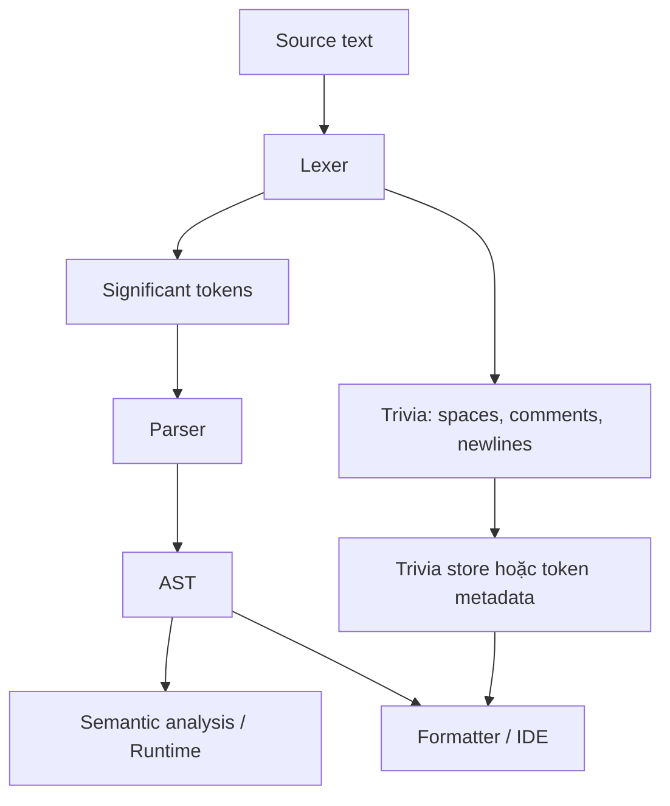

# Giữ hoặc bỏ trivia

Khi xây dựng parser và cây cú pháp cho một **Domain-Specific Language (DSL)**, không phải mọi ký tự trong file nguồn đều mang ý nghĩa nghiệp vụ. Khoảng trắng, dòng trống và chú thích thường giúp con người đọc hoặc tổ chức mã, nhưng không trực tiếp quyết định chương trình làm gì. Những thành phần như vậy thường được gọi là **trivia**.

Quyết định giữ hay bỏ trivia ảnh hưởng đến cách parser lưu thông tin, cách tạo Abstract Syntax Tree (AST), khả năng định dạng lại source, hiển thị chú thích trong IDE và thực hiện các phép biến đổi mà vẫn bảo toàn nội dung người dùng đã viết. Nếu chỉ cần chạy chương trình, có thể bỏ phần lớn trivia khỏi mô hình ngữ nghĩa. Nếu cần formatter, refactoring, công cụ review hoặc chuyển đổi source-to-source, việc loại bỏ trivia quá sớm có thể làm mất thông tin không thể khôi phục.

## 1. Trivia là gì?

Trong quá trình phân tích từ vựng, lexer đọc chuỗi ký tự và tạo ra các token. Một số token biểu diễn thành phần có ý nghĩa đối với grammar như từ khóa, định danh, số, chuỗi, dấu ngoặc hoặc toán tử. Một số đoạn văn bản chủ yếu phục vụ trình bày hoặc ghi chú, ví dụ:

- Khoảng trắng giữa các token.
- Tab dùng để căn lề.
- Dòng mới và dòng trống trong ngôn ngữ mà xuống dòng không quyết định cấu trúc.
- Chú thích một dòng hoặc nhiều dòng.
- Một số ký tự phân cách hoặc ký tự định dạng không có ý nghĩa ngữ nghĩa trong ngữ cảnh cụ thể.
- BOM hoặc khoảng trắng ở đầu/cuối file, nếu định dạng DSL quy định chúng không mang ý nghĩa.

Ví dụ:

```text
service "orders-api" {   # dịch vụ xử lý đơn hàng
    replicas = 3

    image = "example/orders:2.4"  # phiên bản đang triển khai
}
```

Các từ khóa `service`, `replicas`, `image`, tên dịch vụ, số `3`, chuỗi image và dấu ngoặc có vai trò trong cấu trúc DSL. Các khoảng trắng, dòng trống và nội dung chú thích có thể được xem là trivia nếu grammar của DSL không gán ý nghĩa đặc biệt cho chúng.

**Trivia không đồng nghĩa với dữ liệu không quan trọng.** Chú thích có thể giải thích lý do của một quyết định, khoảng trắng có thể phản ánh cách nhóm cấu hình và dòng mới có thể giúp review thay đổi. Chúng chỉ thường không tham gia trực tiếp vào việc xác định ý nghĩa thực thi.

## 2. Phân biệt trivia với token có ý nghĩa cú pháp

Một ký tự chỉ được xem là trivia khi ngữ pháp và ngữ nghĩa của DSL quy định rằng nó không làm thay đổi cách hiểu chương trình. Không nên mặc định mọi khoảng trắng, dấu câu hoặc dòng mới đều có thể bỏ.

Ví dụ, trong DSL dạng khối dùng dấu ngoặc nhọn, dòng mới có thể chỉ phục vụ trình bày:

```text
set replicas = 3
set image = "orders:2.4"
```

Nếu dấu `;` không bắt buộc, khoảng trắng và xuống dòng có thể được bỏ qua giữa các khai báo. Nhưng trong một DSL mà xuống dòng kết thúc câu lệnh, newline là token có ý nghĩa cú pháp:

```text
set replicas = 3
set image = "orders:2.4"
```

Trong trường hợp này, bỏ newline trước khi parser xử lý có thể làm mất ranh giới câu lệnh.

Một số ví dụ khác:

| Thành phần | Có thể là trivia khi... | Có ý nghĩa khi... |
|---|---|---|
| Khoảng trắng | Chỉ phân tách token hoặc căn lề | DSL dùng khoảng trắng để phân biệt cấu trúc hoặc giá trị |
| Newline | Chỉ là cách trình bày | Newline kết thúc câu lệnh hoặc xác định khối |
| Dấu phẩy | Không phải trivia trong danh sách thông thường | Thường là token phân tách phần tử và phải được giữ khi parse |
| Dấu chấm phẩy | Có thể tùy chọn và chỉ dùng để trình bày theo quy ước | Kết thúc câu lệnh hoặc phân tách khai báo |
| Comment | Chỉ ghi chú cho người đọc | Là directive, annotation hoặc tài liệu được công cụ tiêu thụ |
| Khoảng trắng trong chuỗi | Không áp dụng: nội dung chuỗi là dữ liệu | Luôn có thể ảnh hưởng đến giá trị chuỗi |

Ví dụ, hai biểu thức sau có thể khác nghĩa:

```text
name = "New York"
name = "NewYork"
```

Khoảng trắng bên trong literal chuỗi là dữ liệu, không phải trivia. Tương tự, khoảng trắng trong nội dung heredoc, template, biểu thức chính quy hoặc đoạn mã nhúng có thể cần được bảo toàn nguyên vẹn.

## 3. Vì sao phải quyết định giữ hay bỏ trivia?

Parser thường cần một mô hình gọn để phân tích và xử lý ý nghĩa chương trình. Trong khi đó, editor và formatter cần đủ thông tin để tái tạo hoặc chỉnh sửa source. Hai mục tiêu này không giống nhau.

Nếu bỏ trivia sớm:

- AST gọn hơn và dễ duyệt cho semantic analysis, interpreter hoặc code generator.
- Các bước xử lý không phải quan tâm đến khoảng trắng và chú thích thông thường.
- Có thể giảm bộ nhớ nếu chỉ cần giữ mô hình ngữ nghĩa.
- Nhưng formatter khó khôi phục chính xác cách trình bày ban đầu.
- Chú thích, dòng trống và khoảng trắng do người viết lựa chọn có thể bị mất.
- Refactoring có thể tạo source mới nhưng không bảo toàn ghi chú hoặc định dạng xung quanh phần được sửa.

Nếu giữ trivia:

- Có thể định dạng lại hoặc tái tạo source gần như nguyên bản.
- IDE có thể hiển thị, di chuyển và bảo toàn chú thích.
- Công cụ review hoặc migration có thể giữ lại nội dung không bị tác động.
- Mô hình cú pháp phức tạp hơn và cần quản lý vị trí, quan hệ trivia với token hoặc node.
- Các bước xử lý ngữ nghĩa phải phân biệt trivia với thành phần thực sự của chương trình.

Vì vậy, quyết định không chỉ là “có cần khoảng trắng hay không”. Cần xác định những công cụ nào sẽ sử dụng source sau khi parse và mức độ bảo toàn mà chúng cần.

## 4. Trivia trong pipeline lexer và parser

Một lexer có thể xử lý trivia theo nhiều cách. Cách đơn giản là bỏ các đoạn trivia sau khi nhận diện chúng. Cách khác là giữ trivia trong token stream nhưng đánh dấu chúng thuộc một kênh riêng để parser chính chỉ đọc token có ý nghĩa cú pháp.



Ví dụ source:

```text
replicas = 3  # số bản sao
```

Lexer có thể tạo các token có ý nghĩa:

```text
IDENTIFIER("replicas")
EQUALS
INTEGER(3)
```

Đồng thời, lexer ghi nhận trivia:

```text
WHITESPACE(" ")
WHITESPACE(" ")
WHITESPACE("  ")
COMMENT("# số bản sao")
NEWLINE
```

Parser có thể chỉ nhận các token có ý nghĩa cú pháp, còn trivia được lưu ở vị trí tương ứng. Cách tổ chức thực tế phụ thuộc lexer framework: trivia có thể nằm trong hidden channel, token phụ, thuộc tính leading/trailing trivia hoặc một cấu trúc source riêng.

## 5. Các chiến lược giữ hoặc bỏ trivia

### 5.1. Bỏ trivia ngay trong lexer

Lexer nhận diện khoảng trắng và chú thích rồi không phát chúng vào token stream mà parser tiêu thụ.

Ví dụ mã giả:

```text
while not endOfSource:
    if currentCharacter is whitespace:
        consumeWhitespace()
    else if startsComment():
        consumeComment()
    else:
        emit(nextSignificantToken())
```

Ưu điểm là token stream đơn giản, parser dễ triển khai và AST không chứa thông tin trình bày. Đây là lựa chọn hợp lý khi ứng dụng chỉ cần kiểm tra, thông dịch hoặc sinh mã và không có yêu cầu tái tạo source ban đầu.

Hạn chế là một khi lexer loại bỏ trivia, các bước sau không thể khôi phục chính xác nội dung chú thích, số lượng dòng trống hoặc kiểu thụt lề ban đầu nếu không có một bản source khác để đối chiếu.

### 5.2. Giữ trivia trong token stream nhưng ẩn khỏi parser

Lexer phát cả token có ý nghĩa và token trivia. Token trivia được đặt ở một kênh riêng hoặc được đánh dấu để parser bỏ qua khi tìm token tiếp theo.

Ví dụ khái niệm:

```text
DEFAULT_CHANNEL:
    IDENTIFIER("replicas")
    EQUALS
    INTEGER(3)

TRIVIA_CHANNEL:
    WHITESPACE(" ")
    WHITESPACE(" ")
    COMMENT("# số bản sao")
    NEWLINE
```

Parser đọc `DEFAULT_CHANNEL`, trong khi formatter hoặc IDE có thể truy cập `TRIVIA_CHANNEL`. Cách này tách luồng xử lý ngữ nghĩa khỏi thông tin trình bày nhưng vẫn giữ dữ liệu nguồn.

### 5.3. Gắn trivia vào token hoặc node cú pháp

Một chiến lược khác là gắn trivia trước hoặc sau token, hoặc liên kết nó với node trong cây cú pháp. Ví dụ, token `INTEGER(3)` có thể giữ comment cuối dòng là trailing trivia; token `IDENTIFIER("replicas")` có thể giữ khoảng trắng phía trước là leading trivia.

```text
Token:
  kind: INTEGER
  value: 3
  leadingTrivia: "  "
  trailingTrivia: "  # số bản sao"
  span: line 1, columns 12-13
```

Mô hình này thuận tiện cho formatter và source transformation vì trivia đi cùng vị trí cú pháp. Tuy nhiên, cần có quy tắc rõ cho comment nằm giữa hai node, comment đầu file, comment cuối file hoặc comment có thể gắn hợp lý với nhiều node.

### 5.4. Giữ một Concrete Syntax Tree hoặc Lossless Syntax Tree

Một **Concrete Syntax Tree (CST)** thường giữ nhiều chi tiết cú pháp hơn AST, bao gồm token, dấu phân cách, dấu ngoặc và có thể cả trivia. Một **Lossless Syntax Tree** hướng đến việc giữ đủ thông tin để tái tạo source ban đầu mà không làm mất các ký tự được quản lý.

Ví dụ, source:

```text
service "orders" {  # cấu hình đơn hàng
    replicas = 3
}
```

CST hoặc lossless tree có thể giữ node cho `service`, tên chuỗi, dấu ngoặc, khai báo `replicas`, khoảng trắng, comment và newline. AST ngữ nghĩa có thể chỉ giữ một node `Service` với tên và thuộc tính `replicas`.

Giữ CST/lossless tree hữu ích cho IDE, formatter, refactoring và công cụ chuyển đổi source. Đổi lại, cấu trúc cây có nhiều node hơn và các phép biến đổi cần bảo đảm không làm mất trivia ngoài vùng chỉnh sửa.

## 6. AST và CST có mục tiêu khác nhau

AST thường tập trung vào cấu trúc và ý nghĩa cần cho các bước xử lý sau. Nó có thể loại bỏ dấu ngoặc không cần thiết, dấu phân cách và trivia. CST giữ nhiều chi tiết về cách source được viết.

Ví dụ với biểu thức:

```text
total = (price * quantity)  # thành tiền
```

AST có thể biểu diễn:

```text
Assignment
  target: Name("total")
  value: Multiply
    left: Name("price")
    right: Name("quantity")
```

AST trên không cần giữ dấu ngoặc nếu cấu trúc cây đã thể hiện đúng nhóm phép toán. Nó cũng có thể không lưu comment `# thành tiền` nếu chỉ phục vụ thực thi.

CST có thể giữ:

```text
Assignment
  NameToken("total")
  Whitespace(" ")
  EqualsToken("=")
  Whitespace(" ")
  OpenParen("(")
  NameToken("price")
  Whitespace(" ")
  StarToken("*")
  Whitespace(" ")
  NameToken("quantity")
  CloseParen(")")
  Whitespace("  ")
  Comment("# thành tiền")
```

Sự khác nhau này không có nghĩa AST luôn bỏ trivia hoặc CST luôn giữ tất cả. Đây là các mô hình có mục tiêu khác nhau; thiết kế cụ thể có thể thêm source span, comment attachment hoặc metadata vào AST khi cần.

| Tiêu chí | AST | CST / Lossless Syntax Tree |
|---|---|---|
| Mục tiêu | Biểu diễn cấu trúc ngữ nghĩa | Biểu diễn chi tiết source |
| Khoảng trắng và comment | Thường bỏ hoặc lưu metadata chọn lọc | Có thể giữ đầy đủ |
| Dấu ngoặc và dấu phân cách | Có thể được giản lược | Thường được giữ |
| Semantic analysis | Thường thuận tiện | Có thể cần đi qua node chi tiết hơn |
| Formatter và refactoring | Khó bảo toàn nguyên bản nếu thiếu metadata | Phù hợp hơn cho chỉnh sửa bảo toàn source |
| Kích thước và độ phức tạp | Thường nhỏ hơn | Thường lớn hơn |

Một kiến trúc có thể giữ CST cho công cụ source và tạo AST riêng cho semantic analysis/runtime. Hai cây có thể liên kết bằng source span hoặc tham chiếu node để chuyển kết quả phân tích và chẩn đoán về đúng vị trí trong file.

## 7. Vị trí nguồn và thông tin trivia

Ngay cả khi bỏ trivia khỏi AST, thường vẫn nên giữ **source location** cho token và node quan trọng. Vị trí nguồn có thể gồm:

- Tên file hoặc định danh tài liệu.
- Offset bắt đầu và kết thúc trong source.
- Dòng và cột bắt đầu/kết thúc.
- Độ dài đoạn source.
- Thông tin nguồn gốc nếu nội dung được ghép từ nhiều file hoặc macro.

Source span giúp validator báo lỗi ở đúng vị trí, IDE chọn vùng mã tương ứng và formatter biết phần nào cần thay thế. Nó không thay thế trivia: biết một node nằm ở dòng 5 không cho biết người dùng đã dùng tab hay bốn dấu cách, hoặc đã viết comment gì ở cuối dòng.

Ví dụ metadata:

```text
Node: IntegerLiteral(value = 3)
SourceSpan:
  file = "service.dsl"
  startOffset = 42
  endOffset = 43
  startLine = 4
  startColumn = 16
  endLine = 4
  endColumn = 17
```

Nếu parser bỏ comment nhưng vẫn giữ source span, nó có thể báo lỗi chính xác. Nhưng nếu công cụ cần in lại comment hoặc giữ định dạng, cần lưu thêm trivia hoặc source gốc.

## 8. Comment không phải lúc nào cũng là trivia thuần túy

Comment thường không ảnh hưởng đến ngữ nghĩa chương trình, nhưng có những loại comment được công cụ khác đọc và xử lý. Ví dụ:

- Comment tài liệu gắn với khai báo, dùng để tạo tài liệu tham khảo.
- Directive bật/tắt lint hoặc cảnh báo.
- Chỉ thị build hoặc cấu hình công cụ.
- Annotation đặc biệt được đặt trong comment để tương thích với cú pháp cũ.
- Marker dùng để sinh mã hoặc xác định vùng do công cụ quản lý.

Ví dụ:

```text
# lint: disable=deprecated-option
service "legacy-adapter" {
    old_option = true
}
```

Nếu lexer bỏ comment này như trivia thông thường, công cụ lint có thể mất chỉ thị và đưa ra kết quả sai so với ý định người viết.

Một cách tiếp cận là phân loại comment:

| Loại comment | Cách xử lý thường phù hợp |
|---|---|
| Comment giải thích thông thường | Giữ cho editor/formatter; có thể bỏ khỏi AST thực thi |
| Comment tài liệu | Gắn với khai báo hoặc chuyển thành metadata tài liệu |
| Directive cho compiler/linter | Parse thành chỉ thị có cấu trúc hoặc giữ trong luồng công cụ tương ứng |
| Marker do generator quản lý | Bảo toàn và xác định quy tắc chỉnh sửa rõ ràng |
| Comment không được hỗ trợ | Giữ như trivia hoặc báo lỗi theo đặc tả |

Nếu comment có ảnh hưởng đến hành vi công cụ, nên định nghĩa rõ cú pháp và phạm vi của nó thay vì dựa vào một quy ước ngầm khó kiểm tra.

## 9. Khi nào nên giữ trivia?

Giữ trivia hoặc một biểu diễn lossless đặc biệt hữu ích trong các trường hợp sau:

### 9.1. Xây dựng formatter

Formatter cần biết vị trí comment, dòng trống và cấu trúc trình bày để tạo source mới. Có hai mục tiêu khác nhau:

- **Canonical formatter** chuẩn hóa source theo một phong cách duy nhất. Nó không nhất thiết phải giữ nguyên số lượng khoảng trắng hoặc dòng trống ban đầu, nhưng phải bảo toàn comment và ý nghĩa chương trình theo quy tắc đã định.
- **Preserving formatter** cố gắng giữ phong cách và trivia không liên quan đến vùng thay đổi, chỉ định dạng lại phần cần thiết.

Canonical formatter có thể hoạt động từ AST nếu có cơ chế gắn comment. Preserving formatter thường cần CST hoặc lossless tree để tránh thay đổi toàn bộ file khi người dùng chỉ sửa một thuộc tính.

### 9.2. Xây dựng IDE và editor

Editor thường cần hiển thị comment, giữ con trỏ và vùng chọn ổn định, hỗ trợ sửa từng phần và cập nhật cây cú pháp khi người dùng gõ. Nếu trivia bị loại bỏ, editor phải lấy lại thông tin từ source text hoặc parse lại toàn bộ file. Lossless tree có thể giúp cập nhật từng vùng mà không làm mất phần source chưa thay đổi.

### 9.3. Refactoring và source-to-source transformation

Một công cụ đổi tên thuộc tính hoặc chuyển cú pháp cũ sang cú pháp mới cần giữ các comment và định dạng xung quanh. Nếu chỉ có AST, công cụ có thể tạo lại toàn bộ source nhưng làm mất chú thích hoặc thay đổi phong cách. Nếu có CST/lossless tree, công cụ có thể thay đúng node liên quan và giữ phần còn lại.

### 9.4. Tài liệu hóa và comment gắn với khai báo

Comment tài liệu có thể cần gắn với khai báo kế tiếp hoặc một node cụ thể. Việc giữ vị trí và quy tắc attachment giúp tạo API documentation hoặc hiển thị trợ giúp trong IDE.

### 9.5. Round-trip và bảo toàn source

Một số công cụ cần đọc source rồi ghi lại mà không thay đổi những phần người dùng không sửa. Đây là yêu cầu round-trip. Nếu mục tiêu là bảo toàn nguyên văn, cần giữ đủ token và trivia hoặc giữ source gốc cùng các span được chỉnh sửa.

## 10. Khi nào có thể bỏ trivia?

Bỏ trivia khỏi mô hình xử lý thường hợp lý khi:

- DSL chỉ được dùng để validate, thông dịch hoặc sinh mã.
- Không cần tái tạo file theo phong cách ban đầu.
- Comment không được dùng làm tài liệu hoặc directive.
- Source gốc vẫn được lưu riêng nếu cần phục vụ log hoặc chẩn đoán.
- Mục tiêu ưu tiên AST nhỏ, đơn giản và dễ xử lý.

Ví dụ, một dịch vụ nhận file DSL trong pipeline CI, parse thành mô hình triển khai, kiểm tra ràng buộc rồi sinh cấu hình cho nền tảng đích. Nếu không có nhu cầu chỉnh sửa lại file DSL, AST có thể bỏ khoảng trắng và comment thông thường sau khi lexer đã xác định chúng không ảnh hưởng ngữ nghĩa.

Ngay cả khi bỏ trivia, không nên bỏ source span nếu validator cần chỉ ra lỗi. Cũng cần xác nhận không có comment directive hoặc newline có ý nghĩa bị loại nhầm.

## 11. Gắn comment vào node: leading, trailing và dangling trivia

Khi giữ comment trong cây, một câu hỏi quan trọng là comment thuộc về node nào. Một số quy ước phổ biến:

- **Leading trivia** nằm trước token hoặc node, có thể chứa comment giải thích khai báo tiếp theo.
- **Trailing trivia** nằm sau token hoặc node trên cùng dòng, thường là comment cuối dòng.
- **Dangling trivia** nằm trong phạm vi của một node nhưng không gắn rõ với node con nào, ví dụ comment bên trong một khối rỗng hoặc giữa hai dấu ngoặc.

Ví dụ:

```text
# số bản sao cho môi trường production
replicas = 3  # không giảm dưới 3

resources {
    # giới hạn tài nguyên cho mỗi instance
}
```

Comment đầu tiên có thể được gắn làm leading trivia của khai báo `replicas`. Comment cùng dòng có thể là trailing trivia của giá trị `3` hoặc toàn bộ khai báo. Comment bên trong khối `resources` là dangling trivia của khối nếu không có node con nào khác để nhận.

Không có một thuật toán attachment duy nhất phù hợp cho mọi DSL. Có thể dựa vào khoảng cách dòng, cùng dòng, ranh giới khối và quy tắc tài liệu hóa. Quan trọng là kết quả ổn định, có thể giải thích và được formatter/IDE sử dụng thống nhất.

## 12. Ví dụ: lưu trivia riêng khỏi AST

Giả sử DSL có khai báo:

```text
replicas = 3  # số instance chạy song song
```

AST phục vụ ngữ nghĩa có thể là:

```text
Assignment
  name: "replicas"
  value: IntegerLiteral(3)
```

Một trivia store có thể lưu:

```text
TriviaEntry
  kind: COMMENT
  text: "# số instance chạy song song"
  placement: TRAILING
  ownerSpan: [0, 13)
  sourceSpan: [15, 43)
```

Khi formatter tạo lại file, nó lấy cấu trúc từ AST và ghép comment từ trivia store. Khi semantic analyzer chạy, nó chỉ cần đọc node `Assignment` và giá trị `3`.

Trong một triển khai thực tế, offset và span phải được tính theo cùng một quy ước, chẳng hạn byte offset UTF-8 hoặc offset ký tự theo UTF-16. Không nên trộn hai loại offset vì vị trí sau ký tự Unicode nhiều byte hoặc surrogate pair có thể bị lệch.

## 13. Thiết kế lexer để giữ trivia có kiểm soát

Lexer cần phân biệt rõ token có ý nghĩa cú pháp với trivia, nhưng không nên bỏ qua các trường hợp đặc biệt.

Một quy trình tổng quát:

1. Đọc ký tự tiếp theo và xác định ngữ cảnh từ vựng hiện tại.
2. Nếu đang ở trong string, template hoặc raw block, áp dụng quy tắc của literal; không phân loại khoảng trắng hay ký hiệu bên trong thành trivia thông thường.
3. Nếu gặp whitespace ở ngoài literal, xác định loại và ghi nhận span nếu cần giữ.
4. Nếu gặp comment, nhận diện loại comment và kiểm tra có phải directive hay documentation comment không.
5. Nếu gặp newline, xác định DSL có dùng newline như token kết thúc câu lệnh hoặc dấu phân cách không.
6. Phát token có ý nghĩa vào kênh parser và lưu trivia theo chiến lược đã chọn.
7. Giữ vị trí nguồn để thông báo lỗi và liên kết trivia với token/node.

Mã giả:

```text
while not endOfSource:
    if insideStringOrRawBlock():
        emit(readLiteralContent())
    else if isSignificantNewline():
        emit(NEWLINE)
    else if isWhitespace():
        trivia = readWhitespace()
        if preserveTrivia:
            saveTrivia(trivia)
    else if startsComment():
        comment = readComment()
        if isDirective(comment):
            emit(parseDirective(comment))
        else if preserveTrivia:
            saveTrivia(comment)
    else:
        emit(readSignificantToken())
```

Mã giả nhấn mạnh rằng việc phân loại phụ thuộc ngữ cảnh. Ví dụ `#` có thể mở đầu comment ở ngoài chuỗi, nhưng là ký tự dữ liệu nếu nằm trong chuỗi. Với template hoặc ngôn ngữ nhúng, lexer có thể cần chuyển đổi giữa nhiều chế độ từ vựng.

## 14. Tác động đến formatter

Formatter có thể làm việc trên AST, CST hoặc một mô hình kết hợp. Lựa chọn ảnh hưởng đến mức độ bảo toàn source.

**Formatter dựa trên AST** thường tạo lại toàn bộ văn bản theo một quy tắc chuẩn. Cách này đơn giản khi AST chứa đủ thông tin ngữ nghĩa và comment đã được gắn vào node. Tuy nhiên, nếu comment bị bỏ hoàn toàn, formatter không thể tự khôi phục chúng.

**Formatter dựa trên CST/lossless tree** có thể giữ các token và trivia không đổi, rồi chỉ thay thế vùng cần định dạng. Cách này phù hợp với editor và công cụ định dạng từng phần. Đổi lại, formatter phải xử lý nhiều chi tiết cú pháp hơn.

Một formatter tốt nên bảo đảm:

- Không thay đổi ngữ nghĩa chương trình.
- Bảo toàn comment được hỗ trợ và vị trí tương đối của chúng theo chính sách.
- Xử lý nhất quán khoảng trắng, newline và thụt lề.
- Có kết quả ổn định khi chạy lặp lại.
- Không làm hỏng nội dung trong string, template hoặc raw block.
- Có hành vi rõ khi source chứa lỗi cú pháp.

Nếu DSL có comment directive, formatter cần bảo toàn chúng chính xác hoặc hiểu cách di chuyển chúng. Di chuyển directive khỏi phạm vi áp dụng có thể làm thay đổi kết quả lint hoặc build dù AST nghiệp vụ không đổi.

## 15. Tác động đến refactoring và migration

Refactoring là phép biến đổi cấu trúc chương trình mà vẫn giữ hành vi mong muốn. Ví dụ, đổi tên thuộc tính `replicas` thành `instances` hoặc chuyển cú pháp cũ sang cú pháp mới.

Nếu chỉ có AST, công cụ có thể tìm mọi node tham chiếu đến tên thuộc tính rồi sinh lại source. Nhưng source được sinh lại có thể mất comment, dòng trống và kiểu thụt lề. Nếu có CST hoặc trivia metadata, công cụ có thể thay chính xác token định danh và giữ các phần không liên quan.

Ví dụ trước:

```text
service "orders" {
    replicas = 3  # số instance
}
```

Sau refactoring đổi tên:

```text
service "orders" {
    instances = 3  # số instance
}
```

Comment và cách trình bày vẫn được giữ. Đây là lợi ích thực tế của việc bảo toàn trivia trong các công cụ chỉnh sửa source.

## 16. Ảnh hưởng đến hiệu năng và bộ nhớ

Giữ trivia làm tăng lượng dữ liệu lexer và cây cú pháp phải quản lý. Với file nhỏ, chi phí này thường không đáng kể so với lợi ích về formatter và IDE. Với file rất lớn hoặc editor cần parse liên tục khi người dùng gõ, cần cân nhắc cách lưu hiệu quả.

Một số cách tối ưu:

- Lưu span vào source buffer thay vì sao chép toàn bộ chuỗi trivia nhiều lần.
- Dùng token stream có chỉ số hoặc slice tham chiếu đến source gốc.
- Chỉ tạo object trivia khi công cụ cần; với runtime chỉ dùng AST có thể tắt chế độ giữ trivia.
- Dùng incremental parsing để cập nhật vùng thay đổi thay vì parse lại toàn bộ file.
- Tránh gắn một object riêng cho từng ký tự khoảng trắng nếu có thể gom thành đoạn liên tiếp.
- Đặt giới hạn kích thước comment và độ sâu cấu trúc khi xử lý đầu vào không đáng tin cậy.

Không nên hy sinh khả năng bảo toàn source chỉ dựa trên giả định rằng trivia gây tốn tài nguyên lớn. Hãy đo với kích thước file và cách sử dụng thực tế. Có thể cung cấp hai chế độ: parse nhẹ cho runtime và parse lossless cho editor/formatter.

## 17. Những lỗi thiết kế thường gặp

| Lỗi | Hệ quả | Cách xử lý |
|---|---|---|
| Bỏ mọi whitespace mà không xét ngữ cảnh | Mất newline hoặc indentation có ý nghĩa | Phân biệt trivia với token cú pháp theo đặc tả |
| Bỏ comment trước khi nhận diện directive | Linter hoặc compiler bỏ qua chỉ thị | Phân loại directive trước khi loại trivia thông thường |
| Giả định comment luôn thuộc node kế tiếp | Comment có thể bị di chuyển sai khi format | Định nghĩa leading, trailing và dangling trivia |
| Chỉ giữ AST nhưng cần round-trip source | Mất định dạng và chú thích | Giữ source buffer, CST hoặc trivia metadata |
| Gắn source span nhưng không lưu nội dung trivia | Có vị trí nhưng không thể khôi phục comment/whitespace | Lưu cả span và dữ liệu nguồn cần thiết |
| Không bảo vệ nội dung literal | Chuỗi hoặc template bị thay đổi | Lexer phải theo dõi trạng thái và chế độ từ vựng |
| Trộn byte offset với character offset | Diagnostics trỏ sai vị trí với Unicode | Dùng một quy ước offset nhất quán |
| Formatter sắp xếp lại comment không đúng phạm vi | Chỉ thị hoặc ghi chú bị gắn sai khai báo | Bảo toàn quan hệ comment và node |
| Giữ trivia trong AST ngữ nghĩa mà không có nhu cầu | Mô hình xử lý phức tạp và khó duyệt | Tách AST ngữ nghĩa khỏi dữ liệu source |

## 18. Quy trình quyết định giữ hay bỏ trivia

Có thể lựa chọn chiến lược theo các bước sau:

1. **Liệt kê công cụ tiêu thụ DSL**: runtime, validator, formatter, IDE, refactoring, migration, documentation generator hay công cụ review.
2. **Phân loại thành phần có thể bị xem là trivia**: whitespace, newline, comment, BOM và các ký tự trình bày khác.
3. **Xác định ý nghĩa đặc biệt**: newline có kết thúc câu lệnh không; comment có directive không; khoảng trắng trong literal có được bảo toàn không?
4. **Xác định mức bảo toàn cần thiết**: chỉ cần AST ngữ nghĩa, cần giữ comment hay cần tái tạo source gần như nguyên bản?
5. **Chọn nơi lưu trữ**: bỏ trong lexer, giữ ở channel riêng, gắn vào token/node, lưu trivia store hoặc dùng CST/lossless tree.
6. **Quy định cách gắn comment**: leading, trailing, dangling hoặc metadata tài liệu.
7. **Xác định source span và quy ước offset**: bảo đảm diagnostics và phép biến đổi trỏ đúng vị trí.
8. **Thử round-trip và chỉnh sửa**: parse rồi format, đổi tên một node, thêm/xóa node và kiểm tra comment có được giữ đúng không.
9. **Đo chi phí**: đánh giá bộ nhớ, tốc độ parse và độ phức tạp của các công cụ.

Một số tình huống tham khảo:

| Nhu cầu chính | Chiến lược thường phù hợp |
|---|---|
| Chỉ validate hoặc thực thi file cấu hình | Bỏ trivia thông thường khỏi AST; giữ source span nếu cần diagnostics |
| Sinh tài liệu từ comment | Giữ comment tài liệu và gắn với khai báo |
| Formatter chuẩn hóa toàn file | Giữ comment; AST có thể đủ nếu comment được attachment ổn định |
| Editor định dạng từng phần và refactoring | CST hoặc lossless tree cùng source span |
| Comment chứa directive | Parse thành metadata/chỉ thị hoặc giữ riêng cho công cụ liên quan |
| Round-trip phải bảo toàn văn bản chưa sửa | Giữ source gốc và trivia hoặc dùng lossless syntax representation |

## 19. Kiểm thử việc giữ và bỏ trivia

Kiểm thử cần bao gồm cả trường hợp trivia không được làm thay đổi ngữ nghĩa và trường hợp trivia có vai trò đặc biệt.

- Hai source chỉ khác khoảng trắng thông thường phải tạo ra AST tương đương nếu DSL quy định whitespace không có ý nghĩa.
- Comment thông thường không làm thay đổi kết quả thực thi.
- Comment tài liệu hoặc directive phải được giữ và xử lý đúng theo đặc tả.
- Newline có ý nghĩa cú pháp phải được giữ như token và parser phải phân tích đúng ranh giới câu lệnh.
- Khoảng trắng bên trong chuỗi, template hoặc raw block phải được bảo toàn.
- Formatter phải giữ comment và tạo output ổn định khi chạy nhiều lần.
- Refactoring một node phải giữ trivia của các node không liên quan.
- Source có Unicode phải cho diagnostics đúng vị trí theo quy ước offset đã chọn.
- Source có comment đầu file, cuối file, giữa hai khai báo và trong khối rỗng phải được xử lý nhất quán.

Với lossless tree, có thể kiểm tra thuộc tính round-trip: parse source rồi serialize mà không chỉnh sửa phải tái tạo đúng source ban đầu trong phạm vi định dạng được hỗ trợ. Nếu formatter chuẩn hóa khoảng trắng, phép kiểm tra cần so sánh theo chính sách canonical thay vì yêu cầu chuỗi giống hệt.

## 20. Kết luận

Trivia thường không tham gia trực tiếp vào ngữ nghĩa của DSL, nhưng lại có giá trị lớn đối với người viết và các công cụ làm việc với source. Bỏ trivia giúp AST gọn và thuận tiện cho xử lý ngữ nghĩa. Giữ trivia hỗ trợ formatter, IDE, documentation, refactoring và round-trip. Comment directive, newline có ý nghĩa, khoảng trắng trong literal và nội dung template cần được xử lý theo quy tắc riêng.

Một kiến trúc DSL tốt thường tách rõ mô hình ngữ nghĩa khỏi thông tin source. Có thể dùng AST cho validator và runtime, đồng thời giữ CST hoặc trivia metadata cho công cụ chỉnh sửa. Quyết định phù hợp phụ thuộc yêu cầu bảo toàn source, loại công cụ cần hỗ trợ và chi phí vận hành; điều quan trọng là phân loại đúng trivia trước khi loại bỏ nó khỏi pipeline.
