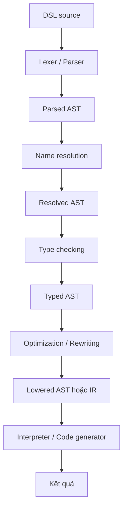

# AST bất biến trong DSL

**Abstract Syntax Tree (AST)** là biểu diễn cây của cấu trúc chương trình sau khi phân tích cú pháp. Mỗi nút trong cây đại diện cho một thành phần có ý nghĩa như literal, phép toán, lời gọi hàm, khai báo hoặc câu lệnh. Trong một DSL, AST là cầu nối giữa văn bản mà người dùng viết và các bước kiểm tra ngữ nghĩa, diễn giải hoặc biên dịch.

Một **AST bất biến** (*immutable AST*) là cây cú pháp mà các nút và dữ liệu cấu thành không thể bị thay đổi sau khi được tạo. Khi cần thay đổi chương trình, bộ xử lý tạo ra một cây mới hoặc một phần cây mới. Những nhánh không thay đổi có thể được dùng chung với cây cũ.

Ví dụ, AST của biểu thức:

```text
price * quantity + shipping
```

có thể được biểu diễn như sau:

```text
             Add
            /   \
      Multiply  Identifier
       /    \    "shipping"
  Identifier Number
    "price"   "quantity"
```

Nếu muốn thay `quantity` bằng `itemCount`, một AST bất biến không sửa nút Identifier đang tồn tại. Nó tạo một nút Identifier mới và các nút cha mới trên đường dẫn đến gốc. Cây ban đầu vẫn giữ nguyên.

Cách tổ chức này giúp AST dễ chia sẻ giữa nhiều bước xử lý, an toàn hơn khi có nhiều tác vụ cùng đọc, thuận lợi cho cache và hỗ trợ so sánh các phiên bản chương trình. Tuy nhiên, bất biến chỉ có ý nghĩa khi dữ liệu bên trong nút cũng được bảo vệ; một record có trường `final` nhưng chứa một danh sách có thể sửa vẫn chưa tạo thành một AST bất biến thực sự.

## 1. AST là gì và nằm ở đâu trong DSL?

Khi người dùng viết DSL, đầu vào ban đầu thường là văn bản. Bộ xử lý chuyển văn bản qua các bước:

1. **Lexical analysis:** nhận diện token như từ khóa, định danh, số, chuỗi và toán tử.
2. **Parsing:** kết hợp token theo grammar để tạo parse tree hoặc AST.
3. **Semantic analysis:** kiểm tra tên, kiểu dữ liệu, phạm vi và quy tắc miền.
4. **Transformation:** chuẩn hóa hoặc chuyển đổi AST sang một dạng phù hợp hơn.
5. **Interpretation hoặc code generation:** thực thi trực tiếp hoặc sinh mã đích.

AST thường bỏ qua chi tiết trình bày không cần thiết cho xử lý, chẳng hạn một số dấu phân cách hoặc khoảng trắng. Nó giữ lại cấu trúc quan trọng đối với ý nghĩa chương trình.

Ví dụ, biểu thức `a + b * c` được biểu diễn với nút Add ở gốc và nút Multiply ở nhánh phải nếu phép nhân có ưu tiên cao hơn phép cộng. AST thể hiện grouping đã được xác định bởi grammar và precedence.

### Parse tree và AST

Parse tree thể hiện quá trình dẫn xuất theo grammar và thường giữ nhiều nút trung gian. AST tập trung vào cấu trúc có ý nghĩa cho các bước sau.

| Đặc điểm | Parse tree | AST |
|---|---|---|
| Mục tiêu | Thể hiện cấu trúc theo grammar | Thể hiện cấu trúc trừu tượng của chương trình |
| Nút trung gian | Thường giữ các non-terminal | Thường loại bỏ nút không cần cho ngữ nghĩa |
| Chi tiết dấu câu | Có thể giữ nhiều chi tiết | Thường chỉ giữ phần cần thiết |
| Sử dụng | Kiểm tra parsing, diagnostics, tooling | Type checking, transformation, interpretation, compilation |

AST không nhất thiết phải loại bỏ mọi dấu câu hoặc chi tiết nguồn. Một công cụ formatter, refactoring hoặc IDE có thể giữ thêm token, comment và source span. Điều quan trọng là phân biệt phần cấu trúc ngữ nghĩa với metadata phục vụ công cụ.

## 2. Bất biến nghĩa là gì?

Một đối tượng bất biến là đối tượng không thay đổi trạng thái quan sát được sau khi được tạo. Khi một thao tác cần tạo trạng thái khác, nó trả về một đối tượng mới.

Với AST, điều này có nghĩa:

- Không thay đổi loại nút sau khi tạo.
- Không thay đổi toán tử của một nút.
- Không thay đổi danh sách con tại chỗ.
- Không sửa tên định danh, literal hoặc thuộc tính của nút.
- Không để một tham chiếu mutable bên ngoài thay đổi dữ liệu bên trong cây.
- Không cho phép metadata ảnh hưởng đến cấu trúc bị thay đổi ngoài dự kiến.

Ví dụ, giả sử có nút cộng:

```text
Add(
    left = Number(2),
    right = Number(3)
)
```

Nếu muốn đổi số 3 thành 5, kết quả là một nút Add mới:

```text
Add(
    left = Number(2),
    right = Number(5)
)
```

Nút Add cũ và các nút con cũ vẫn tồn tại với giá trị ban đầu. Chúng có thể tiếp tục được dùng trong một phép phân tích khác hoặc được lưu làm phiên bản trước của biểu thức.

### Bất biến nông và bất biến sâu

**Shallow immutability** (bất biến nông) chỉ bảo vệ tham chiếu hoặc trường ở lớp ngoài. Đối tượng được tham chiếu vẫn có thể thay đổi.

**Deep immutability** (bất biến sâu) bảo đảm toàn bộ dữ liệu có thể quan sát từ AST không thể bị sửa thông qua bất kỳ tham chiếu nào.

Ví dụ Java:

```java
final class UnsafeNode {
    private final List<Node> children;

    UnsafeNode(List<Node> children) {
        this.children = children;
    }

    List<Node> children() {
        return children;
    }
}
```

Trường `children` không thể được gán lại sau khi khởi tạo, nhưng danh sách vẫn có thể bị sửa bởi người giữ tham chiếu ban đầu hoặc người nhận danh sách qua accessor. Vì vậy, lớp này chỉ bất biến nông.

Một cách an toàn hơn là sao chép và công bố danh sách không thể sửa:

```java
final class SaferNode {
    private final List<Node> children;

    SaferNode(List<Node> children) {
        this.children = List.copyOf(children);
    }

    List<Node> children() {
        return children;
    }
}
```

Đoạn mã giả định các phần tử `Node` cũng bất biến. `List.copyOf` bảo vệ cấu trúc danh sách, nhưng không tự biến các đối tượng nằm trong danh sách thành immutable. Muốn có bất biến sâu, từng node và mọi dữ liệu lồng bên trong cũng phải tuân thủ nguyên tắc này.

## 3. Vì sao AST bất biến hữu ích?

### An toàn khi chia sẻ

Nhiều thành phần có thể cùng đọc một AST mà không lo một thành phần sửa cây làm thay đổi kết quả của thành phần khác. Parser, validator, formatter và compiler có thể làm việc trên cùng một phiên bản.

### Dễ xử lý đồng thời

Khi dữ liệu không thay đổi, nhiều thread có thể đọc cùng cây mà không cần khóa chỉ để bảo vệ cấu trúc AST. Điều này không tự làm cho mọi thao tác runtime an toàn, nhưng loại bỏ một nguồn race condition phổ biến.

### Cache đáng tin cậy hơn

Kết quả phân tích hoặc tính toán có thể được cache dựa trên cấu trúc AST. Nếu cây không thể thay đổi sau khi cache được tạo, khóa cache không bị mất hiệu lực do một nút bị sửa âm thầm.

### Dễ so sánh phiên bản

Khi một phép biến đổi trả về cây mới, cây cũ có thể được giữ lại. Công cụ có thể so sánh hai phiên bản, tạo diff, hỗ trợ undo/redo hoặc giải thích thay đổi.

### Dễ kiểm thử

Một hàm transformation nhận AST và trả AST mới có thể được kiểm thử theo kiểu đầu vào/đầu ra. Không cần thiết lập và khôi phục trạng thái mutable dùng chung.

### Hạn chế tác dụng phụ

Các bước xử lý không thể âm thầm thay đổi cây mà bước trước đã tạo. Luồng dữ liệu rõ hơn: mỗi bước nhận một giá trị và tạo một giá trị mới.

## 4. Thiết kế mô hình nút bất biến

AST thường được xây dựng từ một tập kiểu nút có quan hệ rõ ràng. Với DSL biểu thức, có thể chia thành:

- **Literal:** số, chuỗi, Boolean, ngày tháng.
- **Name hoặc Identifier:** tham chiếu đến biến, trường hoặc đối tượng.
- **Unary expression:** biểu thức có toán tử một ngôi.
- **Binary expression:** biểu thức có toán tử hai ngôi.
- **Call expression:** lời gọi hàm hoặc thao tác miền.
- **Member access:** truy cập thuộc tính hoặc thành viên.
- **Collection expression:** danh sách, map hoặc tập hợp.
- **Declaration:** khai báo biến, hàm, rule hoặc cấu hình.
- **Statement:** hành động hoặc cấu trúc điều khiển nếu DSL có câu lệnh.

Một thiết kế tốt dùng các kiểu riêng cho những dạng nút khác nhau thay vì một lớp chung với nhiều trường tùy chọn. Nếu một nút BinaryExpr luôn cần operator, left và right, mô hình nên thể hiện rõ ba thành phần này.

### Ví dụ với Java records

Java records cung cấp cú pháp ngắn gọn cho các đối tượng dữ liệu. Kết hợp sealed interface và record, ta có thể biểu diễn một AST nhỏ:

```java
import java.math.BigDecimal;
import java.util.List;
import java.util.Objects;

sealed interface Expr
    permits NumberExpr, NameExpr, UnaryExpr,
            BinaryExpr, CallExpr {
}

record NumberExpr(BigDecimal value) implements Expr {
    NumberExpr {
        Objects.requireNonNull(value);
    }
}

record NameExpr(String name) implements Expr {
    NameExpr {
        Objects.requireNonNull(name);
        if (name.isBlank()) {
            throw new IllegalArgumentException("name is blank");
        }
    }
}

record UnaryExpr(String operator, Expr operand) implements Expr {
    UnaryExpr {
        Objects.requireNonNull(operator);
        Objects.requireNonNull(operand);
    }
}

record BinaryExpr(
    String operator,
    Expr left,
    Expr right
) implements Expr {
    BinaryExpr {
        Objects.requireNonNull(operator);
        Objects.requireNonNull(left);
        Objects.requireNonNull(right);
    }
}

record CallExpr(String function, List<Expr> arguments)
    implements Expr {
    CallExpr {
        Objects.requireNonNull(function);
        arguments = List.copyOf(arguments);
    }
}
```

Trong mô hình này:

- Các record chứa dữ liệu bất biến và tự cung cấp accessor.
- Sealed interface giới hạn tập kiểu biểu thức có thể triển khai.
- Các tham chiếu con được kiểm tra null khi tạo node.
- Danh sách arguments được sao chép thành danh sách không thể sửa.
- Các node con là Expr và cũng được thiết kế bất biến.

Record chỉ tạo bất biến ở mức trường của record. Nếu trường là một đối tượng mutable, record vẫn có thể quan sát thay đổi bên trong đối tượng đó. Vì vậy, kiểu dữ liệu được dùng trong AST cũng cần được chọn hoặc bảo vệ phù hợp.

### Vì sao nên dùng kiểu nút cụ thể?

Một lớp tổng quát như:

```java
class Node {
    String kind;
    String operator;
    String name;
    Object value;
    List<Node> children;
}
```

có thể chứa nhiều tổ hợp không hợp lệ: Number node có thể không có value, Call node có thể thiếu tên hàm, hoặc Name node có thể chứa children không cần thiết. Kiểu nút cụ thể giúp chuyển nhiều lỗi từ runtime sang thời điểm biên dịch hoặc khởi tạo.

## 5. Bảo đảm bất biến sâu

Chỉ khai báo trường `final` là chưa đủ. Cần xem xét toàn bộ đường đi từ AST đến dữ liệu mà nó tham chiếu.

### 5.1. Defensive copy

Khi nhận collection từ bên ngoài, tạo bản sao trước khi lưu:

```java
record ListExpr(List<Expr> elements) implements Expr {
    ListExpr {
        elements = List.copyOf(elements);
    }
}
```

Sau khi tạo, người gọi không thể thêm hoặc xóa phần tử trong danh sách được trả về. Việc sao chép cũng ngăn thay đổi trên collection gốc làm ảnh hưởng đến AST.

### 5.2. Dùng kiểu giá trị bất biến

Ưu tiên các kiểu có giá trị bất biến như:

- String.
- BigDecimal và các kiểu số immutable phù hợp.
- Enum.
- Các record chỉ chứa dữ liệu immutable.
- Collection immutable hoặc bản sao không thể sửa.

Tránh lưu trực tiếp mutable object như StringBuilder, Date mutable, array có thể ghi hoặc collection có thể sửa mà không có lớp bảo vệ.

### 5.3. Không để lộ tham chiếu mutable

Accessor không nên trả về mảng nội bộ hoặc collection mutable. Nếu buộc phải lưu dữ liệu dạng mảng, cần sao chép khi nhận và khi trả về. Với dữ liệu nhị phân, có thể dùng wrapper immutable hoặc API chỉ đọc.

### 5.4. Kiểm tra giá trị ngay khi tạo

Constructor hoặc factory nên kiểm tra invariant của node. Ví dụ, toán tử phải thuộc tập được hỗ trợ, danh sách tham số không chứa null và tên định danh không rỗng.

Việc kiểm tra ngay khi tạo giúp AST luôn ở trạng thái hợp lệ theo những invariant mà kiểu node có thể tự bảo đảm. Các quy tắc phụ thuộc toàn bộ chương trình, chẳng hạn tên biến có được khai báo hay không, vẫn cần semantic analysis.

### 5.5. Phân biệt bất biến cấu trúc và bất biến ngữ nghĩa

Một AST có thể bất biến về cấu trúc nhưng chưa được xác thực ngữ nghĩa. Ví dụ, NameExpr("unknown") là một node bất biến hợp lệ về mặt dữ liệu, nhưng có thể tham chiếu đến tên không tồn tại trong domain model.

Có thể biểu diễn các giai đoạn bằng kiểu khác nhau:

```text
ParsedAst -> ResolvedAst -> TypedAst -> ExecutablePlan
```

Mỗi giai đoạn tạo một mô hình mới. ParsedAst giữ tên thô; ResolvedAst liên kết tên với symbol; TypedAst bổ sung kiểu đã xác định; ExecutablePlan chứa cấu trúc sẵn sàng thực thi hoặc biên dịch.

## 6. Tạo AST bất biến

AST có thể được tạo trực tiếp trong parser, qua factory hoặc qua builder. Lựa chọn phụ thuộc độ phức tạp của node và cách người dùng nội bộ xây dựng cây.

### 6.1. Constructor hoặc record constructor

Với node nhỏ, constructor là cách đơn giản:

```java
Expr expression = new BinaryExpr(
    "+",
    new NumberExpr(new BigDecimal("2")),
    new NumberExpr(new BigDecimal("3"))
);
```

Sau khi tạo, expression không thể được sửa. Muốn thay một toán hạng, phải tạo BinaryExpr mới.

### 6.2. Factory method

Factory có thể gom quy tắc tạo node, chuẩn hóa tên toán tử hoặc kiểm tra điều kiện:

```java
final class Exprs {
    private Exprs() {}

    static Expr add(Expr left, Expr right) {
        return new BinaryExpr("+", left, right);
    }

    static Expr multiply(Expr left, Expr right) {
        return new BinaryExpr("*", left, right);
    }
}
```

Factory giúp parser và transformation không phải lặp lại chi tiết tạo node. Nó cũng là nơi thích hợp để bảo đảm những invariant chung.

### 6.3. Builder

Builder hữu ích khi node có nhiều thuộc tính tùy chọn hoặc cấu trúc phức tạp. Tuy nhiên, builder chỉ là công cụ xây dựng; đối tượng được tạo ra vẫn cần bất biến.

Một builder tốt:

- Chỉ cho phép sửa trạng thái tạm trong giai đoạn xây dựng.
- Kiểm tra trường bắt buộc khi gọi build.
- Sao chép collection đầu vào.
- Trả về node immutable.
- Không giữ tham chiếu mutable có thể ảnh hưởng đến node sau khi build.

Không nên để builder và node chia sẻ một collection mutable. Sau khi build, người gọi sửa builder cũng không được làm thay đổi AST đã tạo.


## 7. Thay đổi AST bằng cách tạo cây mới

Với AST mutable, một transformation có thể sửa trực tiếp một node. Với AST bất biến, transformation trả về một node mới nếu cần thay đổi.

Ví dụ, muốn thay tên `quantity` bằng `itemCount`:

```java
Expr renameQuantity(Expr expr) {
    if (expr instanceof NameExpr name) {
        if (name.name().equals("quantity")) {
            return new NameExpr("itemCount");
        }
        return name;
    }

    if (expr instanceof BinaryExpr binary) {
        Expr newLeft = renameQuantity(binary.left());
        Expr newRight = renameQuantity(binary.right());

        if (newLeft == binary.left()
                && newRight == binary.right()) {
            return binary;
        }

        return new BinaryExpr(
            binary.operator(),
            newLeft,
            newRight
        );
    }

    return expr;
}
```

Đây là ví dụ rút gọn cho NameExpr và BinaryExpr; một triển khai đầy đủ cần xử lý mọi loại node. Hàm không sửa cây đầu vào. Nếu node không cần đổi, nó trả lại chính node đó. Nếu một nhánh thay đổi, nó tạo node cha mới để trỏ đến nhánh mới.

### Transformation thuần (pure transformation)

Một transformation thuần có đặc điểm:

- Kết quả chỉ phụ thuộc vào đầu vào và tham số tường minh.
- Không sửa AST đầu vào.
- Không thay đổi biến hoặc trạng thái bên ngoài.
- Cùng đầu vào và cùng tham số tạo ra kết quả tương đương.
- Không dựa vào thời gian, môi trường hoặc trạng thái toàn cục nếu không được truyền rõ ràng.

Tính thuần giúp transformation dễ kiểm thử, cache và kết hợp thành pipeline.

Ví dụ:

```text
parsedAst
    -> resolveNames
    -> inferTypes
    -> simplifyExpressions
    -> lowerToIntermediateForm
```

Mỗi bước nhận một cây và trả về một cây hoặc mô hình mới. Các bước không cần chia sẻ trạng thái mutable để phối hợp.

## 8. Structural sharing – dùng chung cấu trúc

Nếu mỗi transformation sao chép toàn bộ cây, chi phí bộ nhớ và thời gian có thể lớn. AST bất biến thường kết hợp với **structural sharing**: cây mới chỉ tạo lại những node nằm trên đường dẫn thay đổi, còn các nhánh không đổi được dùng chung với cây cũ.

Ví dụ, cây ban đầu:

```text
             Add
            /   \
      Multiply   Name("tax")
       /    \
 Name("price") Number(2)
```

Khi thay `Number(2)` thành `Number(3)`, cây mới có thể:

- Tạo Number(3) mới.
- Tạo Multiply mới trỏ đến Name("price") cũ và Number(3) mới.
- Tạo Add mới trỏ đến Multiply mới và Name("tax") cũ.

Name("price") và Name("tax") được dùng chung vì chúng không thay đổi. Cây cũ vẫn tham chiếu đến Multiply cũ và Number(2).

### Minh họa hai phiên bản

```text
Cây cũ:
          Add(old)
          /      \
    Multiply(old) Name("tax")
       /      \
 Name("price") Number(2)

Cây mới:
          Add(new)
          /      \
    Multiply(new) Name("tax")
       /      \
 Name("price") Number(3)

Các node Name("price") và Name("tax") được chia sẻ.
```

Structural sharing giúp transformation trên cây lớn tiết kiệm hơn việc deep-copy toàn bộ node. Chi phí thường tỷ lệ với số node trên đường dẫn thay đổi, cộng với phần dữ liệu collection phải sao chép.

### Persistent data structure

Một cấu trúc dữ liệu **persistent** giữ được các phiên bản trước sau khi cập nhật. AST bất biến có thể được tổ chức theo cách này: mỗi phép cập nhật trả về một root mới, còn các root cũ vẫn hợp lệ.

Persistent không có nghĩa là dữ liệu phải được lưu xuống đĩa. Nó nói về khả năng giữ nhiều phiên bản logic của cấu trúc trong bộ nhớ.

### Khi nào structural sharing an toàn?

Chỉ chia sẻ node khi node và toàn bộ dữ liệu mà nó tham chiếu thực sự bất biến. Nếu một node chia sẻ danh sách mutable, sửa danh sách có thể làm thay đổi đồng thời cả cây cũ lẫn cây mới, phá vỡ tính persistent.

## 9. Traversal – duyệt AST bất biến

Duyệt cây là thao tác đọc các node theo một thứ tự nhất định. Traversal không cần sửa cây, vì vậy rất phù hợp với AST bất biến.

Một số kiểu duyệt:

- **Pre-order:** xử lý node cha trước các node con.
- **Post-order:** xử lý node con trước node cha.
- **In-order:** thường dùng cho cây nhị phân, xử lý nhánh trái, node và nhánh phải.
- **Breadth-first:** duyệt theo từng tầng.
- **Depth-first:** đi sâu theo một nhánh trước khi quay lui.

Ví dụ, đếm số node trong AST:

```java
int countNodes(Expr expr) {
    if (expr instanceof NumberExpr) {
        return 1;
    }
    if (expr instanceof NameExpr) {
        return 1;
    }
    if (expr instanceof UnaryExpr unary) {
        return 1 + countNodes(unary.operand());
    }
    if (expr instanceof BinaryExpr binary) {
        return 1
            + countNodes(binary.left())
            + countNodes(binary.right());
    }
    if (expr instanceof CallExpr call) {
        return 1 + call.arguments().stream()
            .mapToInt(this::countNodes)
            .sum();
    }
    throw new IllegalStateException("Unknown expression");
}
```

Hàm chỉ đọc cấu trúc. Không có trạng thái nào bị thay đổi và không cần bản sao của cây.

### Visitor pattern

**Visitor pattern** tách thao tác khỏi cấu trúc node. Mỗi loại node cung cấp điểm gọi visitor; visitor triển khai hành vi tương ứng.

Ví dụ, có thể có các visitor riêng cho:

- In biểu thức thành văn bản.
- Tính giá trị biểu thức.
- Kiểm tra kiểu.
- Thu thập tên được sử dụng.
- Sinh mã.
- Tạo diagnostics.

Tách visitor giúp cùng một AST được dùng cho nhiều mục tiêu mà không cần nhồi mọi thao tác vào từng lớp node. Tuy nhiên, khi thêm một loại node mới, các visitor có thể cần được cập nhật để xử lý đầy đủ loại node đó.

## 10. Rewriting – viết lại AST

**AST rewriting** là quá trình tìm một mẫu cấu trúc và thay nó bằng cấu trúc khác. Với AST bất biến, mỗi lần viết lại tạo ra node mới và giữ nguyên node cũ.

Ví dụ, một DSL công thức có thể đơn giản hóa phép cộng với số 0:

```text
x + 0  ->  x
0 + x  ->  x
```

Hoặc đơn giản hóa phép nhân với 1:

```text
x * 1  ->  x
1 * x  ->  x
```

Một hàm rewrite rút gọn có thể như sau:

```java
Expr simplify(Expr expr) {
    if (expr instanceof BinaryExpr binary) {
        Expr left = simplify(binary.left());
        Expr right = simplify(binary.right());

        if (binary.operator().equals("+")
                && isZero(right)) {
            return left;
        }

        if (binary.operator().equals("+")
                && isZero(left)) {
            return right;
        }

        if (left == binary.left()
                && right == binary.right()) {
            return binary;
        }

        return new BinaryExpr(
            binary.operator(),
            left,
            right
        );
    }

    return expr;
}
```

Đây chỉ là ví dụ minh họa. Hàm isZero cần kiểm tra đúng loại literal và semantics số học của DSL. Không phải mọi phép biến đổi quen thuộc trong toán học đều hợp lệ trong mọi DSL; ví dụ, phép toán có overflow, kiểu số đặc biệt hoặc tác dụng phụ có thể làm thay đổi tính đúng đắn của một phép rewrite.

### Rewrite cục bộ và rewrite toàn cây

- **Rewrite cục bộ:** áp dụng một quy tắc tại một node sau khi các node con đã được xử lý.
- **Rewrite toàn cây:** duyệt tất cả node để tìm các mẫu cần thay.
- **Rewrite theo điểm cố định (fixed point):** lặp transformation cho đến khi không còn thay đổi.
- **Rewrite có điều kiện:** chỉ áp dụng khi biết kiểu, phạm vi hoặc ngữ cảnh phù hợp.

Nếu lặp đến fixed point, cần bảo đảm quy tắc hội tụ hoặc có giới hạn vòng lặp. Hai quy tắc rewrite xung đột có thể khiến AST dao động giữa hai dạng.


## 11. Metadata và vị trí nguồn

AST thường cần lưu thêm thông tin ngoài cấu trúc biểu thức. Ví dụ:

- Vị trí bắt đầu và kết thúc của node trong tệp nguồn.
- Tệp hoặc module tạo ra node.
- Comment hoặc trivia liên quan.
- Kiểu dữ liệu đã suy luận.
- Symbol mà một tên được liên kết tới.
- Thông tin về node được sinh từ macro, include hoặc transformation nào.

Metadata cũng cần tuân thủ nguyên tắc bất biến hoặc được lưu trong một cấu trúc riêng có quy tắc cập nhật rõ ràng.

### Source span bất biến

Có thể mô hình hóa vị trí nguồn bằng một record:

```java
record SourceSpan(
    String sourceId,
    int startOffset,
    int endOffset
) {
    SourceSpan {
        Objects.requireNonNull(sourceId);
        if (startOffset < 0 || endOffset < startOffset) {
            throw new IllegalArgumentException("Invalid span");
        }
    }
}
```

Span thường dùng khoảng nửa mở: startOffset được tính vào vùng, endOffset nằm ngay sau vùng. Quy ước này giúp tính độ dài bằng endOffset trừ startOffset và dễ biểu diễn vùng rỗng.

Một node có thể chứa span:

```java
record LocatedExpr(Expr expression, SourceSpan span) {
    LocatedExpr {
        Objects.requireNonNull(expression);
        Objects.requireNonNull(span);
    }
}
```

Nếu transformation giữ nguyên ý nghĩa và nguồn gốc, nó có thể giữ span cũ. Nếu node được tổng hợp từ nhiều node hoặc được sinh ra, cần quy định span đại diện cho nguồn nào. Một số hệ thống dùng source map hoặc origin metadata để lưu quan hệ giữa node sinh ra và đoạn nguồn ban đầu.

### Metadata có nên nằm trực tiếp trong node?

Có hai hướng thiết kế:

**Metadata nằm trong node:** dễ truy cập và bất biến cùng node. Tuy nhiên, metadata có thể làm equality và hashing phức tạp, đồng thời mỗi transformation cần quyết định cách sao chép metadata.

**Metadata nằm trong side table:** AST giữ cấu trúc ngữ nghĩa; một bảng riêng ánh xạ node ID hoặc node identity tới type, symbol hoặc diagnostic. Cách này tách metadata theo từng giai đoạn, nhưng side table cần có vòng đời và cách đồng bộ rõ ràng.

Không có một cách đúng cho mọi DSL. Với AST dùng cho IDE hoặc compiler nhiều giai đoạn, việc tách source metadata, symbol information và inferred type thường giúp kiểm soát tốt hơn.

## 12. AST đã phân giải tên và AST đã định kiểu

Một AST sau parsing có thể chỉ chứa tên dưới dạng văn bản. Ví dụ, NameExpr("price") chưa cho biết tên đó là biến cục bộ, thuộc tính của order hay một symbol trong môi trường.

**Name resolution** liên kết tên với symbol hoặc đối tượng tương ứng. **Type checking** xác định kiểu và kiểm tra các phép toán phù hợp.

Một kiến trúc có thể tạo các dạng AST theo giai đoạn:

```text
ParsedExpr
    -> ResolvedExpr
    -> TypedExpr
    -> LoweredExpr
```

Mỗi dạng có thể là một mô hình bất biến riêng:

- ParsedExpr giữ cấu trúc từ nguồn và tên chưa phân giải.
- ResolvedExpr chứa liên kết đến symbol.
- TypedExpr bổ sung kiểu của biểu thức.
- LoweredExpr biểu diễn cấu trúc đã được chuyển về một tập thao tác đơn giản hơn.

### Vì sao không sửa node cũ để thêm kiểu?

Nếu semantic analyzer sửa trường type trong từng node, các thành phần đang đọc AST có thể nhìn thấy trạng thái nửa hoàn chỉnh. Một visitor chạy đồng thời có thể đọc node trước khi type được gán hoặc sau khi một phần cây đã được cập nhật.

Với mô hình bất biến, semantic analyzer có thể trả về Typed AST mới. Các bước sau nhận một cây đã hoàn chỉnh và có thể tin rằng mọi node trong cây tuân theo invariant của giai đoạn đó.

### Kiểu dữ liệu có thể là một phần của node hay side table

Nếu mỗi node chỉ có một kiểu cố định trong một pipeline, Typed AST có thể lưu type trực tiếp. Nếu cần nhiều phân tích độc lập trên cùng Parsed AST, side table có thể phù hợp hơn để tránh tạo một cây mới cho từng bộ phân tích.

Điều quan trọng là không để một bảng mutable bị chia sẻ mà không có quy tắc đồng bộ. Có thể dùng một bảng immutable sau khi phân tích hoàn tất, hoặc tạo một bảng mới cho mỗi lượt phân tích.

## 13. Equality, hashing và định danh node

AST bất biến thường có thể so sánh theo **structural equality**: hai cây được xem là bằng nhau nếu loại node và toàn bộ thành phần có ý nghĩa của chúng bằng nhau.

Ví dụ:

```text
Add(Number(2), Number(3))
Add(Number(2), Number(3))
```

Hai cây trên có thể bằng nhau về cấu trúc dù được tạo thành từ các object khác nhau.

### Structural equality

Structural equality hữu ích cho:

- Kiểm thử kết quả parser và transformation.
- Phát hiện cây không thay đổi sau một phép rewrite.
- Cache kết quả theo cấu trúc.
- So sánh AST trước và sau khi chuẩn hóa.
- Phát hiện các biểu thức tương đương theo mô hình dữ liệu.

Tuy nhiên, cần xác định metadata có tham gia equality hay không. Hai biểu thức cùng cấu trúc nhưng nằm ở hai dòng khác nhau có thể bằng nhau về ngữ nghĩa nhưng khác source span.

### Identity equality

Identity equality kiểm tra hai tham chiếu có trỏ đến cùng một object hay không. Structural sharing tận dụng identity để nhận biết node được dùng lại.

Một transformation có thể trả về chính node đầu vào nếu không có thay đổi. Khi đó, phép so sánh identity giúp phát hiện nhanh nhánh không đổi. Tuy nhiên, không nên dùng identity làm định nghĩa duy nhất của sự bằng nhau về ngữ nghĩa.

### Hashing và cache

Nếu node bất biến và có structural equality, hash code có thể được tính ổn định theo cấu trúc. Điều này hữu ích khi dùng AST làm khóa cache.

Cần chú ý:

- Các trường tham gia equals và hashCode phải bất biến.
- Không đưa mutable metadata vào hash nếu metadata có thể thay đổi.
- Hash collision vẫn có thể xảy ra; hash không thay thế equality.
- Với cây lớn, có thể cache hash sau lần tính đầu tiên nếu node thực sự immutable.
- Nếu source location không ảnh hưởng đến semantics, có thể dùng một semantic key riêng thay vì hash toàn bộ node.

## 14. Serialization và lưu AST

AST bất biến có thể được tuần tự hóa thành JSON, binary format hoặc một định dạng trung gian để lưu, trao đổi hoặc cache.

Khi serialize, cần quyết định:

- Node được nhận diện bằng loại nào?
- Các trường bắt buộc và tùy chọn được biểu diễn ra sao?
- Metadata nguồn có được lưu không?
- Phiên bản schema AST là gì?
- Cách xử lý node hoặc trường không còn được hỗ trợ?
- Có cần bảo toàn thứ tự danh sách con không?

Ví dụ biểu diễn JSON đơn giản:

```json
{
  "kind": "binary",
  "operator": "+",
  "left": {
    "kind": "number",
    "value": "2"
  },
  "right": {
    "kind": "number",
    "value": "3"
  }
}
```

Khi deserialize, bộ xử lý cần tạo các node immutable thông qua constructor hoặc factory đã kiểm tra invariant. Không nên khôi phục object bằng cách bỏ qua validation hoặc gán trực tiếp vào trường nội bộ.

### Serialization không đồng nghĩa với deep copy

Serialize rồi deserialize tạo ra một biểu diễn mới, nhưng không phải cách duy nhất hoặc luôn hiệu quả để sao chép cây. Với AST immutable, thường không cần sao chép toàn bộ cây chỉ để bảo vệ dữ liệu. Có thể chia sẻ node an toàn nếu mọi thành phần đều immutable.

## 15. AST bất biến và kiến trúc compiler/DSL

AST bất biến phù hợp với pipeline nhiều giai đoạn. Mỗi giai đoạn có thể nhận một phiên bản và trả về phiên bản mới.



Lợi ích của cách chia giai đoạn:

- Mỗi giai đoạn có invariant rõ ràng.
- Lỗi được phát hiện gần nơi nguyên nhân xuất hiện.
- Nhiều bước có thể đọc cùng một phiên bản mà không sợ sửa đổi ngoài ý muốn.
- Có thể lưu hoặc so sánh các phiên bản để hỗ trợ diagnostics.
- Có thể chạy các phân tích độc lập trên cùng một cây đã parse.

Ví dụ, formatter có thể đọc Parsed AST trong khi type checker tạo Typed AST mới. Hai tác vụ không gây ảnh hưởng đến nhau nếu chúng không chia sẻ mutable state khác.


## 16. Chi phí và giới hạn của AST bất biến

Bất biến đem lại nhiều lợi ích nhưng cũng có chi phí. Thiết kế cần cân bằng giữa độ an toàn, hiệu năng và độ phức tạp triển khai.

### Chi phí tạo node mới

Mỗi transformation có thay đổi cần tạo node mới. Với cây lớn và thay đổi diện rộng, số object được tạo có thể tăng.

Structural sharing giảm chi phí bằng cách tái sử dụng nhánh không đổi. Nếu gần như toàn bộ cây thay đổi, lợi ích chia sẻ sẽ ít hơn.

### Áp lực bộ nhớ

Khi giữ nhiều phiên bản AST, các node cũ vẫn còn sống nếu còn tham chiếu. Điều này hữu ích cho undo/redo và so sánh phiên bản, nhưng có thể làm tăng bộ nhớ.

Ứng dụng cần quản lý vòng đời của các root và không giữ tham chiếu đến phiên bản không còn cần thiết.

### Chi phí collection

Một record chứa List immutable có thể cần sao chép danh sách khi tạo node mới. Với node có rất nhiều con, việc sao chép toàn bộ danh sách có thể tốn kém. Có thể dùng persistent collection hoặc cấu trúc dữ liệu chuyên biệt nếu profiling cho thấy đây là điểm nghẽn.

### Độ phức tạp khi cập nhật metadata

Nếu metadata như inferred type hoặc diagnostics được thêm vào sau parsing, mô hình bất biến cần tạo bản ghi hoặc side table mới. Thiết kế các giai đoạn và metadata rõ ràng sẽ tránh việc phải thay đổi node cũ.

### Bảng so sánh

| Khía cạnh | AST mutable | AST immutable |
|---|---|---|
| Cập nhật node | Sửa trực tiếp | Tạo node mới |
| Chia sẻ giữa thread | Cần đồng bộ nếu có ghi | Đọc chung an toàn hơn |
| Cache | Dễ bị vô hiệu hóa khi node đổi | Cấu trúc ổn định hơn |
| Undo/redo | Cần snapshot hoặc log thay đổi | Có thể giữ root phiên bản cũ |
| Bộ nhớ | Có thể tái sử dụng object | Có thể tạo thêm object |
| Transformation | Dễ viết kiểu sửa tại chỗ | Thường dùng hàm trả về cây mới |
| Kiểm soát trạng thái | Cần quản lý mutation | Dễ suy luận hơn nếu bất biến sâu |

Không phải mọi AST đều bắt buộc phải immutable. Với parser nhỏ, cây chỉ tồn tại ngắn và không chia sẻ, AST mutable có thể đơn giản và đủ hiệu quả. Với compiler nhiều giai đoạn, IDE, hệ thống phân tích song song hoặc công cụ cần nhiều phiên bản, AST immutable thường đem lại lợi ích rõ hơn.

## 17. Những nguyên tắc thiết kế thực tế

### Mỗi node nên biểu diễn một khái niệm rõ ràng

Dùng kiểu node cụ thể cho literal, binary expression, declaration hoặc call. Tránh một node tổng quát chứa nhiều trường không liên quan và cho phép trạng thái không hợp lệ.

### Constructor bảo vệ invariant

Kiểm tra null, kiểu, collection và các ràng buộc cục bộ ngay khi tạo node. Nếu cần chuẩn hóa tên hoặc toán tử, thực hiện qua factory thống nhất.

### Bảo đảm bất biến sâu

Sao chép collection, tránh mảng mutable bị lộ, dùng kiểu giá trị immutable và không trả về tham chiếu mutable nội bộ.

### Transformation nên trả về node cũ nếu không đổi

Khi không có con nào thay đổi, trả lại node đầu vào giúp giảm cấp phát và hỗ trợ structural sharing. Identity có thể dùng để nhận biết nhánh không đổi, nhưng structural equality vẫn cần cho so sánh theo giá trị.

### Tách cấu trúc khỏi ngữ cảnh phân tích

Symbol table, type environment và diagnostics có thể được lưu trong các mô hình immutable riêng hoặc side table. Không nên để nhiều giai đoạn cùng ghi vào một AST dùng chung.

### Giữ source metadata cần thiết

Source span, node ID và origin information giúp diagnostics và tooling. Khi transformation tạo node mới, cần xác định node đó kế thừa vị trí nguồn, kết hợp nhiều span hay được đánh dấu là synthetic.

### Có chiến lược cho node lớn

Với danh sách dài, cân nhắc persistent vector hoặc cấu trúc cây cân bằng thay cho việc sao chép mảng lớn mỗi lần cập nhật. Chỉ nên thêm cấu trúc phức tạp khi nhu cầu hiệu năng đã được xác định.

### Quản lý phiên bản AST

Nếu AST được serialize hoặc trao đổi giữa process, schema node cần có version và chính sách tương thích. Thay đổi kiểu node hoặc ý nghĩa trường có thể ảnh hưởng đến dữ liệu đã lưu.

## 18. Những lỗi thường gặp

**Nhầm final field với bất biến sâu.** Trường final chỉ ngăn gán lại tham chiếu. Collection hoặc object mutable bên trong vẫn có thể bị sửa.

**Cho rằng record tự động bảo đảm mọi dữ liệu immutable.** Record chỉ bảo vệ việc gán lại component. Nếu component là List mutable và không được sao chép, AST vẫn có thể thay đổi.

**Chia sẻ node có chứa trạng thái mutable.** Chỉ một nhánh mutable được chia sẻ cũng có thể làm hỏng tính bất biến của cả cây.

**Transformation sửa node cũ qua một tham chiếu phụ.** Một helper hoặc visitor có thể vô tình sửa collection nội bộ. Cần giữ API node chỉ đọc và tạo node mới khi thay đổi.

**Sao chép toàn bộ cây cho mọi thay đổi.** Deep copy luôn an toàn nếu được thực hiện đúng, nhưng có thể lãng phí. Structural sharing thường hiệu quả hơn khi thay đổi cục bộ.

**Dùng identity equality thay cho structural equality.** Hai cây được tạo độc lập có thể biểu diễn cùng một chương trình nhưng không cùng object. Cần chọn loại so sánh theo mục đích.

**Đưa metadata mutable vào hash key.** Nếu metadata thay đổi sau khi object được đưa vào HashMap hoặc HashSet, cấu trúc tra cứu có thể hoạt động sai. Trường dùng trong equals/hashCode cần ổn định.

**Trộn AST của nhiều giai đoạn.** Parsed node, resolved symbol và typed information có invariant khác nhau. Phân biệt các mô hình hoặc giai đoạn giúp tránh node nửa hoàn chỉnh.

**Bỏ qua source span khi rewrite.** AST mới vẫn có thể thực thi đúng nhưng diagnostics trỏ sai vị trí nếu metadata nguồn không được chuyển tiếp hợp lý.

## 19. Quy trình xây dựng AST bất biến cho một DSL

Khi thiết kế AST, có thể thực hiện theo trình tự sau:

1. Xác định các cấu trúc cú pháp và khái niệm miền cần biểu diễn.
2. Phân nhóm node thành expression, statement, declaration và các loại chuyên biệt khác.
3. Chọn kiểu dữ liệu cho từng trường và xác định invariant của node.
4. Dùng constructor, record hoặc factory để tạo node bất biến.
5. Sao chép collection và bảo vệ mọi tham chiếu mutable.
6. Quyết định cách lưu source span, comment, symbol và type metadata.
7. Xây dựng parser tạo AST qua các factory hoặc constructor đã kiểm tra.
8. Viết visitor hoặc hàm traversal chỉ đọc để phân tích cây.
9. Viết transformation thuần trả về node mới và tái sử dụng nhánh không đổi.
10. Kiểm thử structural equality, structural sharing và việc cây cũ không thay đổi.
11. Đo chi phí cấp phát và bộ nhớ trên các AST đại diện.
12. Định nghĩa cách serialize, version và quản lý vòng đời nếu AST cần được lưu hoặc trao đổi.

Một bộ kiểm thử bất biến có thể giữ tham chiếu tới cây đầu vào, thực hiện transformation, rồi xác nhận cây cũ vẫn giữ nguyên cấu trúc và giá trị. Đồng thời, kiểm tra rằng collection được công bố không thể sửa và các nhánh không đổi có thể được dùng chung khi thiết kế yêu cầu.

## 20. Câu hỏi tự kiểm tra

1. AST là gì và khác parse tree ở điểm nào?
2. AST bất biến có nghĩa là gì?
3. Vì sao trường final chưa đủ để tạo bất biến sâu?
4. Defensive copy giải quyết vấn đề nào khi lưu danh sách node con?
5. Structural sharing hoạt động như thế nào khi thay đổi một node ở sâu trong cây?
6. Transformation thuần có những đặc điểm gì?
7. Visitor pattern giúp tách cấu trúc AST khỏi thao tác như thế nào?
8. Vì sao Parsed AST, Resolved AST và Typed AST có thể được biểu diễn thành các mô hình riêng?
9. Structural equality khác identity equality như thế nào?
10. Metadata như source span cần được xử lý ra sao khi rewrite AST?
11. AST immutable có thể hỗ trợ cache, concurrency và undo/redo như thế nào?
12. Khi nào chi phí tạo node mới và giữ nhiều phiên bản có thể trở thành vấn đề?
13. Hãy thiết kế các kiểu node bất biến cho biểu thức cộng, phép gọi hàm và danh sách literal.
14. Hãy mô tả transformation đổi một định danh trong AST mà không sửa cây ban đầu.

Khi nắm được AST bất biến, người học có thể thiết kế mô hình cây an toàn để chia sẻ, xây dựng các bước phân tích và biến đổi theo hướng không tác dụng phụ, đồng thời cân nhắc structural sharing để kiểm soát chi phí bộ nhớ và hiệu năng.
