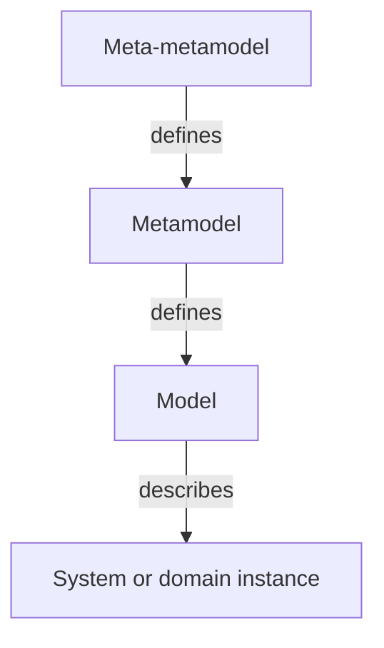
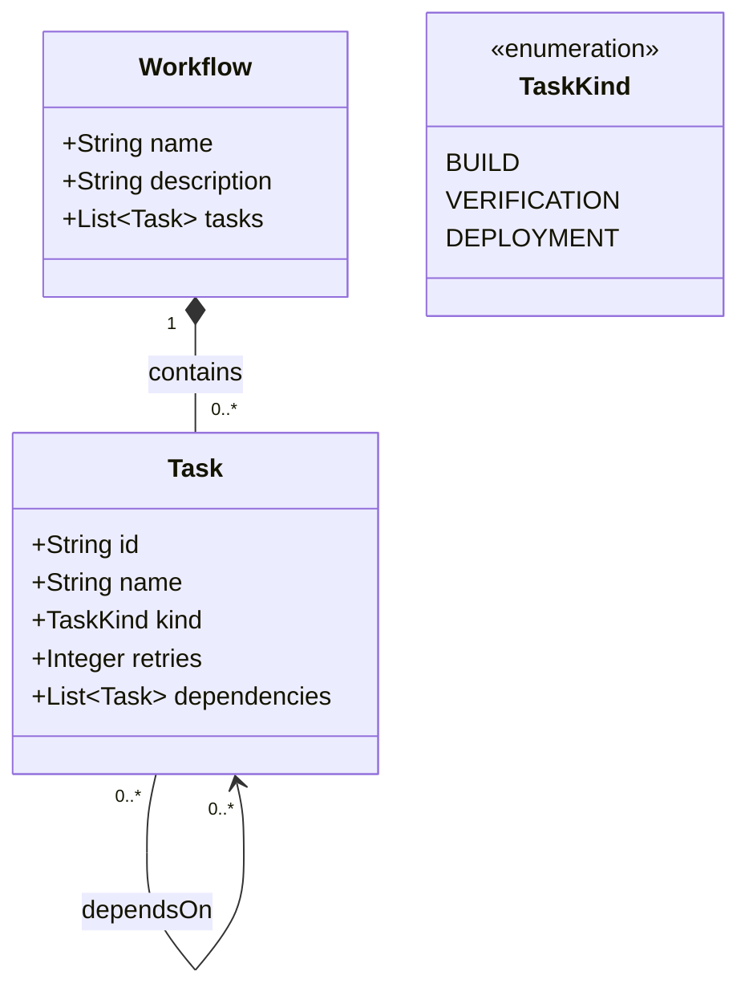
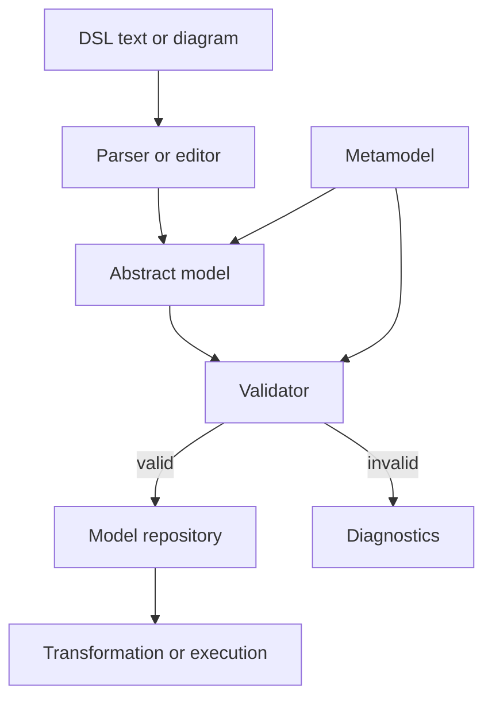
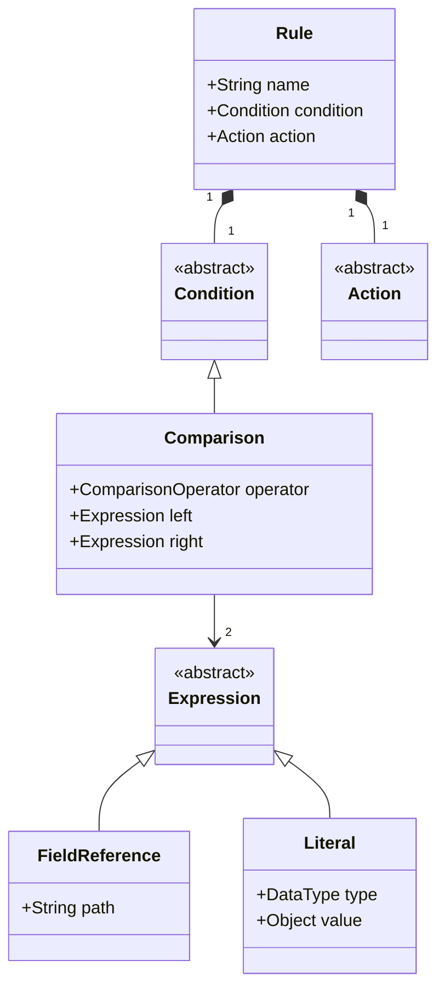

# Metamodel là gì

Trong phát triển ngôn ngữ miền chuyên biệt (Domain-Specific Language, DSL), mô hình trừu tượng mô tả những khái niệm và quan hệ quan trọng của miền. Để xác định mô hình đó được phép chứa những thành phần nào, mỗi thành phần có thuộc tính gì và chúng liên kết với nhau ra sao, ta cần một mô hình mô tả cấu trúc của các mô hình. Mô hình ở cấp độ này được gọi là **metamodel (siêu mô hình)**.

Metamodel định nghĩa ngôn ngữ dùng để tạo ra các mô hình trong một miền hoặc trong một họ ngôn ngữ. Nó quy định những loại phần tử có thể xuất hiện, thuộc tính, quan hệ, bội số, kế thừa và các ràng buộc hợp lệ. Nhờ metamodel, công cụ có thể đọc, kiểm tra, lưu trữ, chỉnh sửa và chuyển đổi mô hình theo cùng một cấu trúc đã được thống nhất.

Ví dụ, nếu DSL dùng để mô tả quy trình xử lý đơn hàng, một mô hình cụ thể có thể khai báo các bước `ReceiveOrder`, `CheckInventory` và `ShipOrder`. Metamodel của DSL định nghĩa khái niệm `Workflow`, `Task`, `Transition`, quan hệ phụ thuộc giữa các tác vụ và quy tắc như mỗi workflow phải có tên. Metamodel không phải một workflow cụ thể; nó là định nghĩa về những gì một workflow hợp lệ có thể chứa.

## 1. Phân biệt model, metamodel và meta-metamodel

Để hiểu metamodel, cần phân biệt ba cấp độ thường gặp trong mô hình hóa.

- **Model (mô hình):** mô tả một hệ thống, quy trình hoặc đối tượng cụ thể bằng các khái niệm đã được định nghĩa. Ví dụ: workflow `daily-order-processing` với ba tác vụ.
- **Metamodel (siêu mô hình):** mô tả các loại phần tử và quy tắc mà một model được phép sử dụng. Ví dụ: định nghĩa `Workflow`, `Task`, `Transition`, thuộc tính và quan hệ của chúng.
- **Meta-metamodel (siêu-siêu mô hình):** định nghĩa các khái niệm và quy tắc dùng để xây dựng metamodel. Ví dụ: các khái niệm tổng quát như `Class`, `Attribute`, `Reference` và `DataType` trong một nền tảng metamodeling.

Có thể hình dung quan hệ này như sau:



Ví dụ trong một DSL quy trình:

| Cấp độ | Ví dụ | Vai trò |
|---|---|---|
| Meta-metamodel | `Class`, `Attribute`, `Reference` | Cung cấp khái niệm để định nghĩa cấu trúc ngôn ngữ |
| Metamodel | `Workflow`, `Task`, `Transition` | Định nghĩa các thành phần hợp lệ của DSL quy trình |
| Model | Workflow `release` gồm `compile`, `test`, `publish` | Mô tả một quy trình cụ thể |
| Hệ thống được mô tả | Quy trình phát hành phần mềm của một dự án | Đối tượng mà model biểu diễn |

Trong nhiều tài liệu, cấp độ được gọi là M0, M1, M2 và M3:

- M0: các đối tượng hoặc hệ thống thực tế.
- M1: model mô tả các đối tượng đó.
- M2: metamodel định nghĩa ngôn ngữ để tạo model.
- M3: meta-metamodel định nghĩa ngôn ngữ để tạo metamodel.

Tên gọi và cách đánh số có thể khác tùy tài liệu, nhưng ý tưởng chính là mỗi cấp độ mô tả cấu trúc của cấp độ bên dưới.

## 2. Metamodel giải quyết vấn đề gì?

Nếu không có metamodel, một DSL có thể được triển khai bằng những cấu trúc dữ liệu tùy ý. Một module có thể dùng trường `steps`, module khác lại dùng `actions`; một công cụ xem `next` là quan hệ duy nhất, công cụ khác cho phép nhiều quan hệ. Khi đó, mô hình khó chia sẻ, khó kiểm tra và khó chuyển đổi.

Metamodel tạo ra một hợp đồng cấu trúc chung. Nó giúp:

- **Chuẩn hóa khái niệm miền:** các nhóm cùng hiểu `Task`, `Workflow`, `Event` hoặc `State` theo một định nghĩa thống nhất.
- **Giới hạn mô hình hợp lệ:** chỉ cho phép các phần tử, thuộc tính và quan hệ đã được công bố.
- **Hỗ trợ kiểm tra tự động:** công cụ có thể xác thực kiểu, bội số, tham chiếu và ràng buộc.
- **Tạo công cụ tổng quát:** editor, validator, serializer hoặc generator có thể hoạt động dựa trên metamodel thay vì viết riêng cho từng model.
- **Hỗ trợ trao đổi dữ liệu:** các công cụ khác nhau có thể hiểu chung một cấu trúc mô hình.
- **Tách mô hình khỏi cách trình bày:** cùng một model có thể được hiển thị bằng sơ đồ, biểu mẫu, văn bản hoặc cấu hình.
- **Quản lý sự phát triển:** thay đổi cấu trúc DSL có thể được ghi nhận và kiểm soát qua phiên bản metamodel.

Metamodel đặc biệt hữu ích khi DSL có nhiều loại phần tử, nhiều công cụ cùng thao tác hoặc mô hình cần được lưu trữ và chuyển đổi lâu dài. Với một cấu hình rất nhỏ, cấu trúc dữ liệu đơn giản có thể đã đủ; việc xây dựng metamodel đầy đủ cần tương xứng với lợi ích nhận được.

## 3. Các thành phần cốt lõi của metamodel

Một metamodel thường gồm các lớp khái niệm, thuộc tính, quan hệ và ràng buộc. Tên cụ thể phụ thuộc vào phương pháp mô hình hóa, nhưng những thành phần sau xuất hiện trong nhiều hệ thống.

### 3.1. Class hoặc metaclass

Class (lớp) định nghĩa một loại phần tử trong model. Trong metamodel, class thường được gọi là metaclass để nhấn mạnh rằng nó mô tả các phần tử của model.

Ví dụ, metamodel của DSL quy trình có thể định nghĩa:

- `Workflow`: một quy trình.
- `Task`: một tác vụ trong quy trình.
- `Transition`: quan hệ chuyển từ tác vụ này sang tác vụ khác.
- `Parameter`: tham số đầu vào của một tác vụ.

Mỗi phần tử cụ thể trong model là một instance của class tương ứng. Chẳng hạn, `compile` là một instance của `Task`.

### 3.2. Attribute

Attribute (thuộc tính) lưu giá trị mô tả một phần tử. Ví dụ, `Task` có thể có `name`, `description`, `timeout` và `enabled`.

Thuộc tính cần có kiểu dữ liệu rõ ràng, chẳng hạn:

- `String` cho tên hoặc mô tả.
- `Integer` cho số lần thử lại.
- `Boolean` cho trạng thái bật/tắt.
- `Duration` cho thời gian chờ.
- `Enumeration` cho tập giá trị hữu hạn như `Manual`, `Automatic` hoặc `Scheduled`.

Metamodel cũng quy định thuộc tính nào bắt buộc, thuộc tính nào có giá trị mặc định và liệu giá trị có thể vắng mặt hay không.

### 3.3. Reference hoặc association

Reference (tham chiếu) biểu diễn quan hệ giữa các phần tử. Ví dụ, `Transition` có thể tham chiếu đến một `sourceTask` và một `targetTask`; `Workflow` có thể chứa nhiều `Task`.

Quan hệ cần xác định hướng, kiểu phần tử đích và bội số. Ví dụ, một `Transition` có đúng một tác vụ nguồn và một tác vụ đích; một `Workflow` có thể có từ không đến nhiều tác vụ.

### 3.4. Containment

Containment (quan hệ chứa) thể hiện quyền sở hữu cấu trúc giữa các phần tử. Nếu `Workflow` chứa `Task`, tác vụ là một phần trong cấu trúc của workflow. Khi xóa workflow, các tác vụ thuộc nó thường cũng bị loại khỏi model chứa đó.

Containment khác với tham chiếu thông thường. Một `Task` có thể tham chiếu đến `Service` dùng chung mà không sở hữu service đó. Quan hệ chứa thường tạo thành một cây cấu trúc, trong khi các tham chiếu thông thường có thể tạo thành đồ thị.

### 3.5. Multiplicity và cardinality

Multiplicity (bội số) quy định số lượng phần tử được phép ở một đầu quan hệ hoặc số lần một thuộc tính có thể xuất hiện. Ví dụ:

- `1`: bắt buộc đúng một.
- `0..1`: tùy chọn, tối đa một.
- `0..*`: không hoặc nhiều.
- `1..*`: ít nhất một.
- `2..5`: từ hai đến năm.

Bội số giúp công cụ phát hiện cấu trúc thiếu hoặc thừa. Nếu một `Transition` bắt buộc có `source` và `target`, model thiếu một trong hai tham chiếu là không hợp lệ.

### 3.6. Inheritance và specialization

Metamodel có thể dùng kế thừa để chia sẻ thuộc tính và quan hệ chung. Ví dụ, `Task` và `EventHandler` có thể cùng kế thừa từ `WorkflowNode`, nơi khai báo `name` và `description`.

Kế thừa giúp giảm lặp, nhưng cần tránh hệ phân cấp quá sâu hoặc quá tổng quát. Nếu hai loại phần tử có ý nghĩa và quy tắc khác nhau, không nên gộp chúng chỉ vì có vài thuộc tính giống nhau.

## 4. Ví dụ metamodel cho DSL quy trình

Giả sử ta muốn xây dựng DSL mô tả quy trình triển khai phần mềm. Model cụ thể có thể là:

```text
workflow "release" {
    task "compile" {
        type = "build"
    }

    task "test" {
        type = "verification"
        depends_on = ["compile"]
    }

    task "publish" {
        type = "deployment"
        depends_on = ["test"]
    }
}
```

Metamodel cần định nghĩa ít nhất các khái niệm sau:



Trong mô hình này:

- `Workflow` có tên và mô tả, đồng thời chứa danh sách tác vụ.
- `Task` có định danh, tên, loại tác vụ và số lần thử lại.
- `TaskKind` giới hạn loại tác vụ vào các giá trị đã định nghĩa.
- `Workflow` chứa không hoặc nhiều `Task`.
- `Task` có thể phụ thuộc vào nhiều tác vụ khác.

Đây là metamodel ở mức khái niệm. Một triển khai thực tế có thể biểu diễn nó bằng UML, Ecore, JSON Schema, class Java hoặc một định dạng mô hình khác. Cách biểu diễn không làm thay đổi vai trò của metamodel: nó định nghĩa cấu trúc mà model cần tuân theo.

## 5. Ràng buộc trong metamodel

Các thuộc tính và quan hệ cơ bản chưa đủ để mô tả mọi quy tắc hợp lệ. Metamodel thường đi kèm constraint (ràng buộc) để giới hạn tổ hợp giá trị và quan hệ.

Ví dụ với DSL quy trình:

- Tên workflow phải duy nhất trong phạm vi dự án.
- Mỗi task phải có định danh không trùng.
- Task không được phụ thuộc vào chính nó.
- Mọi dependency phải trỏ đến task thuộc cùng workflow.
- Đồ thị phụ thuộc không được có chu trình nếu runtime yêu cầu DAG.
- Số lần thử lại phải không âm.
- Một workflow đang hoạt động phải có ít nhất một task.

Có thể phân biệt các nhóm ràng buộc:

| Nhóm | Nội dung | Ví dụ |
|---|---|---|
| Structural constraint | Cấu trúc, kiểu và bội số | `Transition` phải có một `source` và một `target` |
| Value constraint | Miền giá trị của thuộc tính | `retries >= 0` |
| Referential constraint | Tính hợp lệ của tham chiếu | Dependency phải trỏ đến task tồn tại |
| Global constraint | Quy tắc trên nhiều phần tử | Tên task duy nhất trong workflow |
| Behavioral constraint | Điều kiện liên quan đến hành vi | Task chỉ chạy sau khi các dependency hoàn tất |

Ràng buộc có thể được kiểm tra ở nhiều thời điểm. Ràng buộc cấu trúc và kiểu thường được kiểm tra khi model được tạo hoặc nạp. Ràng buộc phụ thuộc dữ liệu bên ngoài, quyền hoặc trạng thái runtime cần được kiểm tra khi thực thi.

### 5.1. Biểu diễn constraint bằng OCL

Object Constraint Language (OCL) là ngôn ngữ dùng để diễn đạt các ràng buộc trên mô hình UML và các mô hình tương tự. OCL cho phép mô tả điều kiện bất biến, điều kiện trước và điều kiện sau mà không phải viết mã thực thi trực tiếp.

Ví dụ minh họa:

```ocl
context Task
inv NonNegativeRetries:
    self.retries >= 0

context Workflow
inv UniqueTaskNames:
    self.tasks->isUnique(t | t.name)
```

Ràng buộc đầu yêu cầu số lần thử lại không âm. Ràng buộc thứ hai yêu cầu tên các tác vụ trong một workflow là duy nhất.

Cú pháp OCL và khả năng thực thi phụ thuộc phiên bản cùng công cụ sử dụng. Ý tưởng quan trọng là constraint có thể được mô tả tách khỏi cấu trúc class để công cụ kiểm tra model theo một bộ quy tắc thống nhất.

## 6. Metamodel và mô hình trừu tượng của DSL

Mô hình trừu tượng (abstract model hoặc abstract syntax) biểu diễn nội dung và cấu trúc có ý nghĩa của chương trình, không phụ thuộc hoàn toàn vào cách viết văn bản hay cách trình bày đồ họa.

Ví dụ, người dùng có thể khai báo task bằng DSL dạng văn bản, chỉnh sửa bằng biểu đồ hoặc tạo bằng API. Cả ba cách có thể tạo cùng một model gồm các instance `Workflow` và `Task` theo metamodel.

Cần phân biệt:

- **Concrete syntax:** cách người dùng nhìn thấy và viết mô hình, như văn bản, sơ đồ hoặc biểu mẫu.
- **Abstract syntax:** cấu trúc khái niệm của mô hình, chẳng hạn class, thuộc tính và quan hệ được metamodel định nghĩa.
- **Semantics:** ý nghĩa và hành vi của mô hình khi được diễn giải hoặc thực thi.

Metamodel chủ yếu định nghĩa abstract syntax. Nó có thể kèm constraint để giới hạn model hợp lệ, nhưng không tự động quy định toàn bộ hành vi runtime. Ngữ nghĩa thực thi thường được định nghĩa bởi interpreter, compiler, transformation hoặc các quy tắc bổ sung.

## 7. Metamodel, UML và MOF

UML (Unified Modeling Language) là ngôn ngữ mô hình hóa tổng quát, trong đó class diagram thường được dùng để mô tả class, thuộc tính, quan hệ và bội số. Một class diagram có thể là cách trực quan để trình bày một phần metamodel.

MOF (Meta-Object Facility) là chuẩn của OMG cung cấp nền tảng để định nghĩa metamodel. Kiến trúc MOF thường được mô tả qua các tầng M0 đến M3. Ecore trong hệ sinh thái Eclipse Modeling Framework (EMF) là một meta-metamodel phổ biến để định nghĩa mô hình và sinh công cụ.

Một số khái niệm thường gặp trong Ecore:

- `EClass`: định nghĩa một loại phần tử.
- `EAttribute`: thuộc tính dữ liệu của một class.
- `EReference`: tham chiếu giữa các class.
- `EDataType`: kiểu dữ liệu như chuỗi, số hoặc kiểu tùy chỉnh.
- `EEnum`: kiểu liệt kê.
- `EPackage`: nhóm và định danh các thành phần metamodel.

Ví dụ, một `EClass` tên `Task` có thể chứa `EAttribute` `name` kiểu `EString`, `retries` kiểu `EInt` và `EReference` `dependencies` trỏ đến `Task` khác với bội số `0..*`.

Không bắt buộc phải dùng UML, MOF hay EMF để xây dựng DSL. Chúng là các chuẩn và công cụ hữu ích khi cần metamodel có cấu trúc, khả năng sinh code hoặc tích hợp với hệ sinh thái mô hình hóa.

## 8. Tạo model từ metamodel

Khi metamodel đã được định nghĩa, model có thể được tạo theo nhiều cách:

1. Người dùng viết tệp DSL bằng concrete syntax.
2. Parser đọc văn bản và tạo cấu trúc trừu tượng.
3. Bộ chuyển đổi ánh xạ cấu trúc cú pháp sang các instance theo metamodel.
4. Validator kiểm tra kiểu, bội số, tham chiếu và constraint.
5. Model hợp lệ được lưu, hiển thị, chuyển đổi hoặc thực thi.

Luồng này có thể biểu diễn như sau:



Metamodel được dùng ở cả bước tạo model và kiểm tra model. Nếu một phần tử không thuộc loại được định nghĩa, thuộc tính sai kiểu hoặc quan hệ vượt bội số, validator có thể báo lỗi trước khi model được thực thi.

## 9. Metamodel và công cụ DSL

Metamodel có thể là nền tảng cho nhiều công cụ phát triển DSL.

### 9.1. Editor và autocomplete

Nếu editor biết metamodel, nó có thể gợi ý những loại phần tử được phép tại vị trí hiện tại, các thuộc tính của một class, giá trị enum và các phần tử có thể được tham chiếu. Ví dụ, trong thuộc tính `depends_on`, editor chỉ nên gợi ý các task có thể tham chiếu trong workflow hiện tại.

### 9.2. Validation

Validator có thể kiểm tra các ràng buộc structural, kiểu, bội số và constraint tùy chỉnh. Thông báo lỗi có thể gắn với đúng phần tử hoặc thuộc tính trong model.

### 9.3. Serialization và persistence

Metamodel cho biết cách biểu diễn các phần tử và quan hệ khi lưu ra tệp hoặc cơ sở dữ liệu. Serializer cần bảo toàn định danh, tham chiếu và cấu trúc chứa để model sau khi nạp lại vẫn giữ cùng ý nghĩa.

### 9.4. Model transformation và code generation

Một model hợp lệ có thể được chuyển thành model ở metamodel khác hoặc sinh mã cho nền tảng đích. Ví dụ, workflow model có thể được chuyển thành cấu hình cho một bộ điều phối tác vụ. Metamodel giúp transformation biết các loại phần tử và quan hệ nào cần xử lý.

### 9.5. Nhiều concrete syntax

Cùng một metamodel có thể có editor dạng biểu mẫu, sơ đồ và văn bản. Người dùng chọn cách tương tác phù hợp; các công cụ vẫn làm việc trên cùng abstract model. Điều này giảm nguy cơ mỗi giao diện tạo ra một định dạng dữ liệu khác nhau.

## 10. Metamodel trong thiết kế DSL: quy trình xây dựng

Một quy trình thực tế có thể bắt đầu từ miền và dần hình thành metamodel:

1. **Khảo sát miền:** xác định người dùng, nhiệm vụ, khái niệm và quy tắc thường gặp.
2. **Xác định khái niệm cốt lõi:** chọn các loại phần tử có ý nghĩa riêng, chẳng hạn workflow, task, event hoặc resource.
3. **Xác định thuộc tính:** liệt kê dữ liệu cần thiết và kiểu phù hợp.
4. **Xác định quan hệ:** mô tả tham chiếu, containment, hướng và bội số.
5. **Tổ chức kế thừa:** dùng lớp cha khi các loại phần tử thật sự chia sẻ khái niệm và hành vi.
6. **Định nghĩa constraint:** mô tả bất biến, tính duy nhất, miền giá trị và quy tắc liên kết.
7. **Xác định abstract syntax:** bảo đảm cấu trúc độc lập tương đối với cách viết hoặc hiển thị.
8. **Chọn concrete syntax:** thiết kế văn bản, sơ đồ hoặc API để người dùng tạo model.
9. **Xây validator và công cụ:** cung cấp kiểm tra, thông báo lỗi và hỗ trợ chỉnh sửa.
10. **Kiểm thử bằng model thực tế:** dùng ví dụ đại diện và trường hợp biên để đánh giá metamodel.

Không nên bắt đầu bằng việc tạo thật nhiều class. Hãy bắt đầu từ các khái niệm mà người dùng miền thực sự cần thao tác, sau đó chỉ thêm cấu trúc khi có yêu cầu rõ ràng.

## 11. Đánh đổi khi thiết kế metamodel

Metamodel quá đơn giản có thể không biểu diễn được các trường hợp thực tế. Metamodel quá phức tạp lại khiến người dùng phải học nhiều khái niệm, validator khó xây dựng và các công cụ trở nên nặng nề.

Một số quyết định cần cân nhắc:

- **Class hay attribute:** nếu một khái niệm có định danh, vòng đời hoặc quan hệ riêng, nó có thể cần class; nếu chỉ là một giá trị đơn giản, attribute thường đủ.
- **Containment hay reference:** dùng containment khi phần tử thuộc cấu trúc và vòng đời của phần tử cha; dùng reference khi chỉ cần liên kết đến phần tử khác.
- **Kế thừa hay composition:** kế thừa chia sẻ đặc điểm chung, composition xây cấu trúc từ các thành phần. Không nên dùng kế thừa chỉ để tái sử dụng vài trường dữ liệu.
- **Constraint tĩnh hay quy tắc runtime:** đưa vào metamodel những gì có thể xác nhận từ model; kiểm tra dữ liệu bên ngoài và quyền ở thời điểm thực thi.
- **Mức độ mở rộng:** quyết định metamodel có cho phép plugin thêm loại phần tử hay phải giữ tập class cố định.
- **Tính tương thích:** thay đổi metamodel có thể làm model cũ không còn hợp lệ hoặc mất thông tin khi chuyển đổi.

Một metamodel tốt vừa đủ để diễn đạt miền, nhưng không áp đặt các chi tiết triển khai không cần thiết. Nó cần được đánh giá qua các model thật, không chỉ qua sơ đồ class đẹp mắt.

## 12. Quản lý phiên bản và tiến hóa metamodel

Khi DSL được sử dụng lâu dài, metamodel sẽ thay đổi: thêm thuộc tính, đổi tên class, tách một loại phần tử hoặc điều chỉnh bội số. Những thay đổi này có thể ảnh hưởng đến model đã lưu, parser, editor, validator, serializer và code generator.

Một số loại thay đổi:

- **Thêm thuộc tính tùy chọn:** thường dễ tương thích nếu có giá trị mặc định hợp lý.
- **Thêm thuộc tính bắt buộc:** model cũ có thể thiếu dữ liệu và cần migration.
- **Đổi tên thuộc tính hoặc class:** serializer và công cụ cần biết cách ánh xạ tên cũ sang tên mới.
- **Thay đổi bội số:** có thể khiến model cũ không còn hợp lệ.
- **Thay đổi kiểu:** cần chuyển đổi dữ liệu và kiểm tra mất mát thông tin.
- **Thay đổi constraint:** model trước đây hợp lệ có thể bị từ chối theo chính sách mới.

Nên gắn định danh và phiên bản cho metamodel, ghi lại lịch sử thay đổi và cung cấp migration khi cần. Khi nạp model cũ, hệ thống có thể nhận biết phiên bản nguồn, chuyển đổi sang cấu trúc mới rồi chạy validator. Không nên âm thầm bỏ trường hoặc thay đổi ý nghĩa thuộc tính mà không có quy tắc chuyển đổi.

## 13. Các lỗi thiết kế metamodel thường gặp

- **Mô hình hóa quá nhiều chi tiết kỹ thuật:** đưa tên bảng, cấu trúc JSON nội bộ hoặc tên class runtime vào metamodel dù người dùng miền không cần biết.
- **Dùng chuỗi cho mọi thứ:** trạng thái, loại tài nguyên và kiểu hành động đều là `String`, khiến validator khó phát hiện giá trị không hợp lệ.
- **Không xác định bội số:** không rõ quan hệ là bắt buộc, tùy chọn hay có nhiều phần tử.
- **Nhầm containment với reference:** làm vòng đời và cách lưu trữ phần tử không rõ ràng.
- **Thiếu constraint:** model có thể đúng cấu trúc nhưng vi phạm các quy tắc cơ bản của miền.
- **Kế thừa quá sâu:** khó hiểu loại phần tử thực sự và làm thay đổi một class ảnh hưởng nhiều tầng.
- **Trộn abstract syntax với concrete syntax:** mô hình phụ thuộc vào cách trình bày, khiến việc thêm editor hoặc định dạng mới khó khăn.
- **Không có chiến lược phiên bản:** model cũ mất khả năng nạp khi metamodel thay đổi.

Những lỗi này thường xuất hiện khi thiết kế metamodel chỉ dựa trên cấu trúc dữ liệu hiện có mà chưa phân tích cách người dùng suy nghĩ về miền. Việc trao đổi với chuyên gia miền và thử nghiệm bằng model thực tế giúp phát hiện sớm.

## 14. Ví dụ tổng hợp: metamodel cho DSL quy tắc

Giả sử cần tạo DSL để mô tả các quy tắc phê duyệt đơn hàng. Một model cụ thể:

```text
rule "large-order-approval" {
    when order.total >= 5000000 VND
    then requireApproval("manager")
}
```

Metamodel có thể gồm:

- `Rule`: có `name`, `condition` và `action`.
- `Condition`: biểu diễn điều kiện cần đánh giá.
- `Comparison`: gồm toán hạng trái, toán tử và toán hạng phải.
- `FieldReference`: tham chiếu đến thuộc tính của đối tượng miền.
- `Literal`: giá trị hằng có kiểu.
- `Action`: hành động được yêu cầu khi điều kiện đúng.

Quan hệ có thể được mô tả:



Metamodel này định nghĩa cấu trúc trừu tượng của rule. Parser có thể chuyển cú pháp `order.total >= 5000000 VND` thành một `Comparison`, với `FieldReference` ở vế trái và `Literal` kiểu tiền tệ ở vế phải. Validator kiểm tra hai vế có thể so sánh, loại tiền tương thích và action `requireApproval` có được phép trong ngữ cảnh rule hay không.

Nếu sau này muốn thêm biểu thức `and`, `or` hoặc `not`, metamodel có thể thêm các loại `LogicalExpression` tương ứng. Editor và code generator dựa trên metamodel có thể được mở rộng để hỗ trợ các loại biểu thức mới.

## 15. Khi nào cần metamodel?

Metamodel phù hợp khi DSL cần cấu trúc rõ, nhiều loại phần tử, nhiều quan hệ hoặc nhiều công cụ cùng làm việc trên mô hình. Nó đặc biệt hữu ích khi model được lưu trữ, trao đổi, kiểm tra, chuyển đổi hoặc sinh mã qua nhiều bước.

| Nhu cầu | Có nên đầu tư metamodel? |
|---|---|
| Một tệp cấu hình nhỏ với vài trường cố định | Có thể chỉ cần schema đơn giản |
| DSL có nhiều loại phần tử và quan hệ | Metamodel giúp chuẩn hóa cấu trúc |
| Nhiều editor hoặc giao diện cùng tạo model | Metamodel chung rất hữu ích |
| Cần validator và code generator tổng quát | Metamodel tạo nền tảng tốt |
| Mô hình cần lưu lâu dài và có phiên bản | Metamodel giúp quản lý tiến hóa |
| Một đoạn script nhỏ chỉ chạy một lần | Metamodel đầy đủ có thể không cần thiết |

Không phải mọi DSL đều cần một hệ thống metamodeling lớn. Có thể bắt đầu bằng các class hoặc schema có cấu trúc, sau đó phát triển thành metamodel đầy đủ khi nhu cầu kiểm tra, trao đổi và sinh công cụ tăng lên.

Metamodel là mô hình mô tả cấu trúc và quy tắc của các model trong một ngôn ngữ. Nó định nghĩa những khái niệm, thuộc tính, quan hệ, bội số và constraint mà model hợp lệ cần tuân theo. Khi được thiết kế dựa trên miền thực tế và tách biệt khỏi cách trình bày, metamodel trở thành nền tảng chung cho parser, editor, validator, serializer, transformation và code generation, giúp DSL nhất quán và có thể phát triển lâu dài.
